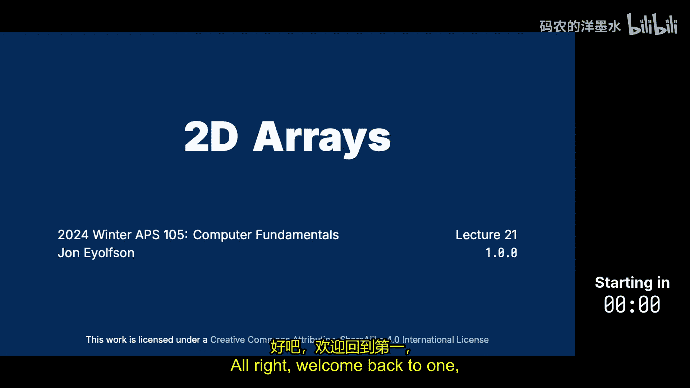
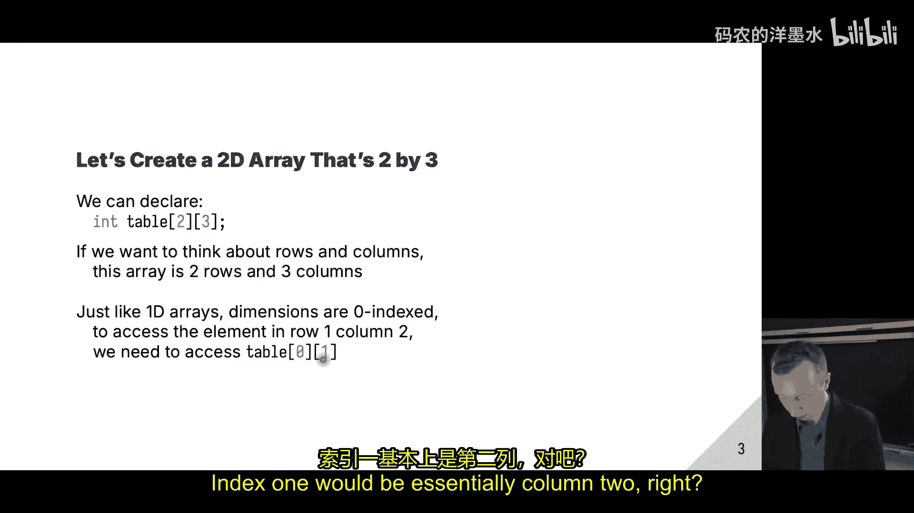
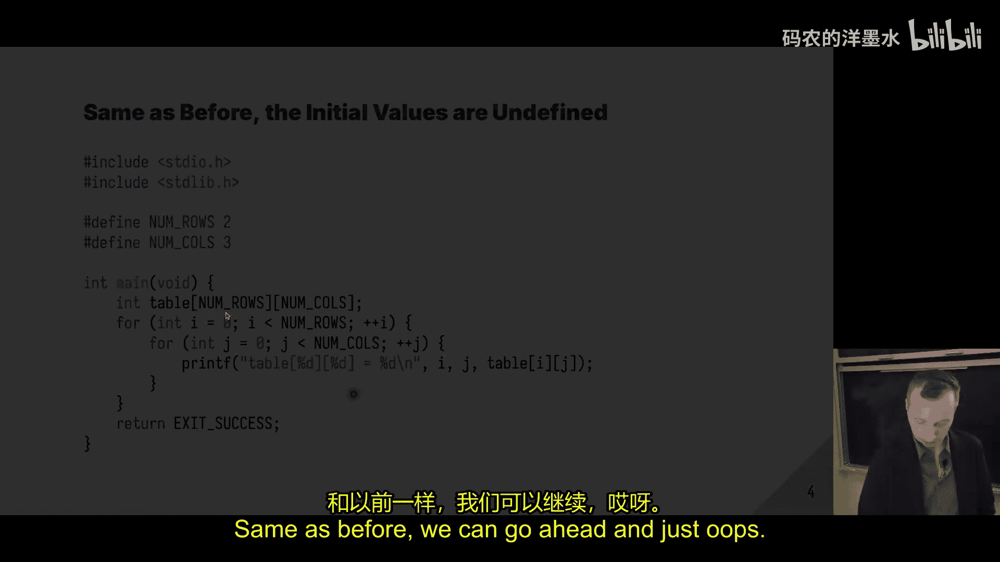
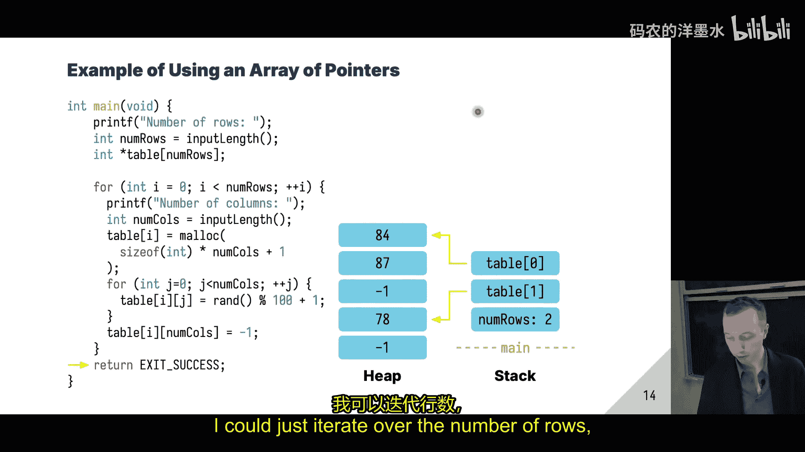
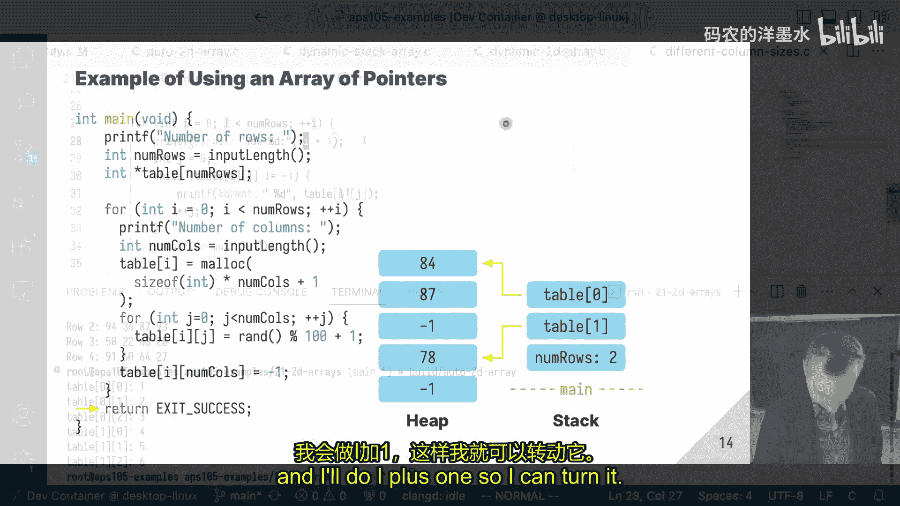
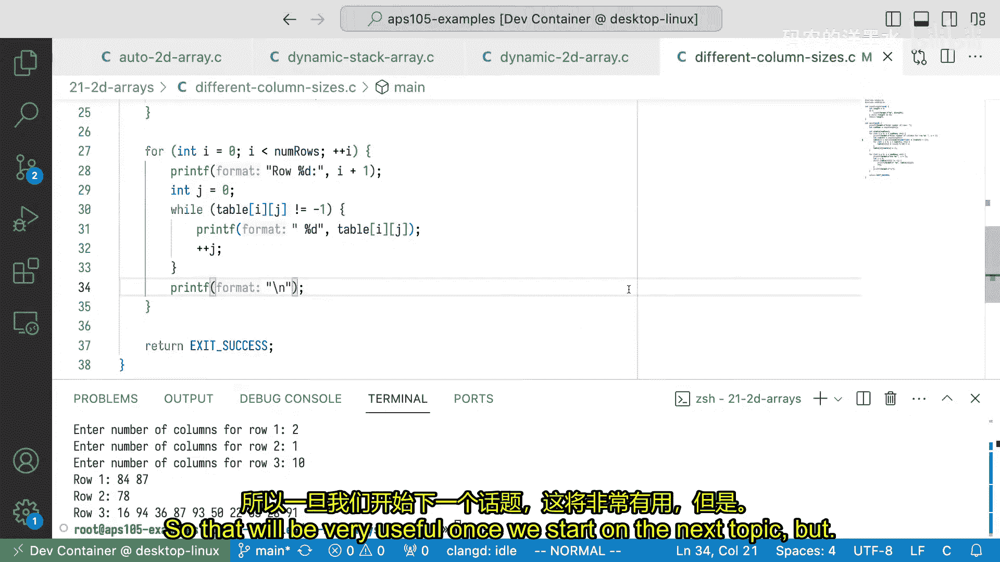
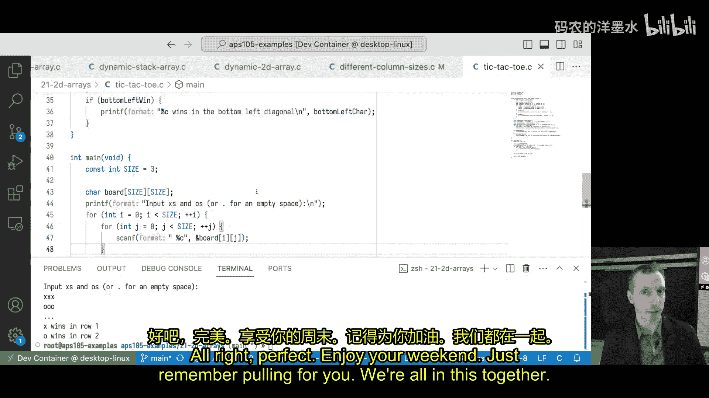

# 【全集】多伦多大学 C语言编程 中英字幕 1080P p21 Lecture 21 - 二维数组 -BV1gikKB3EZW_p21-

。

Alright， welcome back to 1，0，5。 So we're doing 2 D arrays today。 So after today's lecture。

 you can actually do lab 6。 So after this， you should be able to actually。😊。

Know everything you need to know for lab 6。 So let's get into it。

So previously we had 1D arrays they were okay right so to declare it it was just some type。

 some name and then in squared brackets and array size whenever we wanted to declare it and then optionally we could go ahead。

 give it some values you know we know what types are now we can just name it whatever we want give it an array size that would be one or anything greater than that and then some values and then we saw we could you know optionally just omit the array size。

 we had that fun little macro that could figure out the array size for us so a questions about the first array before we get into more fun arrays。

So。Two D arrays， as you might imagine， iss just another set of square brackets。

So syntax looks almost exactly the same。 So there's a type what each element should be。

 you give it a name。 And now instead of having one dimension， wow， it has two dimensions。

 So they can be different sizes。 So there's the first size and the second size。

 So every all the rules aside are the exact same。 So the type again。

 type of each element name we can name it whatever we want。

 And then the first size is the number of arrays you want in the next dimension or you can think of it as the number of rows if they're just 2D arrays。

 And then the second size is just by the number of elements in each of these smaller arrays。

 So we could say it's like multiplication right。 So we could say we have。Two arrays of size 3。So。

We can just create an array thats。2 by three， so we can declare。In table， let's just call it a table。

 assume it has a row a column。 We can say it has， in this case， two rows and then three columns。

 So just like wheny arrays arrays， all the dimensions are0 indexed。

 So if I want to access the element in row 1 as a human column 2 as I understand it。 Well。

 that would translate to index 0 since0 is the first index。 And then that would be our row。

 And then our column would be one， which would correspond to。Index 1 would be essentially column 2。

 right？

So。Same as before， we can go ahead and just oops。

We can go ahead and we can just create them。 So before when we created an array like this and then we tried to print all the values。

 they were just garbage in this case， same thing。 They're just garbage。

 So if we compile and we run this。We see that。We iterate over every single index。 So tables。

 So there's going to be two rows。 So this is the first row。 It has three elements in the row。

 and it's just full of absolute nonsense。Then next one also has some nonsense in it。

 although some of the numbers seem to actually repeat。 But that was just luck。 So a。

 questions about this。 So far， nothing really new， right。Trust me， it'll get weirder at the end。So。

Nothing new here。If we want same stories before， we can assign values to elements if we want in the declaration。

 but the only difference here is we do an inner set of curly brackets for each row。 So in this case。

 I can have one set of curly brackets around the entire thing。 So that is my entire 2D array。

 And then each of these inner brackets here are all of the elements in that row。

 So in this case I would say row 1 has the elements 12，3。 and then row 2 has the elements 4，5，6。 so。

First set curly brackets for the entire array， and then the next set for a row。

 And then that looks like， you know， one of the single arrays we had before。

 So we can go ahead and do that。So we would just say equal new set of curly brackets and one， two。

 three。Then we go with4， five， six， and then boom， we initialized everything right。

 so if we compile this。And then， we run it。We see that， hey guess what， they're all initialized。

 they're all initialized in the order we did them， so this was row1， column1， then column 2。

 then column 3。 so same thing here they all nicely match up。So questions about that。All right。

 nothing that's good。 It means we know arrays。 and this isn't actually that surprising。So。Also， just。

Like I had there in that example， well table at index 1 or 0。

1 would be equal to2 because that's this element right here。So if we wanted to。It gets a bit ugly。

 but we could actually just initialize our 2D array just with one set of curly brackets。

 And that also seems to work。 whoops，1，1。 So if we go ahead and we just do something like。

Let me do this to do。So if we do something like this。

 C wants to complain at us a little bit that we're missing braces。 and it's telling us， hey。

 you should put them around every row。 But turns out that， well。

 just a warning so we can go ahead run it。 And we see we get the exact same thing。

 So it still seems to work。 Those braces seem to be optional。

But why does it actually work so it only works because arrays are stored in memory in something called row major order。

 so they are stored similar tos it'll just be elements beside each other。

 but in this case we're going to store all the elements of a row beside each other in memory and then we'll go to the next row or the all beside each other and this 2D array will be just one big contiguous array。

 so essentially the same thing as just having in this case an array that has six elements in it。

So if we really wanted to， in this case， we could represent the 2D array using a plane 1 D array。

 So instead of having just like。Instead， we could have an it array called table。

 And then whenever we index the elements， we can just do something like this， right。

 We take the row row index times it by the number of columns and then add the column index。

 and luckily， because everything is base 0， this actually works。 So if we take， in this case。

 the row。Being 0 and the column being 0， if we do that calculation， we get index0。

 If we take the row0 and then column1， then you know0 times whatever is0 plus column so we'd get0，1。

2，3 as the indexes and then similarly for the next row。

 Well it would be one times the number of columns， which is three， So plus 0 so we would just get3。

 and we get4 and then6 or sorry， four then5。 So everything pretty much translates。

So this is why we call them row major order， because while everything in the same row are beside each other in memory。

 we could have just done this calculation ourselves。 We could。

 We could have used pointer arithmetic if we really wanted to， all means the same thing。

 So any questions about that。Alright， perfect。 So if I want to do pointer arithmetic。

 if I take the address of you know， the element at I J。

 it's also the same as doing that same pointer arithmetic I did。 So table。

 which is a pointer plus and then this is just going to be an integer。

 So I times the number of columns plus J， so it'll move me that many elements。

 So if it was I equal to1 J equal to2。😊，Then， I would。Take that。Table array and then move it forward。

5 characters。 And， you know， I would get this element。 So we're good。 Pointer arithmetic。 Still。

 Everyone loves pointer arithmetic。😊，So why we're doing this and see， I guess。So。Similarly。

 for 1 D arrays， we can just let C determine the number of rows。

 but we can't leave out both of the indices here， so I can't do something like this and say， hey。

 C figure out the number of rows and columns I have because thered be no way to tell what the hell I actually meant。

 So if I just have six numbers in a row Well I could have two rows and three columns。

 I could have three rows and two columns。 I could have one row and six columns。

 I could have six rows and one column so。C actually needs to know the number of columns to calculate the number of rows。

 And more importantly， it doesn't really care about the number of columns you have。

 C just needs to be able to do this calculation itself。

 So it needs to know the number of columns because it needs to know how much to skip to get to the next array。

 essentially。So we can leave out the first dimension only and C can figure it out。

 So if we tell it that， hey， I have three columns and then you figure out how many rows I have。

 it can do that because that actually has a solution if I have just six elements here。 Well。

 then it would know that I have actually。Two rows。So this applies for any number。

 I could have a three dimensional array， a four dimensional array， so on and so forth。 All I can。

 the only thing I'm allowed to do is drop the first dimension。

 and then I have to specify the rest of them。 So questions about， yep。バけオがめト。

So I can only emit the first dimension because like C needs to know this calculation and the number of rows。

Doesn't factor in here， right？ So I don't actually need a number of rows。

 C can figure it out similarly to like just that one array。

 And I can use something like that a size macro。 And using the size。

 I can figure out how many rows it has in this case。

 But I need to at least know the number of columns past that。 It doesn't really care， right。But。

All right。So。Other things we can do。 So let's go back to the code example。

So if I want to go back and say I specify。Something like this where。Alright。

 so I have this where I actually define everything and。When I define everything， well。

 maybe since I give it the number of rows and the number of columns。

 another thing I could do is something like this。So， I have。Here。

 I know I have two rows and three columns， but I give it two rows and then only give it two columns。

 Well， the C rule is。You might think that， hey， maybe this value that I didn't give it is undefined or something like that。

 I might get some garbage， but C has special rules where if you give it any number of elements here and it's a known size。

 So C knows that it is a2 by 3， and there should be three columns in a row。

 it will go ahead and it will fill it by zeros。 So if I run this。

 I'll see that it just filled in the missing element of each row， with a0。

 So it will do this even if I only give it one element， if I do something like that。

 the first row would be just one0，0。So I'd get 1，00， and C will do that even with 1 d arrays。

 if I like actually give it the dimension of D array and then an initializer list。

 if it's smaller than the actual array， it will go ahead and fill it with zeros for us。So。

Questions about that。 And yeah， if I remove the other braces， will I get or。Oh。

 if I just completely remove the braces。So yeah，'ve got question is if I just do this。What happens？

 So if I just do this， it would likely just fill up the first row。

 So it just fills up the first row and then fills the rest of it with zeros。Let， go back。All right。

 questions about that。Just more silly rules that may or may not be useful for us。

 but we should know what they actually are。So。Like I said， same， same idea for plane arrays。

 if I initialize at least one value and I say if I declare it with a known size。

 it will go ahead and just fill up the rest of it with zeros for us。

 Sometimes that actually proves to be useful。So other things。

 So remember one of the rules I said before were was like。

 if I have an array and I don't know the size at runtime。

 I have to go ahead and malloc it and get the space for it on the heap。 Well。

 if you don't have a ancient version of C， which I guess was recently upgraded here。

 but this has been around for like 20 years。You don't actually have to use mallocc for some arrays。

So I can actually do something like this。Where I just ask the user for the length of the array and say I just prompt them to enter some number that is greater than zero。

 and then I can just go ahead and declare an array using that array length and C will go ahead and get memory for us but。

Since we're not using malloc， that will be on the stack。

 So it has the same limitations as when we had。Trying to return like a memory address before in a function。

 So we can't like return an address to array outside of this function or use anything。 In this case。

 it's in main。 so it doesn't matter， but that rule still applies， but。In some cases。

 if you don't know the length of the array， you can go ahead and you can do this if you want。

 as long as you have a C compiler that is newer than the 90s， which is。Still older than all of you。

 So as long as the C compiler is。Your age or younger， then you should be good。

 And then we can go ahead。 We can use it。 We can like randomize array。 We can go ahead。

 We can just fill it in with random values。 We can do whatever we want。

So questions about that perfectly legal to do。 We can do that。 just changes where things are。Alright。

 other fun things to do。 So， yeah， all the rules for the arrays apply。 So if I wanted to。Oops。

I could do something like this where I can have a dynamic 2D array。

 So I could say enter the number of rows， enter the number of columns。 The only rule is。

 if I dynamically allocate an array， I can't assign values for it like here。

Because when I compile my code， C has no idea to know how big it is if it can even hold dis many values or anything like that。

 So the only rule is I cannot initialize it with anything。

 but I can declare a 2D array using those two variables， and then I can go ahead。

 I can call like randomized table on it。And that will fill it with a bunch of random values。

 And then I can just output all of the values I want to。

 So I just iterate over them and print everything。 So if I go ahead and run this。I can see。

 let's enter a number of rows。 I don't know。 Let's do a4 by4。 and it can go ahead。

 It can generate it for me。Yeahay。But not terribly exciting yet， right， but kind of looks like lab 6。

 So lab 6 will， you're given like。呃。You're given something like this。To use and you just go ahead。

 use that to get your 2D array， and then you can use it in every other function。

And the only other rule is with the functions。Well， in the function declarations， I can't just say。

 hey， you know。Just use。I can't do something like。This。Because again。

 C needs to know at least the number of columns。 The only thing I can min is the first dimension。

 but I can do it dynamically so I can do something like this。

But the only rule for this is this variable name here has to come before I actually use it in the function declaration because if I do something like this。

If I do whoops， not numb calls。 If I do something like this， then I get use of undeclared identifier。

 It does not exist yet。 It has to come before I actually use it。

 So I just have to do something like this in numb calls。And then sees happy。

 It knows the number of columns in my 2D array。And everything is fun。Alright， other things I can do。

 Other rules still apply。 So if I do something like this， where I just。In my array。

 I just admit the first parameter。 So I let C figure out the number of rows。 Well。

 if I had that array length macro like I had before。

 I can just have C figure out the number of rows for me。 So I can just ask， okay， well。

 what is the length of or Yeah， was the of this array。 And it will fill in this dimension for me。

 So I would get two rows。 and if I run this， it will also work。

 it will just show me every element of the table again。 nothing terribly surprising right。Alright。

 any questions before we get into the weird part where I spent like a whole day trying to craft this animation so you can actually understand it。

Allright， good。 So now it's going to get slightly strange。 So just to recap。If I。That is a mouse。

 all right， so just to recap。If I want to use dynamic lengths in like function arguments where if I have a 2D array。

 I need the number of columns。 Well， the number， the variable has to be come before we actually use it。

 So it has to come before the array itself。 in lab 6。

 you're already given arguments that that's true for。 So you don't really have to do anything。

 but that's just to explain why they are written the way they are written。 So just to recap。

 you can't write this because numb calls comes first。 if I really wanted to。

 I could fill in the number of rows I want。 but it's not really going to do anything for us。

 It's just more typing， Don't actually have to do it。Alright， so for 2D arrays。

 all columns need to be the same length。But maybe you want your combs to be different sizes。

 So since each comb is a different size， well。I can't use like a real 2D array because I don't know how big a column is。

 and I need memory for it。What I have to do is I need to use malloc and have a slightly different approach。

 so that slightly different approach， which is going to be the entire example for most of the class unless I have time for another fun thing we can do is we have to create an array of pointers and then in that array of pointers。

 each pointer is itself an array。So the idea behind that。Before。When I used malloc to get an array。

 right， I just malloced some I could just malloc some space。

 So I did like the size of an int times how many things I want。 I got back a big block of memory。

 And then I treated that as an array。 So that was essentially like one row。

 So now the only thing that's going to be different is instead of having essentially one row。

 I will have multiple。 So that means I need multiple pointers。So I have one pointer for each row。

 and then I mall each row individually， and then I can go ahead and actually access all the elements in the row through that pointer so each column essentially or each row gets malloced。

So that is a typo there that should say each row gets malllocked。So here is that whole example。

 so this will actually let you input the number of rows and then for each row you get to input a different number of columns you can have as many as you want and then like the midterm in order to know that you are done with the column it will put a negative one at the end so it's going to declare one more integer than we actually need。

 so it can go ahead and stick a minus1 at the end。After that。

 it's just going to fill it with random values between 1 and 100。So let us break this down。

 And again， please stop me and ask any questions if this doesn't make sense。

 This is the thing that took me literal hours， so。We would execute this。 starts executing at main。

 We ask for the number of rows。 that just outputs to the user。 Then we say input the number of rows。

 And this is that function I had before that will just ask you over and over again。

 until you input something that is greater than 0。 So let's say I input the number of rows。

 And I say it's 2。 So I would have a variable on my stack called nu rows。 It's an integer。

 It's value is 2。Good。Alright， now we take our first weird turn。 So before we had like an int array。

 nu rows。 So that would declare that many integers。 instead of integers Now。

 I'm declaring that many pointers to integers。 So I'm declaring an array。

 So this is an array called table。 It's going to have two elements。

 And then each element is going to be a pointer to an integer。So after this， because I did it。

On the stack， I would have essentially two pointers here。 I don't know what their values are。

 but I have two。1 would be at index 1 or 0。 Don't know its value。 The other would be index 1。

 Don't know its value。 They are both int pointers， right。Okay。

 so now we go into the for loop  for in I equals 0。

 So we would create a new variable called I and then check is0 less than nu rows。 Well， it is not。

 So we go into the body of the loop with I equal to 0。Then print F number of columns。

 We would see something that says actually gets our input。

 So let's say the number of columns I input for the sake of making this slide in my sandy。

 I just input2。So I input two columns， okay。So I need two columns for this row。 So I need to malloc。

I'm going to store integers。 So it is the size of an integer times the number of columns。

 because I need one number for each column。 And then I'm going to add one to that。

 So I would add one to that。 I should have brackets around that in the slide。

 Turn out it actually work still。 But I should actually have brackets here because it would be like four times。

Oh yeah， finding bugs life。 So this would be  four times 2， which would be 8 plus 1。

 which would be 9 B when I actually need 12 B for three things。

 So should have put a set of brackets around here。 Allright， sees fun。 But after this malloc。

 as long as I write it correctly， I should get back 12 B that I can use for three integers。😊。

So that would be on the heap and I don't know what the value is， and malloc returns me a pointer。

 so I get a pointer to the starting address of this block of memory。

 which I'm going to treat as an array。 and in this case， all my boxes here are going to be integers。

 So I have three integers don't know the values。Everyone， good。 still good。All right。

Then I have my loop， my inner loop here。 So for I or j equal to 0。

 So I'm going to iterate over every single column and generate a number。 So for this， well。

 J equals 0。 So 0 is less than nu columns。 So I have a variable called J。 It is equal to 0。

 And then here。Well， the value I'm accessing is table。I， so I is currently 0。

 So that means I'm using this pointer， right？ So table 0 here or table I in this case is this pointer。

 So that will get me accessing this。Location here。 And then this is just pointer arithmetic。

 So I access that pointer。 and then I'm treating it as an array。 In this case， J is equal to 0。

 So that would be this element right here。 right， And then I generate a random number。In this case。

 it would be 84， probably。Good so far。So， I go。Increment J， increment J to1， check。

 Oh is one less than2。 Sure it is。 So I'll show that my J has been updated to one。

 Then here I'm accessing table I。 So yeah， table I， which is 0。 So that is this pointer right here。

 and then I'm doing some pointer arithmetic or I'm accessing element。In this case， J equals to1。

 So it would be this element right here。 I set it to some random value， probably 87。Go back up。

 J increments to 2。2 is not less than 2。 So we are done this for loop。 So J goes out of scope。

 It disappears。Tying together everything， right， So questions so far， where we were at with that。

Alright， so now we got table I。 So I is still 0。 So it's this。

 And then we're accessing index nu calls， which is equal to 2。 So that would be 0，1，2。

 It would be this one， we set it equal to negative 1。 And whenever we use this array。

 we can just go ahead and。Go over all the values until we hit a negative one。

 And then we know we're done。So now we're done that iteration of the loop。 We can go back up。

 We would increment I from 0 to 1。 then check， oh， is I less than nu rows。 Oh， well， nu rows is 2。

 So one is less than 2。 So we go in here。 We ask again the number of columns。

Ask the user to input the length。 In this case， I will save myself some writing and just input nu calls equal to one。

 And then here we do malloc again。 So we would malloc。In this case， nu causes one plus 1。

 So two integers。 and then。After malloc， we get a pointer back that points to somewhere in the heap that has some new memory for two integers。

 So it looks like this。Now in this loop， we're starting again， so we declare a new J， j is equal to0。

0 is less than nu calls。 So we go into here。 We're accessing table I。 Now table I is one。

 which is just this pointer， and then we access element J， which is 0。

 which is this element right here。 and we assign it some random value in this case， probably 78。

 Then we increment J J is now1。1 is not less than1。 So we are done this loop， and then here。

We access table I， which is one。 So table1。 So we're using this pointer。

 and then we access element nu calls， which is equal to1。 So that would be 0，1。 It would be this。

 And we said it equal to negative1。All right。 So questions about that。

So this isn't like a true 2D array。 This is an array of pointers。

 And then each of those pointers is an array。O。Yeah。If you want to row one， column two。

 how would you call？So in this， if you want row 1， column 2。So like row 1。

 column 2 in human parlance， and human speak。As like政。So if we access like row 1。

 which would be index 0 and then。Column 1。Which would be index 2。 Well。

 we can still use this this with like two indexes， right， So if I use table 1 or table 0。

 that would be this pointer， right， And then using that pointer。If I just indexed a one into it。

 it would be 0，1。 It would be this，87。Yeah。Yet。Yeah， tableable square bracket 0 is just a pointer。

 but remember。Like array decay， a raisezor just a pointer。哦。そをするせ労し。Yeah， so。

 so it's table square bracket 0 plus one if we did pointer arithmetic。 But remember。

 instead of doing point arithmetic。Because we would have to do point arithmetic and then dereence it。

 we could just do the square brackets and do it all in one step。Right。So if I write that out。

 it looks exactly the same。 I'd access tables square bracket，0， square bracket 1。そ天。Yeah， yeah。

 still， still the same syntax for this。 But this one works slightly different， right。

 for a true 2D array， it would just calculate what index it needs directly because every columns the same size for this。

 it's a bit more indirect。 It has to find which pointer to use like which pointer to use for the array。

 And then using that， it looks it up in the second array。

 So this uses like essentially two separate arrays and a true 2D array just uses like。

It just lays it out in memory altogether together because everything's the same size， it can do that。

小さハウス。2D。Yeah， so this will work because array our pointers， right？And C。

 will know based off like the type I give a name。 So like I have to say， in this case。

Table is array of pointers in this case， but if I said it was you know。

 like the 2D array we had before， See will know like， oh。

 that's a 2D array and the number of columns is constant so I don't have to do any weird pointer math。

 I can just figure it out because I know it order it in。Right。All right， any other questions？Alright。

 this。Is。Oh， other question did the are table 0 and table 1 elements actually contiguous in the heap。

 So these， oh， these elements on the heap no， they will not be because。This is a result of a malloc。

 and this is a result as a malloc。 They probably will will not be contiguous with each other。

 but they're contiguous within themselves， right。So since these three were all the same malloc call。

 they're beside each other， which is why I can use them as array。

 and so these two are beside each other because I can use them as an array。

 but these are not all beside each other。Right， they could be somewhere else completely in memory。

 It could be。Like。Not light years away。 It could be like thousands of bytes away。All right。

 any other questions with this。 So this is。Might take a bit to sink in。

 but hopefully me was not wasting me spending a lot of time on this。 hopefully helped。So at the end。

 you know， we're done。 we'd exit the program， and we can go ahead and run it just to make sure that it actually runs。

So。Here is that same thing。 and then here， just to show you that the format works。

 if I wanted to print out everything， I could just iterate over the number of rows， print the row。

 and I'll do I plus one so I can turn it oh， crap。

My bad。 all right。 So here is that program again。 So here is the beginning of it where I say enter the number of rows and then I have a array of int pointers then for the number of rows I say number of columns for the row。

 So I have more print lines here。 I just ran out of space on the slide when I animated everything。

Here， number of columns。I malllock it。And I fixed it。And then。Here I went over every single column。

 generated a random number， put a negative one at the end。 So if I wanted to print everything。

 I can just iterate over the number of rows。 I know how many rows there are so I can use a for loop。

 so I'll print row and then I plus one to bring it into human。Base or index1， then start J equal to0。

 And then here is where I access just normal 2 d array syntax。

 So why that works again is because table I gives me a pointer。

 and then I use that pointer as an array so I can just use this。 I can just use index J。

 which that will go ahead， do the point arithmetic for me and then de reference it。

 So I just get the value。 and then I'll just print F， whatever that value is。

 So I just iterate over and over again until I hit negative1。

 I know I negative1 means I'm done like this is the last element the the array。

 So I shouldn't print it Otherwise， I'll just print off what the element is increment J。

 and then print a new line1 I'm done。 So if I run this different column sizes。

 I could say enter number of rows。's say three number of columns for row 1。21 and then。10。

 something like that。 And then if I run that， boom。So， I get。The same numbers， thankfully。

 as the example。 So I get 84，87，78。 and then the other gigantic row。

 I just get a whole bunch of other numbers。But works， kind of cool， right？

So that will be very useful once we start on the next topic， but。

Go back。So。Like I said before the preview sample， it's not like a true multidial array in like a real 2D array。

 If I write like table I J， that's the same as just doing this。 So like。

The index I'm actually using because it's in row major order。

 says I times the number of columns plus J， that's the actual index。

 but what I did in the previous example just again。

 I accessed I had an array of int pointers so if I just split that into two steps。

 I get oh okay so table I is a pointer to an int， I could just call that row if I want。

 and I could treat this pointer as an array， so I could just say row at J and that gives me my element back。

So I can just。So if I do table I J， that's the same thing as doing this。 it just saves me a line。

 but。If it's confusing at first and you want to write that， you can write that。

 it does the same thing。All right，The only difference is， because。In the declarationation。

 I had to use malloc， right？It could be， if I lay out。

So I could have omitted the number of elements if I wanted to if I used malloc to actually allocate my array of pointers。

 so I could have wrote something like int star table and then the array。

 which means I could have dropped that because this decays into a pointer。

 So the actual type of table is actually int star star table。

 So it is a pointer to a pointer to an integer。Cool， right？When I showed you pointers。

 you saw two stars。 You're like， why in the blue hell would I ever need something like that， but。

We do need that。 So even if we want like a 2D array of integers， we technically need that。

 So that's our first double pointer of the course。Yeah。Thankfully in this course。

Double pointers is about where our usefulness stops。

 So if you wanted like a 3D dynamically allocated array。

 well then it's probably a pointer to a pointer to a pointer。 So there's three of them。

 But in this course， as far as I know， at least we only need 2D arrays。So this will be the end of。

How complicated pointers can get。 So if you can understand this and you understood pointers so hard so far。

Congratulations， you are now done with like the hard syntax part of C and understanding what the hell C is supposed to be。

So。Since we have time， I will do a quick little exercise as much time as I have left。

To show you essentially something that is very similar to your lab 6。

 So how lab 6 is set up is something like this。 So there's skeleton code。

 It gives you the size to use。 So like， they have constant size。 They you， I like all capitals。

 They just had capital S。 You should follow their format。And not mine。

 because I don't get the final say， but I just do it like this。 So it would look exactly like this。

 So they say。You can just declare a board of size， size， and it will be， in this case， a 3 by 3。

 So I'm just going to write like a quick littletic ta toe checker。

 So I declare a 2 D array of size times size。 And then I can input X's and O's。

 and then maybe I just do a。Thought for a empty space。

So I could just iterate over essentially the number of rows， iterate over the number of columns。

 And then that is how many characters I have to capture。 So remember。

 whenever we want to capture a character， We put a literal space before it。

 because otherwise we might actually capture a space， especially with your word problem for lab6。

 you do not want to capture a literal space。 So this will ignore any white space if we do something like that。

 and we just store it to a character。 So this board is just going to be a 2D array of characters。

 and you should just use a 2D array of characters for lab 6。

 So some of you know what the word string means and know like。Kind of what that is。

We don't Most people don't know。 We， we don't know we will do strings next week。

 You do not need strings for lab 6。 In fact， you should not even understand what the hell I'm talking about。

 So just a 2D array of characters。 So in this case， I fill it all up。 And then I can go ahead。

 I could check and see if there's a winner。 So let's see how much I can get through。

 Let's make sure it actually works。So input x's and O's， and then a dot for an empty space。

 so I could do something like this。Let's say I just do something like this， so。Ticktk toe。

I either need to have all the same characters horizontally， so all in a row。

 vertically all in a column or at in the diagonal。 So in this case。

 there's x' is in the diagonal so X should win。 So if I press enter。 Well fills up this board。

 it is now a three by three array of characters。 So it would look be stored like this。

 it would be index。0，0，0，1，0，2， so on and so forth。 And then here I have my trick winner。

 So because it's a 2D array， it needs like the int size and we can neglect this parameter and I can just use in this case。

 the size that I was given in the function。 and it would work for variable number of sizes。

 If for some reason， I wanted atict toe board that was like a size 4。 I could just change that。

 and then everything magically changes。 don't really need to y。The cold。

How did it read the diagonal Xs。 So in here， let's see the fun solution。 I guess I have five minutes。

 So in here， I just have a for loop that。Iterates over every single row and column。So in this case。

 it's not every single row column。 I only cared that I know it's a square board。

 So I just have one variable I that goes from0 all the way up to less than size and then。In here。

I'm going to check the first row and column all at once。

 So I need to figure out what the character is。 I start off here。

 So I figure out what the character is。In the first column of whatever row I'm checking。

 So I'm going to check row I for row cha and in call cha。

 I check what the character is in essentially row0， but with whatever column I have and then。

In order to win， I have to find all x's and all O's。 so I check if that character is an X or an O。

 otherwise if it's like a dot or something， then it's not a valid character。 you can't win。

 It needs to be an X or an O。Then I go and I check。For in this case， one and the rest of them。

 I'll check all the rest of that row or all the rest of that column。 So because it's an and。

 they all have to be true， so they all have to match the character that it started with。

 So if it started with an X， the rest of that row should have x's or the rest of that column should have x is。

 if it started with an X。 so I just go here， I check them and then at the end if row win is still true。

 then it means whatever that character was， actually one in the row。

 Otherwise if the column win was true， whatever that character was， one in that column。

And then same for diagonal。 So diagonal， I started with the top left character。

 So I had one thing to check this diagonal， and then I had a bottom left character。

 So I checked this diagonal。 And unlike your lab， I don't have to check them forward and backwards because order doesn't matter in Titk toe。

 So didn't really matter。 So what I did is I just went， I could have went。

Top right and went down and then bottom right and up。

 or I could just have done what I did and just went from the left side。

 doesn't really matter in this case will matter for you。Then in my loop here， I just went。

Across that diagonal。 So the top left， Well， if it start at 0，0， the next would be 1，1， and then 2，2。

 And that would be that diagonal。 The other diagonal， the bottom diagonal would start at。0。

 and then we start at s -1。 So it would just be s -1 minus I。 So going back up the other way。

And then here I can check if we one in the bottom left or top left diagonal。So if I run that。

 let's see Tiktk toe。So in this case， if I have two winners， then my code's not that smart。

 It just reports all the winners doesn't really care。 But in Tit toe。

 if you actually wrote the game yourself， you'd make sure that like。This is a good basis for it。

 but you'd make sure they take turns and then if someone wins。

 you just automatically stop the game as whatever winner， so if you wanted to。

 this is a lot of the logic for it， but you could take this， you could tweak it。

 you could actually play Titk toe if you really wanted to。Alright， any other fun questions for this？

 Yeah， so we went over check winner。Thankfully， it's on the recording。

 So it was too big to fit on the slides。 Plus， I didn't know if I would get to it， but。Yeah。

 this is basically a simpler version of La6， but the ideas are kind of similar right， labb6。

 you're doing a crossword order matters， so I have to go forward and backwards and do this in this I only have a few directions and I don't have to go backwards。

Same， but same idea。 All right， Any other questions before we wrap up。All right， perfect。

 enjoy your weekend。 Just remember pulling for you。 we're on this together。

