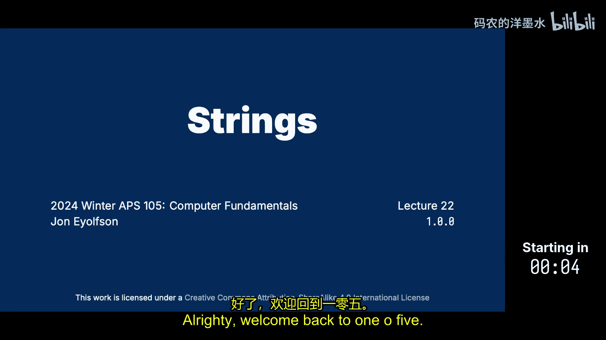
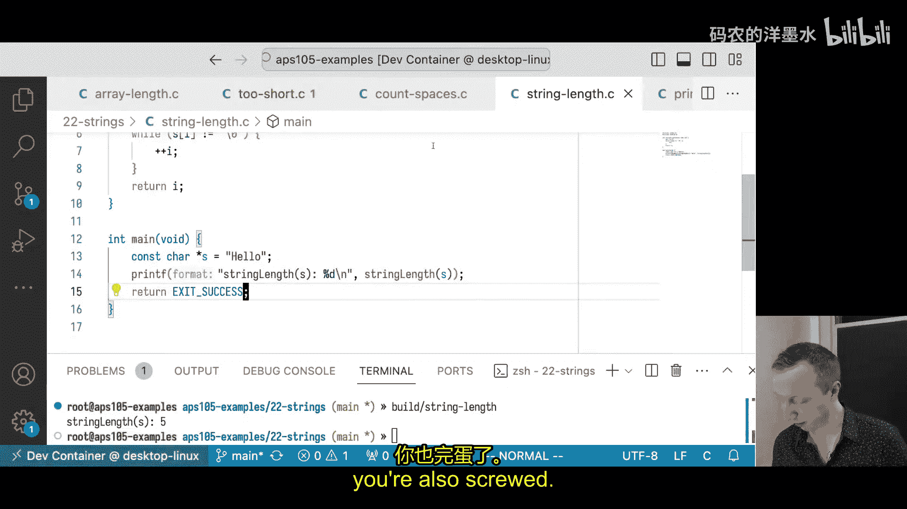
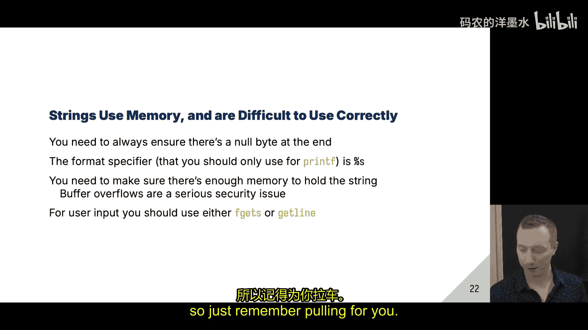

# C语言编程：第22讲：字符串



在本节课中，我们将要学习C语言中的字符串。字符串是字符数组，并以一个特殊的零字节（`\0`）标记结尾。理解字符串的存储、操作以及安全地处理用户输入至关重要。

## 字符串基础

上一节我们介绍了数组，本节中我们来看看一种特殊的数组——字符串。

字符串本质上是一个字符数组，其末尾有一个特殊的零字节（`\0`）作为终止符。这个零字节告诉程序字符串在哪里结束。

**核心概念**：字符串 = 字符数组 + 终止符 `\0`
**代码示例**：`char str[] = "Hello"; // 实际存储: 'H','e','l','l','o','\0'`

## 字符串字面量

字符串字面量是用双引号括起来的字符序列。例如，`"Hello world"`。

**重要规则**：
*   字符串字面量存储在**只读内存**中，这意味着你不能修改它们的内容。
*   字符串字面量的类型是 `const char*`，它是一个指向常量字符的指针。
*   使用 `const char*` 类型来声明指向字符串字面量的指针，可以防止你意外修改只读内存，从而避免程序崩溃（段错误）。

**代码示例**：
```c
const char *s = "Hello"; // 正确：指向只读字符串
// s[0] = 'h'; // 错误：尝试修改只读内存，会导致未定义行为（如段错误）
```

## 可修改的字符串数组

如果你想创建一个可以修改的字符串，应该在栈上定义一个字符数组。

以下是创建可修改字符串的方法：
*   **方法一**：显式初始化数组并包含终止符。
    ```c
    char s1[] = {'H', 'e', 'l', 'l', 'o', '\0'};
    ```
*   **方法二**：使用字符串字面量初始化数组。C语言会自动将字符串（包括终止符）复制到栈上的数组中。
    ```c
    char s2[] = "Hello"; // 数组s2在栈上，内容可修改
    s2[0] = 'h'; // 正确：可以修改
    ```

使用 `sizeof` 运算符获取此类数组的大小时，会包含末尾的终止符。

## 字符串操作与常见陷阱

理解了字符串的存储方式后，我们来看看如何操作它们以及需要注意的问题。

### 打印字符串
使用 `printf` 打印字符串时，格式说明符是 `%s`。它会从给定的地址开始，逐个打印字符，直到遇到终止符 `\0` 为止。

**代码示例**：
```c
char str[] = "Hello";
printf("%s\n", str); // 输出: Hello
printf("%.3s\n", str); // 输出: Hel (限制打印前3个字符)
printf("%s\n", str + 2); // 输出: llo (从第3个字符开始打印)
```




还有一个专用的函数 `puts`，用于输出字符串并自动添加换行符。
```c
puts(str); // 等同于 printf("%s\n", str);
```

### 字符串长度
由于字符串以 `\0` 结尾，我们可以通过遍历数组来计算其长度（不包含终止符）。

**代码示例**：实现 `strlen` 函数的功能
```c
int string_length(const char *s) {
    int i = 0;
    while (s[i] != '\0') { // 遇到终止符时停止
        i++;
    }
    return i; // 返回字符数量
}
```

### 缓冲区溢出
这是处理字符串时最危险的问题之一。如果为字符串分配的空间不足以容纳用户输入的内容及终止符，就会发生**缓冲区溢出**，导致程序写入非法内存，可能破坏其他数据或引发安全漏洞。

**错误示例**：
```c
char buffer[4]; // 只能容纳3个字符+1个终止符
scanf("%s", buffer); // 如果用户输入"Hello"，将发生缓冲区溢出！
```
`scanf` 不知道 `buffer` 的大小，它会一直写入，覆盖 `buffer` 之后的内存。

## 安全的字符串输入

鉴于 `scanf` 与 `%s` 配合使用极其危险，我们必须寻找更安全的方法来获取用户输入。

### 使用 `fgets`
`fgets` 函数允许你指定缓冲区的大小，从而防止溢出。

**函数原型**：`char *fgets(char *str, int n, FILE *stream);`
*   `str`：指向存储输入字符串的缓冲区。
*   `n`：最大读取字符数（包括终止符 `\0`）。实际最多读取 `n-1` 个字符。
*   `stream`：输入流，通常使用 `stdin` 表示标准输入（键盘）。

**代码示例**：
```c
#define BUFFER_SIZE 10
char buffer[BUFFER_SIZE];
printf("Enter your name: ");
fgets(buffer, BUFFER_SIZE, stdin);
// 如果输入超过9个字符，fgets只会读取前9个并添加'\0'，多余部分留在输入流中。
```

### 使用 `getline`（推荐）
`getline` 函数更加强大和方便。它会自动分配足够的内存来容纳整行输入（包括换行符），你无需猜测缓冲区大小。

**函数原型**：`ssize_t getline(char **lineptr, size_t *n, FILE *stream);`
*   `lineptr`：指向字符指针的指针。函数会通过 `malloc` 分配内存，并修改这个指针指向新内存。
*   `n`：指向一个变量的指针，该变量保存了已分配缓冲区的大小。函数可能会调整它。
*   `stream`：输入流，如 `stdin`。
*   **返回值**：成功读取的字符数（包括换行符，但不包括终止符），失败返回-1。

**代码示例**：
```c
char *line = NULL; // 初始化为NULL，getline会分配内存
size_t len = 0;    // 缓冲区大小初始为0
ssize_t read;

printf("Enter a line: ");
read = getline(&line, &len, stdin); // 注意传递指针的地址

if (read != -1) {
    // 可选：去掉末尾的换行符
    if (read > 0 && line[read - 1] == '\n') {
        line[read - 1] = '\0';
    }
    printf("You entered: %s\n", line);
    printf("Buffer size allocated: %zu\n", len);
}

free(line); // 必须释放getline分配的内存
```
`getline` 会处理所有内存管理问题，是处理不定长用户输入最安全、最省心的方式。

## 总结

本节课中我们一起学习了C语言字符串的核心知识：
1.  **本质**：字符串是以空字符 `\0` 结尾的字符数组。
2.  **字面量**：字符串字面量（如`"Hello"`）存储在只读内存，应使用 `const char*` 指针指向它们。
3.  **可修改字符串**：在函数内定义字符数组（如 `char s[] = "Hello"`）可以创建栈上的、可修改的字符串副本。
4.  **操作与陷阱**：使用 `%s` 格式说明符进行输出，但**切勿**用 `scanf` 和 `%s` 进行输入，这会导致无法防范的缓冲区溢出。
5.  **安全输入**：使用 `fgets` 并指定缓冲区大小来防止溢出，或者使用更强大的 `getline` 函数，它能自动管理内存以适应任意长度的输入。



牢记始终为终止符预留空间，并选择安全的输入函数，是编写健壮C语言程序的关键。