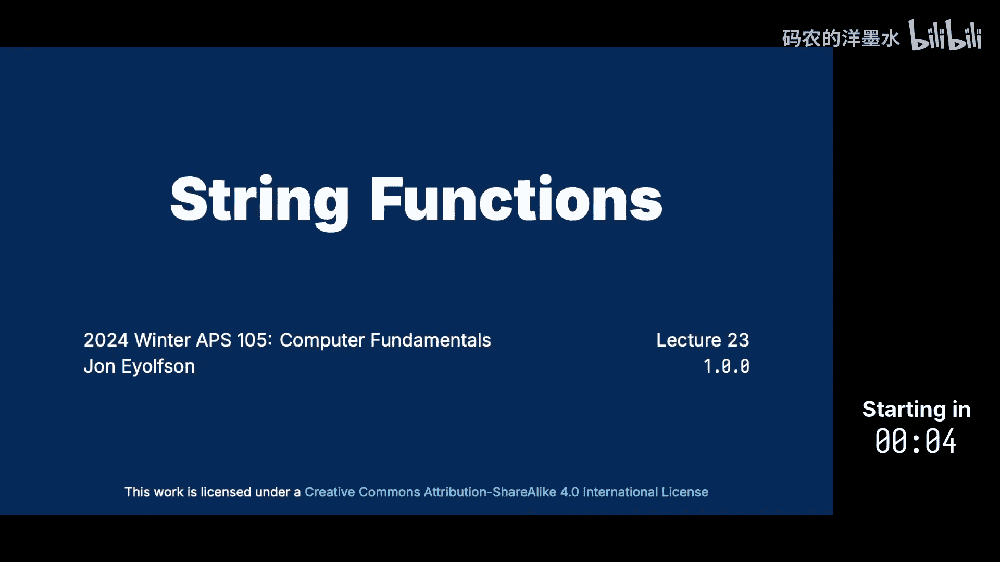
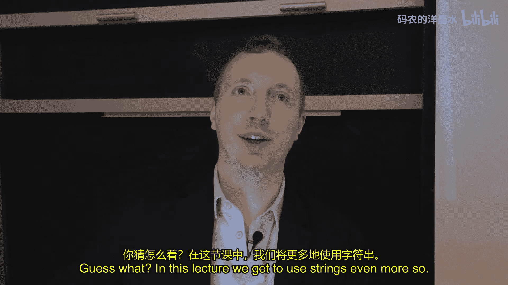
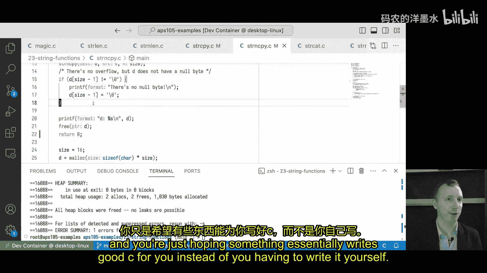
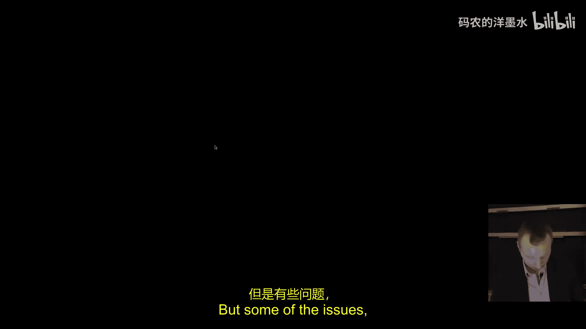
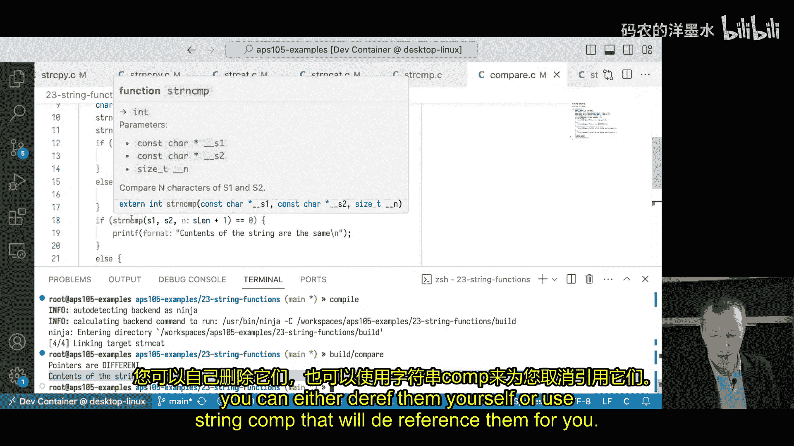
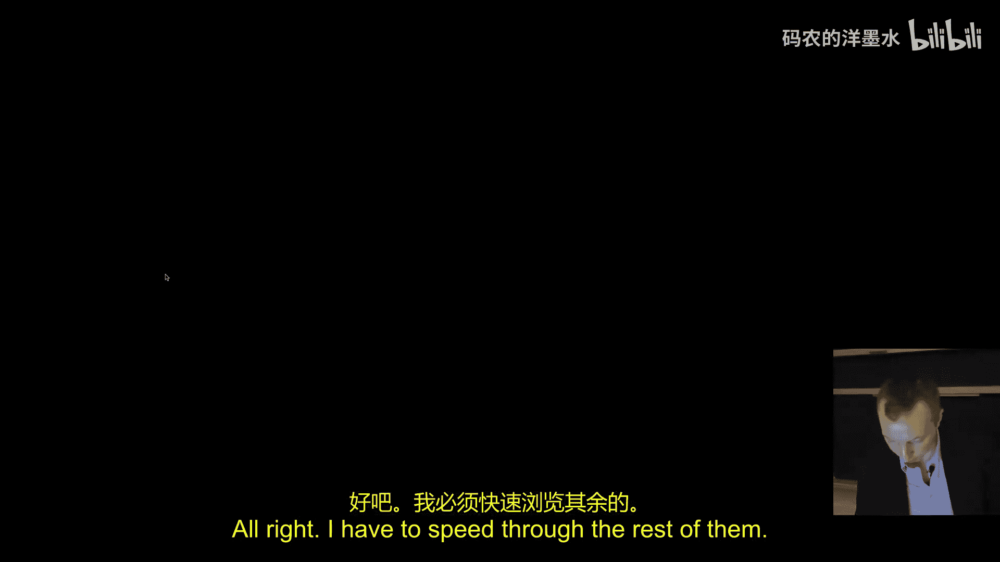
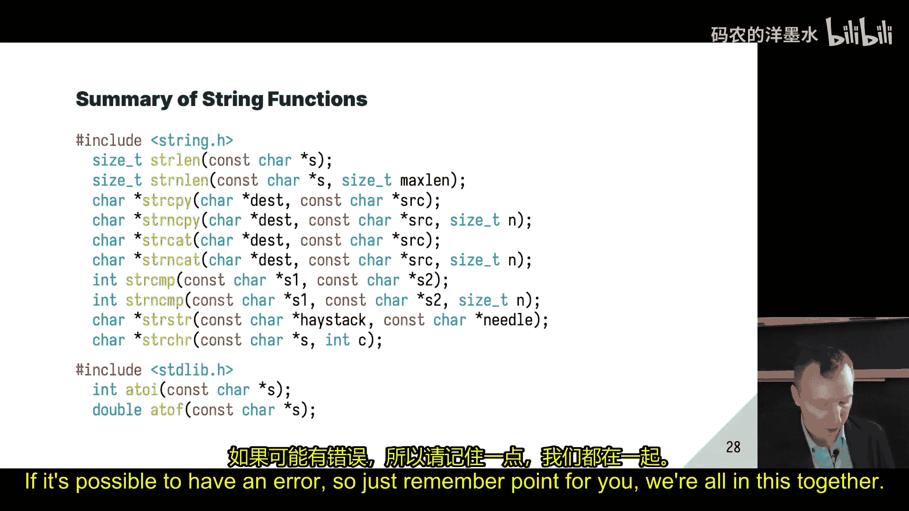

# C语言编程：23：字符串函数 📚





在本节课中，我们将学习C标准库中提供的一系列字符串处理函数。这些函数能帮助我们更高效地操作字符串，而无需自己从头实现所有功能。要使用这些函数，只需在代码文件顶部包含 `#include <string.h>` 头文件即可。

---

## 字符串基础回顾 🔍

上一节我们介绍了字符串的基本概念。字符串本质上是一个以空字符（`\0`）结尾的字符数组。它可以分配在栈上或堆上。请记住，存储一个字符串需要**字符串实际字符数 + 1**个字节，这额外的1个字节就是用来存放结尾的空字符。忘记这一点是许多错误的根源。

---

## 获取字符串长度 📏

我们之前自己编写过获取字符串长度的函数。实际上，标准库已经提供了这个功能。

### `strlen` 函数

`strlen` 函数用于计算一个以空字符结尾的字符串的长度。它接受一个指向字符数组的指针作为参数，并返回一个 `size_t` 类型的值，表示字符串中空字符前的字符数量。

**函数原型**：
```c
size_t strlen(const char *s);
```

**示例**：
```c
char *s = "hello world";
int s_len = (int)strlen(s); // s_len 的值为 11
```
字符串 `"hello world"` 包含11个字符，但存储它需要12个字节（11个字符 + 1个空字符）。

### `strnlen` 函数

有时我们不确定一个字符串是否正确地以空字符结尾。`strnlen` 函数允许我们指定一个最大长度限制，避免访问无效内存。

**函数原型**：
```c
size_t strnlen(const char *s, size_t maxlen);
```
这个函数最多检查 `maxlen` 个字节。如果在达到 `maxlen` 之前找到了空字符，则返回实际长度；否则，返回 `maxlen`。

**示例**：
```c
char *s = "hello world";
size_t len = strnlen(s, 5); // len 的值为 5
```
即使字符串更长，它也只会检查前5个字节。

---

## 复制字符串 📝

如果我们想修改一个字符串，通常需要将其复制到我们可以写入的内存区域（例如通过 `malloc` 分配的内存）。`strcpy` 函数就是用于此目的。

### `strcpy` 函数

`strcpy` 函数将一个源字符串（包括结尾的空字符）复制到目标内存区域。

**函数原型**：
```c
char *strcpy(char *dest, const char *src);
```
*   `dest`：指向目标内存区域的指针，必须有足够的空间容纳源字符串。
*   `src`：指向要复制的源字符串的指针。

**重要**：你必须确保 `dest` 指向的内存至少能容纳 `strlen(src) + 1` 个字节。

**示例**：
```c
char *src = "hello world";
char *dest = malloc(strlen(src) + 1); // 分配足够的内存
if (dest != NULL) {
    strcpy(dest, src); // 复制字符串
    // 现在可以安全地修改 dest
    free(dest); // 使用完毕后释放内存
}
```

### `strncpy` 函数

`strncpy` 是 `strcpy` 的安全版本，它允许你指定最多复制多少个字符到目标缓冲区。

**函数原型**：
```c
char *strncpy(char *dest, const char *src, size_t n);
```
*   `n`：最多复制的字符数。

**行为**：
*   如果 `src` 的长度（包括空字符）小于 `n`，它会将剩余的空间用空字符（`\0`）填充。
*   如果 `src` 的长度大于或等于 `n`，它只会复制 `n` 个字符，并且**不会**在目标字符串的末尾添加空字符！这可能导致字符串未正确终止。

**示例**：
```c
char src[] = "hello";
char dest[6];
strncpy(dest, src, 5); // 只复制了5个字符，dest 可能没有空字符结尾
dest[5] = '\0'; // 手动添加空字符以确保安全
```
使用 `strncpy` 时必须小心，并经常需要手动确保字符串的终止。

---

## 连接字符串 🔗

`strcat` 函数用于将一个字符串追加到另一个字符串的末尾。

### `strcat` 函数

`strcat` 将源字符串的内容复制到目标字符串的末尾（覆盖目标字符串原有的空字符），并在最后添加一个新的空字符。

**函数原型**：
```c
char *strcat(char *dest, const char *src);
```
**重要**：你必须确保 `dest` 指向的内存有足够的剩余空间来容纳 `src` 的所有字符加上一个新的空字符。



**示例**：
```c
char dest[20] = "hello";
char *src = " world";
strcat(dest, src); // dest 现在变成 "hello world"
```



### `strncat` 函数

与 `strncpy` 类似，`strncat` 允许限制从源字符串追加的字符数量，并且它**总是**会在结果字符串的末尾添加一个空字符。

**函数原型**：
```c
char *strncat(char *dest, const char *src, size_t n);
```
**重要**：即使使用 `strncat`，你仍然需要确保目标缓冲区有足够的空间。安全的使用方式是计算剩余空间：`剩余空间 = 缓冲区总大小 - 当前字符串长度 - 1`。

**示例**：
```c
char dest[10] = "hello";
char src[] = " world";
size_t dest_size = 10;
size_t chars_to_copy = dest_size - strlen(dest) - 1; // 计算还能安全添加多少字符
strncat(dest, src, chars_to_copy); // 安全地追加
```

---

## 比较字符串 ⚖️

要比较两个字符串的内容，不能直接使用 `==` 运算符（那比较的是指针地址），而应使用 `strcmp` 函数。

### `strcmp` 函数

`strcmp` 逐个字符地比较两个字符串，直到遇到不同的字符或空字符。

**函数原型**：
```c
int strcmp(const char *s1, const char *s2);
```
**返回值**：
*   `< 0`：`s1` 小于 `s2`（按字典序）。
*   `= 0`：`s1` 等于 `s2`。
*   `> 0`：`s1` 大于 `s2`。

**示例**：
```c
if (strcmp("apple", "banana") < 0) {
    // 会执行到这里，因为 "apple" < "banana"
}
```

### `strncmp` 函数

`strncmp` 只比较两个字符串的前 `n` 个字符。

**函数原型**：
```c
int strncmp(const char *s1, const char *s2, size_t n);
```

**示例**：
```c
if (strncmp("Jonathan", "John", 3) == 0) {
    // 会执行到这里，因为前3个字符都是 "Joh"
}
```

---

## 在字符串中搜索 🔎

### `strstr` 函数

`strstr` 用于在一个字符串（“干草堆”）中查找另一个子字符串（“针”）首次出现的位置。

**函数原型**：
```c
char *strstr(const char *haystack, const char *needle);
```
*   如果找到，返回指向 `haystack` 中匹配子串起始位置的指针。
*   如果未找到，返回 `NULL`。

**示例**：
```c
char *text = "This is a long string";
char *found = strstr(text, "long");
if (found != NULL) {
    printf("Found at: %s\n", found); // 输出: "long string"
}
```

### `strchr` 函数

`strchr` 用于在字符串中查找特定字符首次出现的位置。

**函数原型**：
```c
char *strchr(const char *s, int c);
```
*   如果找到，返回指向该字符的指针。
*   如果未找到，返回 `NULL`。

**示例**：
```c
char *s = "hello world";
char *found = strchr(s, 'w');
if (found != NULL) {
    printf("Found: %s\n", found); // 输出: "world"
}
```

---

## 字符串与数值转换 🔢

以下函数位于 `<stdlib.h>` 中，用于将字符串转换为数值。





### `atoi` 和 `atof` 函数

*   `atoi`：将字符串转换为整数。
*   `atof`：将字符串转换为浮点数（`double`）。

**函数原型**：
```c
int atoi(const char *str);
double atof(const char *str);
```

**示例**：
```c
int num = atoi("1234");       // num = 1234
double val = atof("12.34");   // val = 12.34
```
**注意**：如果字符串格式无效，这些函数的行为是未定义的或返回0。在实际项目中，更推荐使用 `strtol` 和 `strtod` 等具有错误检查功能的函数。

---

## 总结 📋

本节课我们一起学习了C语言标准库中常用的字符串处理函数。我们涵盖了：
1.  **测量长度**：`strlen`, `strnlen`
2.  **复制字符串**：`strcpy`, `strncpy`
3.  **连接字符串**：`strcat`, `strncat`
4.  **比较字符串**：`strcmp`, `strncmp`
5.  **搜索内容**：`strstr`, `strchr`
6.  **类型转换**：`atoi`, `atof`



使用这些函数时，最关键的是要时刻注意**内存安全**和**空字符终止**。许多函数都有带 `n` 的“安全”版本，允许你指定操作的上限，这是防止缓冲区溢出的重要手段。请务必查阅手册以了解每个函数的详细行为和注意事项。