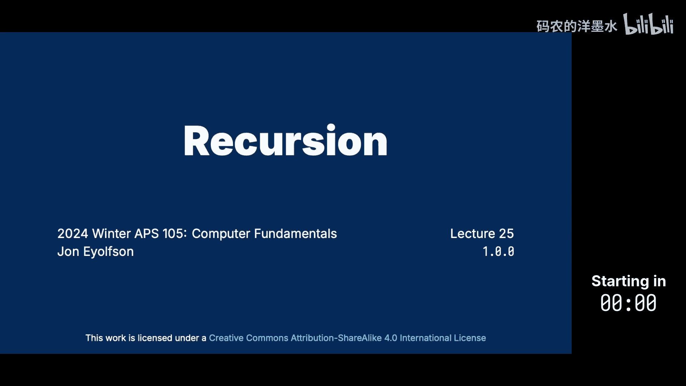
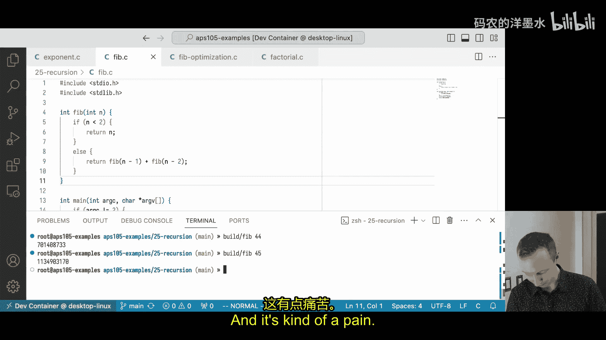
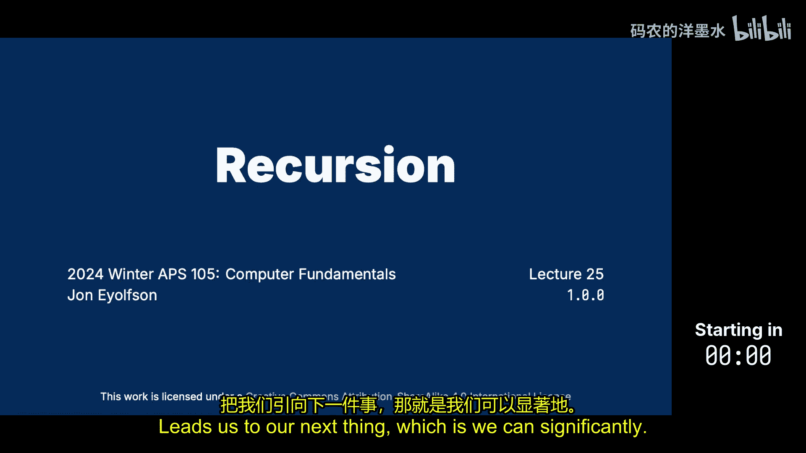
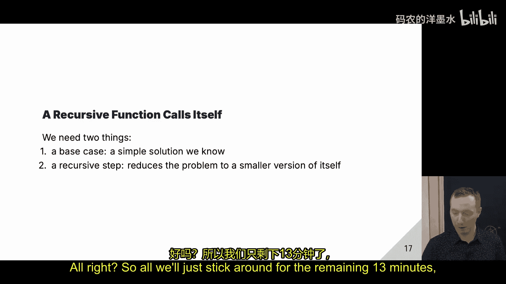

# 【全集】多伦多大学 C语言编程 中英字幕 1080P p25 Lecture 25 - 递归 -BV1gikKB3EZW_p25-

Welcome back to 105， I'm rerecording this because I forgot to hit the stream button。

So let's get into it。So this is probably one of the。

Toughest things to get your mind around being recursion。

 so might have heard of recursion before or in math， a recurrence relation。But if you haven't。

 a recursive function is just a function that calls itself。So in order。

To actually solve a problem recursively， we need two things。 So we need a base case。

 So that is a simple solution that we know。 And then we need a recursive step。

 And the idea behind this is we don't have to solve the whole problem。 We can assume。

The solution already works， we just have to put the solution in terms of a smaller version of itself and then through the magic of computers。

 well we can have that try and make the problem smaller and smaller and smaller and smaller until it gets to our base case and then it will go ahead and solve our problem for us。

So if you went and looked in the dictionary for the definition of recursion。

 you might see something hilarious like this where the definition of recursion just says C recursion。

And this would not solve any problem because， well， if you were going to read it， you see。

 what's the definition of recursion。 Well， it's recursion。 What's the definition of recursion。

 It's recursion。 So this kind of looks like an infinite loop。

 And while we can get like the same types of things happen whenever we do not have our two rules coming into effect where you know。

 our computer would just essentially run forever because it's basically an infinite loop。

 It's just more of a roundabout way to get into an infinite loop。

So you may have seen Fibonacci numbers before。 They're also an example of recursion。

 So they are in math， a recurrence relation， which means。That they define it like this。

 They say that the value of the zeroth Fibonacci number is simply just a0。

 then the value of the first Fibonacci number is just1。

 and then they give you the recurrence solution。 so to calculate the nth Fibonacci number。

 it is the n minus1 Fibonacci number plus the n minus2。Fibbonacci number。

 as long as n is greater than 0。 So we're just assuming positive integers。

 So we could also write a function to compute F of n。 And what that would look like is， well。

 if we're translating into C， we know that we are computing the nth Fibonacci number。

 And the type of n would be an integer。 And well， we could go ahead and。😊。

See that the condition to use the recurrence relation is if n is greater than one。

 So we kind of know we probably want to do some type of if statement。 So for recursive problems。

 typically。Once you're starting out， to， it's easier to divide it into the base case and the recursive step。

 So in this example， to solve the。Calculating the nth Fibonacci number。

 our base case could be assuming that n is going to be 0 or above， not no negative values。

 Our base case would be if n is less than 2， then just return n。

 So that covers actually both of our base cases。 So if n is equal to1。

 Well one is less than 2 and then based off the definition should be one in this case。

 we just return n， which is equal to1。 And also if we're calculating the zero Fibonacci number。

 which should have the value 0。 Well0 is also less than 2， then we could just return n。

 which is currently 0。 So we would get 0。 So if you wanted to。

You could write two different if statements， so you could have two base cases。 So if n is equal to 0。

 return 0， or if n is equal or else if N is equal to。One， then return one， and remember。

 you should use double equals， not an equals because you might get into trouble for that。

And then the other part of the solution here is the recursive step， so if it's not the base case。

 then it's the recursive step so we could just do else and then we just write out the recurrence relation and just kind of translate it to C so we return。

Just fib of n -1。N plus Fb of n minus2， and we will revisit this problem a bit later in the lecture2。

So， let's start with the。Bit of an easier problem first。

 So we could also calculate exponents using recursion as well。

So assuming that we have n that can't be negative if we want to compute B to the power of n， well。

 that's the same thing as B times B times B times B just n times。

But if we want to think about this recursively。The two things we need are the base case and also the recursive step。

Which is solving the problem in terms of a smaller version of itself。So。Well， our base case could be。

 there's a few possibilities here， but one of our base cases could be。

If the exponent or n is equal to 0， then we know that the result is just one。

 So that could be our base case。 So if we see n is equal to 0， we should just return  one。

 We could also have a base case of when N is equal to1。 We could just return B， but。In general。

 you kind of want to have your base case follow like the worst case scenario。

 So if we assume n is going to be0 or positive， the worst case scenario is that well。

In terms of our correctness would be that n is greater or equal to 0。

 So our base case could be B to the0 equals 1。And then in terms of our recursive step。

 so to calculate B to the power of n in terms of b to the power of something。

 well our recursive step could be that b to the power of n is equal to b times b to the power of n minus1 and n minus1 well that's an instance of the same problem it's just a smaller problem so we just take our number B and then multiply it by B to the n minus1。

So if we were to write that out in C。Looks like the same thing as a Fibonacci number， so。

We would create a function called exponent。Which would take two arguments now。

 So we have a B and an n which are integers。 and then we could write out an if statement for our base case。

 So in this case， our base case is n is equal to 0。 We could just return the value 1。

 and then for our recursive step， while we just return B times exponent B so we don't change the base at all。

 and then n minus-1。 So we can think of another way to calculate the exponent just using something like a wall loop or4 loop。

 But in some scenarios， we're just getting practice writing recursive。Recursive solutions。

 because some problems lend themselves to this much more than others。

 so we can go ahead and see that。Here is my program if I implement it， I went ahead and also。

Used the version of C of the version of main。That takes some arguments that we type in just because I'm saving myself from writing scan F and then having to enter。

 hit enter two times to use this program。 So here I just check if there are three arguments。

 So the first is gonna be the name of the program。 And then I'm assuming the next are two numbers。

 So I'll just assume that the user is nice。 I will use our A2 I。

Function that we discussed in the strings function lecture that will go ahead and give convert that string to an integer。

 And then I will just call exponent with B， N that I get from the first argument and the second argument and just display the results。

 Now， if I go ahead and run this。I might say that2 to the power of 4。

 well that should give me what I expect and give me the result 16。 and now if I do to the power 5。

 I get 32 and this seems to actually work as I expect。

So now let's evaluate what actually happens when we are calling2 to the exponent of four。

 and this is where my recording catches up so let's switch to that。There we go， oops。So if we hit。

 or sorry， if we do2 to the。Four。Well， we would call exponent 2。

4 that would go into our recursive case。 So it would go into that L statement and。It would do return。

 Well， two times exponent。2 to the power of three。So before that function returns that called two to the four。

 it has to actually compute two to the three， so we would do another function call so this is another function call so I put it here on the stack to indicate that the other one is still active。

 it's waiting for this one to complete so right here in the gray text that is what we're trying to compute and every box is a new function call that would have its own local variables in this case it would be B is two and n is three。

So。To evaluate exponent 2 to the three that would go into the recursive case so we would get two times exponent 2 to the two okay。

 well now we have to figure out what exponent2 to the two is that is another function call so we call exponent 2 to the two。

 then that gets into the recursive case again， so we get two times exponent 2 to the1。

Then it's kind of boring。 So then we do have another function call with exponent or two to the one。

 And then while that is two times exponent 2 to the one。 So we would call that。 And then mercifully。

 this is our base case。 So in this。Case n is equal to 0， So it would just get a one。

 So it would return one。 So the function that called it gets a copy of one。

And this whole thing kind of unravels itself。 So then it would return。

 And then in our two to the one function， we would calculate two times 1， which is just2。

 And then that is the result for two to the power of one。

 So that would get returned for this function call。Then we have two times 2。 So that would be 4。

 So that's 2 to the power of 2。 And then it would get returned here。 And then all kind of unravels。

 right， So now here。That4 is returned。 It gets a copy of it。 So then we would do two times 4。

 which is equal to 8。Which is thankfully to the power of 3。 And then here， while we would return 8。

So then we would get two times 8。And then we'd get finally our final answer 16。

 So lots of steps it would be in that case， what five function calls。

 but we got the answer in this case， a for loop would have probably been less confusing。

 but is there any questions about how this worked because it's going to get weird once we get Fibonacci going。

So we're all all okay until it gets。Slightly more strange。Okay， so let's go ahead and run it。

 make sure it works。So here's that exponent code。 So here I just have my base case and my recursive step。

 oops。And then if I go ahead and run it。I could do to the power 4。

 something that I get 16 seems to work to the power 5，32。But。If we implemented this with a loop。

 I could probably do like one to the power of。2ello。Some large number。And that would be fine。

 It would just might take some time to execute， right。Well， let's see what happens here。

 So if I run that。I get a segmentation full。Crap。Well， I didn't even use Maoc。 How in the blue hell。

 do I have a segmentation fault。 So one of your steps might be， okay， well， I'll use Val grand。

 and then I'll see， says， okay， I have no memory leaks。 I didn't allocate anything。 So what happened。

 So you try and scroll up。 And then you get a bunch of random text that's probably not so readable。

 The only thing that you have any hope of reading is this thing called a stack overflow。 So。

We know that kind of what a stack is。 It's where all the local variables are。 And in this case。

 the stack overflow means basically it ran out of memory。

 So this is a very common thing you can encounter once you do recursive functions。

 because if there's too much recursion。 We essentially just run out of memory。

 So I did what to the power of like。A million or something like that。 So that would mean that。

 you know， a million called。9，9，99999 called 9999998， called that， called that， call that。

 called that。 And well， every function that is active has a B and an N。

 at least so it has two integers， so I essentially just ran out of memory because every function call needs its own variables。

So that is what a stack overflow means。 Basically， just I ran out of memory。So。Again， like I said。

 every time we call a function， that function gets its own copy of the variables。In C。

 they store local variables on the stack。 So if there's many active functions at once。

 So there I did one to the power of a lot。 So if I was to draw that on the slide。

 I would run out of room because it would just call itself over and over and over again until it actually ran out of memory。

So running out a memory for local variables called a stack overflow。

 that is the name of the helpful website that you can get questions and answer to for programming questions。

So they named it that because， while this is a common enough error that is really hard to go。

 and it means you have screwed something up because usually people get to recursion and then things start screwing up。

 and then most programmers see stack overflow a lot when they are starting out。So。

Common cause for stack overflow more likely than not， is infinite recursion。

 So it's similar to an infinite loop， except in an infinite loop just takes a lot of time。

 It doesn't actually need more memory each time you go through the loop for recursive functions。

 It needs more memory， essentially every iteration of the loop。 If we were thinking about loops。

 So we can actually likely run out of memory before we run out of time。So。

This is far beyond the scope of the course。So don't worry about if this part doesn't make any sense。

 but there are like certain forms of recursion that。Are more that can be optimized more easily。

 So we can rewrite some functions to use what's called tail recursion。

 So it's a special recursive function that just has a single recursive call in the return statement。

 You do not need to practice。 actually rewriting this。 This is mostly for performance。😊。

So if we modify exponent， well， we could create an exponent that takes three variables。

So before we just returned a number， well， like in our recursive case， we did like two times。

The recursive function。 So if we want to be tail recursive， we can't do that。

 So we create another variable here that's local to the function called accumulator。

 that just keeps track of the current value， so。In our base case， instead of returning one， we just。

Return whatever the final value we have is。 So it would do like。2 to the。Two times 2 times 2 times2。

 if we did to the power of 4， then eventually it would be 16 and then we just return 16 at the end and this is our recursive case。

 so we just do the calculation with the accumulator so we just multiply B by it and otherwise it looks the same as before so if we want to keep exponent looking the same well。

We have the base and the N， and we can just return exponent written in this tail recursive manner by giving the accumulator 1 and then giving B at the end。

And the only reason why I show this to you is because compilers can optimize this function。

 So if it's recursive。A lot of people don't like writing recursive functions because well。

 it wastes a lot of memory and you can get into the stack overflow issue where if you just wrote a while loop or for loop or something like that。

 that would work better。 and you wouldn't have that memory issue。

 So it's actually guaranteed that compilers and you'll learn this in like fourth year whenever you get the compilers。

 So it's guaranteed that compilers will optimize this away。

 So it will optimize away the recursive fall call and just convert that whole function into essentially a while loop。

 So it would convert it to this for you。 So just start off。It x equals accumulator。 So in our case。

 we set it equal to1， and then it would just go while n is not equal to 0 and just do the recursive step over and over again。

So now our code doesn't have a stack overflow。 doesnn't have that issue because we're not actually doing recursive function calls。

 We let the compiler optimize it away for us and。In this version。

 maybe you can argue that the recursive one was more readable。 So you'd rather have it than this。

 but。For calculating an exponent， probably just a while loop is going to be much， much。

 much easier to do。 But it's good to think of things recursively because， well。

 some solutions lend itself better to recursion than others。So。

Let's rewind a bit and see what happens when we call fib of four。

So this one is a bit different than the exponent where in our recursive step。

We return fib n-2 plus Fb or Fb n-1 plus Fb n -2。 So we do two function calls here。

 So if we actually want to evaluate something like Fb of4。

Turns out it's going to be a lot of work to understand how your computer actually executes this code。

 so。Gets a bit ugly。 So if we evaluate Fb of4。Well， we call fib of 4。 And again。

 I'll just write in the gray here。What the function is supposed to be computing。

 So it's supposed to be computing the fourth prebonacci number。So， in order to compute。Fib of four。

 Well， that's the recursive step， right。It should return。Fib。3 plus Fb 2。

So we have to do these function calls。 So C will go ahead and it does function calls in left to right order。

 Don't have to know that for the course。 But in order to figure out how this actually works on your computer。

 it's important to know what happens first。 So we will do this function call for Fb of three。

So we'll do that function call， it'll get its own copy of n， and we do Fb of3。 Well。

 that goes into the recursive step， so it would return fib of2 plus one， right？Then， okay。

 now we need to call fib of two。Okay so we call fib of2， fib of 2 is equal to fib of 1 plus Fb of0。

Mercifully， when we call fib of one， that is thankfully our base case， right。

 So it would immediately return one。 So that whole thing would evaluate to one。And then。

 it would return。And give us the value 1 back for， in this case， Fb of one。So it returns。 and now。

 oh， no， well， we still have to find out what fib of 0 is， right？

 So now we have to figure out what fib of 0 is。So that is another function call to figure out what Fb of 0 is。

 That mercifully is another base case。 So that just gets a value of 0。 So it returns。

And then we can finally figure out what the second Fibonacci number is。 So it's1 plus 0。

 So it would figure out that that is one。 Okay， great。 So that was figuring out what Fb of2 was。

 So that would return the value 1。Okay， well， now we have to do the other half of it。

 Now we have to do fib of one。Okay， well， that's another function call， so we call fib of1。

Mercifully， that is another base case， so that just returns one。And then， well， that returns one。

So then we can figure out what the third Fibonacci number is。 So it's just one plus 1。 So that's 2。

So now that returns， right。 So that is Fb of 3。So， that returns。Oh。

 but now we have to figure out what the second Fibonacci number is。 So that is another function call。

 So this whole thing kind of goes again。 So we have a fib of 2。 Okay， well。

 that's a function call oh。That's our recursive case， So we would return fib of1 plus Fb of0。Okay。

 so then Fibit1， that's another function call。 mercifully。 That's our base case。

 So that's just a one。So then that would return。 Okay， yay。

 so now we have to figure out what Fb of 0 is again。So fib of 0， okay， that's another function call。

That goes to the base case， verrcifully， we know it's a zero。Then， it would return。

And now fib of two is done， so we get one。 then that returns。

 Now we can finally figure out the fourth Fibbonacci number， which is2 plus1， which is3。Yeahay。

Wasn't that fun。So。Any questions about how that works。Other than。

 it seems like it takes a long time to figure it out。So。Let's see。 So here is that implementation。

And just as a review for the last one， instead of just asking and doing scanf。

 I'm just using that other version of main that takes another argument that I can type to it just because I don't feel like hitting enter two times。

 So I check that there's two arguments and then use A O T I to convert the first one to an int。

 And I assume I'm being nice to it。 I'm just gonna print the result of calling Fibonacci on whatever that number is。

So。If I call Fib of four， it was a lot of work for us to figure out all the function calls and you know how they work and who calls what and what values and when do they stop。

 but computers are fast， so it just gets three quite readily。And works。 So if we did computed 10。

 we get 55。 heres out it grows pretty fast，20。 We get 6000， something like that。

 seems to be pretty fast。 Computers are quick。 But if we get 40。

 you might have noticed that took a little bit of time。Maybe 44。44 took a bit of time。

It was a bit slow。And also， for this one。We could just write it in a for loop， too。

 and it would be way faster and way easier to actually compute。 But again。

 we're just kind of practicing， practicing recursion， even though doesn't really make sense。

 This would be a lot easier to just do in a for loop。So any questions so far about evaluating that。

 yeah。I want to know how much the world get。あ単に。Yeah， so the question is。

 do we know how much slower it will be， depending on how many steps it will get。

 So you can kind of guess it's gonna get like。In this case。

 almost two times slower every time because， well， if I have to compute 44。

 that means it has to compute 43 and then 42。And then if I have to compute the next one。

 I have to compute 44， which is going take as much as what I ran before， plus of 43。

 So not quite two times slower every step， but gets up there。 So if I do like。45。

Probably pretty slow。Yeah， oh， crap。So， oops， so if I do 44，1 Mississippi 2 Mississippi。

 takes a bit of time。 if I do 45，1 Mississippi，2 Mississippi，3， Mississippi，4 Mississippi， okay， so。

Took about twice as long because essentially it has to calculate everything it had to do before and then do it all again for the next number。

 And then you might imagine this might be like exponential， so。I have to compute one side。

 and then the other side。 And then I have to do it again and again and again。

 And it's kind of a pain。

So， that。Leads us to our next thing， which is we can。

🎼Whoops， wrong thing。Leads us to the next point of， again。 So this part， again， is。

Beyond the scope of the course。For this course， just writing recursive functions is good enough for us。

 we'll get some more practice as it goes on， but just so you know。

You can significantly speed this up without， actually。

Changing it from being recursive with something called memorization。

 which is just a fancy word for caching and caching is just a fancy word for just saving values that you don't so you don't have to recompute them。

 So even with Fb calculating fib of4， Well， we had to calculate like Fb of2 a lot of times。

 and we had to calculate fib of3 once and fib of2 a bunch of times and then a lot of well。

 we didn't have to calculate the value for fib of1 or fib of 0 but。

We could change our program a little bit， so we don't have to go ahead and recompute them over and over again。

 So what optimization we could do。That you could probably implement right now。

 but you don't have to for this course is just， I could just remember some old value in an array。

 And then if I've already calculated that value before。

 I can reuse it again instead of recomputing it。So。This one took。I almost counted like 5 Mississippi。

 It was really， really， really， really， really， really slow。

 So I wrote another version of it that just。That just saves the value that is computed already。

 So it just reuses it over and over again， instead of。

Doing the whole recursive nonsense over and over again。 And if I run that， whoops。

 that is the same function。So if I run my optimized version， boom， look how fast that was。

So there are some techniques you might employ that。

Some problems will have to be recursive and they might be slow。

 and this is one technique to speed it up again， just something to think about。

 don't have to do that in the context of this course at all， but it will come up know。

 probably in your next programming course。So。Recursive functions。Are basically just another tool。

 some problems are easier to think about recursively。

 especially if you're like more of a mathy person that likes proofs and all that stuff was never me。

 so it took me a bit to figure out this recursive thing， but some problems， believe it or not。

 are actually easier to solve recursively。So it's good to get some practice trying to get yourself into that mindset。

So typically recursive functions are going to take more space to execute tail recursive functions can be optimized again。

 don't have to know that for this course， but in your career that might be a good thing to know and try to write for so it's important to practice so you can go ahead。

 identify these types of problems and be able to solve them and the main two things are given a problem。

 you probably want to identify a base case so something you know a value for given one of the inputs and then you also want to create the recursive step。

So you want to solve the problem in terms of itself。Sorry。

 you want to solve the problem in terms of a smaller version of itself。

 So typically it'll be you do one thing like you just take one step and solve that。So。

Let's think about that for more practice。Can we write a recursive function to calculate factorials？

So sit， think about it for a few minutes。 and then we will try and come up with the code ourselves together。

 So we're trying to calculate factorials。 And like， for an example， well the。

Like four factorial would be four times 3 times2 times1。So。Take a minute。

 Think about how you would solve that。And write that as a recursive function。

 So these are the types of things。That would be on exams and stuff like that。For this course。

Most of the problems you'll see， you can probably solve with like a wall loop or something like that。

 because， well， you have to be able to write them during an exam and recursive stuff takes practice。

 So generally， you'll probably get some question on the file will be like。

Solve this problem with a recursive function。Alright， I'll give you a few minutes for that。

 And then we'll try and think about what the steps would be。All right。第二。I can't hear you， sorry。

Okay， so I'll take you first。 So you， you， you will start half of it。

 So the first thing we need is a base case that has been answered up there。 So our base case。

Would probably be well。If we're computing， like。In lesson than 2。

 So if we're computing the factorial， we'll assume no negative numbers。

 If we're computing one factorial or0 factorial， well， they're defined as just being the value 1。

 So that is our base case。So I'll get someone else for the recursive step。

 So that is one thing we need。So the other thing we need is our recursive step。So。

Anyone with the idea of what we should do in the recursive steps。

 So how do we solve factorial in terms of itself， yeah。She说。Yeah， so my recursive step。

 I could write in it else or return doesn't really matter。

 So in terms of solvingnt in terms of itself， well， let's assume the number is 4。 So in order to。

Calculate4 factorial。 Well， that's just the same as doing four times three factorial。

 So if we wrote that in terms of C function callss， a recursive step would be to return N times。

And-1 factorial， which would just be factorial n -1。Everyone agree with that？So turns out this one。

Might be easier to think about than doing all the for loop and everything like that。 So if we do。

 I don't know，4 factorial，24，10 factorial， some large number。Seems to work。Cool。

That was faster than I expected。 Any questions about that。Yeah。So the question is。

 can I do a recursive macro？这是我的。Yeah。I'm not sure if the C Pro pre processoror lets you。

Define recursive macros。I'm actually not sure I don't think so。 It's fairly straightforward， and。

Simple， and that would probably complicate it。So I don't think you can。

 but can do recursive functions。 No pro Lamo。So。Any questions at all about factorial。All right。 wow。

 I， I did myself。 So here's the solution for you。 So same thing we developed。So important things。

 So we will get a much， much， much， much more complicated。Example in the next lecture。

 I even have fun toy props that I can bring in。But for this one。Just to remember。

 a recursive function， just a function that calls itself。In order to think about the problem。

 while your solution needs two things。 So you need a base case。

 So which is basically a simple solution you know。 So something you know how to do that you don't have to think very hard about。

 And then the other one is your recursive step that you'll have to develop。

 which just solves the problem in terms of a smaller version of itself。

 So the idea here is since it's a smaller version of itself。

 you're making progress each step you take。 eventually you will hit the base case。

 And then you can just let your computer solve it for you。 So。Yeah， we're really 13 minutes ahead。

 Allright， cool， I like it。 Allright， so all， we'll just stick around for the remaining 13 minutes。

 But just remember pulling for you。 We're on this together。😊。

