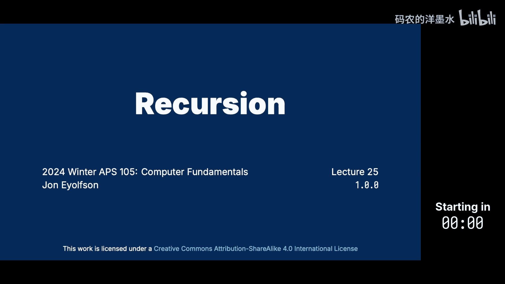
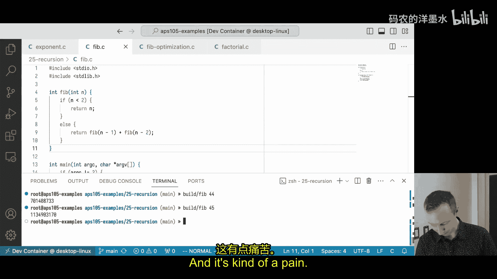
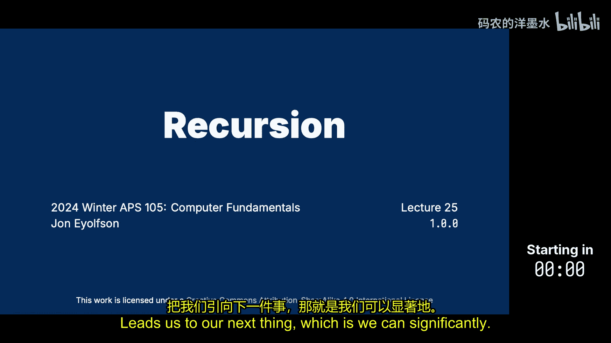
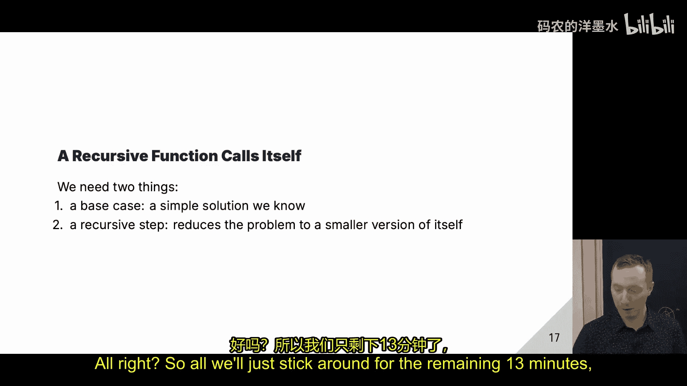

# C语言编程：第25讲：递归 🌀



在本节课中，我们将要学习递归的概念。递归是编程中一个强大但有时令人困惑的工具，它允许函数调用自身来解决问题。我们将通过几个例子来理解递归的基本原理，包括如何定义递归函数以及如何避免常见的陷阱。

## 什么是递归？

递归函数是指调用自身的函数。在数学中，你可能见过类似的概念，称为递推关系。为了有效地使用递归解决问题，我们需要两个关键部分：**基础情况**和**递归步骤**。

基础情况是一个简单且已知的解，它可以直接返回结果，无需进一步递归。递归步骤则是将问题分解为一个更小的、相同类型的子问题，并假设我们已经知道如何解决这个子问题。

## 递归的示例：指数计算

上一节我们介绍了递归的基本概念，本节中我们来看看如何用递归计算指数。

假设我们要计算 `B` 的 `n` 次方（`B^n`），其中 `n` 是非负整数。我们可以这样定义递归函数：

*   **基础情况**：当指数 `n` 等于 0 时，任何数的 0 次方都是 1。因此，我们直接返回 1。
*   **递归步骤**：对于 `n > 0` 的情况，`B^n` 可以表示为 `B * B^(n-1)`。这里，`B^(n-1)` 是原问题的一个更小版本。

以下是该函数的C语言实现：

```c
int exponent(int B, int n) {
    // 基础情况
    if (n == 0) {
        return 1;
    }
    // 递归步骤
    else {
        return B * exponent(B, n - 1);
    }
}
```

当我们调用 `exponent(2, 4)` 时，计算过程如下：
1.  `exponent(2, 4)` 调用 `exponent(2, 3)`
2.  `exponent(2, 3)` 调用 `exponent(2, 2)`
3.  `exponent(2, 2)` 调用 `exponent(2, 1)`
4.  `exponent(2, 1)` 调用 `exponent(2, 0)`
5.  `exponent(2, 0)` 遇到基础情况，返回 1
6.  然后结果层层返回：`1*2=2` -> `2*2=4` -> `4*2=8` -> `8*2=16`
最终得到结果 16。

## 栈溢出与无限递归

在理解了基本递归后，我们需要认识一个重要的潜在问题：栈溢出。

每次函数调用时，计算机会在称为“栈”的内存区域中为该调用分配空间，用于存储局部变量等信息。如果递归调用过深（例如，计算 `exponent(2, 1000000)`），栈空间可能会被耗尽，导致程序崩溃，这就是**栈溢出**。

栈溢出最常见的原因是**无限递归**，即函数没有正确的基础情况来终止递归，导致它无限地调用自身。这与无限循环类似，但会更快地消耗内存。

## 递归的优化：尾递归

有些递归函数可以被编译器优化，以减少内存使用。一种形式称为**尾递归**。

尾递归函数的特点是，递归调用是函数体中最后执行的操作（即在 `return` 语句中直接调用自身，没有其他运算）。例如，我们可以重写指数函数为尾递归形式：

```c
int exponent_tail(int B, int n, int accumulator) {
    if (n == 0) {
        return accumulator;
    } else {
        return exponent_tail(B, n - 1, B * accumulator);
    }
}

// 包装函数，保持接口不变
int exponent(int B, int n) {
    return exponent_tail(B, n, 1);
}
```

许多编译器能够将尾递归函数优化为等价的循环代码，从而避免额外的栈开销和栈溢出风险。不过，对于本课程，了解这个概念即可，无需强制使用。

## 更复杂的递归：斐波那契数列 🐚

现在，让我们看一个更复杂的递归例子：计算斐波那契数列。

斐波那契数列的定义如下：
*   **F(0) = 0**
*   **F(1) = 1**
*   **F(n) = F(n-1) + F(n-2)**，当 n > 1 时

这是一个典型的递归定义。我们可以将其直接翻译成C语言函数：

```c
int fib(int n) {
    // 基础情况
    if (n < 2) {
        return n;
    }
    // 递归步骤
    else {
        return fib(n - 1) + fib(n - 2);
    }
}
```

然而，这个实现存在效率问题。以计算 `fib(4)` 为例，其调用过程会涉及大量重复计算（例如 `fib(2)` 被计算了多次）。随着 `n` 增大，计算时间会呈指数级增长。

## 提升递归效率：记忆化

为了解决重复计算的问题，我们可以使用一种称为**记忆化**的技术。记忆化意味着“缓存”或存储已经计算过的结果，以便后续直接使用，避免重复计算。





虽然本课程不要求实现记忆化，但了解这个概念很有用。基本思路是使用一个数组来存储已经计算出的斐波那契数值。在递归函数中，先检查数组中是否已有结果，如果有则直接返回，否则进行计算并将结果存入数组。这能显著提升性能。

## 递归实践：阶乘计算

为了巩固对递归的理解，让我们尝试用递归计算阶乘。

阶乘 `n!` 定义为 `n * (n-1) * ... * 1`，且 `0! = 1`。

以下是递归解决方案的思考过程：
*   **基础情况**：`0!` 或 `1!` 等于 1。
*   **递归步骤**：`n!` 可以表示为 `n * (n-1)!`。

对应的C语言函数如下：

```c
int factorial(int n) {
    // 基础情况
    if (n <= 1) {
        return 1;
    }
    // 递归步骤
    else {
        return n * factorial(n - 1);
    }
}
```

对于许多问题，递归解法比循环解法在思维上更直观，尤其是当问题自然具有自相似结构时。

## 总结



本节课中我们一起学习了递归的核心概念。我们了解到，一个递归函数需要明确的基础情况和递归步骤。我们通过计算指数、斐波那契数和阶乘的例子实践了递归的编写。同时，我们也认识了递归可能带来的问题，如栈溢出和效率低下，并简要了解了尾递归优化和记忆化技术。递归是解决某些类型问题的强大工具，掌握它需要练习，但能极大地提升你解决复杂问题的能力。