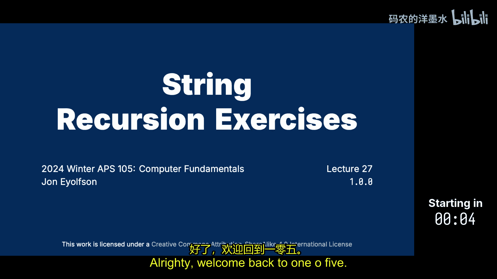
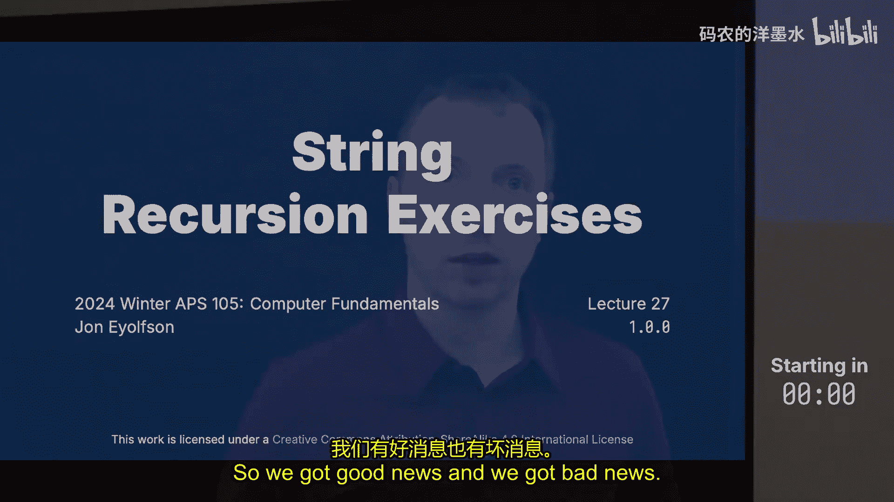
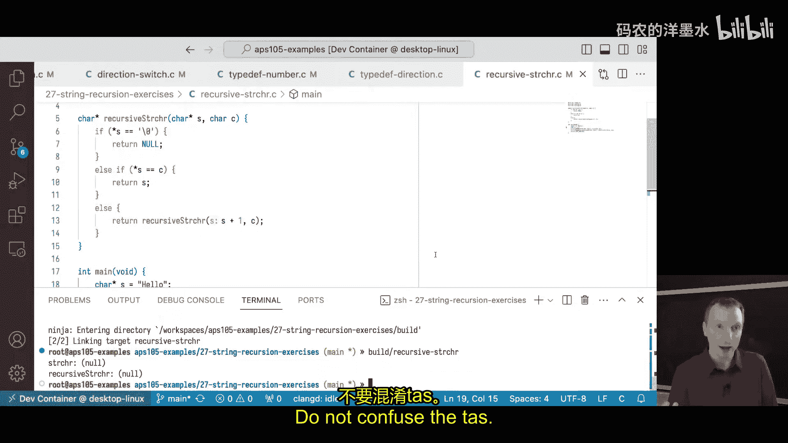

# C语言编程：第27讲：字符串递归练习





在本节课中，我们将学习如何对字符串进行递归操作。我们将通过实现一个检查回文串的函数来深入理解递归在字符串处理中的应用。此外，我们还将简要介绍一些C语言的高级特性，如三元运算符、枚举（enum）、switch语句和类型定义（typedef），虽然这些内容在本课程中不要求使用，但了解它们有助于阅读未来的代码。

---

## 递归基础回顾

上一节我们介绍了递归的基本概念。递归函数需要两个关键部分：**基础情况**（一个已知的简单解）和**递归步骤**（将问题简化为更小的自身版本）。

对于字符串的递归，通常有三种主要思路：
1.  将问题视为“一个字符 + 更小的字符串”。
2.  将问题视为“更小的字符串 + 一个字符”（即从末尾开始处理）。
3.  将问题视为“首尾两个字符 + 中间更小的字符串”。

---

## 实践：递归判断回文串

我们的目标是编写一个函数 `is_palindrome`，它能递归地判断一个字符串是否是回文串（即正读反读都相同，例如 “racecar”）。

直接使用单个字符串参数进行递归比较困难，因为我们需要同时跟踪首尾字符的位置。因此，我们需要一个辅助函数来接收额外的索引参数。

以下是实现思路：

1.  **基础情况**：
    *   如果首字符索引 `first` 大于或等于尾字符索引 `last`，说明我们已经检查完所有字符对或只剩下一个字符，此时字符串是回文，返回 `true`。
    *   如果 `first` 位置的字符不等于 `last` 位置的字符，则肯定不是回文，返回 `false`。
2.  **递归步骤**：
    *   如果首尾字符相等，则问题简化为检查去掉首尾字符后的子串。即，使用 `first + 1` 和 `last - 1` 作为新的索引调用辅助函数。

根据以上思路，我们可以编写如下代码：

```c
#include <stdio.h>
#include <string.h>
#include <stdbool.h>

bool is_palindrome_helper(const char *s, int first, int last) {
    // 基础情况1: 字符不匹配
    if (s[first] != s[last]) {
        return false;
    }
    // 基础情况2: 检查完毕或只剩中心字符
    if (first >= last) {
        return true;
    }
    // 递归步骤: 检查内部子串
    return is_palindrome_helper(s, first + 1, last - 1);
}

bool is_palindrome(const char *s) {
    int len = strlen(s);
    // 处理空字符串的情况（空串被视为回文）
    if (len == 0) {
        return true;
    }
    return is_palindrome_helper(s, 0, len - 1);
}
```

在主函数中，我们可以这样测试：

```c
int main(int argc, char *argv[]) {
    if (argc != 2) {
        printf("Usage: %s <string>\n", argv[0]);
        return 1;
    }
    if (is_palindrome(argv[1])) {
        printf("\"%s\" is a palindrome.\n", argv[1]);
    } else {
        printf("\"%s\" is NOT a palindrome.\n", argv[1]);
    }
    return 0;
}
```

---

## C语言特性简介（了解即可）

以下是一些C语言的其他特性。虽然在本课程中不要求使用，但了解它们有助于你阅读和理解更多的代码。

### 三元运算符 `? :`

三元运算符是一种简洁的条件表达式。
**语法**：`条件 ? 表达式1 : 表达式2`
如果条件为真，整个表达式的值为`表达式1`，否则为`表达式2`。

```c
int x = (5 > 3) ? 10 : 20; // x 的值为 10
```
它相当于一个简写的if-else语句，但过度使用会降低代码可读性。

### 枚举

枚举（`enum`）允许你为整数值创建有意义的名称，使代码更易读。
**语法**：`enum 枚举类型名 { 名称1, 名称2, ... };`

```c
enum Month { JAN=1, FEB, MAR, APR, MAY, JUN, JUL, AUG, SEP, OCT, NOV, DEC };
enum Month current_month = MAR; // current_month 的值为 3
```
未显式赋值的名称会自动获得递增的整数值（从上一个值+1开始，首个默认为0）。

### Switch 语句

`switch` 语句根据一个变量的值跳转到不同的代码块执行。它通常与 `enum` 搭配使用。
**语法**：
```c
switch (变量) {
    case 值1:
        // 代码块1
        break; // 跳出switch
    case 值2:
        // 代码块2
        break;
    default:
        // 默认代码块（可选）
}
```
**注意**：每个 `case` 末尾的 `break` 至关重要，否则代码会继续执行下一个 `case` 的语句（这称为“穿透”）。

### 类型定义

`typedef` 用于为现有类型创建别名。
**语法**：`typedef 原类型 新类型名;`

一个常见的用法是简化 `enum` 类型的声明：
```c
typedef enum { NORTH, EAST, SOUTH, WEST } DirectionT;
DirectionT dir = NORTH; // 声明变量时无需再写 ‘enum’
```
这使类型声明更加简洁。通常在新类型名后加 `_T` 或 `_t` 来表示这是一个类型别名。

---

## 额外练习：递归实现 strchr

作为额外的练习，我们可以尝试递归实现标准库函数 `strchr`，其功能是在字符串中查找指定字符并返回首次出现位置的指针。

以下是实现思路：
1.  **基础情况1**：如果当前字符是字符串结束符 `\0`，说明未找到，返回 `NULL`。
2.  **基础情况2**：如果当前字符等于要查找的字符，返回指向当前字符的指针。
3.  **递归步骤**：否则，在字符串的剩余部分（指针+1）中继续查找。

代码实现如下：
```c
char* my_strchr(const char *s, char c) {
    if (*s == '\0') {
        return NULL; // 未找到
    }
    if (*s == c) {
        return (char*)s; // 找到，返回指针
    }
    return my_strchr(s + 1, c); // 在剩余部分递归查找
}
```

---

## 总结

本节课中我们一起学习了：
1.  **字符串递归**：通过实现回文串判断函数，掌握了如何设计递归函数的基础情况与递归步骤，并学会了使用辅助函数来处理需要额外参数的递归问题。
2.  **C语言特性**：简要了解了三元运算符、枚举、switch语句和类型定义。请记住，这些特性在本课程中不要求使用，但认识它们对未来的编程学习有益。



递归是解决许多字符串和数据结构问题的强大工具，核心在于将大问题分解为相似的小问题。多加练习是掌握它的关键。