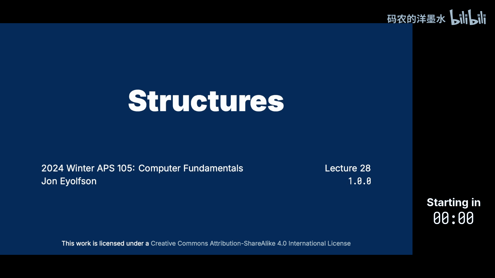
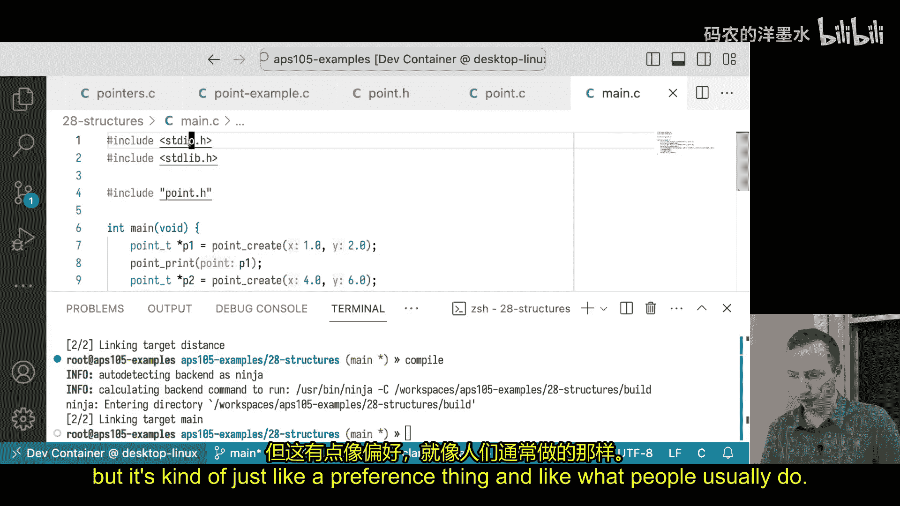
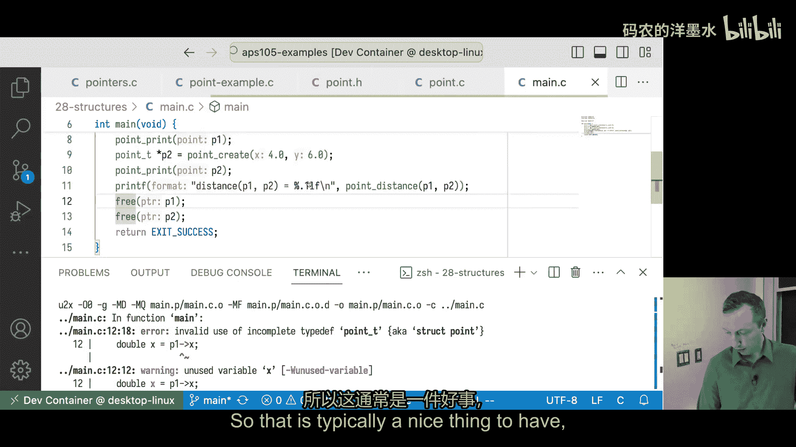
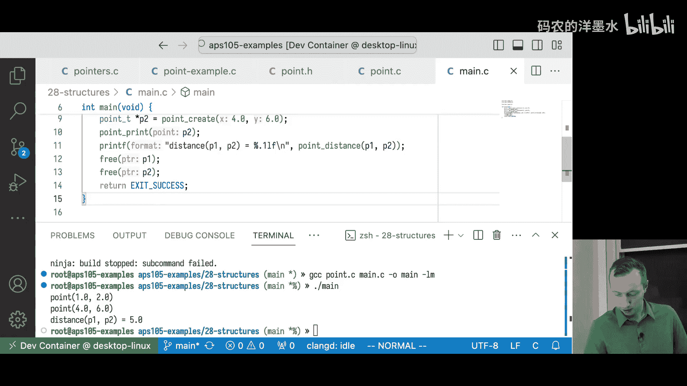

# C语言编程：第28讲：结构体 🏗️



在本节课中，我们将要学习C语言中一个非常重要的概念——**结构体**。结构体允许我们将多个不同类型的变量组合在一起，形成一个新的复合数据类型。这对于组织和管理复杂数据非常有用。

---

## 什么是结构体？

在C语言中，我们可以将多个变量组合在一个称为“结构体”的单元中。它是一种新的数据类型。C语言使用关键字 `struct` 来定义结构体。

定义结构体的语法是：首先输入关键字 `struct`，然后为这个变量组起一个名字，接着在大括号 `{}` 内放入任意数量的变量声明。

与枚举类型类似，结构体通常定义在 `#include` 指令之后，并且不定义在函数内部。

---

## 一个简单的例子：计算两点距离

让我们从一个简单的任务开始：计算两点之间的距离。一个点由x坐标和y坐标组成。

如果不使用结构体，我们可能会这样写函数：

```c
double distance(double x1, double y1, double x2, double y2) {
    return sqrt(pow(x2 - x1, 2.0) + pow(y2 - y1, 2.0));
}
```

在 `main` 函数中，我们需要分别定义四个变量：

```c
int main() {
    double x1 = 1, y1 = 2;
    double x2 = 4, y2 = 6;
    double dist = distance(x1, y1, x2, y2);
    printf("Distance: %.1f\n", dist); // 输出 5.0
    return 0;
}
```

这种方法虽然可行，但当需要处理多个点时，管理 `x1`, `y1`, `x2`, `y2` 这样的变量名很容易出错，例如可能不小心将不同点的坐标混用。

---

## 使用结构体改进

既然我们学习了结构体，就可以创建一个代表“点”的结构体。我们知道一个点在逻辑上是一个整体。

我们可以这样定义一个结构体：

```c
struct point {
    double x;
    double y;
};
```

这样就创建了一个名为 `struct point` 的新类型。我们可以像使用 `int`、`double` 一样使用它来声明变量。

要访问结构体内部的变量（通常称为“字段”或“成员”），可以使用点运算符 `.`。

```c
struct point p1;
p1.x = 1;
p1.y = 2;
```

---

## 使用 `typedef` 简化

为了使代码更易读，我们常使用 `typedef` 为结构体类型创建一个别名。

```c
typedef struct point {
    double x;
    double y;
} point_t;
```

现在，我们可以直接使用 `point_t` 来声明变量：

```c
point_t p1;
p1.x = 1;
p1.y = 2;
```

我们还可以在声明时直接初始化结构体，类似于数组：

```c
point_t p1 = {1, 2}; // 按结构体字段定义的顺序赋值
point_t p2 = {.y = 6, .x = 4}; // 也可以指定字段名赋值
```

---

## 用结构体重写函数

现在，我们可以用结构体重写之前的函数，使逻辑更清晰。

距离函数可以改为接受两个 `point_t` 结构体：

```c
double distance(point_t p1, point_t p2) {
    return sqrt(pow(p2.x - p1.x, 2.0) + pow(p2.y - p1.y, 2.0));
}
```

打印点的函数也可以简化：

```c
void print_point(point_t p) {
    printf("(%.1f, %.1f)\n", p.x, p.y);
}
```

在 `main` 函数中，代码变得更简洁：

```c
int main() {
    point_t p1 = {1, 2};
    point_t p2 = {4, 6};
    print_point(p1);
    print_point(p2);
    printf("Distance: %.1f\n", distance(p1, p2));
    return 0;
}
```

通过结构体，我们将逻辑上相关的数据（x和y坐标）组合在了一起，减少了出错的可能性。

---

## 使用结构体指针

上一节我们介绍了如何定义和使用结构体。本节中我们来看看为什么以及如何使用结构体指针。

在C语言中，函数参数是“按值传递”的。这意味着当我们将一个结构体传递给函数时，函数会获得该结构体的一个完整副本。如果结构体很大，复制它会消耗时间和内存。

更常见的做法是传递结构体的指针。这样，函数操作的是原始数据，效率更高，并且函数内部对结构的修改也能影响到函数外部。

首先，我们将函数参数改为指针：

```c
double distance(point_t *p1, point_t *p2) {
    // 需要解引用指针来访问字段
}
```

在 `main` 函数中调用时，需要传递地址：

```c
distance(&p1, &p2);
```

---

## 箭头运算符 `->`

当通过指针访问结构体字段时，不能直接使用点运算符 `.`。我们需要先解引用指针，这会导致代码冗长：

```c
double dx = (*p2).x - (*p1).x; // 必须使用括号
```

为了简化，C语言提供了箭头运算符 `->`，它结合了解引用和字段访问。

使用箭头运算符，代码变得清晰：

```c
double distance(point_t *p1, point_t *p2) {
    return sqrt(pow(p2->x - p1->x, 2.0) + pow(p2->y - p1->y, 2.0));
}
```

同样，打印函数也应改为使用指针和箭头运算符：

```c
void print_point(point_t *p) {
    printf("(%.1f, %.1f)\n", p->x, p->y);
}
```

这是处理结构体的首选方式。

---

## 动态创建结构体

有时我们需要动态地在堆上创建结构体。这时可以使用 `malloc` 函数。

我们可以创建一个专门的函数来动态创建并初始化一个点：

```c
point_t* point_create(double x, double y) {
    point_t *p = malloc(sizeof(point_t));
    if (p != NULL) {
        p->x = x;
        p->y = y;
    }
    return p;
}
```

在 `main` 函数中使用：

```c
point_t *p1 = point_create(1, 2);
point_t *p2 = point_create(4, 6);
// ... 使用 p1 和 p2 ...
free(p1); // 记得释放内存
free(p2);
```

这类似于其他语言中的“构造函数”。

---

## 组织代码：头文件和源文件

随着程序变大，将代码分割到多个文件中是很好的实践。通常，我们将与特定结构体相关的所有函数放在一个 `.c` 文件中，并创建一个对应的 `.h` 头文件来声明这些函数。

以下是组织代码的常见方式：

**point.h (头文件)**

```c
#ifndef POINT_H // 防止头文件被重复包含
#define POINT_H

typedef struct point point_t; // 前向声明，隐藏结构体细节




// 函数原型
point_t* point_create(double x, double y);
double point_distance(point_t *p1, point_t *p2);
void point_print(point_t *p);
double point_get_x(point_t *p);
void point_set_x(point_t *p, double x);
// ... 其他 getter 和 setter 函数

#endif
```

**point.c (源文件)**

```c
#include "point.h"
#include <math.h>
#include <stdio.h>
#include <stdlib.h>

// 实际定义结构体
struct point {
    double x;
    double y;
};




// 函数定义
point_t* point_create(double x, double y) {
    point_t *p = malloc(sizeof(point_t));
    if (p != NULL) {
        p->x = x;
        p->y = y;
    }
    return p;
}

double point_distance(point_t *p1, point_t *p2) {
    return sqrt(pow(p2->x - p1->x, 2.0) + pow(p2->y - p1->y, 2.0));
}
// ... 其他函数定义
```

**main.c (主程序)**

```c
#include "point.h"
#include <stdio.h>
#include <stdlib.h>

int main() {
    point_t *p1 = point_create(1, 2);
    point_t *p2 = point_create(4, 6);

    point_print(p1);
    point_print(p2);
    printf("Distance: %.1f\n", point_distance(p1, p2));

    free(p1);
    free(p2);
    return 0;
}
```

编译时，需要将所有源文件一起编译：

```bash
gcc point.c main.c -o main -lm
```

---

## 总结

本节课中我们一起学习了C语言的结构体。我们从为什么需要结构体开始，学习了如何定义结构体、使用 `typedef` 创建别名、初始化结构体。接着，我们探讨了通过指针传递结构体的优势，并介绍了箭头运算符 `->` 的用法。最后，我们了解了如何动态创建结构体以及如何通过头文件和源文件来组织更大型的代码，实现信息隐藏和模块化。



结构体是C语言中构建复杂数据模型的基石，理解它们对编写清晰、高效的代码至关重要。