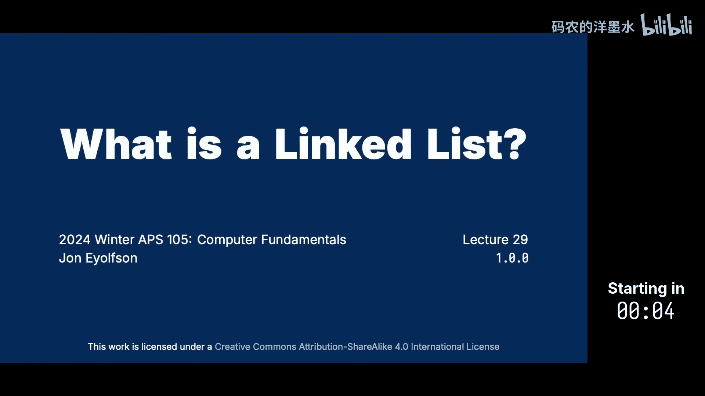
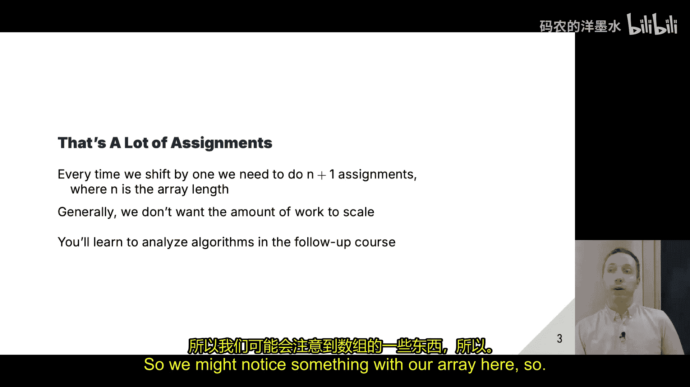
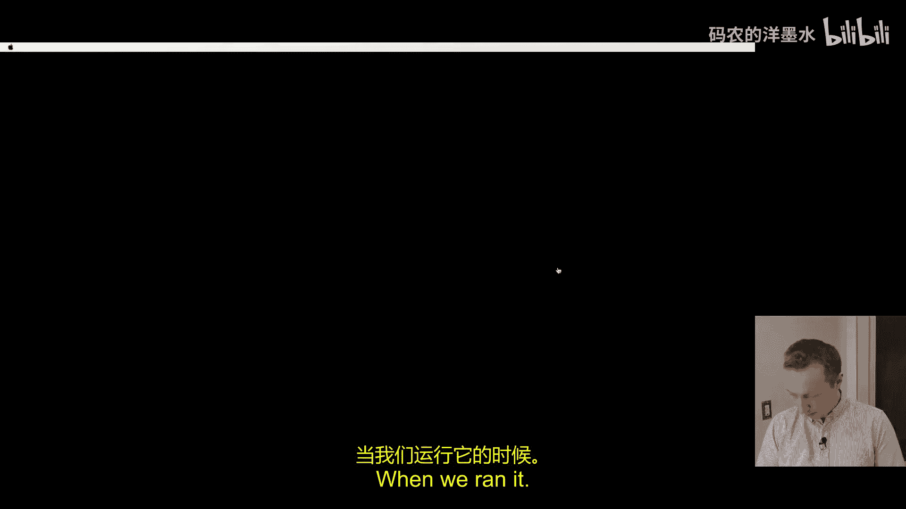
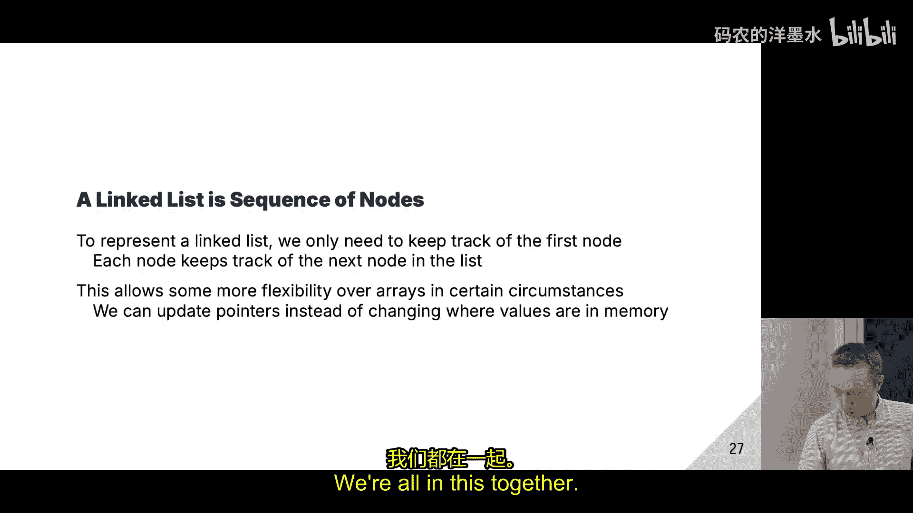

# 【全集】多伦多大学 C语言编程 中英字幕 1080P p29 Lecture 29 - 链表 -BV1gikKB3EZW_p29-

。

Ohrighty， welcome back to 105。 so good to see everyone again after。Missing two lectures。

So now we get to talk about link lists， which is。At least from talking to previous students that have taken this course。

 one of the hardest things in this course。 And this is where some of them start to struggle， but。

Hopefully， if you've understood pointers up to this point， we will be okay。

 so we will hopefully get through this together。 So title the lecture is， what is a link list。

 And I will start with motivating why we would want to have a linked list， so。A raise。They work。

 They're not perfect。 They have some drawbacks。 We'll see more as we go on。

 But the first drawback could simply be that let's just。

 we have an array that represents like a line of people。In line， maybe you're taking turns for。

 I don't know， your favorite childhood toy or something like that with all your siblings。

 You get assigned a number。 Say we have four people in line。They get assigned number 1，2，3， and 4。

 And you just take turns in order。 So the order of people will just use an array to represent that line and the order they are in the array is the same order they are in that line。

 So whoever is currently at index 0。 So whatever is。

The first number at that array is who is at the front of the line。 So if we want to let 1，2，31，2，3，4。

 I can count。 and we print our array， we want to write a function called move array that just takes whoever is at the beginning。

 So currently whoever is at spot 1 or number one gets thrown to the back of the line。

 So after this move array function， our should be 2，3，4， and then one。So I've already written it， so。

We should know how to write the print array function， so just print everything in order。

 shouldn't be a big surprise to anyone， and then I write this move array function， which goes ahead。

 tries to essentially say okay， number one， you've had your turn so number two is next， then three。

 then four and then number one is at the back。So if I want to write this move array function。

 turns out it is a bit of a pain。 So my move array function。Well。

 I would first check that the array length is one or greater。 if it's just one。

 I would't have to do anything。 If it's 0， don't have to do anything。

 So I will just check for corner cases first。 And then in order to move everything in the array。

 I have to do a lot of assignments， so。First， if we go back to our swap example where I need a variable to keep track of the element。

 I was assigning something to， So I didn't overwrite it and lose it。 Same idea here。 So I will get。

Whatever number is at currently at the front of the array。 So it would be at index 0。 and then。

4 index 0 all the way up to array length -1。 So I skip the last element。

 I will just essentially shift the numbers by one。 So array 1 or sorry。

 array I will be equal to array I plus 1， so。Here is the array we had before。

 So if I go through that， I save the number one and then first time through the loop。

 I assign two equal to the index0 So then these would both be two。 then I assign three to here。

 Now these are both three。 then I assign4 to here。 then they are both four。

 and then at the final step。 I set the last element to whatever was the first before。

And there's a question wise there no return after the last line of the move array function。

 So this is just a function void means it returns no value。 It's just optional。

 I could write return here。C won't care， but C inserts that for us anyways if we don't want to。

 Usually people don't write return at the end of void functions because C will just do it for you。

Essential， extra code we don't have to write。Alright。

 so any questions about that move array function。Alright， well， I have a question for you。

 So how many assignments did I do。Right。Anywayone， I saw。5。We got five。Ih， yeah。

 we did five assignments， right， We assigned something equal to first。

 and then we reassigned every single array element。 And let's say my array had 10 things in it。

 How many assignments do I get to do then。11， and then it goes up and up and up and up。

 And doing assignments might be slow， might be kind of a pain。In general， in computing。

 we do not want to have something like that。So here's that code。 So that had a lot of assignments。

 So every time I shift by one， I need to do like n plus one assignments where n is the length of the array。

 So in general， in computing。 if you can help it work to scale with like the size of an array。

 you would like it just to be as quick as possible。 hopefully just swap two things。

Do a known amount of work the same time， every time。 And we try and have it not to scale。

 So we'll talk about later up in the course。 And there's gonna be a whole another course that follows it。

 So in order for you to analyze algorithms like this and decide， you know。

 which one you would prefer， try to think of better algorithms that are more efficient。For now。

 this course， we're just solving problems， but that is something to look forward to in other courses where you actually get to analyze these algorithms。

 But in general， we want to do the least amount of work as possible because that would be faster。

So we might notice something with our array here。

When we ran it。

We might notice that。Well， at least to us。A lot of things stay the same。

 So aside from moving one to the end， everything's in the same order， right。Well。

 it goes to or two in the same order。 That stays the same。

 So that is basically the idea for a link list。So the order between the numbers don't change。

 except for the one we're trying to move。 So for each number。

 what we can do is we can keep track of which one is next。 So two can know that3 is next。

3 can know that4 is next。 And then well， to change。Everything， well， we could just。Put one after4。

 And that would be it。So for each number， we track who is next in line and for the list。

 we might also just keep track is who who is at the front the line。

 and it's like the equivalent of having an ordered list。

 So the idea behind that is for this array instead of just having it as an array if we want represented as a list we would say one is at the front。

 So we know one's at the front and then one knows well。The next number after me is 2，2 knows。

 The next number after me is3，3 knows。 the next number after me is 4。

 And then if I want to put one at the back of the list。All I need to do is say， okay， well。

 now  two is at the front of the list and one， you're now after four。

 So I could do that as a constant amount of work。So do， to do， so that is my idea behind a link list。

So。The data structure we're going to implement a linked list is called a node。

 So we'll create a node in C that contains our data。 And then which node is next。

 So here is what it would look like。 So we did structures before I left。 So we could type defstruct。

Notode as node underscore T。 If we want to say node underscores T instead of typingstruct all the time。

And then for the actual definition of the nodestruct itself。

 Well the data we only care about is just an integer。 So we'll just call it the value。

 And then here is the next pointer。 So it's going to point。

 which is why we need to learn pointers before this。 to whatever node is next。

 So in the previous example we saw。1 node would have the value 2。

 and its next would point to a node that has the value 3。So， note。Well， I need this to be a pointer。

Because if I didn't。That would be another example of fun recursion， right？

 So I can't define thestruct in terms of itself。 Otherwise。

 that would be like the what's the definition of recursion， C recursion。

 So if I didn't put a pointer here。 and was node underscore T。 Well。

 that would be infinite recursion。 You can't define it in terms of itself。

 So that's one reason why it has to be point a pointer。And this。

Next variable being a pointer also allows us some flexibility。 so we will use the value null。

 which just means it's not some valid value to represent that there is absolutely no next node。

 So if you're at the back of the list， your next pointer is going to point to null to indicate that you are the last one。

And then if I wanted to track what node was at the front of the list。

 I could just go ahead and create a variable called head。To represent the front of the list。

 that's normally what people call it a pointer to a node。So visually， how would that look？

So it would look like this。 So instead of just creating an array of size 4。

 and then it's an in array， they just get assigned based off their index。

 I would create a node for each individual number。 So in the green boxes。

 that is the entire structure itself。 So the green would be the node。 And each node has a value。

 And then a next pointer。 So。First。I would have the node that has the value 1。

 Then it's next would point to the node with the value 2。

 Then its's next would point to the node with the value 3。

 Then it's next would point to the node with the value 4。 And then it's next。

 I'm just showing an arrow to nothing to represent null。

 That just means it's not pointing to anything。 It is the last thing at the back of the list。

 And then head just keeps track of who is at the front of the list。

 So that would point to the first node with the value1。So any questions about that。

 There is a lot of pointers going on。 So hopefully， we understand pointers。So。

We can think for a second that what changes would I need to make to these pointers if I want。To send。

Number one to the back of the list。第二。Yeah， so first change would be， I want head to  point to 2。

Okay。And then I want fours next pointer to 021， yep。Yeah。

 and then we want one's next point at a point to Nda indicated is now at the back。

So I had to change three values there， right， I had to change head。 I had to change。I changed head。

 I changed whatever was at the back of the list next to point to the previous head。

 And then I had to change ones next to be null。 So that was three， yeah。Yeah， so there's a question。

 Can I do it in that order， And that's where the implementation gets a bit tricky。

 So I might need to have some temporary variables to keep track of things。 So I don't lose them。

 And that's usually where people start to have difficulty。

 but we'll do it hopefully slow because we will have to work up to this because eventually we want to take this and then move it to that。

 So those are the three changes you described to me there。

 And no matter how many things are in this list。 If this was 10 things long。

 it's still only three changes。So that is the main advantage for us。 And， yeah。For this question。

Yeah， there's some implementation details here where we might have to you know go through the list and find out what is at the back。

 but in terms of assigning new values， we only have to assign three values in this case。

 and there's going to be different ways to get to make this work better if you care about the back of the list at all。

So。I have written out。That struck for you， and。You might notice it's a bit weird if we want to define it all at once。

 so we could go ahead。 We could create a node called node 4。 And remember before when we are here。

 I'll make that a bit bigger。When we are， if we just want to set the value of a struct。

 we can use the good old curly brackets and then。The values you set will be the same orders as the fields in the struct。

 So this is just shorthand to create a node called N 4 with the value 4 and the next being null。

 So that indicates it's at the back of the list。 And if I want to actually construct things。

 and not have to play with the next point or anything like that。 I have to do it backwards because。

 well， node。3 needs to point to node 4。 So node 4 already has to exist。

 So if I want to create it myself， I have to go backwards。 So if I want to create my link list。

I could just。Do this， so。Now， I'm setting its next pointer。

 So its next pointer should be the address of N 4。 So that would create。Noode 3。 So with the value 3。

 that points to node 4。 So that would be next。 So is everyone okay with me creating that。

 I can create the rest of them。All right。So I can create the rest of them。So good old copy paste。

So there's all the rest of the nodes。 I did not change the values。 So boom， boom， boom。So there。

 I created the rest of the nodes。 And then the only thing missing is the head pointer or what is pointing to the first element of the list。

 So I could go ahead， create a pointer to a node， call it head， and then assign it equal to N1。

And then that is my link list， right。Okay， well， what if I wanted to print everything in this linked list in order。

So let's try and write a fortune that's just called。Print， I'll just call print list for now。

So we want to print the contents of the list。Alright， anyone w help me write this function。Yeah。

So get the current value of head。So。Dereference heading and get that value。

 So if I de reference head。Then that is。Going to be。Yeah， so I can dereence head and get the value。

 But syntax， whoops。Is the same as before just doing the arrow。 It's the same thing， right。

So what do you want me to do with this？Print that value。 Okay， so let's see。Sorry。Yeah。

 so if the next value isn't null， I want to go and print the next one after that。

 So this kind of feels loopy。Yeah。Yeah， so I could。Also， do well。Head does not equal the null。

So if head's null， that means there's nothing in the list or。I'm currently updating that value。

 And then in here， I can go ahead， print that value。

 So this syntax generally frowned upon with the de reference and then access the value。

 perfectly fine if you want to do it， but it's usually preferred to do something like this。And then。

To get the next head， all I have to do is do head equals to head next。If I wanted to。

I could have created a new variable。 I could have just created a new pointer to a node called it current and set it to head。

 if I wanted to maybe rename this。Oops， yeah， to rename this。Maybe I could do something like that。

 and then print F a new line at the end， and。That should print everything in the list， right？

All right， let's make sure it actually works。So， now。Prints us off everything in the list， right， so。

What it's going to do is current starts off pointing at。Notode 1。So that is not null。

 It's a valid pointer。 It's somewhere in memory。 In fact， it's on the stack for main。

 Maybe want to change that later。And then goes ahead， prints its value， and then updates the pointer。

Current to。2 currents next。 So it would start off with one and the next would  point2 and 2。

So now next time through the loop， we'd print off the value2。

 then we would update our current pointer to point to twos next， which is three。

That's still not null。 Then we would print it 3， update。Current to point to threes next one。

 which is 4。Then we'd go ahead， print4。 Then we'd update current to 。24s next one， which is null。

 Then it's going to go here， check。 oh， well， current is equal to null。

 So it's going to just exit the while loop， and we're going to be done。

So anyone have any questions about this print list function。

Give you another minute to look at it uses， I mean。Lots of pointers going on here， right。

So more pointers， more fun。I should trademark that， it's pretty good。Yeah。you know。Yeah， so question。

 can I do that recursively， of course。Yeah， we can absolutely do that recursively if you want。嗯。

Becauseuse， yeah， the base case is just。If it's the pointer is null， don't print it。

 And then after that here。Do we want to。Alright， How many of us want to write a recursive one or do it yourself later for fun。

Do we want it？Like three， do we want to do it for fun later？Like no one。 Okay， well。

 that's a lot of votes。 He you， Allright， so。I could do print， recursive。And then whatever。

 I'll just start off by using just some generic name。So how would I print this recursively。

 So everyone remember recursion。 You should probably start with a base case。And then， our。

Recursive step。So what is our race case？Yeah。I can't hear that well if I heard null。

 everyone probably that if the pointer， the node pointer is null， probably a base case。

 I don't have to do anything if I'm printing anything right， So that's probably a good base case。

 So if node is null， then just return， don't do anything because this is a print function， right。

Alright， so what would my recursive step be if I know that， well。

 the current node is not equal to null。He， guess。No。Yeah， you， yeah。Yeah。

 so I could just print the value。So that would be the current value。Or sorry。 I just called it node。

 my bad。And then well， we could call print recursive with node next。

So just print off the rest of the array， right？So。Let's see。Print， recursive。Ha。

So now it won't look the same because I didn't put list in front of it。 But if I run it。

Should be the same idea。Right， if I want to put the new line。

 I could put the new line here if I want print an F new line。And there， print off the list in order。

If I wanted to put the list in front of it all the time。

 I could write like a little helper function for me， that would。

Print off list and then do that recursive function。 wonon't bother with it for now， but。Same。

 same idea。 I can use recursion for this。So any questions about that。B bonusus。 All right， sweet。So。

Let's see。 So you have it in your slides， how we create our list in C。

 And when we did that step by step， what we were doing created a node for next pointed to nothing。

 And now， while that exists so we can point to it so we can create。The node with the value 3。

 point our next to it， create the node with the value 2， point our next to it。

 createate the node with the value 1， point our next to it。

 and then head could point to the node with the value1 in it。

 So that is how we created our list step by step。 and we've already written this function。

 So to print the list of values。 in fact， yeah， you beat me， I said you can either do it iteratively。

 So with a loop or recursively。 I was gonna leave the recursive one for you later。 But hey。

 we did it。 So yeah， So。Here is just so you have it on the slide。 So when we printed it iteratively。

 that's essentially what we did。So， we have some。Things we can solve like knowing dynamic memory and knowing structures。

 We can write some helper functions to make our life easy。😊，E or more difficult。

 depending on your preferences， because we could create a node dynamically using malloc instead of just doing local variables within a function that die whenever the function end。

 So generally for data structures and linked lists and stuff like that。They'll outlive the function。

 or。If I just allocate a variable in a function， it's going to go away。

 So I don't want it to go away。I will go ahead and create these nodes dynamically and also more importantly。

 maybe I don't want to have to name every single one of them。

 I don't want to have any weird memory issues with stacks or any of the other challenges we saw before with linked lists and having so many pointers。

 it just makes it even messier if you screw up your pointers。

So if I want to create a node dynamically， I could write a little helper function just called create node。

 So I just have create node。 All I care about is whatever the value I want to set in that node。

 So what I will do in that function is just malloc。 The size of a node。

 So I'll request memory for it。 I will get back a new pointer that points to。

A number of bytes large enough to hold this node underscore T data structure。I will check。

That it did not return null because if it return null， that means my computer is out of memory。

 and that means probably the world is on fire。 So I should just exit my program just with that exit failure to indicate that。

 well， my computer ran out of memory， I won't try to execute my program any further。Go ahead， and。

Set the nodes value equals to。The same value I got in this function。

 And then I'll just initialize its next as equal to null and then return node。

 which would be a pointer that I got back from malloc that。I， of course。

 will free later when I'm done with it， because we should always free our pointers。

 So any questions about that function before we write some more interesting ones。😊，O。So， now。

We can go ahead and create a function。 just going ahead and setting pointers myself。

 It was kind of a pain。 So maybe I want to just create a function to insert to the front of the list。

 So this is just for constructing list， not just swapping things around。 So we're just dealing with。

😊，Creating a node and putting it at the front of the list。So this function should do a few things。

 It should well， one， create a node with the value provided。 We just wrote that create node function。

 so that will go ahead， get memory from the heap and all that fun stuff。

 And then it should do a few other things on top of that。

 So it should make the next pointer of that node point to whatever is currently at the front of the list because now it is next in line。

So we will point to the current head， and then we will make the list head point to this new node。

 And then we'll go ahead。 We'll also return a pointer to the new node just in case we need it。

 So the function prototype will be this。 We'll call it insert front。

The first argument will be the head of the list。 The next will be the value。

 and it will return a pointer to that。 So let us try to write it。So。Actually， you hear it。

Let's try android it， and I will use。Okay， so here is our insert front function。

 So how would I go about writing this provided I have， Where is it。

So I have this create node function already created for us。So。What were our steps。

 So we want to create a new node with the value provided。 So how should I do step 1。C， cough。

 I wrote a function called createate node。Hopefully， I use that function， right。Alright。

 we're still getting used to me being back and being awake。Alright， so first thing。

I should create a new node。 So I'll create node with the value that I get from this function。Right。

 so now I have that node。Cool。So what should I do next。

So I want to insert this node to the front of the list。Yeah二。take。Sorry。

 take heads next and point it to that。Sorry， can someone pass it up， I can't hear。Yeah。

The next value of what， of node。Oh， okay， so。Yeah， so the next value of the node I just created should point to the current head。

 right？ So that is currently what was at the front of the list。 So that is step 1。

 And then step 2 is I should make the head of the list point to this node， right。

So step 2 would just be。Oops， not this。 no。So those should be my three steps， right。

 And then at the end， I could just return。A pointer to the node。Alright， A1 C。

 Any problems with that。Yeah。Yeah。So。We'll see if anyone picks up on that too。 So here's a function。

 So currently head is equal to null。 So I'll do the insert front。 So if I do that。

 what should happen is the current head is null。 So we create a new node。

 And then well set the next node equal to null。 That's fine。 That's the only thing on the list。

 and then set the head。What is that the front currently equal to that new node。

 So if I just do insert front， I should create a node with the value 4 on it。

 And then that should be the only thing on the list。So if I go ahead and print the list。

 I should see that four is in it， right。So， I'll see， so。This will definitely work， right。I'm， I'm。

A great programmer。不用。So。Anyone that didn't hear the other one know what's going on or someone else in the front will explain what the hell。

 yeah。So I signed head to null， and。So we can。 yeah， one guess might be that I set head to null here。

 right， So maybe I just w to debug it really quick。 I'll do a print F。

 and I'll just print off whatever the value like the pointer value of head currently is。

 So if it's null， it'll tell me that it is null。If I go ahead and run it。

 tells me that's a natural pointer to something。 It's not null。第二。You're good。I think you're。

You're not changing the value as。Yeah， so what's happening here is。It's C function arguments there。

Call by value。 or they get a new copy of it。 So my insert front function。

 remember what happened before if it was an int or anything。 When we call this function。

 it gets a new copy of this pointer。 So this head is different than this head。

 So they're completely different。 So any modifications I make to it。 do not reflect。

Do not reflect in main's head， right if I wanted to go ahead and change it， Well。

 it would have to look like scanf， so I would have to give it the address of whatever it wants to change。

 So typically one way to go about is just to go back by the compiler warnings。 So like scanf。

 I need to give it the address of head if I wanted to modify it， which。Makes this not a pointer。

 It makes it a pointer to a pointer， right， Because every time we do address of that essentially adds another pointer to our type。

So， now。I would have to dereence it here。 So to get the current value， I de referenceence it。

To see whatever that value of the pointer is at that memory location。 And then here。

 I could dereence it as well and do something。Like that。 And then my list works again。So。Typically。

For this looks a bit ugly， although some of you may love， you know。A pointer to a pointer。

 but for this。We might want to take advantage of the fact that head actually signifies something to us。

 It actually represents something。 So knowing the head that kind of represents our whole linked list so we can make it a bit more readable by just creating another struct。

So I will just create astruct called Li L。And in my link liststruct， well， I'll type def it。

 So I can also call it link list underscore T。 And I'll just give it one variable。

 and it will be the head variable。 So it will be a pointer to whatever is at the front of the list。

 And the only difference now is that I'm just going to name it link list。So now with that change。

I could go ahead and I could do the same thing as before with my node so I can go ahead and create it dynamically as well。

 so just like with my node， I'll just malloc enough space for it which essentially is just the pointer。

 make sure that I got memory and then I'll initialize the current head to null to signify that there is nothing in this list and just return that pointer that I got back from Maloc。

So now using this where everything is a pointer， things actually look a bit better。 So now。

In my insert front。Instead of having a pointer to a pointer， well。

 I'll just take the link list by pointer itself。So。This is still technically a pointer to a pointer。

 but it's easier to read because we're only reading one pointer at a single time。

 So we have a pointer to the link list。 And then the link list itself has a pointer to the node。

 which might be better than a pointer to a pointer。Up to you。So。

But this is generally how people defined linked lists。 So if I want to rewrite my insert front。

I could take the link list by pointer。 And then if I change the value of its head。

 it's changed for whoever called me as well because it is taken by a pointer。

 So here I'll do the same steps。 I'll do the create node。

 and then set the new nodes next to the link list head。

 So that apparently this will also do the dereence because I'm using this line。 but。Eventually。

 you start to forget about this actually being dereencing。

 you just think about as accessing a field through a pointer。

 but really it's doing the de referencing。 And then we can go ahead and update the linkless head to be equal to the node and then return the node。

So， now。In Maine， we can properly clean things up to so we can create a link list。

 then we can insert front to the link list， which is a lot more readable。

 the value4 print the link list， which didn't really change。

And then I could go ahead and free them both。 So a， questions about that code。

So it should do the same thing。 If everything works， as I expect it to。Oops。It should just work。

 L just gives me four， like I expect， right。And also， if I go ahead， let's say。We create a new node。

 called N 3。And we are sure to free it， as well。This should also work right。

 I hopefully will see that my list has three， then a4。W。All right。Any questions about that。

Like I said， lots and lots and lots and lots and lots of pointers。So。Our first attempt didn't work。

 because C。It's called by value。 We went over that。 again， these are just in the slide。

 So you have them。And。Head， like I said， head actually represents a link list。

 so we should make astruct for it。Again， just in the slide so you have it。

 that's us making that link liststruct and creating that little helper function just so we can allocate it dynamically without having it called malloc ourselves every single time and initializing everything。

So we rewrote insert front to take a link list Instead。 It seemed to work。

We technically had to rerrite our print list to， but the only difference was this one we didn't modify head or anything。

 so it didn't actually matter， but to make it match。

 we can take it by a linked list pointer and just get set current equals to the current head of the link list and the rest of it is just as before。

So。This was everything together。 And how we create our link list step by step is after create linked list。

We just had a head pointing to null， right。 And then when we inserted front。Well， we had three steps。

 right， We created the node with the value 4， and its next was initially pointing to null。

 So in order to make all of the pointers jive。We set the current head。Equal。To。

The node with the value 4。 we change the value of next first， but we change it from null to null， so。

Doesn't really show up on the slides。So。After that。We added another node。 It worked。

 That was a bit more complicated。 So here's how that works step by step。Create a linked list。

 head pointed to null， which says that there's nothing currently in the list。

Then we created the node with the value 4， set it next equal to the current head， which is null。

 So null gets set to null， Who cares。 Then we update the head to point to that new node。 And now。

 whenever we added the node with the value 3。Well， we did the same three steps again， right。

If this was an array， we would have to move everything to the back。

 So with this and inserting it to the front same three steps every time。

 So we created a new node with the value 3。 and then we set its next equal to the current head。

 So that pointer points the same head。 So the new nodes next。 So three next now points to4。

 and then we just all we had to do is update the pointer of head just to point to3。

 and then this is our new link list at the end。 So three is at the beginning。

 and then after three comes4。 and then after four comes nothing we're done。So。Let's see。

How bad things can go。So。I will need help with this。 So here。Here's a piazza post。

 So I just flipped those two lines together。I， I have now post on Piazza。Help me。

 My program does not work。So。Help me。What do you。Think is going to happen if I do this。Yeah。

It you' setting to add to no。どちな。Yeah， so。If I look at this too。

 if I even just argue about adding a single node， So I'll create a node。And then allright。

 I get the pointer back to the node。 That's the same as before。

 Then I set the link list head to point to that node。 So that's what we had before。

 That's the starting node that should be at the front now。 That seems okay。

 So now the head of the list is pointing to let's just say we created4 first。 So it's pointing to4。

 And then we sets4 is next， equal to head， which we just updated to4。 So its next is now4。

So the start of the list is 4。 and what is after 4。4。Does that sound good？No， sounds like bad， so。

Let's say， I just。Had  four。 So if I just insert 4 with those two lines flipped around and I tried to print the list。

What am I going to see if， is if after 4 is 4。Yeah， should be。Look like an infant loop， right？

 So if I run， was it called list insert。3，3，3，3，3，3，3， because， well。In this case I。Wops。

 in this case， I didn't compile it。Oh， it has an error。 What is my error。嗯。哦。I freed here。Alright。

 you gotta recompile。 So my infant loop is 4， goes back to 4。

 over and over and over and over and over again， and。Looks the same。 If I go ahead and I just add 3。

Well， what happens in that case is。If the lines are flipped around。Then I just added the node 3。

 So the list head currently points to 3， and then three points to itself。

So if I go ahead and compile this now， I just get three over and， whoops。If I compile it again。

 I'm having trouble compiling today， I just get three over and over and over and over again。

 and I will never see four。So what is that， So real quick。There's me swapping the line of code。

Here's me adding to the list。 So this was an infinite loop。And again， just so you have it。

 what was happened visually is whatever I tried to add my two node to the link。

 and I had the values flipped。Or the assignment statements flipped。

 I created a node with the value 4。 Its next was point to null。 and then。Well。

 first I updated head to 024， and then I set next equal to the list head。

 so it was then pointing to itself， So it looked like this。 And then when I added node 3。

 Well same steps happened again。 so I created a new node with the value 3。

 I updated head to point to it。 And then I updated its next pointer to3。So。Now。

 there's another thing we can notice where。Through the head pointer。

 there is now no path for me to get to4。 So I have lost it forever。 And if I have lost it forever。

 that is essentially we have a very bad memory leak because I can't call free on it anymore。

 right I I can't access its address anymore。 I lost it。 So I will never be able to free that memory。

 And again， this is like why Google Chrome。 if you make this error and you just lose some memory and you can't free it。

😔，You can't free forever。 It's just going to waste space forever。

 And if you do that a few thousand times， you get Google Chrome and all the web browsers that waste like gigabytes of memory because well essentially boils down to that same thing。

So。Summary and again， ask questions later on Discord or whatever。

 So because linked lists are the one of the hardest topics we have， so。All you need to remember。

 a link list is a sequence of nodes to represent a link list。

 We just need to keep track of the first node。 and then each node keeps track of whatever the next node is on the list。

It does allow us some more flexibility over array in certain circumstances when to use which。

It comes with a bit of experience， but is good to know both。

The only kind of drawback is we have to update pointers and really understand pointers in order to understand the linked list。

 But because we can just go ahead and update a few pointers。 Well。

 we don't have to change like where they are in memory。 So like we change the values in the array。

 Don't have to do that anymore。 All we have to do is update pointers。 So just remember， Bo andvoya。

 we're on this together。

