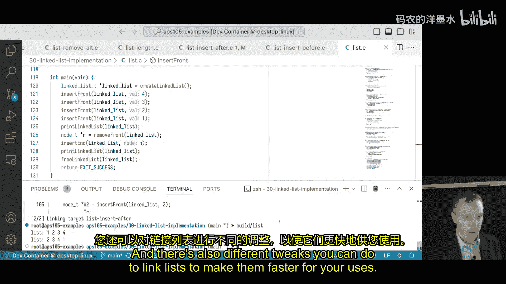
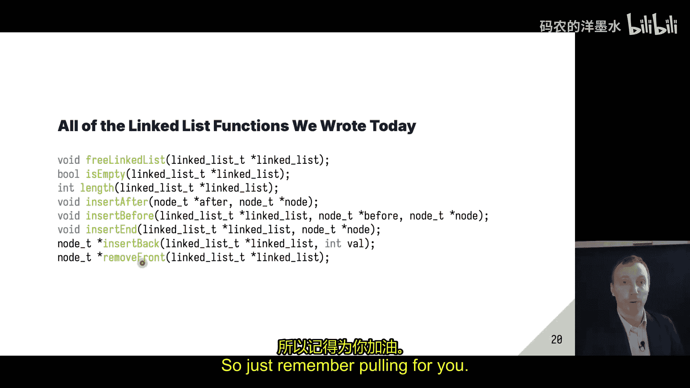

# 【全集】多伦多大学 C语言编程 中英字幕 1080P p30 Lecture 30 - 链表实现 -BV1gikKB3EZW_p30-

Alrighty， We back to 1，05。 So if I am tired at all， this is the reason。Yeah， those are five puppies。

 So if I'm。Sleep deprived。That's why all right， fun。

 so talking about link lists and we get to talk more about their implementation today。

 so let us just dive into the code。And solve our first one because someone already identified this in discord。

 which was great， so。😊，Let's say I have a linked list。 So first off。

 any questions about anything we did yesterday， We had lots of fun。 right， Link lists are cool。

 It's just pointers on pointers on pointers。😊，All right， sweet。 today， yay， more linked list。

 more pointers， more fun。 I think I said that yesterday too。😊，So。If we do something like this。

 we create a link list and let's say we wrote that function insert front last time that just created a new node。

 put it at the front。 So if I do that， let's say I create four nodes this time。

 and then we always say that we should free our memory once we're done using it。 So in this case。

 after printing my list I'm done with it so I can free the link list which is basically just a location to store the head pointer for my link list。

 then I can free node 1 node2 node4 and exit。 So what is the bug with my program。Yeah。

 I didn't free number 3， right， kind of a pain in the。 you know what。

 If we have a whole bunch of nodes， we forget to free just one。And then everything unravel。

 So first thing we should probably do is be like， oh， well。

 maybe I just write a function that freeze， that entire linked list itself。

 frees every single element。 So maybe I go ahead， write a function。 that's called， I don't know。

 There's one called create linked list。 So let's try calling it。 I don't know。 void free linked list。

Now it would take a linked list type。As a parameter by pointer so we can go ahead and actually。

Use that address if we want to change the head or whatever or actually free it。

 So how would we go about。Freeing everything in this linked list。 Well。

 we have to be really careful so we don't try and use the memory after we free it。

So if we did something like just free link list， and then I was like， oh， well。

 maybe I need a node to keep track of the current node， I need to free。

And I did something like I initially said it at head。So like I did my looping thing before。

If I do something like this， this is also wrong， right。 So this is a use after free。

 So if I go ahead and let's see， it's free link list。Let's get rid of all those individual calls。

So if I do something like this。This should not work， right， because well， I have a free。

 And then all the memory associated with this linked list pointer is free。

 So if I try to access one of its fields。 So remember the arrow de references the linked list first and then accesses this head field。

 which is the variable defined find an thestruct， if I do this and try and run it， well。

Then it works， oh great。Turns out it worked， but if I use velgrind。

 it would probably complain at me very loudly。Saying that， hey。

 here's an invalid read of P 6 I shouldn't have actually done that because that's a use after free。

 So I have to be very careful after I get the pointer of the head。

 only then can I free it because then I'm done with that link list structure， I don't need anything。

 I just need to get the current value of head。 and then I could go ahead and write my while loop like before。

 So while current does not equal null。So in this case， can I just free？Current。

 and then go current equals current。Next。Is that a great thing to do？Probably not。 samee issue again。

 But now this time I'm freeing the node。 And now in this line。

 I'm trying to dereence it and then access its next field。 So， again。

 this is the same problem of views after free。 So I probably just。

 I'd like really want to capture the value of next because I need it to go to the next element。

 But I also need to free the structure that has that next variable within it。 So。To solve that。

 we just create a new temporary variable。 We could call it next and capture current dot next。

 Then we can free current， and then just use that variable to set to reset current to next and do something like that。

And now doing that。Are we done？Yeah， look looks pretty decent to me。

 Should iterate through everything free， every single node until the very end。 So now if I run that。

If we double check， all right， now we have a bunch of unused variables because， well。

 we don't need to free them anymore， so。If we wanted vgri。We get all he blocks were freed。

 No leaks possible，6 allocation，6 freeze。 It is all happy with us。 It is not yelling at us at all。

 And as a bonus。We can actually get rid of some pointers。 We actually don't need any of this。

 We can just simply delete it。 So now our code looks like this。No memory leaks。 We're all good。

 So a questions about that。 And starting to， I mean， there's a lot of pointers going on。

 But once we write the functions once， we can just use free link list。

Then we don't have to worry about iterating through them ever again。 We just use our function。

Alright， any questions about that before we do more fun things。 It's just gonna be like all pointers。

 all linked lists today。And。Wait， is La 9 released yet。Okay。

 so lab 9 will have linked list we're like a week ahead of other sections。

 so you could it'll probably don't quote me on this。

 but it should be do it like the last day of class since the other sections are behind。

 but we can go ahead， we can finish it long before。 if you can。

 you can give it a read if you have any questions that are specific to that。

But the stuff I'll introduce today will probably answer that as well。So。

That's our function that frees everything for us。 again， put it in the slide so you can have it。

All right， our next task is going to be a fun one。 It is going to be removing a node。So。In this。

 we're going to assume we have a pointer to node 3 there。

 And then we just want to remove node 3 from this list。

 So what are the changes we need to make in order to remove node 3 from this list。是。

So do I need to change the head pointer， oh wait， yeah， way up there。没。Yeah， so the first step。

 probably， if I want to remove node 3 and I've appointed to it well。actually remove it from the list。

 I have to take node2s next pointer and point it to node 4 instead of node 3， right。

 I have to like look at the node behind me and move its next pointer to go to my next right so yeah that would be the first step is take nodes2 next pointer and point it to my next So they should both be pointing at node 4 and then。

That could be it because now if I iterated through the list， I started head。 I go to one， print 1。

 go to 2， print 2， and then  two leads me to 4。 So I would get 1，2，4，3 would be gone， right。

If I want to be nice， maybe in node 3 I set next to null。 So maybe I do that。

 so I just set next to null， clean it up， could do that if we want。

 Some people don't bother because it's not in the list anymore。

 but just in case we will set it to null just to be super careful。So， yeah。So node 3 is next pointer。

 we set to null because we're assuming it's not in the list anymore。

 but it doesn't really matter We can just leave it。 It's next pointing to4， if we want。

 because if we try and iterate through the list， we won't ever access node 3 anymore， right。

 We'll go from  one to 2 to 4。So up to us whether or not we want to update it to mill。Okay， so。

To remove that， to think about it， like in terms of what steps a computer would have to take。

We can probably create a variable calledPrevious。 We can initialize it to null。

 And while if we have a list that we only have head and then a pointer to node 3， Well。

 the only way to get to node 2 is just by iterating from the head and trying to find node 2， right。

 And another way to think of it is。Well， if I know the head of the list in node 3。

 I can just keep a variable calledPrevious that points to whatever the previous node is。

 and then I can keep updating previous until I find node3。

 which matches the pointer I have in this case， previous should point at node2。

 and then I can go ahead and change the pointers and all that fun stuff。So， that is our。Goal here。

 So we're going to iterate through the list till we find our node updating previous so that at least in this example。

 previous should be equal to node 2。 And then once we find the node while we know the previous node。

 we can update the previous nodes next to point to our next。

 and then we're effectively removed from the list。So。Another thing to think of this are edge cases。

 So what if the list is empty， what if。The node is the head of the list， well。

Previous is null after the search， that means the node you are trying to delete is the head。

 so instead of updating a next pointer you have to update linkless head instead of the previouss next pointer because there is no previous and maybe the other edge case is that the node you're trying to delete isn't in the list there's different implementations for this。

2 valid things to do is you could just crash and just say， hey。

 you're not allowed to try and remove a node that's not currently in the list。

 or you could just do nothing。 You could detect the error。 We'll do both today， just for fun。So。

Let's try and write。to the node remove function。So get back here， known for。All right，To write。

 remove nodes。 So we're given the link list that way we can access head and everything。

 And then we're given the node we want to delete。So if we follow those steps。

 we kind of argued of before。 Maybe I create a pointer called。Previous。Set it equal to null。

 And then like I had when I was iterating through the list to print all the values。

 while I could go ahead and have a node called current。 And that would， oops， linked list。

I can't type。So I could set up to linked list head and then have my wild loop that iterates through the loop。

 so while current does not equal null。I can go ahead and while I could update previous equal to current。

And then， current equal to current。Next。So that's the way I could go ahead。

 update the previous over and over and over again， but while this will just iterate until I hit the end of the list。

But really， I'm actually looking for a node， right， So I'm actually looking for this node。

So I should probably stop this while loop while， you know。Current does not equal this node。

 If current equals this node， I want to stop this while loop because I want my previous to be the previous one to this node。

 So another condition I can add to my while loop is just current does not equal the node。

So in order to go through the wall loop， these both have to be true， right。

 so I can't be at the end of the list。 So current is null。

 And while I want it to stop if current equals a node， that means I found it。And I'm done。

 if I don't care about the case where I crash， I could just have this condition。 and that's it。

 if I really wanted to。 But we'll leave them both in for now。 So any questions about that。😔，Okay。

 so what pointers should I update so we can go back real quick。 Let's see。So first pointer I updated。

 So in this case， if were removing three， hopefully previous is equal to node 2， right。

 So what is the pointer update I make。So。This is previous。And this is node。

And want to tell me which one I update。第二。Yeah， so if this is previous and this is。Noode or current。

And if I want this at the end， well， then I have to update previous next to be equal to my next。

 So I get that， right。So in this case， previous is two。Notode is three， so previous is next。

 so this should be equal to this is next。 so they're both pointing at the same thing。So if I do that。

 let's see。So previous next equals to just node next， current next shouldn't matter。

So this should remove it， right？Alright， well， let's just try， try it out。

 So here I'll give these names again。 So let's see。Let's call this node 4。

 So let's print the link list。 Then we'll try to remove。So hopefully if I do this。

What should my link list print on that second line here。Well， I see 1，2，3，4。

Or something hopefully different。Yeah，1，2，3， hopefully， right。 So let's walk through it step by step。

 Make sure it works。 This program is called list free。So second time I print it， I get 1，2，3。

Because I tried to remove node 4， right， So if I tried to remove node 4， let's see like my picture。

Well。Notode 4， its previous was 3， so I would have updated threes next to be equal to fours next。

 which is both null。 So there're just point that would effectively end the list。

 So I would never reach 4。 So I just get 1，2，3， so。With our code， am I done is this perfect code。

 Or do I have another edge case to consider， So one worked。 Let's make sure let's for fun。

 we can give。😊，Noode3。 so like our example， make sure it works。 So let's remove node3。

So now I remove node 3。 My list says 1，2，4。 So 3 got red。I got rid of three。

So anything else I need to consider in this。Yeah， said it was good practice to。Yep。

 so I could make note 3 point to null or another or。Whatever I'm updating。

 So the nodes next is equal to null like that。 Yeah， that's good， yeah。The first node， Yeah。

 So we got a slight issue here。So let's say we tried to remove node 1。We compile， we run it。Boom。

 our favorite era， segmentation full。Why did that happen？So what's previous to one。Yeah。Yeah。

So what happened， we currently set previous to null。 And then while。

 current is equal to the linked list head。 In this case， it would be node1。

 And then well we're trying to remove one。 So current would be equal to the node we're trying to remove。

 So the while loop would break because it's the first one， we wouldn't go into it。 So at this line。

Previous is equal to null。 And then if we try to dereence previous， which is what this is doing。

 that de references null， then we get a segmentation fault。

 So we have to take into consideration the case where if previous is equal to null。

That's that corner case where the first element we're trying to remove is the head right。

 So all I need to do is make the link lists head equals to node dot next。

And then only if previous is not nulled， then I update the previous node。

 So it should look like that， right。So let's make sure we work。Boom。We work。All right。

Any questions about that， cause that will probably be。The hardest one。

 although I'll show you a way to do it in less lines of code， but it will probably hurt a little bit。

So any questions about that before we carry on。All right。Perfect， so yeah， again。

 linked lists are hard， so if you have any questions， feel free to ask whenever。So。

Here's us removing its。Oh yeah。 and I have another corner case because current could be null if this node is no longer in the list。

 but we said we could crash， we could not， but turns out if we want to do something like this。

 if current，Is null AK， we didn't find it， then we could just return and do nothing。

And then if I try to remove node one twice， our program doesn't do anything， just carries on。

 keeps on working。Well。If I didn't care about the case of like the node not being in the list and it can crash。

 I can simplify it a little bit like this。I can just get rid of that check。 So if。

The node isn't in the list。 This loop will just keep on going forever and ever and ever until eventually we get current is equal to null。

 like it reaches the end of the list。 And then it's going to try and de referenceence null。

 And then it's kind of segmentation fault。 So if I do that this time。Boom， I guess。

 segmentation fault。 if I try and delete it， if it's not in the list。

 if I just try and delete it once， it should work。 No problem。So。Works now。

 two different ways to write it depends whether or not you want to crash if it's not the list or。

 you know， just carry on and just kind of ignore it。So questions about that。 that's lots of fun。

All right。So， that is。The way people usually introduce it。

 we could think about this problem more indirectly。

 So another way we could think about is we could check like the address values for head and next until I find the nodes address。

 So then I know。I'm essentially updating its pointer instead of going backwards and updating its next。

 So I just like get the address of its next pointer， which might hurt the brain a little bit。

 And then I update that it actually simplifies and removes that edge case。

 So after I find my address。 Well， it's either stored it in a head or next pointer。

 So I can just update that value to point to my next。

 And I don't have to worry about any corner cases anymore。 So。I note this may be very confusing。

 at first。 I'm throwing this in here because， well。

 the head developer of the Linux kernel that everyone's everything runs in， likes it this way better。

 And they are an expert and see。 So if you want more explanation for it。

 There's a link in the slides。 But I will introduce it and try to explain it。😊。

So I could rewrite it to just check all the pointers。 And why does this hurt， Well。

 because I have to use a pointer to a pointer to a node。Why do I have to do that。

 Because I'm checking like the head and the next field of all the nodes。

 So here I'm just looking for my address in one of those fields。 And I'm trying to update it。

 So I could have a pointer to a pointer to the node that starts at the address of the link list head。

 And then in the while loop， I could simplify it。 If I'm just， this is equivalent of the other cases。

 So while。It's next or head is not equal to me。 I just keep going on。And then I update it。

 so I have to dereference P。 so that becomes just the node pointer。

 and then I can take access the next field， and then I can take the address of it to go to the next one。

Boy， does that look ugly， right？ But really， all that's doing。

 Let's see if I can try and illustrate it。Basically， all that's doing in this case。This case， yeah。

 what that's doing in this case is， it's pointing to head。 And then it's checking。

 So if we're removing node 3， it's pointing to head and saying， does head point to node 3， No， okay。

 does this next point to node 3。 No， does this next point to node 3。 Oh， yes， Well。

 I can just update it， I can just change that to point to node 3 is next。

And then I also don't have a corner case because if I want to remove node one。

 well heads pointing to node1， oh， well， I can just change head。

 which is just a pointer to a pointer， I'm just changing the value， I can have it point to node2。

 and I don't have a corner case anymore。It's weird， but it works。

 If you like the corner case1 better， you can think of it that way because， yeah。

 this is a pointer to a pointer， so。This is what it looks like if I wanted to just get rid of the case where it's not found in the list。

 I could actually delete this line if I wanted to and then to update it。 Well， I just dereference P。

 So that's either pointing to the head of the list if it's the first one or some next field of another node。

 and I just update that the point to my next。 and then I'm done。So。

This one might take time to set in。 so you can go ahead， look at it again later。

 Or if you want to just ignore it completely， you can do that and just do the other case， which is。

This one， which just。More clearly illustrates that you'rere looking for the previous node than then changing its next pointer。

 The only difference is。You have to keep track of this edge case where it's the first element of the list。

Alright， other useful functions。 So we can just write a whole bunch of useful functions。

 like getting the length of a list， seeing if it's empty so we could write a few other functions。😊。

So like， if I wanted to， I could write is empty and for is empty。 Well， if the list is empty。

 that's the same as the head just being null， right， It's not pointing to anything。

 So that could be my Boolean。 Hopefully we remember those。To check if the list is empty。

 if I wanted to get the length of the list。 So like our equivalent array length macro before。

 except now， because it's a pointer， it always works。 Well， I could start off with the length is 0。

Create just iterate over the list like we've been doing so far。 So create a variable called current。

 set it equal to the list head and then have a while loops。

 So while current does not equal null length goes up by one。

 And then we go to the next pointer until we're eventually done。 And then we return the length。

 So this would return the length of the list。We could write that recursively too， right？

The base case would just be null。 The length is0。 Otherwise， my recursive case would be okay， well。

 one plus the length of the rest of the list， right。

 So could get practice right recursively if you really want。

 I could also write is empty in terms of length So instead of checking if the head is null。

 I could check if the length is0 means the same thing， right。

 So might want to compose our functions that way， doesn't really matter。Alright。

 let's talk about insertion now， which is。A fun， more fun case。

 So say we're in this scenario where our link lists， we remove three。 So now we have one points to2。

 points to4。 and we just have kind of node 3。Just out in the wilderness。

 And what about if we want to put node 3 back in the list。

 So what if I wanted to insert it after node 2。So how， how would I insert it after node 2。Yeah。

 assuming note 3 is created。Yeah， insert。第。Ex。Yeah， yeah。

 So I need the next of the second node pointing to the third。And whatever this was pointing to。

 I need to make me point to it right？ So order here is going to matter。

 So if I update two is next to point to 3 now I can't point at4 anymore。

 So I probably need to update the other one first。 Yeah。

 so first step I should do is if I want to insert 3， after node 2 Well。

 I take whatever node2 is pointing2 next。 So in this case 4， and then node 3 points to42。

 So now they're pointing to the same node。 And now instead of node 2， pointing to node 4。

 it should now point to me node3 and now it is back in the list， right。So just two pointer updates。

 if we were to write that。222。All right。I have suffered retrograde amnesia help。

What were those two pointers I had to update？So。In that case， what was I trying to do。

 I was trying to insert this node after this one，不是。So， yeah， so。Afters next is。Mhm。Yeah。

 it's gonna be this node's new next， right？ So in the case on the slide。Well， in this case。

 after would have been node 2。 So node 2 is next。 node 4。

 So I need to make me point to that node as well。 So in code， that would mean that my next。

Is equal to afters next， right？And then after is next。Is just the node itself， right。So in this case。

 I just。Take its next。 Now， my next is its next。 And instead of it pointing to whatever its next was。

 it is now pointing to me。Right， so I just。Or you can think of this as you just like swooped in in line in somewhere。

 You just cut in line。 Everyone enjoys those people， right。So。Let's see here。So to test that。

 it worked。I create that linked list again， so。4，3，2，1。 then I remove node 4。 So when I print it。

 it should be 1，2，3。 And then maybe I just create a new node and try and insert it after node 2。

 So after this point， I should see 1，2，7，3， right， And then print the link list and free it。

 So let's see if we work。Build。Insert after boom。So that seems to work as well， right。

 So I inserted after node 2， node 7。Maybe I want to check if it works at the end as a corner case。

 so I could insert it after node3。So insert after node3。In this case， it should work。

 It should just throw it at the end because node 3 is pointing to null。

 So makes me also point to null and then makes node 3 point to 7。 So still works。

 So no other corner cases。Insert after。Just two little pointer updates。 So with linked list。

I find it easier like that diagram just to draw out the pointers and figure out what needs to change。

The order， you kind of have to look at the code and be like， oh， okay， well I need after next。

 So I can't update it until I use its value。 otherwise， I lose it。And。Typically。

 that's what trips people up because it's really easy to lose the pointer。

 If I update it in the wrong order， we've seen numerous times。 If I just flip the two lines。

 really bad things happen。For fun， we can flip these lines。 We， So if we flip these lines。

 what's going to happen。😊，Yeah。Or no， still confused。Yeah。Just those little ways in。くれ。Yeah。

 you're setting nodes next。Yeah， so basically， like。TheAfter nodes next， so points to seven。

 so like in this case。Let's go。 So 3 would point to 7。

 and then sevens next would point to afters next， which is 7。So it should just be like1，2，3，7，7s。

Oops， I didn't compile it。 Sometimes you need to compile things。And then 7，7，7。 So yeah。

 you will probably， so if you see this while you're doing linked lists。

 you didn't write an infinite loop。 you just you know made a pointer point to itself recursively over and over over again。

 So just be wary when you do that because just flipping the lines of code gets really hairy。

 I think that's what at least the second time we flipped two lines of code and made it point to itself。

 and then it just print infinite loop over and over and over again。 So that's lots of fun。

 So any questions about that。All right， then let's go for a challenge then。So where we am now。So。

Challenge， so we want to insert a node before another node。So let's assume it's set up like this。

 So my link list has one pointing to3， pointing to4。 And then I want to insert node 2 before node 3。

Yeah， this should seem。 So I'll give you a minute。 This should seem familiar。To。What we do first。

I forget， Yeah， removing the node。 Yeah， it should look fairly similar to removing the node。

So give you a minute to think about how we should do this。 But hint。

 it looks pretty similar to the removing node。AndLet me make sure that。Alright。

 anyone want to explain what I should do in this case。

 You can be fairly vague and use the word previous and blah， blah， blah， but I'm trying to。

Take node 2 and insert it to node 3。 So I have the link list。 So I know the head。

 I have a pointer to 3， and I have a pointer to 2， which I would like to insert。

So what are my steps I need to do yeah。Yeah， so， well， so you said， I need to find node 3s previous。

 so I need to find node 1， right。And then I need to take that previous and make it point to me right。

 if I'm inserting to， so first step is I need to make its previous point to me and then my next should simply just point to well。

 the node that I'm inserting before， right my next should just be right next to node3 and it should look like this after right。

So we said previous， so we could kind of steal our operate or steal our implementation and do a nice little copy paste from remove node。

 So same idea。 this time， I'll just crash if it's not foundca I don't。

Because it fits on the slide better here。Set current equal to head previous to null。

 And then I'm looking for it。 So I'm looking for the node before。

 the 1 I want to remove or insert myself before。So I want to update previous。

 so I update previous and then update current。 And then after I am done this while loop。

 I know that current is equal to before。 So previous is the previous note to before。

A lot of words that kind of mean the same thing， but they're different nodes。 So in this case。

What was previous to node 3 was node 1。 So this would be previous。 This would be before。

And then node would be too。 So have to take the corner case again the previous as null。

 Then the head should point to me。 Otherwise， the previous next should point to me。

 And then my next should always point to the node I was inserted before， right。Who。

Everyone having fun with pointer updates yet。Alright， that's why this is fun， so。

Why I showed you the indirect one is that if you want。

To do the clever solution and look really smart， especially if you can actually explain this one。

 you could actually write insert before and remove like this。So in both cases。

 I'm kind of looking for that next pointer。 I'm like searching for something。

 So I could just write a function that returns a pointer to a pointer to a node。

 and that will either point to like the head pointer I need to update or the next one。

 I need to update and I can search for a node。 So as soon as I find it。

 I just return a pointer to that pointer。 So I can dereference it and update the value fun。

 But then that makes my remove node super short。 So after I find the node， I want to remove。

 So now it's pointing to some next field。 Well I can just update it to point to that nodes next。

 So it just skippped over that element， and then I could update nodes next to be equal to null or I could just remove that line。

 if I just want two lines。 and to be super clever。 My insert before also looks a lot shorter。

 So I can find where the before is So now。😊，P points to the pointer that has a next or a head that I need to update。

 so I can update it to point to me。 And then I point my next to before the node， right， Sam thing。

 but。I can write both functions that fit on a slide without doing the previous to do anything， so。

Again， you don't have to write your code like this。 I highly doubt the other sections will see this。

 But if you can understand this。It kind of looks oddly nice， right， It's like。

It's like debatable whether or not you want to read this because might。

 even if it makes like vague sense now， I bet if you go to sleep and you wake up and then you look at this again。

 you look at the first one。 You're like， what in the blue hell is that guy doing， but。You know。

 see programming is all about practice。So if you come back and you can read it after 10 minutes。

 then the next time you wake up， you can read it again after5。

 then you can read it again after like 2。 And then suddenly it kind of like makes sense and you're like。

 wow。You great program broer something I don't know。 I don't know what you would say。

 but oddly looks good。So。Other functions we can write。

 So we've done all of the hard ones So we could just write a function to insert a new node at the back because well before we got lost in the plot of all this。

 we were trying to remove an element from the front and then move it to the back。

 So we could write a function to insert it to the back。 So if I wanted to use that function again。

 Well， I could then this one will create the node for me So I can create a new node and then use that find indirect to find null。

 So it would find either the list head as null， meaning it's empty。

 or I'm at the last element like I'm at the end of the list。

 So I can just update that pointer to point to me instead， and that's all I have to do。

 or if I wanted to write some more code that looks familiar in terms of the other。 well。

I could just write a function called insert end。 that would。

Maybe be a bit nicer if I don't want to remember null would be like ending or adding to the beginning or the end。

 like just the end of the list。 So maybe I make a function called insert end that takes the link list and the node to put at the end。

 and then I could use that insert before with the null that would just put it at the end。

 and then maybe I write a function called insert back that will just go ahead and create the node for us so I can just create the node and then insert it at the end and then return a pointer to the node。

Just depends whatever you think is more useful。 So insert。

 and as soon as you already have a node that exists， insert back。

 we'll just go ahead and make the node for you。So any questions about those ones。Alright， fun。 Again。

 you can re view this later。 Like I said， we're ahead of other sections， so。😊。

We don't have lecture Friday。 So please， you know， you can ask on Discord。

 email me anything you want。 and we can explain it more， but。Just to wrap it up。

 we can have another function that can just like remove and return the first node So remove front while it could just get the node that's at the link list head。

Check the corner case that the list is empty。 So if the node does not equal null。

 then while I have to make the head of the list point to its next。 So I need to skip it by one。

 Otherwise， if node was null， that just means the list is empty。

 so I can just return null and just return node。 So now， finally。

 we can have our code that looks a bit nicer， we can have our linked list。

 we can insert all of our things at the back。So1，2，3，4， so we can do it in order now。

 might look a bit nicer instead of doing it in the reverse order like we did before。

 print the link list。 Now we can just remove the front of the list and get that node back so that should be one and then we can throw it to the end print the link list and then finally we have done it so。

Now， if we have this code and run it。We see that， well。

 we took one and we put it to the back of the list。And that was definitely easier than to raise。

 right。I only took two lectures to do that instead of a bunch of assignment savings。 So there's like。

A lot of other reasons to use link lists。 this is not the most efficient one， but。

We had fun with the journey， right， So we'll go over other reasons you want to use linked lists， so。

😊，Most of the time， the data structure you use is either like array or list and take some experience to know which one to use when。

 And there's also different tweaks you can do to link lists to make them faster for your uses。

 So here， let's see。

So other things we could do， whoops。

So other things we could do with the linked list is maybe in that linked list structure。

 maybe instead of you know keeping a pointer to the front。

 maybe I keep a pointer to the front and the back and that way I don't have to iterate through the list to access the back but of course it would be tricky to implement because we have a lot more corner cases so you know I would have to think if I need to remove the node and it's the only element in the list so it's both the front and the back I have to make sure that I've set both those pointers to null or if I add something I make sure that I set only if I add to the front I only update the front if I add to the back I only update the back and that way you wouldn't have to iterate through the list if I'm just like inserting at the end if you kept another pointer but we'll go over that later it's just more pointer front。

 more edge cases， more things we have to keep track of but。We did a lot of work today。

 So here's all the functions we wrote today。 So we sped run it。 We did a lot of pointer stuff。

 but we wrote a lot of useful functions。 So we wrote freeing the link list。

 We wrote checking if the link list is empty。 if it has no elements。

 We saw row function to return the length or how many elements are in the list。😊。

Wrote a function to insert a node before another or after another one。Which was fairly easy。

 That was two pointer updates。 The harder version of inserting before an element。

 which looked like remove。Oh， yeah。 And we also forgot。 We also wrote remove node， too。

 That's not even on here。 So we wrote an extra function。 So we wrote insert end。

 So that's to put a node at the end。 insert back， which created a node and put it at the end。

 Remove front。 We just that returns a node。 We just had a good old fun today。

 So you can enjoy your Easter break with that。 Ask any questions。 Like I said。

 email and figure that and yeah， don't be afraid because link lists。😊，Historically。

 the hardest topics or so I've been told。 So just remember， pulling and for you。

 we're all on this together。

