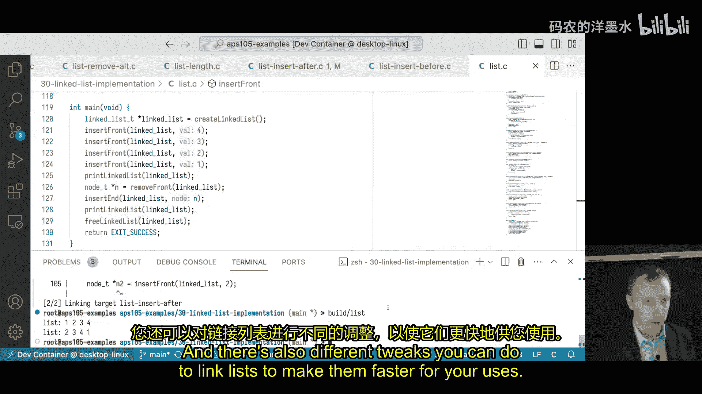
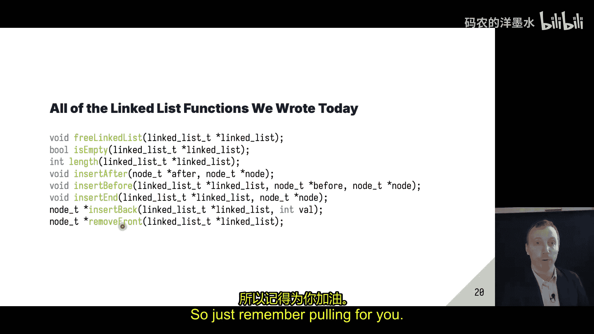

# C语言编程：第30讲：链表实现 🧩


在本节课中，我们将深入学习链表的具体实现。我们将探讨如何正确地释放链表内存、如何从链表中移除节点，以及如何在链表中插入节点。通过编写一系列实用函数，你将掌握操作链表的核心技巧。

## 释放链表内存 🧹

上一节我们介绍了链表的基本概念，本节中我们来看看如何安全地释放整个链表占用的内存。直接逐个释放节点容易出错，例如忘记释放某个节点或造成“释放后使用”的错误。

以下是安全释放链表的步骤：

1.  遍历链表，使用一个临时指针保存下一个节点的地址。
2.  释放当前节点。
3.  将当前指针移动到之前保存的下一个节点。
4.  重复此过程直到链表末尾。

对应的代码实现如下：
```c
void free_linked_list(LinkedList *list) {
    Node *current = list->head;
    Node *next;

    while (current != NULL) {
        next = current->next; // 保存下一个节点
        free(current);        // 释放当前节点
        current = next;       // 移动到下一个节点
    }
    // 可选：释放链表结构本身
    free(list);
}
```
使用这个函数可以确保释放所有节点，避免内存泄漏。

## 从链表中移除节点 🔗

现在，我们来看看如何从链表中移除一个指定的节点。核心思路是找到目标节点的前一个节点，然后修改其 `next` 指针，使其跳过目标节点，指向目标节点的下一个节点。

实现时需要考虑几个边界情况：

*   链表为空。
*   要移除的节点是链表的头节点（即没有前一个节点）。
*   要移除的节点不在链表中。

以下是处理这些情况的移除函数：
```c
void remove_node(LinkedList *list, Node *node_to_remove) {
    if (list->head == NULL || node_to_remove == NULL) {
        return; // 链表为空或节点无效，直接返回
    }

    Node *current = list->head;
    Node *previous = NULL;

    // 遍历寻找目标节点
    while (current != NULL && current != node_to_remove) {
        previous = current;
        current = current->next;
    }

    // 如果没找到节点，直接返回
    if (current == NULL) {
        return;
    }

    // 如果找到的是头节点
    if (previous == NULL) {
        list->head = node_to_remove->next;
    } else {
        // 如果是中间或尾部节点
        previous->next = node_to_remove->next;
    }

    // 可选：将移除节点的next置为NULL，使其完全脱离链表
    node_to_remove->next = NULL;
}
```
还有一种更简洁但理解起来略有难度的“间接寻址”方法，它通过操作指向指针的指针来统一处理头节点和中间节点的情况。

## 在链表中插入节点 ➕

接下来，我们学习如何在链表中插入节点。我们先看相对简单的“在某个节点之后插入”。

假设要在节点 `after` 之后插入新节点 `new_node`，需要两步操作：

1.  让新节点的 `next` 指向 `after` 节点的原下一个节点。
2.  让 `after` 节点的 `next` 指向新节点。

**注意：** 这两步的顺序不能颠倒，否则会丢失原下一个节点的引用。
```c
void insert_after(Node *after, Node *new_node) {
    if (after == NULL || new_node == NULL) {
        return;
    }
    new_node->next = after->next;
    after->next = new_node;
}
```
“在某个节点之前插入”则稍微复杂一些，因为它需要找到目标节点的前驱节点，其逻辑与 `remove_node` 函数类似。

## 其他实用链表函数 🛠️

掌握了核心操作后，我们可以编写一些辅助函数来更方便地使用链表。

以下是几个常用函数：

*   **判断链表是否为空：** 检查头指针是否为 `NULL`。
    ```c
    bool is_empty(LinkedList *list) {
        return list->head == NULL;
    }
    ```
*   **计算链表长度：** 遍历链表并计数。
    ```c
    int length(LinkedList *list) {
        int count = 0;
        Node *current = list->head;
        while (current != NULL) {
            count++;
            current = current->next;
        }
        return count;
    }
    ```
*   **在链表尾部插入节点：** 遍历到链表末尾，然后进行插入。
    ```c
    void insert_at_end(LinkedList *list, Node *new_node) {
        if (list->head == NULL) {
            list->head = new_node;
            return;
        }
        Node *current = list->head;
        while (current->next != NULL) {
            current = current->next;
        }
        current->next = new_node;
        new_node->next = NULL;
    }
    ```
*   **移除并返回头节点：** 将头指针指向第二个节点，并返回原头节点。
    ```c
    Node* remove_front(LinkedList *list) {
        if (list->head == NULL) {
            return NULL;
        }
        Node *removed_node = list->head;
        list->head = list->head->next;
        removed_node->next = NULL; // 使其脱离链表
        return removed_node;
    }
    ```




## 总结 📚



本节课中我们一起学习了链表的详细实现。我们掌握了如何安全地释放链表内存，如何实现节点的移除与插入操作，并编写了一系列实用的链表工具函数。链表操作的核心在于谨慎地管理指针，理解节点之间的连接关系，并妥善处理各种边界情况。虽然涉及许多指针操作，但通过反复练习和理解这些基本模式，你将能够熟练地运用这一强大的数据结构。