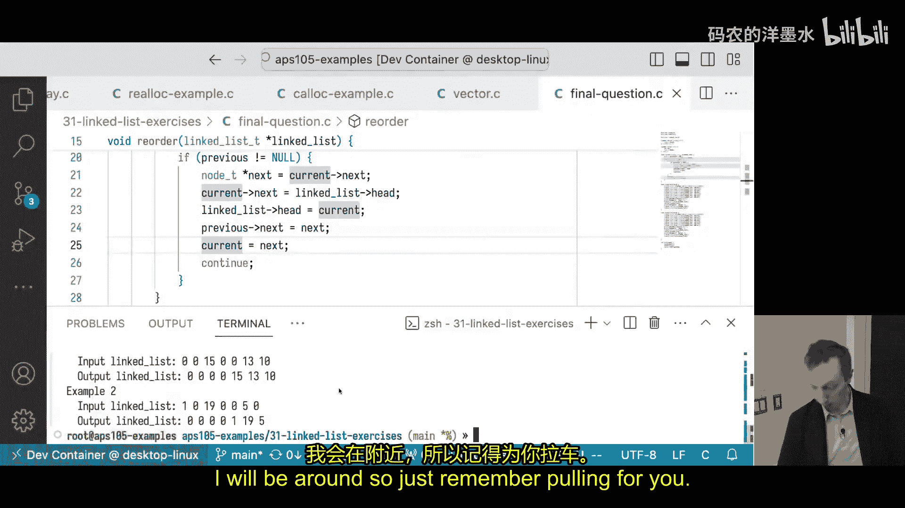

# C语言编程：31：链表练习与动态数组


在本节课中，我们将继续练习链表操作，并学习如何动态调整数组大小。我们将编写几个实用的链表函数，并了解C语言中用于内存管理的其他工具。

## 链表函数库

上一节我们介绍了链表的基本操作。本节中，我们将封装这些操作为一个函数库，让用户无需直接操作节点结构，使接口更接近Python等高级语言。

我们之前已经编写了以下函数：
*   `linklist_create`：初始化链表，将头指针设为 `NULL`。
*   `linklist_free`：释放链表所有节点，清理内存。
*   `linklist_empty` / `linklist_length`：检查链表是否为空并获取其长度。
*   `linklist_insert_front`：在链表头部插入一个新值。

我们还编写了从链表头部移除节点的函数 `linklist_remove_front`。今天，我们将编写几个新的函数。

以下是今天将要实现的新功能：
*   `linklist_contains`：检查链表中是否包含某个特定值。
*   `linklist_remove_first`：移除链表中第一个匹配的节点。
*   `linklist_remove_all`：移除链表中所有匹配的节点。

### 检查值是否存在

首先，我们编写函数检查一个值是否存在于链表中。该函数遍历链表，若找到匹配值则立即返回 `true`。

```c
bool linklist_contains(LinkList *list, int value) {
    Node *current = list->head;
    while (current != NULL) {
        if (current->value == value) {
            return true;
        }
        current = current->next;
    }
    return false;
}
```

### 移除第一个匹配值

接下来，我们实现移除第一个匹配值的函数。这需要小心处理指针，以确保链表不会断裂。

```c
bool linklist_remove_first(LinkList *list, int value) {
    Node *current = list->head;
    Node *previous = NULL;

    while (current != NULL) {
        if (current->value == value) {
            Node *next = current->next; // 保存下一个节点
            free(current); // 释放当前节点

            // 更新指针
            if (previous == NULL) {
                // 要删除的是头节点
                list->head = next;
            } else {
                // 要删除的是中间或尾部节点
                previous->next = next;
            }
            return true; // 成功移除
        }
        // 继续遍历
        previous = current;
        current = current->next;
    }
    return false; // 未找到该值
}
```

### 移除所有匹配值

最后，我们可以利用 `linklist_remove_first` 函数轻松实现移除所有匹配值的功能。

```c
int linklist_remove_all(LinkList *list, int value) {
    int removed_count = 0;
    while (linklist_remove_first(list, value)) {
        removed_count++;
    }
    return removed_count;
}
```

## 链表的应用：计算总和

了解了链表的基本操作后，我们来看看一个有趣的应用：如何仅通过“从头部移除两个数，将其和放回头部”这一操作，来计算链表中所有数字的总和。

其核心思想是循环执行以下步骤，直到链表中只剩一个节点：
1.  从链表头部移除两个节点，获取其值 `a` 和 `b`。
2.  计算 `sum = a + b`。
3.  将 `sum` 作为新节点插入链表头部。

最终，链表中剩下的唯一节点值就是总和。这个过程模拟了计算机逐对相加的工作方式，也体现了“栈”（后进先出）数据结构的特点。

## 动态数组与内存管理

尽管链表在某些场景下有用，但在大多数情况下，数组因其内存连续性和缓存友好性而速度更快。C语言提供了动态调整数组大小的功能。

### 手动调整数组大小

在只知道 `malloc` 和 `free` 的情况下，调整数组大小需要手动分配新内存、复制数据并释放旧内存。

```c
int *array = malloc(4 * sizeof(int));
// ... 使用数组
int new_length = 7;
int *new_array = malloc(new_length * sizeof(int));
// 检查 malloc 是否成功...
// 复制旧数据
for (int i = 0; i < (4 < new_length ? 4 : new_length); i++) {
    new_array[i] = array[i];
}
free(array); // 释放旧内存
array = new_array; // 指向新内存
length = new_length;
// 初始化新增部分
for (int i = 4; i < new_length; i++) {
    array[i] = 0;
}
```

### 使用 `realloc` 函数

C标准库提供了 `realloc` 函数来简化这个过程。它可以尝试调整已有内存块的大小，并在需要时自动复制数据。

```c
int *new_array = realloc(array, new_length * sizeof(int));
if (new_array == NULL) {
    // 处理错误：内存不足
    free(array);
    exit(EXIT_FAILURE);
}
array = new_array;
length = new_length;
```
`realloc` 的第一个参数如果是 `NULL`，则其行为等同于 `malloc`。

### 使用 `calloc` 函数初始化内存

另一个有用的函数是 `calloc`，它在分配内存的同时将其初始化为0。这可以避免使用未初始化内存导致的随机错误。

```c
// malloc 分配的内存内容是未定义的（可能是随机值）
int *arr1 = malloc(10 * sizeof(int));

// calloc 分配的内存内容保证为0
int *arr2 = calloc(10, sizeof(int));
```

## 封装动态数组：向量（Vector）

为了方便管理动态数组及其容量，我们可以创建一个“向量”结构体，将数据指针、当前长度和总容量打包在一起。

```c
typedef struct {
    int *data;
    int length;
    int capacity;
} Vector;

Vector *vector_create(int initial_length) {
    Vector *vec = malloc(sizeof(Vector));
    vec->data = calloc(initial_length, sizeof(int)); // 使用 calloc 初始化
    // 错误检查...
    vec->length = initial_length;
    vec->capacity = initial_length;
    return vec;
}

void vector_resize(Vector *vec, int new_length) {
    if (new_length <= vec->capacity) {
        // 缩小：仅更新长度，保留容量以便后续扩展
        vec->length = new_length;
    } else {
        // 扩大：需要重新分配内存
        int *new_data = realloc(vec->data, new_length * sizeof(int));
        // 错误检查...
        vec->data = new_data;
        vec->capacity = new_length;
        vec->length = new_length;
    }
}
```
使用向量结构可以让代码更清晰，并减少因忘记关联数组长度和指针而导致的错误。

## 链表综合练习：重排序节点

最后，我们通过一个来自期末考试的题目来综合练习链表操作。题目要求编写函数 `reorder`，重新排列链表节点，使所有值为0的节点出现在链表前端，非零节点保持原有顺序出现在后端，且不能修改节点的数据域或创建新节点。

**解题思路**：遍历链表。当遇到值为0且不是头节点的节点时，将其移动到链表头部。我们需要仔细更新相关节点的 `next` 指针以及链表的 `head` 指针，并注意更新遍历指针以避免死循环。

```c
void reorder(LinkList *list) {
    Node *current = list->head;
    Node *previous = NULL;

    while (current != NULL) {
        if (current->value == 0 && previous != NULL) {
            // 将 current 节点移动到头部
            Node *next = current->next; // 保存下一个节点
            previous->next = next; // 前驱节点跳过 current

            current->next = list->head; // current 指向原头部
            list->head = current; // 更新头指针为 current

            current = next; // 当前节点更新为保存的下一个节点
            continue; // 跳过本次循环的指针后移操作
        }
        // 正常遍历后移指针
        previous = current;
        current = current->next;
    }
}
```

## 总结

本节课中我们一起学习了：
1.  实现了更复杂的链表操作函数，包括查找、移除首个匹配值和移除所有匹配值。
2.  探索了链表的一个应用场景，模拟了加法运算的过程。
3.  学习了C语言中动态管理数组内存的工具：`realloc` 用于调整大小，`calloc` 用于分配并初始化内存。
4.  介绍了将动态数组封装成“向量”结构体的思想，以提高代码的模块化和安全性。
5.  通过一个重排序链表节点的综合题目，巩固了链表指针操作的技巧。



记住，虽然链表是重要的数据结构，但在追求性能时，连续内存的数组通常是更优的选择。根据具体问题灵活选用合适的数据结构是关键。