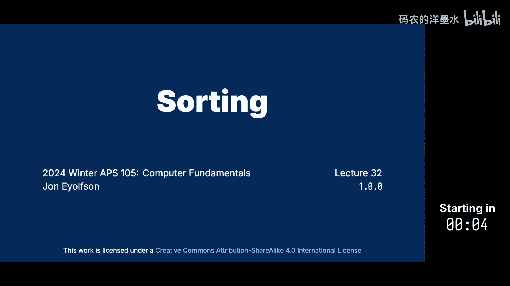
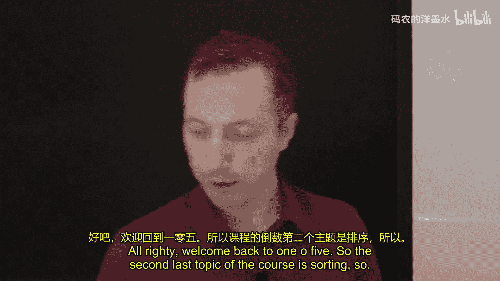
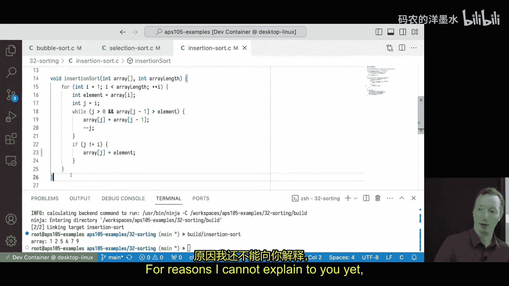
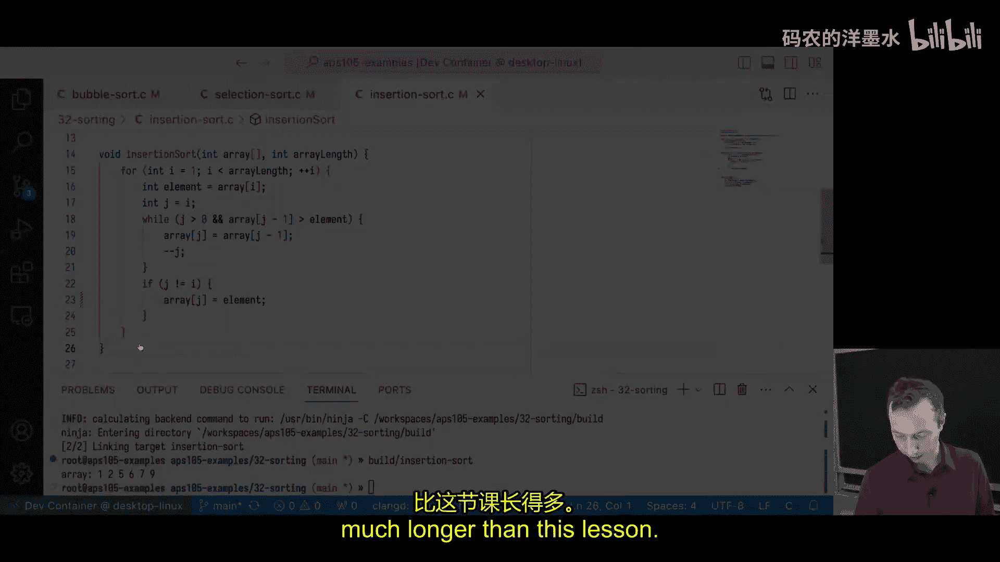
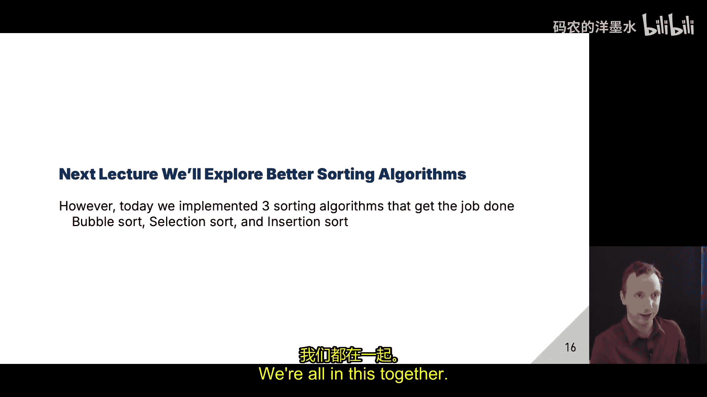

# 【全集】多伦多大学 C语言编程 中英字幕 1080P p32 Lecture 32 - 排序 -BV1gikKB3EZW_p32-

Alrighty， welcomee back to 105。 So the second last topic of the course is sorting。

 So why are we doing sorting？ Well， one of the most。😊。

Common problems you'll probably encounter throughout programming。

You don't really have to solve it yourself， but it's good to know how it's done because it will come up and you'll need to use it。

 So you should probably understand what is going on。 So computers are really， really fast。

 but they don't really care about the order of the data whenever it needs to present it to a human。

 such as yourself。Probably it should be in some type of order。 So it's easier for you to read。

And so today， we will discuss several sorting algorithms throughout the lecture。

 And if I haven't used the word algorithm before， algorithm， just a set of steps to solve a problem。

 So hes break it down one step at a time。Typically， in more or less， a programming language like C。

So here is our problem for today。 So we may need to sort an array。

 So we are given an array such as this in array that has four elements in it。

So our has the elements and they'll be in order of their indexes。 So start at index zero and go on。

The actual values are 2，5，3，1。And we want to write a function that will sort the array in ascending order so we can go in either order。

 So we'll go in ascending order， which means the lowest number should come first。

 then the next lowest then the next lowest and the next lowest and so on and so forth。

 and the largest number should be at the end。 So after sorting。

 the elements of the array should be in this case，1，2，3， and 5， So they should be in order。So。

Given that this is our problem today， let's go ahead and take a minute to think about how to sort it。

Using C， trying to explain it to a dumb computer。 So essentially everyone probably knows how to sort if you're given a deck of cards or something like that。

 But how do you really break it down。 So computers they are essentially like telling a twoy old what to do。

 They can't do many things at once and what they can do is pretty simple。

 So computers can only compare two elements at once and tell you whether or not one is greater than the other one or less whatever you want。

 And then the only other operation we should need for sorting is just swapping two elements in array and we wrote that before just to swap two elements。

 So let us think about this for a minute。 So given an array such as that。

 how would you explain it essentially to a twoy old called C。

 how to actually sort the number numbers in。The array。So give you a minute to think about that。

 And then we will dive into some ideas other people have had。And explore them， evaluate them。

 and see how they would work。好。就ju。Alright， that's about a minute。

 So anyone want to give me any ideas how to sort。How you explain sorting to a dumb two year old。

 yeah。そういた戦刻にけ。ため。然后呢。有。Switch down。Yeah， so I compare the first element of the array with the second one。

 see if they're in order or not。 So in this case， I compare two to5。

 And in this case they're in the right order。 if I want the smallest to come before and then while I can do that to the next pair like three and 5 and compare them in this case。

 okay while they're not in the right order。 So maybe I swap them so that we have three。

5 and then I could go ahead， compare the next two and then they're not in the right order so I should swap them again and make sure it goes one then5 and then I do that whole process again。

 so I scan the whole array again make sure that see if they're in the right order if they're not。

 I swap them and I keep on doing this until eventually。Maybe I might have the idea where。

If I scan the whole array and I don't have to make any swaps， that means it's sorted。 So I'm done。

 So if I don't have to make if I'm just checking if everything's in the right order。

 if every single element is in the right order， then that means I am done。

 So that idea is actually given a name and it's the first sorting algorithm。

 people typically learn it is called bubble sort。 So that is that idea。

 so it compares the first two elements of the array index0 in index1， if the first element。

 since we're doing ascending order， if the first element is larger than the second， I swap them。

 and now I compare the next two elements。 So index 1 and2。

 swapping them if I need to until eventually I compare all the elements of the array。

 And then while the whole array might not be in order。

 but I'm kind of guaranteed that the largest value is now at the end。

 So now I can just repeat these steps。Until the array is actually sorted。

 I would just repeat these steps until the end of the array。

 And then the larger values go towards the end in order。This is also given other names。

 It's also sometimes called a sinking sort， because numbers kind of。

Very slowly go to their right direction。So if after I scanned the whole array once。

Things are a bit closer to being sorted。 So now I just repeat the entire process again until the arrays sorted and the array sorted whenever I scan the entire thing。

 and I haven't made any swaps。 So how would that look like what that little array。

 So in the blue boxes are the values and below them is their index in the array。

 So this is what we were given initially。 And how bubble sort would work is， okay。

 we compare index 0 in index 1。 And this case， well，5 is greater than 2。

 So there're in the right order。 So we can leave it alone。Then we look at index 1， index 2。 Oh。

3 is less than 5。 So they're in the wrong order。 I should swap these two around。

 So we swap them around。 Then I look at index2 and index 3。 Okay， these are in the wrong order。

 So one is less than 5。 So I need to swap them around。 And now after my first pass。

 this is what my array looks like。 So not quite sorted yet， but getting in closer。

 So now we just do it again。 So we swap something。 So we just need to do it again。

 So now we look at these two， these two are in the right order。 So we leave them alone。

 now we look at the next two。 So index 1 and index2。 They're in the wrong order。

 So I need to swap these around。 And then finally， I look at the last two。

 And they are in the right order。 So I don't have to do anything。 So I made at least one swap。

 So I know my array is not in order。 So I have to do it again。So now I look do the exact same thing。

 look at the first two again， they're not in the right order。

 so I swap them and then the next two are in the right order。 don't have to do anything。

 next two are in the right order don't have to do anything。

 and then if I rescan the whole thing again， I wouldn't have to do any swaps because now it is in order。

 So any questions about that。Cool， let's implement it。So。How I would implement。 So remember C。

 you just have to explain it step by step， so。If I wanted to translate that into code。

 I'm essentially doing all of these steps while I have no swap elements。 So maybe I make a。

Variable called swap。 And then I put it in a do while loop because I need to check everything at least once。

 So I should do this while I have swapped something。 And then initially。

 maybe I'd say swap is equal to false because I'm keeping track of whether I swap something in this iteration of the loop。

Now， my for loop， I have to inspect every single。Well， not every single pair。

 but I'm comparing like element 0 to 1， then  one to2， then2 to3， and so forth until the end。

 So that tells me， all， I probably need a four loop。 So my loop。Should go from zero。

And not to all of the array length， because I'm going to compare two elements， so。You have a choice。

 You can either start at。I equals one and go to the end or start at I equals 0 and go one less than the end because I want to compare the last or the two elements beside each other。

 In this case， I'll start off with I equals 0 and then go to array length minus-1 plus plus I。

 and I'm doing that because essentially I want to compare。Aray of I。To array。I plus one。

 So if I just left that at array length， well， then I I would go one past the bound of the array if I added one to it。

 and that would be invalid， so。Now， this is the check where I'm comparing the two elements with each other。

 So the first one。 so I can check。If they are， I want the condition where they are out of order。

 So if they are out of order， that means。The element。I is greater than the element。 I plus one。

 So that means the element to the left is greater than the one to the right。

 which means I need to swap them。 So if I need to swap them， I can， I wrote the swap function。

 which takes a pointer so we actually swap the values。

 So I can swap array I and swap the address of array I plus1。

 or you could use pointer arithmetic or do whatever you want。 And then。😊。

I would just set swapped equal to true because Ive at least swapped at least one pair of elements in this iteration of the loop。

So does that look good， Look looks like。Does that look bubbly enough to be a bubble sort。

I don't know that。I don't know why I described it like that。So。If we compile it。

 that's pretty much all the steps we need to， right。

 So it just keeps on going over and over again until eventually， we have not swapped anything。

 So if I run that。I see that， hey， here's my array before。 Here's my array after it is sorted。Joy。

 so any questions about that。Right。Alright， let's try and think of some different things， because。

Well， we can。Ask our good friend， Obama， if this is a good idea。

What is the most efficient way to sort a million，32bit integers？Well。I'm sorry， maybe no， no， no， no。

 no， I I think the bubble sort would be the wrong way to go。Alright， bubble sorts wrong way to go。

 Alright， thanks， Obama。 Allright， so we'll try something better。😊，Yes是。

So here is our implementation。 So let's have another idea， so。That was kind of silly。

 It was fairly simple to implement。 I just checked if it was in the right order or not。

 But we know how to do some other things with loops， right。Oh， and then question。

 what happens if we loop at the number of times there are inputs。 So， yeah。

 if I go back here to this implementation， there's different ways to do it。

 So I could optimize this a bit because every time through the loop。

 the largest element is the one at the back。 So I don't really need to check the back to。 And I know。

I have to do this a maximum number of times that are elements in the loop。

 so you can change this code a little bit， if you want。

This just has an optimization where it will stop if it's already sorted。

 but it will check like the largest numbers that are already in the right place that won't get swapped。

 So yeah， there are some slight tweaks you can do to this。

 But if we just get rid of that idea and try something else。 Well， we we've written loops before。

 So why don't we just find the smallest number。 So if you can find the smallest number。

 you can put it at the beginning of the array， and then we can think， know。

 it's like a little bit of recursive thinking。 So now if the smallest number is at the beginning of the array。

 well， then to sort the rest of the array， I can find the smallest number in the rest of the array。

 then that should be the second number in the array。

 And then if I look to find the smallest number in the rest of the array。 that's the third。

 and then so on and so forth。I just repeat this process until I've gone through all the elements。

 So every time through， I'm finding the smallest element， And then I'm putting it in its right place。

So this algorithm is also given a name， and it is。Given a fairly literal name。

 it is called selection sort because I am selecting the element I want to put into its place。

 So just so we can go through that， We can see how that would work。

 So say I have a larger array of 6 elements。 They are out of order。 So it goes9，5，18，8，5，2。😊。

And if I do this using selection sort， well， I can just scan this entire array。

 So if I scan this entire array， what's the smallest number。Hopefully， too。

So I can scan the whole array。 It is 2， and then I can compare the smallest element and see if it's already in index 0。

 So index 0 is the first one。 So I can just say， okay， the smallest number。 Are you at index 0。 Oh。

 no， you're not。 Well， I should probably swap you there。 So now2 is the smallest index。

 I don't have to worry about where two is。 I don't have to look at it anymore。Now。

 if I look through this and try and find the second smallest。Well， the second smallest is 5， so。

We compare 5。 Maybe we can 5 against 5。 So in that case， well， it's already 5。 doesn't really matter。

 It's already the smallest number。 And then for the rest of the array。From two onwards。

The smallest number is 5。 So if we compare that to where it should go， well， it should go in index 2。

 So we should swap 18 and 5。 So we swap them。 And now we know for sure that the first three elements are in the right place。

 And then we do that for the next one。 So。Excluding this， the next small would be 9。

 So we don't need to swap them。 And then we look at the next two。 And then while that's it。

 we need to swap them。 and then the array is sorted。So yeah， every time through the loop。

 like we're just looking for the correct number to place that index0 and that correct index would be just or the correct number to place there would be the smallest number in the array。

So if we were to implement that。I'll just show you the code for that。

 although I may have missed time this lecture， this may go quick。So how we would write that is， well。

 we need to figure out the slot for index I all the way up to essentially everything except the last element。

 because if there's only one element left while we don't need to find the minimum。

 it's already in the right place， all the other elements are placed correctly。 So inside this loop。

 we're trying to find the minimum index。 and we can just say initially it is equal to I。

 So we can just say that。We're trying to place I。 So we'll set min index to I and then scan the rest of the array。

 so we can write another for loop that goes from J of I plus1。 all the way up to the array length。

 So we're scanning every other element。 And then we check if the element is less than our current minimum。

 Then we can change the minimum index equal to here， because this is the smallest index。

 we have found so far。 and then。At the end of the loop， we can compare the minimum index we saw to I。

 So the first time through this， this would be I would be equal to0。 So smallest index compared to I。

 And if it's not equal to I。 So we the smallest number isn't at index 0。

 then we go ahead and swap it。 So we swap the right element to the right place。 Otherwise。

 it's already present there。 and it's already sorted。

 So we just keep on doing this over and over again until we have sorted every element。

 just like that example。So。Any questions about that code？And let us make sure it works。So， if I run。

The selection sort sort。I'm just printing it off here。 Let's make sure I print it off。

Before and after。Gops。Just to make sure it didn't cheat。 So before my raise。9，5，18，8，5，2。

 And then after it's actually sorted， we got 2，5，5，8。9，18。And then， yeah， so we have a question here。

 So why do I start this loop at J。OfI start J at I plus 1。 Well， if I go back to my example here。

Oops。So if I go back to the example here， if my I start my min index at0。

 and this is the smallest one。 This is the index I want to replace。

 I'm trying to find the index of the smallest number in the rest of the array。 and initially。

 I say that the smallest index is equal to 0。 So I start off comparing everything to 9。

 So that's why I started at I plus 1。 So the first time through that inner loop here， loopops。

 let's go back。So the first time through this inner loop， J would be equal to one。

 So I'm first comparing。It against the element at index1。 And then in this case， the value there。

5 is less than 9。 So the minimum index is now equal to 1。 And then if I look and I scan okay。

18 isn't less than 5，8 isn't less than 5，5 isn't less than 5。2 is less than 5。

 So min index would be5。 So min index would be 5。 And then I is 0。

So we're comparing these two things against each other and then determining whether or not we need to swap them。

 So if I found my minimum index was at 0， that means the smallest number is the first 1。

 I don't have to swap anything because it's already there。Alright， any other questions with that。

 oops。Alright， let's do a。That was bubble sort。Oops， not that。Okay， so throughout all of that。We。

Kind of had an idea where we had like a sorted part of the array and an unsorted part of the array。

 So the first time through， we knew the smallest number was at the start。

 so we could ignore it from then on。 Then the second number was at the start。

 So was the second lowest number was the second element。 So we can ignore the rest of it。

 And then we went so on and so forth。 So that brings us to our last idea。So we kind of divided。

 like I said， we kind of divided the array into two parts like an sorted part and an unsorted part。

 Soll give you another few minutes to think of another method of sorting that uses the same idea。

 So you might think if you've done this， or if you played。What the hell is that game。

 Uno or like any playing card game where you have a lot of cards in your hand。

 you probably had them sorted in some type of manner unless you were just insane。

 like one of my friends。Just didn't sort them and just looked at all of them because I don't know。

 I assume that's no in this class since we're all in engineering。 I think they had like。I don know。

 they're probably like an art student or something like that。 I don't know。 But think of it。

How would you sort playing cards in your hand if you really had to break it down。

And especially if you already had your card sorted and I gave you another card。

So give you a mint to think about that。 And then you can tell me。What your thoughts are with that。

 Because， yeah， we should probably listen to listen to Obama and not do the bubble sort。Alright。

 anyone have any ideas。 There's one thing in discord。 But。

 let's see if anyone in class has any ideas。 So yeah，oo over card games or whatever。

 they're already sorted。 I give you another card。 What do you do， Do you do。Do you bubble sort it？

You start comparing against any other。Well， I guess bubble sort wouldn't really work in that case。

Unless you just placed it randomly in your hand and then did a bubble sort。That would be weird。So。

What would you do， How would you keep your hand your。Card sorted， yeah。Pilot sorted cards。

Like inserted。Yeah， so you have your pile of sorted cards。 You get a new card。 You just look。

 do you go there there， there， there， there， Like you figure out where it goes。

 and it's already sorted， right， So you just figure out where it goes。 So same idea。 And yeah。

 so someone else said with uno cards。 They're already in sorted order。

 You just go like I have a specific order。 It always goes。 was it。Blue， blue， yellow， green， red。

 And then the numbers。 so that everything is always sorted。 And you just。Pick a card。

 Put it in its right spot。So that is the idea for the last algorithm of the day。 So you can。

 if you just have all random cards in your hand while you keep all the sorted cards to the left。

 unsorted cards to the right， I everything's to the right。

 you take a card from the right and then you just put it in its correct position right So everything sorted on your left。

 if you have all of your cards already sorted， you get one unsorted card。

 you just figure out where it goes， you put it in sorted order， right。So。This algorithm。

 well you insert a card in the right place or you insert the element in the right place。

 So this algorithm is curiously called the insertion sort。 So it uses that idea。

 So we try and keep an unsorted part sorted part of the array and an unsorted part of the array。😊，So。

Let's go over how that this would work with insertion sort。 So here are another 6 elements。

 So we got 9，2，6，5，1，7。 They are not in order。 and we have to go ahead and place them in order。

 So initially， I can say that， well， if I just have one card on my left hand side。 So just with a 9。

 one card by itself is sorted because you don't have to compare it to anything。

 So I can consider 9 as my sorted side and the rest of it as my unsorted side。

 So I might take element 2。 and then figure out where it goes。So I'm taking element 2。

 and I'm figuring out where it goes and。It will either go in index1 or index 0。

 So what I would do is I would take that element to look at the element right before and then decide whether or not I need to shift this one over to the right。

So since 9 is greater than 2， that means my number should come before it， right。

So two should come before it。 So I need to essentially just shift。9 over one space。

 so I can make room for this， too， if I need it。So。I yeah， so really subtle。 So I take that too。

 I don't like I'm keeping it in a variable called element because I know what I'm placing。

 I'm trying to find a place for two。 So I can go ahead。 I know 9 is larger。

 So I need to shift 9 over 1。 So I copy 9 over to element 0 or element。 sorry， index 1。

 And now I'm at the beginning of my array。 So this must be where 2 goes。Right。

 so now my sorted side is here are these two numbers。 They are sorted at index 0 and index 1。

 So the next thing I am going to examine is element 6。So I can compare element 6 with whatever。

 So it came from index 2。 So I start by comparing it to one。 So in this case。

The value at index 1 is 9， So that is greater than my number。

 So I need to shift it over one to make room， right， So I shift my 9。😊。

Which I'm currently looking at over to index 2。And then well。

 now I have to look at the next lowest number， I would look at two and be like， oh。

2 is actually smaller than 6。 So6 should go exactly here， right， So6 should go at index 1。

 So I would put 6 at index 1。 So now my first three elements are in place。

Now I have to figure out where element 5 goes。 Okay， well I compare 5 to index 2。

 which is currently 9，9 is greater than 5。 so I need to shift it over to make room for my5。

 So I would copy it over to index 3。Then I look at the next index， index 1。

 its element is currently 6， has the value 6， which is greater than 5。

 So I need to shift it over one to make room for5。 So at index 2， I make it a 6。

 And then I could look ahead and look to see， oh， okay， well。2 is smaller than 5。

 So that means 5 needs to go right here。 right， So then I place  five there。

 So everyone with me so far。 So we got our sorted side on the left of that red dot。

 So our first four elements are my sorted side， the。Onces to the right are my unsorted side。

Kind of sucks once you have to break it down and see， right， compute。

 So if this doesn't illustrate computers are dumb， computers are dumb。 right。

 You could have probably sorted this a long time ago because you are smart。But。

Try doing this a million times。 Yeah， that kind of sucks。So。Now。We got two more elements to go。

 So now we're looking at element 1。 this one's gonna be fun because it needs to go all the way to the end。

 right， So whole process is gonna go again。 So we look at index 3。 Okay。

 the value at there is greater than one。 So I need to shift it over。😊，Then I look at the next index。

 So index 2，6 is greater than 1。 I got to shift over。Look at the next index。 The value is 5。

 It's greater than 1。 I need to shift it over。Then I look at the next index 2。 Well。

 that's greater than one。 So I need to shift the two over。 And now I'm at the beginning。

 I have nowhere else to go。 So I know the one needs to go at index 0， right。

 So now it looks like this。So good。 So now our sorted part is now to the left of the red dot。

 unsorted to the right of the red dot。We're almost done。So， now， finally。We have element 7。

So we have to look back。At the last element from that。 So it's 9。 It's greater than 7。

 So we need to shift the 9 to the end。 And now，7， well， that's。Great than， sorry。Yeah。

7 is larger than 6。 So it's in the right spot。 I should just put the 7 here。 And then mercifully。

 we are sorted。Who。Alright， we're good。 ish。 Let's see how good we are because we need to implement it。

ToTo do insertion， sort。So。Now we get to implement insertion sort。 so we can use that idea。

 So we need to， we can start at I equals to one because we're initially going to assume that， well。

 index 0 is already sorted， right， We don't have to do anything with it。 So we'll start at index 1。

And then let's think about how we actually go ahead and implement this thing。

So I'll give you a second to think about it。 And then we can go through it quickly。Or not so quickly。

And I'll give you a hint。 So the first thing we probably want is to create a variable called element like I had on the slide that just remembers the current value at that index that we need to save because we might shift things into this index。

 right， if it's， if it's greater than this element。2。

Anyone have any thoughts of what I should write Yeah。电证。Okay， yeah， that's a good start。

 So I need to essentially what I was doing before， I was starting at index I and then looking backwards。

 right， So if we think about our loops， I want to go backwards。

 I'm not sure how much I want to go backwards because there's some conditions that might stop me if I found the right place。

 I need to stop。 So I probably need a wild loop of some type。

 So I could just put a while here while I'm thinking about it。And then I know each time through。

 I probably want to decrement J。So。How I might think about it is， well， another thing。

 I probably want to make sure at least that J is greater than 0。 So I don't break things。

Because if I need to shift things， what I want to do that I might think about is to shift things。

 I kind of want to copy， make array at J equal to array at J minus1。So。When I do that。

 that's when I kind of shifted that9 over one element。 right， So I just copied it。

 And since I'm starting at I， that's why I need to save this element because while I just overwrote where it was in the array。

 I have to remember it。 So that's why I remembered the element。 So we have a J greater than 0。

 because well， if j is not greater than 0。 if j is equal to 0， then 0-1 is -1。

 So if you take an index of -1 of the array， bad things are going to happen。 So。

I probably need something like that。 So I'm kind of trying to find。Only go as far as I need to。

 to actually。To actually place this element。 So the other condition。Is just if a。At。J minus-1。

 So whatever I'm currently looking at， if I look back one index and that one is greater than my element。

Then that means I need to shift things， right， because if it is less than or equal to。

 then I can go ahead and it's already in the right order， so。This would be my condition。

 which might hurt a bit to think about。 You might have to try this on your own and play with it。

 And there's other ways to write this。 but this is one thing I could do because now if I break out of the loop。

 then J is the index where the number should go。 so I could just simply write。

 I could just simply put at index J， I could just put the element there。

And that should be it unless I am off by one。 So greatest thing programming is we can just run it。😊。

So if I run it。My array is now sorted。So。Might hurt a bit to look at。 There's other ways to do this。

 so。Yeah， there's some other conditions here。 So at the end of this loop。Well。

 J and I could be equal to the same thing。 So if the element is already in the right spot。

 So I look backwards 1 and it is actually less than then I can go ahead。 I can skip it。

 And then I would just be reassigning element equal to J。 So if I want。

 won't change anything if I just do if J does not equal I。Doesn't really hurt anything。

 I'm just kind of optimizing things so that I just don't reassign the same value。 But if I do that。

 same idea still works。Who。All right。So。Any questions while that is up。

 I'll leave it for a minute because it might hurt for a little bit， but basically。

Doing those same steps we did when we did it by hand。 So we remember the number， we look。We remember。

 like it's index。 So it starts at index。I， which we put in J。 So we look at the number before。

 see if we need to shift that number into the current index。 So if we do。

 that means while the number is greater than our element。

 So I need to shift it over to the right by one。 And that's what this does。 So it takes that element。

 which is greater than this and then shifts it to the right because well J is greater than J -1。

 that's just shifting it to the right one。 And then I check the next index and I go down。

 and then I also have to check that J is greater than 0， because if j is 0， that just means， well。

 I'm at the beginning of the array， and I need to shift it there。Yeah， and then there's a question。

 So is this algorithm computationally the same as selection sort since for a selection sort。

 sample size is reduced with time and insertion sort， It's enlarged with time， so。Computationally。

 they're about the same。In general， on the average case， but insertion sort。

Due to how computers work， which you won't know until you take like an operating system course or something like that。

 insertion sort is generally makes computers happier。For reasons。

 I cannot explain to you yet that will， not， That will take me much， much longer than this lesson。

So。I will leave you with this might hurt。 So try it yourself if's not that much code or if you want。

 you can try writing it yourself。 I think on the exams。

 they probably if they do have you to write a sort， you don't have to write the most efficient thing。

 So bubble sort was probably the quickest and easiest to write。

 so you could just write a bubble sort， but for your own programs。

 if you want to make things go faster， probably want to do something like insertion sort。So。Yeah。

 funny。 We got that question about computationally the same。

 So we can take a slight detour to computer science land。 So computer scientists。

 they evaluate algorithms and runtime using something called a big O notation。 And for performance。

 they just care about how many operations an algorithm has to do。

 They don't care about how long each operation takes。

 And big O is just the relationship between like the number of elements。 So in this case。

 the number of elements in the array and how many operations you need to do。

 So you can think of it is it is a function that takes the number of elements as input and tells you essentially how many operations you have to do。

 and that's the formula of it。 So for large problems， they don't really care about constant values。

 because as you'll see， the kind of。😊，Scaling factor will just dominate everything。

 So the sorting algorithms we implemented today， they're all something called big O of n squared。

 So it's n times n because we had4。 Well， we had essentially two loops。 right， We had one outer loop。

 one inner loop。 And they both ran。Proportal to the size of the input。

 So maybe sometimes we didn't scan the whole list。 But if we had double the amount of elements。

 we would have to do double the work。 So like I said， constant factors don't matter， so。

For every time we ran the loop， which is N， we had to run it n time。 So it's n times n or n squared。

 And why is that an issue？ Well， first of all， problems doesn't look that bad。

 So I plotted a bunch of common run times for algorithms。 So on the X axis is the number of elements。

 which。Typically， everyone represents using N。 and then the number of operations。

 which is just the result。 So today we got n squared。 So that's this red line here， which seems。

Worse than the other ones。 if number of operations is how long it takes。 then there's a few others。

 So there's like n log N。 There's O N。 So that's just like a single four loop。

 And then there's log N， which we'll get into later right now， that doesn't seem that bad， right。

 It's like it's not eyeballing。 It doesn't seem that much slower。

 especially if there's not that many elements。 who cares， which。That's why in this course。

 all your problems are small。 So you're like in this land。

 So that's why we don't care how efficient your algorithms are because you don't really do that much。

 So， and not that much for computers is like thousands。 That's not that much。

But if I took those functions and I plotted it over a larger time， it looks something like this。So。

 this is。As you become Facebook or Google or whatever， you have a very， very large problem。

 So if you have something that is n squared， you are in this land， which is much， much， much， much。

 much， much， much， much， much， much bigger than this。 And this isn't even that big of an N。

 So if I were to increase it even more。Just， you'd see the red line just grow up and up and up。

 And you probably would not see the other lines anymore。

 So just gets worse and worse and worse the larger it gets。But， today。We're in this land。

 We're in the red line。So。In the next lecture。We'll do better。

 So we're going explore some better sorting algorithms that are not and squared。But today。

 we implemented three sorting algorithms that at least got the job done。 So there is bubble sort。

Which is easy to implement。 Obama didn't like it very much。 It's not that efficient。 But， you know。

 what can you do， Easy to implement。 Then we saw selection sort and then insertion sort。

 So with that， I will leave it and then be around for any questions。 So just remember。

 pulling for you。 We're all in this together。

