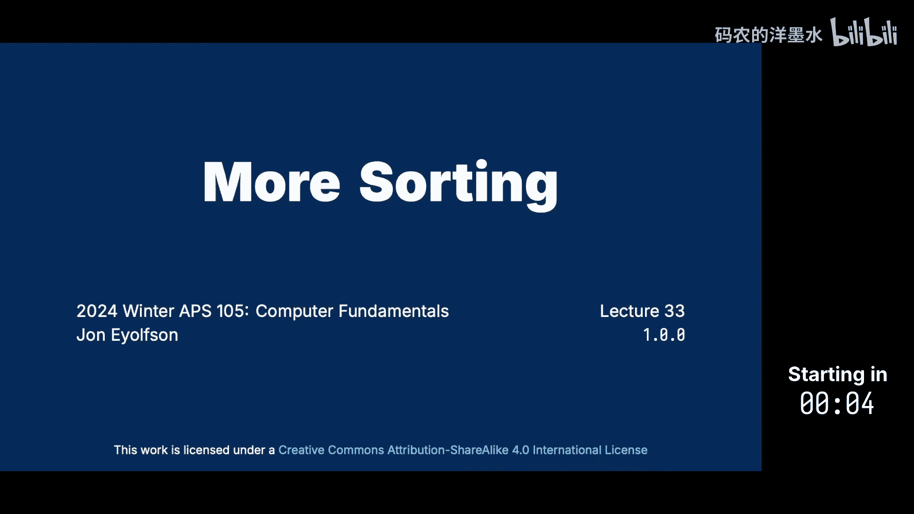
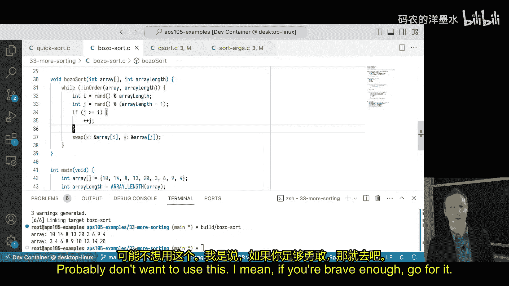
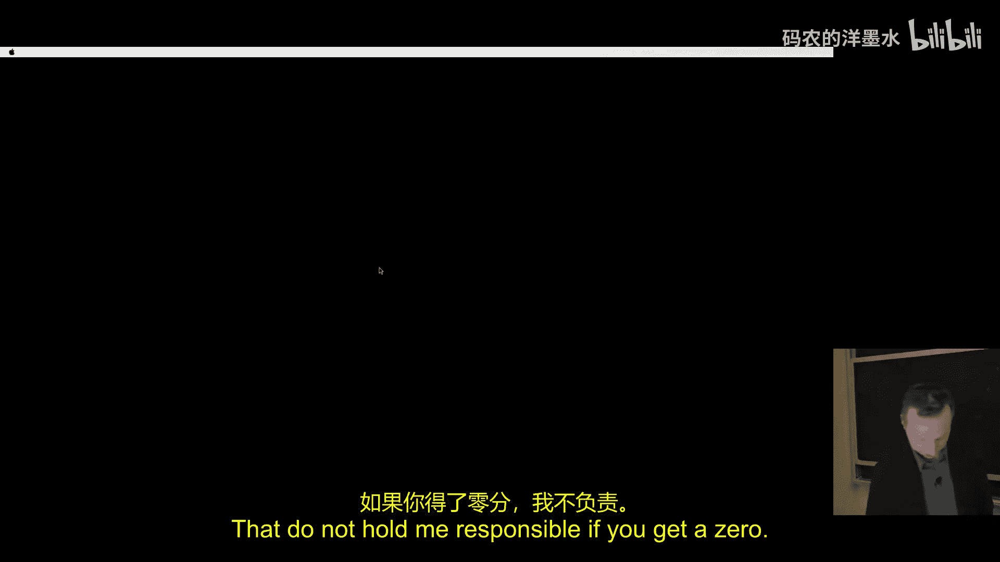
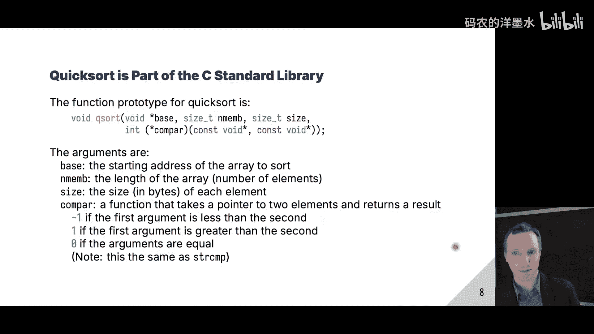
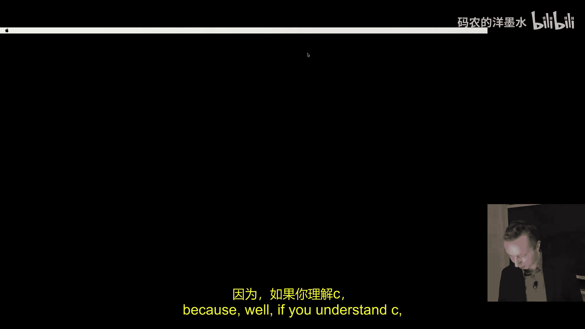
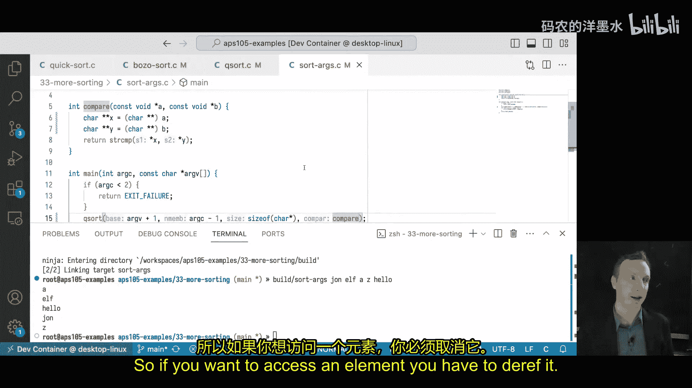
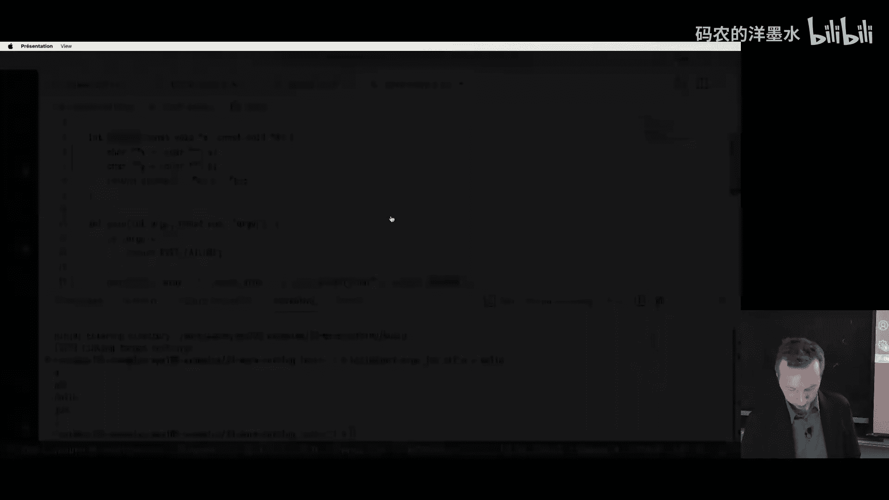
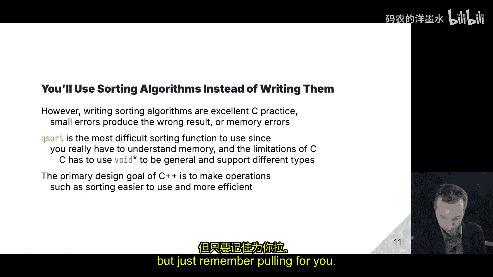

# C语言编程：33：进阶排序



在本节课中，我们将学习几种进阶的排序算法。首先，我们会深入探讨一个高效且实用的算法——快速排序。然后，为了增加趣味性，我们还会了解几种理论上存在但绝不推荐在实际中使用的“玩笑”排序算法。最后，我们将学习如何使用C标准库中内置的快速排序函数 `qsort`。

## 🚀 快速排序算法

上一节我们介绍了时间复杂度为 O(n²) 的排序算法。本节中，我们来看看一个更高效的算法——快速排序，其平均时间复杂度为 O(n log n)。

快速排序的核心思想是 **分治**。其工作原理如下：
1.  **选择基准**：从数组中选择一个元素作为“基准”。
2.  **分区**：重新排列数组，使得所有小于基准的元素都移到基准的左边，所有大于基准的元素都移到基准的右边。分区操作完成后，基准元素就处于其最终的正确位置。
3.  **递归**：递归地将上述过程应用于基准左侧和右侧的两个子数组。

### 分区过程详解

让我们通过一个例子来理解分区操作。假设我们有以下数组：
`[10, 14, 8, 13, 2, 3, 6, 9]`

我们选择最后一个元素 `9` 作为基准。目标是让所有小于9的数到左边，大于9的数到右边。

我们使用一个“绿色箭头”来标记基准最终应该放置的位置，初始时指向数组开头（索引0）。

以下是分区的逐步过程：
*   **步骤1**：比较 `10` 和 `9`。`10 > 9`，不交换，绿色箭头不动。
*   **步骤2**：比较 `14` 和 `9`。`14 > 9`，不交换，绿色箭头不动。
*   **步骤3**：比较 `8` 和 `9`。`8 < 9`，将 `8` 与绿色箭头当前位置（索引0）的元素 `10` 交换。交换后数组为 `[8, 14, 10, 13, 2, 3, 6, 9]`。然后将绿色箭头右移一位（指向索引1）。
*   **步骤4**：比较 `13` 和 `9`。`13 > 9`，不交换。
*   **步骤5**：比较 `2` 和 `9`。`2 < 9`，将 `2` 与绿色箭头当前位置（索引1）的元素 `14` 交换。数组变为 `[8, 2, 10, 13, 14, 3, 6, 9]`。绿色箭头右移（指向索引2）。
*   **步骤6**：比较 `3` 和 `9`。`3 < 9`，将 `3` 与绿色箭头当前位置（索引2）的元素 `10` 交换。数组变为 `[8, 2, 3, 13, 14, 10, 6, 9]`。绿色箭头右移（指向索引3）。
*   **步骤7**：比较 `6` 和 `9`。`6 < 9`，将 `6` 与绿色箭头当前位置（索引3）的元素 `13` 交换。数组变为 `[8, 2, 3, 6, 14, 10, 13, 9]`。绿色箭头右移（指向索引4）。
*   **步骤8**：所有元素（除基准外）已比较完毕。现在，将基准 `9` 与绿色箭头当前位置（索引4）的元素 `14` 交换。最终数组为 `[8, 2, 3, 6, 9, 10, 13, 14]`。

此时，分区完成。基准 `9` 位于索引4，其左侧所有元素 `[8, 2, 3, 6]` 均小于9，右侧所有元素 `[10, 13, 14]` 均大于9。

### 递归排序

分区之后，问题被分解为两个更小的子问题：排序左子数组 `[8, 2, 3, 6]` 和右子数组 `[10, 13, 14]`。对这两个子数组递归地应用相同的快速排序过程，直到子数组的长度为0或1（递归的基本情况），整个数组即告排序完成。

快速排序的函数框架如下：
```c
void quicksort(int arr[], int low, int high) {
    if (low < high) {
        // 对数组进行分区，并获取基准的最终位置
        int pivot_index = partition(arr, low, high);
        // 递归排序左半部分
        quicksort(arr, low, pivot_index - 1);
        // 递归排序右半部分
        quicksort(arr, pivot_index + 1, high);
    }
}
```
其中 `partition` 函数实现了上述的分区逻辑。

## 🤪 玩笑排序算法

在了解了高效的快速排序后，我们来看看几个“著名”的低效排序算法。请注意，这些算法仅用于教学娱乐，**绝对不要**在任何实际场景或考试中使用。

以下是几种玩笑排序算法：

*   **Bogo排序**：算法不断随机打乱整个数组，然后检查数组是否已有序。如果未有序，则重复此过程。其平均时间复杂度是 **O(n!)**，效率极低。
*   **奇迹排序**：算法检查数组是否有序。如果未有序，则什么也不做，只是再次检查，寄希望于一个“奇迹”发生（比如宇宙射线翻转了内存位）。其运行时间可能是**无限**的。
*   **Bozo排序**：比Bogo排序“聪明”一点。它随机选择数组中的两个元素进行交换，然后检查数组是否有序。如果未有序，则重复此过程。

### Bozo排序示例代码

以下是一个Bozo排序的简单实现，用于展示其思想：
```c
#include <stdbool.h>
#include <stdlib.h>
#include <time.h>





// 检查数组是否已排序
bool in_order(int arr[], int len) {
    for (int i = 1; i < len; i++) {
        if (arr[i-1] > arr[i]) {
            return false;
        }
    }
    return true;
}

// Bozo排序
void bozo_sort(int arr[], int len) {
    srand(time(NULL)); // 设置随机种子
    while (!in_order(arr, len)) {
        int i = rand() % len; // 随机选择第一个索引
        int j = rand() % len; // 随机选择第二个索引
        // 确保两个索引不同
        if (j >= i) j++;
        if (j == len) j = 0; // 处理边界情况
        // 交换两个元素
        int temp = arr[i];
        arr[i] = arr[j];
        arr[j] = temp;
    }
}
```
尽管对于极小规模的数组（例如少于12个元素），Bozo排序可能偶然快速完成，但随着数组增大，其完成时间将变得不可预测且极其漫长。

## 📚 使用C标准库的qsort

理解了快速排序的原理后，在实际编程中，我们通常直接使用C标准库 `<stdlib.h>` 中提供的 `qsort` 函数，它实现了快速排序算法。

`qsort` 函数的原型如下：
```c
void qsort(void *base, size_t nmemb, size_t size,
           int (*compar)(const void *, const void *));
```
参数说明：
*   `base`: 指向要排序的数组的起始地址的指针。
*   `nmemb`: 数组中元素的数量。
*   `size`: 每个元素的大小（以字节为单位）。
*   `compar`: 指向比较函数的指针。该函数决定了排序的顺序。

### 比较函数

比较函数 `compar` 接收两个指向待比较元素的 `const void *` 类型指针。它需要返回一个整数：
*   如果第一个参数“小于”第二个，返回 **负整数**。
*   如果两个参数“相等”，返回 **0**。
*   如果第一个参数“大于”第二个，返回 **正整数**。

**关键在于**：在比较函数内部，你需要先将 `void *` 指针转换（强制类型转换）为实际数据类型的指针，然后再进行比较。

### 示例1：排序整数数组

```c
#include <stdio.h>
#include <stdlib.h>





// 比较函数，用于升序排序整数
int compare_ints(const void *a, const void *b) {
    // 将void指针转换为int指针，再解引用获取值
    int x = *(const int *)a;
    int y = *(const int *)b;
    if (x < y) return -1;
    if (x > y) return 1;
    return 0;
    // 更简洁的写法：return (*(int*)a - *(int*)b);
}

int main() {
    int arr[] = {10, 14, 8, 13, 2, 3, 6, 9};
    int n = sizeof(arr) / sizeof(arr[0]);

    qsort(arr, n, sizeof(int), compare_ints);

    for (int i = 0; i < n; i++) {
        printf("%d ", arr[i]);
    }
    printf("\n");
    return 0;
}
```
要改为降序排序，只需修改比较函数，例如 `return (*(int*)b - *(int*)a);`。

### 示例2：排序字符串数组（命令行参数）

排序字符串数组时，需要特别注意指针的层级。`argv` 是一个 `char* []` 类型的数组，即元素是 `char*`（字符串指针）。

```c
#include <stdio.h>
#include <stdlib.h>
#include <string.h>

// 比较函数，用于排序字符串（char* 数组）
int compare_strings(const void *a, const void *b) {
    // a和b是指向数组元素的指针，而数组元素是char*。
    // 所以需要先将void*转换为char**，再解引用得到char*（即字符串）。
    const char **str_a = (const char **)a;
    const char **str_b = (const char **)b;
    return strcmp(*str_a, *str_b);
}

int main(int argc, char *argv[]) {
    // 跳过第一个参数（程序名），对剩余参数排序
    qsort(argv + 1, argc - 1, sizeof(char *), compare_strings);

    for (int i = 1; i < argc; i++) {
        printf("%s\n", argv[i]);
    }
    return 0;
}
```
**关键点**：`compar` 函数接收的是指向数组元素的指针。我们的数组元素是 `char*`，所以传入 `compar` 的是 `char**` 类型。因此，在函数内部需要先转换为 `char**`，再解引用得到 `char*` 才能用 `strcmp` 比较。





---



本节课中我们一起学习了快速排序算法的分治思想，见识了几种低效的玩笑排序算法作为反面教材，并重点掌握了如何使用C标准库中的 `qsort` 函数来对各种类型的数据（如整数、字符串）进行排序。虽然 `qsort` 的使用涉及指针和函数指针，稍显复杂，但它是C语言中高效、通用的排序工具，理解其用法对深入掌握C语言编程至关重要。