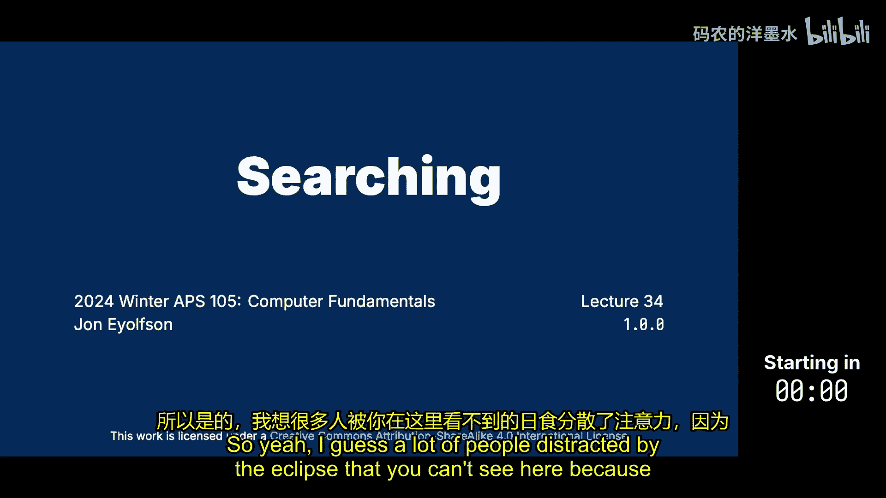
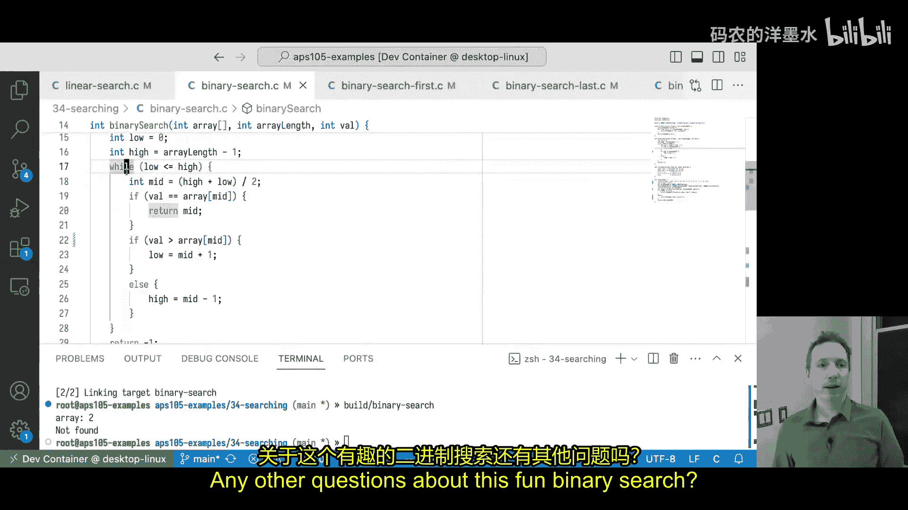
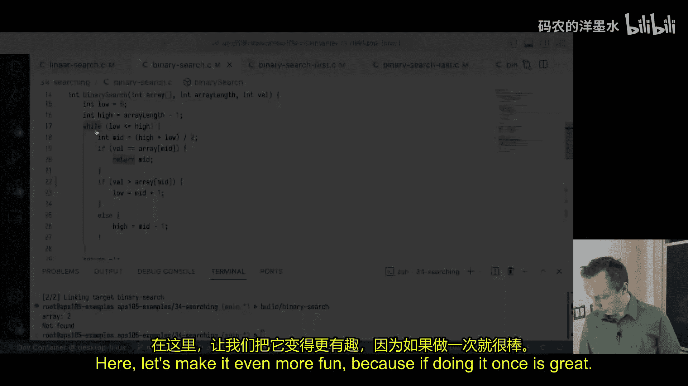
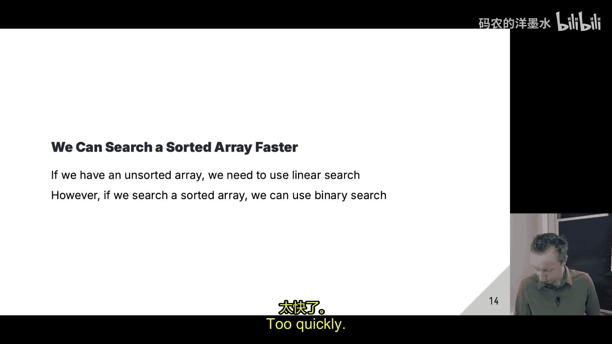

# C语言编程：34：查找算法



在本节课中，我们将学习如何在数组中查找特定元素。我们将从最简单的线性查找开始，然后探讨一种更高效的方法——二分查找，特别是当数组已经排序时。最后，我们会讨论如何修改二分查找来找到重复元素的第一个或最后一个出现位置。

## 线性查找

上一节我们介绍了查找的基本概念。本节中我们来看看最简单的查找方法：线性查找。线性查找的原理是遍历数组中的每一个元素，直到找到目标值或遍历完整个数组。

以下是线性查找的实现步骤：

1.  从数组的第一个元素开始。
2.  将当前元素与目标值进行比较。
3.  如果相等，则返回当前元素的索引。
4.  如果不相等，则移动到下一个元素。
5.  如果遍历完所有元素仍未找到，则返回 -1。

其核心代码可以表示为：
```c
int linearSearch(int array[], int length, int value) {
    for (int i = 0; i < length; i++) {
        if (array[i] == value) {
            return i;
        }
    }
    return -1;
}
```
这种方法简单直接，但效率不高，在最坏情况下需要检查数组中的每一个元素。

## 二分查找

如果数组是**有序**的，我们可以使用一种更聪明的查找方法：二分查找。它的核心思想是每次都将搜索范围缩小一半。

想象一下在一本按字母顺序排列的电话簿中找名字。你不会从第一页开始一页一页地翻，而是会先翻到中间，根据名字是在这一页之前还是之后，决定接下来翻查前半部分还是后半部分。二分查找正是基于这个原理。

以下是二分查找的算法逻辑：

1.  设定搜索范围的起始索引 `low` 为 0，结束索引 `high` 为数组长度减 1。
2.  只要 `low` 小于等于 `high`，就继续搜索。
3.  计算中间索引 `mid`，公式为 `mid = (low + high) / 2`。
4.  比较中间元素 `array[mid]` 与目标值 `value`。
    *   如果 `array[mid] == value`，查找成功，返回 `mid`。
    *   如果 `array[mid] < value`，说明目标值在右半部分，将 `low` 更新为 `mid + 1`。
    *   如果 `array[mid] > value`，说明目标值在左半部分，将 `high` 更新为 `mid - 1`。
5.  如果循环结束仍未找到，则返回 -1。

以下是迭代实现的代码：
```c
int binarySearch(int array[], int length, int value) {
    int low = 0;
    int high = length - 1;

    while (low <= high) {
        int mid = (low + high) / 2;

        if (array[mid] == value) {
            return mid;
        } else if (array[mid] < value) {
            low = mid + 1;
        } else { // array[mid] > value
            high = mid - 1;
        }
    }
    return -1;
}
```
二分查找的效率远高于线性查找，其时间复杂度为 **O(log n)**。





## 递归实现二分查找

二分查找的逻辑天然适合用递归来描述。我们可以将“在某个范围内查找”看作一个子问题。

递归实现的思路如下：

1.  **基准情况1**：如果搜索范围无效（`low > high`），返回 -1。
2.  **基准情况2**：如果中间元素等于目标值，返回中间索引。
3.  **递归情况**：根据中间元素与目标值的大小关系，在左半部分或右半部分递归调用查找函数。

以下是递归实现的代码：
```c
int binarySearchRecursiveHelper(int array[], int low, int high, int value) {
    if (low > high) {
        return -1; // 基准情况1：范围无效
    }

    int mid = (low + high) / 2;

    if (array[mid] == value) {
        return mid; // 基准情况2：找到目标
    } else if (array[mid] < value) {
        // 递归情况：搜索右半部分
        return binarySearchRecursiveHelper(array, mid + 1, high, value);
    } else { // array[mid] > value
        // 递归情况：搜索左半部分
        return binarySearchRecursiveHelper(array, low, mid - 1, value);
    }
}

// 包装函数，提供简洁的接口
int binarySearchRecursive(int array[], int length, int value) {
    return binarySearchRecursiveHelper(array, 0, length - 1, value);
}
```

## 查找第一个和最后一个匹配项

标准的二分查找在找到目标值后就立即返回，如果数组中有重复元素，它返回的索引可能是其中任意一个。有时我们需要找到第一个或最后一个出现的位置。

我们可以修改二分查找算法来实现这一点，而无需退化成线性查找。

**查找第一个匹配项**的思路是：即使找到了一个匹配项（`array[mid] == value`），我们也不立即返回，而是继续在**左半部分**（`high = mid - 1`）搜索，看看前面是否还有相同的值。我们需要记录下当前找到的这个匹配索引。当搜索范围无效时，最后记录的索引就是第一个匹配项的位置。

以下是查找第一个匹配项的修改版二分查找：
```c
int binarySearchFirst(int array[], int length, int value) {
    int low = 0;
    int high = length - 1;
    int result = -1; // 用于记录找到的索引

    while (low <= high) {
        int mid = (low + high) / 2;

        if (array[mid] == value) {
            result = mid; // 记录找到的位置
            high = mid - 1; // 继续在左侧寻找更早的匹配项
        } else if (array[mid] < value) {
            low = mid + 1;
        } else { // array[mid] > value
            high = mid - 1;
        }
    }
    return result; // 返回第一个匹配项的索引，未找到则返回-1
}
```
**查找最后一个匹配项**的思路与之对称：找到匹配项后，继续在**右半部分**（`low = mid + 1`）搜索。

结合这两个函数，我们可以高效地计算某个值在数组中出现的次数：`count = lastIndex - firstIndex + 1`。

## 总结

本节课中我们一起学习了数组的查找算法。
*   对于**未排序**的数组，**线性查找**是唯一的选择，它逐个检查元素，时间复杂度为 O(n)。
*   对于**已排序**的数组，**二分查找**是更优的选择，它通过不断将搜索范围减半来快速定位元素，时间复杂度为 O(log n)。
*   我们学习了二分查找的**迭代**和**递归**两种实现方式。
*   我们还探讨了如何修改二分查找来找到重复元素的**第一个**或**最后一个**出现位置，从而能高效地计算元素出现的次数，而无需进行线性扫描。



掌握这些查找算法是处理数据的基础技能，它们在不同的场景下各有优势。