# 【全集】多伦多大学 C语言编程 中英字幕 1080P p37 Lecture 37 - 期末复习课 -BV1gikKB3EZW_p37-

。

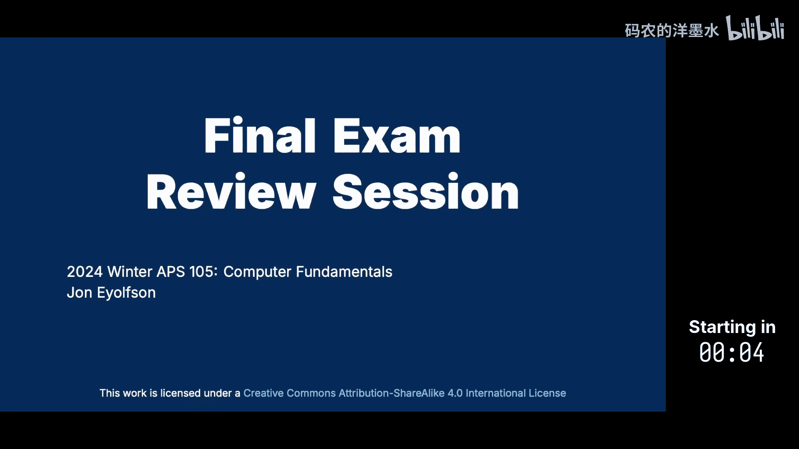

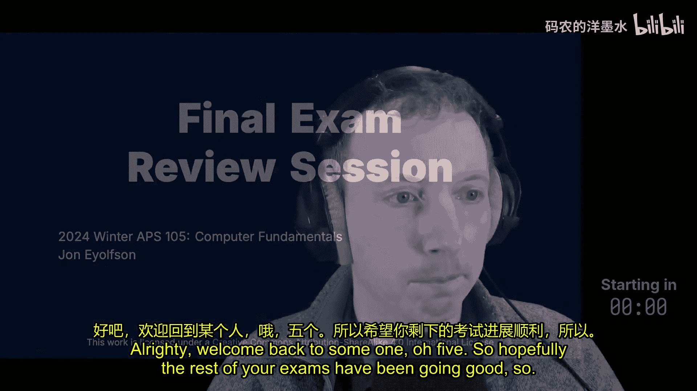

Alrighty， welcome back to some 105。 So hopefully the rest of your exams have been going good， so。

What shall we do？A burning questions anyone has。 I'm monitoring the discord。So we can do that or。

I can do other exam questions or whatever you want。Oh， thank you。 Alright， what shall we do， oops。

 I need to plug this in。Alrighty， so。Welcome to the Vo of review。

 so anyone have anything pressing that we should go over？

Saw a bunch of piazza posts asking about Quick sort and。Inertion sort， don't have to know them。

 Don't worry about it。U then question about strings， multiple choice。

 sure you can ask anything you want in general or we can do exam questions， whatever you would like。

And luckily， the exam， we wrote the exam quite a while ago， so I forget what's exactly on it。

All right， we got a。Dynamic memory，2000。19， question 11。 let's go check what that is。

 Maybe it has dynamic memory。 Maybe we can。Do two things at once。Do。😔，2000， and。

19。Let me go。呃。<|OTHER|>So 2019， number 11。In general。

 the bubble sort algorithm can be explained two steps for each pair of adjacent elements If they are out of order swap。

 repeat the。First up till no swaps are done。Write a function bubble sort link list that sorts a link list using the bubble sort algorithm。

 The function has one parameter pointer to the link list， assume that this pointer is not null。

 This function will modify the link list in place so that the values are in ascending order。 i。

e1 comes before to the definition of link list and node are shown below。

 You must abide by the following constraints。 Failure to meet to constraint will result in a grade of 0。

The function must not modify the next pointer of any node。

You cannot create any other data structures， another array linked list。

Your function cannot call other functions。 Your function must not call or cause a segmentation fault。

Do any drawing here so。We want to do this one， it's。A strange kind of question， but。I mean， we can。哦。

Yeah。So if we do this question， so because。My initial thought reading it is like， oh， okay， well。

 let's just go ahead and change the next pointers。And like swap them， swap the nodes。

 but we don't have to。 so this is trying to tell us that we should probably swap the values instead of the next pointers of writing like a helper swap function。

 it's probably not the way to go so。This will probably look like。A other bubble sort， so。

The way it usually goes is， well， usually。Usually， it's like a do while loop because you want to go over and over again。

 and you're just trying to keep track of the number of swaps you have done。

 so we could create a Boolean whoops。 That is a large。

So let's create a Boolean just to keep track if we have swapped in like one entire iteration。

So we can create a bullan called swapped。And we can initialize that to fault。 Well。

 it doesn't really matter。 We'll initialize it in the loop。 So we create a variable called swap。

Then we could have our do， kind of like。I think this is how we wrote it in the lecture so we could just say swapped。

Equals false。And then we could go ahead and actually try to swap all the values。Thisす。

Because it's a link list， we can't just write like our normal for loop that has a ray bound。

 So we have to iterate over a link list and how we did that。

 We did that a bunch of times during the lecture。 We start off with a node pointer。Called current。

And it starts at the linkless head， so that should just be list。And because it's a pointer。

 we have to use the arrow。 So I think on the exam， they'll just let you draw the arrow。

 Or if they're really being panantic， we can go ahead do the。Dash greater than doesn't really matter。

 I'd just draw the arrow。 So the first element is called the head and then。What you probably。

Commit to memory is like the iterate over every element of a linked list is just well current。

Does not equal。No。😔，Then。We iterate， we do our thing， and then we can do current。Equals current。Next。

 so that will go to the next node。Over and over and over and over again， so。

Let's give us some room because we know that's pretty much all we're going to do。

And then here we can do this loop well。😔，Well， swapped。So if we have made at least one swap。

 we got to do it again。All right， are we all right with that so far？So。

This is a little bit trickier since it is a link list， so。

Current is like the current value we're at and we also want to check the next one。

 but like check the next one to see if we need to swap the values。

So turns out we have to be a bit careful here because we might be currently at the last element of the list。

 so the next might be null。We can go ahead and create another variable just called whoops node。Next。

Equals current。Next， just to save ourselves a bit of writing and we can go ahead and just update the variable there instead make that a little bit shorter。

So。Here。If this was just the normal bubble sort， like， we just check the al above and make sure like。

Just check if it's out of order。 And if it is， we go ahead and re swap them。 So here。Same idea。

 but we have to make sure。Next does not equal null， otherwise we'd be accessing。

Invald memory if we try to go ahead and access the data， so if we go back。In the node。

 the data is just a field called data so we can access it。By just。

We can access it by just doing the arrow to data so then we get the actual integer。

We're just writing the condition to swap。 So we want to swap if current。Arrow value。

 So if the current value is greater than。The next value。

Which we're allowed to do because we know that next is not null。 So remember the arrow sign。

So if we do next。Herow。Data。😔，Well， that's the same。 And like。I'll write the type。

So the type of next is a node pointer。So writing the arrow is the exact same thing as if we just did。

 we de referenceence next。And remember when we dereference a pointer。

 the resulting type if you want to remember that way is you just remove one of the stars。

 so if we dereference next and it is a pointer to a node， then it is just a node。

 then we can go ahead and access that value or that variable within the structure by doing dot data。

 so just remember that these two things are equivalent。All right， so。Now going back to the question。

This is our whole if condition。 So this makes sure that the next value is actually valid and that they're out of order。

 So if they are out of order。Then we have to swap the values。 So like with swapping。

We have to create a temporary variable。To capture the value of， let's say， current。对的。

And then we can make current current。Data。Equal to next。Daer。😔。

So if current was two and next was one， well we just made current one and we want to make next two and tempemp currently has that value too so。

Now we do next data。Equals tip。All in that if， and we want to make sure that we set swapped equal to true。

So that's all we got and。This will end so scheduled for two hours if we're out of questions and we don't want to do anything we can end early。

 but I'm here for at least the two hours。So other question can clarify what we need to know about searching and sorting？

Like with this question that says， hey， here's the idea of a bubble sort。

 you should know the idea of bubble sort and selection sort and be able to implement them。

So like this， we implemented bubble sort， they kind of gave us idea of it and gave us some hints。

 but we implemented bubble sort。And then question， should it not be pointing to value instead of data if you define that in the if condition？

Sorry， my writing is a bit sloppy here， let's move some stuff， oops。So value， I don't think。

 is actually。Anything。So not be point to value of data。 So the。

 the field is called just data unless I called it value。 No， I called it data。 Oh， sorry。 Yeah， yeah。

 yeah。Xre。😔，Sorry， in the if condition， it's not called value， it was called data。

 sorry I usually call value data。对了。All right， there we go。Yeah， so question。

 so bubble sort generally just when't we want to swap adjacent elements， right。

 not connected to four loops or no arrays。Nope， if bubble sort just a way to sort things doesn't matter if it's a raise or link list or anything else as long as you like。

There's。You can access them in a certain order， then you can sort them， so linkless。

 you know we can access them in order。Aray we can access them in order of their indices so we can go ahead and sort things in order that way。

嗯。yeah， bubble sort idea behind that is。We scan the。

We've scanned like adjacent elements in the array。 If they're out of order， we swap them。

And we just do that for not every pair， but like just adjacent ones。And then。Wo。If。We swap something。

 then we know the array might not be completely sorted yet。

 so we just do it again and again and again and again until it is actually sorted and the idea behind that is because。

It's sometimes called whether it like。I guess no one's actually like tried to prospect for gold or anything。

 but it's like sinking kind of so like values kind of migrate towards where they're going to so if you think of the larger numbers as heavier they kind of migrate at least one space towards the end every time you go through the loop and then all the lighter values migrate one space up each time you go through the loop。

Hopefully。Al right， so we got that one， another one， questions 11 for 2018。 All right。

 questionstion 11s are popular。

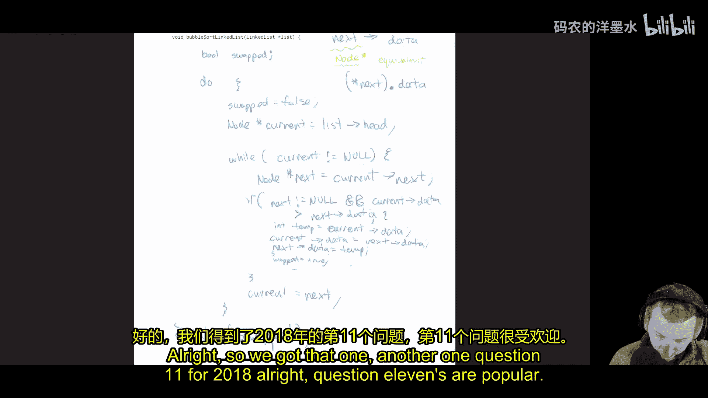

Oh whoops。

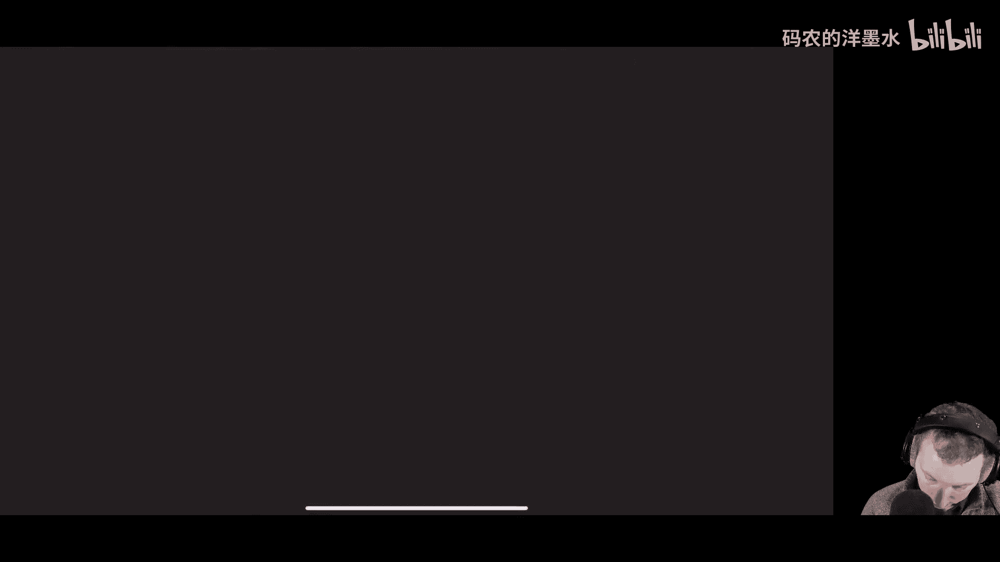

2018。19。Where we got 18。2023。

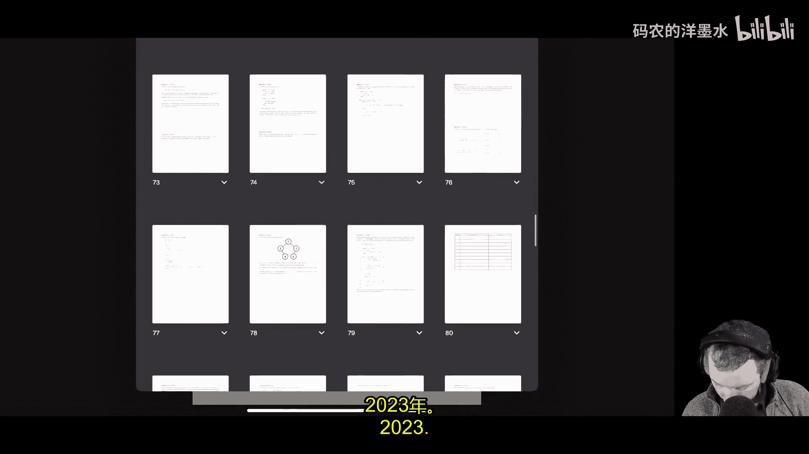

Alright， let's take a look at this function。Oh， midterm， not final。 Okay， sorry， I don't。

 I don't have the midterm ones pulled up， so。Can't do。Those ones， I can。Try and discuss the idea。

 but I can't pull them up on my thing。 Let's see what was。See if I can look it up on my other water。

Oh， okay， so。Yeah， that one's。Weird， I think I kind of covered it during the midterm review session。

 but yeah it says post in chat。We to see a program that returns a randomly j prime number way。

 what exam says 2018？Okay， if you actually look at the exam， it says。Did。

Write a program to determine the quality of Rand。And that's prime numbers。Cloia。😔，Okay。

 so for that question， the like。I don't think they really grade by how clever it is。

 First solution that pops out is。Just randomly generate a number and have a function that called is prime and。

U。Then if it's not prime， just generate a new number and try again over and over and over again。

 So that's one solution you could do。Alright， so we have a question of dynamic memory， too。 So here。

 let me。Ohoops。

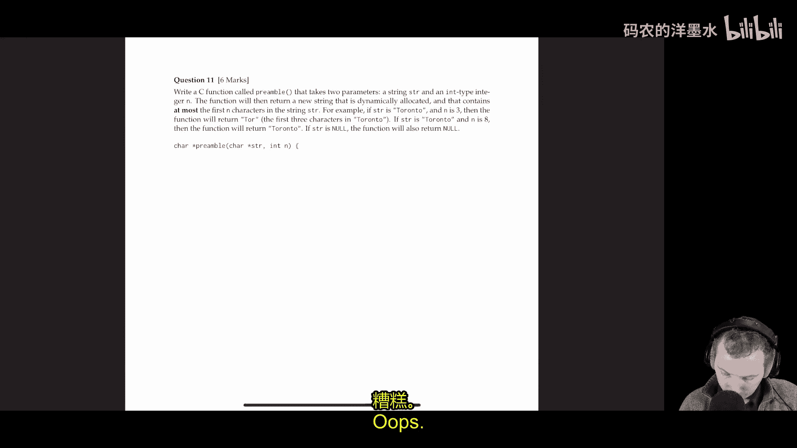

All right， anyone with anything。Else， otherwise， I can try and tackle dynamic memory type things， so。

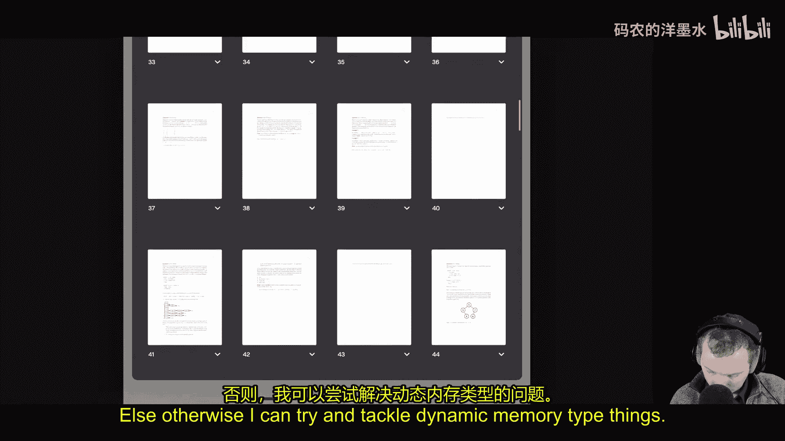

Right now， I can look at the， oh， sorry， someone was typing。 is that。

I mean give you an idea with how to solve that。 I can't。Find exactly which one。

Exactly which one that actually refers to。I see you do。OhOkay， yeah， I see that question。It's。

It's actually question 10 on that midterm， not 11。But。Yeah， the solution does just what I send。

 So you generate a random number。 So between one and max range。

 So you can just mod it with max range。 So whenever you mod。

 it'll always give you a result from 0 all the way up to that number-1。

 So that's why they add one there。 So that。The lowest number they'll get is a1 and the highest a is max range。

Technically， they shouldn't want to generate one because they would。Say that is prime。

 oh they have an if condition。Der one from but coming prime。 Okay， so yeah。

 they just have a lift that just goes over and over and over again。All right， so。So， we can go。

So you can stop me if you want me to go like revisit anyone in more detail。These。

 I will just go over fast， just so。We have it completed， and I can。Comment on things。

During the lecture。Yeah。So one， the random care。Character 1。

 I don't know why they modeling 27 should be 26。At leastas in the alphabet I know about there's only 26 characters。

嗯。Question 2。Says in a single statement， declare initial array 500 integers called numbers where the first four numbers are 1。

2，3，4， and the remaining are all 0。 So that means we have to。We define an array。

 They say it's called numbers。And we can give it a definite size， so it says there's 500。

And then we can just use the initializer， array syntax。So it's just curly brackets， and then 1，2，3，4。

 And then if we end it there by default， if we don't specify the rest of them， they're all zeroed。

 So that's just what the solution has。This。Same idea。 So with most of these。

 it says a single term write a single C statement terminated by one semi colonlon。

 that declares two variables name。Plant one， plantt two of the type of the following data structure。

 it's called plant。In the same statement， initialized plant one's name and height to with cactus and the other one to row and some number。

If this is。Confusing， you can start with something simpler and then work your way up to it。

 So assume that。I want to initialize these things all on one line。

 and they were integers instead of plants， well then it would look something like int。Plant。1。Wow。

 maybe I can write a bit better。Intplant1。Equals one。

 and then I could do a comma to introduce another variable。They could have plant。

2 equals 2 with the semicolon。That's if they were integers， they are not。 They are structures。

And the structure is called plant， so instead of int， I can just replace it by plant。Hello， Ka。

 thank you。And then because I'm trying to initialize a structure， same way to initialize arrays。

 I can use curly brackets， but with initializing a structure， the order matters。

 So the first value I give it is going to correspond with the first field in the structure。

 So I can't write something like if I want to add cactus in。5。3， I can't write this。And yes， okay。

So I can't write something like that because it would try and assign 5。3 to a char name。呃。

And then it would assign cactus to double。 and I'll see if the cat's being。Being helpful。

 So in this case， I'd have to do it。In order， so it be cactus。5。3。And then same thing plant two。

Would be。Rose。And10。2。So。Okay。Oh cheese， all right， and there's a cat。

Although he looks weird because his eyes are green and there's a green screen。Oh， we got another cat。

 We got it。 a kitten。But yeah， he looks very weird'cause I'm behind a green screen and his eyes are green。

They look weird。Yeah， and。The cat likes to come out while I'm trying to do stuff。All right。

 question four， okay， question four is weird。So I'll skip question four。Question5。

 so this kind of has to do with dynamic memory and things。Question 5 is actually pretty good。

The code has a serious mistake in the get names function。Things to note， there is this。

Structure called student with only one field。 So a char pointer to last name。

 So that should probably be a C string。So it should point to a null terminated array of characters。

So。There are gi name functions。Well， let's just see what does。

 it has a four loop that goes four times， so I will go through。All the way， so it'll be 0，1，2，3。

And then it will just say enter last name and then scan F。With。A string format specifier。

 which is always a bad idea。 But that's not the serious mistake in this code。Then。It goes ahead。

 fills in that string for with whatever the user typed out， and then changes studentss eye。

 So it's an array of students， changes student I' last name to be equal to last name。

So then in Maine， what it does is it declares an array of students。So。Then declares。

A very large character array。Then it calls gi names on that and then prints off all of the students' last names and what happens is。

 well， if we enter four last names。Then it just prints off that the last name for all the students。

Is the exact same。So it says revise it by crossing up parts and writing and revision above。

 such that the outputs。A above a desired you can assume the maximum size of a string is。1024。

What is happening here？ So what is happening here is。Let's draw out our variables， so in main。

Whenver we start executing it。 So I of course， start executing in Maine。

 So we'd create an array of students that would be on the stack， so we would have students。Oops。

 students。Z students。1。😔，Students。To students。3 and all of these are just， you know， a pointer。

 Then we just have a giant array of that called last name。 So I was call it last name。And。

It's just a big array。 then in Gi names， what happens is we pass it。Last name。

 which will just be a pointer， so it'll be a pointer somewhere like at the beginning of that array because of our good old friend array decay。

And then we have students same idea there so。What happens here is we ask the user to enter a name。

 and then we go ahead and。We fill it here。 So like for the first user。

We would have put in the string。And。And then we set students last name equals to last name。

 So this is last name here。So what we're doing is we're making students dot last name。

 which is the only thing in the structure。Point。To the beginning of the array。

So then next time through the loop。Then we ask for last name again。 We scan F。

 and then we reuse that pointer。 So last name is still pointing to the。Large section of bites。

 So they enter， in this case， brown。And it would overwrite that because while it's starting at the same memory location。

 so brown， something like that， and then the next thing we do is we update students。

One's last name equal to last name。 And because it's a pointer， it's all pointing here。

 So save you the time。 They all point to the same thing。 And the last name we update。

Was the one that gets printed over and over again。 So we print up something like that。So。

Because of that， well。We need separate space to store each last name is kind of our issue here。

Because this is a function in Gi names。So I need to copy some memory somewhere in this gi names。

 I probably need to get some memory and then copy the string the user entered somewhere so it doesn't interfere with know whatever they input something else next time。

I also like need it after I use the Gi names function， because here I use it to print everything。

 So this is where dynamic memory comes in。 So I probably need to。

Use some dynamic memory whenever they enter the information and then go ahead and copy it to it。

 so like。This print and the scan F， that's fine。 But now I have to take what is currently in last name。

 and I have to copy it to some like new memory location。

 So what I probably want to do is I can go ahead and。Like there's different things。

 Maybe I don't want to even use string copy， so I don't have to use that last name parameter at all they given like I can go ahead and I know I'm going to go ahead and I need to store some memory for students。

Ey'es last name。And I need some dynamic memory。 so then I can go ahead and malloc it。 So malloc。

 that will return me a pointer back to。Back to the starting by of starting address of howeverma by I。

Go ahead and allocate， and it says that well， you're guaranteed that。You know， we can。

It it'll in 1024 so we can。It's an array of cut chas。 So we could do size of char。Times。1024。

And then we could go ahead， now we have memory， we can ask a user to enter a last name。

 and then instead of filling in that last name， we can go ahead and we can just directly give it。

The student's last name to fill in。So something like that。And yeah。

 that that malloc line is soon be required。So if you didn't have that malloc。Then whenever。

 like we're using it in mainine， so。Let's go back。Main starts， right。We have students。

We can go ahead。All the students have is a pointer。To a char that should represent a sea string。

Then we had just some array just on our stack that originally we used to。

Get the input from the user and store it there。 So it would be stored in last name。

 but that didn't work before because it's shared with all of them。 right。

 So we only get the last name entered。So we call it git names。

 and then we have to print all the students' last names。

 so Git names sets aside needs to go ahead and set aside that memory。

So that when a user enter thing enters a name， it has some place to go。So。

Just because it's written like this， we need to use malloc because the memory needs to exist longer than the function。

 So if we did something like。I don't know we。Did。呃。Like we did char。Or here we did like char。Well。

 actually， not， none of these are going to work。 So there's no way to put it such that it'll live outside the function。

 if I declare just a cha， say I even did like a 2D array of。For each。Last names。

I had something like that so I could store all of them in。Says 2 d array。

By the time this function Gi names actually returns at。The end here， all that memory is now gone。

 and it's invalid。 We can't use it anymore more。 So we have to use malloc here because I need to use memory for this function。

 and it needs to still exist and be valid outside of the function。

 So that's why we need to have malloc here。 So what that will do。 now。Whenever we call the function。

 so here's all of our students。Now we actually don't need that last name。So wait， first off。

 are we all okay with what the problem was before。And then I'll go over why this solution works。

So you could malloc space for a 2D array， but then it's just。Kind of。A bit more strange。 But yeah。

 you don't。 you know， this， this doesn't need to D array。So。

We're okay with why this was a problem before， why we got the same last name every single time。

And in discord， at least hopefully we're okay at this point。All right。

 I'll hopefully just assume we're okay with why this was an issue unless someone tells me otherwise。

So now with the malloc， what's going to happen， let's start off start us off at the beginning again。

So there is our change， so now。If we execute Maine。

 we get space for students that just have their last name。Then we have this giant last name。

On the stack that we're not going to use anymore。 So this is just like。Just a bunch of characters。

We don't really care。Then we call git names and it gets appointed to students so it can go ahead and access them。

 then in git names。We go our four loop， so I starts off at I equals 0 then。Well。

 what we're going to do is we're going to set。So now these are not all not set。

 so we're going to set students。Zero's last name， so whatever it's pointing to。

Over just to some big chunk of memory。 So this is 1024。Wei。An array of chars of4 1024。

 so we make it point to that starting address。 so that's what Maloc will give you back right and then we enter the last name。

In this case， there was a B hand。So and since we scan F and we give it like a pointer to students last name that we just malllocked。

 it's going to fill in the value exactly at that memory location， so it would fill in。And here。

And then。Well， it turns out we don't need this line anymore either so。Fill it out。 And then。

We'd be done。 We'd go back up to。The loop now I is equal to1。 So now we malloc space for student。

One's last name， so。We malloc， that gives us a big old。Char array is somewhere off in memory。

 We're not sure we're to sure it's valid。So。We get that， and。

Then we ask the user to enter a last name。 Oh sorry。We would then point students one to it。

Then now when we scan F。We're taking the string， the user inputs and storing it at Student one last name。

 which is that space we just mallloed。Which would not overwrite what we had before because it's a different pointer。

 So now we have brown there。And then similarly， whenever we go。For I equals 2 and I equals 3。

 that would get more space on the heap， something like that。 And then whenever they enter。

Lee and Jea， it is all stored there。 No issues whatsoever。 It's all different memory。 It's。

 and it's all valid。 So then。We'd be done with the function。 Thank you for your insight， Ka。呃。

So we'd be done the function， come back and then well， now when we iterate through this。

We go through every student's last name。The pointer values。A still around。

 And whatever they're point to， that memory is still valid。 We haven't freed it yet， right。

 It's always a rule with mall。 You should only free it when you're like you should free it as soon as you're done with it。

 So we weren't done with it for the function。 we have to remember to free it。

 but not for this question because while we're only writing the get names function。 So。

Here it would print off each student's last name， so it would point to that malloc region of memory。

 use that as a string and because we use scanF it's all nu terminated it's a string and we're good。

So any questions about that？Or。Anything anyone didn't understand about dynamic memory。

 Hopefully that that got by your dynamic memory and everything， so。We're good with that。All right。

 so hopefully that fix that。 So question 6， that is quick sort。OhWe can skip that。 So wait。

 I got another one。Oh， quick unrelated question。I understand if we're pointing to a string literal。

 but we can't change the individual elements of the string only what's pointed to。 However。

 would still be possible to index a string literal or is its functionality also limited。

 So for a string literal， you can access。The elements like get the value back。

 You just can't change the values。 So if you think of it like as a pointer。You can dereence it。

 read its value， but you can't reassign anything so you can't change it。And also， for clarity's sake。

 could you also quickly go over when something is a string literal and when it is not。 So， yeah。

 the rules。For that is well。Basically。Any time you see。This， so anytime anyone writes。

Something like this in C。 That is a string literal。 So that would be stored somewhere off in memory。

 But if you do something like char。1。Aray equals that。

What that's going to do is there's a special thing here where it will actually copy that string literal。

To the stack for you。 So this is still a string literal。

But because you're creating an array on the stack。Well， it needs to be on the stack。

 It's not just off somewhere else in memory， like where the string literals are actually stored。

 So it's going to copy that the contents of string literal over to the stack for you so then you can go ahead and modify it。

So， if I just did。Char S2， so a pointer called S2 that equals this。Well， I mean。

 it's still a string literal。But now I'm pointing to it。

 I'm not like the variable on the stack is the pointer。 So the pointer is mine。

 It exists as long as my function exists。 But what I'm pointing to is a string literal。

 While if I have an array there， the entire array is on the stack。 so I'm。

Iize you can think of it more as like， I'm initializing my array to be the same contents as a string string literal。

嗯。And another question， if we pass it into a function， can we still use cha star in the parameter。

For that same rules as if it's an array or if it's anything like。If you have。Int， whatever。

 let's give it a name， int。Numbs， whatever。Inams 50。And。In starve， whatever。

 Like if we have a function called F。And we have instar。

Nums or here I'll call it something different， let's call it x's。So if I call foo with numbs。Well。

 there's going to be a rate decay in that case， right， so then。I just do point arithmetic on and。

I just assume it works like that。 And if I。Do that instead in my function signature doesn't matter。

 doesn't change anything whatsoever。 So same rule with。Same rule with。The string literals。So。If。

I have my。If I have my array of chars on the stack and I pass it to a function。

 then it would be a char star， so it'd be pointing to wherever my array starts。

And then I can go ahead and I modify it whatever， because the address is not the string literal address。

So does that make it clear？What if we have to write a function that has charged star as input。

 can we assume the string was not declared as a string literal Yeah。

 so if it tells you you have to modify the string， then you're fine。If we have something here， so。

CharSo this S2 here。This is。S2 points。Directly。2。😔，String。So， I can do。If I want to see， you know。

 the value of。Index 1， which would be the a here。 I can write that in my code。

 I could do cha C1 equals this。 and then you know。It's going to make it equal to。A lowercase， a。

The only thing I can't do is I can't do if I can't try and like， change the N to。

Or let's save that same character。 I can't change that A to and O。

So I can't do something that that is a no， no， definitely can't do that。But。

If it was declared on the stack， then I could， but only this weird rule for string literals。嗯。Okay。

 related。For question 14 from 2018， we could also do recursion by directly increasing the index and the comparing string index。

 asked because in the marking sea zone， the solution is marked specifically reserved for changing the string pointer。

 So changing the index wouldn't work here， let's go。So， 2018。20。So which question is that 14？

So it says consider the following function that returns the index of a char。Of a cha sea in。A string。

 string。Wow， that's redundant。 That's， that's not confusing at all to read。 So strings called string。

The position of the first C in the string returns N when it does not occur in the string。

So then it says write a C function。Recursive find index that does not use any loops and yet behaves like find index in the function both of your function may have additional parameters。

But at bare minimum， it must include parameter string in C。 So I guess they have that。

 So we don't have to write a helper。Function。But let's see what you're talking about。So sorry。

 what's your question for this？Qu directly。So what does the grading scheme say？Yeah， so in this。

You do have to remember， And somewhere in the parameters， otherwise。U。Otherwise。

 you don't know what index。 So I think you're thinking about like， hey。

 my reccursive stuff could be going through the smaller string。Until I find the character。

 but then you don't know how many steps you have taken because it needs the index of that character。

Alright， so we got a solution。 So here， let me find my most。 So you have written。I string and。

So here I will write what you wrote and we can take it up。So。

The solution posted in the chat is I'll just write it out， so we declare a function。Called F char。So。

Takes a string。Cercy。And。Index。And then， you know。Here。Well。

 this is actually like our helper function， right？So we could have in。Fine， cha。That takes a string。

Cxi。And then return。😔，Find， wow， sorry， my writings skin bad。 Find char helper。String， C，0。

So you could do that and then in the body so。With all of our recursive functions。

They all work the same。 We always want to make sure we have our base cases。

Maybey be multiple of them who knows。 And then a recurs of steps。 our base cases are in this case。

What you have written is if I'll just write it verbatim and we can go ahead and。

We can go ahead and fix it up because I see some issues already。So， if。This is equal to null。

 actually this。If year。So。If we're at the end of the string。

 then we can just return negative one like it's not found。Else if。We could have string。At index。So。

 otherwise， we have found。With with two equal signs， sorry， we have found the character。

Then we can just return the index。Else， now we're in our recursive。Recursive stuff， right？Recur。

So our recursive step is， well， we'll just make like the smaller problem as well。

 The current character isn't the one we're looking for。

 So we'll just make the string one shorter and try and solve that problem。

 So it would just be find cha。In this case， it is called helper。First string。

So it's still the same string， still the same C。 And then we just advance the index by one。

And ending bracket。Could you go over what the point of the helper function is， Yeah， so in here。

Our helper function。Like， if we just wrote fine char like this。

 it doesn't match the function signature。So it says write a function called recursive find index that just takes。

Two parameters， just the string in the char。So when we write the recursive one。

 we need another parameter that is keeping track of what our current index is。

 So our actual recursive function is going to have index as one of the arguments here。

So because that's what we need to have to actually write our recursive function。 Well。

 there's an extra argument there， so。Typically what you do is you call the function with like the recursive function with everything like the helper function or in this case。

Or fine chart or whatever we wanted to call it。And then。

Our helper just calls that function and starts at the whole problem。

 so our first index should be at index 0， so that's why we need a helper function here。Oh。Yeah。

 so this， let's see。 So this solution would be okay。 One thing I noticed here is that。So。

If you look at the string at index and if it's equal to null， typically。

We use null if it is a pointer， not if it's like the null bite。 So slight difference here。

 theyre actually all zeroes， and this will work。 But technically， if you want to look a bit。

More like it should be。 The null terminator at the end of the string is the character just backslash0。

 So I would just do that little change。 but this would be a fine solution。

 So part of the marking scheme， it says remembering n somehow in the parameters。

 that's just the index。 So you have it right here。 So that would be fine。And then yeah。 so。

 so this is not the only way to solve it。 So another thing you could do is well， instead of。

Like using the array indexes， I can go ahead and I can just like advance the pointer of the string once。

 So I point to the next character。 So instead， I could so I could do this entire function。Like this。

 I think is what the person was suggesting。You said not to have an index but show why that is a bad idea。

 so。Let's change it a little bit。 And then here we could just dereference the string。

So it's pointing at the first character。 So if it's the null bitete， then we're done。 Otherwise。

 if the character we're currently pointing at is the character， like if we dereence it。

 then well now。We have a problem。 We don't have index any more。 So that's not good。

 And in our fine char helper， you probably want something like we do。String plus 1， C。

 something like that。 So that will get us most of the way there。

 So that's a way to make the problem smaller。Like， instead of。

Just changing the index and using the index all the time wherere。

🎼Just pointing to the next character and like just making our string smaller that way。

 But we still need to return the index at the end of the day。 So we still need to keep track of it。

 So you can do it like this， but we just need to reintroduce our index。So in index。

So we could have something like that， and then。We initialize it to 0。

 We could keep the rest of it as it is， but we just have to remember here。To do index plus1 as well。

So。Now， unlike before， where we just had to do index plus1。

 now our recursive function looks a bit weird， we have to remember that we have to do string plus1 to move the pointer one forward and since we're keeping track of the index。

 we have to add one to that too。But。The solution you gave would probably get full marks because it would work。

 I would just say just that k null should be。Like the actual。KNll character technically。

But should be fine。And。Yeah， okay， An that。

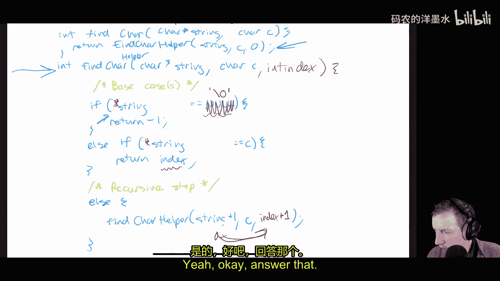

Question 13 on。

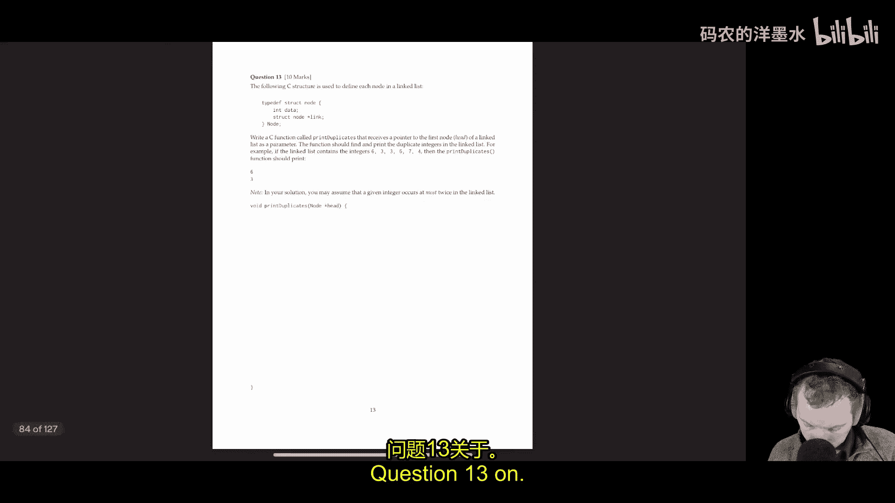

The 2019， am I on the 2019， I already forgot where I'm at。No， I'm 2018。2019 question third。

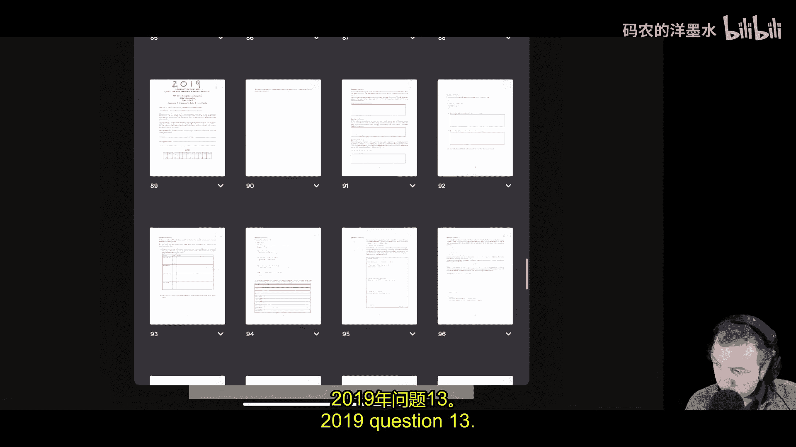

Teen。Oh we got here。Complete the definition of a C function。U。Permate whose function。

 whose prototype is shown below that prints all permutations of a string string。For example。

 the string passenger function is defined as ABC。 A call to it should print all of that you must use recursion to solve this problem。

 asterisk 1。 In fact， the non recursive implementation would be more challenging。So hint。

 you may wish to define a helper function， and you may also find the swap function defined below useful。

So we want to have permutations of literally everything。What we could do。😔。

There's a few ways we could tackle it。Wellow， so。The solution。Is straight。Yeah。

 I can't think of a better way to do it than this solution。solution keeps one thing constant。

 just tries to swap everything around。 and then。Makes it one smaller。

 then swaps it again and prints it。So。If you have something specific with that， but。Yeah。

 just try reading the solution to that one。If you still have trouble with that。

 I will help you again later， but。Other questions， Otherwise， I will go back to。

Some other things I saw that were useful。But yeah， if you wan help with that one， message me afterca。

I'm trying to do things more general now， and trying。TT make a bit things that。

We can definitely do a bit different than the solution posted。 But yeah。

 I can't see anything other than the solution。 So let's see this one， questiontion 9。

Rightite a C function called diagonal sum that returns the sum of both diagonals of a square and by n array named square diagonal elements are circled in sewing figure note if n is odd。

 the central element should be counted twice in your solution。So。With that。

 the solution that is given is kind of。Its a lot of writing。 so I'll tell you the way I think of it。

So the way I think of it is。We just need， like， a single。Hopefully you just need a single for loop。

 right？So single for loop， I know that the coordinates of this diagonal， right， It's like one。Like。1。

 sorry，0，0， because you know， a arrays are 0 indexed，1，1。2，2。 And then in this case， we go up to 3，3。

 So that's like the first diagonal， right？And then the secondtagonal。 Well。

 the elements there are three。0。Oops。Sorry。0，3， my bed。 row column。So then we have row 1， column 2。

 row 2， column 1， row 3， column 0。So look something like that。

 So I just need to add up all of these numbers， so。If I'm summing things generally。

 I know I have to create a variable called sum。 I can initialize it equal to0， and then。

Unlike the solution， I should be able to just do this all in one loop。

 so my loop could just look like four。And I。Equs0 all the way up to I is less than n。Plus， plus， I。

So I know that if I access square。At I， I。And I go， and I do that。For this entire for loop， well。

 that would access these elements here， right， So if I。Want to go ahead and update the sum with them。

All I have to do is I could write。Some。Plus equals square I I I。Right， sounds a bit like a pirate。嗯。

And I could also make it even so that's one diagonal， right。

 so everyone agree with me that should get this diagonal here。Now。

I could just stay in this for loop and do the other diagonal as well。 So the other diagonal， well。

It's to access the elements of the other diagonal， it's square I。So it starts at I。

 And then to get the column， right， It's just kind of inverted。 So it's just。And。Minus1。Winus I。

And to verify that， we can check。 So in this case， n would be4。 So first time。You， n would be 4。

 So 4-1 is 3。 So we get。Well， this would always be 3。 So then we get3 minus I I is 0。

 So we would just get3。 so that would give us。This。The first element， So row 0， column 3。

 Then next time through I is equal to1， Then we would get。Well， row I and then 3-1。

 So that would be 2。 So that would give us the next diagonal so it can look just this simple。So some。

Plus equals square。And that's the entire solution。So here I can make this a bit more compact。

And then at the end， of course， we need to return the sun。But。

That's what we could do for the solution， so the solution given。Really， really wordy。

 So the solution has like a row， like integers for rows， integers for columns， and then while loops。

I find it weird。So。I would just do this， so。Everyone okay with this solution should save time and。

Hopefully be faster to think of。All right， Any other general things or I can carry on。And yeah。

 you can feel free to ask any questions you want about the exam because I forget。I forget most of it。

 so I can't spoil anything。Well yeah， but for most of these questions。

 there's lots of different ways of writing it。As long as your solution works。

 then you're good unless the solution specifically says， write a recursive version of this。Then。

Do you have to write a recursive function otherwise， you will not get a good mark。 And yeah。

 this binary trees in other exams this year， it's not included because you'll be doing that in one of your future courses。

 and it was just confusing in this course。 So it was cut so。Bineary trees， don't worry about them。

Binary search would be in scope for this exam， though。So。That， like， we covered it right before。

 So that by， that searching lecture I did。All good stuff。But yeah， don't。

 don't worry about binary trees。 Don't worry about insertion sort。 Don't worry about quick sort。

 although like。That disuses the idea of recursion。So。

you don't have to remember it or anything like that。

 but you should kind of understand the gist of it。Should you know how to do binary searches recursively。

 I mean， couldnt hurt， it's not that much different than doing it iteratively so。You。

It's good to practice。YouShould be able to do it such that like you're not committing it to memory。

 All you should remember is that the idea of the binary search is， hey。

 we could try and cut it cut the array in half all the time because it's sorted。But aside from that。

 you don't really have to remember anything。 You should get to the point where。

You can kind of implement it。U。Other question， when we declare a char star string， for example。

 my string， can we use it like we would， the name of an array。

 like do my string plus one to access the address of the second element， etc cetera。 Yep。

 you can absolutely do that。 So it's just an array， like anything else。

 So the only thing that makes like strings special， strings are just as of characters。

 The only thing that makes C string special is that the last character is the null biteite or 0。

 So you know， when the string ends。 But aside from that， there's nothing special。😊，You can think。

You can think like I just think of strings as just an array of characters and it ends with a null bitete。

That's it。So yeah， so point arithmetic rules all apply if you do like here was the example。

So if you do cha， star。My。Was is it my。Myice string。Let's say here。

 let's make it equal to some string literal。So that just means somewhere in memory。

 there's going to be like an array of characters。 So let's draw it out like an array。 Wow。

 that's a real even box，So we can draw it out like this， and it would have the character。Each。😔，E， L。

 L。Oh， and then the null bite。So it would just look like that somewhere。In memory。

 and then my string， if you were to say what character it points to， it would be pointing to this。

So just be point to the first capital H。 And if I do my string。Plus one， I'm adding one to a pointer。

So it's a pointer to charge。 So it will go to the address of the next character。

 So my string plus  one would。Just like if it was an array of ints。

 it would point to that lowercase E。So， yeah。Yeah。Cea strings， just as of characters。

 all those same rules apply if it's easier to think about it。Just。Think about it as ins。

 usually people think about， especially if you're starting off easier to think about in terms of ints。

 So make it simple。 Think of what would happen if things were integers and then just change it。

 So now instead of integers， theyre just characters。 But all the same rules apply。

Point arithmetic array。 The only difference is that。Characters are smaller than integers in memory。

 but it doesn't matter。 You don't need to know that if。All right， any other general questions？

Anything else fun we can do。sort。And yeah， also on the exam， like I said in there。Do not， do not。

Do not remember Bogo sort or Bozo sort， either。In question， wait， so we need to clear your string。

 You can do char star and cha。 No， you can't do cha。 So I can't say just char like this。

 that would not work because。The string literal， it's a pointer to that string literal。

 so this would give you some error saying that you can't convert a char star to a char。

But if I wanted to， I could make it an array， right， I could just do square brackets like that。

And then I make it an array， and then seal figure。Out the size for me and put it on the stack。

 so in this case， the size of it would be six chas because H ELL O and then the null byte。

 and then we can go ahead and modify things。And it would also not point to wherever string literals are stored in memory。

 it would just be on the stack and you can go ahead and modify it。But。Yeah。

 that's the only difference。 But same thing。 if you use it in function， it's now no longer an array。

 It's only a real array in the function it's declared in it。

Outside of that just becomes a pointer because of our array decay。Alright。Other questions， comments。

 concerns or other things we definitely want to go over。we can。Oh， that is a large thing。All right。

 we got insert at tell。That might have not copy and paste the drawing。

 Can you explain how it inserts a node at the end of the link list？The formatt。

So if you want to post like code and Discord， do three of the Til。Things。

 so like it's like the key right below escape and paste the code and do three till the things to end it。

 and it will format it as code。Oh， not like that。 So three。Here I'll type。Alright， there we go。So。

 we want to insert tail。So this is from the textbook。Yes。🎼So to do。Okay， so what。

 what specifically do you want me to like。Do the implementation for that or。我。

Or explain what that one's doing since it's a bit。Stranger than what we usually do。All right。So。

I might have to follow up after because no one can see anything。 So it's probably not。

 not that effective， but basically。What that does is。

So create node will return a pointer to some new node。For value。

 make sure that we actually have enough memory for it。 That's why it checks for null。

 and then it starts off。At the head of the list and tries to iterate all the way to the end has a weird while loop that checks like if it's inserted or not。

 So it'll iterate through everything。 Also check if it's inserted。 So if we found the last element。

 A K， A currents next is null。That means this is the tail so we can change currents next to point to the node we want to make the last and the list tail point to it。

 And then we've inserted it。 And then that would break the while loop。Otherwise。

 if it's not inserted， that means that。Well， we didn't even enter that while loop。

 so the list could have been empty。Well， in this case， the list is definitely empty。

 So if the list is definitely empty， then well。There is nowhere to put it。

 So this is the only element in the list。 So in this case， the list。

Liinnk this structure keeps track of the head and the tail since this is the only element in the list。

 while the head and the tail both point to this because it's the last one or it's the only element in the list。

 so it's both the first and the last one。Does that make sense。

 we can try see if we can find a linkless question too。But yeah， for most linkless。

Be careful of like the edge cases of like， hey， the list is empty our。Yeah。

 mostly the list is empty or what I'm looking for doesn't actually exist。Or things like that。

And yeah， there's more than one way to write that function too。

I probably wouldn't have wrote it like that and just like checked。Hey， if immediately。

 if head's null， then we can go ahead， we can insert it。 We're done and just return。But。

 Funs a bit weird， I'm not a big fan of that one。嗯。All right。

Anything else we want to go over where we got。H。Sort array， let's see if we can find a link list。Oh。

 we can do some recursion。Sure， recursion's fun right， so again， yeah， this is the 2023 exam。

So it says write a recursive function name print reverse that reads a sequence of positive integers and outputs the sequence in reverse order。

The input sequence ends when the user enters the number 0。

 assume that the user always enters Valult input。 Your print reverse function must be recursive。

 otherwise。The solution will not receive any marks you may not declare。Any array in your solution？

Blue is a sample input of the execution。With this。Well。We have to think。

 So every time we call this function， we want everyone to enter a number， right， so。

We would start off by just saying print。Yeah。Could say， enter。Noumb。And then。We declare int nu。

 don't have to initialize it to everything。 We're assuming that the user enters V input。

 Then we can scan F。Percent D， because that's the format specifier for an integer and we need to give it the address of nu so I can go ahead and update the value for us。

So。Just remember， if you use scanf and it's a char。

 I would always do like a literal space before the character format specify to get rid of any weird issues。

 So， but if it's not a character， we don't have to worry about it。 So we get a number。

 and then we can go ahead and。Well。Check our work， our like base case。

 So our base case is we stop if the user actually enters a0 so we can。

We can just go with what we think of first and then try and refine it as we go on is one way you can do this。

So usually with this helps to have a scrap piece of paper around。 So if the user。And there's a nu。

Well， that's kind of like our base that's our base case， right， Then we're done。

 we don't want to do anything anymore。We're good， so。In this case， we can't just do a return。

Because then nothing would happen， although。I mean， we can try with that。So this is our base case。

We could go ahead and print。Was it what reverse sequence？So we could go ahead。Printverse sequence。

And well。Yeah。That isn't the situation we're in。 So we're doing the recursive case。Well。

 we want to go ahead and ask the user for input before we could。Or we want to。

Call the recursive function again。 right， We want to print off the rest of them。 Pri recursiveive。

Or sorry， print reverse。 So we do print reverse。 And then only after we're done with that， do we。

Print F our actual number that the user inputted。So we could say reversed。Sequence。

Percent D N and then。And。That should be it， right， I think that's it。Here。

 if we could just do if we wanted to， we know that it's0 already so we could do something like that if we really wanted to。

But。That should work。 So let's run through the example and see if the example works。

 So we'd say print reverse。Yeah， so we do want multiple reverse sequence。

 So let's let's run through the code and see what would happen。

So always good practice to double check。 So we would。Call print reverse once。 enter numb。

 First time we enter 10。 So the first time through it here， let's。Right out。So in print reverse。Nom。

We have a variable called nu equals 10。Well， it does not equal 0。

 So we skip over that and we call print reverse again。 So now we have another function call。To print。

Reverse。Then we enter a nu。In this case， we would enter5 as our number。So the number is not 0。

 So we call print reverse again。 So now we have another function call to print。Re first。And now。

Let's try and skip a few steps。So call it again， they enter， in this case， they enter two。

Then we would call print reverse again。This time。The variable nu in that function call is equal to1。

 Then finally we call print reverse。I know。Is 0。 So let's continue on with right here in that。

That one。So number is equal to 0。 So now。If number is equal to zero， so。0 is equal to0， thankfully。

Then we would print。 What we would see is we would see。Reversed。Here I'll just make it short。

Reverse sequence。0， get printed out and then return。So now this function call is done， right。

 with nu equal to 0， it's done， and we're going to return and we would resume wherever the last function ended off。

 So the last function was up here。 So it was print reverse with nu equal to one。 So。Now。

 nu is equal to 1。 we would print off reverse sequence 1。And now everything tries to kind of unwind。

 So now we're done with that。We hit the end of the function。

 which has which just returns from the function。 We don't have to write anything。

 So now this one is done。And we resume print reverse with nu equals to2。

So now it's going to print off。Reverse sequence2。And then that function is going to be done。Oops。

Then same thing。With nu equals to 5， or we're going to resume the function with。I'm equal to5。

 we're going to print off for ver sequence。5， then we're going to print off reverse sequence。

10 for the last one。 And then our functions finally going to be done。Right。So。

That printed often to reverse。So。If。I sorry。I think I did this in lecture， too。 But like。

 what would happen if I just moved this print。Print F up one。And yeah。

 we do want multiple reverse sequence。 Oh， whoops， Oh， sorry， yeah。

 that would be multiple reverse sequence。 Sorry， should just start with this。

 And this should just be， sorry。A space with that。Yeah， sorry， it just wanted all in one line。

 so this shouldn't have a new line。And this shouldn't have a new line， either。

So it should look something like that。Oops， sorry， should all be one on line。

 I thought it was one every line， oops。So it would print reverse sequence。0，1，2，5，10。

And if I did something like this， I did the printf first。Well， then。It would print reverse sequence。

0。And then be done and then print off。O。It would have actually printed off。呃。Like 10， oops。

 let's do a different color。 If I just move the print F up1， Well， then it would actually print 10，5。

2，1， and then reverse sequence。0 and。That would have been bad。 So if we want it reversed。

We just make sure the print F comes after the recursive call and intuition behind that is， well。

 the smaller problem is。Before I print my current number， I have to print the rest of the numbers。

 so。That's one way you can think of it。All right， any other questions or any other stuff we want to go through。

 So we kind of Yeah， we did the recap lecture before。Or like general questions about the exam。

s right。If we were to reach the end of a nonvoid function without returning anything。

 what would happen。 So if you reach the end of a nonvoid functioning without returning anything。

C says you're kind of on your own， usually by default， it returns a zero。Another question。

 why is it 9 am in the morning？I don't。 I don't know， but I'm commuting from far away。

 So I have to get up at like some ungodly hour。 So hopefully you have to commute less than I do。

 But yeah， I have two exams at 9 back to back。Yeah， so my other course is on the 30th。

 and this is the 29th。And yeah， so can we assume that help helper functions are allowed unless less specified。

 yep， you can。Always write additional functions if you want。

 unless the question specifically says which I don't think any of them do to say only write a single function can write as many functions as you want。

You just might be writing too much。Also， no， you don't remember the exam much since it was written a long time ago。

 Would you try your best to remember a sliver of it for us。It has questions in it。

 those questions have to do with the course。So。Yeah， that's pretty crazy。

 I do not know what room I'm invigilating。h what？It's， it's all in the exam center， right。

 I think this one's in the exam center。 I get confused with my other course concerning they're like the next day apart。

Yeah， I。Ive no idea what room I will be in。 I will go， and I will do what I will is told， and told。嗯。

Yeah， also。Fun fact with the invigilators there if you didn't know this because some of my third ears didn't know this。

 the invigilators we get for final exams are completely random。 They are not your Ts for the course。

 In fact， they might not know anything about programming whatsoever。

 They might be from a completely different department， so invigilators are purely random。

So you'll have no idea who the invigators are， so unless you're asking them to go to the bathroom。

They won't。 They're told not to answer questions。 That's why instructors have to be around so。

If any question comes up， make sure。If you are in a room without the instructor of your section。

 your instructors are myself， Selma and Bruno so。Bia。Try and see。

 make sure like we should announce ourselves it should be obvious who we are。But bii。

You probably don't want the vivigilators answering your questions anyways but。Just remember。

 make don't even if don't try and ask the invigilators anything if you have a question regarding the exam。

 just tell your invigilator to flag one of us down like one of the actual instructors unless you need to go to the bathroom or something and then that's what they're there for。

Yeah， trying to bribe them is not going to work。 I assume Im I have no basis of this whatsoever。

 but I assume that's why most universities， the vigilators you get are like the Ts in your course。あ。

But， yeah。So maybe that's why Toronto does it。 Maybe the Ts did get。

Kickbacks or something I don't know。 There's got to be a reason for the， this rule。But yeah， th$20。

Doesn't get you too far anymore， unfortunately。Alright， Anything else about the exam， I would say。

Exam tips， I mean， there's probably going to be stuff on linked lists。 so unlike last year's。

Exams where they covered a lot more things and link lists were done pretty quickly。

We spent some time on link list。 some of the sections spent almost two weeks on link list。

 So that was a vast majority of the course。 So I would practice your link list for sortings。

 You should know bubble sort and selection sort。Are the two that all sections covered？嗯。

You don't have to know insertion sort or quick sort。

And please forget I ever showed you Bogo sort or bozo sort。we。Another question。

 we don't have to free anything on this exam， right？I believe if you have to free something。 Alright。

 so this is where my memory comes into place。 If you have to freeze something。

 the question will tell you you must properly like free your memory。

 so the question should state that。If you don't， just assume you could just like write an assumption to say。

 I assume the memory gets used afterwards。 so I don't have to free it or something like that。

 But I believe when they。Again， don't trust my memory， I believe。

Although I probably shouldn't say this， I believe one of the questions says like make sure you free memory。

Properly。But， I don't really remember it。Vguely， remember the questions I wrote。

 I only wrote three of the questions。Maybe four。 Oh。

 I can't even remember how many questions I wrote。 That's not good。

Keep forgetting how long this exam actually is。 I think it's a two and a half hour exam。

Unless the first year ones are different， but should be two and a half hours。Oh。But yeah。

 it'll be a long one。But yeah， maybe two questions， your exam。Your exam， I believe。

You're exam slightly on the longer side， if I had to guess。But it doesn't have binary search trees。

 so the idea is hopefully it evens out。Oh。But yeah， so。

If you find yourself running up against time constraints， like。Try and prioritize the question set。

Are worth the most marks that you can do quickly。But yeah。

 would you say this funnel would be harder than previous years on account of high midterm average？

The course this year is covering different topics and stuff and have different instructors， so。

If you guys just learn more and can demonstrate it， having a higher mark is not a bad thing。

The department might come at us and be like， hey， your average is too high historically。

 But then we can probably say， hey。We changed how the course was delivered a bit this year。

 changed the material and。There's two instructors and hey。All I ask is that。If the exams highe。

 like average is highe。ItsHo it's for good reasons， right， so if you all。Go there and kill the exam。

 That's great。 That's I would rather see that。 I don't really care if the mark's high。

So the apartment probably is gonna， I mean， not mad。

 but like it'll probably get flagged because it's historically and historically。

 the course average has been low。But。They also asked weird questions。

So we'll probably get talking to anyways， don't worry yourselves about that。

But we'll all get through it together。But yeah， I mean the。Also。

 it's I don't know what happened to you if you like what。

 what's the midterm average for other courses，75 is probably about where it should be at。

So I thought the midterm average was good。Well then。But yeah。

 I don't know what your averages are for other courses。Various pre course E C 110。 Yeah。

 what's the 110 midterm average this year。It's a skull。 you don't want to know。50，60。Yeah， so。

People err on making things too hard and adjusting the grades。 but generally， that's this。

This just the exams too hard or things。Weren't clear or something like that， that's just weird。U。

Yeah， I had an electronics course where。I mean， the midterm average was like like a 40。

 And the professor said the exam was the。What do he call it。Midterm ever just 40。

 he said it was the technician's exam。 Like the midterm was the technician's exam。

 and the final is going to be the engineering exam。 So strap yourself in。 And I believe the final。

 like the unadjusted average for the final was probably like 20 per cent or lower。

 That was a fun course。ICan't say I learned anything。All right， they made the final easier， but yeah。

I mean。undergrad with。But yeah， if you get if you get destroyed on midterm and they say it's a technicians exam and the files gonna be the engineering one。

 then yeah， be be very worried。 I've only heard that once。 and it was not good。And yeah。

 there's a bimodal distribution。 You have to justify。Like I said。

 this is my first time teaching this course。Well just。Do the exam hope for the best， huh？All right。

 any other question， comment concerns， Yeah， concentrate on linked lists。Bas of it problem solving。

 just try and do past exams， there will be some questions too that are like hey。

 implement this recursively， so practice on your recursion， practice on your linked list for sure。嗯。

And then aside that， normal seed knowledge structures， that's all handled in linked list。What else。

 what else？Oh， question about linked lists。 Yep， what is the question about linked lists？嗯。

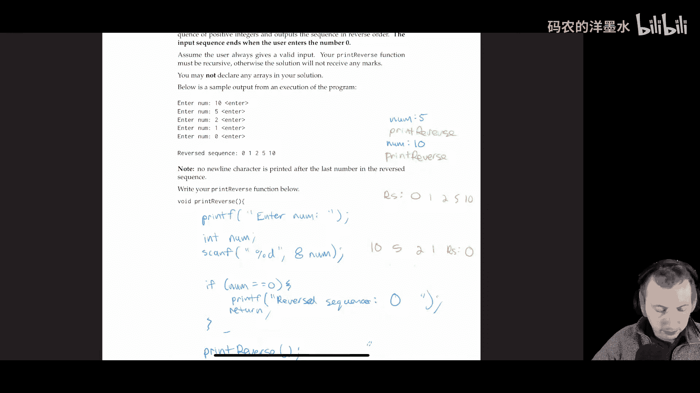

We can make myself bigger too。So would you recommend brute force memorizing the linkless situations in the textbook。

 insert note at front， et cetera。 So I wouldn't bother memorizing them like on。What lecture did I do。

So like。We implemented most of them in which lecture。Leecture 30 I did。 we implemented most of them。

 The only thing you really have to remember is like that。

Just generally knowing how it works is practice。For most of them。

 you will have to go over every single element， so。

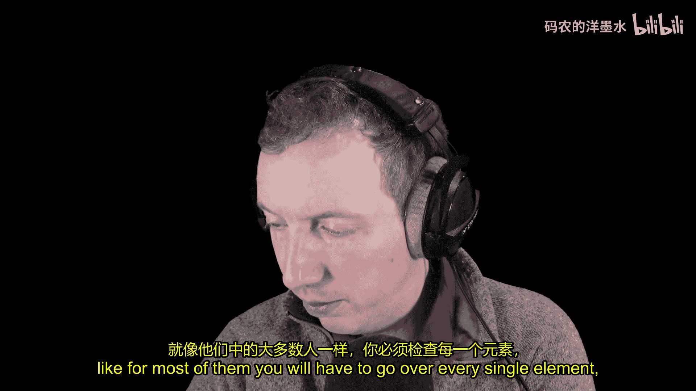

Like iterating， like it should kind of be second nature that。

Kind of iterating over every single element of a link list just looks somewhat something like this。

 So you have a node。Current， and then it always starts at the list。Head。Then， generally。

 you'll have well。Current。Does not equal null。Then you can go ahead and you know that you can access current。

You know， maybe it has some data in it。 You can do something with that。

 Who knows this will all kind of。Depend。On question。And then at the end， you know。

 you update current。Eals two current。Next， and that's generally like the basis of all the questions。

Like you just have to access every single element， maybe you do something。

 so in that lecture we did things before we did things after。U。Past then it kind of depends。

 but it'll always look something more or less like this。

So this will be pretty much common for all the link list questions。um。Like。Maybe it might say like。

 I don't know。Do something with the previous node。 We。

 we had one of those questions in in the lectures， also for figuring it out。

 like the figures I did in the lecture are probably a lot better than。

Me trying to trial something right now so。Yeah， and。

I'll more or less be around what we got we got a solid solid three days or aK the weekend for the exam。

 so yeah I'll try and answer questions on Discord mostly sometimes I do piazza but I like piazza less than Discord。

So you can do that， let's see if there's anything。So yeah。

 most of the questions on Piazza more or less got answered。

Is there anything anyone here post on piazza they should definitely look at？Quick sort， Yeah。

 most of the questions I saw in Piazza were like what sorting algorithms are on here。

So on and so forth。 And yeah， bubble sort， selection sort， things。

Those are the only sorting algorithms。No binary search。We never covered binary search trees。

 you don't know what they are， so don't worry about them if you see them in past finals。

Not included in the course this year。But， yeah。Any other questions and stuff。 And yeah， for。

 for the most part， like。I wouldn't even remember of like functions to remember。Let's see what。

 What do I got off the top of my head。 So of functions to remember。

 you should probably remember if you commit anything to memory R， t'll just return。Loops。Returned。

Random。Int。😔，On the exam， you don't have to worry about setting in the seed or the fact that you know if you don't set the seed。

 it's the same thing every time， if you just assume it's always a random number。

And then what you always do with RA， usually its returns some random number between 0 and some giant number。

 So to make it go to a range， you always mod it。 so you mod it by some number。

And that makes the result。In the inclusive range， it'll be any number from 0 all the way up to and including nu-1。

 So that will give you a range of integers like that that many。

 And then you know you might need to add something to that or multiply by it or divide it to get whatever the questions asking you。

If there's a random question， so ranand， good function to know。For the other math functions。

 I probably wouldn't bother remembering them， most them take a single argument and you could probably make them up if you had to so like sign。

 it's just sign square root， most people like most programmers。

At least the standard library ones tried to make things as short as possible。 So like。

 just think about writing as little as possible。 But it looks like something like square root。

 So square root would be like。S Q RRT， but again。Wouldn't bother even remembering it。Um。

 let's see other functions you should know off the top of your head。

 while you should definitely know print F。You should know scanf。

For any of the like even string input or anything like that。

 just use scan F and just assume that it works fine。

 you don't have to deal with nitty gritty memory issues with scan F that's what crashing your computer is for So know these two functions。

Know the format specifiers， so you know we got percent D。For an integer， percent S for a C string。

Pcent C for a cha should probably have a space before it。

 and that's pretty much all the ones you need to know。Aside from that。

So the other functions you should know from。The strings。

Good string functions to definitely know if you don't。 So the length of a string， stir lang。

And again， like there's stir n length that like constrains it。For the exam。

 you assume like your memory is fine， so I wouldn't remember any of the string functions with an n in it。

So you should also know string。Copy。So it's where you want to copy the string to as the first argument and what you want to copy from as the second argument。

And then there's like stir cat。Two concatenate strings。 So you got dust and string。Her source。

 I'll put it at the end。 And then the other one you should definitely know is stir Co。

So that will compare two strings together。And then return an integer。

Of that represents like the result of the comparison。 And if the strings are equal， this returns 0。

If it returns greater then。Greater than 0， it means S2 is greater than S1。 If it returns less than 0。

 it means S1 is less than。Oh， sorry。Si。S1 is less than S2。 and if it returns greater than 0。

 it means S。Wow， okay， I'm having a brain for it because the dog， it means S1 is greater than S2。

 sorry。And then。Those are all the other ones like they're searching for a string。

 but generally they'll probably just tell you to implement it so you can just try and remember search for a string。

Is thirster so。It's searching for a string within a string。

So it searches that and then gives you back a pointer to wherever it's found。 there's also stir cha。

Which is the same thing。 You'll search a string for a character。

 Give you back a pointer to that character。 but generally， you'll probably have to implement them。

 So these。I would probably not worry about。But the other ones you should know。

 So you should definitely know RAand print F， scan F。

 Hopefully you've used it enough time now that it's probably seared into your brain。

 Std length stir copy。 for sure。 these two stir cat。Probably good。 Stirop， definitely。And then。Like。

 if I had had to put them in tears， I would say， let's say。Everything underlined with orange。

Definitely， remember。Everything underlined like。Stir cat， probably good。

You could chance it and just completely forget about it and then stirir stir and stirir cha。

 probably like iffy。Yeah， question， both a dog and a cat， which you think is superior， can't choose。

 They all do different things。 So， yeah， I have two dogs。 and you can probably hear the dog barking。

 they currently have a feud， so。Yeah and then question can we use these string functions for any question in the final so I mean I guess you could technically use them for any question。

 but if you use them for a question thatt doesn't have strings in it， probably going be weird。

 you can use them unless the question specifically tells you you cannot use them。

And then how many questions will be on the exam， I have no idea somewhere in the ballpark of the same thing。

 It kind depends， I think。There might be more questions in this one。

 but there's more shorter questions。Of。Yeah。Yeah， we got cats， dogs。

 and there's also a nesting robin on our front porch。 So I guess we have birds， too。

The dogs are fine and bigger than the dogs， so。Yeah。

 I'm bigger than both of the dogs put together barelyly。So I'm safe， I'm bigger than the dogs。

But if the weight of the dogs is greater than your weight， you probably you might be in trouble。

All right， any other questions， comments， concerns， so yeah you shouldn't have to memorize。

Many functions。 Oh， sorry， other functions you should know。 You should definitely know malloc。Maoc。

 that's a good one。 that' I put that under the orange tier。 And then， you。

 you should probably know free too。So free， probably the question will probably tell you whether or not to use it。

But I believe those are all the functions you should definitely know。

Any tips on not being super confused with pointers in linkless。 So hopefully that。

Figures and everything in。Like lecture 30 and the lectures I have are helpful。

Like we did a lot of exercises。I would just try practicing with them like you've probably forgot them all now trying and implement one of the functions we did without looking at it。

Go through it。I tried to make it as standalone as possible so you can you know even write it out and see。

 I think we even wrote it out。 So write your link list implementation C， you can go ahead。

 you can play with it while you still have a computer。To help you out with it。Let's see， all right。

 because I'm having trouble with Liless head。Like， why does head have next。

 so how the link lists generally work？Is like the link list structure itself just。

Points to the first node in the link list。 And that's all the link list is。 And then after that。

 every node points to what is after it。So。Like the list head doesn't have a like the list head would have a next。

 but the list itself doesn't have a next， if that makes sense。So。All the link listed is。

 it points to the first node， and then every other node has it next， so。It's like， I don't know。

Like to keep track of everyone in line。Add something。 So if you just remember who is after you。

Then that's all the information you need to know for no matter how many people。

 if everyone just remembers who is after them and then you know who is at the beginning of the line。

 then you know the complete order of the line， right？ So if we got A B and C， all standing in a line。

 A knows B is after them。 B knows C is after them。 And I know it A is at the front of the list。 Well。

 I know what order they're in， I can be like， okay， well， so the first thing is A， who's after you。

 B， Oh， who's after you。 C， boom， now I know the order of the list。

 So that's kind of the idea of the link list。Because unlike an array。

 the nodes could be anywhere in memory， like an array， you know they're all in order。

 so you just go to the next integer for linked list nodes， you have no idea where they are in memory。

But yeah， like the head is just a node， it's just whatever is at the front。

They have different names for stuff。 General， you know， they say head is the like front of the line。

 If you want to think of it as a line， that might be easier。 So head is just the front of the line。

 Tail is the back of the line。And like。If you want to think of it as per people。

 nodes are people and all the people just remember whos after them and then。

To you as the person managing the line just have to know who's at the front。

 maybe sometimes maybe you have to know who's at the back。Right。But yeah， but。

Practice with the pointer stuff。Can you go over different ways we can access or edit a string？嗯。

Not sure what you mean by that， but the only thing you have to be careful about with a string is let's see where we start writing。

 let's just write。A string， just， it's just an array of characters。 That's it。

 So it works exactly like if it was an integer array or anything like that， modifying it。

Is all the same。 The only exception is if you have something like this， if I have char star S。

And I say it just equals to a string literal， like directly。If I do something like this， well。

 where this string is， So where this array is in memory。It's in a special place and memory。

So it would just look like an array of chars， so it would be H E。然后然。Oh。

 and because it's a sea string， it has to end an an nu bite。So string literals。

 they'll be stored somewhere in memory。 But the rule is， if it's like a string literal。

 I'm not allowed to modify any of these characters。 So this is like the only exception to。The two。

Like it's just an array of in or anything。 So I'm not allowed to try and modify it if I have it pointing to a string literal because I don't know where in memory this is and a place in memory where I'm not allowed to change any values。

 Why， well， because for。Reaons， so。It might be clear if I tell you the reason。

 So why it's like that is because。I could have， let's call this S1， and I could have char S2。

Maybe I make it also equal to hello。So someone decided that， okay， well， both of these like are。

Sposed to represent the same C string。 So it's supposed to be hello。 So well。

 I could have two helllo somewhere in memory， but that's wasteful。 Why do I need two hells。

 I could just have them both share that one。 So what will actually happen is likely。

As long as you compile with like optimizations and things。

 likely what will happen is the pointer to S1。And S2 will actually point to the same。Addres。

 those both point to the starting H。 So that's why you're not allowed to modify it。

 Because if I was allowed to modify it and say I did something like。

S1 string 1 at index 1 is equal to， I don't know。Ai。Well， then it would change this。

From an E to an A。 And now， wow， now it looks like I modified string 2 when。I didn't want to， right。

 I only modified string 1， I thought they were independent。

 But because now that like C was trying to be smart and not store hello twice in memory。

 They're both sharing memory。 And now， if I modify it。

 I'm not allowed to modify it because then I'm kind of like。Breaking the rules。

 So now I'm modifying someone one else's string。 It's not exclusively owned by me。So。I don't know。

 What's the reallay analogy。 You can think of it as like， I don't know。

A library book or something I don't know or like some paid someone's written。

 like you can all share it。YouYou can't like rip out a page and start scribbling your own stuff。

 that's not fair to anyone else。嗯。But yeah， that， that's the。This is the only exception for strings。

 otherwise， or just like an array。So if I just， if I instead did char。S。

 3 en treated as an array and said it was hello。Then。Just like if I had int numbs。Equal to one，2，3。

While C is going to size numb so that it fits all three integers and they all exist on the stack。

 I can modify them however I want。Same rules with this。

 So that string literal is just meant to initialize that array。

 So C is going to go ahead and make sure that the length of this is going to be 6。

 So it would actually。Bi。😔，6， because it needs to hold。Each。Well， basically needs to hold this。

 which is six characters， right， H， E， LL O and then the null bitete at the end。So after that。

 I mean， it's just an array of characters， it just ends with a null bitete。Alright， any other， oh。

 we're slightly over。 Alright， any other last minute questions， comments， concerns knowing that。

 yeah， I don't remember what what we wrote on the exam。

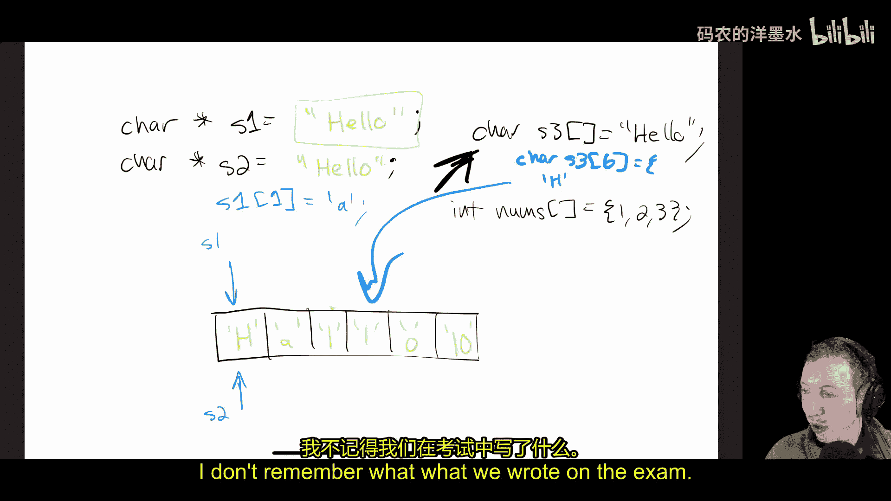

But yeah， on the long。Yeah， I will warn you slightly on the long side， I think。

But the questions are easier。 so the idea is it evens up。But yeah， again， linked list recursion。

 focus on those ones。And otherwise practice。But don't quote me because I， like I said。

 haven't done exam this course yet。I don't know how it goes。

 but hopefully it will be all right and yeah， ask any other questions on Discord。

 I'll be more or less around on the weekend。Oh， another question would directly initializing string literal like that also include the null character。

 Yes， it would。 So yeah， like the string literal definitely has a null character in it。

 So you just can't modify it。Yeah yeah， using recursion program a beta version of chat GT。Yeah。

 I expected a lot a decent amount of recursion。So yeah。

 the other sections mostly focused on recursion and linked lists。

So that's probably the majority of it。It's cumulative because it's C， so it has to be。

But definitely a focus on the second half of the course。Yeah， all right。Other people are typing。

 yeah， so I'll make sure everything's answered before I go。For string literals。

 why are you allowed to do string string plus one instead of string one。 So here。

Let's go back real quick。So。

I'm so this。Here， so here， let's erase。So let's assume this。 So this is a string letter。

 like S2 is pointing to some。You can think of it as it's pointing to an array that I'm not allowed to modify。

 and that's the only rule。 So I can't modify it。 So I can't do something。Like。Yes。Wops， too bold。

Stop it。So I can't do something like S to1 equals。A。This is a nogo。I cannot modify it。But I can oops。

I can do like charge C equals S to1。 That's fine。 You're allowed to access the data and like get the values from the array。

 No problem。 I just can't change the values of the array。 So this is A O。

So I'm allowed to do that and in this case。We know that like。C would be equal to。A lowercase E。

And I'm also allowed to do S2。Equals。S 2 plus1， because that's just point arithmetic， right。

 So I'm just not allowed to change like the elements of the array， but。Like the pointer。

 it's just pointing to some address and memory I'm allowed to change what it points to。

 So originally S 2， it's basically。You going dr out that array again。

 So here's that array of chars in memory。H。E L L。Oh。And then the null bitete。So those are six。

Characters。So initially S2。Is pointing to the capital H if I do S2 plus1。Well， just like。

As if it's pointer arithmetic and just like if it was an array of ints。

 it would make it would return a pointer that points to the next integer， right。

 So S2 plus1 this is going to point to this。 So I'm allowed to do that。I'm allowed to， like。

Breed whatever the characters are。 I just can't change any of these， so。

The only thing I'm not allowed to do is I can't change this。E to an A。

 I'm not allowed to change this to J。 I'm not allowed to do anything。

 I'm not allowed to modify the elements of the array。But and that's it if it's a string iteral。Yeah。

 and tires of Hannoi。Yeah， so Tas of Hanoi。Good recursion。Yeah。

 what the test should be is I should bring in the full tower of like eight pegs and actually no。

 we should have a tower of 20 pegs and if you can finish it before two and a half hours。

 you pass the course or you could just write the exam。So。I forget how many steps that was。

 like several million。So yeah， just remember Ts of Hanoi。We've solved a good example of recursion。

 probably the hardest recursion you'll see if you can understand that should be pretty good。Yeah。

 that'd be an interesting。Interesting option。 You can either write the exam or try and do a 20 tower of Hanoi in front of us。

Wait， so when you。When you do S 2 equals S2 plus 1， Yeah。

 then you're just point to the next element so。If we do S 2 equals S 2 plus 1。

 So S 2 plus 1 points to the E。 And then we update S 2 to be equal to that。 So then S 2。

Let's do blue。So now S2 points to the E。So now if you try and print S2。

 what if we just did like print F？Percent S and then gave it S 2。 Well。

 is this going to treat it as a C string。 So it's pointing at the first character it's pointing at is a lowercase E。

 So it's this going to print off all the characters until it reaches the nullbite and not print that。

 So we would see E， L L O L O。So that's what we would see printed。Yeah。

 if you do S 2 equals S2 minus-1 plus1， then。You would get some random， like if I did。

Here let's do S2 equals S2 minus-1。 so S2 started off pointing to here。If we did -1。

 then we' would be pointing to whatever this element is， which is undefined memory。

So we don't know what this is。 This is a big old mystery。

It could happen that we see some a weird character。 and then hello。

 it also could happen that this random bite is just like the null bitete， in which case。

 if we try and print it， we don't see anything， right， It just prints absolutely nothing。So。

Or it could try and access this。 And we don't have permission to access this memory。

 And then it Seg faults。 So our three major options that we don't need to know for the exam。

 Either we'll see some random character that maybe can be printed。 And then hello。

 Maybe we see nothing or maybe we se fault。So that's the joy of programming， isn't， So we just。

Minus1， we're off by one， and then。Who knows what our program does now？ It's only one little。

1 little character。 What could one little character do。All right。All good。All right， should be again。

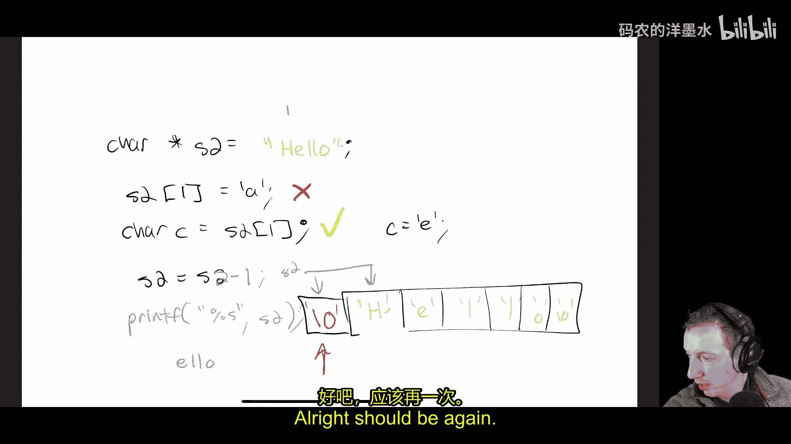

I will be around practice， practice practice。Link lists， recursion， it'll be good。So。Just remember。

 bullet and foyer。 We're all in this together， and。Only one more weekend。 So good luck。

 and I will see you， hopefully， on Monday。

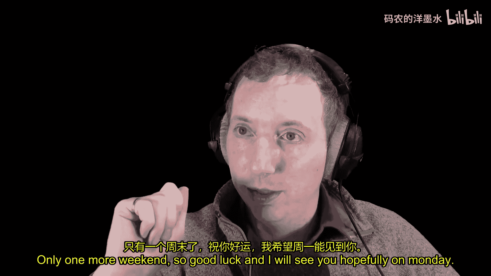