# C语言编程：期末复习课

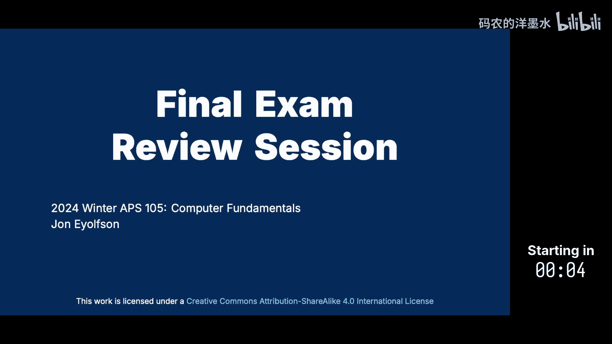

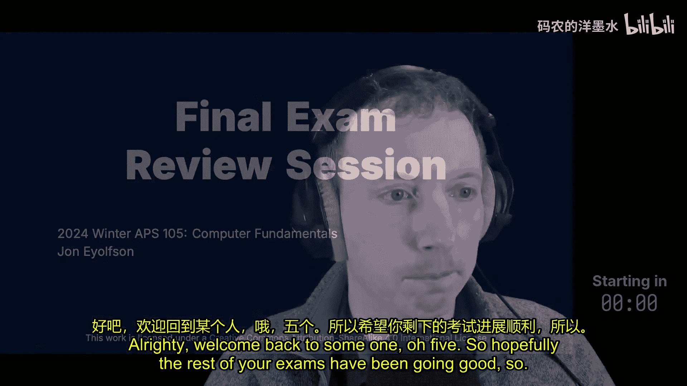


## 概述
在本节期末复习课中，我们将回顾C语言课程的核心概念，包括链表操作、递归、动态内存管理、字符串处理以及排序算法。课程将通过分析历年考题来巩固这些知识点，确保大家为期末考试做好充分准备。

---

## 链表排序：冒泡排序算法

上一节我们介绍了链表的基本操作，本节中我们来看看如何对链表进行排序。冒泡排序算法可以应用于链表，其核心思想是反复比较并交换相邻元素，直到链表完全有序。

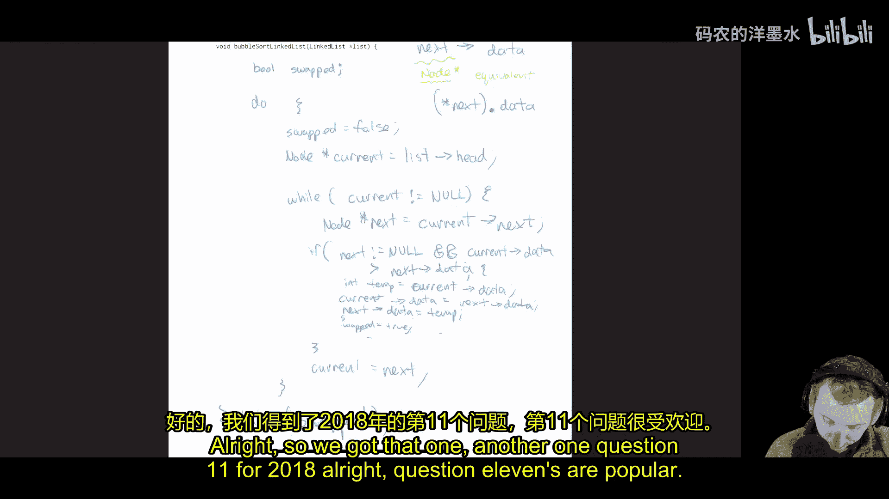


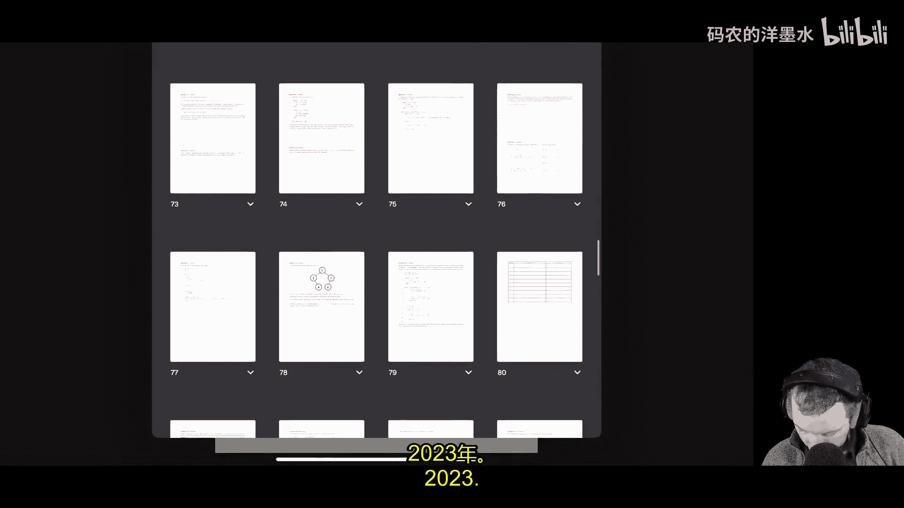

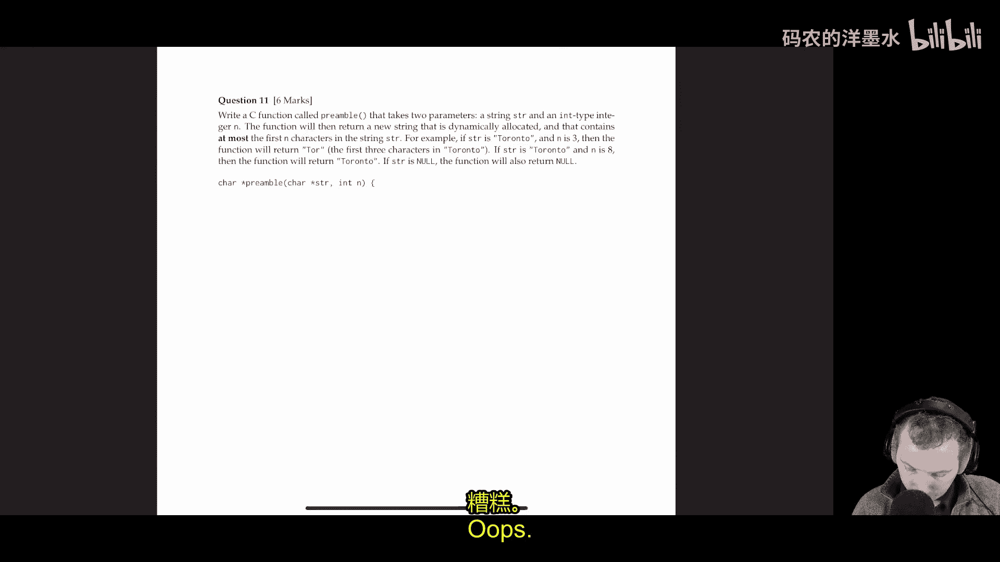

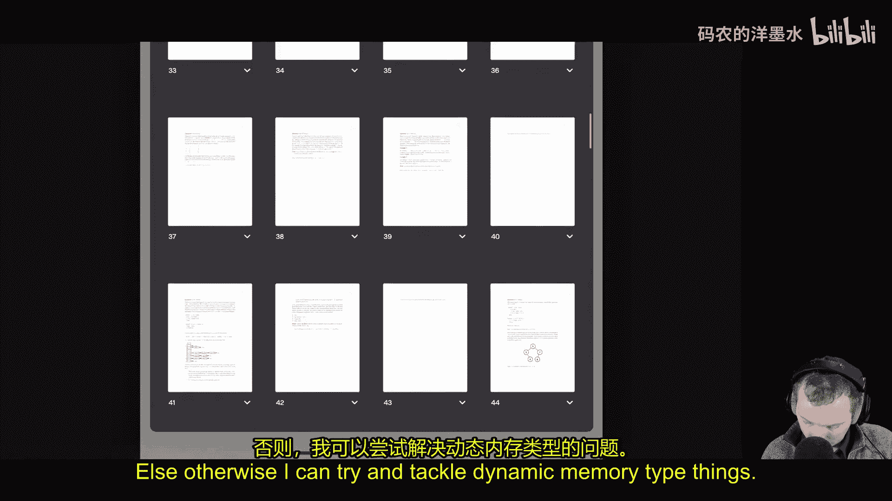

以下是实现链表冒泡排序的关键步骤：

1.  使用一个布尔变量 `swapped` 来跟踪在一轮遍历中是否发生了交换。
2.  使用 `do-while` 循环，只要上一轮发生了交换，就继续下一轮遍历。
3.  在每一轮遍历中，使用指针 `current` 迭代链表。
4.  对于每一对相邻节点（`current` 和 `current->next`），如果它们的值顺序错误（例如 `current->data > current->next->data`），则交换这两个节点的数据值。
5.  注意处理链表末尾（`current->next` 为 `NULL`）的情况。

**代码示例：链表冒泡排序**
```c
void bubble_sort_linked_list(Node** list) {
    int swapped;
    Node* current;
    if (*list == NULL) {
        return;
    }
    do {
        swapped = 0;
        current = *list;
        while (current->next != NULL) {
            if (current->data > current->next->data) {
                // 交换相邻节点的数据
                int temp = current->data;
                current->data = current->next->data;
                current->next->data = temp;
                swapped = 1;
            }
            current = current->next;
        }
    } while (swapped);
}
```

---

## 动态内存管理：字符串数组的常见错误

理解了链表操作后，我们来看看动态内存管理中的一个典型问题。在处理结构体数组（特别是包含指针的成员）时，初学者常犯的错误是让多个指针指向同一块内存。

**问题场景：**
一个 `Student` 结构体包含一个 `char* last_name` 指针。在 `get_names` 函数中，如果直接将用户输入的字符串地址（一个局部字符数组）赋给每个学生的 `last_name`，那么所有学生的 `last_name` 指针都将指向同一个数组。后续的输入会覆盖这个数组，导致所有学生共享最后一个输入的名字。

**解决方案：**
为每个学生的 `last_name` 动态分配独立的内存空间。

**修正后的代码逻辑：**
```c
void get_names(Student students[], int num_students) {
    for (int i = 0; i < num_students; i++) {
        // 为每个学生的姓氏动态分配内存
        students[i].last_name = (char*)malloc(MAX_NAME_LENGTH * sizeof(char));
        if (students[i].last_name == NULL) {
            // 处理内存分配失败
            exit(1);
        }
        printf("Enter last name: ");
        // 直接将输入读入新分配的内存
        scanf("%s", students[i].last_name);
    }
}
// 注意：在主函数使用完这些名字后，需要遍历数组并 free 每个 students[i].last_name
```

---

## 递归应用：反向打印数字序列

动态内存管理让我们关注数据的生命周期，而递归则是一种强大的问题解决范式。我们来看一个经典的递归问题：读取一系列正整数，并以相反的顺序打印它们。

**问题描述：**
编写递归函数 `print_reverse`，持续读取用户输入的正整数，当输入0时停止，然后以相反顺序打印所有输入的数字。

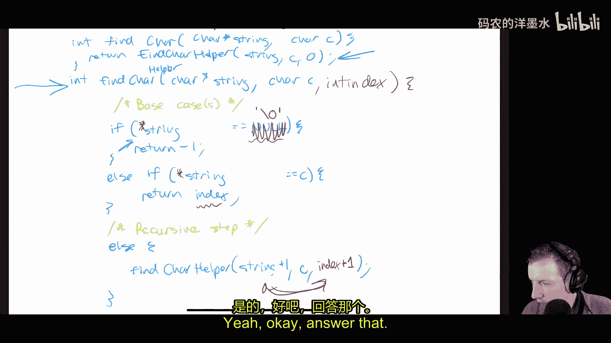

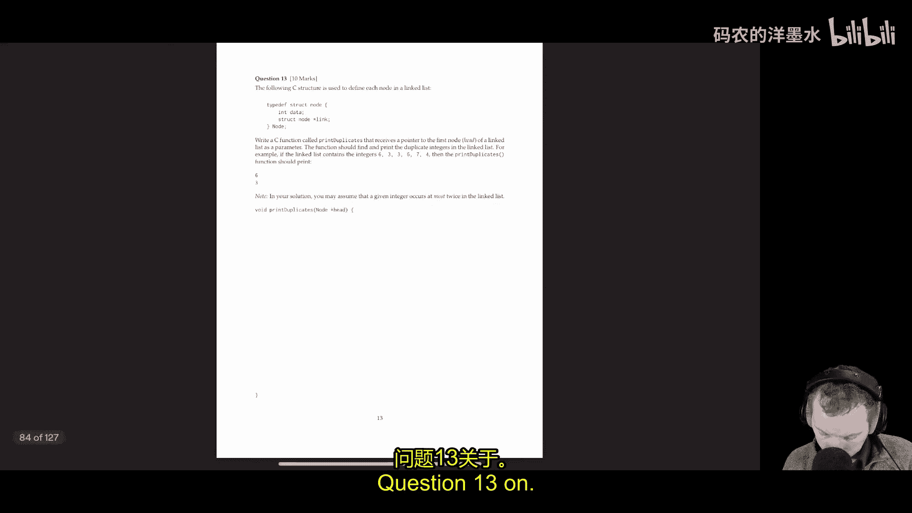

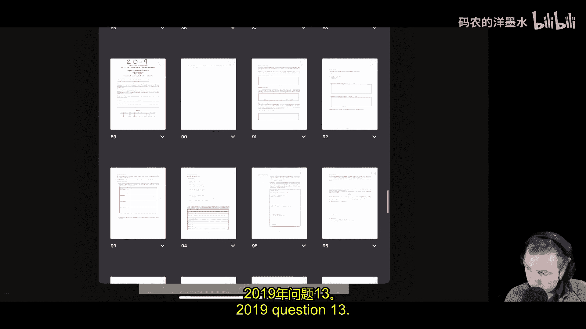

**递归思路：**
1.  **基线条件：** 如果读取到的数字是0，则打印“反向序列”提示并返回。
2.  **递归步骤：** 如果读取到的数字不是0，则先**递归调用** `print_reverse` 处理后续的数字，**然后再打印**当前数字。这样就能保证后输入的数字先被打印。

**代码实现：**
```c
void print_reverse() {
    int num;
    printf("Enter number: ");
    scanf("%d", &num);

    if (num == 0) {
        printf("Reversed sequence: ");
        return;
    }
    // 先递归处理后面的数字
    print_reverse();
    // 递归返回后，再打印当前数字
    printf("%d ", num);
}
```

---

## 字符串基础：字面量与字符数组

在递归中我们处理了数字，现在回到字符数据。理解字符串字面量和字符数组的区别至关重要，这关系到能否修改字符串内容。

**核心区别：**
*   **字符串字面量：** 例如 `char *str = "Hello";`。`"Hello"` 存储在内存的只读区域。指针 `str` 指向它，但你不能通过 `str` 修改其内容（例如 `str[0] = 'h';` 会导致未定义行为）。
*   **字符数组：** 例如 `char arr[] = "Hello";`。这会在栈上创建一个数组，并将字符串 `"Hello"`（包括结尾的 `\0`）复制到其中。你可以自由修改数组的内容（例如 `arr[0] = 'h';` 是合法的）。

**重要规则：**
*   你可以读取字符串字面量的内容（`char c = str[1];`）。
*   你不能修改字符串字面量的内容。
*   字符数组在传递给函数时，会退化为指向其首元素的指针（`char*`）。

---

## 递归与字符串：查找字符索引

结合字符串和递归，我们来看另一个问题：递归地查找一个字符在字符串中第一次出现的索引。

**问题描述：**
编写递归函数 `recursive_find_index`，返回字符 `c` 在字符串 `string` 中首次出现的索引，如果未找到则返回 -1。

**递归思路（使用辅助函数）：**
由于需要跟踪当前查找的索引位置，而题目要求的函数参数只有 `string` 和 `c`，因此通常需要一个辅助函数来接收额外的索引参数。

**代码实现：**
```c
// 辅助函数
int find_char_helper(const char* string, char c, int index) {
    if (string[index] == '\0') { // 基线条件：到达字符串末尾
        return -1;
    }
    if (string[index] == c) { // 基线条件：找到字符
        return index;
    }
    // 递归步骤：检查字符串的下一个位置
    return find_char_helper(string, c, index + 1);
}

// 题目要求的函数
int recursive_find_index(const char* string, char c) {
    return find_char_helper(string, c, 0);
}
```

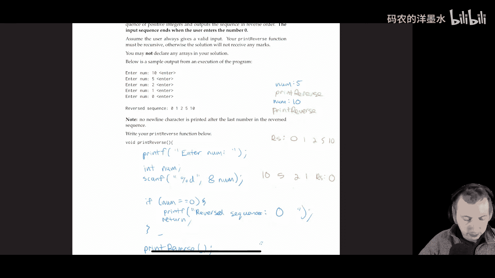

---


## 二维数组操作：计算矩阵对角线之和

从字符串回到数值计算，我们看看如何处理二维数组。一个常见的问题是计算方阵两条对角线上所有元素的和。

**高效解法：**
只需一次循环即可完成。主对角线元素为 `array[i][i]`，副对角线元素为 `array[i][n-1-i]`。注意当 `n` 为奇数时，中心元素 `array[n/2][n/2]` 会被计算两次，这正好符合题目要求。

**代码实现：**
```c
int diagonal_sum(int square[][N], int n) {
    int sum = 0;
    for (int i = 0; i < n; i++) {
        sum += square[i][i];          // 主对角线
        sum += square[i][n - 1 - i];  // 副对角线
    }
    return sum;
}
```

---

## 关键函数与考试建议

在课程的最后，我们总结一些必须掌握的标准库函数和备考建议。

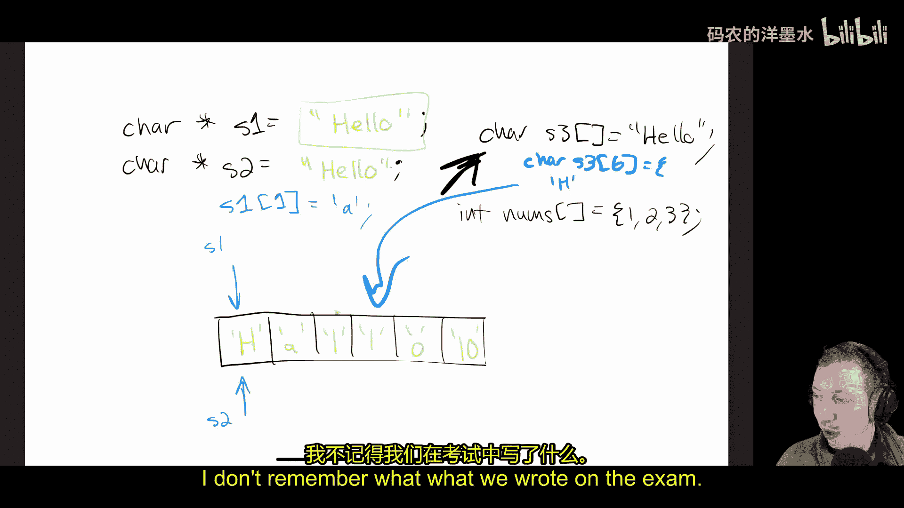

**必须掌握的核心函数：**
*   **输入/输出：** `printf`, `scanf`
*   **内存管理：** `malloc`, `free`
*   **字符串操作：** `strlen`, `strcpy`, `strcmp`
*   **随机数：** `rand` (注意配合 `%` 运算符生成指定范围随机数)


**期末考试重点与建议：**
1.  **重点主题：** **链表**和**递归**是重中之重，题目占比会很高。
2.  **排序算法：** 掌握**冒泡排序**和**选择排序**的思想与实现，不需要记忆插入排序或快速排序。
3.  **不考内容：** **二叉树**、**插入排序**、**快速排序**不在考试范围内。
4.  **练习方法：** 多做历年试题，尤其是链表和递归相关的题目。尝试在不看答案的情况下实现链表的各种操作（插入、删除、遍历、排序）。
5.  **应试技巧：**
    *   如果题目没有明确要求，可以使用辅助函数。
    *   注意处理边界情况（如空链表、空字符串）。
    *   动态内存分配题中，如果题目要求“正确释放内存”，请务必写出 `free` 语句。

---

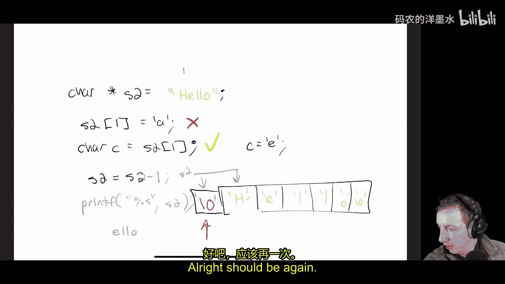


## 总结
本节课中我们一起回顾了C语言期末考试的多个核心知识点。我们从链表的冒泡排序开始，探讨了动态内存管理的常见陷阱，练习了递归在反向打印和字符串查找中的应用，厘清了字符串字面量与字符数组的关键区别，并学习了高效处理二维数组的技巧。最后，我们梳理了必备的函数库和备考策略。请务必加强对链表和递归的练习，这是考试成功的关键。祝大家期末考试顺利！