# 001：导论 🚀

在本节课中，我们将要学习这门课程的整体介绍，包括课程目标、为什么选择Rust语言，以及课程的基本安排。

---

欢迎来到EC 1724课程，这是一门关于软件工程专题的课程。在整个学期中，我们将围绕Rust语言展开讨论。这是本课程的第二次开设，去年是首次开设，实际上这也是加拿大和美国首批与Rust相关的课程之一。今天我们将首先讨论与课程相关的一些行政和后勤事宜，然后在课程的后半部分，我们将直接进入编程语言的学习，并争取在今天完成一些实际内容。

在开始课程之前，我想先简单介绍一下自己。大家能认出我在这里使用的编程语言吗？没错，这是JavaScript。我们稍后还会再提到这门语言。这里我没有写“Hello World”，而是写了我自己的名字“Baochun Li”。三十年前，我获得了清华大学的学士学位。二十五年前，我在伊利诺伊大学厄巴纳-香槟分校获得了博士学位。从那时起，我就在这里工作。我是IEEE Fellow和EIC Fellow。我的研究兴趣广泛，涉及云计算、分布式系统（特别是近年来的分布式机器学习系统）、计算机网络的基础问题、计算机安全的许多主题，以及最近的隐私保护（特别是与机器学习相关的隐私保护协议）。过去25年的大部分工作都是由一个非常小的研究团队完成的，我大约有22名学生（包括博士后）在世界各地（主要在加拿大、美国和中国香港）成为了教授。我的研究愿景是弥合理论进展与现实世界实践系统之间的差距。从今天开始，在这门关于Rust语言的课程中，我们将对现实世界的实践系统产生兴趣。这是我的网站，如果你对我的论文感兴趣，可以随时从网站下载。

现在，让我们进入课程本身。

这门课程有一个标题，一个更花哨的标题是“使用Rust构建高性能软件系统”。其基本思想是，我们希望构建一些现代软件系统。所谓“现代”，是指我们真正希望充分利用现代计算机硬件的极致性能优势，从嵌入式系统、物联网系统，一直到数据中心中由GPU驱动的服务器。为了实现这一点，我个人认为我们必须使用Rust，这也是我们在这门课程中要讨论的语言。我们不仅要理解Rust，还要深入其中，培养对这种特定编程语言的实践性、动手性和深入的理解，并了解如何实际使用这门语言来开发现实世界的现代软件系统。这就是我们在这门课程中追求的目标。

为了做到这一点，我们首先需要谈谈为什么选择Rust。我们有三页幻灯片来讨论这个问题，因为我们对这个问题有很多答案。

幻灯片上的第一个要点是：Rust能够**生成可靠的软件系统**。它保证的第一件事叫做**内存安全**。那么，如果我们谈论的是内存安全系统，我们可以防止哪些错误呢？是的，如果我们试图在释放某块内存后继续使用它，这很可能不能称为内存安全，这不安全。但如果你使用的语言不保证内存安全，这种错误会经常发生，例如C或C++等语言。所以，内存安全是我们将要保证的，我们不允许任何释放后使用内存的行为，不允许对同一块内存有双重指针，我们希望没有与内存使用相关的错误。换句话说，如果你习惯了C和C++中的核心转储、段错误等问题，在Rust中，这些都不会发生。

可靠性的另一个要求是**线程安全**。线程安全是更高层次的要求，内存安全是基础，而线程安全是锦上添花。但在足够现代的软件系统中，它几乎和内存安全一样是必须的。线程安全关乎并发编程。如果你有多个线程，或者在Rust中，我们将讨论比线程更高级的概念——协程。我们希望确保并发可以在没有运行时错误的情况下进行。换句话说，你在多个线程中的代码可以并发执行，而无需担心通常在C++等不保证线程安全的编程语言中会担心的运行时问题。在Rust中，我们有时称之为“无畏并发”，意思是我们可以编写并发程序而无需太多恐惧。我们可能仍然会不时犯错，但与C或C++相比，语言保证的错误要少得多。这也是我们必须支持的。这类运行时线程安全问题的一个例子是**竞态条件**，如果你上过操作系统课程，通常会看到，如果我们不仔细锁定代码的关键部分，就会出现竞态条件。这与线程安全有关，而在Rust中，我们没有竞态条件。

可靠性的第三种要求是**静态类型**的使用。之前我们展示了一个“Hello Bran”程序，那是用JavaScript写的，JavaScript没有静态类型。C编程语言有静态类型或准静态类型，但C编译器并没有非常严格地强制执行。在Rust中，我们不仅有静态类型（意味着每个变量都必须有类型），而且还有非常严格、极其严格的编译器强制执行。我们稍后会看到这一点，这是我们必须注意的，以确保可靠性。

我们还试图通过一个**非常严格的编译器**来实现所有这三个要点。一个严格的编译器会将我们所有关于内存安全、线程安全以及任何相关的运行时错误，尽可能多地转换为编译时错误。这就是我们想要的，也是我们从Rust编译器中得到的。

Rust是一门相对年轻的编程语言，始于2015年（大约10年前），大约从五年前（2020年和2021年）才开始成熟。我们在Rust中实际上有一个非常好的编译器，今天也会看到一些例子。

那么，为什么是Rust？我们如此关心这门语言以至于需要为它开设一门新课程的其他原因是：它**性能极高**，速度极快。它快到你无需担心与为性能设计的传统语言（如C）相比有任何性能损失。最好的例子就是C，C速度极快，它是每门语言设计时进行基准测试的标杆。Rust在编译后的速度与C一样快。

它还能像C一样**完全控制底层细节**，在这方面没有问题。所以，就超能力而言，它拥有与C编程语言相同的超能力。

它**没有垃圾收集器**。垃圾收集器是现代发明，大约20年前随着Java的出现而出现，后来被JavaScript继承，最近还有Go编程语言。这些垃圾收集器通常没问题，直到你尝试做一些需要高速的事情。所以，直到你尝试设计一个高性能的软件系统时，它才会介入并试图拖慢你。最好的例子是，如果你使用Go作为开发Web服务器的语言，它通常运行良好，但如果你希望它拥有最佳性能，垃圾收集器每几百毫秒就会启动一次，这会在运行时略微拖慢速度。这是Rust所没有的。

它还具有**非常小的内存占用**，就像C一样。并且，如前所述，它保证了完整的内存安全。

最后但同样重要的是，我们有一些非常现代的东西：**协程**。这是为了在我们实际进行并发编程时比线程更快而设计的。线程显然受Rust支持，而协程大约从五年前（2020-2021年时间段）开始得到支持。不仅支持协程（可以将其视为轻量级线程，是线程的更快版本），而且还是协程实现中更快的替代方案。有两种不同类型的协程：基于栈的和无栈的。基于栈的协程通常由传统语言（如Go）实现，Go设计用于支持这些轻量级线程的协程。但更好的版本是无栈协程，它甚至不需要栈，实现起来更快一点，所需内存占用也更小。Rust实际上支持这种无栈协程。Rust支持这些协程的方式非常独特和先进，先进到我们可能没有时间在这门课程中涵盖。我们将看看有多少讲座可以实际涵盖这些高级主题。但这是我们将Rust用于高性能软件系统（如需要极高可扩展性的Web服务器）的主要原因之一。我们需要这些协程非常非常快。协程将是一个非常好的理由，也是Rust的一个优点。据我所知，过去五年中唯一支持无栈协程的其他编程语言是C++。但就支持而言，我不是那门语言的粉丝。Rust在这方面要好得多。

关于Rust实际优势的最后一页幻灯片。然而，我们为什么要花这么多时间学习Rust呢？因为它拥有**世界上最好的生态系统和工具链**。不是最好的之一，就是世界上最好的。在生态系统和工具链方面，没有什么能打败它。所谓生态系统，我指的是由其他开发者设计的第三方框架或库，这些开发者有使用这门语言开发现实世界系统的相似兴趣。他们开发了大量极其高质量的库，并得到了一些世界最大公司的支持，如亚马逊、字节跳动、谷歌、微软等。这些大公司实际上支持团队用Rust编写这些第三方库。工具链也非常好。工具链指的是，例如，我们如何在生态系统内管理我们的包，如何确保我们的代码正确使用这些框架。这听起来很简单，你只需导入库，但这并不容易，因为代码可能依赖于其他代码。这个库可能依赖于其他地方的其他第三方库，每个库都可能依赖于数百个其他库，版本之间可能存在冲突。你如何管理包依赖、版本、硬件要求等等？所有这些问题在其他语言中都是主要问题。例如Python，它仍在改进，但在过去十年中，Python在使用工具管理包依赖方面一直表现不佳。而Rust在这方面是世界上最好的。

除此之外，它还有**极其有用的编译时错误信息**。这是我们今天将要讨论的一个话题。它还有**Cargo包管理器**和**crates.io**。crates.io有点像Python中的PyPI，管理所有公开可用的包，这是一个非常成熟的系统。虽然仍有一些小问题，但它是世界上最好的。你不可能拥有一个完美的包管理系统。

此外，它还有**非常好的文档**。文档通常在docs.rs上，每个包都有非常好的文档。它有一个非常好的系统，可以从代码注释中自动生成文档。所有这些都是这门语言的优点，也是我们学习Rust的原因。希望到现在为止，你已经信服了。实际上，我希望你在选择这门课程时就已经信服了，并且我希望你有足够的兴趣进入这门课程。顺便说一句，这门课程是一个相当大的挑战，Rust是一门很难学的语言，我们稍后会讨论这一点。

以下是我们打算涵盖的内容：我们将从最基础开始，不假设你有任何Rust背景或任何其他面向系统的编程语言（如C和C++）的背景。唯一的要求可能是你应该对Python或Java有一点了解。本系本科课程中的E 244（C++编程基础）并不是必需的，如果你对C++一无所知，那也没关系，我们仍然可以从基本的编程概念中学到很多东西。但我们会相当快地从基本编程概念进入Rust的一些主要主题。

首先是**所有权**。所有权是Rust独有的编程模型，实际上是一种思维方式。唯一另一种由编译器强制执行所有权思想的近期语言是Mojo（专为机器学习设计，也是一门编译语言）。除此之外，Rust是少数强制执行所有权思维方式的语言之一。在编程时，你必须具备这种思维方式。

我们将涵盖**结构体**和**枚举**。它们在Rust中无处不在。Rust中的结构体和枚举不仅仅是C语言中的结构体，也不仅仅是简单的枚举值。它们在Rust中极其强大，尤其是枚举，其威力不容小觑，它改变了编程的思维方式。其他语言不常使用枚举，事实上，Go编程语言甚至没有枚举，你必须自己模拟枚举。但在Rust中，这是编译器支持的基本编程概念之一。

使用**Result类型**进行**选项和错误处理**。这也是我们必须涵盖的内容，因为错误处理在所有编程语言中都是一个痛点，包括C++、Python等。每当出现错误时，你如何处理？是try、catch还是finally？在Rust中，我们有自己的方式使用Result类型来处理错误，我们将讨论这一点。

我们还将讨论一些我们经常使用的基本数据结构：**向量**、**哈希映射**、**切片**、**字符串**。这些由标准库提供。当然，还有大量额外的第三方库提供的额外数据结构，你可以使用Cargo包管理器轻松导入。

然后，我们将继续讨论一些更高级的主题：**泛型**。其他语言也提供泛型，但不常用，而在Rust中更常用。我们将讨论**特质**，它改变了一切，改变了编程的思维方式。这类似于Swift中的协议或Java中的接口，但要强大得多。它取代了C++中的对象。事实上，在Rust中，我们根本没有面向对象。Rust开发者不喜欢面向对象，Rust设计者认为面向对象不是一个好主意，事实上，他们认为这是一个坏主意。所以他们做的是，从中提取好的想法放入特质中，并抛弃坏的想法。所以我们没有类、对象等，这些都是坏主意，我们将它们抛弃，从头开始。

除此之外，我们还有一个额外的概念，需要花一整节课来讨论：**生命周期**。生命周期是Rust中一个非常独特的概念，然而，它对内存安全至关重要。生命周期很难理解，但你必须理解它，只需欣赏Rust如何管理内存安全的美妙之处。通常我们不会遇到它，但一旦我们足够深入，就需要面对它。即使是典型的人工智能模型也无法处理这些东西。

此外，Rust也支持**函数式编程**，不仅仅是基本的程序式编程。我们使用**闭包**和**迭代器**来支持函数式编程。这是一种完全不同的思维方式，Rust显然是一门多范式编程语言，支持程序式和函数式编程。它不支持面向对象，但支持函数式，这是一个好主意。所以我们确实希望在课程中涵盖这一点。

此外，我们必须理解，Rust通常不手动使用堆。通常你不像在C++中那样直接使用堆（malloc、free等）。我们确实使用堆，但通常是通过使用第三方库来使用堆，它们为我们管理实际内存。但如果我们是第三方库的开发者，或者我们在做一些非常高级的事情，我们确实希望在堆上管理数据，这必须通过使用**智能指针**等高级方式来完成，以确保同时实现内存安全和性能。所以我们想要内存安全、性能，也想要灵活性，我们想要超能力。所有这些都将通过智能指针来完成，这是Rust中一些我们将要提到的高级主题。

如果我们有时间，还将讨论与**Future**和**无栈协程**相关的无畏并发。如果没有时间，我们将不得不跳过这些。

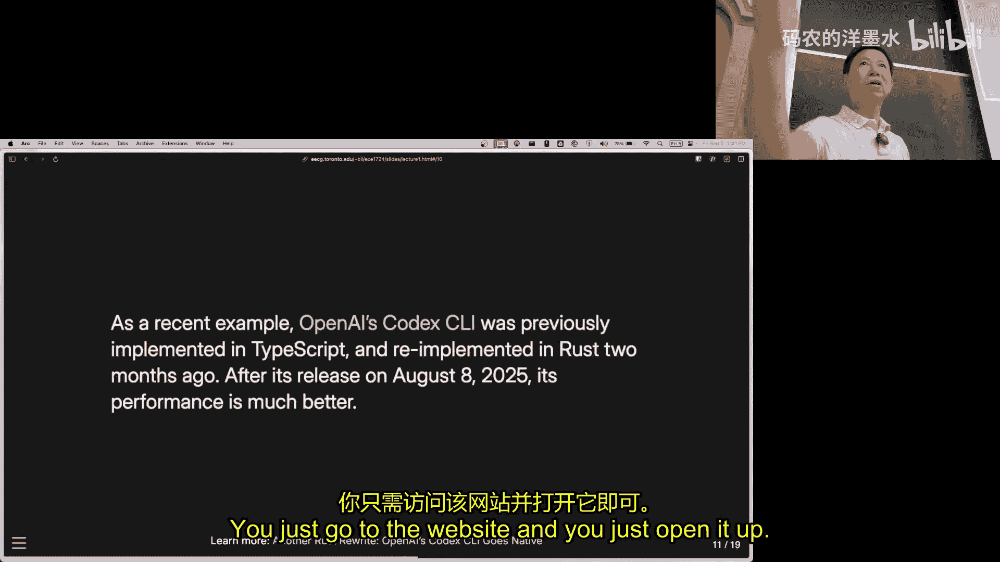

最后但同样重要的是，我们将讨论编写Rust程序的最佳实践，即所谓的**地道Rust**。我们必须变得“Rusty”（熟练）。如果你“Rusty”了，就意味着你在Rust编程中很地道。还有**设计模式**，即编写Rust程序的好方法。这些都是我们在这门课程中必须真正深入的内容。有很多东西需要学习，非常有挑战性。希望你为此做好了准备。

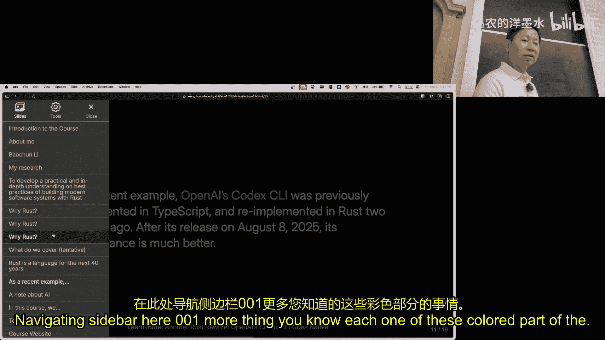

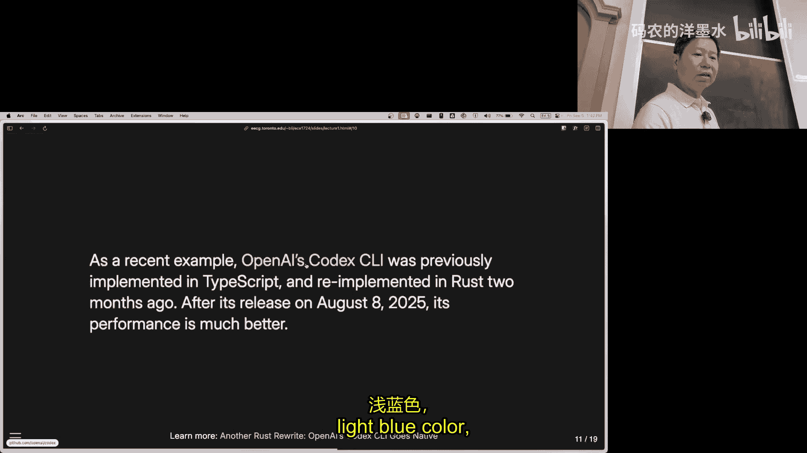

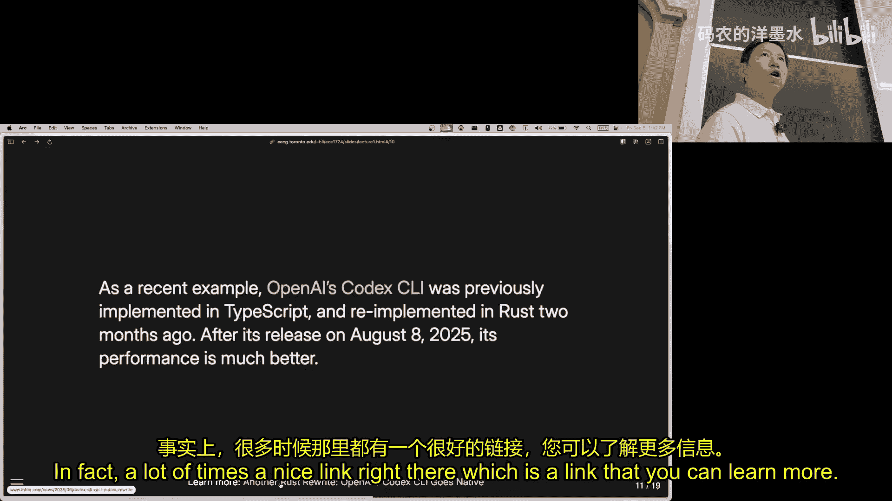

这里再补充一点个人观点：我个人相信Rust是未来40年的编程语言，我今天会告诉你为什么。这就是为什么我们需要在这个学期花一些宝贵的时间学习这门语言。

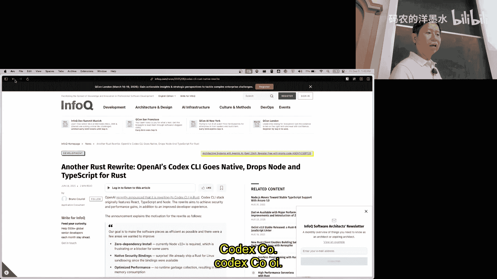

首先，它既是一门高级语言，也是一门低级语言。C更像低级语言，Python更像高级语言。我们可以在Rust中同时进行高级和低级编程。在非常低的层面，如果我们需要性能，我们实际上可以为WebAssembly等平台编写Rust代码（这基本上就像Web浏览器的低级代码），我们可以为云中的容器编写代码，我们也可以为非常接近硬件的裸机芯片编写代码。它还支持我们想要的三个要素：我们想要**快速**（高性能），我们想要**可靠性**（我们提到的内存安全、线程安全），我们还想要**生产力**，即我们想要快速完成编程。Rust给了我们生产力。这主要是因为可靠性，因为我们没有很多运行时错误。如果它编译通过，它运行时就没有错误。这非常美妙，因为通常你至少有几千行代码，可能是几万、几十万行代码。如果你有运行时错误，即使有AI模型，调试也会花费很长时间，因为AI模型在调试运行时错误方面可能帮不上太多忙。

我们有无畏并发，希望在这门课程中有时间讨论。我们提到这将给我们带来性能，因为有了高性能，有了当今的多核CPU和GPU，我们需要并发，我们需要进行并发编程。并发编程基本上意味着我们想要真正启动所有的协程，成千上万个，充分利用我们的CPU和GPU核心。这是Rust实际上可以支持的，尤其是在CPU方面。Rust在GPU方面也在努力取得进展，但尤其是在CPU方面，我们实际上支持并发。

这里有一个最近的例子：我最喜欢的与AI模型相关的CI/CD工具之一是OpenAI的Codex CI。你们中有多少人用过Codex CI？很好，我相信你们很多人都听说过它。但它在第一次迭代中并不容易使用，因为第一次迭代是用TypeScript实现的，效果不是很好，并且在与Claude Cloud Code CI的竞争中失利。所以Codex CI之前是用TypeScript实现的。大约两个月前，团队意识到不应该用TypeScript来做。于是它用Rust重新实现，并于上个月（8月8日）与GPT-5一起发布了第一个Rust驱动的版本。根据用户在线报告，性能要好得多。这是我最喜欢的例子之一，表明Rust在性能方面真正推动了极限，并且是OpenAI和XAI for G等公司选择的编程语言。有很多例子表明，任何与机器学习相关的东西都需要性能，而Rust是我们追求性能的选择，即使只是实现一个CLI（命令行界面）。

这里有一个关于幻灯片的有趣旁注：这些幻灯片设计成HTML格式，你只需访问网站打开即可。没有PDF下载，这里有一点导航侧边栏。此外，这些浅蓝色文本部分，你可以点击。一旦点击，你将能够打开一个网站。这很好。这里有一个“了解更多”和脚注。很多时候，那里会有一个很好的链接，例如，你可以点击这个，它会给你一些关于OpenAI的Codex CI用Rust重写的进一步阅读的网站。通常，“了解更多”链接与我们正在讨论的幻灯片内容相关。所以你只需访问那个网站了解更多信息。这是这套幻灯片的一个不错的功能。我使用的幻灯片正是你将在课程网站上看到的幻灯片。事实上，这是直接从课程网站加载的。

关于人工智能的一点说明：今天我们处在这个AI大时代，显然每个人都会谈论AI并使用AI。AI被广泛认为是一种超级有效的编码助手。很多人说它实际上取代了初级或中级程序员等。这里有两个故事：一个是Anthropic（一家AI公司）的一位联合创始人在最近的一次采访中提到，Anthropic公司80%的代码是由他们自己的AI编写的。另一家初创公司叫Amcodo，我不确定你们是否听说过，这是一家有趣的公司。这家公司试图提供一个CLI（命令行界面），但市面上有几十种不同的CLI。这个特定CLI支持的功能是，它不会给你选择模型的灵活性，它会自动为你挑选模型。换句话说，你不能随意使用这个或那个模型，它会根据公司自己的判断，为你的任务挑选最佳模型。所以它基本上试图打包世界上所有的模型，给你最好的，你支付的将是使用这些模型的API密钥费用，不会比模型提供商向你收取的费用多一分钱。所以，如果你感兴趣，可以试试。最近与Amcodo联合创始人的一次采访中说，Amcodo公司95%的代码实际上也是由AI编写的。你可能会说，如果80%和95%的代码都是由AI编写的，为什么我还需要学习编程？因为80%和95%不是100%。那剩下的5%到20%的代码，最顶层的、最困难的部分，仍然留给了人类。所以我们仍然需要完成那至关重要的5%到20%的编码，至少今天如此。我的预测是，在可预见的未来也是如此。原因在于，无论AI在规划、架构设计、根据架构计划编写代码方面多么强大，它在创新方面仍然无法击败人类程序员。人类最擅长的是原创想法和创新。AI拥有大量经验，能够基于这些经验解决问题，但它无法创新，无法创造新想法。而那5%的代码需要新想法和创新，这将是我们需要完成的部分。换句话说，使用AI将非常有益，但我们仍然需要人类来完成。这对于Rust来说尤其如此。也许对于Python，你只需要1%的人类参与；对于Rust，你可能需要20%。如果你曾经尝试使用AI来编写Rust代码，你会发现，与Python相比，它失败的概率更高。对于Python，你几乎可以用AI来写代码，99%的情况下它都是正确的，你甚至不用担心。但对于Rust，很多情况下代码甚至无法编译。它无法通过编译时检查，因为我们有一个严格的编译器。如果你将结果反馈给AI，或者如果你使用生成式编码，AI会自己尝试编译，然后可能会说“抱歉，我们得重来”。在很多情况下，它会修复编译错误，但在少数情况下，它无法修复这些问题，因为设计是错误的。因此，使用AI进行Rust编程的问题被放大了，因为Rust对人类来说是一门非常难的语言，对AI来说也是一门非常难的语言。

有时。第一次说。所以，可能有一些原因导致仍有20%或5%的代码留给人类。但最主要的原因之一可能是你提到的，缺乏编写最新、最伟大代码方式的数据，但这在今天不是主要问题。AI实际上可以进行网络搜索等来弥补这种情况。但这里的问题，尤其是在Rust方面，有时我们需要一个设计。而这个设计不仅仅是任何设计，可能有几种不同的设计。我需要最好的、可能的最佳设计。这种设计需要创新，需要原创性。大型语言模型的运作方式是，它们基于最佳经验预测下一个标记。那将是一种设计，一种潜在的设计。它可能在80%或95%的情况下有效，确实有效，但在很多情况下，当它无效时，它会卡住。即使它有效，也可能不是性能方面的最佳设计。所以我们仍然需要关心很多事情。

坏消息是，为了让人来编写那5%的代码，你必须比AI更好。这很难。你必须了解这门语言最精细的细节才能创新。你真的必须理解这门语言、特性、最精细的细节，才能创新。这有点像使用AI，你必须拥有数据集才能编写好代码。同样，为了创新并拥有设计方面的原创想法，你必须学习很多。你必须学习最精细的细节，而不仅仅是高层次的内容。这有点像第22条军规，因为如果你使用AI，它会为你提供所有最精细的细节，或者你不需要学习它们。但如果你不学习最精细的细节，你就无法完成最后20%或5%的代码。换句话说，项目没有完成。但为了学习最精细的细节，你必须放弃使用AI来学习最精细的细节。这有点像第22条军规。在Rust中尤其如此，这可能是个问题。

现在，在这门课程中，我们想讨论的不仅仅是制作任何软件。我们想讨论制作完美的软件。我们想讨论使用Rust制作快速、高性能的软件。在这种情况下，AI尚无法为我们提供这块特定的软件。如果它能提供，我不知道是五年后还是十年后，那么我会取消这门课程，我们就直接用AI来做。但就目前而言，至少根据我的个人经验，我使用了所有最好的前沿模型，我使用了Claude Code、Codex AI（抱歉是Codex CI）、GPT-5 Pro等一切，当我需要时，它仍然无法帮助我完成代码，因为我项目中遇到的挑战。为了完成这些项目，我们需要Rust，我们需要学习这门语言，来完成那顶部的20%。

现在进入与这门课程相关的行政事宜。我们有一本教科书，你可能需要几乎从头到尾阅读。这是近10年来关于编程语言最好的教科书之一，它就是《Rust编程语言》，有时我们称之为“the book”。这是你必须阅读的。阅读这本书是一种享受、一种乐趣，我希望你会喜欢阅读。你不能不读这本书就了解这门语言。

为了激励你阅读这本书，我们在这门课程的讲座中，将非常紧密地遵循这本书。我会确切地告诉你我们涵盖了哪些章节和哪些部分，如果你愿意，你可以只阅读那些章节和部分。但我强烈建议你阅读整本书。它有点长，但它是唯一的书。所以我们不需要读两本或三本书，这仍然是可行的，而且是一件非常愉快的事情。

哦，它要多少钱？它不花钱，因为你只需要点击这个，它就在那里。是的，它是在线的，也可以离线使用。我们会讨论这个。

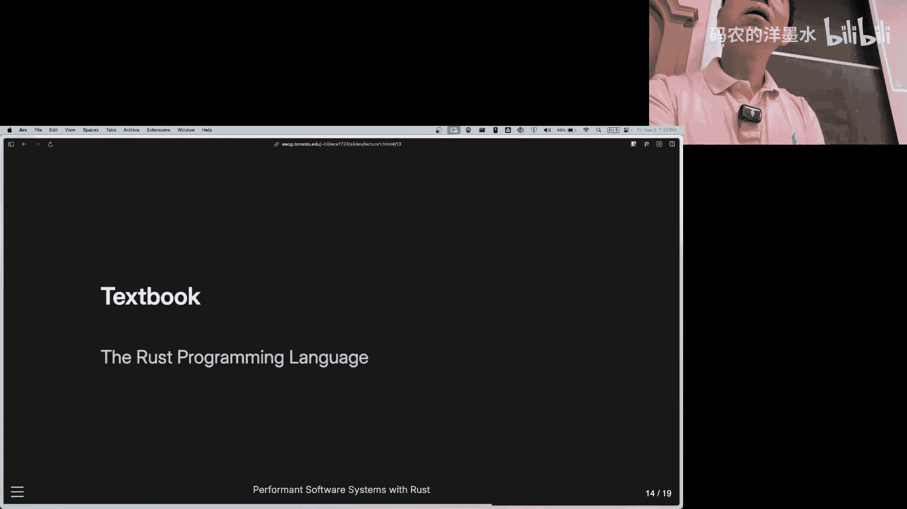

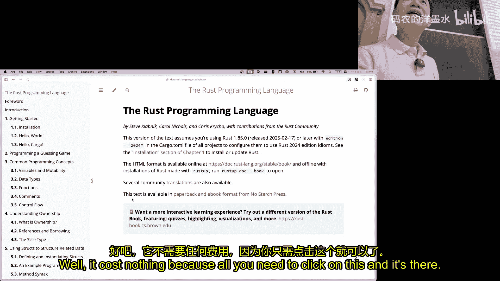

好了，这是关于教科书的内容。此外，我们有一个课程网站。课程网站现在就是这个链接。你可以点击这个链接，我希望它能用。是的，它确实能用。在课程网站上，有课程大纲。如果你看一下这个课程网站，我们确实有课程大纲。就在这里。课程大纲包含了关于这门课程的所有信息，其中很多我们今天不想花时间讨论，但显然你可以阅读。我们还有课程概述，包括截止日期和评分政策等，这些都将在课程网站内。

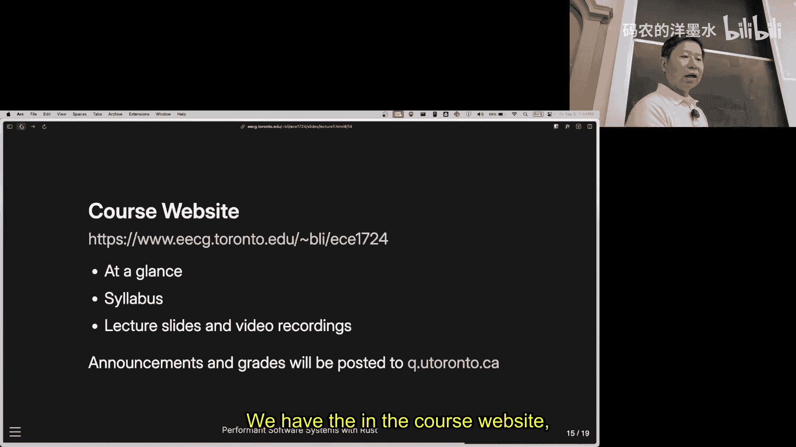

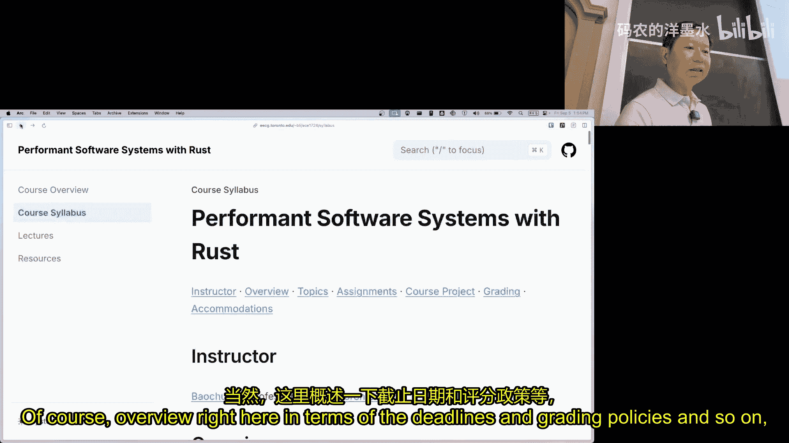

所有讲座我都尽量录制。有时我可能在设置硬件时出错，但我尽量不出错，尽量录制所有视频，并在讲座后立即将视频上传到课程网站。讲座幻灯片通常在讲座前提供，但它们是暂定的，可能在讲座前被修改。它们通常只是HTML格式，所以它们是实时的，在课程网站上。所以在课程网站上，进入讲座部分，选择“课程介绍”，就会看到我们正在展示的内容。例如，下一个将是“动手学习Rust”。你可以在课程网站内找到第二讲。

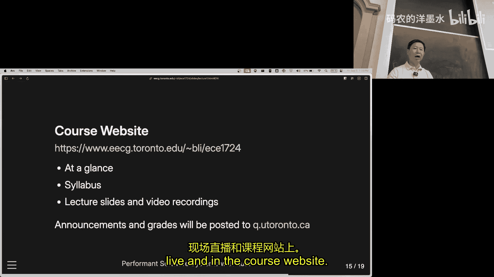

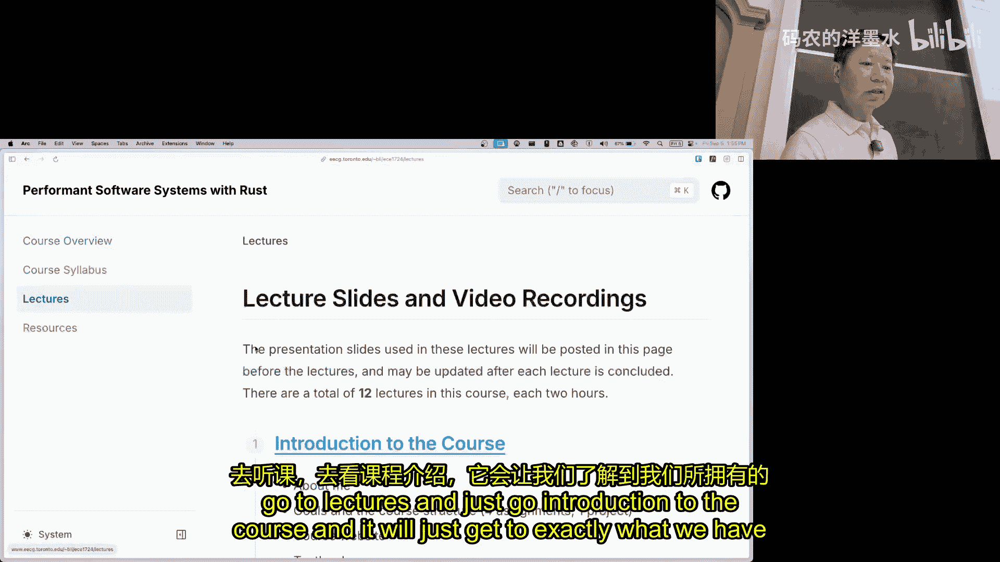

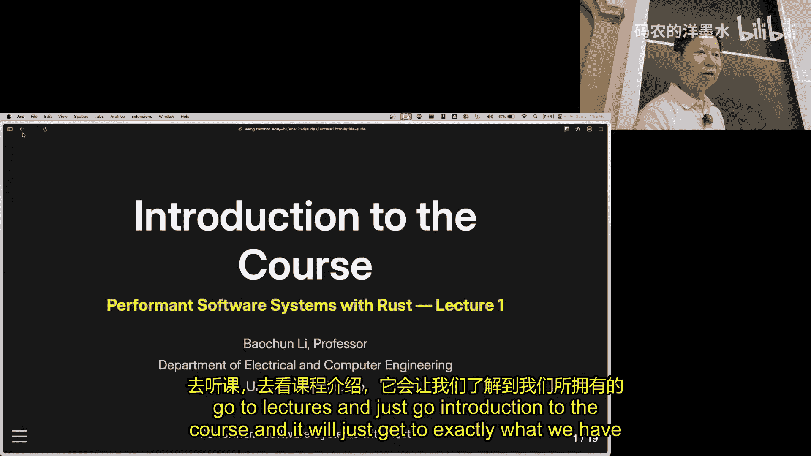

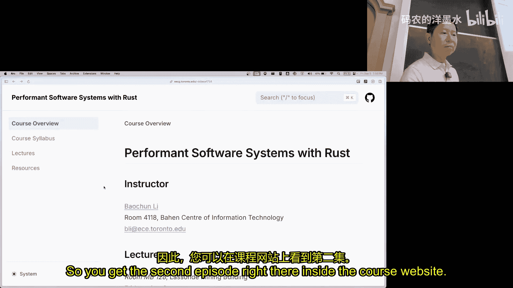

公告和成绩将发布在Caucus上。公告也会通过电子邮件发送给你。成绩将发布。我们有一位助教，将协助我们发布这些和成绩。

现在让我们更详细地了解一下课程大纲。我们每周有一次办公时间，在我的办公室，周一一个小时，或者通过预约。

我们有四次作业。第一次作业是反转井字棋游戏。第二次作业是搜索实用程序，是一个命令行实用程序。第三次作业是一个命令行Web客户端，就像curl一样。第四次作业是一个高性能Web服务器。顺便说一下，这些作业的设计是为了让你从零开始。换句话说，你不需要有任何Rust背景。你只需从第一行代码开始。你不需要知道任何东西，它们是为让你从零开始而设计的。这就是为什么我强调你不应该使用AI。因为如果你使用AI，那就违背了目的，对吧？如果你说“哦，我要为了学分上这门课，我用AI为作业生成代码”，当然你会得到分数。但这有什么意义呢？没有意义，因为你放弃了精心设计的作业来帮助你促进学习体验。这些作业的设计是从简单的想法开始，逐渐变得有点难，再难一点，再难一点。如果你使用AI，你可以在一天内解决这些问题，没问题，可能几个小时，生成式编码可能就能完成，很可能在几个小时内。但这有什么意义呢？这样做毫无意义。原因在于，你基本上浪费了通过动手经验学习的机会，如果你没有这些从简单想法开始的动手经验，你将永远学不会。这些都是为你构建简单事物而精心设计的。当然，你可以用AI来做，但不要这样做。

分数方面，作业占45%。前三次作业各占10%，第四次占15%。对于第四次作业，我们有一点竞赛之类的。但就性能而言，这就是为什么它在分数中所占比例稍高一些。但所有这些都相当容易，即使你完全不用AI自己编码。

你们中的一些人可能离不开AI，我理解。我可以为你破例，那就是**代码补全**。如果你真的想使用代码补全，可以。但我强烈建议你不要这样做。因为它会给你带来很多额外的体验。如果你不使用代码补全，这些天代码补全有点太强大了。它们基本上会给你五行甚至十行代码，一旦你开始写五个字符。这不是最好的主意。第一，你变成了代码审查者而不是编码者，对吧？你不是在编码，你是在审查别人的代码。当然，你可以敲击、敲击、敲击，然后完成。当然，写下一行，它会敲击、敲击、敲击，然后完成。当然，你可以这样做。我建议关掉它。现在，在你最喜欢的代码编辑器（如VS Code等）中，如果你关掉代码补全，你仍然会得到一些代码补全。我想你从未尝试过，但这有点像愉快的惊喜。当你输入一个函数名时，如果你完成一个函数名，它会为你完成；你输入一个关键字，它会为你做点什么。这叫做语言服务器，是LSP（语言服务器协议）。这是免费提供的，即使你不做代码补全。所以，如果你关掉代码补全，我强烈推荐，这是个好主意。这有点像当你在飞机上编程时，这些天即使在飞机上也有网络，所以这不是最好的例子。但你知道，在飞机上，我有点舍不得买网络。所以我基本上在飞机上没有任何网络的情况下编程。我实际上可以在几个小时的编码中非常高效。所以没有代码补全对你来说不会成为问题，尤其是在你习惯之后。

问题：作业是个人完成还是允许合作？不，它们是个人完成的。我们不允许合作。它们是个人完成的。它们有点太简单了，根本不应该使用合作来完成。

问题：我们可以使用外部库吗？我们将在每次编程作业中讨论这个问题。作业说明会告诉你，哪些库是你不允许使用的，如果那是你不能使用的东西。否则，你可以使用任何第三方库。但我们实际上也会在那些作业说明中建议使用一些有用的第三方库。

就这些编程作业的评分而言，由于班级规模庞大（大约120名学生，几乎像一个本科班），我们没有足够的资源进行任何手动评分。所以我们将不得不依赖于自动评分，即我们将不得不比较你的输出与标准输出。因此，我们将有一些测试用例，其中一些测试用例是公开宣布给你的，另一些测试用例是隐藏的，也将用于评分。所以你会有公开测试用例，在作业发布时收到，我们将使用这些测试用例，并且我们也会使用自己的私有隐藏测试用例。基本上，你的输出将与标准输出进行比较，并放宽一些要求（例如空格等）。这就是我们评分的方式。

关于作业还有其他问题吗？哦，问题是推荐我们使用什么IDE？很多人，大多数人使用Visual Studio Code。我觉得它太慢了。所以我使用Zed，这有点像Mac的……你知道，Zed是……那是Mac的版本。所以我使用那个。这是我自己用的。顺便说一下，Zed是一个用Rust 100%编写的编辑器。所以，你知道，超级快，比Visual Studio Code快得多。使用起来非常愉快。显然。所以我用它。我不使用VS Code就是这个原因。但大多数人使用VS Code，VS Code足够好，非常好。

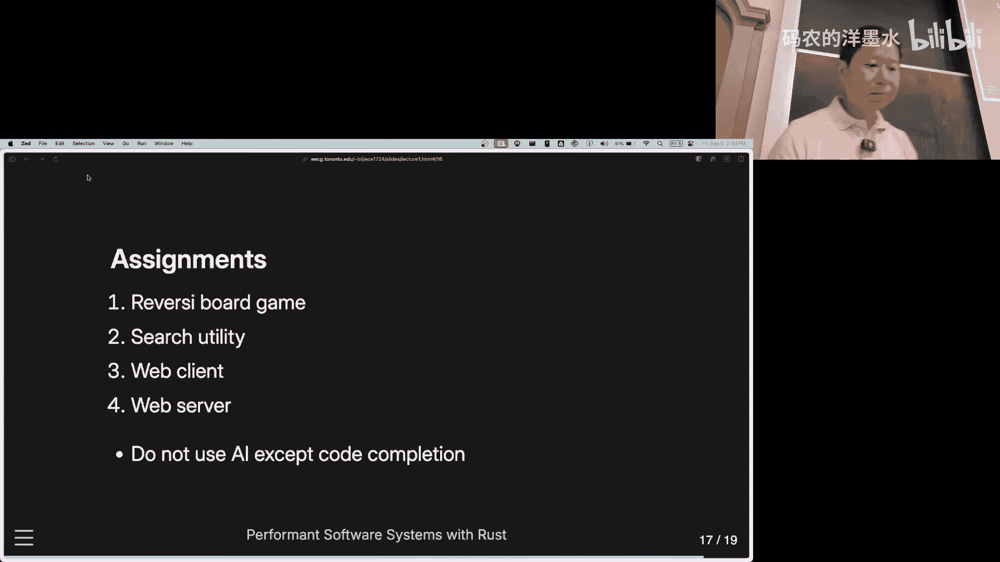

关于作业还有其他问题吗？好的，如果没有更多问题，让我们休息大约7分钟。我们将在2点10分恢复。