# 007：结构与枚举 🏗️

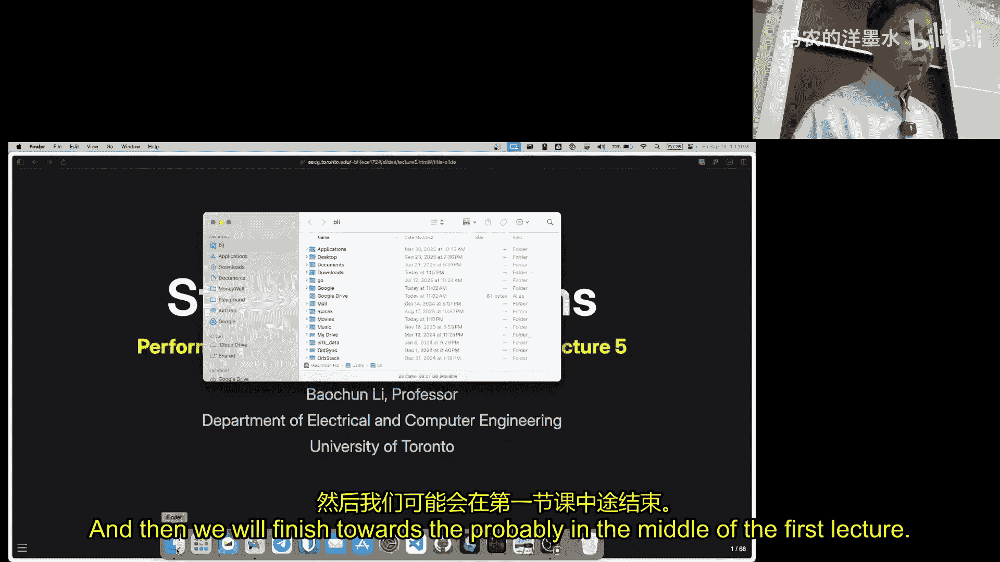

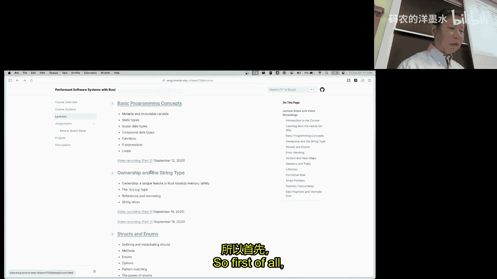

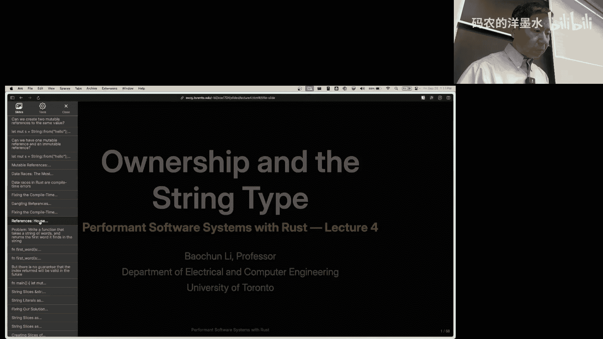

在本节课中，我们将继续学习所有权和字符串的相关知识，然后重点介绍Rust中的结构体（struct）和枚举（enum）类型。我们将通过实例和代码来理解这些核心概念，并学习如何在实际编程中使用它们。

## 所有权与字符串回顾

上一节我们介绍了所有权和引用的一些重要规则。本节中，我们先来简要回顾一下这些内容。

所有权规则主要包括以下几点：
*   引用必须有效。
*   你只能拥有一个可变引用，或者任意数量的不可变引用，但不能同时拥有可变和不可变引用。
*   数据不能在引用之前离开作用域。

这些规则都由编译器强制执行，这与许多其他编程语言不同，后者通常将这些错误留到运行时。

### 字符串切片的应用

我们曾讨论过一个简单问题：编写一个函数，接收一个字符串并返回它找到的第一个单词。我们最初尝试返回一个索引，但这存在设计缺陷，因为无法保证该索引在未来始终有效。

这引出了**字符串切片**的概念。字符串切片是对字符串某部分的不可变引用。我们可以通过指定起始和结束索引（一个范围）来创建它们。

以下是创建字符串切片的几种方式：
```rust
let s = String::from("hello world");
let slice1 = &s[0..2]; // 从索引0到2（不包括2）
let slice2 = &s[..2];  // 从开头到索引2
let slice3 = &s[3..];  // 从索引3到结尾
let slice4 = &s[..];   // 整个字符串
```

字符串切片内部存储着起始引用和长度。我们之前提到的字符串字面量，其类型就是字符串切片 `&str`。

使用字符串切片，我们可以重写 `first_word` 函数，使其返回一个切片而不是索引。这样，如果在获取切片后尝试修改原字符串，编译器就会报错，因为它违反了引用规则（不能同时拥有可变和不可变引用）。这正是Rust安全性的体现。

通过将函数参数定义为字符串切片 `&str` 而非字符串引用 `&String`，我们获得了更大的灵活性。编译器会进行隐式转换，使得字符串引用和字符串字面量都能作为参数传入。

字符串切片的概念也适用于其他集合类型，例如数组。

## 深入理解字符串类型

现在，让我们更深入地探讨字符串类型。`String` 类型在内部被存储为堆上的字节向量（`Vec<u8>`）。因为它是可增长的，所以数据必须放在堆上。

`String` 使用UTF-8编码。与C等语言不同，Rust的字符串可以轻松容纳任何Unicode字符，包括表情符号。

### 字符串的创建与操作

以下是创建和使用字符串的一些方法：

**创建字符串：**
```rust
let s1 = String::new();
let s2 = String::from("hello");
let s3 = "world".to_string();
```

**增长字符串：**
可以使用 `push_str` 追加一个字符串切片，或者使用 `push` 追加单个字符。
```rust
let mut s = String::from("foo");
s.push_str("bar");
s.push('!');
```

**连接字符串：**
可以使用 `+` 运算符或 `format!` 宏。
```rust
let s1 = String::from("Hello, ");
let s2 = String::from("world!");
let s3 = s1 + &s2; // 注意：s1 的所有权被移动了

let s1 = String::from("tic");
let s2 = String::from("tac");
let s3 = String::from("toe");
let s = format!("{}-{}-{}", s1, s2, s3); // 不会获取任何参数的所有权
```
使用 `+` 运算符时，其实现类似于 `fn add(self, s: &str) -> String` 方法，所以第一个操作数（`self`）的所有权会被移动。

### 字符串索引

在Rust中，**不能**使用索引直接访问 `String` 中的字符（例如 `s[0]`）。这会导致编译错误。

这主要有两个原因：
1.  **操作习惯**：在Rust中，我们更倾向于使用迭代器（如 `for (i, &item) in bytes.iter().enumerate()`）来遍历，而不是直接索引。
2.  **编码复杂性**：由于UTF-8编码，一个字符可能占用1到4个字节不等。索引 `0` 指的是第一个字节，而不一定是第一个字符，这会造成歧义。

如果需要按字符处理，应该使用 `.chars()` 方法。如果需要原始的字节，则使用 `.bytes()` 方法。
```rust
let hello = "नमस्ते";
for c in hello.chars() {
    println!("{}", c); // 打印每个字符
}
for b in hello.bytes() {
    println!("{}", b); // 打印每个字节
}
```

字符串切片 `&str` 允许你按字节范围获取子串，但你必须确保范围落在字符边界上，否则可能导致运行时错误。

## 结构体

现在，让我们开始今天的主要内容：结构体。结构体允许你将多个相关的值组合在一起，形成一个有意义的组。与元组类似，结构体的各部分可以是不同的类型；但与元组不同的是，结构体的每个部分都有一个名字，我们称之为**字段**。

### 定义与实例化结构体

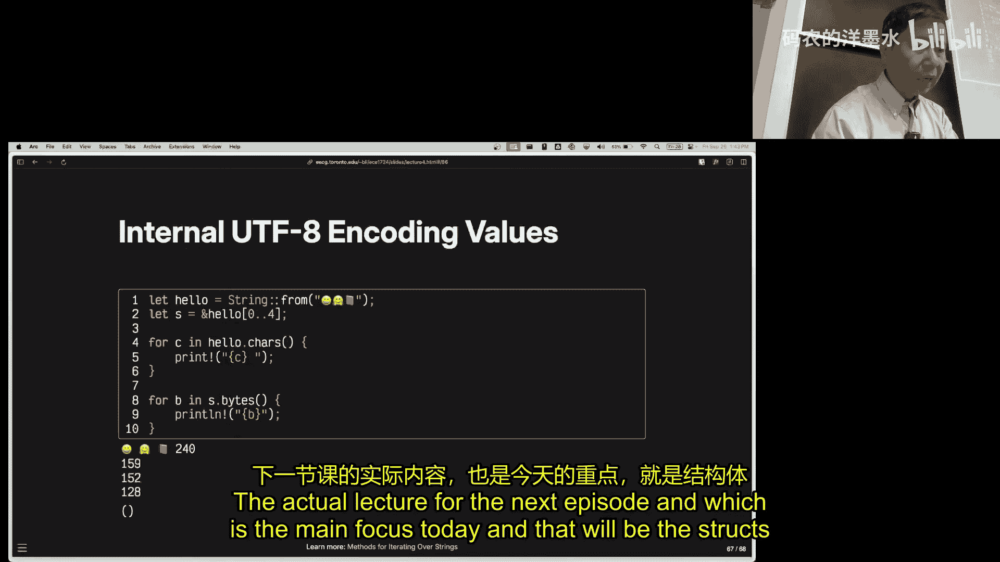

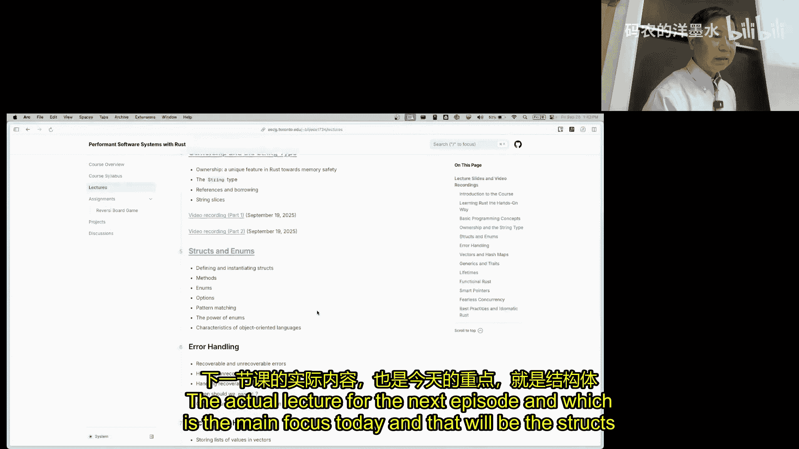

以下是一个定义和创建结构体实例的例子：
```rust
struct User {
    active: bool,
    username: String,
    email: String,
    sign_in_count: u64,
}

let user1 = User {
    active: true,
    username: String::from("someusername123"),
    email: String::from("someone@example.com"),
    sign_in_count: 1,
};
```

要修改结构体实例的字段，整个实例必须是可变的。不能只将单个字段标记为可变。
```rust
let mut user1 = User { ... }; // 实例必须是 mut
user1.email = String::from("anotheremail@example.com");
```

### 字段初始化简写与结构体更新语法

当函数参数名与结构体字段名相同时，可以使用字段初始化简写语法：
```rust
fn build_user(email: String, username: String) -> User {
    User {
        active: true,
        username, // 字段初始化简写，等同于 username: username
        email,    // 字段初始化简写，等同于 email: email
        sign_in_count: 1,
    }
}
```

可以使用结构体更新语法，基于一个实例创建新实例：
```rust
let user2 = User {
    email: String::from("another@example.com"),
    ..user1 // 其余字段从 user1 复制或移动
};
```
使用更新语法时，所有权规则依然适用。例如，如果 `user1.username` 是 `String` 类型（未实现 `Copy`），那么在 `user2` 创建后，`user1.username` 将失效（被移动）。如果字段是实现了 `Copy` 的类型（如布尔值、整数），则会被复制。

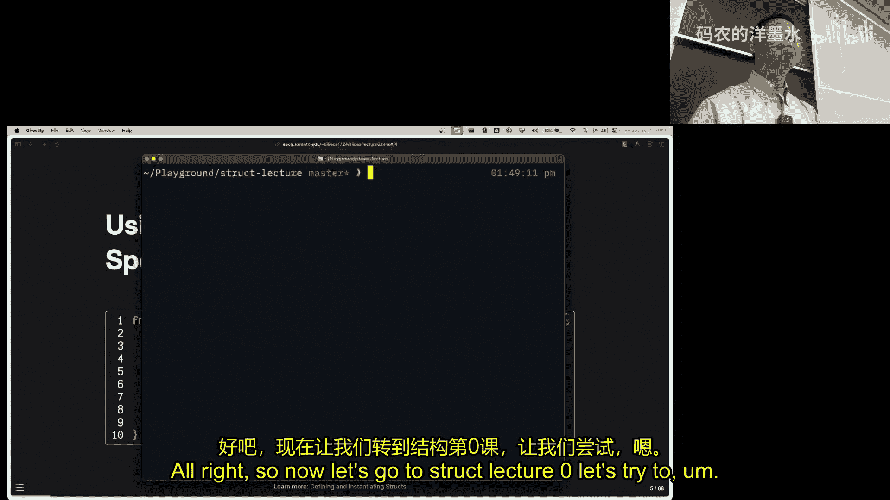

### 在结构体中使用引用

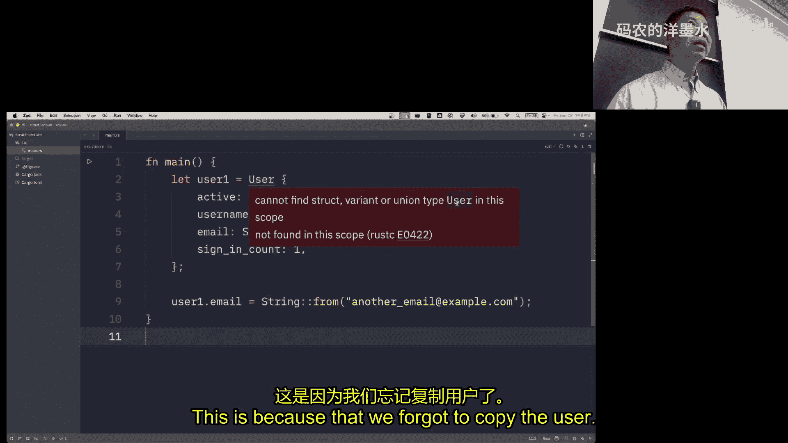

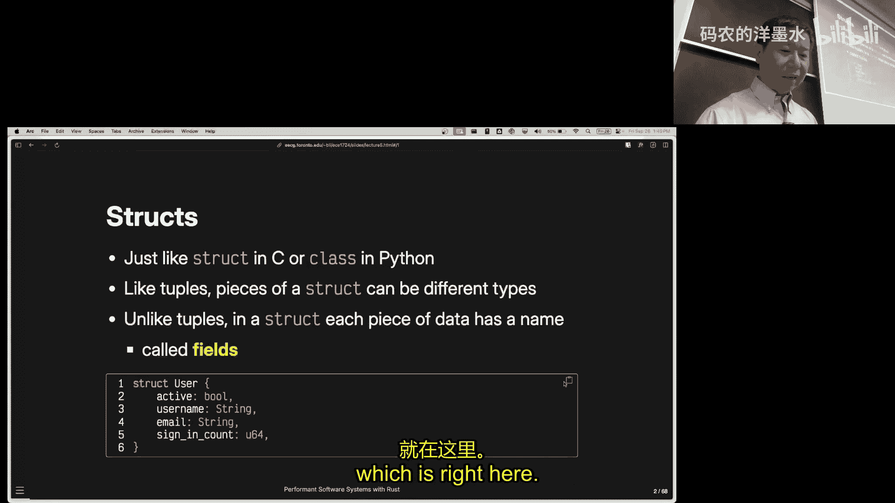

在结构体字段中使用引用（例如 `&str` 而不是 `String`）是可能的，但这会引入**生命周期**的复杂性，需要显式标注生命周期参数。对于初学者，通常建议在结构体中直接使用自有类型（如 `String`），以简化代码，避免过早涉及生命周期的概念。
```rust
struct User {
    username: &str, // 需要生命周期标注，例如 `username: &'a str`
    // ...
}
```

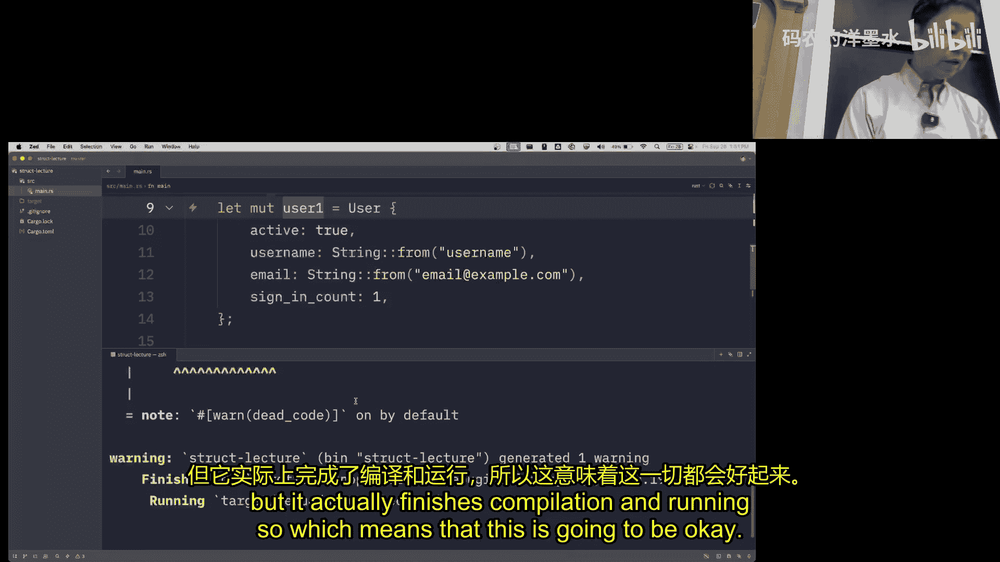

## 枚举

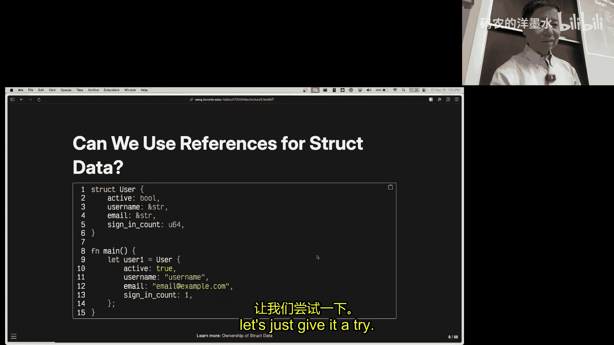

枚举是Rust中另一个强大的复合类型。它允许你定义一个类型，其值可以是若干可能变体中的一个。

### 定义枚举

一个经典的例子是IP地址，它可以是V4或V6版本：
```rust
enum IpAddrKind {
    V4,
    V6,
}
```

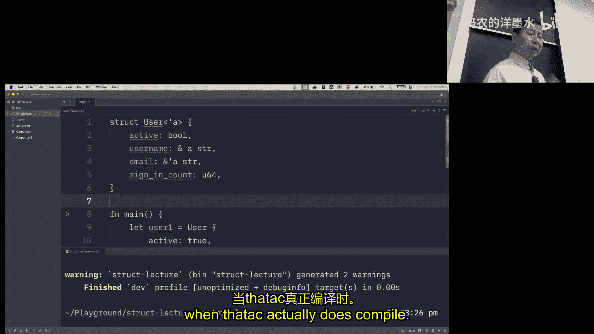

枚举的变体可以关联数据，甚至是不同类型和结构的数据：
```rust
enum IpAddr {
    V4(u8, u8, u8, u8), // 关联一个元组
    V6(String),         // 关联一个 String
}

let home = IpAddr::V4(127, 0, 0, 1);
let loopback = IpAddr::V6(String::from("::1"));
```

枚举的功能非常强大，`Option` 枚举是标准库中一个极其重要的例子，它用于处理可能存在或不存在的值，取代了其他语言中的 `null`。
```rust
enum Option<T> {
    Some(T),
    None,
}
```

## 总结

本节课中我们一起学习了Rust中两个核心的复合数据类型：结构体和枚举。

*   我们回顾了所有权和字符串切片，理解了如何安全地引用字符串的一部分。
*   我们深入探讨了 `String` 类型的内部机制和操作方法，并明白了为何不能直接索引字符串。
*   我们学习了如何定义和使用**结构体**来创建自定义类型，组织相关联的数据，包括实例化、修改、使用简写语法和更新语法。
*   我们初步认识了**枚举**类型，它让我们能够定义一组可能的值，并且每个变体可以关联不同的数据。

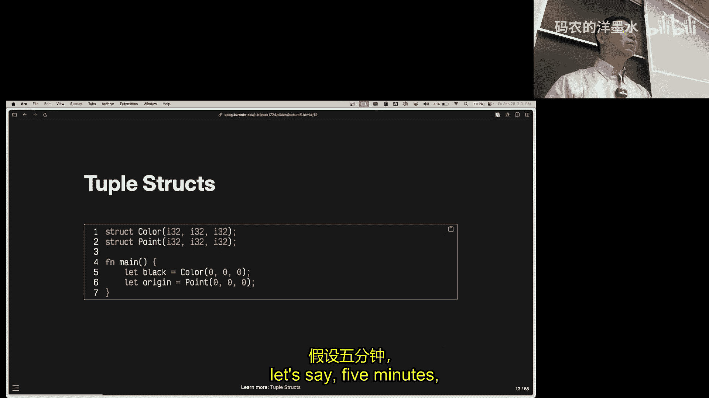

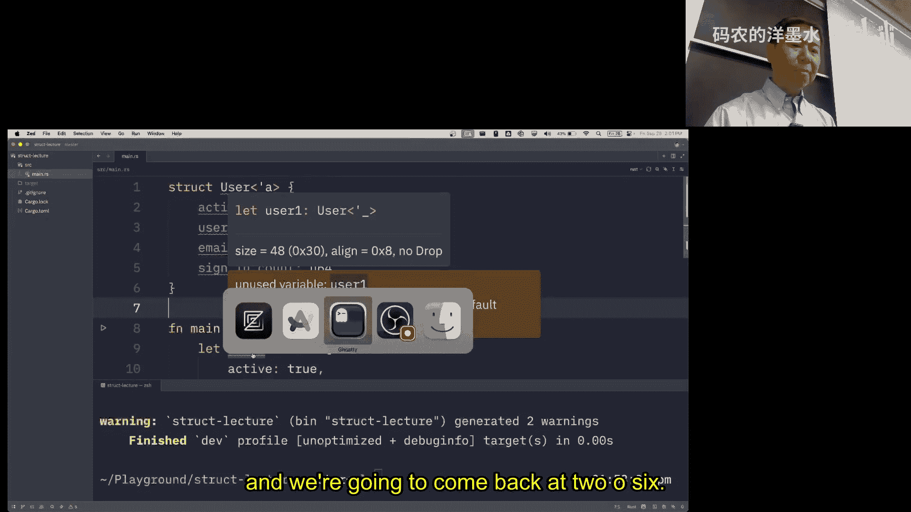

结构体和枚举是构建Rust程序复杂数据模型的基石，在后续课程中，我们还将看到如何为它们定义方法。掌握这些概念对于编写清晰、安全的Rust代码至关重要。