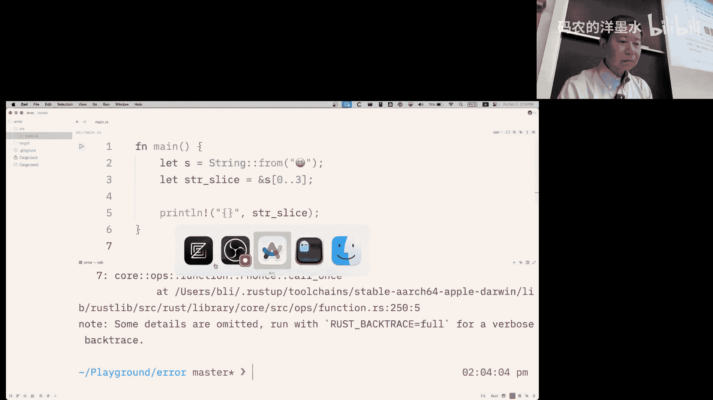
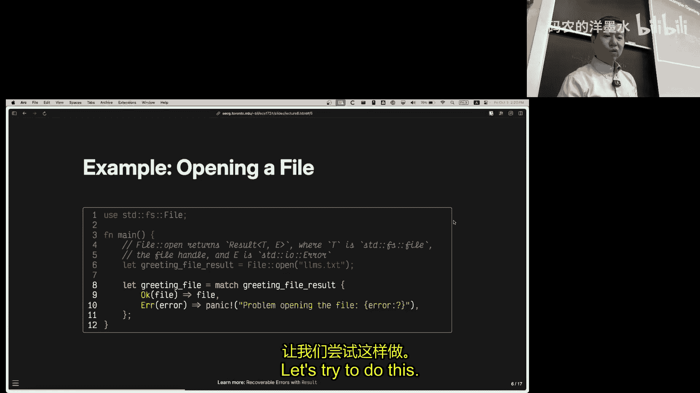
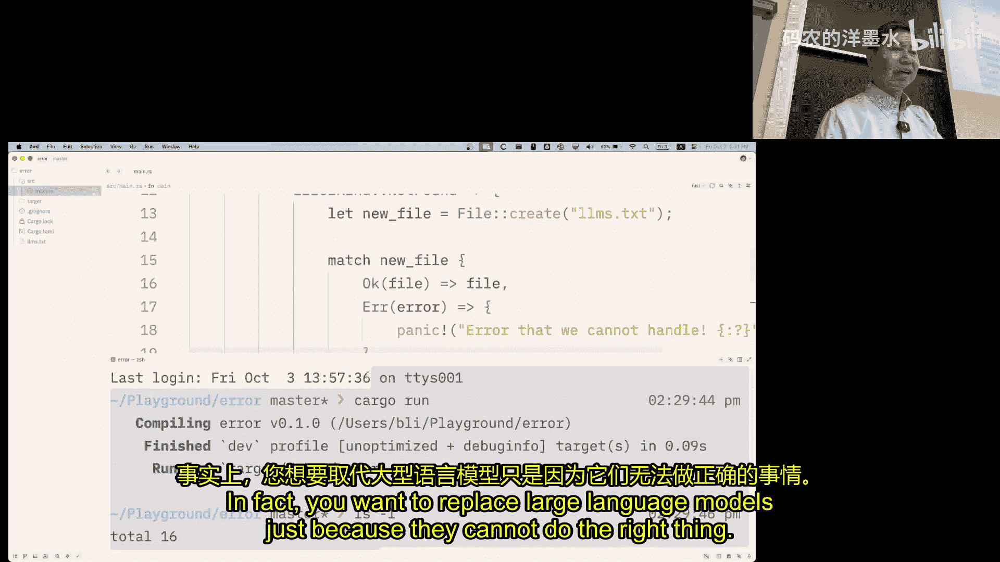
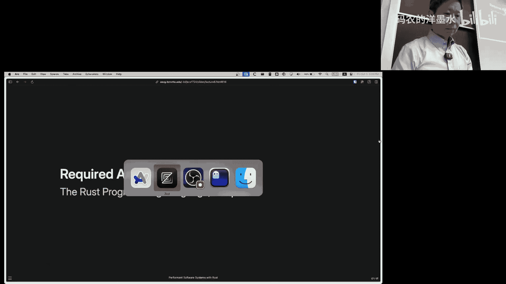

# 010：用于验证的自定义类型 🛡️

在本节课中，我们将要学习 Rust 中如何处理可恢复的错误。我们将重点探讨 `Result` 类型的使用，如何传播错误，以及如何通过创建自定义类型来保证数据的有效性。

## 概述


上一节我们介绍了不可恢复的错误（panic）。本节中我们来看看可恢复的错误。Rust 没有像其他语言那样的异常处理机制，而是使用 `Result` 枚举类型来优雅地处理可能失败的操作。



## 可恢复错误与 `Result` 类型



`Result` 类型是一个枚举，用于表示操作可能成功或失败。其定义如下：

```rust
enum Result<T, E> {
    Ok(T),
    Err(E),
}
```

`T` 代表操作成功时返回的数据类型，`E` 代表操作失败时返回的错误类型。

### 处理 `Result`：`match` 表达式

处理 `Result` 最直接的方式是使用 `match` 表达式。以下是一个打开文件的例子：

```rust
use std::fs::File;

fn main() {
    let file_result = File::open("llms.txt");

    let file = match file_result {
        Ok(file) => file,
        Err(error) => panic!("Problem opening the file: {:?}", error),
    };
}
```

如果文件打开成功，我们获得文件句柄；如果失败，程序会 panic 并打印错误信息。

### 更优雅的错误处理：创建新文件

然而，当文件不存在时直接 panic 通常不是最佳选择。更好的做法是尝试创建文件。以下是实现方法：



```rust
use std::fs::File;
use std::io::ErrorKind;

fn main() {
    let file_result = File::open("llms.txt");

    let file = match file_result {
        Ok(file) => file,
        Err(error) => match error.kind() {
            ErrorKind::NotFound => match File::create("llms.txt") {
                Ok(fc) => fc,
                Err(e) => panic!("Problem creating the file: {:?}", e),
            },
            other_error => {
                panic!("Problem opening the file: {:?}", other_error);
            }
        },
    };
}
```

这段代码首先尝试打开文件。如果错误是“未找到”，则尝试创建文件；对于其他错误，则直接 panic。

## 简化错误处理：`unwrap` 与 `expect`

对于某些情况，如果错误发生我们确实希望程序终止，可以使用 `unwrap` 或 `expect` 方法。`expect` 更好，因为它允许我们提供自定义的错误信息。

```rust
let file = File::open("llms.txt").unwrap(); // 出错时 panic，信息简单
let file = File::open("llms.txt").expect("Failed to open llms.txt"); // 出错时 panic，附带自定义信息
```

## 错误传播：`?` 运算符

很多时候，函数内部遇到错误时，不应该自己处理，而应该将错误“传播”给调用者，让调用者决定如何处理。Rust 提供了 `?` 运算符来简化这个过程。

### 传播错误示例

假设我们有一个从文件读取用户名的函数：

```rust
use std::fs::File;
use std::io::{self, Read};

fn read_username_from_file() -> Result<String, io::Error> {
    let mut username = String::new();
    let mut file = File::open("llms.txt")?;
    file.read_to_string(&mut username)?;
    Ok(username)
}
```

`?` 运算符的作用是：如果 `Result` 的值是 `Ok`，则提取其中的值并继续执行；如果是 `Err`，则立即从当前函数返回这个错误。

### `?` 运算符也可用于 `Option`

`?` 运算符同样可以用于 `Option` 类型，在遇到 `None` 时提前返回。

```rust
fn last_char_of_first_line(text: &str) -> Option<char> {
    text.lines().next()?.chars().last()
}
```

## `main` 函数也可以返回 `Result`

`main` 函数通常返回 `()`，但它也可以返回 `Result` 类型，这样程序就可以向操作系统返回错误码。

```rust
use std::error::Error;
use std::fs::File;

fn main() -> Result<(), Box<dyn Error>> {
    let _greeting_file = File::open("llms.txt")?;
    Ok(())
}
```

这里 `Box<dyn Error>` 表示任何实现了 `Error` trait 的类型，它允许 `main` 函数返回多种不同的错误。

## 何时应该使用 `panic!`

使用 `panic!`（或 `unwrap`、`expect`）是一种设计决策，主要适用于以下情况：
1.  **你有绝对自信不会出错时**：例如，解析一个硬编码的、已知有效的字符串。
    ```rust
    let home: IpAddr = "127.0.0.1".parse().expect("Hardcoded IP address should be valid");
    ```
2.  **当你正在编写库，并且传入的无效数据会破坏后续逻辑时**：此时应在数据验证处 panic，以保护后续代码的假设。例如，`String` 的切片索引方法会在索引无效时 panic。

## 创建用于验证的自定义类型

一个更健壮的设计模式是创建自定义类型来封装数据和其有效性规则。以猜数字游戏为例，我们可以创建一个 `Guess` 类型来确保值始终在 1 到 100 之间。

```rust
pub struct Guess {
    value: i32,
}

impl Guess {
    pub fn new(value: i32) -> Guess {
        if value < 1 || value > 100 {
            panic!("Guess value must be between 1 and 100, got {}.", value);
        }
        Guess { value }
    }

    pub fn value(&self) -> i32 {
        self.value
    }
}
```

通过将字段 `value` 设为私有，并只提供构造函数 `new` 和获取方法 `value`，我们保证了：一旦 `Guess` 实例被创建，其包含的值一定是有效的。这比在业务代码中到处检查范围要清晰和安全得多。

## 总结



本节课中我们一起学习了 Rust 处理错误的精髓。我们了解了如何使用 `Result` 和 `Option` 类型来表示可能失败的操作，如何使用 `match` 和 `?` 运算符来处理和传播错误。我们还探讨了何时应该让程序 panic，并学习了通过创建自定义类型来在编译期和运行时强制数据有效性，这是构建可靠 Rust 程序的关键模式。下一讲，我们将开始学习集合类型。