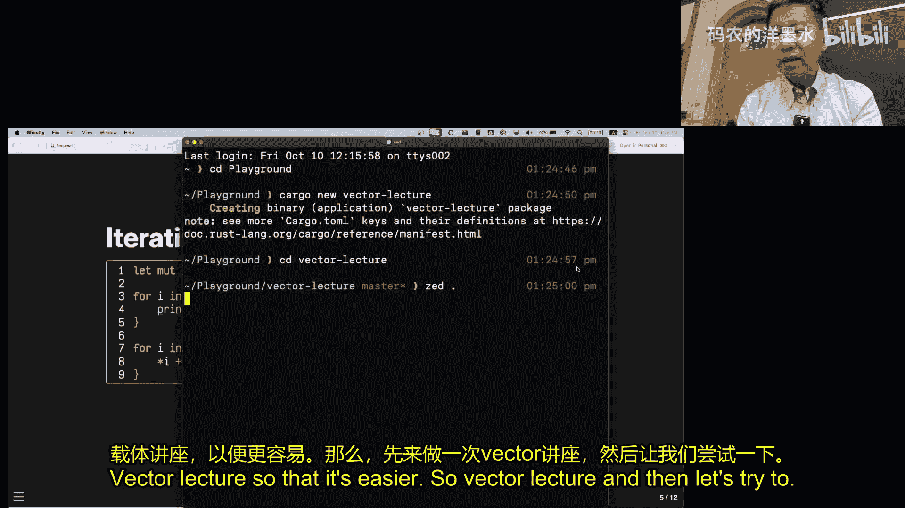
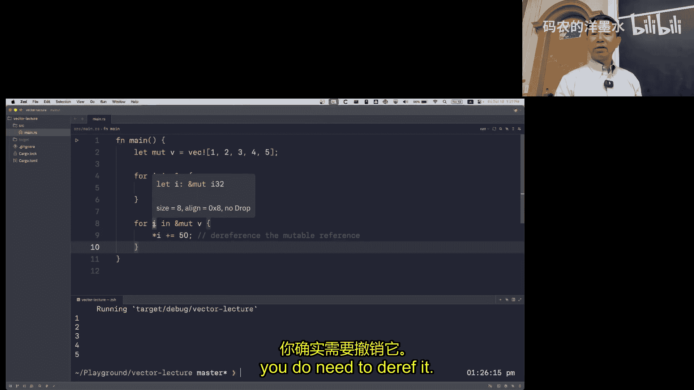
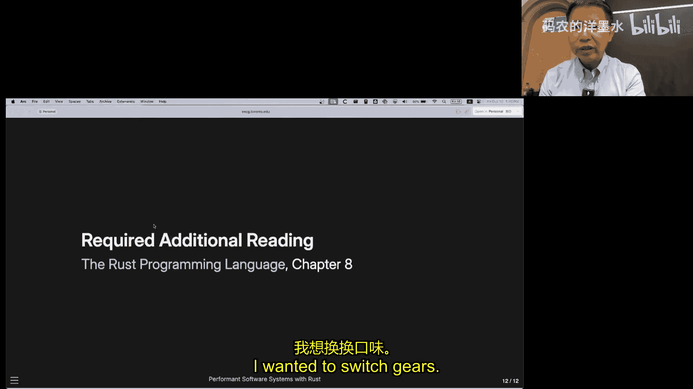
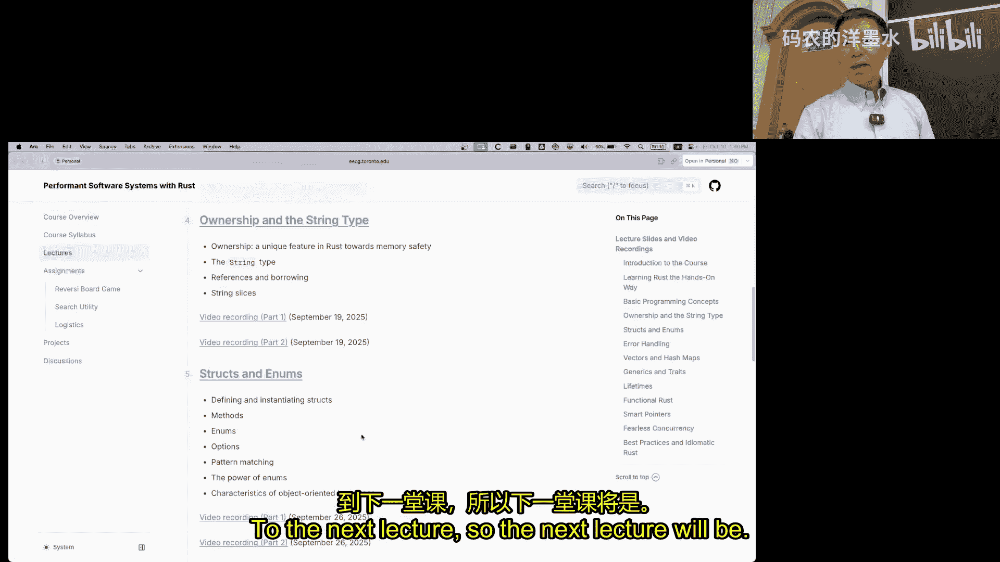
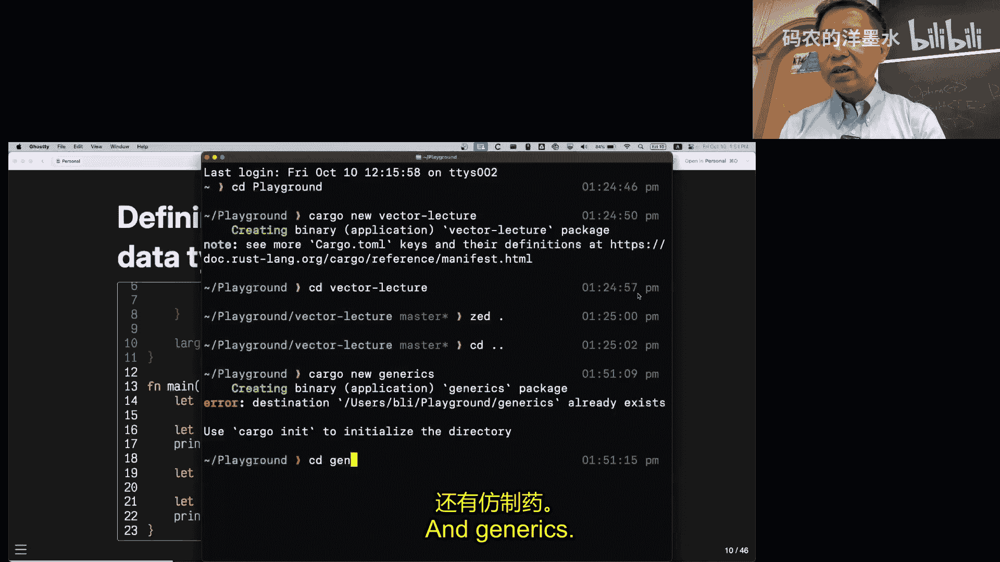
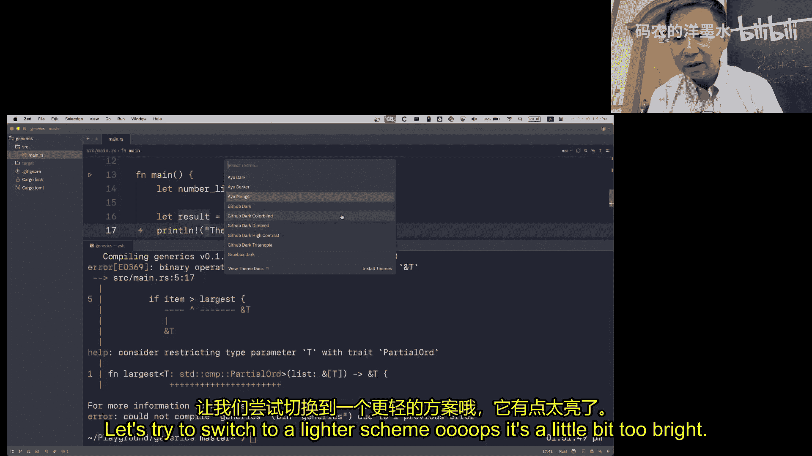
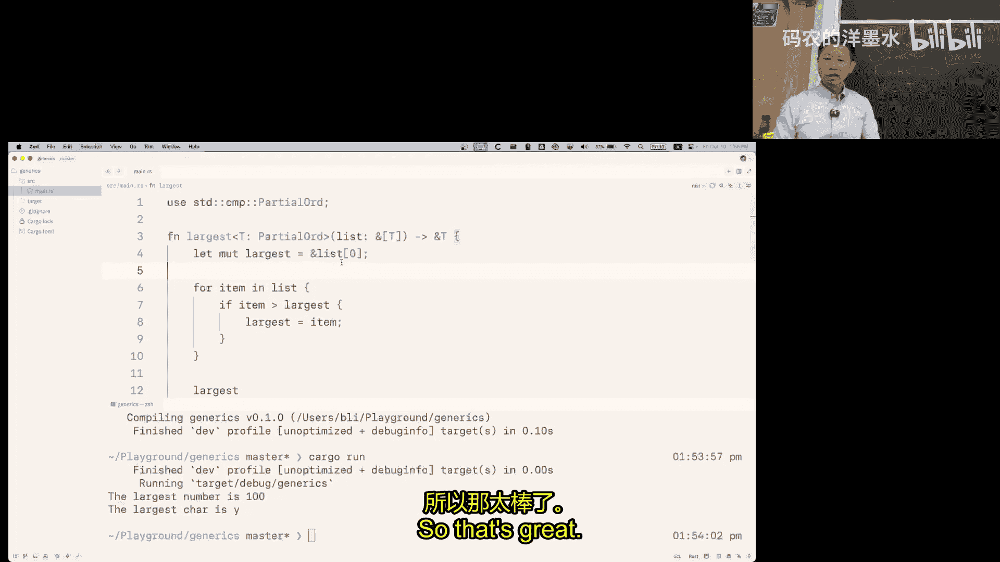
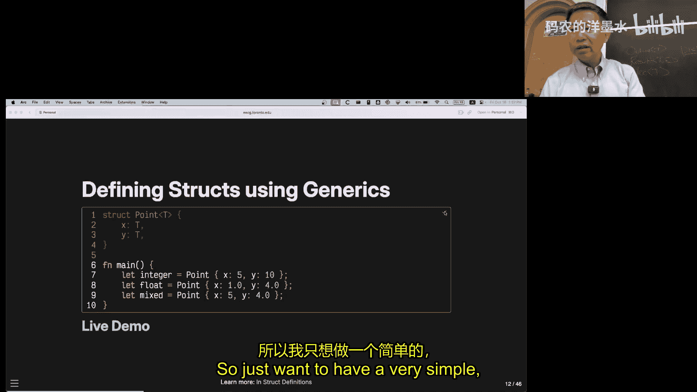
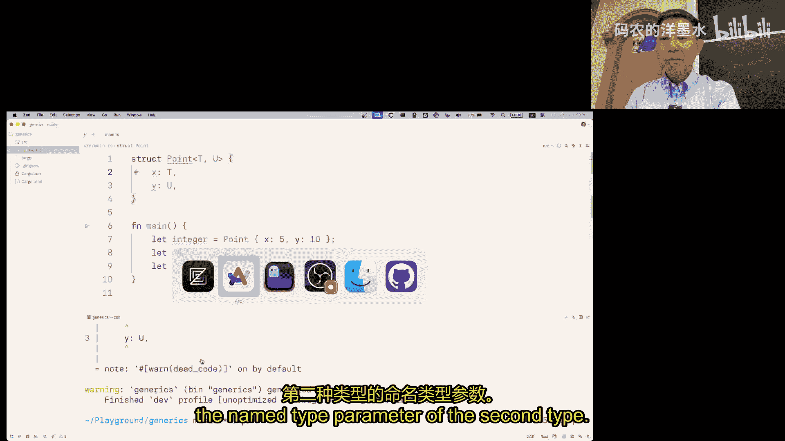
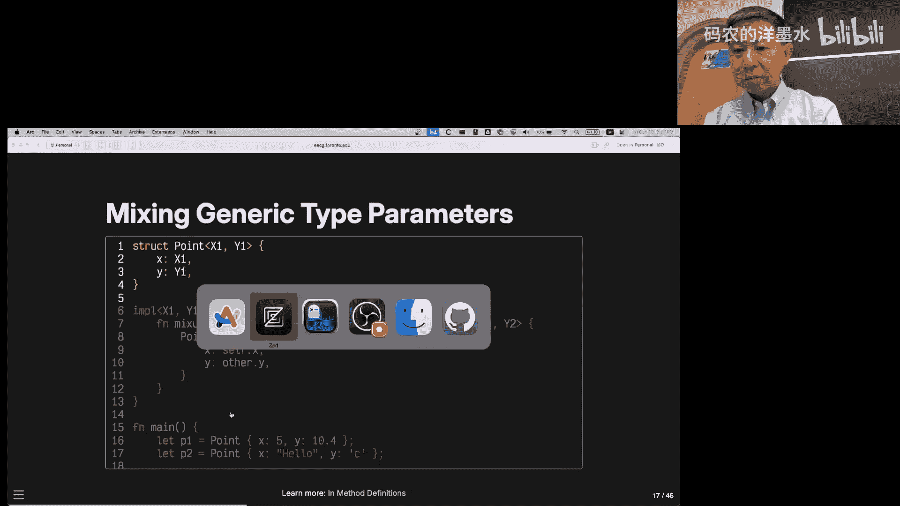

# 011：向量与哈希表 🚀

在本节课中，我们将学习Rust标准库中两个非常重要的数据结构：向量（Vector）和哈希表（HashMap）。向量是一种可增长的数组，而哈希表是一种键值对存储结构。我们将探讨它们的基本用法、所有权规则以及一些实用的技巧。

---

## 向量（Vectors）

向量是一种可增长的数组，存储在堆上，可以容纳多个相同类型的值。例如，字符串本质上就是字符的向量。

### 定义向量

我们可以使用 `vec!` 宏来定义一个带有初始值的向量：

```rust
let v = vec![1, 2, 3];
```

如果需要创建一个空的向量，必须显式指定类型：

```rust
let v: Vec<i32> = Vec::new();
```

向量使用泛型类型 `Vec<T>` 定义，其中 `T` 是向量中元素的类型。

### 向向量中添加元素

使用 `push` 方法可以向向量末尾添加元素：

```rust
let mut v = Vec::new();
v.push(5);
v.push(6);
```

### 读取向量中的元素

有两种主要方式读取向量中的元素：通过索引直接访问和使用 `get` 方法。

通过索引直接访问：

```rust
let v = vec![1, 2, 3, 4, 5];
let third: &i32 = &v[2];
println!("第三个元素是 {}", third);
```

这种方式在索引越界时会导致程序 `panic`（运行时崩溃）。

更安全的方式是使用 `get` 方法，它返回一个 `Option<&T>` 类型：



```rust
let v = vec![1, 2, 3, 4, 5];
match v.get(2) {
    Some(third) => println!("第三个元素是 {}", third),
    None => println!("没有第三个元素。"),
}
```

当索引越界时，`get` 方法会返回 `None`，而不会导致程序崩溃。

### 所有权与借用规则



在向量中，所有权和借用规则同样适用。例如，在获取了向量中某个元素的不可变引用后，不能同时修改向量：

```rust
let mut v = vec![1, 2, 3, 4, 5];
let first = &v[0]; // 不可变借用
v.push(6); // 错误！尝试可变借用
```

这是因为 `push` 方法可能需要重新分配内存，使得之前的引用失效。Rust在编译时就会阻止这种潜在的错误。

### 遍历向量

我们可以使用 `for` 循环来遍历向量中的元素：

```rust
let v = vec![100, 32, 57];
for i in &v {
    println!("{}", i);
}
```

如果需要修改元素，可以使用可变引用：

```rust
let mut v = vec![100, 32, 57];
for i in &mut v {
    *i += 50; // 解引用并修改值
}
```

### 在向量中存储多种类型

向量只能存储单一类型，但我们可以使用枚举来存储多种类型：

```rust
enum SpreadsheetCell {
    Int(i32),
    Float(f64),
    Text(String),
}

let row = vec![
    SpreadsheetCell::Int(3),
    SpreadsheetCell::Text(String::from("蓝色")),
    SpreadsheetCell::Float(10.12),
];
```

这种方法在预先知道可能存储的类型时非常有用。

---

上一节我们介绍了向量的基本用法和所有权规则，本节中我们来看看另一种重要的数据结构：哈希表。

## 哈希表（Hash Maps）

哈希表是一种键值对存储结构，类似于其他语言中的字典（如Python）或映射。在Rust中，哈希表通过 `HashMap<K, V>` 实现。

### 使用哈希表

首先，需要将 `HashMap` 引入作用域，因为它不在预导入模块中：

```rust
use std::collections::HashMap;
```

创建一个新的哈希表并插入键值对：

```rust
let mut scores = HashMap::new();
scores.insert(String::from("蓝色"), 10);
scores.insert(String::from("黄色"), 50);
```





### 遍历哈希表

可以使用 `for` 循环遍历哈希表中的所有键值对：

```rust
for (key, value) in &scores {
    println!("{}: {}", key, value);
}
```

### 更新哈希表

更新哈希表有多种方式。直接使用 `insert` 方法会覆盖已存在的键：

```rust
let mut scores = HashMap::new();
scores.insert(String::from("蓝色"), 10);
scores.insert(String::from("蓝色"), 25); // 更新值为25
```

如果只想在键不存在时插入，可以使用 `entry` 和 `or_insert` 方法：

```rust
let mut scores = HashMap::new();
scores.insert(String::from("蓝色"), 10);
scores.entry(String::from("黄色")).or_insert(50);
```

### 基于旧值更新

一个常见的用例是基于旧值更新哈希表中的值，例如统计单词出现次数：

```rust
let text = "hello world wonderful world";
let mut map = HashMap::new();

for word in text.split_whitespace() {
    let count = map.entry(word).or_insert(0);
    *count += 1;
}

println!("{:?}", map);
```

这段代码会输出每个单词的出现次数，例如 `{"world": 2, "hello": 1, "wonderful": 1}`。

---

## 泛型（Generics）

泛型用于消除代码重复，允许我们使用类型占位符代替具体类型。我们之前已经见过泛型在 `Option<T>`、`Result<T, E>` 和 `Vec<T>` 中的应用。

### 泛型函数

假设我们需要一个函数来查找向量中的最大元素。最初，我们可能为每种类型编写单独的函数：

```rust
fn largest_i32(list: &[i32]) -> &i32 {
    let mut largest = &list[0];
    for item in list {
        if item > largest {
            largest = item;
        }
    }
    largest
}



fn largest_char(list: &[char]) -> &char {
    let mut largest = &list[0];
    for item in list {
        if item > largest {
            largest = item;
        }
    }
    largest
}
```



为了避免重复，我们可以使用泛型：

```rust
fn largest<T: PartialOrd>(list: &[T]) -> &T {
    let mut largest = &list[0];
    for item in list {
        if item > largest {
            largest = item;
        }
    }
    largest
}
```

这里 `T: PartialOrd` 是一个特质约束，表示类型 `T` 必须实现 `PartialOrd` 特质，以便进行比较。

### 泛型结构体

我们也可以在结构体中使用泛型：

```rust
struct Point<T> {
    x: T,
    y: T,
}



let integer_point = Point { x: 5, y: 10 };
let float_point = Point { x: 1.0, y: 4.0 };
```

如果需要结构体的字段具有不同的类型，可以使用多个泛型参数：

```rust
struct Point<T, U> {
    x: T,
    y: U,
}



let both_integer = Point { x: 5, y: 10 };
let integer_and_float = Point { x: 5, y: 4.0 };
```

### 泛型枚举

枚举也可以使用泛型，例如标准库中的 `Option<T>` 和 `Result<T, E>`：

```rust
enum Option<T> {
    Some(T),
    None,
}



enum Result<T, E> {
    Ok(T),
    Err(E),
}
```

### 泛型方法

我们可以在结构体上定义泛型方法：

```rust
struct Point<T> {
    x: T,
    y: T,
}

impl<T> Point<T> {
    fn x(&self) -> &T {
        &self.x
    }
}

let p = Point { x: 5, y: 10 };
println!("p.x = {}", p.x());
```

还可以为特定具体类型定义方法：

```rust
impl Point<f32> {
    fn distance_from_origin(&self) -> f32 {
        (self.x.powi(2) + self.y.powi(2)).sqrt()
    }
}
```

这样，只有 `Point<f32>` 类型的实例才能调用 `distance_from_origin` 方法。

---

## 总结 🎉



在本节课中，我们一起学习了Rust中的向量和哈希表这两种重要的数据结构。我们探讨了它们的基本用法、所有权规则以及一些实用技巧。此外，我们还深入了解了泛型的概念，包括泛型函数、泛型结构体、泛型枚举和泛型方法。泛型帮助我们消除代码重复，并使代码更加灵活和可重用。掌握这些概念是编写高效、安全Rust代码的关键。