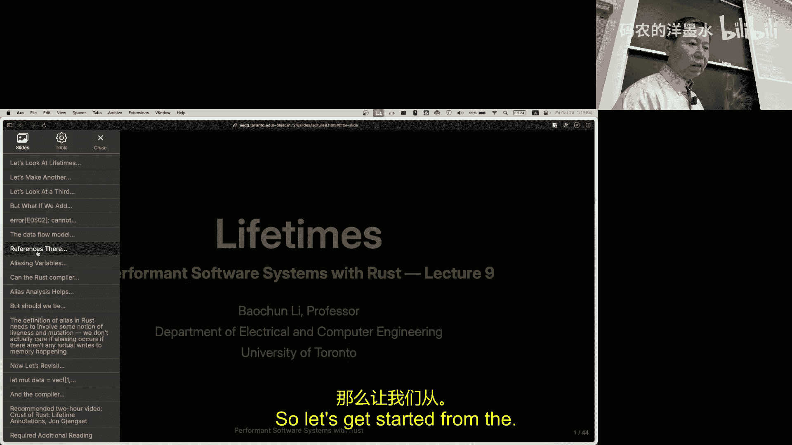
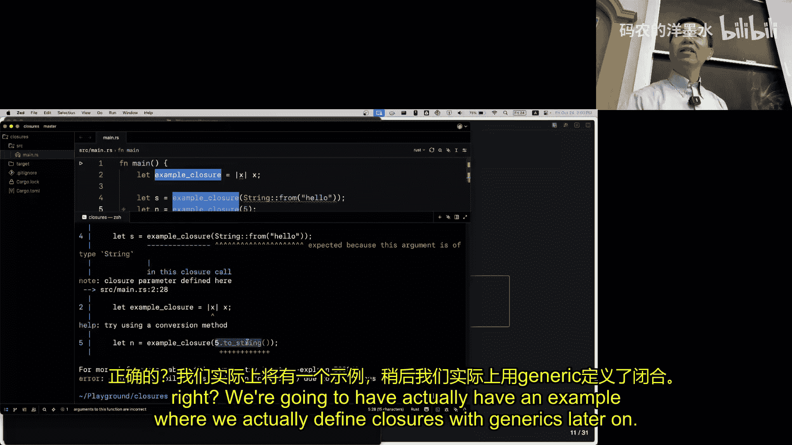

# 013：函数式Rust part1




在本节课中，我们将要学习Rust中的函数式编程概念，特别是闭包。我们将从回顾上一讲的生命周期和别名概念开始，然后深入探讨闭包的定义、类型推断以及它们如何捕获环境中的值。

## 生命周期与别名回顾

上一节我们介绍了生命周期。本节中我们来看看别名的概念以及它如何影响编译器优化。

引用有两种类型：可变引用和共享引用。Rust编译器强制执行两条核心规则。

第一条规则是，引用不能比其引用的值存活得更久。编译器通过生命周期分析来强制执行此规则。

第二条规则是关于别名的。一个可变引用不能被别名化。这意味着，当一个可变引用存活时，内存中不应有其他存活的引用指向重叠的内存区域。

别名的定义是：如果两个变量指向内存中重叠的区域，则它们互为别名。Rust保证可变引用没有别名，这不仅关乎内存安全，也为编译器优化创造了条件。

以下是一个展示别名如何影响优化的例子。

```rust
fn compute(input: &i32, output: &mut i32) {
    if *input > 10 {
        *output = 1;
    }
    if *input > 5 {
        *output *= 2;
    }
}
```

编译器能否将上述两次比较优化为一次？这取决于 `input` 和 `output` 是否可能互为别名。在C/C++中，由于无法保证这一点，编译器难以进行此类优化。但在Rust中，由于可变引用不能被别名化的保证，编译器可以安全地将 `input` 的值缓存到寄存器中，然后进行优化，因为 `output` 不可能指向与 `input` 重叠的内存。

这个特性简化了编译器的别名分析，使其能够进行更多积极的优化。相比之下，面向对象编程中的动态多态（运行时分发）会阻碍编译器优化，因为它在编译时无法确定调用哪个函数。

因此，Rust的别名规则不仅确保了内存安全，还显著提升了代码的运行性能。

## 闭包简介

上一节我们回顾了生命周期的核心概念。本节中，我们将正式进入函数式Rust的世界，首先了解什么是闭包。

函数式编程将函数视为“一等公民”。这意味着函数可以像普通变量一样被存储、传递和返回。闭包是Rust中实现函数式编程的关键特性，它们是匿名函数，可以捕获其定义环境中的值。

闭包之所以强大，是因为它们能够自动捕获环境中的值。如果无法捕获环境，闭包的功能将大打折扣。

让我们通过一个例子来理解闭包的用法。

## 示例：T恤赠送程序

假设一家T恤公司进行促销，赠送限量版T恤（红色或蓝色）。用户可以指定喜欢的颜色（可选），如果未指定，则获得库存最多的颜色。

首先，我们定义数据结构和一些方法。

```rust
#[derive(Debug, PartialEq, Copy, Clone)]
enum ShirtColor {
    Red,
    Blue,
}

struct Inventory {
    shirts: Vec<ShirtColor>,
}

impl Inventory {
    // 返回库存最多的颜色
    fn most_stocked(&self) -> ShirtColor {
        let mut num_red = 0;
        let mut num_blue = 0;

        for color in &self.shirts {
            match color {
                ShirtColor::Red => num_red += 1,
                ShirtColor::Blue => num_blue += 1,
            }
        }
        if num_red > num_blue {
            ShirtColor::Red
        } else {
            ShirtColor::Blue
        }
    }

    // 根据用户偏好赠送T恤
    fn giveaway(&self, user_preference: Option<ShirtColor>) -> ShirtColor {
        // 使用闭包作为参数调用 `unwrap_or_else`
        user_preference.unwrap_or_else(|| self.most_stocked())
    }
}
```

`giveaway` 方法的核心是调用了 `Option` 类型的 `unwrap_or_else` 方法。该方法接受一个闭包作为参数：如果 `Option` 是 `Some(value)`，则返回其中的值；如果是 `None`，则调用传入的闭包并返回其结果。

我们传入的闭包是 `|| self.most_stocked()`。虽然它没有显式的参数（管道 `||` 内为空），但它通过捕获环境中的 `self` 来调用 `most_stocked` 方法。这正是闭包捕获环境值能力的体现。

这种写法非常符合Rust的“生态”风格，利用库函数和闭包简洁地表达逻辑。

## 闭包的类型推断与注解

与普通函数不同，闭包通常不需要显式注解参数和返回值的类型。因为闭包通常只在有限的上下文中使用，编译器能够根据其用法推断出类型。

当然，你也可以为了清晰性而添加类型注解。

以下是函数与闭包语法的一些对比，展示了闭包如何通过类型推断简化代码。

```rust
// 1. 普通函数
fn add_one_v1 (x: u32) -> u32 { x + 1 }

// 2. 带完整类型注解的闭包
let add_one_v2 = |x: u32| -> u32 { x + 1 };

// 3. 省略返回类型注解的闭包
let add_one_v3 = |x| { x + 1 };

// 4. 省略函数体大括号的闭包（单表达式）
let add_one_v4 = |x| x + 1;
```

上述四个定义在功能上是等价的，但闭包版本（v2-v4）因类型推断而更加简洁。

需要注意的是，闭包的类型在第一次调用时就被推断并固定下来。

```rust
let example_closure = |x| x;

let s = example_closure(String::from("hello")); // 推断 x 为 String 类型
let n = example_closure(5); // 错误！期望String类型，找到整数类型
```

第二次调用会导致编译错误，因为闭包 `example_closure` 的类型在第一次调用时已被推断为接受 `String` 参数，不能再接受整数。




本节课中我们一起学习了Rust中函数式编程的基础——闭包。我们了解了闭包作为一等公民的概念，如何定义和使用闭包，以及其强大的类型推断和环境捕获能力。在接下来的课程中，我们将深入探讨闭包捕获环境的三种方式，这是闭包最核心也最具挑战性的部分。