# 014：函数式Rust（第二部分）

在本节课中，我们将深入学习Rust闭包捕获环境值的三种方式，并探讨迭代器（Iterator）的核心概念与使用方法。我们将通过具体的代码示例，理解闭包的`Fn`、`FnMut`和`FnOnce`特征，以及迭代器的惰性求值和适配器模式。

---

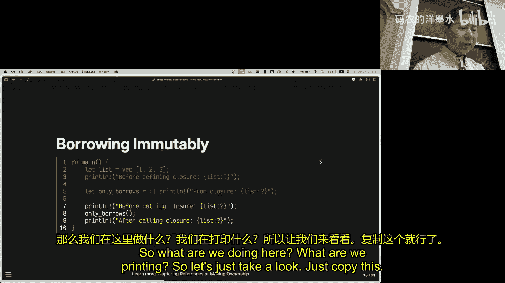

## 闭包捕获环境值的三种方式

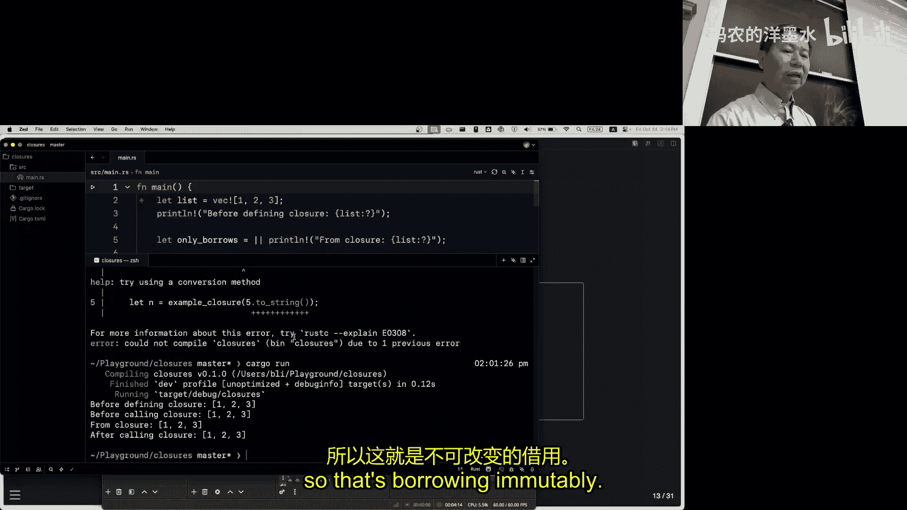

上一节我们介绍了闭包的基本概念。本节中，我们来看看闭包如何从其所在的环境中捕获值。这类似于向常规函数传递参数的三种方式。

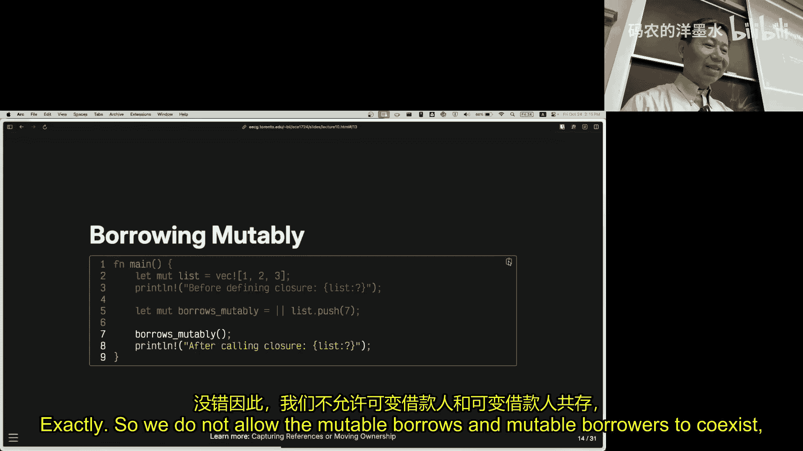

闭包可以从其环境中捕获值，这赋予了它强大的能力。捕获值的方式恰好对应了调用函数的三种方式：不可变借用、可变借用和获取所有权。

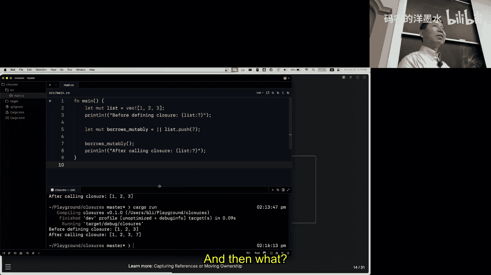

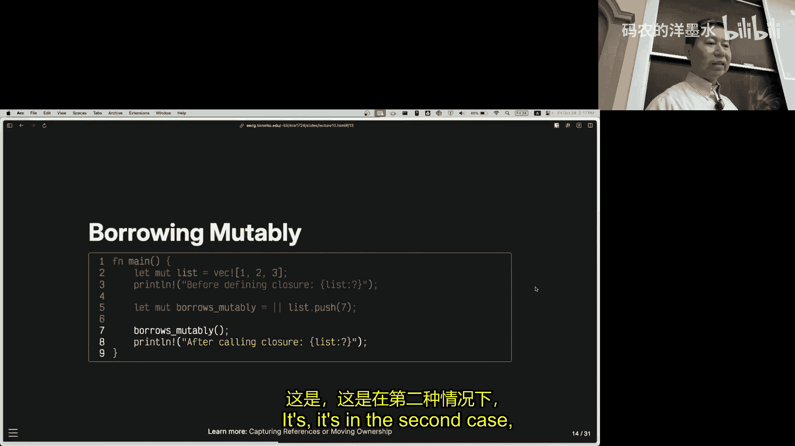

以下是三种捕获方式的详细说明和示例。

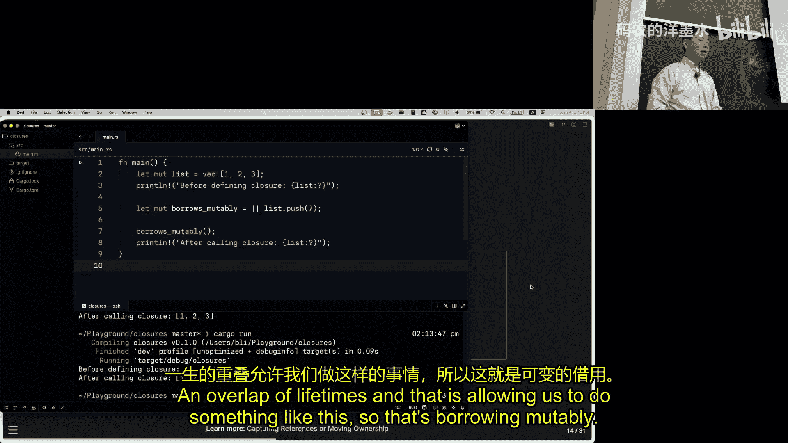

### 1. 不可变借用

这种方式下，闭包以不可变引用的形式捕获环境中的值。这意味着闭包可以读取这些值，但不能修改它们。

```rust
fn main() {
    let list = vec![1, 2, 3];
    println!("调用闭包前: {:?}", list);

    // 定义一个闭包，它不可变地借用 `list`
    let only_borrows = || println!("来自闭包: {:?}", list);

    only_borrows(); // 调用闭包
    println!("调用闭包后: {:?}", list);
}
```
运行此代码会按顺序打印列表三次，证明闭包只是读取了数据。

### 2. 可变借用

这种方式下，闭包以可变引用的形式捕获环境中的值，允许闭包修改这些值。

```rust
fn main() {
    let mut list = vec![1, 2, 3];
    println!("调用闭包前: {:?}", list);

    // 定义一个闭包，它可变地借用 `list` 并修改它
    let mut borrows_mutably = || {
        list.push(4);
        println!("来自闭包: {:?}", list);
    };

    borrows_mutably(); // 调用闭包
    // println!("调用闭包后: {:?}", list); // 如果取消注释，会导致编译错误
}
```
在这个例子中，闭包内部修改了`list`。需要注意的是，在闭包被定义后、调用前，如果尝试使用`list`，可能会因为所有权规则（特别是可变引用的独占性）而导致编译错误。但在闭包调用完成后，其生命周期结束，可以再次使用`list`。

### 3. 获取所有权

这种方式下，闭包获取环境中值的所有权。这通常用于将数据移动到新线程等场景，以确保父线程不会同时修改数据，避免并发问题。使用`move`关键字可以强制闭包获取其捕获变量的所有权。

```rust
use std::thread;

fn main() {
    let list = vec![1, 2, 3];

    // 使用 `move` 关键字将 `list` 的所有权移动到新线程的闭包中
    let handle = thread::spawn(move || {
        println!("在新线程中: {:?}", list);
    });

    // 主线程中不能再使用 `list`
    // println!("在主线程中: {:?}", list); // 这会导致编译错误

    handle.join().unwrap();
}
```

---

## 闭包特征：`FnOnce`、`FnMut` 和 `Fn`

Rust 使用特征来对闭包进行分类，这影响了闭包如何被调用和使用。理解这些特征对于使用接受闭包作为参数的库函数至关重要。

### `FnOnce` 特征
*   **含义**：只能被调用一次的闭包。
*   **行为**：这类闭包会将其捕获的值移出闭包体。所有闭包都至少实现 `FnOnce`。
*   **示例**：标准库中 `Option::unwrap_or_else` 方法的参数就要求是 `FnOnce` 闭包，因为它最多只需要执行一次。

### `FnMut` 特征
*   **含义**：可以被多次调用，并且可能修改其捕获值的闭包。
*   **行为**：这类闭包通过可变引用来捕获环境，允许在多次调用中改变捕获的变量。
*   **示例**：`Vec::sort_by_key` 方法接受一个 `FnMut` 闭包，因为它需要对每个元素调用该闭包以获取排序键，并且闭包可能需要更新内部状态（例如一个计数器）。


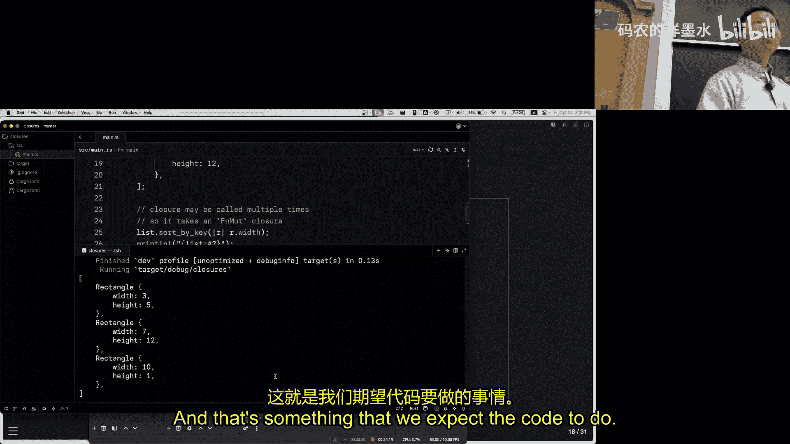

```rust
#[derive(Debug)]
struct Rectangle {
    width: u32,
    height: u32,
}

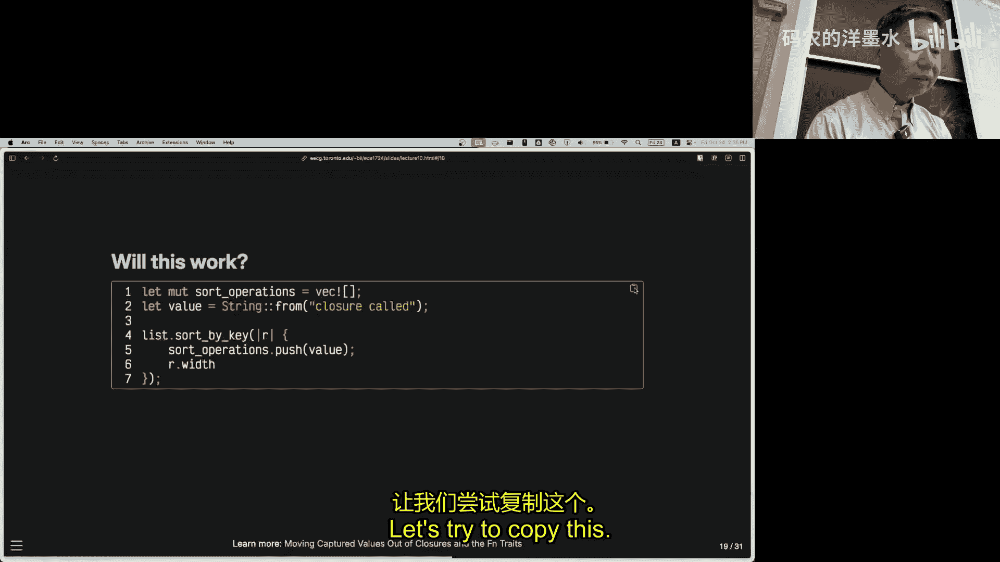

fn main() {
    let mut list = [
        Rectangle { width: 10, height: 1 },
        Rectangle { width: 3, height: 5 },
        Rectangle { width: 7, height: 12 },
    ];

    let mut count = 0;
    list.sort_by_key(|r| {
        count += 1; // 修改捕获的变量
        r.width // 返回排序依据的键
    });

    println!("{:#?}, 排序操作调用闭包次数: {}", list, count);
}
```

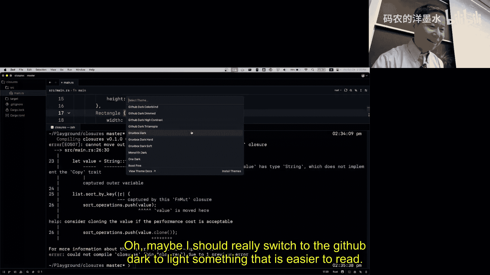

### `Fn` 特征
*   **含义**：可以被多次调用，并且既不移动也不修改其捕获值的闭包。
*   **行为**：这类闭包通过不可变引用来捕获环境，或者不捕获任何环境。
*   **示例**：适用于纯计算的场景。

**关键点**：这三个特征之间存在继承关系：`Fn` 继承自 `FnMut`，`FnMut` 继承自 `FnOnce`。这意味着一个实现了 `Fn` 的闭包也自动实现了 `FnMut` 和 `FnOnce`。

---

## 迭代器深入解析

迭代器是Rust中处理序列数据的强大工具。它们遵循零成本抽象原则，意味着使用迭代器通常不会带来运行时性能开销。


### 迭代器是惰性的
创建迭代器本身不会立即进行任何计算或遍历。只有在“消费”迭代器时，操作才会执行。


```rust
fn main() {
    let v1 = vec![1, 2, 3];
    let v1_iter = v1.iter(); // 此时没有任何遍历发生

    for val in v1_iter { // `for` 循环开始消费迭代器
        println!("得到: {}", val);
    }
}
```

### 迭代器特征
迭代器的核心是 `Iterator` trait，它要求实现一个 `next` 方法。

```rust
pub trait Iterator {
    type Item; // 关联类型，代表迭代器产生的值的类型
    fn next(&mut self) -> Option<Self::Item>;
    // ... 其他有默认实现的方法
}
```
`next` 方法返回 `Option<Self::Item>`。当有下一个元素时返回 `Some(item)`，遍历完成时返回 `None`。

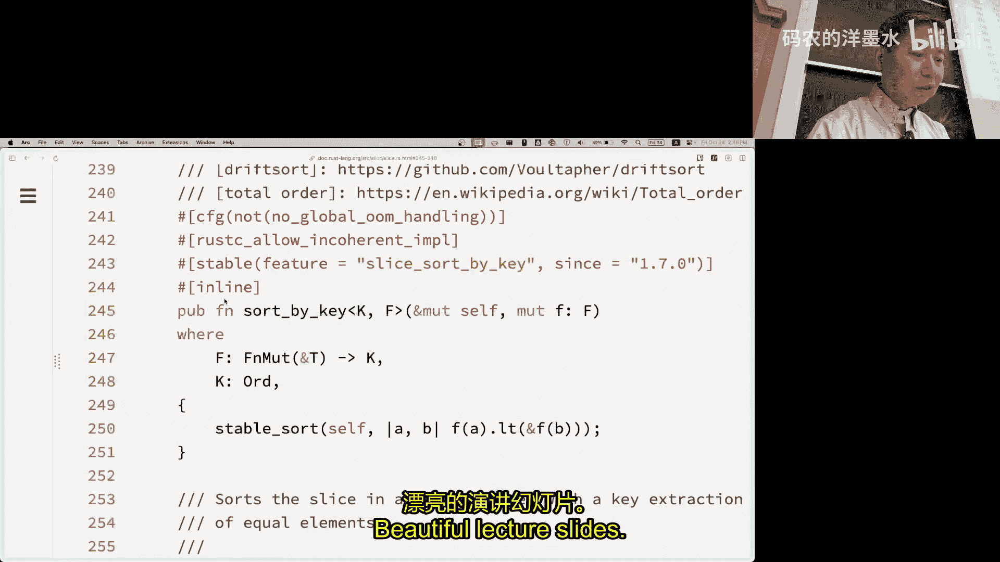

### 消费迭代器的方法
这些方法会消耗迭代器，通常获取最终结果。

*   **`sum`**：计算迭代器中所有元素的和。
    ```rust
    let v1 = vec![1, 2, 3];
    let total: i32 = v1.iter().sum(); // 消费迭代器，得到总和6
    ```

### 迭代器适配器
这些方法接收一个迭代器，返回一个新的、经过某种转换的迭代器。它们本身是惰性的。

*   **`map`**：对每个元素应用一个闭包，产生新元素。
    ```rust
    let v1 = vec![1, 2, 3];
    let v2: Vec<_> = v1.iter().map(|x| x + 1).collect(); // 需要 collect 来消费
    // v2 为 [2, 3, 4]
    ```
*   **`filter`**：根据闭包条件过滤元素。
*   **`zip`**：将两个迭代器“压缩”成一个。

**重要**：迭代器适配器本身不产生最终结果，必须通过消费适配器（如 `collect`, `sum`）来触发计算。

### 三种创建迭代器的方式
根据不同的使用场景，可以通过以下三种方法从集合创建迭代器：

1.  **`iter()`**：生成一个产生 **不可变引用** (`&T`) 的迭代器。用于只读遍历。
2.  **`iter_mut()`**：生成一个产生 **可变引用** (`&mut T`) 的迭代器。用于需要修改集合元素的遍历。
3.  **`into_iter()`**：生成一个 **获取所有权** 的迭代器。它会消耗原集合，遍历后原集合将不可再用。`for` 循环默认使用 `into_iter`。

```rust
let mut v = vec![1, 2, 3];

// 只读遍历
for i in v.iter() {
    println!("{}", i); // i 是 &i32
}

// 可修改遍历
for i in v.iter_mut() {
    *i += 1; // 可以修改元素
}

// 获取所有权遍历（消耗 v）
for i in v.into_iter() {
    println!("{}", i); // i 是 i32
}
// 此处 v 已不再有效
```

---

## 总结

本节课中我们一起学习了：
1.  **闭包捕获环境值的三种方式**：不可变借用、可变借用和获取所有权（使用 `move` 关键字），它们分别对应了函数调用的参数传递模式。
2.  **闭包的三个特征**：`FnOnce`（调用一次）、`FnMut`（可多次调用并可修改环境）、`Fn`（可多次调用且不修改环境）。这些特征被库函数用作约束，以确保闭包行为符合预期。
3.  **迭代器的核心机制**：迭代器是惰性的，其基础是 `Iterator` trait 和 `next` 方法。
4.  **迭代器的使用模式**：区分了**消费适配器**（如 `sum`, `collect`）和**迭代器适配器**（如 `map`, `filter`）。
5.  **创建迭代器的三种方法**：`iter()`、`iter_mut()` 和 `into_iter()`，用于满足只读、修改和消耗所有权等不同场景的需求。

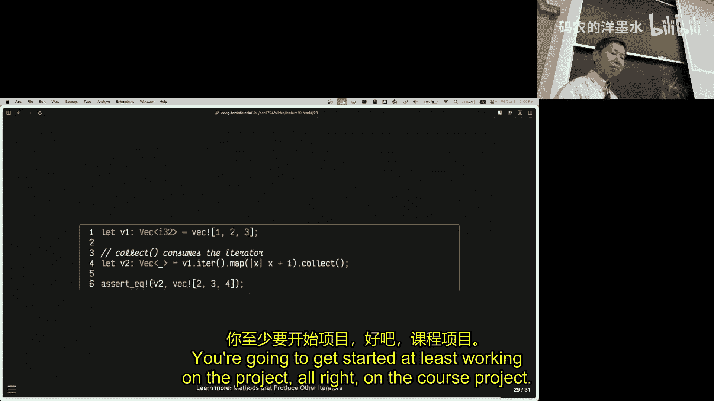


掌握这些概念是编写地道、高效且安全的Rust代码的关键，尤其是在函数式编程风格和数据处理领域。