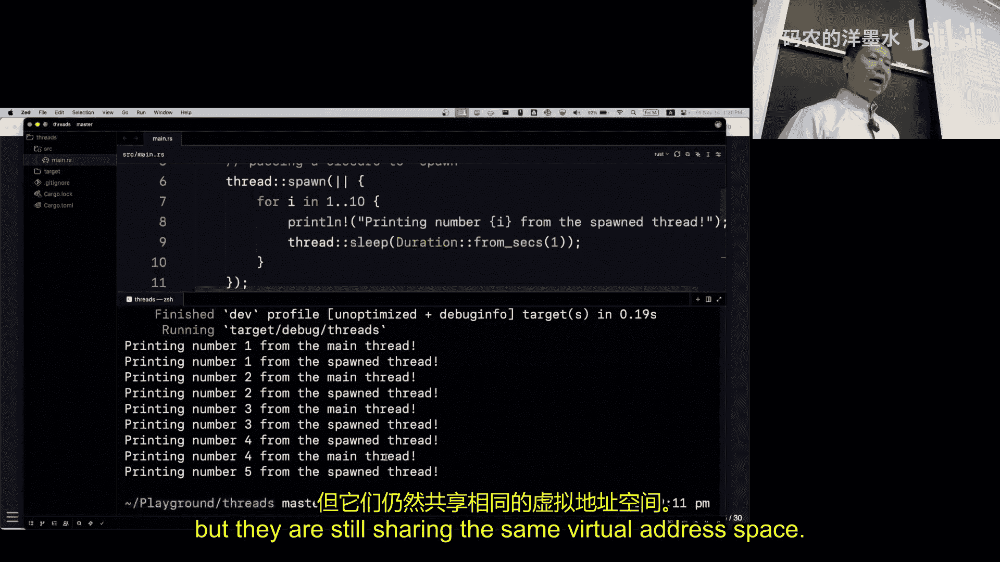
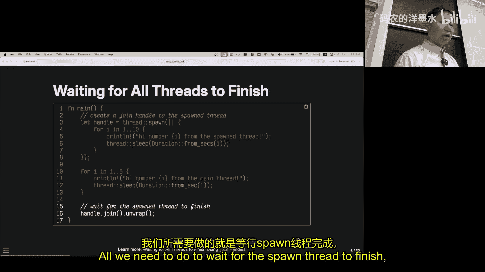
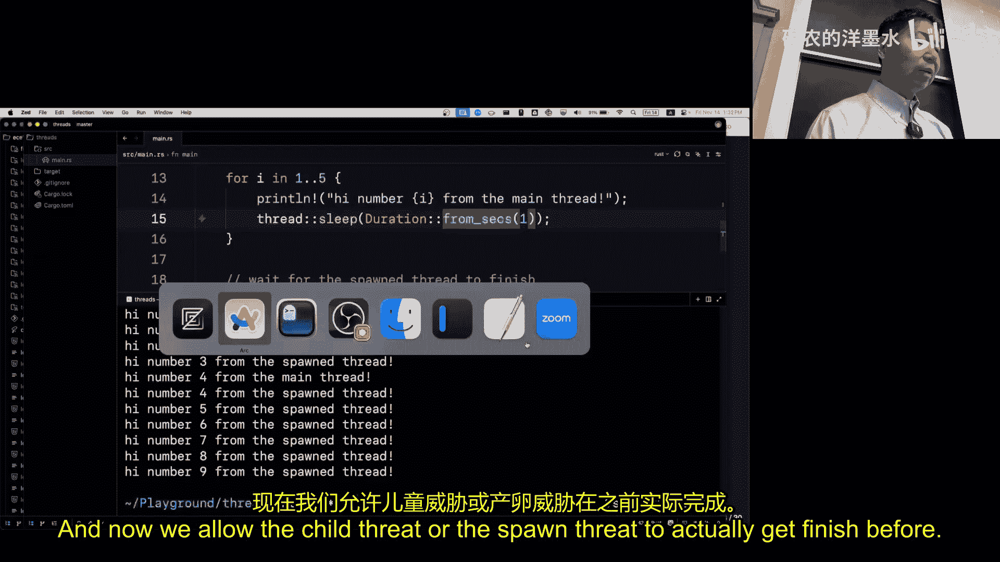
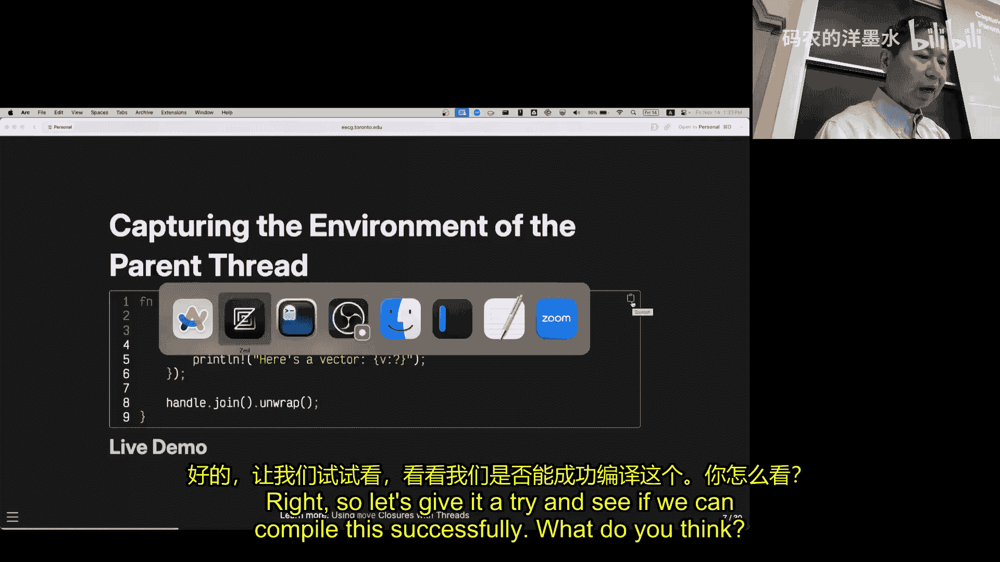
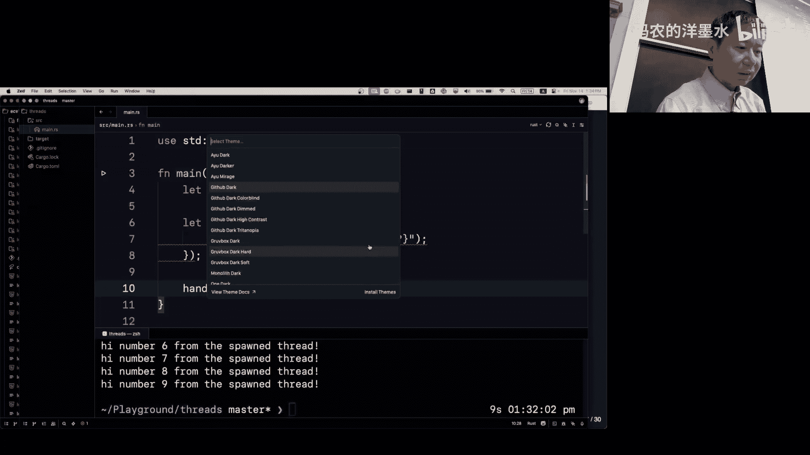
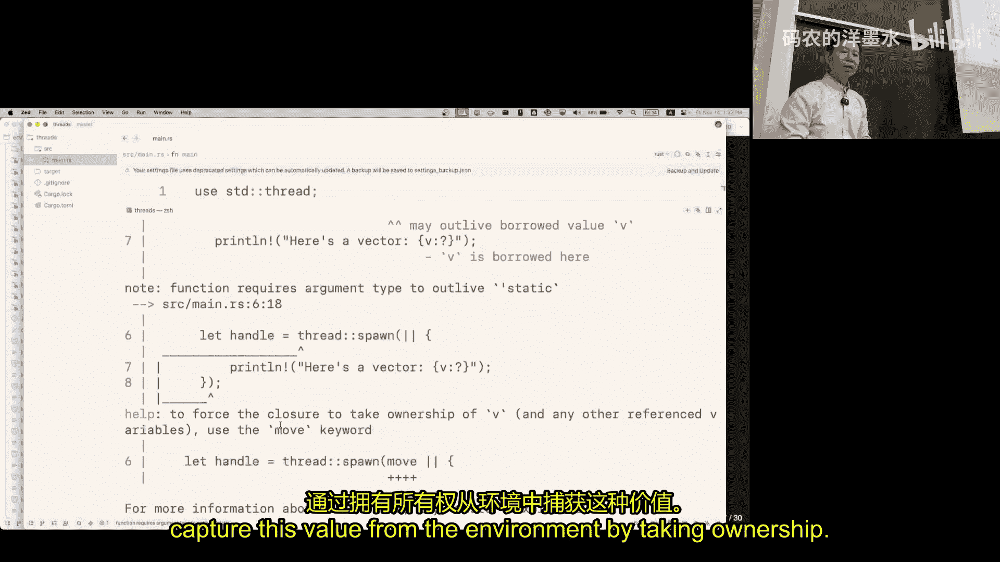
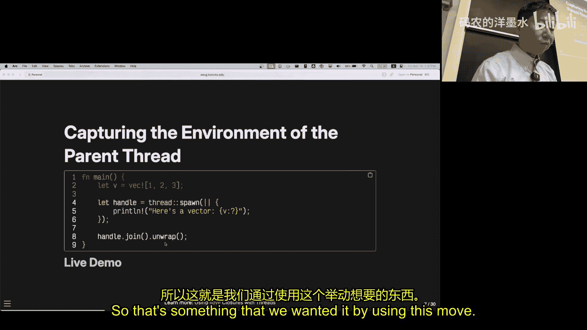
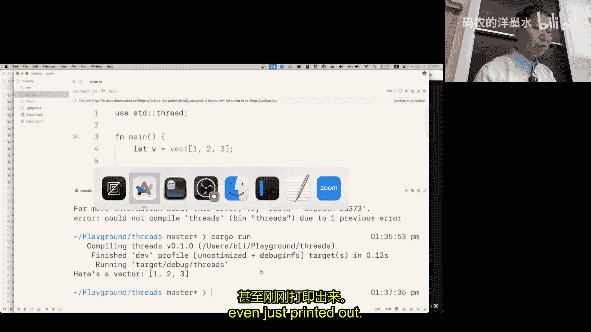
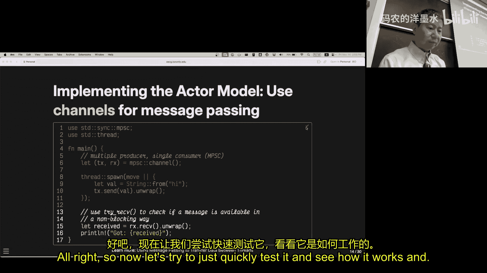
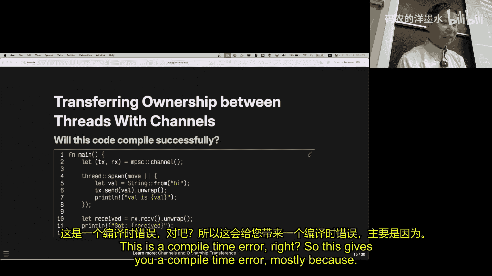

# 017：无畏并发 - 线程 part1

在本节课中，我们将要学习Rust中并发编程的基础知识，特别是线程的使用。我们将探讨Rust如何通过其独特的所有权模型和类型系统，将许多传统的运行时并发错误转化为编译时错误，从而实现所谓的“无畏并发”。

## 概述：并发与Rust的解决方案

上一节我们介绍了智能指针。本节中，我们来看看并发编程。并发对于Rust至关重要。今天我们将开始讨论并发，但无法在一次课程中完成所有内容。我们将分为两部分，第一部分是关于线程。

在Rust中，你可能听说过“无畏并发”这个术语。这有点夸张，因为我们仍然对并发心存敬畏。换句话说，Rust虽然解决了很多过去四十年来编程语言设计中的问题，是我们目前拥有的最佳方案，但我们仍有许多需要考虑和小心处理的事情。因此，它并非完全无畏，但我们仍要开始讨论。

在Rust 1.0之前，设计者们曾认为可以分别解决内存安全和并发这两大难题。然而，他们最终发现，之前讨论过的所有权模型（这在Rust中相当独特）加上极其严格的类型检查，结合一些额外的思想，或许也能解决许多与并发相关的问题。这仍然不是完全无畏的，我们仍需小心处理某些问题，但它比其他语言要好得多。而且，我们不需要在所有权和严格类型检查之外引入大量额外的并发系统。今天我们将看到这方面的例子。

许多运行时并发问题，如竞态条件等，过去令人头疼，因为它们发生在运行时且难以复现。现在，得益于Rust的所有权模型和类型检查，它们变成了编译时错误。这是前所未有的最佳方案。每当开始涉及并发时，例如Python 3.14最近引入了真正的多线程编程，一旦开始共享内存，就会遇到并发问题，而这些问题是过去四十年的运行时难题。Rust提供了你能拥有的最佳方案。

Rust并非第一个思考此问题的语言。例如，Erlang、Pony和Go语言都考虑过。Erlang是最古老的语言之一，由一位博士生在1998年创建，其博士论文旨在创建这种新语言，其基本思想是施加编程层面的约束，以减少运行时的并发错误，使并发更安全。Pony也有类似理念。

然而，尽管使用这些语言（包括Go）能更好地解决并发问题，但它们通常伴随着性能上的权衡，有时速度不够快。我们通常希望鱼与熊掌兼得，既要有并发安全性，又不想有或只有极小的性能损失。我们想要一种在开始时不给强加限制的语言，希望在设计时拥有很大的灵活性和自由，而Rust能够做到这一点。接下来我们将讨论Actor模型。Erlang和Pony都强制使用Actor模型，Go也很大程度上强制了Actor模型，即只允许在Actor之间传递消息。

但在Rust中，我们不做这样的强制。我们允许实现Actor模型，但如果性能损失更小、速度更快，我们也允许线程之间直接共享状态。这就是与Erlang、Pony和Go相比，Rust的优势所在：它不仅支持Actor模型。

## 并发与并行编程

在深入讨论线程细节之前，我们先谈谈并发和并行编程。我们稍后会再次讨论这个问题，以便更好地理解多线程编程。

并发编程意味着程序的不同部分独立执行，但可能不是同时进行。它们可以是同时的，但只是独立的，所以不一定精确同时。

并行编程则意味着程序的不同部分、不同逻辑确实同时执行。例如，如果你有多台计算机，每台运行自己的程序，那肯定属于并行编程。

通常，并行编程是并发编程的一个较小子集。当我们说“并发”时，意味着它可以同时运行，但不一定必须同时。所以它可能不是同时的。这有点令人困惑，因为并发编程就像它们是独立的，但可以或不必同时进行；而并行编程基本上要求必须同时执行。目前我们不想深入这些细节，稍后再谈。但现在，当我们谈论“无畏并发”时，我们指的是更大的图景，即并发编程的图景，它可以包括并行编程，也可以包括运行完全独立但可能不同时的程序。它们可能会轮流执行。我们稍后会讨论。但目前，当我们谈论无畏并发时，我们指的是并发编程或并行编程，因为并发编程包含了并行编程。

## 线程基础

现在我们来谈谈线程。你可能需要复习一下操作系统课程中关于线程的内容。显然，线程意味着我们同时运行代码。这里的“同时”我指的是并发。所以它们可以是并行的、完全同时的，也可以是轮流执行的，基本上就是并发编程。我们使用多个线程来实现并发编程的概念模型。我们允许多个线程并行同时执行，但这也会导致微妙的问题。

这些问题在典型的操作系统课程中是常规主题。通常，我们会花大约一周讲竞态条件，另一周讲死锁（这可能是防止竞态条件时产生的问题），再花两周讲线程同步问题，比如典型的生产者-消费者问题。当拥有多个线程时，我们需要在不同线程之间同步。所有这些在多线程编程中都会出现。如果我们不进行多线程编程，不共享内存，就不会有这些问题。如果我们只说多个操作系统进程，每个都有自己的地址空间，那么我们不共享内存。在这些情况下，我们确实没有这些问题。只有当我们开始共享内存时，才会出现竞态条件、线程同步问题、死锁等各种问题。

Rust显然支持多线程编程。标准库使用所谓的**内核线程模型**，有时也称为**一对一线程模型**。你也可以使用第三方crate引入其他线程模型，但Rust标准库默认的是内核线程模型，这基本上意味着Rust中的每个线程都对应Linux操作系统内核中的一个任务。所以Rust中的每个线程对应Linux内核中的一个任务。这就是我们通常所说的一对一线程模型。

内核线程模型在现代操作系统中非常典型。Linux内核使用一对一模型，macOS使用一对一模型，Windows也使用一对一模型。所有其他操作系统的历史模型已不再使用。

## 创建新线程

现在让我们尝试创建一个全新的线程。我们在讨论闭包时见过这段代码，但在展示代码之前，我们想说明这是来自Rust标准库的。我们基本上是说`std::thread`，然后调用`thread::spawn`，这是thread库中的一个关联函数。我们向它传递一个闭包。我们传递给`spawn`函数的是一个闭包，这显然是一种轻量级函数，我们将用它作为这个特定线程的起点。

在这个例子中，这个闭包将有一个for循环，它会打印，并在每次打印之间睡眠一秒。这就是闭包所做的事情。在`main`函数中（显然也是主线程），`thread::spawn`会生成新线程，所以那是主线程。主线程中我们也会有另一个for循环。我们当然也可以这样做。

让我们尝试运行一下。



以下是创建并运行线程的代码示例：

```rust
use std::thread;
use std::time::Duration;



fn main() {
    thread::spawn(|| {
        for i in 1..10 {
            println!("hi number {} from the spawned thread!", i);
            thread::sleep(Duration::from_millis(1));
        }
    });

    for i in 1..5 {
        println!("hi number {} from the main thread!", i);
        thread::sleep(Duration::from_millis(1));
    }
}
```



运行此代码，你会看到主线程和新生成的线程都在运行，并且是并发（或并行）的。每个线程都会打印一条消息，然后暂停一秒，再打印下一条消息。这些消息看起来是交错的，因为它们并发运行。

这些线程在哪里运行？显然，它们运行在我们的CPU核心上，而且不一定使用同一个CPU核心。因为我们使用的是内核线程、一对一线程模型，意味着我们映射到一个内核任务，而一个内核任务不必与另一个内核任务共享同一个CPU核心。它们实际上可以分布在不同CPU核心上。即使像我现在的笔记本电脑，也至少有10个核心（4个性能核心，6个能效核心等）。所以我有足够多的核心。如果你有两个线程，它们很可能运行在两个不同的CPU核心上，但它们仍然共享相同的虚拟地址空间，这就是线程的特点。



## 使用Join Handle等待线程



刚才，我们实际上有了生成线程的最简单想法，就是让它运行。但我想通过创建一个**连接句柄**来改进那段代码，这个连接句柄方便地是`spawn`函数的返回值。所以无论`spawn`函数返回什么，都将是连接句柄。在我的主线程末尾，我可以尝试`join`。当我调用`handle.join()`时，我是在尝试等待生成的（新）线程完成。有时我们称它为子线程，但这里我们就叫它生成的线程。我们想等待它完成。这是我们可以做的事情。因为`join`实际上返回一个`Result`，可能是一个错误，所以我将直接`unwrap`它。这就是等待生成线程完成所需要做的全部。这真的很好。

以下是使用`JoinHandle`的代码示例：

```rust
use std::thread;
use std::time::Duration;

fn main() {
    let handle = thread::spawn(|| {
        for i in 1..10 {
            println!("hi number {} from the spawned thread!", i);
            thread::sleep(Duration::from_millis(1));
        }
    });

    for i in 1..5 {
        println!("hi number {} from the main thread!", i);
        thread::sleep(Duration::from_millis(1));
    }

    handle.join().unwrap();
}
```

现在运行它，看起来非常相似。但我这里有一个保证：生成的线程将会完成。因为如你所见，生成的线程实际上有10次迭代。上一次运行，我们只允许少于10次迭代完成，因为主线程终止了。当主线程终止时，它生成的所有线程显然也必须终止。现在，我们允许子线程（或生成的线程）在主线程终止前实际完成。这是跨多个线程同步的典型做法。





## 闭包与线程环境捕获



我们看到了现场演示。现在让我们看看之前讨论闭包时提到的一个非常重要的细节。当我们讨论闭包时，我们谈到了捕获父线程的环境。但在这种情况下，我们在`spawn`函数中有一个闭包。问题是，我们能否在子线程中捕获父线程的那个环境？我们想这样做。例如，我不想在函数本身内部简单地打印任何东西，我想捕获父线程中发生的情况，那将是一个包含1到3的向量。我想打印那个向量，如果我们有能力从父线程捕获环境，那将很好。

让我们试试。这很简单。问题是，它能成功编译吗？

让我们试试看是否能成功编译。你怎么看？

我保存后，立即可以看到一些编译时错误。你认为，为什么，那里有什么错误？这个应该是警告，所以我需要去掉它。我们确实有一些错误。你认为那里可能是什么？让我们切换到亮色模式以便更容易看清。你认为那里可能是什么问题？

是的。新线程可能比主线程存活得更久。完全正确。当我们进行`spawn`时，内部有一个捕获环境的闭包。我们是如何捕获环境的？默认情况下，捕获环境的模式是通过不可变引用。我们基本上是获取一个不可变引用。这是默认的。显然，Rust支持所有三种方式：我们可以获取不可变引用（这是默认的）、可变引用，并且我们实际上可以进行所有权转移。我们可以转移所有权。所有这些都有可能，但默认情况下，如果我们这样做，它将是一个不可变引用。我们捕获的是对该向量的引用。这在这里不是一个好主意，因为线程很容易比实际的主线程存活得更久。你可能会说，不，不，它没有存活更久，因为我们那里有一个`join`。所以，你知道，我们正在等待另一个线程完成，但编译器不知道，对吧？所以在这个意义上，我们在这里做的是使用所有权模型进行检查。在这里，我们基本上说这可能不是，你知道……让我们看看这个问题。

所以我们基本上说错误E0373：闭包可能比当前函数存活得更久。这是我们的生命周期模型，当我们试图获取一个不可变引用时，它借用了当前函数拥有的实际向量。当你借用某物时，你借用的任何东西都不应该比原始值存活得更久。这不是编译器会接受的东西。它可能比这里借用的值存活得更久，因为它在一个不同的线程中。它有一条非常有帮助的信息试图帮你修复这个问题。

它试图说：帮助强制闭包获取V的所有权，使用`move`关键字。所以，如果你想获取这个值的所有权（你应该这样做，否则它可能会比原始值存活得更久），你可能会使用我们之前讨论闭包时提到的`move`关键字，以不同的方式捕获它，通过获取所有权从环境中捕获这个值。这就是我们想通过使用这个`move`来做的。所以，再次强调，这是我们可以做的事情。

让我们试着快速移动它。如你所见，错误消失了。`cargo run`将能够通过获取所有权来捕获并打印出来。这是我们可以做的事情。

现在，正如我们在讨论`thread::spawn`中的闭包时提到的，这是非常典型的。事实上，这实际上是我们获取所有权最普遍的方式之一。在其他地方使用闭包时，我们通常不获取所有权。但在这种情况下，我们通常确实获取所有权，因为否则我们无法对这个特定的向量做太多事情，甚至只是打印出来。这不是我们想要的。

## Actor模型与消息传递

好了，这就是通过`move`获取环境所有权的解决方案。现在，我们来谈谈**Actor模型**。Go语言创建时，我不是它的忠实粉丝。我不喜欢这门语言，我认为它实际上比Rust差得多。所以如果你同意我的观点，就不要用它。

但它的文档中确实有一条好建议，那就是：**不要通过共享内存来通信；相反，通过通信来共享内存**。简单来说，不要共享内存来通信，而是通过通信来共享内存。这是基本思想，是你必须记住的东西。早在1998年，人们就在博士论文中强调了这个思想。大约十年前，人们在Pony中创建了一门全新的语言来强调这个思想。Go实际上将其作为语言的一等公民，只是为了强调你不应该共享内存。

所以，如果你开始共享内存，如果你真的需要共享内存，你必须非常仔细地思考那个设计决策。或者在当今世界，如果你开始使用大语言模型，而大语言模型生成了很多共享内存类型的代码，你必须质疑它。如果你采用那种代码，它很容易失控，很容易开始表现得非常奇怪、不可预测等等。过去四十年来所有关于并发的问题都会在你开始共享内存时发生。相反，如果你开始使用Actor模型进行通信，那将是一个更好的设计。

唯一的缺点，正如我们之前提到的，是性能上的权衡。在某些情况下，我们称之为特殊情况，我们可能想要共享内存。因为我们希望在线程之间共享状态的最快方式。在那些情况下，你不想承受性能损失。你希望共享内存，因为你想要最快的性能。只有在那些有限的情况下，你才想共享内存。否则，你就使用通信。

所以，如果大语言模型给你，你知道，10000行代码都在做共享内存的事情，你必须质疑它。你必须挑战大语言模型。有些大语言模型，如果你挑战它们，它们会给你更好的方案。如果你挑战它们，它们可以写出更好的代码。这就是设计发挥作用的地方。所以我们想正确地设计它。

这就是我们引入Actor模型的时候。我想在整个图景的早期就介绍这个，在我们深入讨论更多关于线程的内容之前。我想谈谈Actor模型。

Actor是基本的构建块。你可以把Actor看作一个线程。所以一个Actor就是一个线程。你知道，那基本上是有状态的，并且它可以通过状态运行其逻辑。所以它是一个Actor，但它可以实现为一个线程。它不必实现为一个线程。稍后，我们将讨论异步编程。但现在，它可以实现为一个线程。

它是并发计算的基本构建块。现在，这个线程有状态。然而，状态是完全私有的。所以你不会有任何共享的状态。这就是为什么我们说，通过通信而不是共享内存。这个Actor中的所有东西都是完全私有的。当你实际尝试使用这个Actor模型来构建更复杂、更复杂的系统时，你所做的是让这些Actor相互对话。所以这些映射的Actor，它们将相互发送消息。

如果你想从Actor外部改变一个Actor的私有状态，唯一的方法是向它发送一条消息，然后让它自己改变其私有状态。你不会做任何其他事情。没有其他方法可以访问那个状态。访问状态的唯一方法是发送一条消息。所以你会从其他Actor发送一条或多条消息。所以这是Actor。这是另一个Actor。这些是只能向这个特定Actor发送消息的Actor。当然，我们也可以来回发送Actor消息。但这是从我自己的Actor的角度来看。

发送消息有时在编程中我们称之为句柄，但这并不重要你如何实现它。但，你知道，这基本上只是向这个特定Actor发送消息的一种方式。当然，我们可以发送不同类型的消息。我可以向Actor发送多种类型的消息。

如你所见，这实际上是一个非常简单的模型，概念上非常非常简单。你知道，你不允许做任何其他事情。你不能通过直接访问那个Actor来修改状态。你必须向它发送一条消息。当我们说“发送消息”时，我不是在谈论调用函数。我指的是通过一个叫做**通道**的东西真正发送一条消息。

这是向那个特定Actor发送消息的机制。所以我们必须有一个通道来发送消息，而不是说我要假装发送。不，我们要通过一个通道真正发送它。当然，通道是两个Actor之间共享的东西。但通道唯一能做的就是作为消息的队列中继这些消息，并确保它们被正确中继。这就是通道将做的事情。就这些状态而言，我们无法做任何其他事情。所以没有任何形式的内存共享。Actor模型消除了对基于锁的同步、竞态条件、死锁等任何问题的需求。所有这些都完全消失了。为什么？因为我们不共享内存。

如果有的话，这应该是你的默认模型。你不应该使用共享内存作为默认。这应该是你在并发方面的默认模型。

## 通道：消息传递的机制

现在，让我们来谈谈这些通道。通道是一个通用的编程概念。我们可以有各种不同的通道，通过它数据从一个线程发送到另一个线程。

一个通道，正如你可以想象的，会有两半。一半是**发送器**（或多个发送器），另一半是**接收器**（或多个接收器）。如果我们开始可视化通道，我们可以看到我们可以有一个通道。所以这是一个通道。我们可以有一个或多个发送器，以及一个或多个接收器。所以这是这个特定通道的概念模型，取决于你想要什么。根据你想要的不同语义，可以在Rust标准库或第三方crate中实现。在Rust生态系统中，有许多不同种类的高效通道实现。但根据你的需求，这是你理解通道的实际思路。

发送器有点像河流的上游，你在河里发送橡皮鸭，而河流的下游就是接收器。你也可以认为这是一个通信通道，就像通过网络一样。无论你怎么想。在通道内部，显然，你可以有一个队列。所以在通道内部，你有一个像这样的队列。这是你通道内部的队列。这个队列，再次取决于你想要的语义，可以是一个**有界容量队列**，也可以是一个**无界容量队列**。对于有界容量，好处是你知道会消耗多少内存，所以如果不想为该通道消耗大量内存，你可以有一个更紧的界限。对于无界容量，好处是你不会最终丢失或无法将消息发送到通道，你总是可以成功发送，但缺点是如果你不小心，内存使用量会随着程序运行而越来越高。这是你必须考虑的事情。

这就是通道内部的队列。如果发送器或接收器中的任何一个被丢弃。在这种情况下，如果我们有一个接收器，接收器被丢弃了，那么我们基本上认为通道是关闭的。这就是这个通道的语义。非常简单的想法。

我画了一个通道的典型例子，即**多生产者、单消费者**通道，基本上是多个发送器，一个接收器。你当然可以有超越这个特定想法的东西。但这实际上是最普遍、最常用的。Rust标准库为多线程编程提供了这个。当然，如果你只有一个发送器，你也可以使用这个通道。它不会损失任何性能。如果只有一个发送器，那没问题。这是多生产者单消费者通道的特殊情况。你也可以有多个消费者。换句话说，你也可以有一个多生产者、多消费者通道，这也是可能的，但Rust标准库默认不提供，其他第三方crate可以支持。你也可以有一种叫做**一次性通道**的东西，基本上它是一种特殊的通道，你只能发送一条消息。然后，完成，通道就完成了。你不能再做任何进一步的操作。当你有一种请求-响应编程模型时，这非常有用，因为你的响应可以很容易地也是一个请求，但很可能响应可以很容易地是一个一次性通道。所以你可以建立一个一次性通道来等待那个响应。这是你可以做的，通常在性能方面开销更小，性能更好。所以与典型的MPSC通道相比，开销更便宜。但这是最典型的。所以在大多数情况下，可能95%的情况下，我们使用MPSC通道没问题，而且性能超级好，因为它针对我们的使用进行了优化。

Rust标准库为多线程模型提供了一个MPSC通道。所以这来自标准库`std::sync::mpsc`。我们只需调用`channel`作为一个关联函数，它会返回一个元组。我们只需要解构这个元组，就能得到发送器和接收器。

你可能会说，哦，那只有一个发送器。如果我想要多个发送器怎么办？你怎么想？它只返回一个发送器。如果我想要多个发送器，我想要多个生产者、多个消费者。我只想要多个生产者，我只想要多个发送器。但现在它返回一个发送器和一个接收器。我想让多个发送器向这个通道发送。我想要什么？我该怎么做？是的，完全正确，你只需克隆它。所以这是一个非常简单的概念模型。这是一个非常便宜的克隆。显然，返回的这个发送器可以被克隆。接收器不能被克隆。所有这些从MPSC的语义来看都非常好。你只需克隆它，它将被用作共享同一通道的额外发送器。这真的很好。

你可以有一些发送和接收的方法。所以你可以说`tx.send`、`tx.try_send`、`rx.recv`、`rx.try_recv`。所以有两个变体：`send`和`recv`，与`try_send`和`try_recv`。这两个变体都有它们的用例。所以我们实际上可以同时使用这两个。这两个都返回`Result`，因为尝试向通道发送时可能会有错误。显然，当你有错误时，你知道，如果是`try_send`，可能很容易是因为通道已满，你想向一个已满的通道发送。如果是`send`，当通道关闭时可能会有错误，那么你就无法发送。

这两个变体之间的区别在于，`send`和`recv`是**阻塞**的，意味着它们会阻塞线程的执行，然后等待直到通道有可用容量或变为非空。当我们向通道发送时，我们希望有可用容量。如果没有，我们就在那里等待。当我们从通道接收时，我们希望通道有东西可以接收，即有人向它发送了消息。当它完全空时，我们等待直到它变为非空。这是一个非常简单的语义。通常我们使用那个，因为那是我们习惯的。我们想说，阻塞这个特定线程，直到我们可以完成这个操作。所以这通常是我们想做的。

然而，虽然不典型，但有时我们确实想要非阻塞变体，即`try_send`和`try_recv`。`try_send`和`try_recv`非常有帮助，因为它们是**非阻塞**的。如果发送或接收失败，它们会立即返回一个错误。有时我们想要非阻塞，因为我们还有其他事情要做。我们不想，你知道，在那里等待。我们在那里还有其他事情要做。所以在这个意义上，我们想使用`try_send`和`try_recv`来获得非阻塞版本。所以实际上有一个可用的两个版本是很好的，这样我们可以选择使用哪一个。需要非阻塞版本的情况相当罕见，但有时我们想要，我们想继续，在同一任务中做其他事情，当我们开始讨论异步Rust中的MPC通道时，这非常典型。当我们谈论异步Rust时，语义在多线程与异步编程方面完全相同，我们在那里仍然有通道，但实际上更典型的是，当我们使用异步Rust时，由于某些原因（我们稍后讨论异步Rust时会谈到），我们开始使用`try_send`和`try_recv`。但现在，有两个变体供你选择。所以这是一个你可以选择的很好的菜单。

## 使用通道进行消息传递

现在，让我们尝试通过扩展之前的例子来使用通道进行消息传递。我们之前的例子只是简单地创建了一个多生产者单消费者通道。但现在让我们尝试使用`thread::spawn`创建一个线程。我们想说，让我们尝试发送一条消息。那条消息只是一个简单的字符串“hi”。我们想把它发送到那个特定的通道，只需调用`tx.send`然后`unwrap`，基本上获取结果并解包，如果结果是错误（例如通道关闭），它将会panic。在主线程中，我们可以通过获取通道的接收端来接收，然后调用`recv`。这是一个阻塞版本`unwrap`。然后我们接收它。所以每当通道里什么都没有时，就在那里等待。主线程将在那里等待，直到通道里有东西。然后它会取出并得到接收到的消息。它将把它打印出来。如果你不想接收，你可以把它改成非阻塞版本。但在这种情况下，显然，我们想要阻塞版本，因为我想把它打印出来。

现在让我们快速测试一下，看看它是如何工作的。

以下是使用通道进行消息传递的代码示例：

```rust
use std::sync::mpsc;
use std::thread;

fn main() {
    let (tx, rx) = mpsc::channel();

    thread::spawn(move || {
        let val = String::from("hi");
        tx.send(val).unwrap();
    });

    let received = rx.recv().unwrap();
    println!("Got: {}", received);
}
```



运行此代码，我们将看到预期的结果，即我们在主线程中接收到的消息。在接收到该消息之前，主线程不会终止，因为它将在该通道的`recv`上等待。我们不必通过`join`来等待线程，因为我们只是使用这个非常方便的通道语义在不同线程之间同步，这是我们推荐的。

当然，这不必只是一个简单的字符串。你实际上可以有Actor并将其扩展到结构体、不同类型的消息等。正如我们提到的，接收和发送消息的句柄等等。所有这些都是可能的。所以我们实际上可以尝试将其扩展到一个成熟的Actor模型。


## 所有权转移与通道



现在，让我们稍微改变一下代码。问题是，这段代码会成功编译吗？现在，唯一的区别是我们在发送之后有打印。所以我们想在生成线程的闭包中，在发送之后打印这个值。这段代码会成功编译吗？你怎么想，这段代码会成功编译吗？我们想打印这个值。在我们把它发送到通道之后。不。所有权已经转移。它在通道里了。所以这是Rust的一个亮点。很多人说Rust只是另一种语言。我提到过，你知道，就像，这只是又一个。不，这正是你需要使用Rust的地方。因为这是一个编译时错误，对吧？所以这给你一个编译时错误，主要是因为所有权模型的便利性与通信通道相结合，这样你就可以轻松地，将运行时错误转化为编译时错误，这样你就不必共享状态等等。你只需发送通道。而且，你知道，消息实际上没有被复制，而是所有权被转移到通道中，然后最终转移到接收者。所以这是我们拥有的东西。如果你在发送后立即开始使用它而没有克隆，它会给你一个运行时错误（抱歉，是编译时错误）。编译时错误基本上说这基本上是`String`类型，所有权被转移了。它没有实现`Copy` trait。这就是为什么你不能在移动后使用它。这是非常重要的一点。这就是我们通过将所有权模型与通信通道相结合而利用的优势。所以，我们没有复制字符串，我们基本上只是转移所有权。这真的很好。

## 总结


本节课中，我们一起学习了Rust并发编程的基础，重点是多线程。我们探讨了Rust如何通过所有权和类型系统将许多并发错误在编译期捕获，从而提升安全性。我们学习了如何创建线程、使用`JoinHandle`等待线程完成，以及闭包在线程中捕获环境时需要使用`move`关键字来转移所有权。我们还介绍了更高级的并发模型——Actor模型，其核心思想是“通过通信来共享内存，而非通过共享内存来通信”。最后，我们学习了使用`mpsc`通道进行线程间消息传递的基本方法，并看到了所有权如何与通道无缝集成，确保数据安全转移。下一节课，我们将继续探讨更复杂的并发主题。