# 【全集 附课件】多伦多大学 使用Rust构建高性能软件系统 中英字幕 1080P p01 Lecture 1 - 导论 -BV16V62BhEuf_p1-

I'm gonna start recording right now and let's switch to the slides so welcome everybody to this course this is the EC 1724 which is a special topics on software engineering course and we're going talking about rust in this entire term and this is the second offering of the course it was first offered last year and it was the first offering of anything related to rust actually in Canada and in the United States there are like a few more offerings of the rust course and today we're going to get started talking about some of the logistical issues related to the course。

 some of the administrative issues and then towards the second half of the course we're going to head straight into the programming language and we're going get something done today。

Now， before we get started， talking about the course， I just want to talk a little bit about myself。

 Anybody can recognize the programming language that I used here。What is the programming language？

Javascript， exactly。 This is jascript。 We're going to get back to this language a little bit later today。

 and。Rather than hello world， I'm putting in hello， my own name。

 which is Baochun Li and 30 years ago， exactly 30 years ago。

 I got my bachelor's from Tsinghua University 25 years ago。 my PhD from Illinois， Urban and Sha Pay。

 been there， I've been here since that time of 25 years。 I be fellow 15。

23 CE fellow and EIC fellow 24。 My research interests are kind of broad talking about things related to cloud computing。

diistributed systems， distributeded machine learning systems in particular in recent years。

 fundamental issues related to computer networking。

 a lot of topics related to computer security and more recently privacy。

 especially privacy preserving protocols related to machine learning。

 a lot of the things that I've been doing over the past 25 years and most of the work is done by a very small research team。

 about 22 of my students， including postdoctoral fellows have become professors around the world。

 mostly in Canada， the United States and Hong Kong and my vision for my research is to somehow bridged the gap between theoretical advances and real world practical hands-on systems and real world practical systems。

 would be something we're going to be interested in starting from today in this particular course with the rust。

Programming language。 here's my website。 And if you're interested in my papers。

 you can feel free to download my papers from the website。And now let's get into the course itself。

For this particular course， we have a title， we have a fancier title。

 kind of performanceant software systems with rust。

 but the basic idea here is that we want to build some of the modern software systems by modern。

 I mean， we really wanted to get down to some of the last performance benefits of our hardware of our modern computer hardware。

All the way from in by the systems， IoT systems， all the way into GPU powered servers in data centers。

 so to do that my personal opinion is that we're going to have to use rust which is our language that we wanted to talk about in this course and we wanted to understand rust but we wanted to go into depth and we want to develop a practical hands-on and in-depth understanding of this particular programming language and how do we actually use this language to develop real- worldl modern software systems and so that's what we're after in this particular course。

And。To do that， we wanted to first try to talk about why do we actually pick rust。So。

We have three lecture slides in related to this particular question。

 because we do have a lot of answers to this particular question。

 The first bullet that I have here in this in these slides would be rust is going to be。

Producing reliable software systems。And the very first thing that it actually guarantees is something called memory safety。

 And they knew what memory safety really means。So what are the errors that we can prevent if we're talking about the memory safe system。

 yeah。The what。Exactly， so if we're trying to use a particular piece of memory after it's freed up。

 we probably wouldn't call it memory safe， right， It's not safe。

 but that kind of mistake happens quite quite often if you're using a language that does not guarantee memory safety and obviously there are a few answers。

 few examples of that would be something like C C plus plus or anything。 you know in that regard。

 So memory safety， something we're gonna guarantee and we are not allowing anything that is using any memory after free。

 we don't want double pointers into a piece of memory。

 you know we wanted to have no bugs related to memory usage。 So in other words。

 if you're have if you're used to things in C and C plus plus something called cord dumps or segmentation faults or things like that in Linux。

 we don't have any of that。Rust。Now， the other requirement of reliability is something called threat safety and threat safety is kind of higher up in terms of requirements。

 memory safety is the basics and threat safety is good to have。

 but you know in modern enough software systems， it's almost like a must have as well together with memory safety。

 So threat safety is about concurrent programming。 if you have you know multiple threats or in rust。

 we're gonna to talk about something more advanced than threats called coroutines。

 if we have multiple of these threats or coroutines。

 You wanted to make sure that concurrenrency can happen without runtime errors。

 In other words the code that you have in multiple threats。

 they can progress concurrently without worrying about runtime problems that you typically worry about if。

You are using a programming language such as C++。That does not have guarantees of threat safety。

So in rust， sometimes we call it fearless concurrency in the sense that we can write concurrent programs without much fear。

 we probably can still make mistakes from time to time， but way。

 way fewer kind of mistakes guaranteed by the language compared to C or C++ so this is something that we're going to have to support as well and one of these kind of threat safety issues at runtime would be something called race conditions which if you actually have had operating systems course you will typically see that we will have kind of race conditions if we are not very careful locking the critical sections of the code。

 and that would be something related to threat safety and in rust， we have no race conditions。

And the third kind of requirement of reliability is the use of static types。

 So previously we have shown you a hello Bran program and that one is done in JavaScript and JavaScript doesn't have static types we do have static types or quasiy static types in the C programming language but it's not really you know very strongly enforced in by the compiler by the C compiler in rust。

 not only we have static types， which means that every single variable will have to be typed and on top of that we have very strong extremely strict enforcement。

 we will see that later on today by the rust compiler and that's something we're gonna to have to pay attention to to actually get our reliability。

闹。We also try to achieve all of these three bullet points。By having a very strict compiler。

 so a strict compiler is going to convert all of our runtime errors regarding memory safety related to threat safety。

 related to anything related at runtime。Most of them， as much as we can。To compile time errors。

 Allright， so that's something we wanted to have。 and that's something we get from the rust compiler。

 Rus is a relatively young programming language started in 2015， which is about 10 years ago。

 and only got mature since about  five years ago，2020 and 21。

 And we actually got a very good compiler in Ru。 And we're gonna see examples of that today as well。

😊，So why rust， Well， additional reasons why we care about this language so much that we need a new course for it is that it is highly performance。

 It's extremely fast。 It is so fast that you don't worry about any penalty in terms of performance compared to a conventional language designed for performance。

And the best example of that would be C， C would be extremely fast。

 and it's the code benchmark every single language when it's designed。

 it will be compared with C in terms of performance and rust is as fast as C in after it's compiled。

It also had full control over low level details， just like C， no problem with that。

 so in terms of superpowers， it does have the superpowers。

 the same kind of superpowers as the C programming language。Now， we also have no。

Garbage collectors Now garbageage collectors would be a modern invention about 20 years ago when you have Java。

 you start to have garbage collectors and that were carried all forward with Javascript， you know。

 and also more recently， the go programming language。 these garbage collectors。

 they are typically okay until you try to do something that is fast。

 So until you try to design a highly performance software system。

 then it's gonna to kick in and try to slow you down。

 the best example would be if you use go as the language to develop a web server。

 typically it's gonna to work well， it's gonna be very nice actually。

 but you know if you want it to have the best performance ever。

 the garbage collector is gonna kick in every hundreds of milliseconds and that is going to slow down just by a slight sp。

When it's actually running。So that's something that the rust does not have。

It also had very much minimized memory footprint， just like in C and the memory that it it's tried to use。

 as we mentioned， had full memory safety guaranteed。😊，Finally， and last but not the least。

 we have something pretty modern。 We have something called corouts。

 and this is designed to be faster than threats when we actually try to do concurrent programming threats would be obviously supported by rust and corouts are supported since about five years ago since 2020。

2021 time frame and not only corouts are supported， which is like a lightweight threat。

 you can think of it as a faster version of threats。

 but also it is the faster alternative of the implementations of corouts。

 There are two different kinds of corouts would be something called stackbased and something called stackless and。

Stack based routines are typically done by implemented by conventional languages such as go。

 which is designed to support co routines， these lightweight threats。

 but you know the better version which is stackless does not even require stacks。

 you know when theyre implemented and that is a little bit faster just a little bit。

 a little bit faster and requires less memory footprint。And this is actually supported by rust。

 Rus had a pretty peculiar way of supporting these co routines。 is's actually very advanced。

 so advanced that we may not even have time to cover that in this particular course。

 We're gonna see how many lectures that we have you know that we can actually cover these advanced topics。

 But you know this is one of the main reasons why we use rust for highly performant software systems such as web servers that are extremely scalable。

 we need these co routines to be really， really fast。And the corouts would be a very good reason。

 And one of the nice features of rust to my， to my best knowledge。

 only the only other programming language that supports stackless cor routines in the past five years would be。

😊，Any ideas？C plus plus C plus but would be the other language that supports stackless proteins。

 but you know in terms of the support， I'm not a big fan of that language。 This is much better。

Final slide about the actual advantage of rust。 However why do we actually try so much time spend so much time learning rust。

 It has the world's best ecosystem and tooling。Not one of the world's best。 the world's best。

 There's nothing that beats its ecosystem and tooling by ecosystem。 I mean。

 the third party frameworks， or you can call them libraries that are designed by you know。

 other developers who are， you know， having same similar interests of using this language develop real world systems。

 They develop lots and lots of extremely high quality libraries。

 and they're supported by some of the world's biggest companies， such as Amazon， By ends， you know。

 Google， Me， all of these large large。Companies， they actually support teams that actually you know try to write these thirdpart libraries in the ecosystem and the tooling is really nice as well。

 The tooling means for example， how do we actually manage our packages， inside the ecosystem。

 the frameworks that we have how do we actually try to make sure they are properly used by our code。

 and that's something that sounds easy。 you just import the code。 you know import the library。

 but it's not that easy because the code might be dependent on some of the other code。

 This library might be dependent on the thirdpart library somewhere else， each piece of library。

 each framework each library can be dependent on hundreds of other libraries and the versions could be much very much in the conflict with each other how do you manage the package dependencies。

 the versions， the hardware requirements and so on and so forth。

 All of that would be a major problem in other languages。As。Python， for example。

 it's still being improved。 but over the past 10 years。

 Python had pretty bad tooling in terms of the using the tools to manage the package dependencies。

 Ru is the world's best in this particular case。So it has also on top of that。

 surprisingly useful compile time error messages。 And this is something of the topic we're going to cover today。

 We're going to talk about compile time error messages。

 and it also had the cargo package manager and crates do Io。

 which is sort of like Pip in Python you know that manages packages or you know Py P in Python crates do I is like a web server or web system managing all of the packages that are publicly available。

 and that's something that is very much mature。 There's still a few minor issues here and there。

 but it is the world's best。 You cannot really have a perfect package management system。

On top of that it has very good documentation。 The documentation is typically on docs。 Rs。

 each one of these packages had very good documentation。

 It has a very good system of generating that documentation automatically from commons in the code。

 All of that would be a part of kind of like a nice addition to the language and why we actually learn rust So by this time I hope that you are convinced。

 in fact， I hope you're convinced at the time when you're selecting this course。

 and I hope that you are interested enough to get into this particular course， which by the way。

 is quite a big challenge's it's a hard language to learn and we're going to talk about that later on。

 but here's what we do intend to cover we're going start from very beginning。

 we don't assume that you have any rust background or any background related to you know other systemsoriented programming languages such as。

C and C plus plus you know， the only requirement is probably you should know a little bit about Python。

 probably Java good one of these two I mentioned E 244。

 which is C plus plus programming fundamentals in the undergraduate program of the department but this is not really essential if you don't know anything about C plus plus that's gonna to be fine we can still learn a lot from the basic programming concepts。

 but we're gonna go quite quickly from into the basic programming concepts。

 and then we're gonna move on to some of the major topics of rust and starting from ownership ownership is a unique model programming model it's a mindset in fact。

 that is unique to rust the only other language that is recent that actually had the idea of ownership enforced by the compiler is something called Mojo which is kind of designed for machine learning and it's a compiled language as well but rust otherwise。

It's one of the only languages or one of the very few languages that being enforce the ownership mindset。

 You're going to have to have this mindset when you program。Now we wanted to coverstructs， enums。

 they are everywhere in rustt，structs and enums， they're not just Cstructs。

 not just something that's simple， it's a few values that you choose in between those values define those values in enums knowstructs and enums are extremely powerful in rustt。

 especially enums， the power of enums is not to be underestimated。

 it changes the mindset of programming， other languages they don't use enums that much， in fact。

 in go programming language it doesn't even have enums。

 so you're gonna to have to somehow emulate enums by yourself。

 but in rust we have this as one of the basic programming concepts in rust that we support in by the compiler。

Options and error handling using the result type， that's something that we're going to have to cover as well because error handling is always a sore point in all programming languages and that includes C plus plus Python。

 all of that whenever you have an error how would you handle this do you try do you catch do you do finally you know all of that would be a problem a major problem in rust you know we have our own way of handling errors using the result type and we're going to talk about that？

And we also wanted to talk about some basic data structures that we often use， vectors， hash maps。

 slices， strings， these are offered by the standard library， and of course。

 additional data structures I offered by the tons of additional third party libraries that you can easily just import using the the package manager。

 the cargo package manager。And and then we're going to move forward onto to something a little bit more advanced。

 we're going to talk about generics。Whi its offered by other languages but kind of not really that often used。

 but it's more often used in rust。 We're gonna talk about traits。

 which completely changes everything。 It changes the mindset of programming This is similar to you know the protocol in Swt or kind of similar to interfaces in Java but you know much more powerful。

 This is something that is replacing the objects in C plus plus In fact， in rust。

 we don't have object orientation at all。 We don't support object orientation。

 Ru developers do not like object orientation Ru designers they don't think object orientation is a good idea。

 In fact， they think it's a bad idea So what they did is that they took the good ideas out of this and put them into traits and throw away the bad ideas so we don't really have anything like classes objects all of those are bad ideas。

We're going to throw them out and we're going to start， from scratch。And on top of that。

 we have one additional idea that we're gonna to have to spend a major lecture talking about。

 which is lifetimes。 and lifetimes would be something that is a very unique idea in rust。 However。

 it is essential for memory safety。 Lifes difficult to understand but you gonna have to understand it。

 just just appreciate the beauty of how rust actually manages memory safety。

 This is something that typically we don't bump into。

 but once we are so advanced and we need to bump into this。

 Even your typical artificial intelligence。 AI models will not be able to handle those things。

Allright， and on top of that， we do have functional programming supported by rustT as well。

 not just you know basic programming Procedural and so on。 functional programming。

 we support that using closures and iterators。 and that's a completely different mindset and rust obviously is a multipar programming language It supports both procedural and functional programming language。

 It doesn't support object are reiented， but functional。 it does support It's a good idea。

 So we do actually want to support that。 And we want to mention that in our course as well。

And on top of that we have to understand and rust typically do not use heaps manually so typically you don't directly use heaps like in C++ you kind of mall。

 you free and so on and so forth， typically we don't use heaps by ourselves we do use heaps but typically we use the heaps by using third-party libraries and they manage the actual memory for us。

 but if we are kind of developers of third-party libraries or we're doing something really advanced we do want to manage data on the heap and those would have to be managed by advanced ways of doing this using smart pointers and those are to ensure memory safety and performance at the same time so we do want memory safety。

 we want performance we also want flexibilities so we want superpowers All of that would be done using smart pointers and these are some of the advanced topics in rust that we're gonna to have to mention。

We also if we have time talked about fearless concurrency related to futures and related to Staless routines。

 if we don't have time， we're going have to skip those and last but not the least we're going to talk about the best practices of writing rust programs。

 something called idiomatic rust we have to become so-called rusty So if you're rusty。

 you are kind of idiomatic in rust programming and also design patterns as well。

 like good ways of writing rust programs and those are some of the things that we're going to have to you know really get into in this particular course is a lot of。

Things that we're going to have to learn。 Very challenging。I hope you're prepared for it。

Just a little bit additional selling point right here。

 I believe personally that rust is the programming language。

 the programming language for the next 40 years， and I'm going to tell you why today。

 and this is why we need to spend some valuable time in this term learning this particular language。

First of all， it is both a high level language and a low level language。

 C is more like a low level language。 Python is more like a high level language。

 We can do rust in both high and low level。At the very low level if we need performance。

 we can actually code InRt for platforms like web assemblyly platforms。

 which basically is like like a low level code for the web browser。

 we can actually write code for containers in the cloud。

 we can write code for bare metal chips that is so close to bare metal it also something that supports all three elements that we wanted。

 we want it fast。High performance。 We wanted。Reliability， which we mentioned in memory safety。

 threat safety。 we also wanted productivity in the sense that we wanted to do it fast。

 We want to really be productive in programming and rust gives us productivity。

 And the reason for that is mostly because of reliability because we don't have a lot of runtime errors。

 If it actually compiles it runs without runtime errors。

 and that is beautiful because typically you have at least a few thousand lines of code。

 probably tens of thousands， hundreds of hundreds of thousands of lines of code。

 if you actually have runtime errors， it's gonna take forever to debug even with AI models because AI models will probably not be able to do much help you much in terms of debugging runtime errors。

We have fearless concurrency that we' are going hopefully talk about。

 have time to talk about in this course， and that's something we mentioned is going to give us the kind of performance because with high performance with today's multicore GPs multicore CPUs and GPUs。

 we need concurrency we need to do concurrent programming and concurrent programming basically means that we want to really fire up all of the core routines。

 thousands of them use up our CPUs， use up our GP course and so on。

 and that's something that rust can actually support。

 especially on the CPU Ru is trying to make some progress on the GP side， but especially on the CPU。

 we will actually support concurrency。Here's a recent example。

One of my favorite Cs related to AI models is the codeex， C， I。 How many of you have used codex， C。

 I。😊，codex， great。 I'm pretty sure a lot of you might have heard about it。 but this is from。

 you know， the great company Open AI， obviously， but it's not really very easy to use in the first iteration because in the first iteration。

 it was implemented in Tpescript and it wasn't very good and it lost the battle to clots cloud code C O I。

 So Kox C I was previously implemented in Typescript。 And as of two months ago。

 the team realized that it should not be done in Typescript。 So it was reimple in rust。

And and it was released， the very first rust powered version was released last month August 8 together with G5 and the performance is just way better as reported by the users online so this is one of the more recent than one of my favorite examples that rust really pushes the envelope in terms of performance and it's the programming languages choice by open AI and you know XAI for G and so on and so forth。

 lots of examples for you know anything related the machine learning we need performance and rust is our pick for performance even just to implement a CLI a command line interface and here's kind of interesting just the sidebar story about the slides so the slides are designed so that first of all it's just HTML you just go to the website you just open it up。

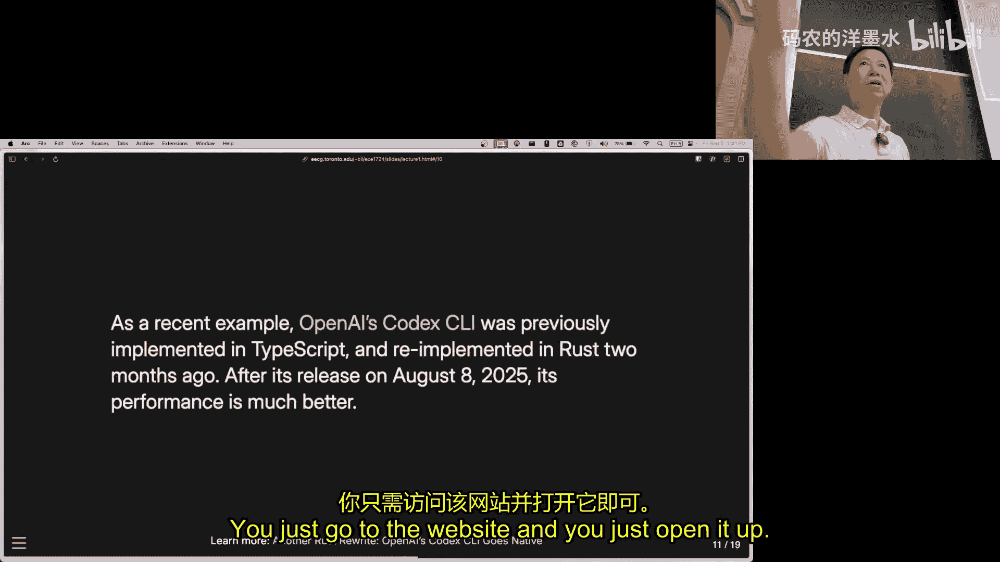

There's no PF download， and there's a little bit of， you know。Navigating sidebar here。 And。

 and one more thing， you know， each one of these colored part of the。

 the actual text in this blue color， light blue color。 you can click on it。 And once you click on it。

 you will be able to open a website。 So that's， that's pretty nice。

 And here we have learned more and the， the footnote。

 And that would be sometimes a nice link right there。 In fact， a lot of times。

 a nice link right there， which is a link that you can learn more。 for example， here。

 you could actually click on this。 and will give you you know。😊。

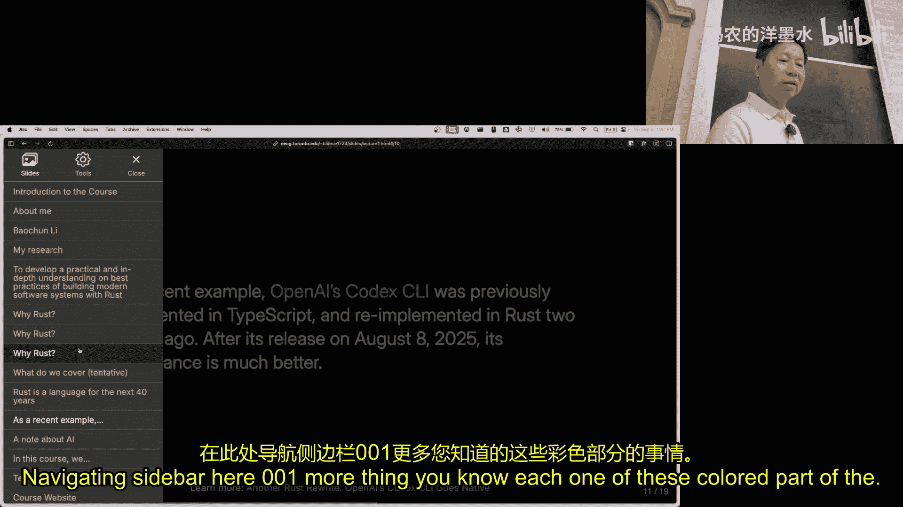

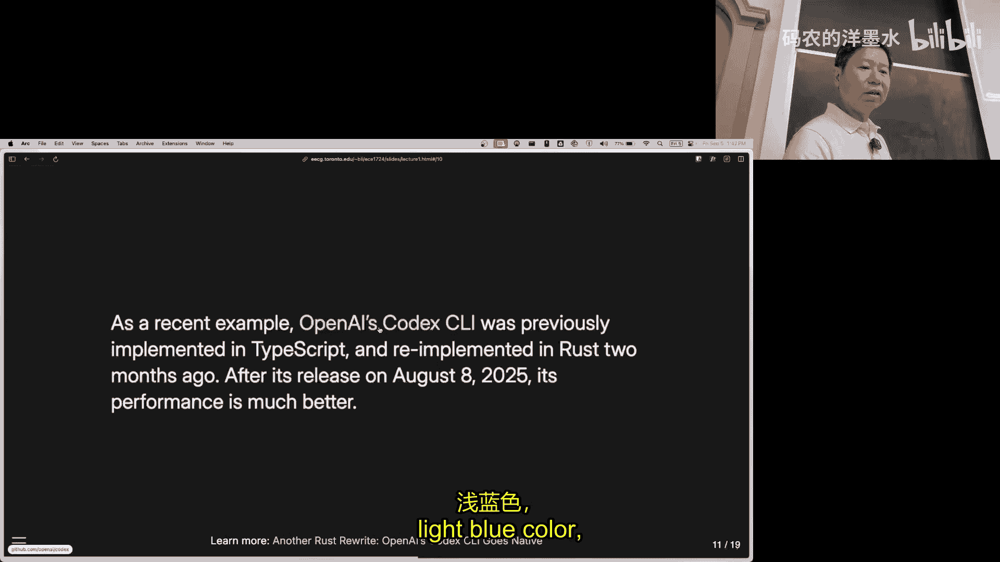

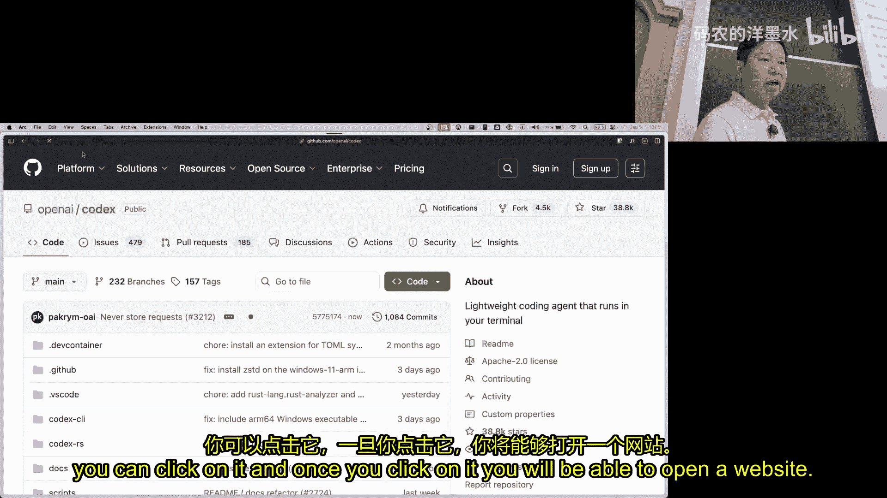

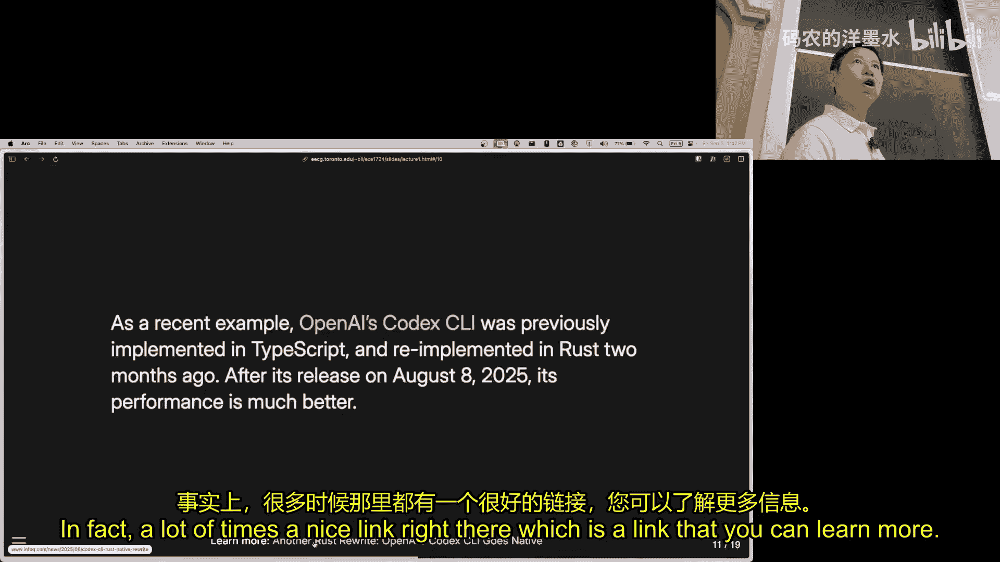

Some of the。Some of the websites that I picked in terms of further reading related to this rust rewrite of open AI's codec Ci。

 So typically， the link and learn more would be related to the actual content that we are talking about in this particular slide。

 So you just need to go into that website to learn a little bit more。

 So that's a nice feature in this particular set of slides。

 And the slides that I'm using is exactly the slides that you will be seeing in the course website as well。

 In fact， this is directly loaded from the course website。

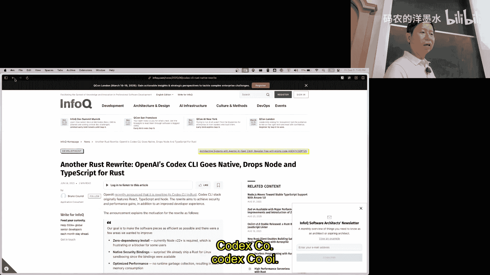

So here's a little note about artificial intelligence today。 we're in this big era of AI。 obviously。

 everybody you' gonna have to talk about AI and is using AI and so on so forth。

 And AI has been widely known to be super effective as a coding assistant A lot of people say that it actually replaces junior programmers or intermediate programmers or things like that。

 here here are two stories one is there's a recent interview by at Anthropic for one of the cofounders there I think in the interview it was mentioned that 80% of the code in Anthropic is written by Anthropic's own AI。

Alright， and another kind of startup company called amco do co。

 I'm not sure if you have heard about this。 it's an interesting company。

 This company is trying to say it's gonna give you a COi's a command line interface。

 but as there are tons of COs out there a few dozen different COs。

 but the features supported by this particular COi is that it will not give you any flexibility in terms of using models。

 it will just pick the models automatically by itself。 In other words。

 you cannot feel free to use this model， this model。

 it will pick the model for you based on the company's own taste on what would be the best model for your task。

 So it basically is trying to package all of the world's models and give you the best and what you pay for would be the API keys of using these models it will not charge you a cent more compared to what the model providers charge you。

So this is something that is nice to have， obviously， if you are interested。

 you can give it a try and a recent interview there with cofounders of M code。

com saying that 95% of the code at M code is actually written by AI as well。So you might say， well。

 if 80% of the code and 95% of the code is written by AI， why do I need to learn programming， Well。

 it's because 80% and 95% is not 100%。And that will leave 5% to 20% of the code。The cream at the top。

The hardest。Would be still left to human beings。 So we're gonna still have to do the essential 5% to 20% of the coding。

 at least today。 And my prediction is gonna be for the foreseeable future， as well。

And the reason for that is because that regardless of how powerful AI is in terms of planning。

 architecting， writing the code based on the architecting plan。

It will still not be able to beat human programmers in terms of innovation。

 So humans are best in terms of regional ideas， innovation。 So AI has a tons of experience。

 It's able to tackle problems based on that experience， but it's not able to innovate。

 It's not able to create new ideas。 And that 5% of the code requires new ideas and innovation。

 and that would be the part that we need to do。 In other words。

 using AI would be very much beneficial， but still we need humans to do it。

 And this is especially true for rust。 because maybe for Python， you just need 1%。 for rust。

 you probably need 20%。 if you ever tried using AI to write rust， you will see that， you know。

 it it fails。with higher probability compared to Python with Python， pretty much you can write AI。

 use AI to write code， you know 99% of the time it's going to be correct。

 you don't even have to worry about it， but for us。

 a lot of the cases the code does not even compile。It doesn't even compile。

 It doesn't pass compile time checks because we do have a strict compiler。

 And if you send the results back to the AI or if you use a gen coding。

 the AI is going to compile by itself and it's going to try to say， oops。

 my apologies we're going have to do it again。 so we're gonna to fix the compilation errors in all lot of cases it's going to fix them but in a few cases it not able to fix these problems because the design is wrong。

And so that would be some of the problems of using AI for rust。

 and the problem is amplified because rust is a very hard language for humans。

 and it is also a very hard language for AI as well question。パイ%セ。Because just on of white。やは。

Sometimes。第一次说。So there could be a few reasons why theres still 20% or 5% that is left that for humans。

 But most of the one reason would be that you mentioned that could be less lack of data for the latest and greatest way of writing code。

 but that is not a major deal these days。 AI can actually do web search and things like that。

 and to you know， remedy that situation。 But the problem here that is， you know。

 especially in terms of rust。 Sometimes we need a design。 And that design is not just any design。

 There could be a few different designs。 I need the best design， best possible。

 And that kind of design requires innovation， requires a originality。

 And the way large language models operate is that they predict the next tokens based on the best experience。

 And that would be a design， one of the potential designs。

 It might actually work80% of the time or 95% of the time。 It actually works， but。

In a lot of the cases。When it doesn't work， it will get stuck。 And even when it works。

 it may not be the best design in terms of performance。

So a lot of the things that we still have to care about。And。The bad news is that。

In order to get that 5% of the code written by humans。You're gonna have to be better than AI。

 You know， that's the bad news and to be better than AI。You know， it's hard。

 You have to know the finest detail of the language in order to innovate。

You really have to understand the language， the features， the finest details， just to innovate。

And that's something that sort of like with， you know， using AI。

 you have to have the data set in order to write good code here。

 the same thing in order to innovate and have that original idea in terms of design。

 you will have to learn a lot。 You have to learn at the finest detail， not just at the high level。

And that's something that is sort of like a catch 22， because if you use AI。

 it's going to supply you all of the finest details， or you don't have to learn about them。

 but if you don't learn about the finest detail， you cannot finish the final 20% or 5%。Right。

 so in other words。The project is not done。If you don't learn about the finest detail。

 But to learn about the finest detail， you have to give up on AI to learn the finest detail。

 This is kind of a catch 22。 And this is， especially the case in rust。

 And that's probably a problem here。😊，Now， in this course。

We want to talk about not just making any software。We want to make perfect software。

 We want to talk about making fast， highly performance software using rust。

 And in this particular case， AI is not yet able to offer us。This particular piece of software。

So if it is able to offer us， I don't know  five years later，10 years later。

 then I will cancel the course。 we will just use AI to do it。 But for now。

 at least based on my personal experience， I use all of the best frontier models I use cloud code。

 codex AI sorry Codex CO I using P5 pro everything I use and it's still not still not able to help me finish my code when I need to。

Because of the challenges that I have in my projects。 and in order to try to finish those projects。

 we need rust， and we need to learn about this particular language and to finish that top 24。

And now getting into administrative issues related to this particular course， we do have a textbook。

 you probably want to read it almost cover to cover。

 It is the best textbook related the programming languages almost in recent 10 years。

 It's the Ru programming language or sometimes we call it the book。

 and this is something that you're gonna have to read。 reading this book is a joy， It's a pleasure。

 It's an enjoyment， and this is something that I hope you will enjoy reading You cannot just learn about the language without reading this book。

To motivate you to read this book。Our coverage of the actual in this course of the course lectures。

 we're gonna follow the book very， very closely。 I'm going tell you exactly which chapters and which sections of the chapters that we have covered。

 and you can read just those chapters and those sections if you wish。

 but I would highly recommend you to read the entire book。 It is kind of long， but， you know。

 it's the only book。 So we don't have to read two books and three books。 So it's still feasible。

 and it's very much a enjoyable thing to do question。😊。

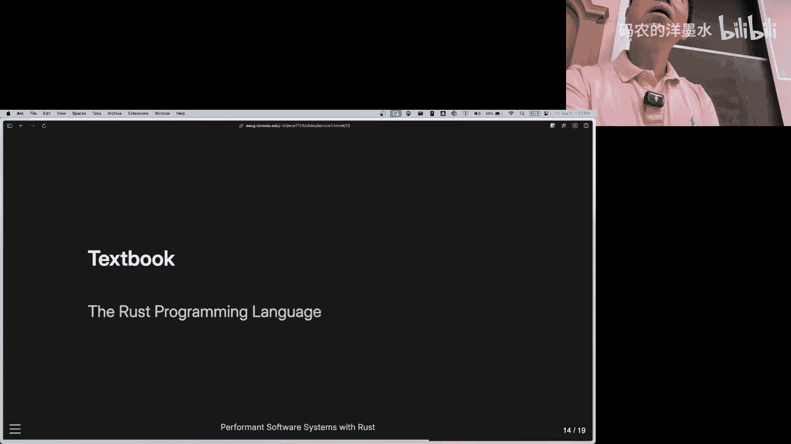

Oh， how much does it cost， Well， it costs nothing because all you need to click on this and it's there。

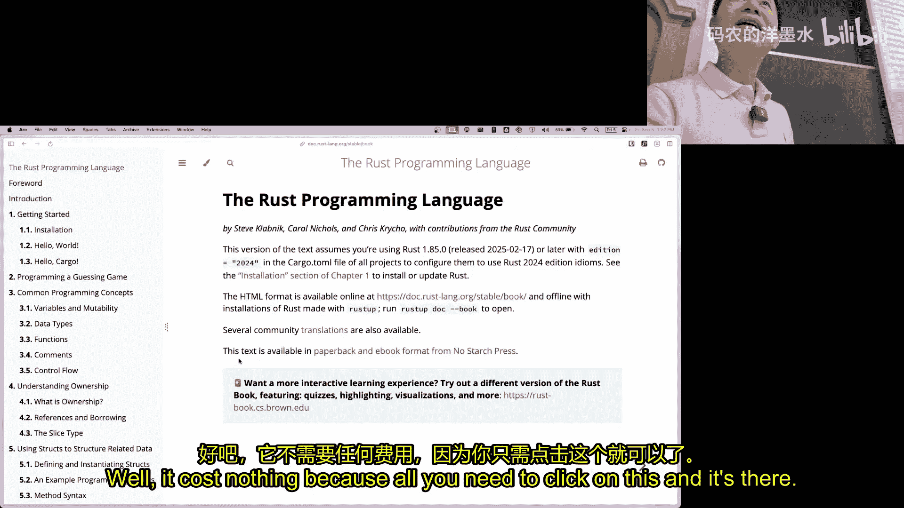

Right， so it's， it's online。 and it's also available offline as well。 We're gonna talk about that。

All right， so this is something that。Also， we have a course website。

The course website right now its this particular link。 You can click this link。 I hope it works。

 Yeah， it does work and。We have the in the course website， the the course syllabus。

 if you actually take a look at this course website， we do have a course syllabus。

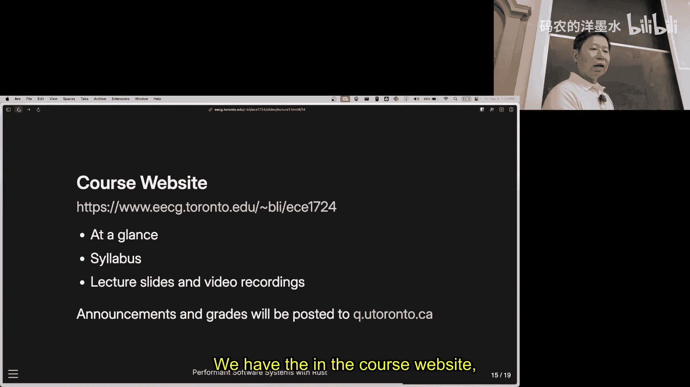

Right here。Well course syllabus and the course syllabus contains all of the information about this particular course。

 A lot of them were， we don't want to spend time talking about。 But today， but obviously。

 you can read about this。 the course syllabus。 and we do have a。Of courseour。

 overview right here in terms of the deadlines and grading policies and so on。

 and that's something we're going to have inside the course website。

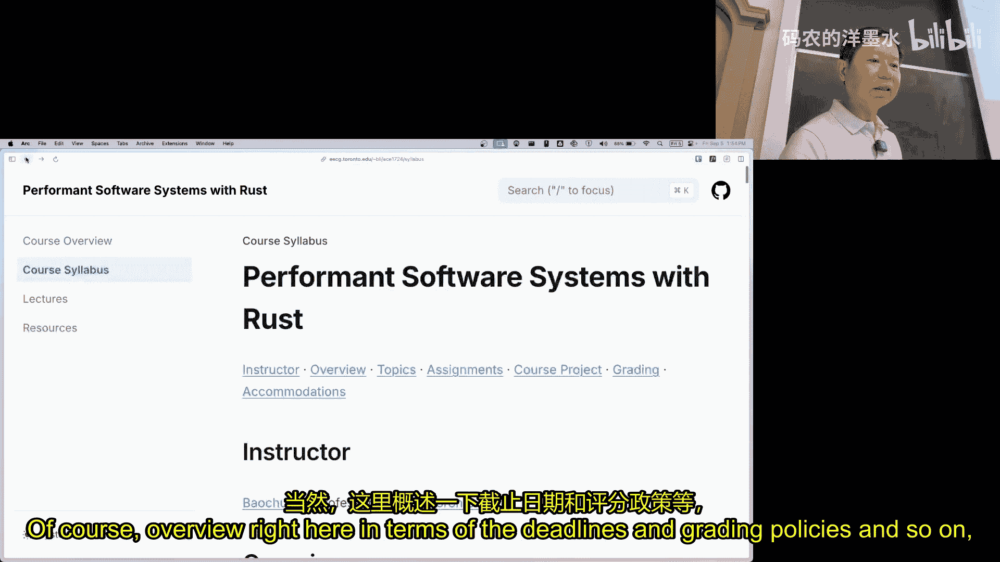

All of the lectures I'm trying to record as much as I can。

 sometimes I make a mistake you know setting up the hardware。

 but I try to make no mistakes I try to be able to record all of the video recordings and upload the video recordings to the course website right after the lecture。

 the lecture slides are typically available before the lectures but they are up to they're tentative。

 they could be modified before the lectures but they're typically just HTML so you know they will be live and in the course website so in the course website we go in go the lectures and just go introduction to the course and it will just get to exactly what we have been presenting。

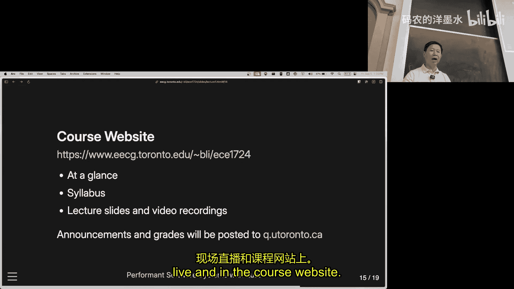

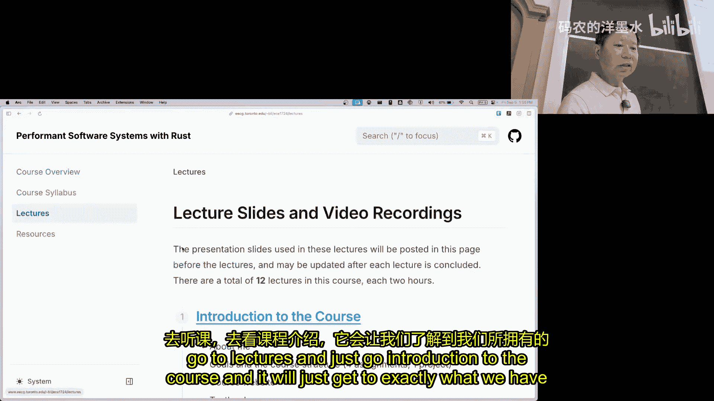

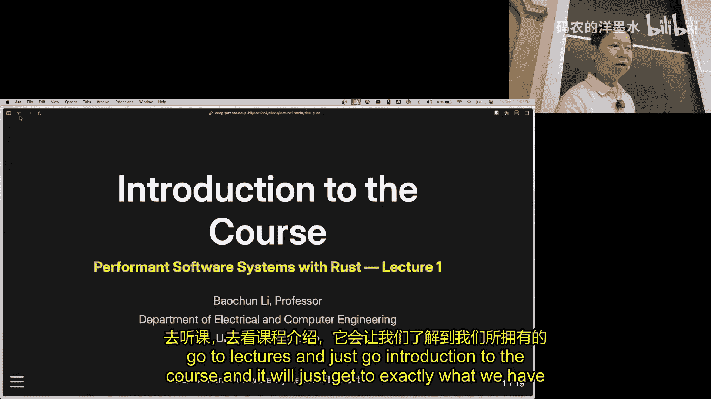

And for example， the next one would be right here learning rust the hands on way。

 So you get the second episode right there inside the course website。

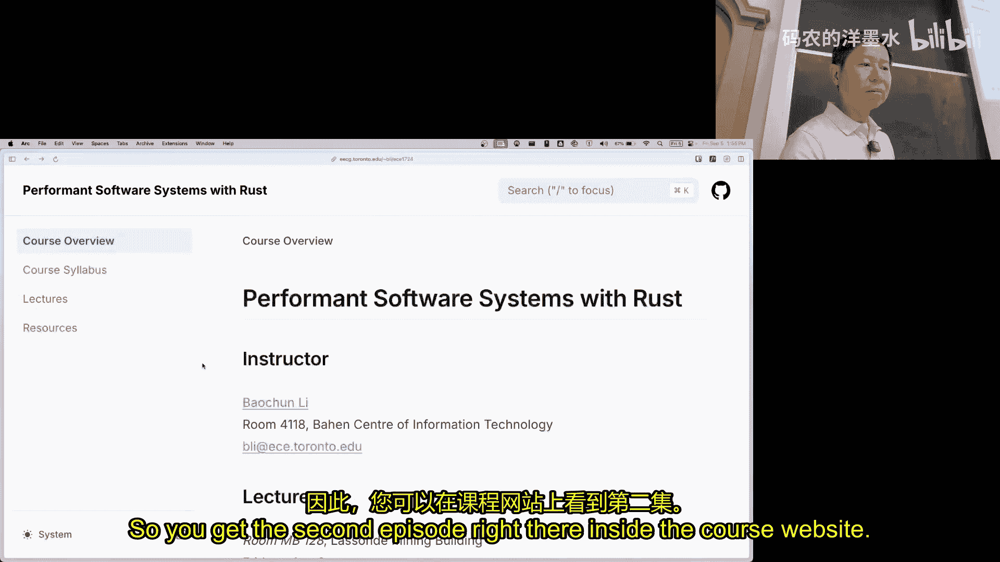

And。The announcements and the grades will be posted on caucus。

 The announcements will be sent by email， obviously， to you as well。 grades will be posted。

 We do have a T A who will assist us in terms of posting these and grades。

Now let's get into a little bit of detail in terms of the course syllabus。

 we do have an office hour every every week， one hour in my office on Mondays or by appointment。

We do have four assignments。Now， the first assignment is the reverse E board game。

 Second assignment is search utility。 It's a command line utility。

 Third assignment is a command line web client， just like curl and the fourth assignment is a high performance web server。

 Now， these assignments， By the way， They are designed。😊，To let you start from scratch。

 In other words， you don't have to have any background in terms of rust。

 You just start from the very first line of code。 You don't have to know anything。

 they're designed for you to start from scratch。And that is why I emphasize that you should not use AI。

Because if you use AI， it defeats the purpose， right if you need if you say， oh。

 I'm gonna take this course for credit and I use AI to generate the code for the assignments。

 Sure you get you get the marks。 but what's the point。

 There's no point because you gave up on well designedign assignments to help you facilitate the learning experience。

 These assignments， they're designed to be starting from simple ideas to something a little bit more progressively a little bit harder。

 a little bit harder， a little bit harder。 if you actually use AI， you can solve these things。

 no problem in the day less than a day a few hours You know。

 agent gentic can actually do it 10 percent， probably you know， most likely in like a few hours。

 But what's the point。 There's no point of doing that。

 And the reason why there's no point of doing that is that you basically waste the opportunity for you learn by handson experience and you will never learn if you don't have these handson experience from simple。

Ths， simple ideas。 And these are well handcrafted as simple things for you to build。 And， of course。

 you can use AI for it， but don't do it。Now。The marks， it's 45%。

 So the very first to 3 would be 10% each and then 15% for number 4。 for number4。

 we do have a little bit of competition and things like that。 But in terms of performance。

 that's why it has a little bit higher in terms of the percentage of the marks。 But it's fairly easy。

 All of these are fairly easy。 even if you code just by yourself with no AI。Now。

 some of you cannot live without AI， you know。Cannot live without it。 I can imagine that。

 And I can make an exception for you， which is code completion。

 If you actually wanted to use code completion。 F with me。 I highly recommend you don't do it。😊。

Because it's gonna to give you a lot of additional experience。 if you don't use code completion。

 These days， code completions are a little bit way too powerful。

 They basically give you like  five lines of code or even 10 lines of code。

 once you start to write  five characters。😊，And that is not the best idea。 Number one。

 you become a code reviewer rather than a coder， right， You're not coding。

 You're reviewing someone's code。 And， of course， you can tap， tap， tap and you get this done。 And。

 of course， use write the next line。 It will tap， tap， tap and you get it done。 Sure， you can do it。

 I would suggest turning it off。 Now， in your favorite code editor such as Vi studio code and so on。

If you turn off code completion， you will still get some code completion。

Which I don I think you have never tried， but it's kind of like a pleasant surprise。

 When you type in a function name。 If you complete a function name for you， you type in a keyword。

 it complete it will do something for you。 And that is called the language server。

 It's L S I language server interface。 And that's something that is provided you for free。

 even if you don't do code completion。 So if you turn off code completion。

 highly recommend great idea。 It's sort of like when you're you know。

 programming on the airplane these days， even on airplanes， you have internet。

 So that's not a best example。 But you know， on airplanes。

 I'm kind of too cheap to purchase Internet。 So I basically program on the airplane without any Internet。

 And I can actually be quite productive over hours of coding on the airplane。

 So no complete completion is not gonna be problematic for you。

 especially after you get used to it question。😊，Oh， the question is。

 are the assignments individual or are they allowing collaboration。 No， they are individual， They do。

 we do not allow collaboration。 Theyre individually completed。

 And they're kind of too simple in the sense that they should not be done using collaboration at all。

All right， in terms of Co。Question。两个有。The question is， can we use external libraries。

 We will talk about that in every single programming assignment。

 The handout in the handout will tell you， what are the libraries that you are not allowed to use if that is something that you cannot use。

 Otherwise， you can use any third party library， But we do actually try to suggest to use。

 some of the useful third party libraries in those handouts as well。Now。

 in terms of grading for these programming assignments， we because of the sheer size of the class。

 this becomes like  hundred20 students。 It's almost like a undergraduate class because of the sheer size of the class。

 we don't really have sufficient resources to do any manual grading。

 So we're gonna have to depend on。Depend on automated grading in the sense that we're gonna have to compare your output with the standard output。

 So we will have to have some test cases and some of the test cases are public announce to you and some of the other test cases are hidden test cases they will be used for grading as well。

 So you do have public test cases that you will receive at the time of assignment release。

 and we will use those test cases， and were gonna to use our own private hidden test cases as well。

 And basically your output is compared with the standard output subject to some relaxed requirements。

 for example， spacing and so on。 So that would be how we grade。Any questions about the assignments。

 y。Oh， the question is， what is the recommended I for us。 A lot of people。

 most people use visual studio code。 I find it too slow。 So I use Z。

 which is kind of like the Mac as， you know， Z would you know。That would be the Mac S version of。

You know， that's， that's what I have。 And so I use that。 And that's something that I， I use myself。

 By the way， Z is like an editor that is written in Ru 100%。 So， you know， super， super fast。

 way faster than visual Studio code。 And the complete joy to use。 Obviously。 So that's what I use。

 I don't use V S code for that reason。 But most people use V S code。

 And V S code is fine enough is very good。😊，Any other questions about the assignments？All right。

 if there are no more question， let me take， let's take a break for about。Probably7 minutes。

 And we're gonna resume at 2，10。

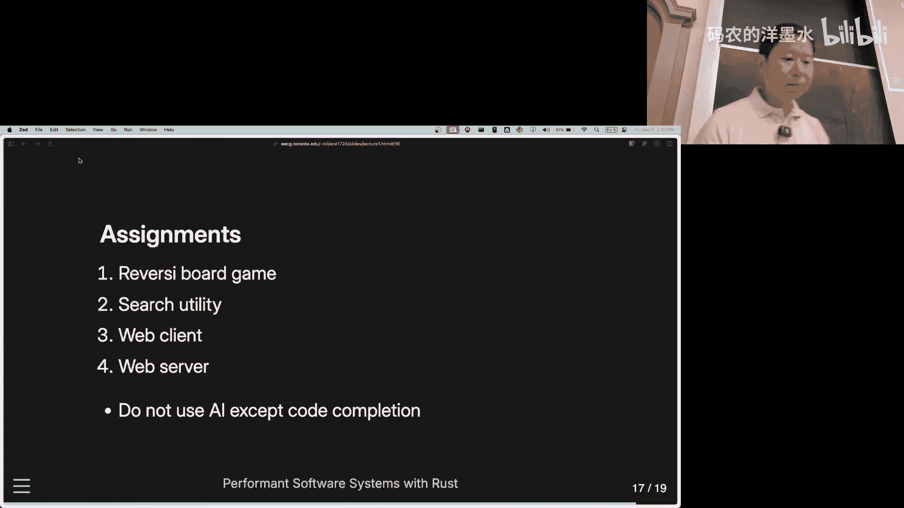