# 【全集 附课件】多伦多大学 使用Rust构建高性能软件系统 中英字幕 1080P p02 Lecture 2 - 创建、构建并运行第一个Rust项目 -BV16V62BhEuf_p2-

So let's get started again。Now， we do have a course project。

And obviously the course project is going to be another opportunity for us to learn about rust。

 course project is gonna to have a lot of substantial overlap compared to our assignments it's gonna take up probably two-td of our time in the course so gonna have to start early。

 we do have an early deadline in terms of the course project proposals。

 you're gonna have to think early as well what to do。 but the course project。

 the objective is to basically build something a lot better than what the assignments asked you to do。

 for example， something that is fast， that is performance。

 something that is like a nice software framework that is fast enough。

 typically it's done by a team of two to three students I highly advise that you go don't go below too。

 but if you want to do it individually you could but a highly advanced advice that you team up with someone unless you really enjoy。

Kind of solo time of， of doing it。 But we cannot go beyond three people。

 So three people is the maximum。嗯。All thirdpart frameworks from Cr do Io。

 the cargo package manager would be possible for you to use。

 and we will announce some of the inspiring project ideas for the teams to choose from very soon for now。

 you could actually try to start to team up。 and we will have a online discussion forum started we're gonna make an announcement about that。

 in terms of creating that online discussion forum。

 I'm very picky in terms of the piece of software that I use。

 So the only kind of online discussion that I enjoy working with or using would be Github discussions。

 So all of the other platforms， you know， Qrkas Piazza whatsoever。 the U I you know。

 is' not easy to use。 the UX is not that good。 So I'm not enjoy using those。

 So I'm gonna I created a nice workflow to create a private。😊。

Repository just to use the Github discussions， and you will be asked to submit your Github username as assignment 0 to Kius。

 And I have a nice script to actually import your your username into Gitthub so that you gain access to the private repository。

 Now over there， you could actually join the discussions。 You can ask questions about anything。

 And you can also try to use that discussion forum to find your team members if you need to。😊。

Alright， and the teams， of course， can use their own project ideas。 And， in fact。

 it is highly encouraged that you start with your own project ideas。

 We do have some minimum requirements in terms of these projects。

 in terms of the size of these projects。 We do require that for example， you'd have at least。

 it's not a lot， but it's at least。嗯。500 lines of code per team member。

 So if you actually have a team of three， you're gonna have to give at least 1500 lines of code。

 That's not a whole lot， but it's still something。 alright， yeah。

It does not include comments and does not include space empty。

 I do have a command line utility to help you to count the lines if。

 and we're gonna talk about it in， we're gonna include that in the project setting。

 in the project announcement。Also， I would highly advise just using the meaning using the the logic that we have announced just now for the assignments that you should not use AI to write new code。

 Now， of course， you could use AI to write new code if you are aiming for something like 10000 lines。

 you know， you really want to generate a lot of code。 But I highly advise that you don't do that。

 You know， the reason for that again， is because the projects。

 you're not really developing anything to be used in production。We are basically using this。

As the training wheels so that you could actually learn about rust in the quickest in the most efficient way。

 So if you start to use AI to write a code defeats the purpose， right it doesn't really make sense。

 However， you know just again， I'm going have to relax that a little bit， you know。

 because I know that all of you are addicted to AI so much that if you don't touch AI every day。

 it's like you didn't touch social media， So this is something that you could do。

 you could use AI to locate books， if you have a book you can use AI to locate bug。

 but even there I'm going talk about later today， I advise that you don't do it， you know。

 because locating bug would be a nice practice of understanding some of the language details and we're gonna to tell you that the rust programming language gave you a lot of help in terms of locating bug。

 but you know in terms in the case of bugs that are so elusive that you are not able to locate by yourself。

 you could use AI to do it。You know， it saves a little bit of time that's fine with me but。

We do have a requirement。 If you use AI to locate bugs， you know。

 you're gonna have to include the prompts that you use in the file， for example。

 cloth do MD or agents do MD and things like that。 And also the conversation histories that you actually had interacting with AI in your submission。

 and， of course， for course， projects， your submission will be just Github repository。

 either public or private， it's up to you。 And in your Github repository。

 you're gonna have to have conversation histories and your prompts in that repository。

 If you use AI to locate bugs。And that should be quite easy to do。

 You just copy and paste from your conversation now。The course project。

 we're going to have more details announced in the projects section of the course website right now it's not there。

 but we're going to have more details momentarily probably later next week before the next lecture。

Final reminder， academic integrity do not copy from the other students in terms of the assignments or provide your code to the others because in today's AI world。

 it is trivial to detect any copy。All I need is one prompt。

 And that's all I need to detect prompting to detect academic， academic integrity issues。

 I don't even need to write any code。 Allright， so now let's try to move on to。

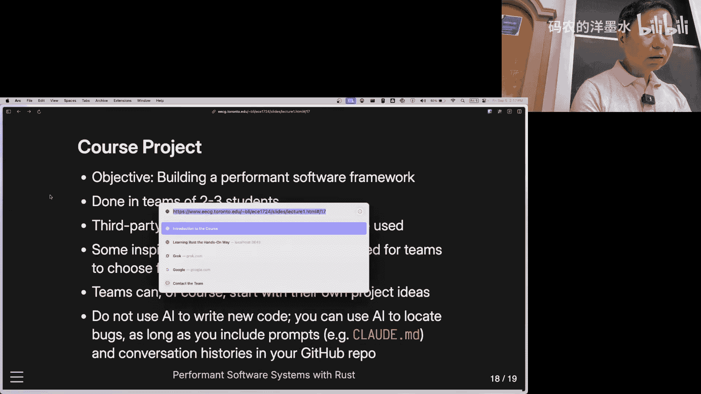

The， the next lecture， which is lecture number two， learning AI， not learning AI， learning trust。

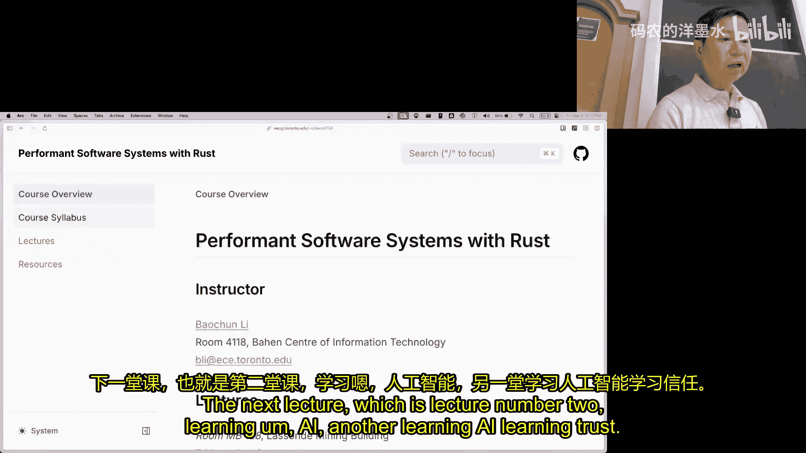

In the。In a hands on way， yep。Yeah， they have been posted， in fact， for this one as well。 you know。

 but they will be posted before the lectures so that if you have your computer。

 you could actually directly open it up， you know， before the lectures and during the lectures as well。

 But I advise you don't open up the slides during the lectures， because you don't want to look ahead。

 I do have a lot of buts。 And you wanted to make sure that you follow。You know， you。

 when you watch a movie， you never watch the movie。 You like read this， you know， the。

 the story of the movie before you watch the movie， you watch the movie。

 and then you read the stories in comments。 And that's what you do typically for this movie as well。

Alright， so lecture number two， we're gonna get into rust。It is， again。

 one of the most exciting languages in recent years based on my own biased personal opinion。

 And hopefully you're gonna agree with me by this time。 yet bad news。It is hard。

 It is a complex language。 It is a steep learning curve。 It is so hard。That。

You're gonna have to era some of the memory that you have previously learned from previous programming languages。

For example， object orientation， you know， that's something you should just erase from your memory。

 No more objects， classes， you know， things like that， not， nothing， inheritance， no more of those。

 It is something that changes the mindset of programming， ownership， lifetimes。

 all of those changes the mindset of programming。 So not only it is hard。

It it is something that it is probably not a good language to selfle to to teach yourself。

 even though obviously it's possible to teach us anything is possible to teach yourself。

 but it's always nice to have a little bit of help and this course is designed to give you that little bit of help so that you could actually try to learn in a nice way。

But I also got some good news for you， not just the bad news。 The good news is that。It can be simple。

If you learned。The language。The hands on。And what we mean the hands on way。

 And that's something I'm going to try to show you with life demo today and。

We're going to have to show you from an example， but I'm going to show you that rust has something that I call a super advanced。

Compiler。And one of the ways that it shows how advanced it is is that it's super， super friendly。

So not only it's advanced， it is also extremely friendly too。The compiler is so friendly to you。

 It feels like you're interacting with AI。You know， that's how friendly the compiler is。

Except that you have no access to Internet and have no access to any models whatsoever。

 It is just the compiler。Talking with you， conversing with you。

 And that's something that shows the superpowers of the compiler。 And that's something that is why。

 you know， this is good news。 This is something that you can learn。

 hand down way just by talking with the compiler。 And we're gonna show you how。😊，Now。

 this is not a case for the other languages。 In the other languages。

 the compilers are only responsible for giving you compile time errors。 And these errors， you know。

 Json decoding error， line1， no pointer exception index error， in file， whatever。

It is just not something that you like， that you enjoy reading for sure。This is cryptic。

 this is cryptic set of errors that the very first instinct response to these errors is that you're going to copy and paste these errors and put them into GT。

That's the instinct that you have because they're just so hard to wait。

And that is not the case for us。 For us， you don't have that problem。For us。

You're going have to read the errors carefully。Because the compiler is gonna be so friendly。

 It is gonna be your teacher。And the compiler is going to teach you rust。As a teacher。

 as an instructor。If you make mistakes， the compiler is going to tell you what these mistakes are in a lot of the cases。

 it will help you to fix those mistakes。In other words， it will just teach you how to do it in rust。

 and we're going to show you an example here。So， here's an example。

So we're gonna do is that we're gonna write some code。 but rather than rust code。

 We don't know anything Ru yet。 but assume I assume that you know jascript and javascript is very simple language。

 something that you can use to define a function here。 We have our hello function。

 We pass in the parameter name。 Baoron。 and it will just return Ho Baotraron。

 And the function is just one line of code， very simple。 It is valid javascript code。

 And this is actually the beauty of jascript。 Javavascript is a simple language。

 very easy to understand。 easy to write the code in。

 but obviously suffers from a lot of other problems。 that rust can fix。

 So let's just copy this code by clicking on this copy。Let's try getting to。

Let's just get into my favorite editor， which is that。So I'm gonna open the new window here。

And I'm not sure if it's easily readable。 Would you like， Probably something that is。

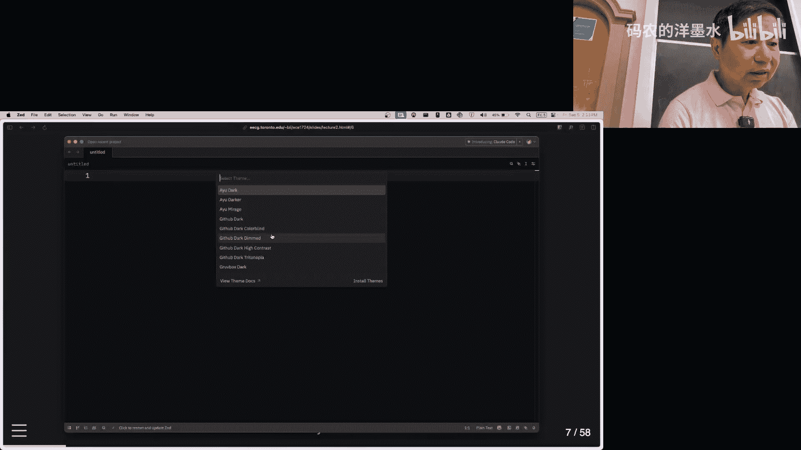

This is too dark， right？Let's try something light。My favorite light， light， you know。

 light scheme here。 So let's copy this code in。😊，And。Let's try to save this。

And let's try to save within just B， O I。 you know， let's call it save within rust main dot R S。

 And let's try to open a terminal。 And it's just try to say， okay， S main dot R S。

 So that's exactly right there。 So at main dot R S。 That's exactly our code。

 And then we're gonna try to compile it to compile the rust code。

Let's make it a little bit bigger to compile the rust code。

What we need is to just say simple compiler rust C， typically we don't do it。 but for now。

 this is sufficient to compile it。 So rust C main dot R S， that compiles the code。

So when you actually see the compilation result， you will see that it will give you a compile time error。

 Obviously， it's jascript code。 Russ doesn't understand Javascript code。 but， you know。

 it will tell you。Something called help。In fact， this entire thing is syntax highlighted。

It's really nice。 It give you the red， you know， the， the blue， you know， things like that。

 different syntax highlighted。 And on top of that， in beautiful ASi。

 which is basically means character graphics。 So beautiful ASi character graphics。😊，You know， dash。

 dash dash， you know， the under， you know， vertical lines and so on and so forth， very。

 very nice just to tell you， giving this help。Right F N， instead of function。To declare a function。

 That's really nice。 You know， it's almost like， you know， I'm， I know that you， you're not right。

 but I'm gonna to tell you why you're not right because function is something I don't understand。

 You need to write F N。 So that's something that we have， you know。

 this is the verbatim copy from that terminal live demo。 And。😊。

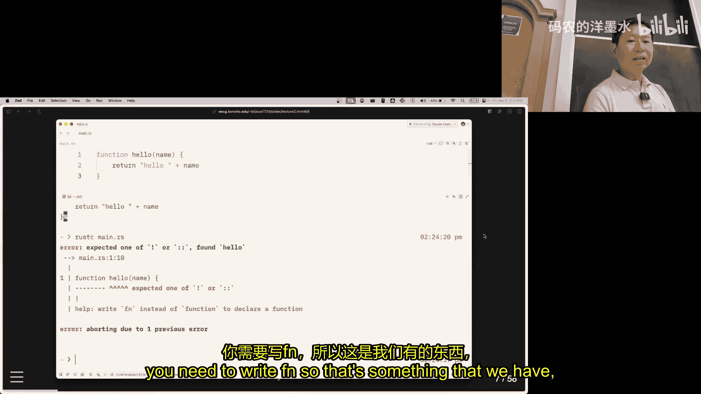

If we try to write Python code， if we change this to Python code。

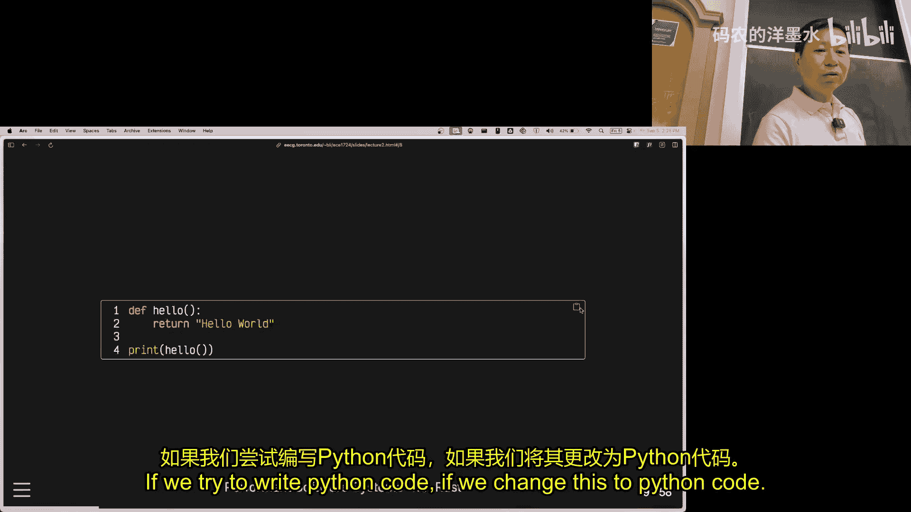

And it's gonna be about the same thing。 So it's gonna say right F N instead of de。

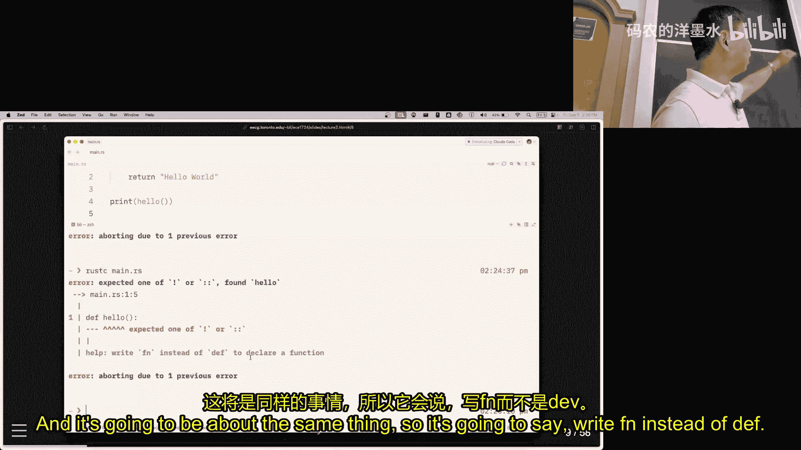

To define a function， samee thing。 So in Python， it works in rust。 It doesn't work。

 but rust is gonna give you that help。 So that's gonna be。You know。

 running the rust compiler over Python code。So let's try to fix it。 So to fix it。

 I just need to change this F N to function to F N。 So that's what we have。 function to F N。

 And let's try to write run it again。

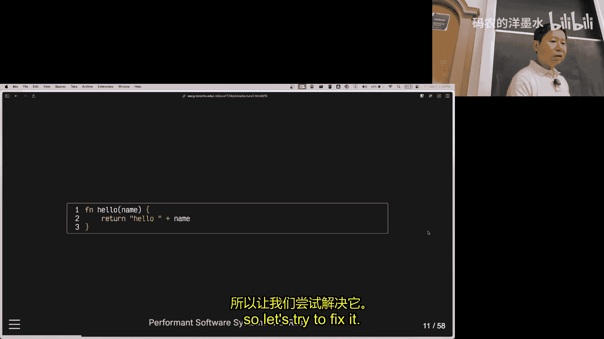

So to run it again， again， this is completely manual， no AI needed， no internet needed。

 just everything is local， which is beautiful。 But I do have this beautiful help。 and of course。

 I do have additional errors right here。😊，So， here， we do have。Quite a lot of errors。 as you can see。

 is like quite quite a bit。 You know， this is where we started。 And at the very beginning。

 it will say， okay， expect one of something。 And this is kind of not very readable。

 expect one of column and so on。 You know， the tendency here is to copy and paste and put it in AI and say。

 what does it mean。 No， you don't have to do that。 The reason for that。

 is because theres something a little bit more readable。 you just need to read on。

 just carry on a little bit， carry on your reading a little bit。 here it says help。

 if this is a selftype， give it a parameter name。 So again， it starts with help。

 just give you a little bit of tips and help。 And， of course。

 this is related to kind of like a method inside astruct here。

 we're not defining a method in thestruct word， basically just a function by itself。

 standalone function by itself。 So it doesn't apply here。 The second case help。

 if this is a parameter name， give it a type。😊，You know。

 that sounds really nice because it is a parameter name that we're trying to define。

 Name is a parameter。 That's exactly what we wanted。 So we need to give it a type， right。

 So that's what we want it to do。 And that's exactly what the compiler is gonna help us。 You know。

 give it a hint that the type name It doesn't know what the type it is。 so that's gonna say， okay。

 type name and give you this very nice aspect graphics。😊，You know， plus plus plus。

 just to say here's the type name that you need to add， add it， that in， you know， plus plus， plus。

 add that in。If it is type， explicitly ignore the parameter name。 So that would be the third kind。

 but that would be not applicable to us。 So there are three different cases。Not only that。

It will also have additional things right here。 But， you know， it will have at the very bottom。

 something called some errors have detailed explanations。 For example， in this case。

 we have this E 0，3，0，8。 Every single error in rust has a particular code and E0，6，0，1。 All of these。

 you can actually try to explain by running this。 We're gonna try to do that momentarily。

 But for now， let's just carry over。 let's just try to follow the advice here。

 if this is a type explicitly sorry， this is a parameter name， give it a type。 that's。

 that's the help that we got So it is a parameter name。 So let's give it a type。

 So this is obviously a string。No， that's the type， right， So let's give it a string。And for now。

 let's try to clear this up。 let's try to compile again。 Now， after you compile again。

 we need to scroll all the way up。And this is at the very beginning。 And it basically says。String。😡。

Help a struck with a similar name exists。 Not the capitalization。String。Oh my goodness。😮。

This is so good。This is absolutely art。You don't think so。

This is way more artistic than using some AI model to help you identify the compile time error。

This is an enjoyable experience， interacting with the compiler。😊，The compiler。

Tells you that this is something called string。 But， yes， we can actually find something similar。

 but you're gonna have to do uppercase S。 So that's something we're gonna do。

 We're gonna do uppercase S。 And then we're gonna try to do it again。 It's clear。 do it again。😊。

And here it， well， it understands strength for now。佛丁南。It basically says。Right here。Cannot。

Add string to N% SR。 So the first line is accepted。 But then we move on to the second line。

 line number  two。 and it says。Return hello plus name。 And that's the jascript way of doing this。

 The concatecnnate two strings。 Now， the first string is a string constant。 It hello。

 And the second string is the parameter we pass in in Javascript， yes。But in rust。

 this is not how we do it。 And the reason for that。

 the rust is going to tell you is that we cannot add a string， which is the uppercase S。

 in this case， name is the uppercase S string。To the N percent STR。 And that is。

 we're gonna talk about the strings later。 but the string types later。

 But that is typically called a string slice in， in Sp， we have a slice type。

 And this is sort of like a portion of the string。 It's like a slice of the string。

 But there are some major differences between these two。 But， you know， regardless of the difference。

 these are two different types。And in rust， you cannot add two different types， obviously。

 because rust is a strongly and statically typed language。 We cannot add two different types。

 So it will tell you cannot be used to concatenate M percent string STR with an uppercase as string type。

So the string slice and% STR is sometimes a lot of the rust developers pronounced as a store just to。

 you know， just so that you don't have to say string slice， but it is basically a string slice。

 so you cannot contact a stir with a string。And that's something that is part of the actual。

Compile time error。But you might say， how can I fix it。Well， again， it will give you some help。

 So help create an owned string on the left and add。A bottom。 Oh sorry， A borrow on the right。

So it will actually give you not just that sort of like cryptic word， you know， for now。

 because you don't understand what a borrow is and what do we mean by an owned string。

 But regardless， it give you， it also gives you the code。So sort of like AI gives you the code。

 So it gives you return。 Hello， dot2 O， which is added into the code。Plus， M percent。

So the N percent basically borrows from the name， and that will basically create。A reference。

And that basically converts that to something that can be added。 So that's again。

We don't understand why it works， but it actually helps us to actually give us working code。

 So for now， let's just copy it and paste that。To our。To our code。 So this is the code that we have。

So copy and paste that to the code。 And that's very good。 So let's try， try it out again。Oh， it says。

Expected。P2 parentheses， which is typically called a unit in rust， which is a unit type。

 a unit type is like a type that is nothing like a nobody kind of type。 But， you know。

 it expected a unit type， but found the string。 What does that really mean。 Well。

 it tells you over there， help。Try adding a return type。Right arrow string。Well。

 it turns out that our hello function does not explicitly mention the return type。 And in rust。

 all functions， you're going to have to explicitly mention the return type。 Otherwise。

 the default will be the unit type。 And since the actual type that we're returning the compiler can tell that it is not a unit type。

Now you can actually see there's a discrepancy between the declared return type。

 you didn't declare anything that would be a default unit type and the returned actual type。

 so that discrepancy basically means that it's a type mismatch。And that is an error。In rust。

 because we are a strongly typed language。And to know a little bit more about this error。

 which is the E 0，3，0，8。And it says some arrows have detailed explanations over here。

 This is the E 0，3，0， A。 This is the actual  error code right here。

 So let's make it a little bit bigger。 A code right here。

And that is something that you wanted to look up and to look up。 It tells you。

 try to do this command， which you should try。 It's fun。 It's a lot of fun。 You should just try it。

 Don't just， again， en rust compiler output is there are a lot of gold mines in the compiler output。

 Lots of things that you can， you know， there's a pleasant surprise everywhere in the compiler message don't。

😊，Ignore the compiler output。 The compiler output is really， really nice。

 It can give you a lot of details right there。 And， of course， because of the space constraints。

 it will sometimes say， go to this rust see to explain。 And that's some， somewhere you should try。

 So let's， let's try that。😊，So let's try that。 Let's say Rusi explained。 So it basically says。

The expected type did not match the receive type。So that's the type mismatch。

 And it gives you some examples。 For example， here's an example， plus one， a simple example where。

 we're expecting x， which is I 32， a 32 bit integer。 and we're passing in a string。

So we're passing in a store type string。 And that's something that is basically a type mismatch。

 And this kind of type mismatch is exactly what we bumped into because our return type is not matching the declared return type because we didn't declare anything。

 the default is the unit type。 So that's something that is the first example。

 But we have additional examples。 If not a boo。 And， but if the keyword expected。 the bullying type。

 a boo type， but it found the store type， that's a type mismatch。 And， and again， we have more。

 So we have let X。F 32， a 32 bit float equals not a float。

 So over here we have a variable x and explicitly declared as a 32 floating point type and you assign a value that is a string slice type and that's something that is a type mismatch as well and then it goes on and says this error occurs when an expression was used in the place where the compiler expected an expression of a different type it can occur in several cases。

 the most common being when calling a function and passing an argument which has a different type then the matching type in the function declaration。

And that's the end of story。For this rust C explain。 And， of course， you sell， this is easy。

 I understood this。 This is something other other languages have。 This is just an example。

 There's a lot of other kind of errors that are much， more challenging to understand。

 much more complex to understand。 And we're gonna get into those kind of problems later on in this course。

 So press escape。 And you will。Actually， escape doesn't escape。 so let's press control C to escape。

 All right。

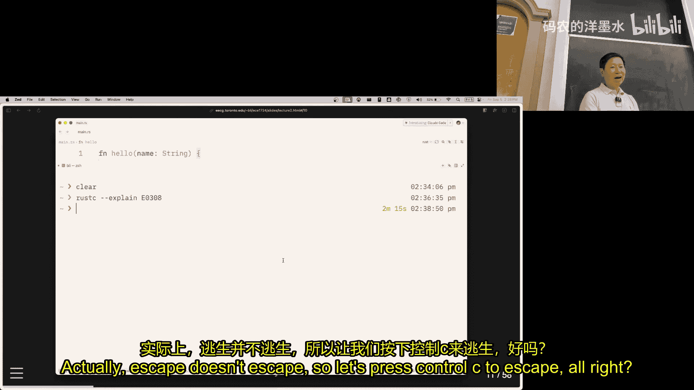

So that's the rust see explained。 So I've gone through this。 This is basically just a step by step。

 I've gone through this using the live demo and you have three different kind of helps and you could actually choose the one that is the one that you wanted to use to fix your code and of course。

 after you fix the code， it will be able to tell you that it's not capitalized and you can capitalize again and then it will tell you that you know you have additional problems this is a string slice and this is a plus that cannot be used to coning a string slice with a string and everything is related to the line number two and。

We have a suggestion right here。And again， this is exactly copied from our live demo。

 Just want to show you how detailed and how beautiful the character ASci graphics。

 is in the rust compiler。 so beautiful。 And this is the code that we got into。

 And then it it says expected unit。 And that's something we could actually try to fix。

 And how do we fix that。 Well， obviously， we could try to understand this a little bit better。

 And then we can try to see you know， the output of the rust see that we what we did。

 And then we have the fix。😊，So once we have to fix， which is to right arrow the string。

 so you could actually try to do that right here。

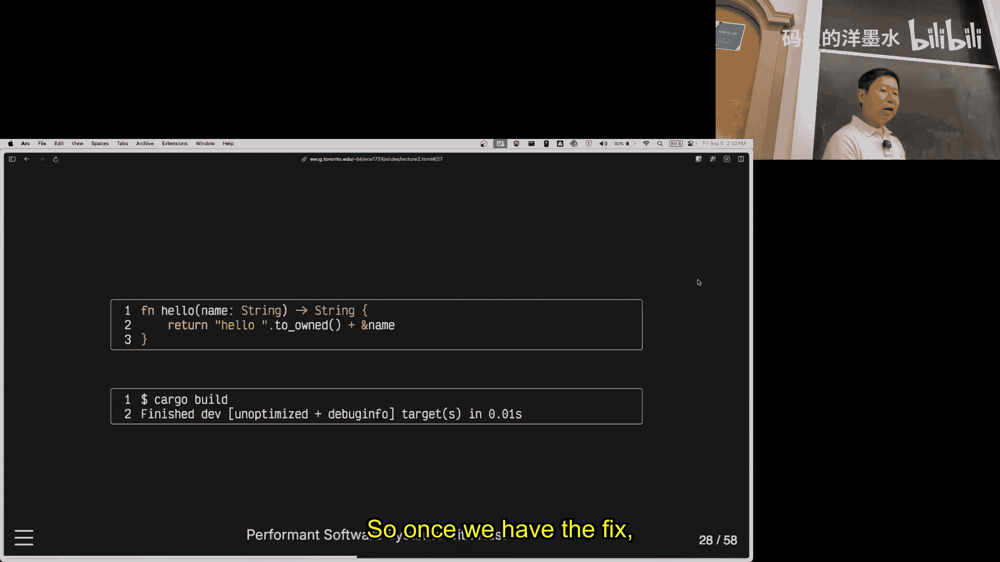

So I'm going to have the right arrow string。And。And then try to do cargo build。

 So the cargo build is you know， something that is typical。 But for now。

 it cannot do it because we haven't have a cargo project yet。

 We're gonna talk about how to do a cargo project。 But for now， we can still use the rust C。

 which typically we don't do。 And the reason why it's still complaining is that it's we need a main function。

 And if you actually have a main function from cargo build， which we will talk about next。

 you will be able to get a successful build。 So a cargo build is gonna be successful。 In other words。

 the function itself does not have an issue。

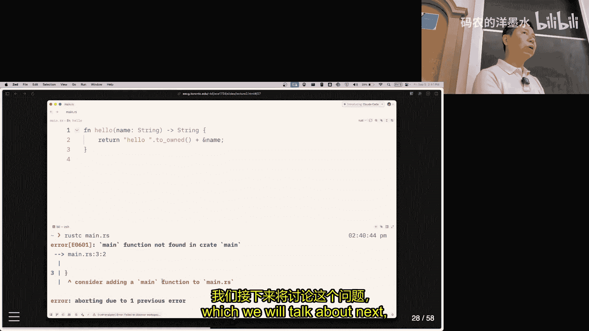

Alright， so that would be how that's an example。 how we interact with the compiler。

 The compiler is a nice friend。 It teaches us how to write code。 And again， in today's， you know。

 era of AI， This is the good old fashioned way。 but I don't know about you。

 I enjoy this tremendously。😊，I enjoy this like0 AI way of doing this tremendously。 Obviously。

 you could cut and paste the entire thing and send it to AI。 But why， why would you do that。

 If you do that， you lose the opportunity to， you know， the actual art。

 the actual beauty of reading the compile time errors。

 The enjoyment of doing that of fixing your code doing that， that's something that you're after。

 right， you're not， you're after the experience， It's almost like you can manually drive the car。😊。

And you wanted to opt for automatic transmission。 And that's not the right way to do it， right。

 Drive the car manually。And the compile compiler is going to teach you。

 and this is how we actually try to do it。 I highly recommend you to do it。Alright。

 so now we have the a beautiful one liner install of installing rust。 And this is the line。

 And this is obviously something you can cut and paste by browsing that website and they give you that line。

 So if go to that one just copy and paste。 and then you can directly install using this particular line of code。

😊。

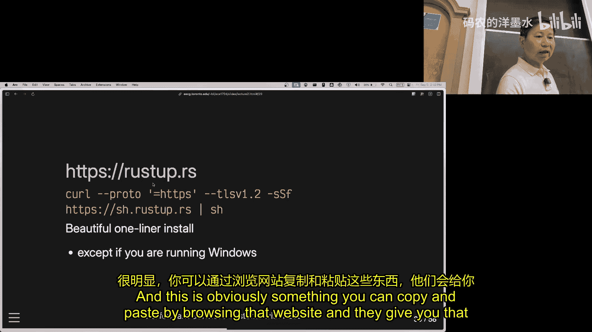

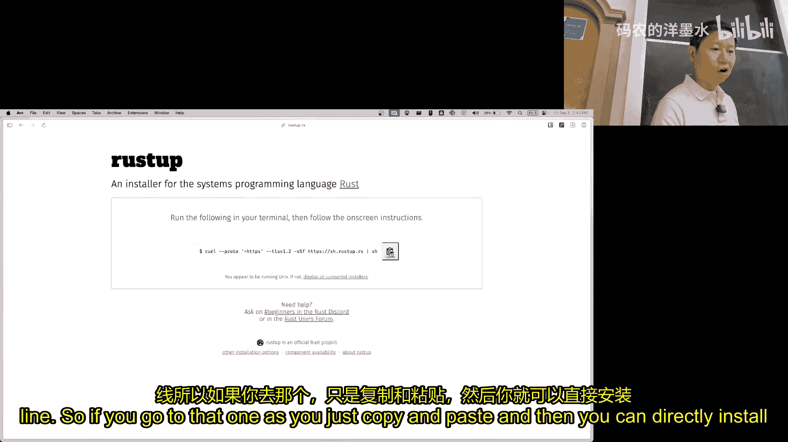

It runs in Macos， it runs in Linuxux。It doesn't run in windows， so。If you use Windows。

 you're out of luck， you do have a graphical user interface to run it to install it。

 or you could run Linux inside Windows， which is called M S L。 You could do that as well。 But。

 you know， I don't use Windows for the past 25 years。 So， you know。It's up up to you。

 You can either get a Mac or you could， you know， install Windows， a different way。All right。

Updating rust， perfect， no problems。 Rust up update。

 So Rut up is something that is is a command line， utility that is installed automatically。

 So just rust up update。 So that's really nice to have。

 it's so nice that I enjoy running it every day， even though rust versions。

 They only come up like every five weeks or something。 But I just run it。 It's just so enjoyable。

 just nice clean update to the latest version。 And obviously。

 it doesn didn't update anything today because I just did it this morning。 Anyway。 So。😊。

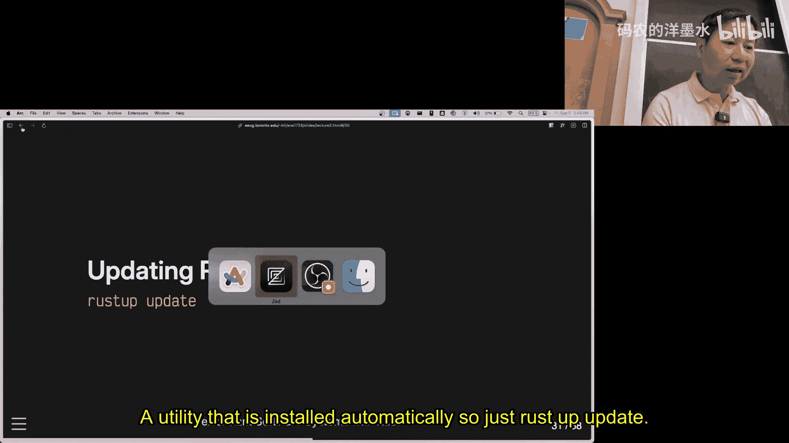

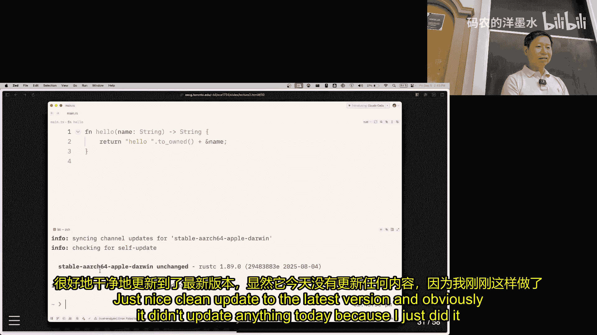

That's rust up upgrade to update the， update to the latest version。

 And there are additional command command line options for the rust up command。 For example。

 rust up doc。

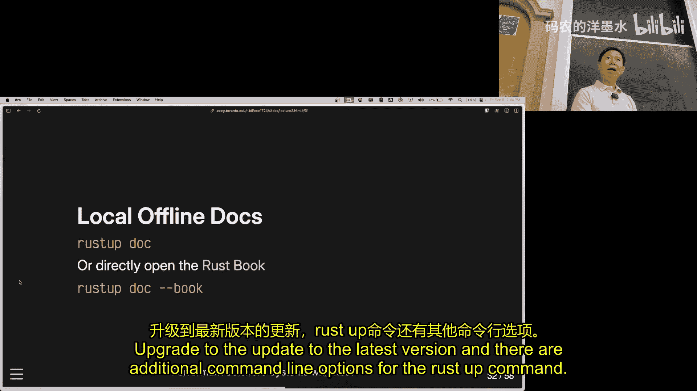

Dooc is documentation， and it will give you the rust documentation just right there。

 It will open the browser。 Your default browser and just my default browser is called Arc。

 And it basically gives you the， the rust up the documentation for rust， the standard library。

 the rust and standard library。 And if you really just write want the book。

 So you can actually just get the rust book by just say rust up doc dash dash book。

 And if you give you the book just the book。😊。

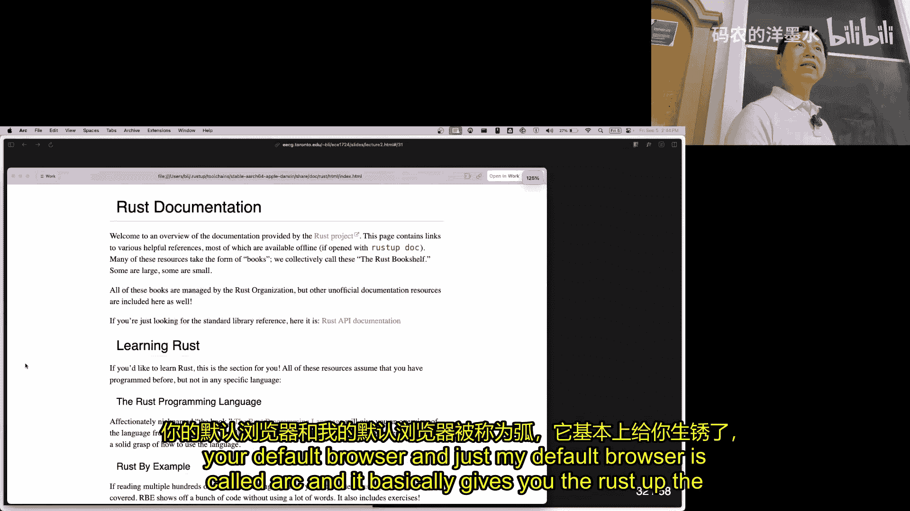

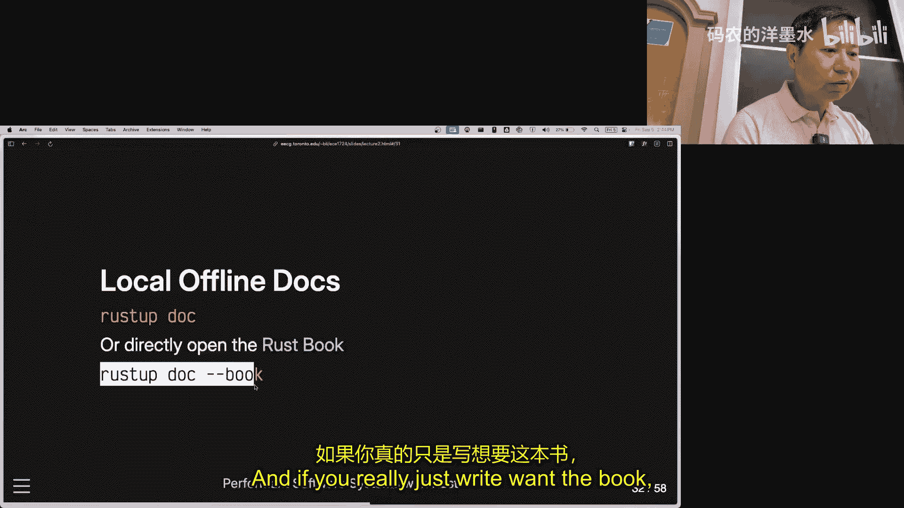

Without any internet， which is great for programming in the airplane， which I do， you know。

 or reading this in the airplane， which I do as well。 So because a lot of this。

 I've read quite a few times。 And I want to read them again。 It's just like beautiful。

 beautiful writing in this in this book。 the only downside of this book， by the way。

 is that it is it's not so advanced。 a lot of the things that are going too advanced。

 You're gonna have to go out of the scope of this book。 in this case。

 towards the second half of this course， we do go beyond this book quite a bit。 But， you know。

 it's still a very good book to get started。😊。

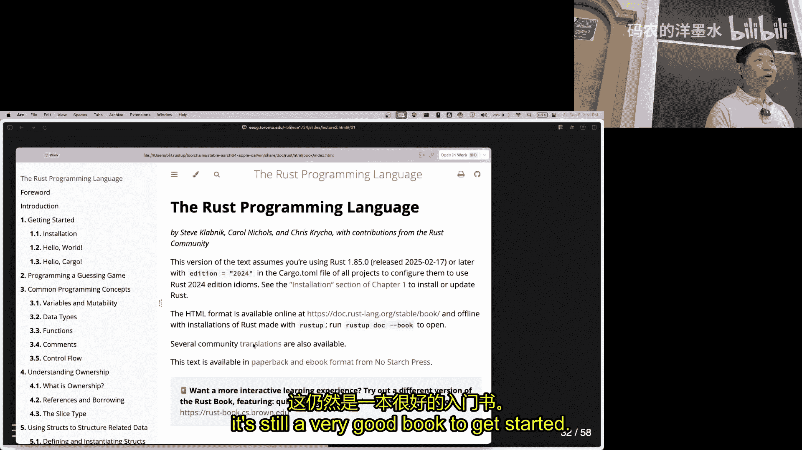

Alright， so that's the book。 And here's the hello world program。 So let's you know。

 have the hello world program copied。 And now we can compile the code just like that。 For example。

 here， I can just paste it right here and just want to compile it just for you to have， you know。

 a main program。 So just rust up see main dot R S。 So that compiles。😊。

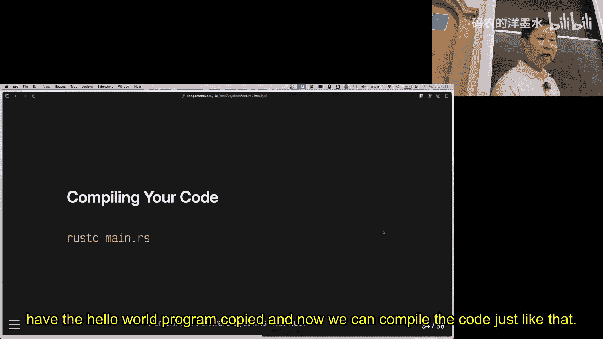

It waits for a little while。 And after it compiles， obviously this observes the Unix philosophy。

 which is。No news is good news。 When anything is bad， is going wrong， It will tell you something。

 when it tells you nothing， it means everything's good。 That's the Unix philosophy。 And of obviously。

 Macs is a Unix variant。 So that's really nice to have。

 It doesn't say succeeded or anything like that。 Allright， so。

 but that's not the typical way for you to actually do it。

 A typical way is to create a project with cargo。😊。

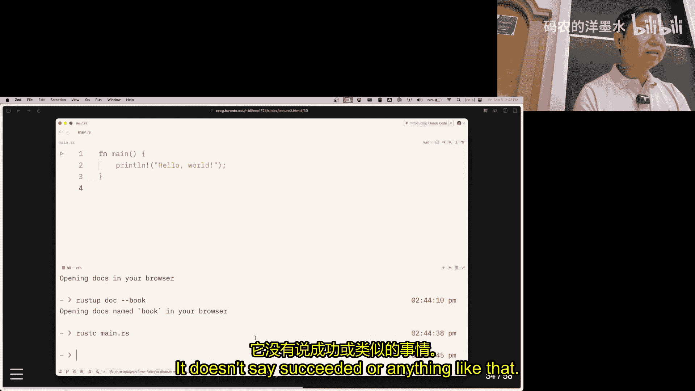

And that gives us a nice project with a gi repository and everything。

 And that's what we gonna have to recommend you to do for every single project in rust。

 because it's so easy to do。 So you just need to have cargo new。 So cargo new。

 let's say we give it a project name。 Hello， it will just create hello。

 and you can just see the hello， it will just give you everything right here。

 including a Gi repository。 So it has even the get ignore。 So get get ignore is right here。😊。

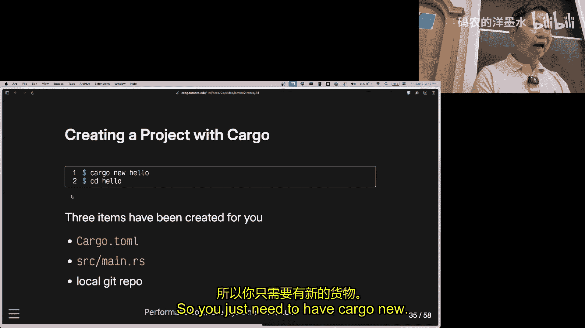

You know， it have a getting ignore right here。 and it has a cargo dot tomo。 to read that。

 let's try to do， use it， use an editor to do it。 So editor right here。And here's the source code。

Right here。 and this is what we have inside the default。 and this is the Tomo。 cargo dotmo。

 So cargo dot Tomo is a Tomo formatted configuration file。

 and Tomo is a format configuration file format preferred by the rust designers， it's pretty simple。

 it's way better than Json， probably as good as Yao， but probably even slightly better。

 But here what we're doing is that we're using the Tomo configuration format to specify some of the metadata about this project。

 including the name of the project the version。 The addition of the rust。 What is the addition。 Well。

 the addition basically means that in rust every three years， 2015 to18 to21 in 2024。

 kind of release a major kind of like an addition and that means that if you say this project is addition 2021。

 it means that it will be。Compatible with all of the other Ru code that is also addition 2021。

 So it is for backward compatibility。 If you actually have addition 2024。

 it may not be compatible with code that has only the addition 2021。

 because you might be using new features。 So， you know， this is something that is a nice feature。

 Every three years， there's a new addition just for backward compatibility Every three years。

 you kind of evolve into something new。😊，Depenencies would be something that you could actually put in your packages。

 but you don't really have to manually put in packages。

 We're going to tell you how to do that later on， but that's something that is generated automatically by cargo new。

 and of course， that's something that you can directly say cargo build。

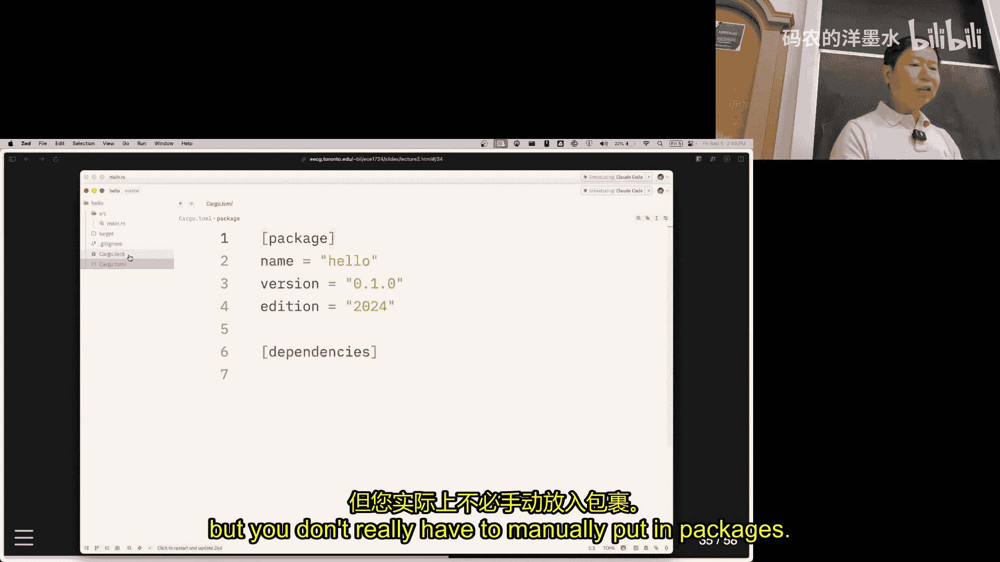

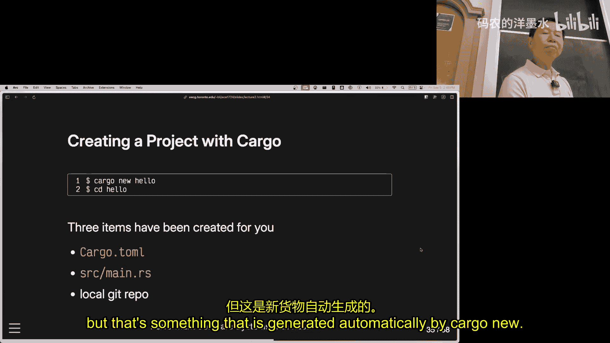

RightSo that runs the rust C compiler and it basically compiles not only your code。

 but also all of the dependencies， all of the packages that it's dependent on and it will build by that。

 cargo build and to clean it。 They just say cargo clean。

 And that removes all of the results of executables in files related to cargo build and that goes back to a clean repository。

 And if you wanted to build for release for production。 you say cargo build dash dash release。

 This is probably useful for assignment number four where we need a highly performant web server。

 we wanted the release mode。 and to do that， it's gonna compile the code， not in debut mode。

 but in release mode。 So that's pretty nice to have。

 So that's what we have this is cargo Tomo addition could be 2021。 but right now it's generated 2024。

 And these are the three commands。

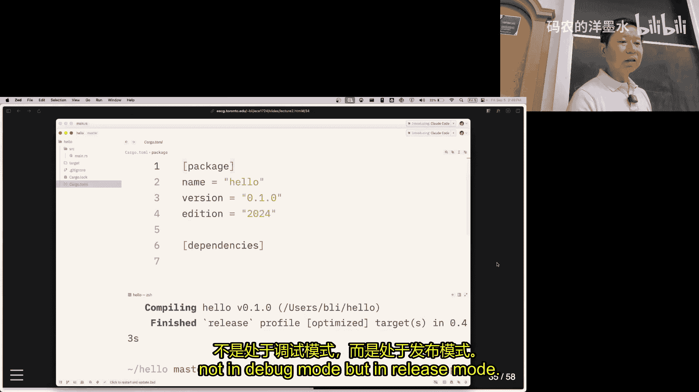

You know， remove all of the previous builds， build the project incrementally and also build the release binaries of your project。

 These are the three commands that I use very， very often that every day， you know。

 I tried cargo clean cargo build and so on so forth。 just out of enjoyment of writing。

 typing in these commands really nice to have。 A lot of people want to click buttons in an I D。

 I don't。 I prefer typing cargo clean cargo build， really nice to have。😊，andum。Running your project。

 you just say cargo run。 That's very simple to have。 And checking your project。

 you have to say cargo check。 cargo check basically checks for compile time errors without building them。

 It's just slightly faster compared to building the code。

And cargo is way more than just clean and build and and run。 It is a Swiss army knife。

 This is something that supports a lot of additional options。 For example， cargo doc。

 It give you the local package documentation。 cargo bench。

 it gonna give you beauty benchmarking tools， cargo test gonna test it using your unit tests that you have provided cargo a。

 which add the actual packages。 For example， I can actually have cargo a。😊。

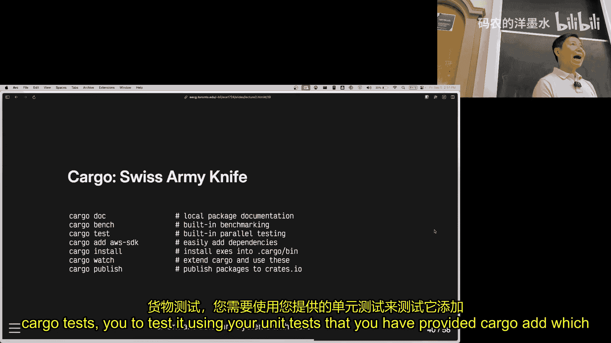

Now are like that。 it will just add packages right here into my cargo Tomo。

 So R is a random number generator。 So just say cargo add R， it will just add the latest generation。

 the latest version of the actual package into the Tomo file。 And here you don't have to have 0。9。2。

 but if you do， it will only have that version。 So later on。

 if the random number generation that library is upgraded to 0。9。3， it will still use 0。9。

2 so that you don't basically have an incompatibility issue with a later version in the future because your kind of your code is developed using 0。

9。2。 But you don't have to do this。 For example， you can just say 0。9。 if you say 0。9。

 it means that it will automatically you know， use the latest and greatest version as long as 0。9。

 something。0。9。2，0。9。3，0。9。9， whatever as long as 0。9。 something， a will use that。All right。

 when you're doing cargo built。Now， you don't even have to have 0。9。 You can just say 0。

 And that means as long as 0。 something， a will use the latest and greatest version of that version。

Alright， and if you do have 0。9。2， for example，0。9。1， for example。

 you could actually say something called cargo update。

 And that cargo update is gonna update to the latest version。If you actually try to。嗯。

Why does it need upgrade。It should upgrade。 Well it should upgrade to the latest version。

I'm not sure why， but I'm gonna figure out later。 He should upgrade little latest version， but it's。

 it's gonna update to the latest version。 And， and then you don't really have to try to。Oh， actually。

 over here， it doesn't update because it's， it should be 0。

9 so that they can update to the latest version， which is 0。9。2。 right。

 So that's something that is there。 And so that is。

The kind of to that you have related to the dependencies， the packages that you have in the project。

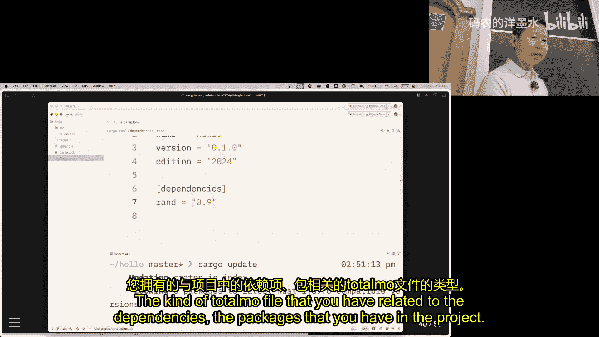

Now， that's something that you have。 And we do have additional， you know。

 requirement additional cargo commands。 cargo watch， cargo publish。

 which basically try to extend cargo to additional features。 cargo is extensible。

 These are extensible by thirdpart packages。 So once these thirdpart packages are installed by cargo。

 These packages can can actually upgrade cargo itself。 by adding additional options to cargo。

 So cargo is a very， very powerful system， As we mentioned， it is the world's best。

 It is not one of the world's best， it is the world's best。

So there a lot of modern ways of doing tooling as well， using cargo， we have cargo format。

 which basically formats the code cargo test， which actually runs the test in both the documentation and the unit tests that you supply cargo bench。

 which basically do the benchmarking， as we mentioned。 one more thing which is cargo clippy。

 This is kind of interesting in the sense that cargo clippy is something that I enjoy running because typically when I write my code。

 I pay attention to my detailed my features and things like that。 it compiles the code compiles。

 but it may not be best practices of programming。So that means that I would love to have someone to check my code for me。

 and cargo clippy is to leverage the vast amount of knowledge in cargo just to check whether or not my code follows best practices。

 And of course， in terms of best practices it's upgraded all the time。

 So this is way better than AI because it's extremely accurate。

 whenever a line of code in my 10000 lines of code that does not follow best practices。

 cargo Cpy is gonna tell me， and I'm gonna fix that。

 And sometimes it will be able to tell me how to fix it。 In fact。

 So I enjoy using it because a lot of the cases。 I have a lot of clippy issues and I enjoy making it completely issue free。

 So run cargo clippy， no news， it's good news。 I enjoy doing that。

 So that's really nice and rust up obviously manages the rust version by itself。😊，On top of that。

 we do have something called rustlings and this is something that really would be a lot of minor and quick exercises that you could actually do in a couple of minutes。

 probably 10 minutes to really brush up your skills in terms of writing code and this is again。

 constantly upgrade it if you click into this， you know。

 this is something that you can really try to go get into and it will you know give you this sort of like a playground that you can exercise and try to write rust code and this is very much in parallel with the official rust programming language book。

 So after you read the book， you know might want to do a little bit of exercises in the rustlings。

 which is sort of like your gem in rust。 So that's really nice to have。😊。

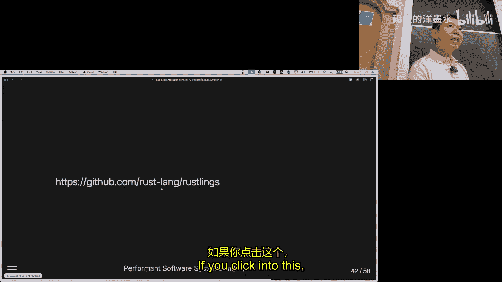

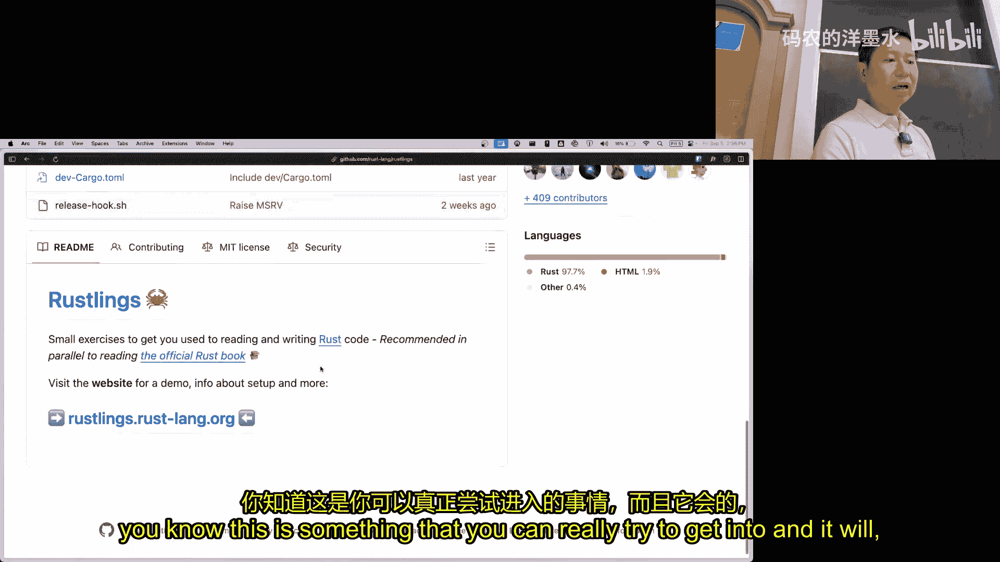

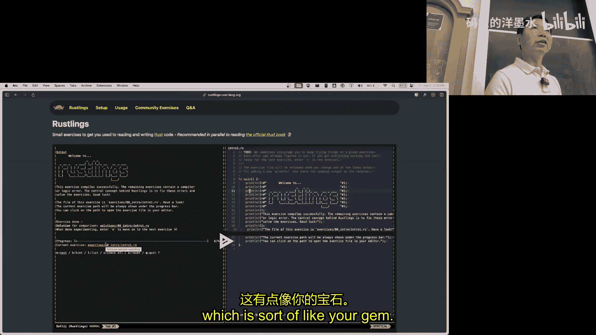

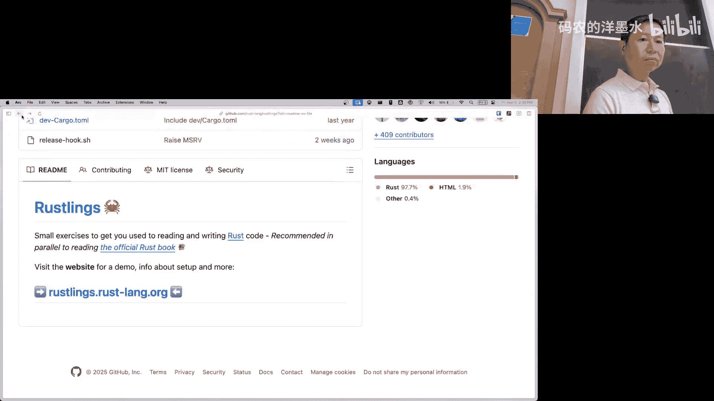

Now。We do have a few additional resources。One of my favorite websites， faster than Lee。me。

Sort of like a strange name， but it's it's one of my favorites。

 It has a lot of very detailed information about rust Ru by example， again。

 in parallel with the rust book， a lot of super easy to understand examples， not something complex。

 just easy to understand examples， sometimes a little bit too easy。

 but it will give you the right mindset to understand the topics in the rust book In the Ru book。

 there are a few examples， but not as many as the rust by example。

 This is official from the rust ecosystem。😊。

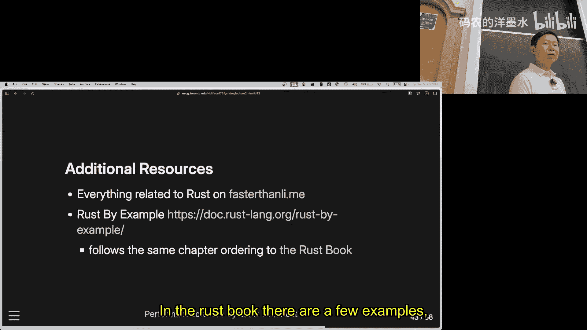

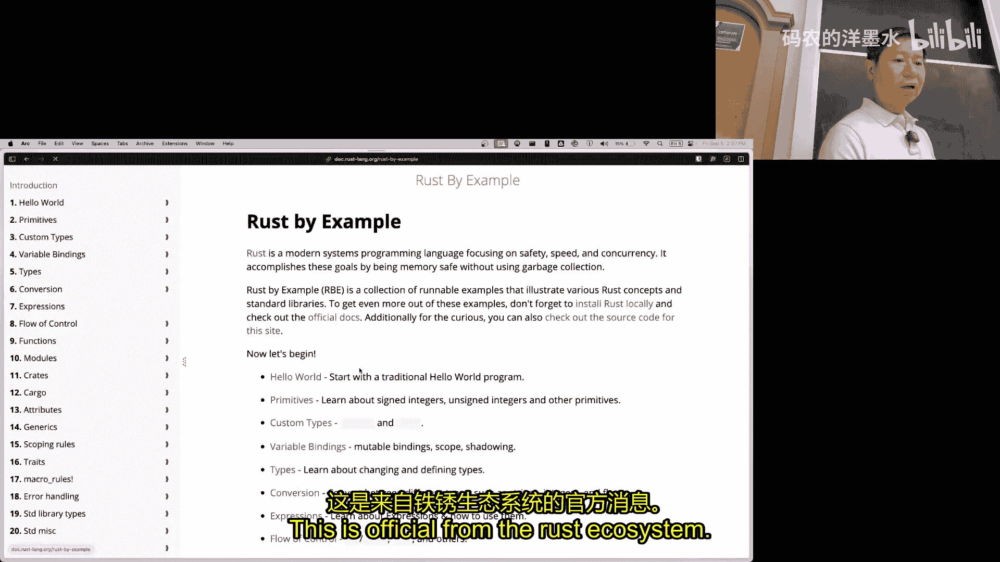

And we want to follow this this Ru by example follows the same chapter ordering to the Ru book。

So again， your code can be perfect。 And that's something that you should get started working on。

 And today we don't have time。 and starting from next time。

 we're gonna get started with our first Ru project which is the guessing game。

 And that is chapter number two。 if I remember correctly。

 let me double checkck in the Ru book right here， chapter number two， programming a guessing game。

 And before the next lecture， I would highly recommend that you at least read this particular chapter。

 and of course， chapter1， which we have already covered and you know。

 just to give you a lot of good head start in terms of understanding some of the basic elements of the programming language by using the guessing name as an example。

 So that's everything I have。 feel free to ask me questions offline after this。 Thank you。

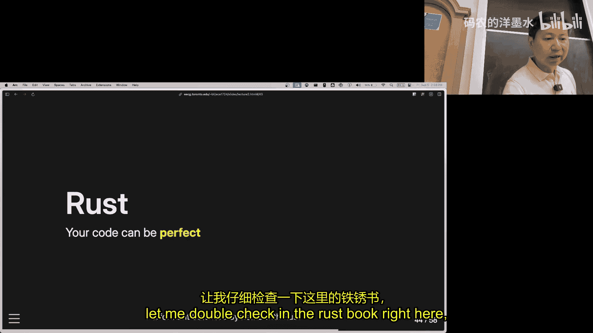

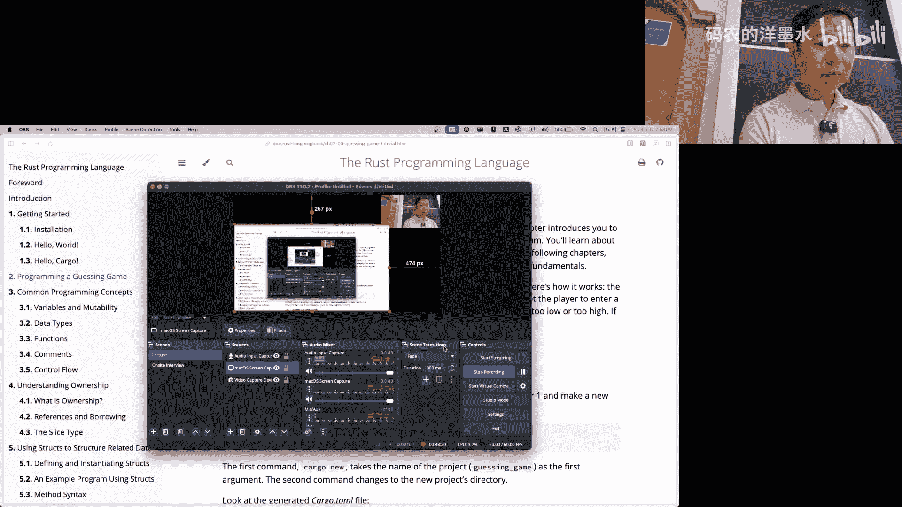