# Rust编程：第2讲：创建、构建并运行第一个Rust项目 🚀

在本节课中，我们将学习如何开始使用Rust。我们将了解课程项目的要求，并亲身体验Rust编译器的强大与友好。通过一个从零开始的例子，我们将看到Rust如何引导我们编写正确的代码。最后，我们将学习使用Cargo工具链来创建、构建和管理Rust项目。

---

## 课程项目概述

课程项目是我们学习Rust的另一个重要机会。与作业相比，课程项目将有大量实质性的重叠内容，并且可能会占用我们课程中大约三分之二的时间，因此需要尽早开始。

关于课程项目提案，我们有一个较早的截止日期。你需要尽早思考要做什么。

课程项目的目标是构建比作业要求更好的东西。例如，构建一个性能优异、速度快的软件框架。项目通常由两到三名学生组成的团队完成。我强烈建议你不要单独行动，除非你非常享受独自工作的时间。但团队人数不能超过三人。

你可以使用来自Crates.io（Cargo包管理器）的第三方框架。我们将很快宣布一些启发性的项目创意供团队选择。现在，你可以开始尝试组建团队。

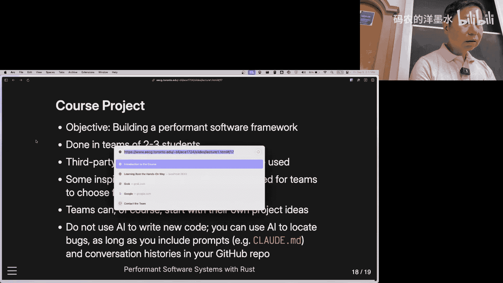

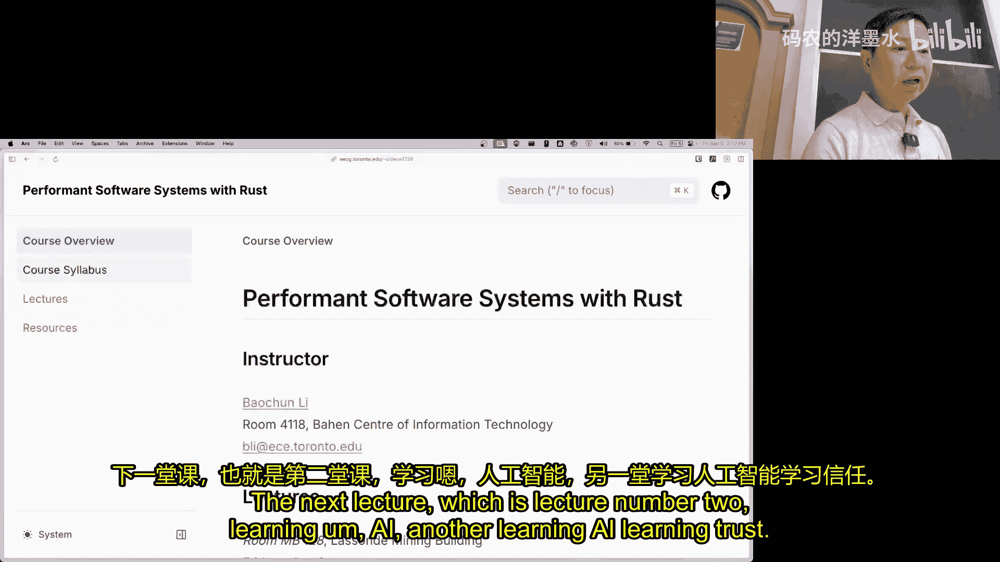

我们将启动一个在线讨论论坛，并会发布相关公告。我对于使用的软件非常挑剔。我唯一喜欢使用的在线讨论平台是GitHub Discussions。我将创建一个私有仓库来使用GitHub Discussions。你需要通过作业0向课程提交你的GitHub用户名，我将通过脚本将你的用户名导入GitHub，以便你获得访问该私有仓库的权限。在那里，你可以参与讨论、提问任何问题，也可以使用该论坛寻找团队成员。

团队当然可以使用自己的项目创意。事实上，我们非常鼓励你从自己的想法开始。我们对这些项目有一些最低要求，例如代码量。每个团队成员至少需要贡献500行代码。因此，一个三人团队至少需要1500行代码。这不包括注释和空行。我们将提供一个命令行工具来帮助你统计代码行数，并会在项目公告中包含这些信息。

我强烈建议你不要使用AI来编写新代码。原因在于，项目的目的不是开发用于生产环境的东西，而是作为训练工具，让你以最快、最有效的方式学习Rust。如果你使用AI编写代码，就失去了这个意义。然而，我知道你们可能对AI有依赖，因此我会稍微放宽限制。你可以使用AI来定位错误，但即便如此，我仍建议你尽量不要这样做，因为定位错误是理解语言细节的良好实践。Rust编程语言本身在定位错误方面提供了很多帮助。如果你遇到难以定位的错误，可以使用AI来节省时间。但如果你使用AI来定位错误，你需要在提交的文件中包含你使用的提示词和对话历史记录。对于课程项目，你的提交将是一个GitHub仓库（公开或私有均可），其中必须包含这些对话历史和提示词。这很容易做到，只需从对话中复制粘贴即可。

关于课程项目的更多细节，将在课程网站的项目部分公布。目前还没有，但预计在下周下一次讲座之前会发布。

最后提醒，请遵守学术诚信。不要抄袭其他学生的作业，也不要向他人提供你的代码。在当今的AI时代，检测抄袭非常容易。我只需要一个提示词就能检测出学术诚信问题，甚至不需要编写任何代码。

---

## 开始学习Rust 🦀

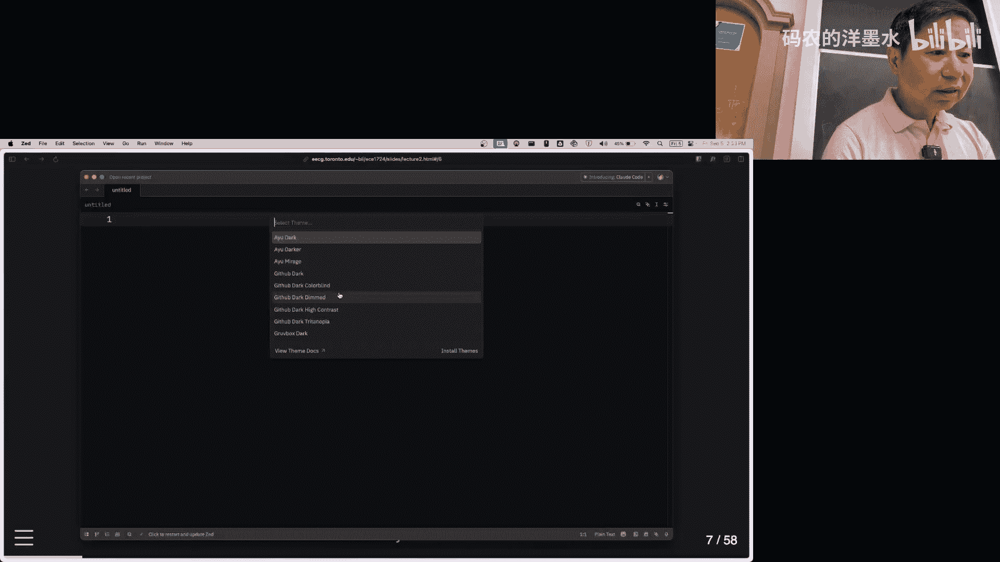

现在，让我们进入第二讲，以实践的方式学习Rust。

Rust是近年来最令人兴奋的语言之一。但坏消息是，它很难。它是一门复杂的语言，学习曲线陡峭。你需要忘记之前从其他编程语言学到的一些记忆，例如面向对象、类、继承等概念。Rust改变了编程的思维方式，所有权、生命周期等概念都改变了编程方式。因此，它不仅难学，而且可能不是一门适合自学的语言。不过，本课程旨在为你提供一些帮助，让你能以更好的方式学习。

我也有一些好消息要告诉你。如果你以实践的方式学习，Rust可以变得简单。我将通过今天的现场演示向你展示这一点。

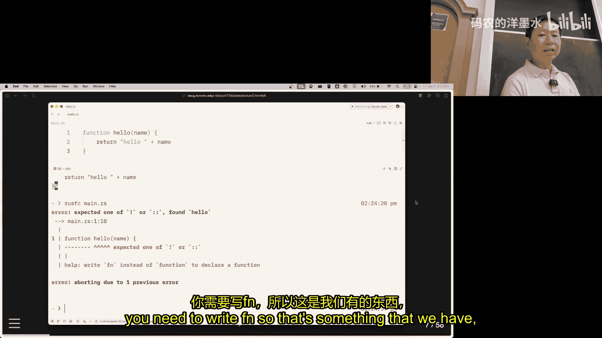

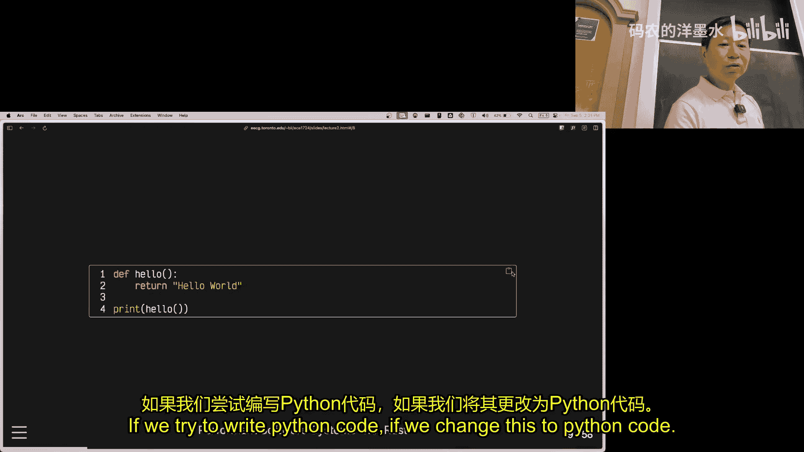

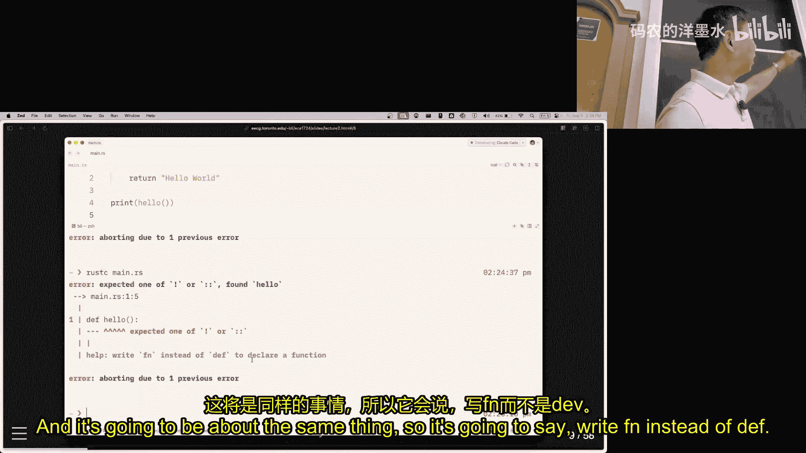

Rust拥有一个我称之为“超级先进”的编译器。它先进的一个表现是它极其友好。编译器对你如此友好，感觉就像在与AI互动一样。你无需访问互联网或任何模型，仅仅是编译器在与你对话。这就是编译器的超能力，也是你可以通过实践学习的原因。我们将向你展示如何做到这一点。

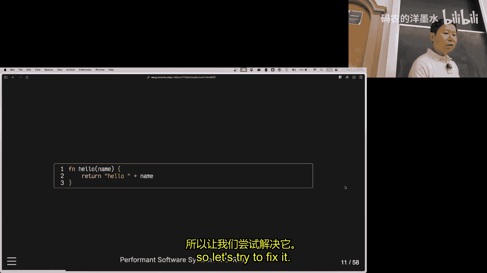

对于其他语言，编译器只负责给出编译时错误。这些错误信息通常晦涩难懂，你的第一反应可能是复制粘贴这些错误信息到搜索引擎中寻求帮助。但在Rust中，你没有这个问题。你需要仔细阅读错误信息，因为编译器会成为你的老师，指导你学习Rust。它会告诉你错误是什么，在很多情况下，它甚至会帮助你修复这些错误。换句话说，它会教你如何在Rust中编程。下面我们来看一个例子。

---

## 与编译器互动示例

我们将编写一些代码。假设你了解JavaScript，它是一种非常简单的语言。我们可以用它定义一个函数。我们有一个`hello`函数，传入参数`name`，然后返回`Hello `加上`name`。这是一行有效的JavaScript代码，非常简单。这是JavaScript的优点，它简单易懂，易于编写代码，但显然存在许多其他问题，而Rust可以解决这些问题。

让我们复制这段代码，然后打开我的编辑器。我将代码保存为`main.rs`。然后打开终端，尝试编译这段Rust代码。我们使用`rustc main.rs`命令来编译。

编译结果会显示编译时错误。显然，这是JavaScript代码，Rust不理解。但编译器会告诉你一些信息，例如“help”。整个输出是语法高亮的，非常美观，并且使用了漂亮的ASCII字符图形来提供帮助。它会说，用`fn`而不是`function`来声明函数。这非常友好，它知道你错了，并告诉你应该怎么写。

如果我们尝试编写Python代码，也会得到类似的帮助。它会说用`fn`而不是`def`来定义函数。所以，在Rust中运行Python代码也会得到同样的帮助。

让我们修复它。将`function`改为`fn`，然后再次运行编译。

现在，我们有很多错误。一开始可能不太可读，但你需要继续阅读。它会说“help: if this is a parameter name, give it a type”。这听起来很有用，因为`name`确实是一个参数名，我们需要给它一个类型。编译器会提示你添加类型名，并用漂亮的ASCII图形展示在哪里添加。

它还会在底部说明“some errors have detailed explanations”。每个Rust错误都有一个特定的代码，例如`E0308`、`E0601`等。你可以运行`rustc --explain`命令来获取详细解释。但现在，我们先遵循建议：如果这是一个参数名，就给它一个类型。显然，这是一个字符串类型，所以我们给它加上`string`。

再次编译后，我们需要向上滚动查看输出。它会说“help: a struct with a similar name exists”。哦，这太棒了！编译器告诉你有一个类似名称的结构体，但需要大写`S`。所以我们将`string`改为`String`。

再次编译，现在它理解了`String`。但接下来，它说“cannot add `String` to `&str`”。第一行没问题，但第二行`return "Hello " + name;`是JavaScript的字符串连接方式。在Rust中，这不是正确的做法。编译器会告诉你，不能将`String`（大写S）与`&str`（字符串切片）相加。`&str`通常被称为“字符串切片”，它们是不同的类型。在Rust中，作为强静态类型语言，你不能将两种不同的类型相加。

但编译器会再次提供帮助：“help: create an owned `String` on the left and add a borrow on the right”。它甚至给出了代码建议：`return "Hello ".to_owned() + &name;`。`&`符号表示从`name`借用，创建一个引用，这样就可以进行相加了。我们现在可能不理解为什么这样可行，但它确实给出了能工作的代码。

让我们复制并粘贴这个建议到代码中。然后再次尝试编译。现在它说“expected `()` (unit), found `String`”。这意味着我们的`hello`函数没有显式声明返回类型。在Rust中，所有函数都必须显式声明返回类型，否则默认是单元类型`()`。编译器检测到实际返回的类型不是单元类型，因此出现了类型不匹配错误。

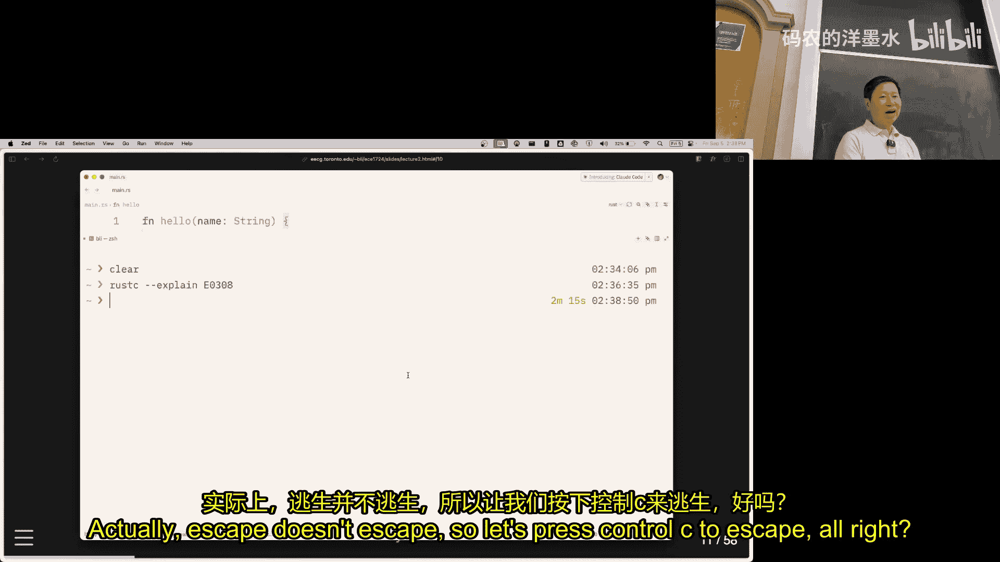

要了解更多关于这个错误（`E0308`）的信息，我们可以运行`rustc --explain E0308`。它会给出详细的解释和示例。例如，它可能展示一个期望`i32`类型但传入`&str`类型的例子，这就是类型不匹配。错误说明指出，当表达式被用在编译器期望不同类型表达式的地方时，就会发生这种错误，最常见的情况是调用函数时传递的参数类型与函数声明中的类型不匹配。

按`Ctrl+C`退出解释。这就是`rustc --explain`的功能。

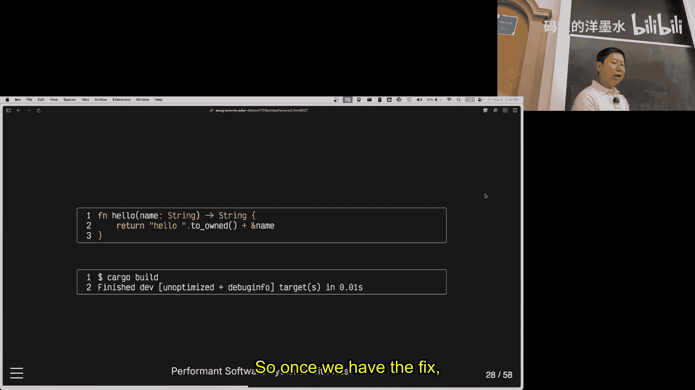

现在我们来修复这个错误。根据帮助信息，我们需要添加返回类型`-> String`。添加后，我们可以尝试使用`cargo build`编译，但因为我们还没有Cargo项目，所以暂时无法使用。不过，我们可以继续使用`rustc`。编译器现在抱怨需要`main`函数。如果我们通过`cargo build`创建项目（接下来会讨论），就能成功构建。换句话说，函数本身没有问题。

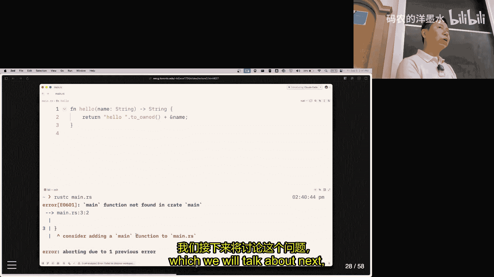

这就是我们与编译器互动的例子。编译器是一个友好的朋友，它教我们如何编写代码。在当今的AI时代，这是一种传统但令人愉悦的方式。我非常享受这种无需AI的编程体验。当然，你可以将整个错误信息复制粘贴给AI，但为什么要这样做呢？你会失去阅读编译时错误、享受修复代码过程的机会。这就像手动驾驶汽车一样，你应该选择手动驾驶，让编译器教你。

---

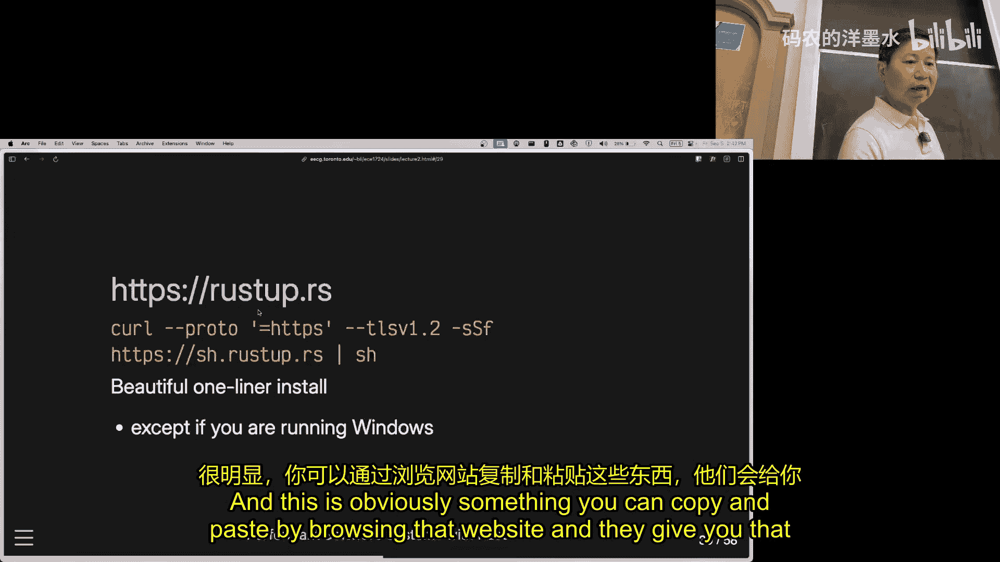

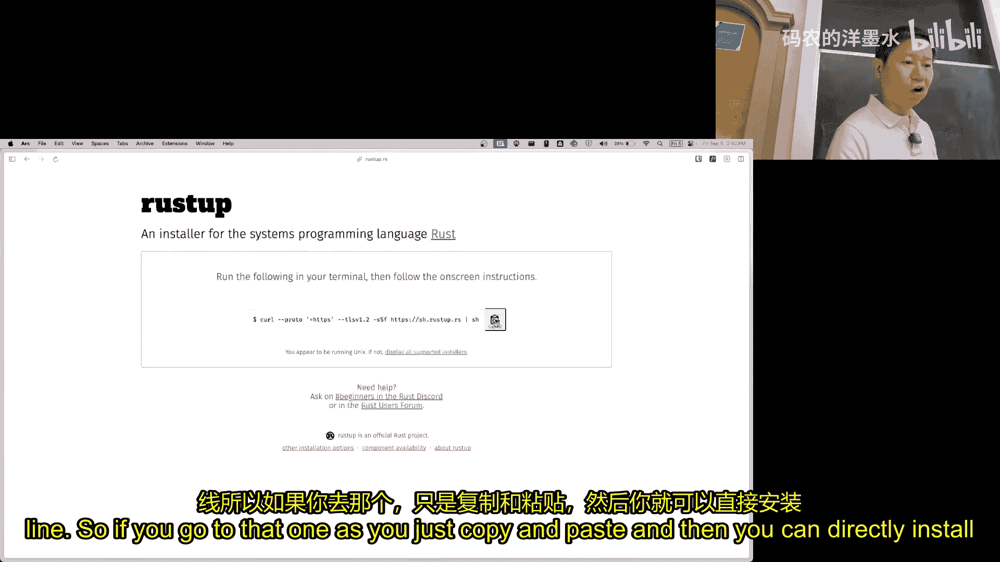

## 安装与工具链 🛠️

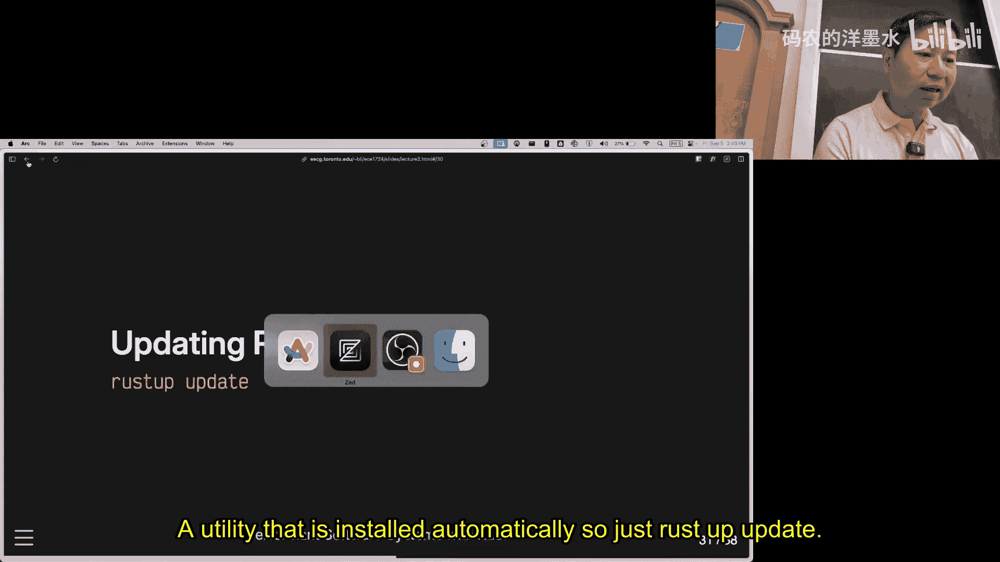

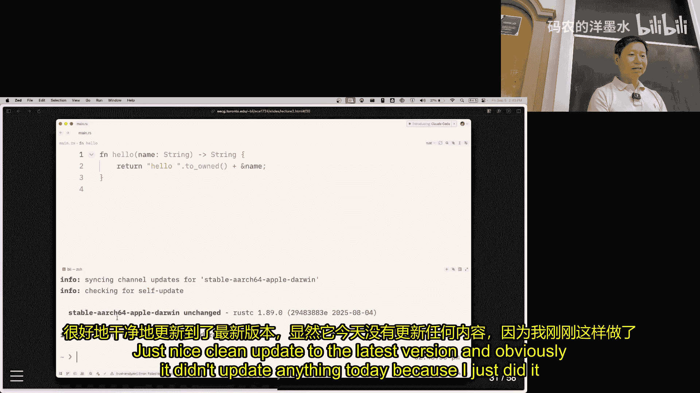

现在，我们有一个简单的一行命令来安装Rust。你可以浏览官方网站复制粘贴这行命令来安装。

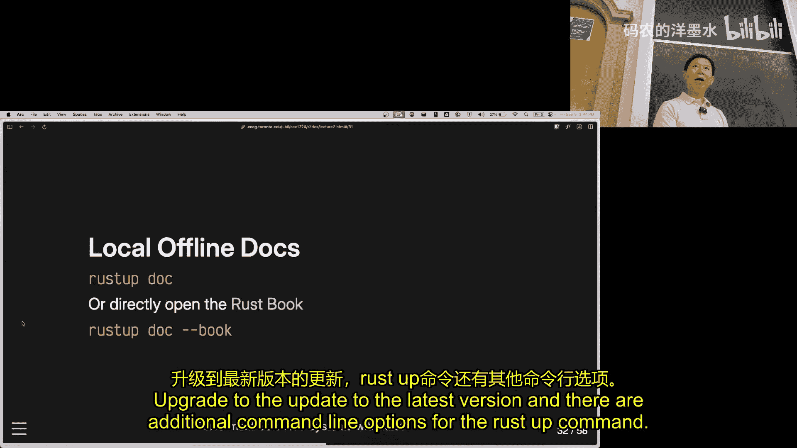

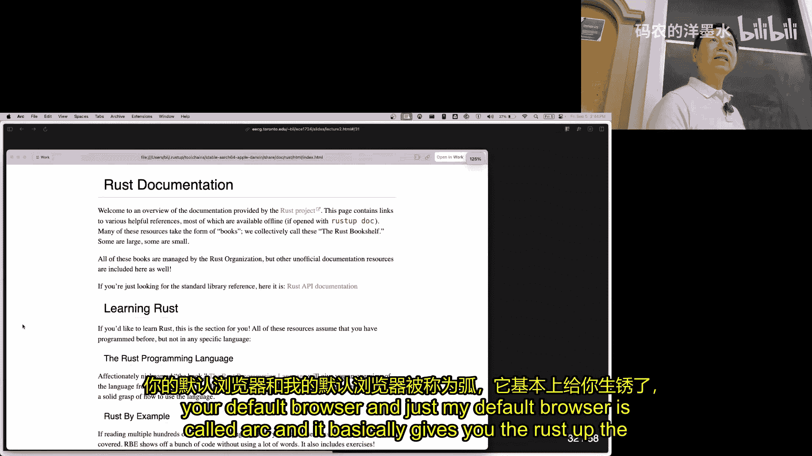

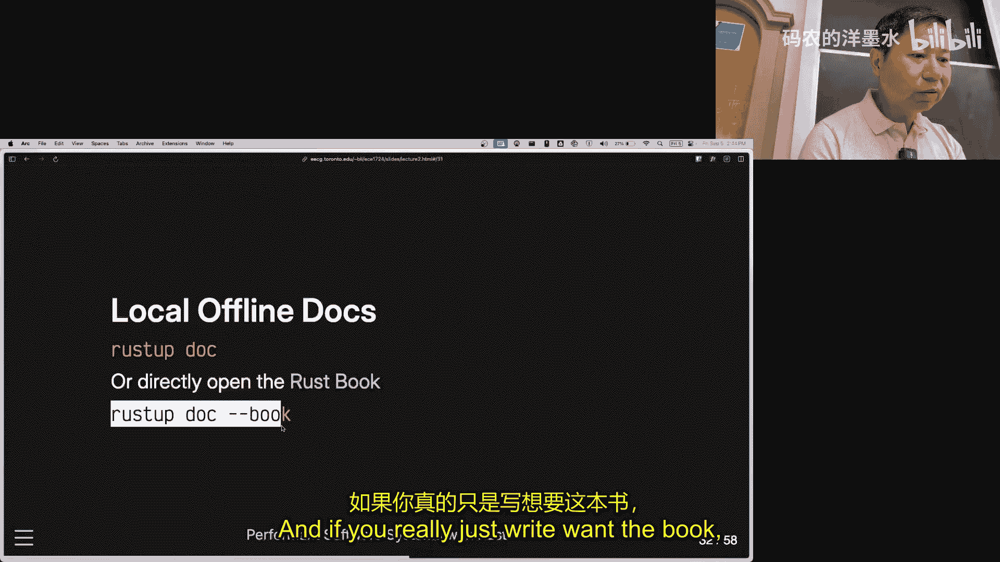

它在macOS和Linux上运行，但不支持Windows。如果你使用Windows，可以尝试使用图形界面安装程序，或者在Windows中运行Linux（例如WSL）。我已经25年没有使用Windows了，所以这取决于你。你可以选择使用Mac或通过其他方式安装。

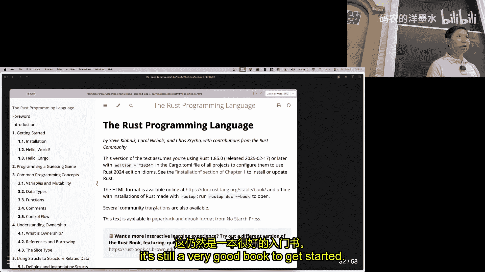

更新Rust非常简单，使用`rustup update`命令即可。`rustup`是一个自动安装的命令行工具。我每天都会运行它，尽管Rust版本大约每五周才更新一次，但我就是喜欢运行它，享受更新到最新版本的过程。

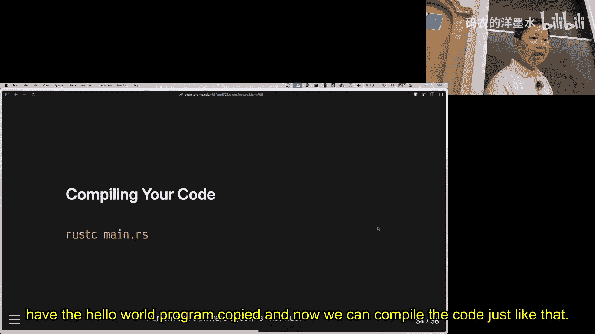

`rustup`还有其他命令选项。例如，`rustup doc`会打开默认浏览器，显示Rust标准库的文档。`rustup doc --book`会直接打开《Rust编程语言》这本书。你可以在没有网络的情况下阅读，非常适合在飞机上编程或阅读。这本书写得非常优美，唯一的缺点是它不够深入。在本课程的后半部分，我们会超越这本书的范围，但它仍然是入门的好书。

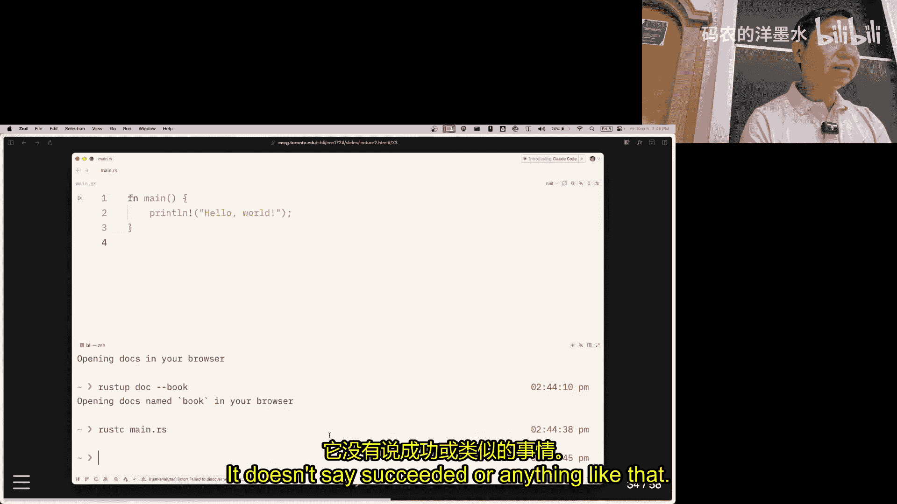

让我们编译一个“Hello, world!”程序。我们可以直接使用`rustc main.rs`编译。遵循Unix哲学，“没有消息就是好消息”。如果一切顺利，它不会输出成功信息；只有当出现问题时，它才会告诉你。这不是典型的Rust开发方式，典型的方式是使用Cargo创建项目。

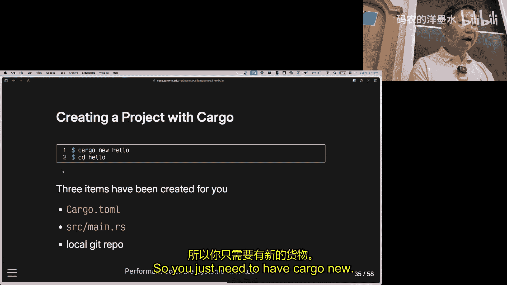

---

## 使用Cargo管理项目 📦

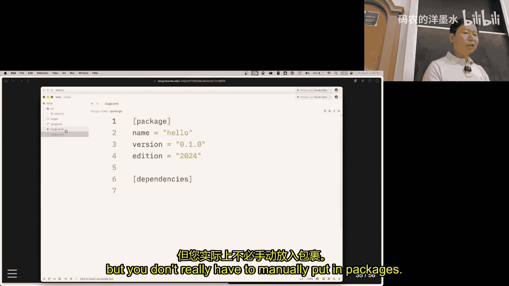

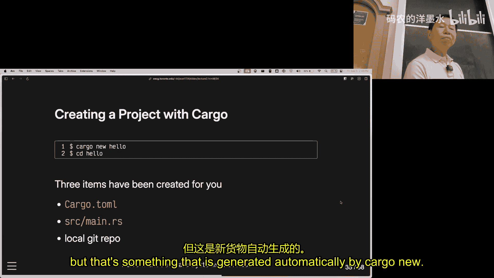

使用Cargo创建项目非常简单，它会生成一个包含Git仓库的完整项目结构。只需运行`cargo new hello`，它就会创建`hello`目录，其中包含`Cargo.toml`配置文件、`src`目录和`.gitignore`文件。

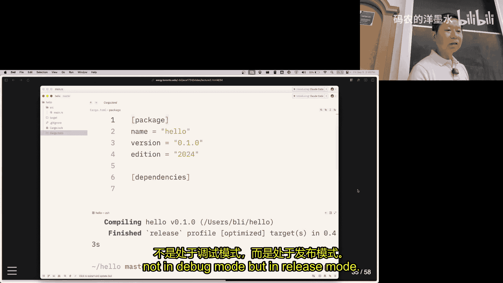

`Cargo.toml`是一个TOML格式的配置文件，用于指定项目的元数据，如项目名称、版本和Rust版本（edition）。Rust版本（edition）每三年发布一次（如2015、2018、2021、2024），用于保持向后兼容性。如果你指定项目使用2021版本，它将与所有其他使用2021版本的Rust代码兼容。依赖项可以手动添加，但通常我们使用Cargo命令来管理。

运行`cargo build`会编译你的代码及其所有依赖项。`cargo clean`会删除所有构建产物，回到干净的状态。`cargo build --release`会以发布模式构建，生成优化的二进制文件，适用于需要高性能的场景（如作业四中的高性能Web服务器）。我经常使用这三个命令，非常方便。

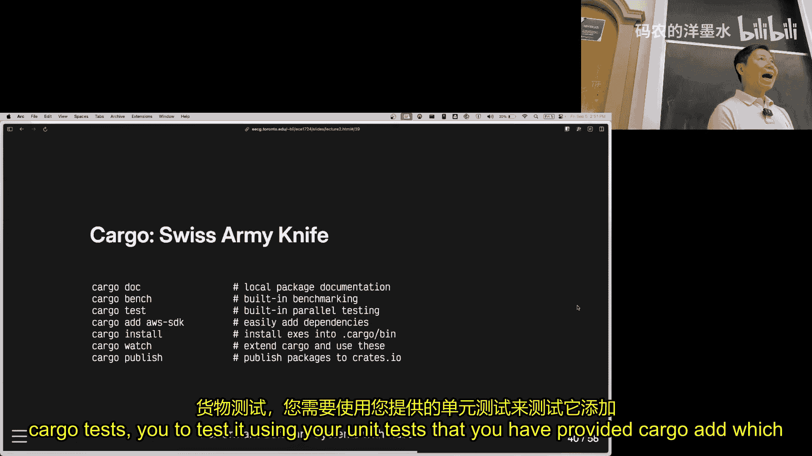

运行项目使用`cargo run`。检查项目（仅检查编译错误而不构建）使用`cargo check`，这比构建代码稍快一些。

Cargo的功能远不止这些，它是一个瑞士军刀般的工具。例如：
*   `cargo doc`: 生成本地包的文档。
*   `cargo bench`: 运行基准测试。
*   `cargo test`: 运行单元测试。
*   `cargo add`: 添加包依赖。例如，`cargo add rand`会添加最新版本的`rand`随机数生成器库到`Cargo.toml`中。你可以指定版本号，如`0.9`表示使用`0.9.x`系列的最新版本，`0`表示使用`0.x.x`系列的最新版本。
*   `cargo update`: 更新依赖到符合版本约束的最新版本。

Cargo是可扩展的，第三方包可以通过插件扩展Cargo的功能。Cargo是一个非常强大的系统，可以说是世界上最好的构建工具之一。

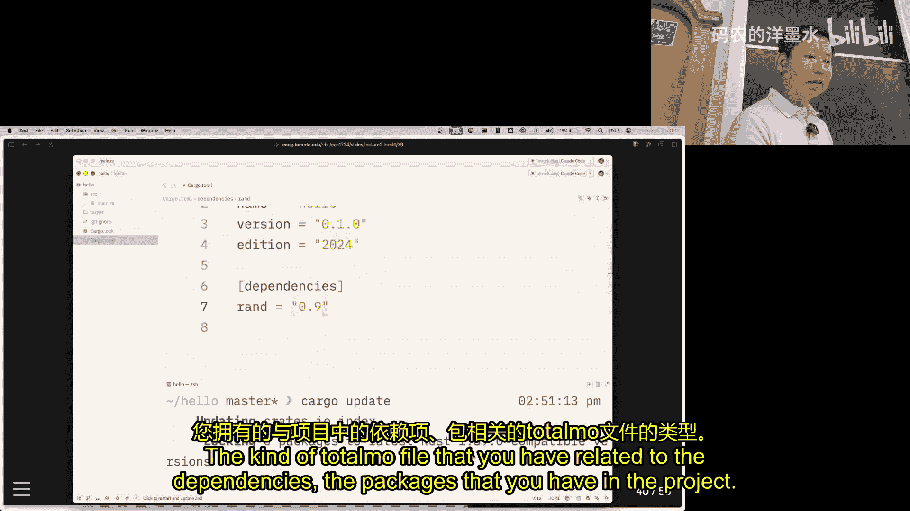

此外，我们还有`cargo fmt`用于格式化代码，`cargo clippy`用于检查代码是否符合最佳实践。我非常喜欢运行`cargo clippy`，因为它能利用Rust社区的丰富知识来检查我的代码。每当我的代码中有不符合最佳实践的地方，它都会告诉我，有时还会告诉我如何修复。我喜欢让代码完全没有clippy警告。

`rustup`管理Rust工具链本身。还有一个叫`rustlings`的工具，它包含许多小而快的练习，你可以在几分钟内完成，非常适合巩固Rust编程技能。它与官方的《Rust编程语言》书并行，读完书后可以做些练习。

---

## 额外资源与下一步 📚

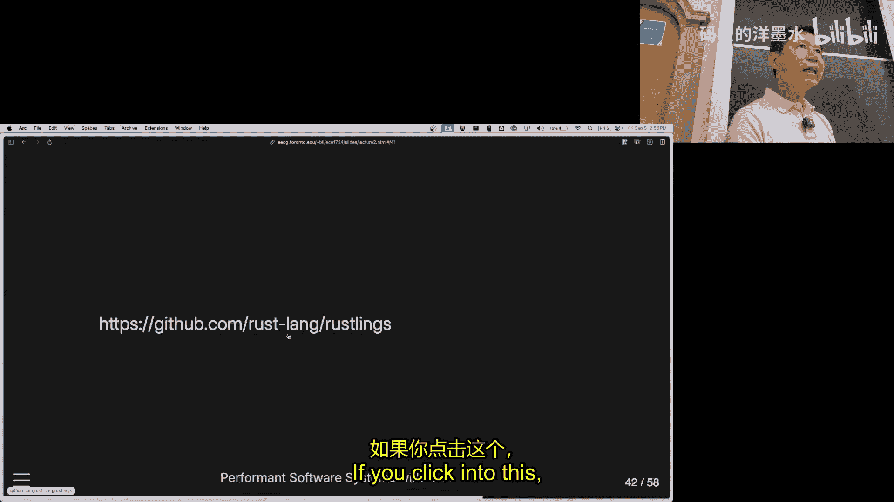

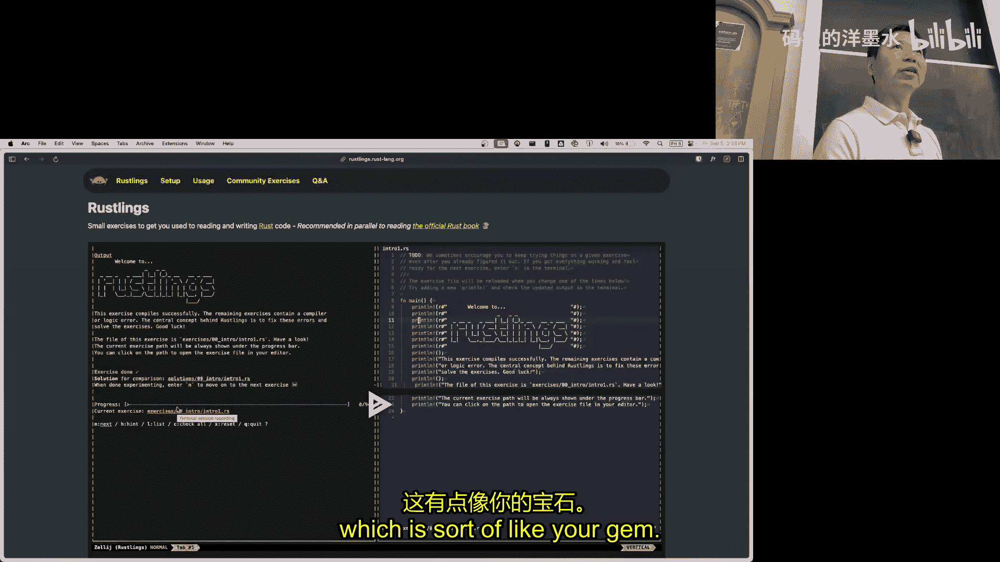

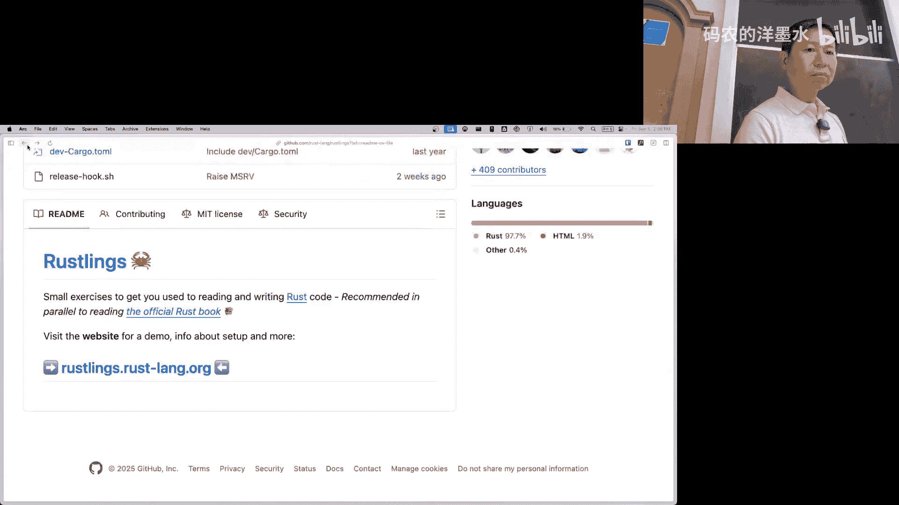

我们还有一些额外的资源。其中一个我最喜欢的网站是“fasterthanli.me”，它提供了很多关于Rust的详细信息。“Rust by Example”也是一个官方资源，它提供了大量易于理解的示例，与《Rust编程语言》书章节顺序对应，能帮助你建立正确的思维方式。

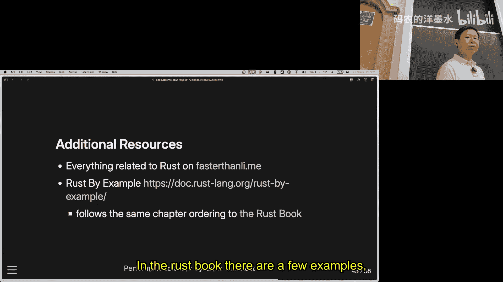

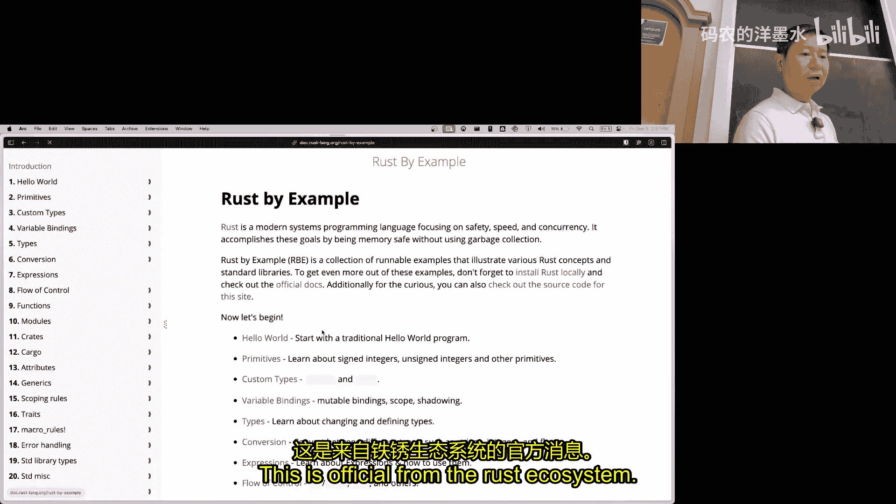

今天我们没有时间了。从下次开始，我们将着手我们的第一个Rust项目：猜数字游戏。这是书中的第二章。在下一次讲座之前，我强烈建议你至少阅读这一章（以及我们已经涵盖的第一章），以便通过猜数字游戏的例子，对Rust编程语言的基本元素有一个良好的开端。

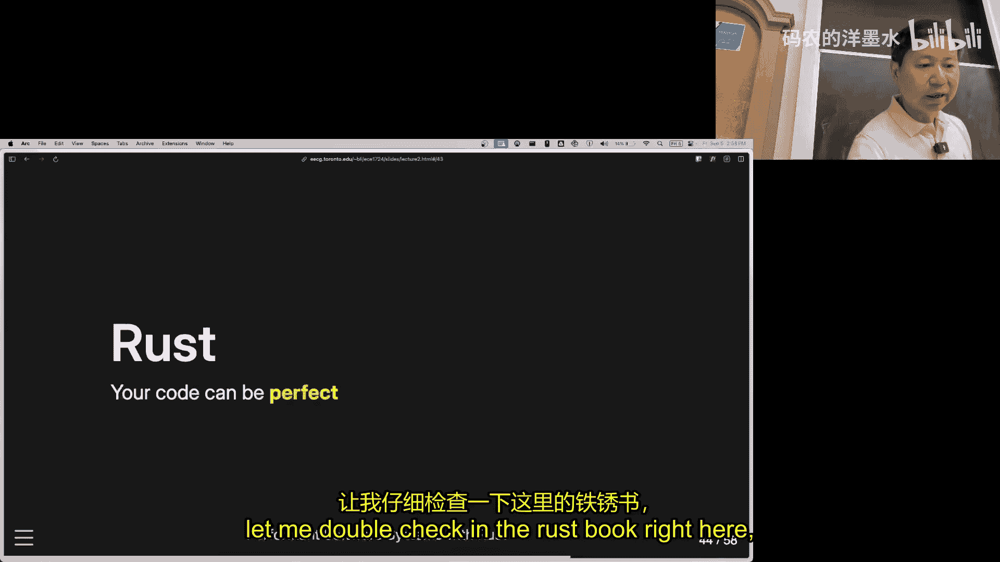

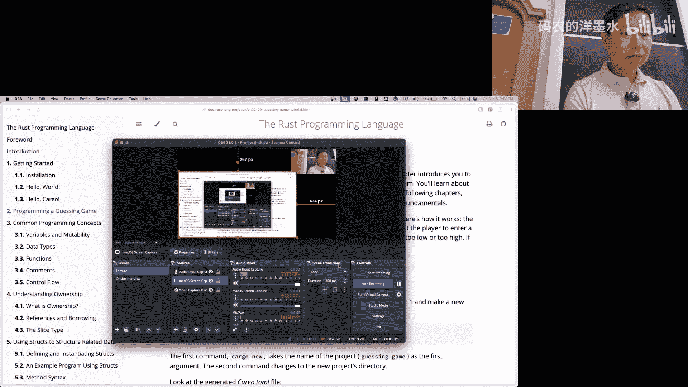

这就是我今天要讲的全部内容。如果有问题，欢迎课后提问。谢谢。