# 【全集 附课件】多伦多大学 使用Rust构建高性能软件系统 中英字幕 1080P p03 Lecture 3 - 猜谜游戏 -BV16V62BhEuf_p3-

All right， so let's get started。嗯。Let's see okay， so last time we talked about the the basic ideas of using the rust compiler and how do we actually build a brand new project。

 And today， we're going to reinforce those ideas by getting started with our。First rust project。

 which is the guessing game。 We're going to start slowly。 We're not going to spend。

We're not going to go through this entire thing quickly。

 we're going to go very slowly if you think the pace is a little bit too slow， bear with me。

 it will pick up later on in the game later on in this entire course maybe even starting from the next lecture we're going to go a little bit more quickly and towards the second half of the course it's going to be much more rapidly that we're going to progress so today we're going to take it slowly with the guessing game。

So。We're gonna get started talking about what do we want to implement with this particular project。

 And the way that we're gonna to do this is're going try to start with just looking at the code。

 the the starting point of the code。 and we're gonna try to show a demo。

 So we're gonna go through the code。 We're gonna show the demo。

 We're gonna build the actual code using the demo， and it's gonna be very demo intensive today。

So the game that we're going to play and we're going to build today is just this very simple guessing game。

 you prompt a user for a number， probably between one and 100， you generate a random number。

 and then you let the。The program to decide whether or not the users guess is greater than smaller than or equal to the guess。

 And then you're gonna to try to continue with a particular loop if the guess is not correct。

 So that's the basic idea it's a very simple thing that we're gonna try to build。

 but with this particular simple example， there are a lot of things that we would like to talk about。

 getting started from the very first line of the code。 the very first line use standard。

Column column IO so what does that really mean here so if you actually are familiar with any of the other programming languages such as Python and so on so forth。

 you will be familiar with something like import if you're interested in something like see you will be familiar with include and this is very similar so the basic idea here is that we would like to somehow import some of the existing library or existing frameworks that we have either from the standard library which this is the case we're importing from the standard library or from a thirdpart library sometimes the thirdpart library in Ru we call it a Create so a Cre is just a special name for the third-part libraries that we have and last time we talked about it we're going to continue to talk about it today in our demo and the standard library obviously。

Not belong to any of the third party crates。 It's part of the rust standard library。

 We don't have to import all of the standard libraries。

 It just happens that I O is not part of something we call the pre。

The prelude then the prelude is basically just the name to tell us what are the things that are imported automatically without using any of the import statements like the U statements that we have however。

 IO is not part of the prelude So this is something that we're going to have to use explicitly or we can do something else we're going to talk about that later now then we're gonna to get started with our definition of the function。

 This is the same thing as C and C plus plus any any other other systems programming language。

 we will have to have a main function and in rust to define a function we use the FN keyword just like what we mentioned last time。

 and then this main function obviously does not in this particular case does not return anything we can make it return something later on。

 but you know it doesn't return anything right now and then just like in C。

All functions and all blocks of code。 obviously， it's going to start an end with braces。

 So we have a brace bracket right there to start the actual block in this particular function。

 And then we're gonna just start printing。And this is just any of the similar to any of the other languages。

 except it looks a little bit different in Python， which just directly say print you know， in rust。

 it actually says print line with the exclamation mark and that exclamation mark basically says that this is a macro and macros are really advanced features in rust。

That we don't even cover in this entire course so we don't define our own macros。

 this macro is something that is predefined for us in rust in fact in the prelude so we don't even have to import anything here so that's something we're going to directly use to print anything and in this case we're simply printing a string constant guess the number and please input your guess so that's obvious and we can continue。

Now， something interesting happens。Line number seven。We have。

A new variable that we declared right here， and that is the variable guess。

And the identifier of the variable is guess， and we use the let keyword。

 resort word to really define that variable， and we're going to bind a value to it immediately after the declaration。

 so the value we're going to bind。Is coming from calling the new。Function。

 and this new function is we say column， column new。

 And that basically means that it is something called an associated function。And。

This function is called an associated function because this function is actually associated with a particular type。

 In this case， it is the string。And that's something that we could actually try to use directly because it is part of the prelude that we have in the standard library。

 So we can directly use the string。 and the new is just an associated function of that particular type。

 and that would be associated with the type。And that's something we can directly call。And you。

 as you can see from intuitively， from the name of the function， it creates a brand new string。

 and this is very typical as a lot of other types we could actually have a new associated function over there to create a brand new instance of that particular type in this case。

 a brand new string， and then we're going to a that new string。😊，To the actual variable guess。Now。

 a string type is something that we're gonna spend a lot of time talking about。

 probably starting next time in the next lecture， we're gonna spend a lot of time talking about strings。

 So we don't have to care too much about strings right now。

 except that we're creating a brand new string。And that would be the guess variable。

 So the guess variable。Has the type string。 Now， we are not really， you know。

 declaring that type explicitly， but it does have a type。

So this particular variable does have a type， even though we don't even say what that type is。

 the reason for that is because the rust compiler will be able to do type inference。

 And this is fairly advanced modern feature of modern languages， such as rust and swift and so on。

 a lot of the older languages。 They don't really have type inference。

 But type inference is certainly something that is quite useful in the sense that you don't even have to declare the type explicitly by yourself every time you declare a brand new variable。

 So a type inference is that feature is used automatically here。

 So that the guess is inferred by the compiler to have a string type because we're assigning and binding a new string to it。

 So that string value has a string type that means the variable that binds that value will also be off string type。

And then we have one more thing right here at line number7， we have the。MUT。Mute。

What does that really mean， Any ideas？Yep。It is a mutable variable so that we can change the value of that particular variable。

 exactly。 But this is exactly。A brilliant feature in Rus。

 We're going to get back to this feature later on today as well。

 in probably the second half of today's lecture。 It is brilliant， because。😊。

We're going to have to explicitly say this is mutable。

 if it is not explicitly said mentioned that it's mutable by default， it is immutable。

 which means that you cannot change the value once it is bound。

The first time after it's bound the first time， you cannot change it the second time。

 So that is an immutable variable。 And this is very different from a lot of the other programming languages that you are used to。

 For example， C， C plus plus Python and so on。 All of these by default。

 they give you this this mutable types， mutable variables， rather than immutable types。And that is。

Bad idea。 That's a bad idea。 And the reason why it's a bad idea is that。

Modern programming requires that types should not be mutable unless you wanted it to be mutable to avoid a lot of errors。

 A lot of mistakes where you inadvertently change the value。

 even though it is supposed to be immable。 So the you might think it's a bad idea to actually explicitly say it's mutable。

 mutable for all of the variables， but this is actually a good idea。 You know。

 it's it's a design issue。 But， you know， with several decades of programming experience。

 people finally realized that variables should， by default， be immutable rather than mutable。

 This is a better idea than C plus was and everything else。

 So you're gonna have to put mute right there。For to。

 to actually explicitly tell the compiler that you can change the type。 In this particular case。

 the guess variable， we gonna have to read the guess from the actual user standard input。 obviously。

 it has to be mutable。Alright， now we come to this line number 9 to line number 11。

 And we wanted to read it from the standard input question。Yeah。It's a very good question。

 The question is can we always do type inference or are there cases where we cannot do type inference？

 There are obviously always a lot of cases， in fact， that we cannot do type inference。

 The compiler will have no idea。 In fact，' it's kind of coming later in the guessing game that we will have to explicitly say what is the type of the variable。

 It will not be able to infer the compiler， when it's not able to infer。

 it will give you a compile time error。 So you're gonna have to give it the type。

So type inference is only for convenience， it's not always like that。Allright。

 so now let's get to this how do we read user input。 Well， IO column column standard in。 again。

 this is an associated function right here from the sorry， this is not associated function。

 This is actually a function in the module IO So the module is the IO module。

 and where's the IO module， this is from line number one， U standard column column IO。

 the IO module is in the standard library and you don't really have to do the first line you don't have to have U standard IO。

 if you directly say standard STD column column IO column column standard in， that's fine as well。

 so you don't have to use but having use is always convenient because you don't always have to say STD column column throughout the entire source code。

 So we could actually do this and standard in is gonna return the standard input。

As like a handle from the operating system， typically you have like a file descriptor from standard input。

 and that is the handle that we return from this particular function。

So this function is gonna return the standard inputs handle。

 and then we're gonna use that handle to read a line from the user and that we're gonna achieve by calling the readline function。

 and that function we're gonna pass in the parameter。 and that parameter is our guess variable。

 And that variable will have to be passed in by reference。

 And this is very similar to C plus plus where you could actually pass in something by reference。

 same thing。 we can pass the guess by reference in the sense that we're gonna send the address of guess into that particular function so that it will be able to put the users input into that particular address。

 So the guess sort of like a holder。 And of course， it' it's a new string， brand new string。

 So it's a holder。 We pass in the reference to that holder。 you know。

 and we're gonna let reline to drop the actual user input into that holder。And， of course。

 we're gonna have to keep in mind that even references by default， they are immutable。

But in this case。We wanted to change the content of the box of the holder。

 which means that we're going to have to declare this as a mutable reference and that means that we can change whatever is in that holder so that is a mutable reference and of course this is a little bit more advanced we're going come back to mutable references and mutable references and load later on in this particular course so don't worry if you have some doubts about it。

 but now we will be able to read user input into guess。Using the read line。

 but we do have line number 11， which is kind of part of the same line。

 we're just breaking them into multiple lines just for readability， it's the same line。

Line number 11 basically takes the return value of readline and do something right there。

And it's called expect。 And that is sort of like a function of the return value。 So what is returned。

By readline。Well， it turns out the red line is going to return a type and that type is called result。

 and this is part of the standard library。 So the result is the enumeration type。

So it is a re enumeration type， or we can directly just， you know， just make it short。

 call it the Eum type。 So the Eum type basically had multiple variants。

 and each variant is a potential alternative value of that particular type。

 but result is a special kind of a Eum type that is predefined already for us。

 And that is exactly what read line is going to return。

 That's the type that read line is going to return。😊，So why do we return a result type？ Well。

 this is a special way for rust to handle errors。 So we use the result type to handle errors。

 And this is very different from a lot of other programming languages。 And in my personal opinion。

 this is the best way to do it。 And you will agree with me later on once we get into this。

 we're gonna have a dedicated lecture about this result type。 And。😊。

What it does is that it has two different variants。One variant is called O。

 and the other variant is called the error。So each one of these variants， you could actually。

 it's basically a holder。 You could actually have something inside that variance。

 So you could have some kind of a value that is that is held by that particular variant。

 And that is kind of different from other languages where you have enumeration where the value is just a value。

 It's just a turn of value here。 We have a value， but it also is able to hold something。

 It's a holder。 So the okay is a variant， and it holds something。 And thearrow is a second variant。

 the only two variant here。 and that would be holding holding something。 That's the value。😊，Now。

 the era。Would be something that would that redline is going to return if it bumps into some kind of a user I O error。

 And okay， obviously， it's going be the variant it's going to return if everything is fine。

And Do Exp basically says that I'm going to take the result type。And I'm gonna to try to。

See if it is a narrow， if it's a error， it will print whatever that is in the parameter of that expect and then crash right there。

 So it's going to be just termination of the program right there。

 So dot expect is kind of a little bit forceful， a little bit hard to take because it just crash right there。

 which sometimes you don't want， but in this case it's okay。

 we wanted that that later on we're going to change it later on probably。

 but here we want it to crash。嗯。If we cannot read the guess。Now。

That's something that we wanted to do。 But if it's okay。

 expect it's going to take the value and they're going to return that。

 which is something that is what we wanted as well。 We're going continue with that value。

 And then we're gonna just print whatever is in the guess。 and to print that。

 we have a second variant of print line in the macro。Previous。

 the macro in line number 4 and line number 5， we just directly print the string。

 And now what we print is。You know， kind of the parameterized string。

 So we have the string and then we have the brace brackets and these brace brackets would be something that we could use to put in whatever variables right there so that we can print the values of those variables in this case we would like to print the variable guess。

 And this is very similar to the kind of the F strings in Python and so on and so forth。 and。

That's our very first program， the starting point。 So let me try to do a little bit of demo。

 I'm gonna use this as a copy。 I'm gonna copy this over to my clipboard。 and I'm gonna try to。

Start something right here。

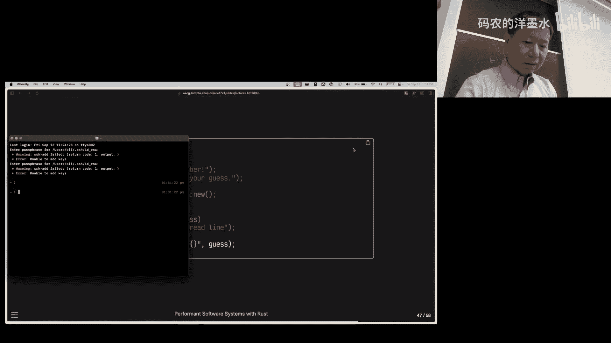

Alright， so I'm gonna just make it a little bit bigger。 I have a nice terminal here。 So playground。

 and to actually try to get started， I wanted to create a brand new project。

 last time we talked about it。 we just say cargo new。 And in this case， we would like to just。

 you know， give it the random names。 Let's say guess。😊，Now， it basically says we are creating this。

 And so we just say guess， C guess。 And let's take a look。 what's going on here。

 So it created just like last time we mentioned， it created a git repository with a default Git ignore。

 So。😊，So I'll get ignore right here。 and then we have an SRC and basically。

We will have the default rust code right here。 Obviously， we wanted to use some kind of an I D E。

 So my default is my Z I D E。 So I'm gonna create that Z right here and。

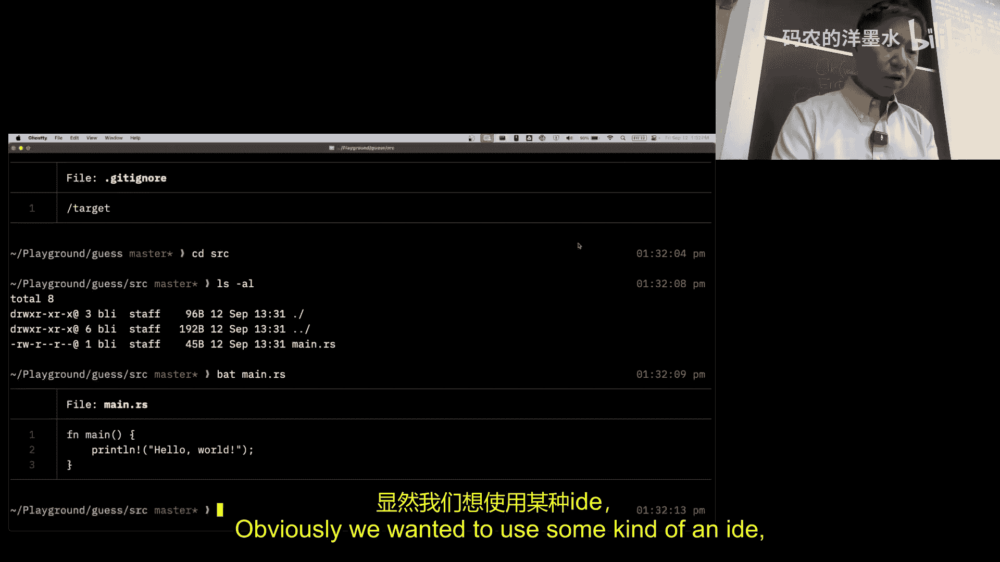

A I gonna just try to replace。Try to replace。The the code that we just copied right here。Right。

 and how do we actually try to compile it。 Well， last time we mentioned that we're gonna just do cargo build。

 and that would be sufficient to compile this。 And since this one does not require any third party crate sizes just a standard library compiled successfully。

Let me just change something here。Let's just get rid of this， get rid of the expect， what happens。

If I do this。It's going return a result type， and I don't have an expect。 So I'm going save it。

 I'm going to press command S， save it。 And then immediately， you see。That there's some kind of。

 I'm not sure if you can see it。 Let me try to。Make it a。

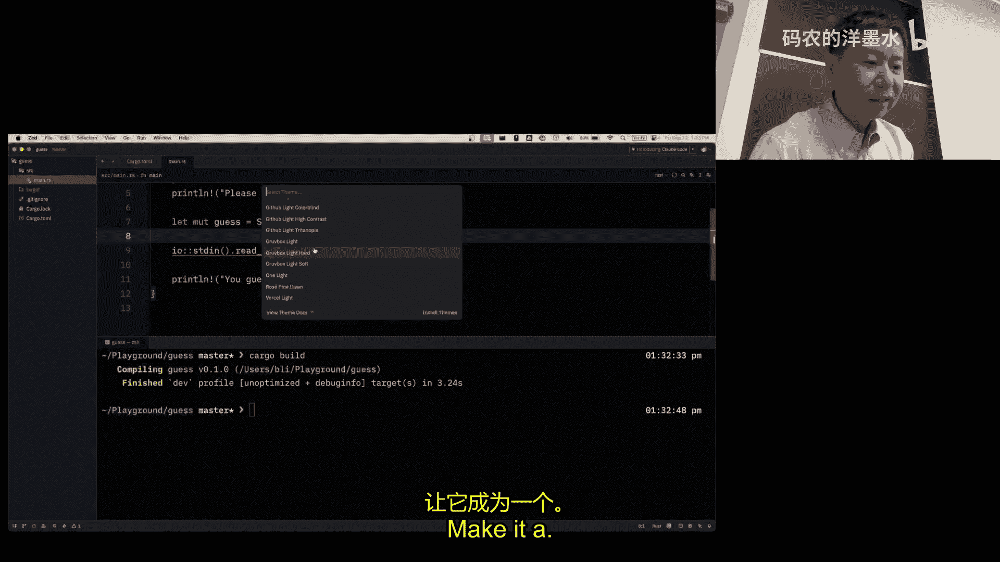

Light light mode。 So immediately you can see that there's some kind of a error right here。

 This is from the the I D E from the rust analyzer。 And we can see that even without building this。

 it will tell me what the actual compile time error is right here。 So I can certainly build it。

And it's gonna to give me， obviously the same thing。 I can do cargo build。

 I can do cargo check either way。 It's gonna be fine， and it will give me the same error right there。

So I can scroll through this error。 were gonna tell me what what's the error。 But the basic error。

 the basic idea of this error is saying that unused result that must be used。

 This is actually not an error。 As you can see， this is like a warning。

 So its it's not really preventing the compilation to succeed。

 It's just something that is the compiler didn't quite like。 So it's gonna say， you know。

 like this result maybe an E R error variant， which should actually be handled。

 We are not handling it。 And that's where the warning is。 So。Going back。

 then we got rid of the warning。 And because the dot expect handles that particular result types error variant。

 So that will eliminate the warning。 And that's gonna be fine。I can also do this。 Can I do this。

Just put the gas inside。You know， I saved it and nothing happens。 So cargo check is fine。

 cargo build is fine。 And if I want to run it， cargo run， and that is。You guessed 3。

 That's fine as well， so。It's okay。 If I put gas in between the， the braces， that's fine as well。

 question。好时公。我不等一边。Yeah。The question is can we store it later。

 of course we can we can store it later and we're going to try to do that actually later on today in the same example。

 we're going to try to do it， we're going to store it probably in a variable and we're going to try to process that separately so this is just a convenient convenience function that we are using Of course we can store it。

😊，Now， so I can put it in here， but what if I wanted to do some kind of a expression right here。

 So can I do something like this， guess plus2， can we do that？No。What'， what's gonna happen。Well。

 I just saved it immediately， You can see that it's as invalid format string expected。

 So if I do cargo build， it's gonna just give me this something that is it just can't understand it。

 You cannot put expressions inside this braces。 only the variables。

 So if you really have expressions。 You're gonna have to take it out。 do something like this， right。

 Can I do this。I can save it。 It still says something。 It says mismatched types。

 So if I actually try to build it again， it will say mismatched types， errors E 0，3，0，8。

 We talked about it last time。 And of course， if you want。

 you can actually get more explanations of this particular error。

 and the type mismatch is because that guess is a string。

And here we're trying to add it to an integer。 And that's not something that the rust allows。

 So it says we expect a string。 In fact， we expect a string slice， a stirer。 And we found an integer。

 So we're gonna have to give it a string slice。 So， for example，A great guess。Something like that。

 And then we can try to build it。 Oh， now it works。 So let's run it， so。You guessed two great guess。

 So that's great。 As you can see， there's a little bit of you know， unexpected。

 because great guess starts from the second line。 So which means that there's some kind of a new line character right after my my string my two right there。

 And that's because that the new line character。 something I entered。 when I say to enter。

 That's the new line character。 And that new line character is obviously not thrown away。

 So it's gonna be part of that string。 So when I print the string。

 it will print the new line character， which you know， conveniently。

 we just say great guess in the new line。 And that's exactly what we wanted。 So that's great。

 So I can do something like this。 And let's get back to the original example。😊。

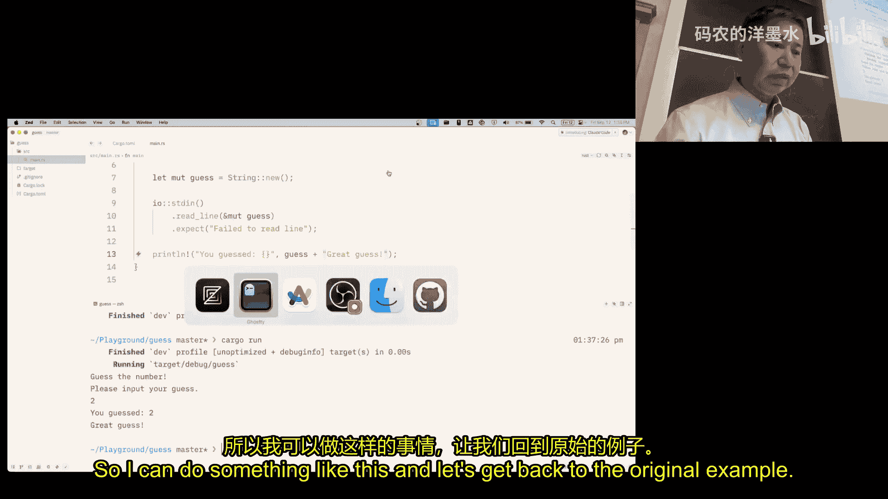

Alright， so now we're done with the demo。 So let's try to do something here。

 Let's try to generate a sequence number to generate a sequence number。

 We need a random number generator because we need to generate random number between  one and 100。

 We wanted an integer right there。 So to do that。 we need to。We need to add a third party crate。

 right， a third party crate right here。 We need to add it。 So to do that。

 we need to go to my dependencies， which is the carmo cargo dot Tomo。

 And I'm gonna just put in Rand 0。9 or something like that or 0。8， something like that。

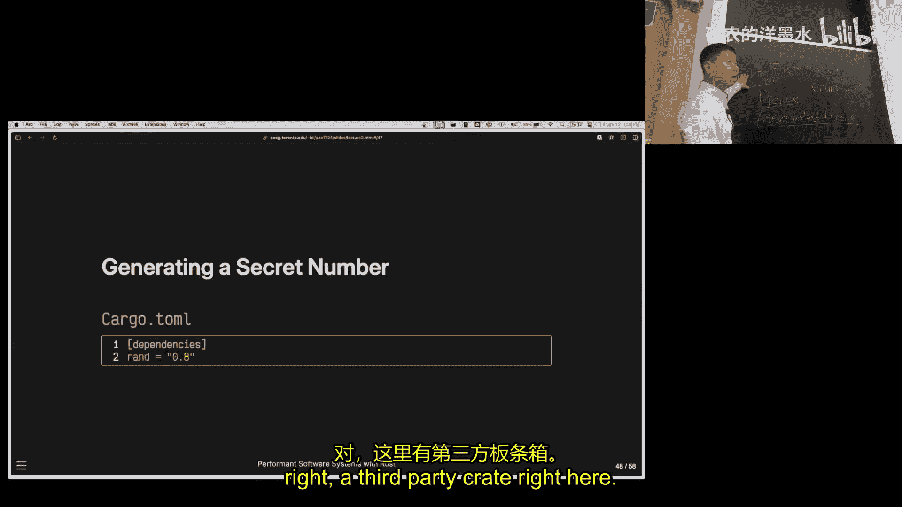

Of course， you could do it， but you don't have to do it like this。

 You could also try to do cargo ad R。That will do it automatically。

 and you can see it will just add it right here。And it is the latest version，0。9。2。

And last time we said that we're going to have cargo update and we didn't show like a big example here。

 so let's do cargo update here， just understand a little bit more about cargo update。

 so cargo update is all about versions of existing dependent packages。

 so in this case my program is dependent on the random number generator， the R package。

So that would be the part of the dependencies。 However。

 I have some freedom into specifying what kind of version。I'm dependent on。RightSo in this case。

 if I directly say cargo a R， it will automatically give me the latest version。And。

 and that's something we could change。 For example， I can change it back to 0。8。

So if that's the case， if its say cargo。Update， it will update it。

 and it will just say dash that verbal。 because I wanted to have printing a little bit more。

 it will update it， but it will downgrade 0。9。2 to 0。8。5。

 which is the highest point version inside 0。8。So if you say 0。9 you want the highest version of 0。

9 if you say 0。9。2 same thing， you want the highest version in 0。9。

 if you directly say0 you just want the highest version in 0。 something， it doesn't really matter0。

 whatever as long it not 1。 something2。 just highest version in 0。 something。

 so that's something we could do， for example， if I do it again。

 and it will update automatically to 0。9。3， which is oh sorry， 0。9。2 right here。

 which is the highest version for ran package for0 for 0。 something。

So that's something they could do， I can downgrade it and I can upgrade it， 0。7， for example。

 I can just cargo update verbals and that oops。And that will give me the 0。7。3。

 which is the highest version in 0。7。 I could you know do whatever I wish I can say 0。4 for example。

 depending on what I wanted， it goes to the highest version in 0。

4 if you don't know what is the current version， you could actually do something called cargo tree cargo tree will automatically not only print out the actual version of R。

 but everything that your program depends on not just R and everything that ran depends on。

 that's why it's called cargo tree。 it's a tree of dependencies in this case， cargo tree if I have 0。

4 it only depends on the actual Lib C， which is the C standard library Ru obviously always depends on the C standard library However。

 if I actually try to change it to something like 0。

8 it will be cargo update it will be basically if you do a tree again， it will be 0。8。5 and 0。8。

5 not only depends on the lip C， but also a few other additional packages and those packages depend on other packages and so on and so forth。

 it becomes a treat。😊，And we could actually try to do this like this。 It will be stuck at 0。8。

 In fact， it will be stuck not only at 0。8 but all of these versions just to make sure that your code works with all of these different versions of the dependent packages and that is part of the cargo dot lock so rust compiler will store all of the version numbers in cargo dot lock for all of the packages not only what you depend on directly。

 but also your dependencies depend on and they depend on and so on so forth recursively everything is stored in cargo dot lock。

 which means that all of the versions are frozen until you have run cargo update if you don't run cargo update。

 it will not update anything cargo dot lock is gonna give you the current version So when you say cargobu。

 it will just use all of these versions inside the lock。Vion。So that's something that we could do。

 And if you wish you can actually commit cargo dot lock into the Gid repository and and the benefit of doing that is that if someone else checks out the code and try to compile it。

It will always be using the versions that you intended this code to be compiling with。Right。

 so it's always a good idea to commit the actual lock， cargo dot lock into the actual。Gt repository。

 And this is something that is not enjoyed by a lot of the other programming languages。 This is very。

 very modern。 For example， something like Python， you know， it doesn't really have a lock。

 unless you use something like U， which is like a modern way of managing Python packages where you have a U dot lock in Python you don't really have that。

 So it's kind of like you know， like not really as good as the cargo package management system。

 So this is cargo dot lock。 you highly recommend it that you commit it into your Gi repository。 And。

 of course， anytime you wish you could actually update your your versions by just running cargo update and that will update to the latest versions that your version wanted。

 So if you want 0。8， it will update to 0。8。5， which is the latest in 0。8。😊。

So that's exactly what we wanted right now and we're going to come back to this a little bit later。

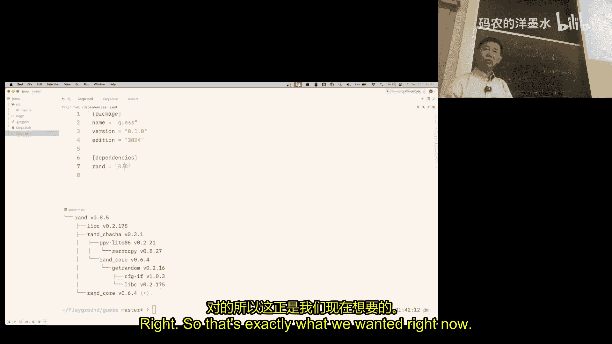

Just mention updating crates， running cargo updating our live demo。

And now let's use the actual functions in our third party crate to generate a random number。

And to do that， what we wanted is， we wanted to use some。Rent dot threat， R， N， G。

 dot Gen range and one dot dot equals 100。 What is that。What is that， That sounds kind complex。

 So first of all， rent is obviously our crate。 Thrat R N G is。

Is one of the functions in that particular crate that generates a random number generator threat underscore RNG basically explicitly called for the threat local random number generator。

 which basically guarantees that the random number generator runs within the local threat。

 otherwise you need threat safety。 So threat local is what you return from threat underscore RNG。

And that's the random number generator that is going to return by this particular threat RNG and then you use the random number generator and call it gen underscore range。

 so you want to generate a random number in that range and what is the range well you give it a range and en rust a range is represented by dot dot so one dot dot equals 100 would be a range between 1 and 100 inclusive on both sides inclusive of1 and inclusive of 100 if you don't have equals it is not going to include 100 so that's。

Exactly what we wanted。 So I'm gonna pass a range as a parameter to get range。

 and it's gonna give me a random number。 And the type of the return value。 What do you think。

 What is the type of the return value。It's gonna be。An integer， exactly。 So the integer would be a。

 what we typically call， We're gonna come back to this later， typicallyy call I 32，32 bit integer。

That is a， you know， that is could be positive and negative。

 So that's something that we wanted as random number。 It's what we return from get range。Allright。

 so now。We can just print it out， obviously。 So let's copy this code。

 So let's copy this code right here。

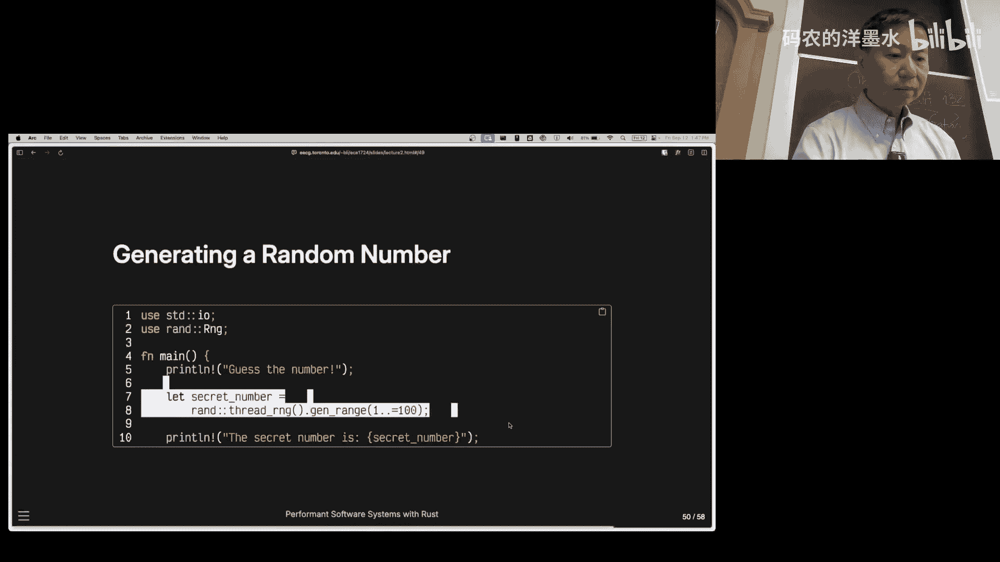

And let's， let's try to do it and put it into our。Dmo right here。 So I'm gonna。

Generate the random number right after we declare a guess or even before it doesn't really matter。

 And then'm gonna save it。 And oops。Cargo build。Update。Cargo build。And it's gonna build it， and。Oops。

 something's going on here。 What's going on here。Well it says no method named Gen range found for struck thread range in the current scope。

Well， what does that really mean here？What does that really mean here Well。

 it turns out this is kind of like a cryptic error message。

 it's a little bit more cryptic until you get familiar with it。

 you know sometimes when you got get one of these cryptic error messages you say oh。

Let AI handle this for me。Right， no， you should not be doing that。

 You should understand exactly what's going on。 What might be the era rather than letting the AI to handle that for you。

 because if you let AI handle that for， you will never understand what is going on and you will never be better than AI。

 if you're never better than AI。 You don't， you know， the AI does not need you。

 Nobody need you anymore。 You need to be better than AI。 So over here。

 you want to figure out exactly what's going on well。

What's going on here is that we do have use R R N G here。

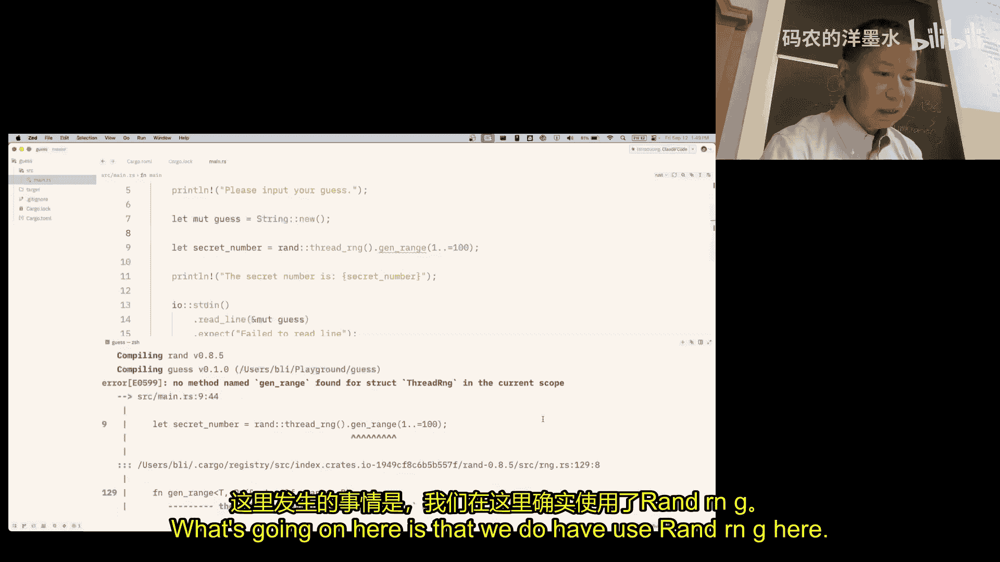

Use red R N G here is kind of  cryptic in the sense that it just。What is RM G， Well。

 it turns out RN G is something that we call a trait。And this is an advanced。Concept in rust。

 And it's pretty advanced that we're going to actually talk about in the second half of this course。

 But it turns out that this trade is required for the get range to really try to function。

 and we're gonna have to do this use。 If we don't do this use， it doesn't really work。

 We're going have to put in the use。

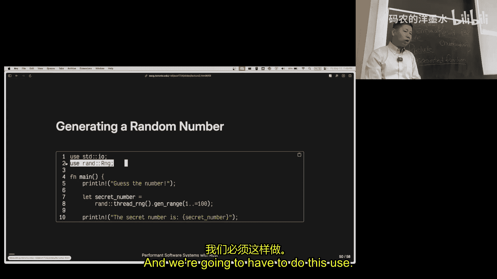

And otherwise it just doesn't work。 and it turns out that this error message you know。

 gives us if we continue to read it， it actually gives us the help that talked about this and that's exactly what we want it to do and this basically says the Gen range is not implemented because it's not in scope。

 whatever that implements it it's not in scope and that's the trait RNG RNG is a trait and this is something that is something we're going have to bring into scope by using it by importing it at the beginning and that's what we want it。

 So after we save it you can see there's nothing here。

 so I just say cargo built it will build successfully So that's great。Except。

If we were to upgrade it。So if we were to upgrade it， cargo update， if we don't say cargo update。

 it will not， it won't change anything。So if you don't， oh， it， it will change。

 we're gonna have to because we already we kind of updated the number here。

If we directly say cargo build， it will， it will update automatically。 And so it will build。

 but it's gonna give us some kind of a problem right here。And these problems are kind of warnings。

 It will still be able to build。 but it will give me some warnings。 And this is kind of lucky。

 We're kind of lucky in the sense that 0。9， as compared to 0。8。

 it is not really like a breaking upgrade in the sense that it will not break。

 It will not give me compile time errors。 We're kind of error we're kind of lucky in a lot of cases。

 when we upgrade a crate to a more recent package， it will give me compile time error rather than a compile time warning。

So in this particular case， it did give me some compile time warning saying that the thread RNG is kind of deprecated。

😊，You know， it's kind of a deprecated function。 So we should not be using it， but if we do use it。

 it will still be able to compile， but it's not suggested。

 Sam thing with Gen range is kind of deprecated。 And we we have already renamed it to random range。

 So that's something we could actually directly use。 So let's try to， you know。

 it's says use deprecated method Gen range。 so。Our random range。

 And that's something we could actually try to do and immediately fix that problem。

 That compile time a warning。 And then over here， it says it's deprecated。

 so we should rename it to R N G。So that's something we wanted to do。

 And then it will compile without the problem。 So after you upgrade to a later version of the same package as you same crate。

 you will still probably need to fix some of the code。

 And that's something that you have to keep in mind。 after you actually try to bring it back to。

To the latest version of the crates， you're gonna have to fix your code。

 And if we actually take it back and we try to build again， it's gonna give us。Ers and so on。

 because it is our new code is not backward compatible to the old version of R。

 So that's not something we have。 So cargo build will not actually work。

 So it's not something that is compatible between different versions。

 We're gonna have to be careful to know a little bit more about each one of these crates。

 We're gonna have to say cargo doc。Dash dash open。 It actually gives gives us documentation for these crates directly。

 We don't even have to do Google search gives us directly。 So this is the documentation。

It has to compile first。 So let's let it compile。 And。

 and it will actually give us a kind of like all of the， not only my own。Kind of my own program。

 But also all of the crates that this program depends on。 For example， R。

 all of the documentation related to that R is available right here。 So over here， this is the 0。9。2。

 the latest version of random number generator crate。 and it has the random range。

 which is the one that we actually used。 Here's an example of using it and so on so forth。

 So a lot of that is available in the documentation。 and it's just one handy command away。

 So that's pretty nice to have。 And let's get back to our regional demo。😊。

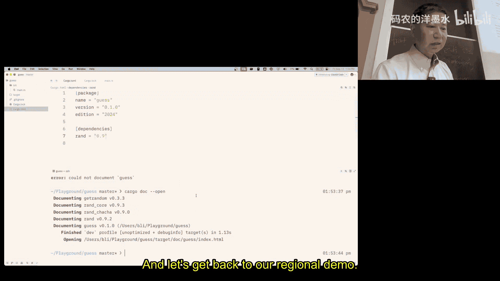

All right， so that would be generating a random number。

And that's the doc dash dash open to use this command to consult local documentation。

Now let's try to compare the gas to the secret number。

So what we're going to do is that we're going to try to use a new。Kind of module。

 which is the standard library module。 It's in standard column column compare CM column column ordering and that module basically had and in fact。

 module is CM， but ordering is not a module。 ordering is a enum and that enum similar to result。

 which is an enum ordering is an enum and that enum is something we could use in our code to compare the two numbers。

 the user's guess and my secret number， So how do we do that。 How do we compare。 Well。

 this is our first try。 We're gonna say guess dot compare my secret number。

Now compare is I'm going to return the ordering ens variant， one of these variants。

 either less or greater or equal， if guess is greater than s number is going to give us ordering less。

 if less is greater than s number is going to give us greater otherwise is going to give us an equal。

So this is something that is very different from what you are used to。Which is in C and so on。

 where you tend to use some kind of an if statement and if else， if and so on and so forth。

This is preferred。And the reason for that is because match。Is like a special way inside rust。

 That is the preferred way of making decisions。😊，You know， making decisions right here。

 Why is it the default way why is it the preferred way of making decisions。 Well。

 it's preferred because match。Is exhaustive in the sense that we're going have to give match all of the possible alternatives and how do we handle these alternatives。

 all of them。 If we miss one of them， it's going to be a compile time error。

 So that's something we wanted question。It's sort of like switch， but we call it match。 Yes。

 it's sort of like a switch， but in switch， you know， very similar to match。

 we will be able to give us different you know different cases here we don't call it a case in CNC+ we'll call it the case over here。

 it's actually called an arm this is actually interesting because in rust designers。

 they want to be unique So they actually change the terminologies here we call it the match arm rather than a switch case。

 So forget about all of everything that you learn in C plus just completely forget about them column arms。

 So each one of these is a match arm and we're gonna have to and in CNncC plus for the switch statements is' not so strict。

 So if you actually don't provide some of the alternatives。

 it will not give you a compile time error for match， it will in rust。

 which is why we prefer this for making decisions right here。

 So in this particular case it's also easier to read rather than。😊。

And L sayF and LF and so if LF and L because。Theres not only something that is going to be less error prong。

 but something that is just one line for every single or one block of code for every single case that we have or in rust terminology。

 every single arm that we have in this case， obviously we just just print out the actual information back to the user。

I'm gonna get to this。 Yeah， so very good question。 So my question is which I already told you。

 I'm gonna show a demo here。 My question is， will this compile。😊，Right。

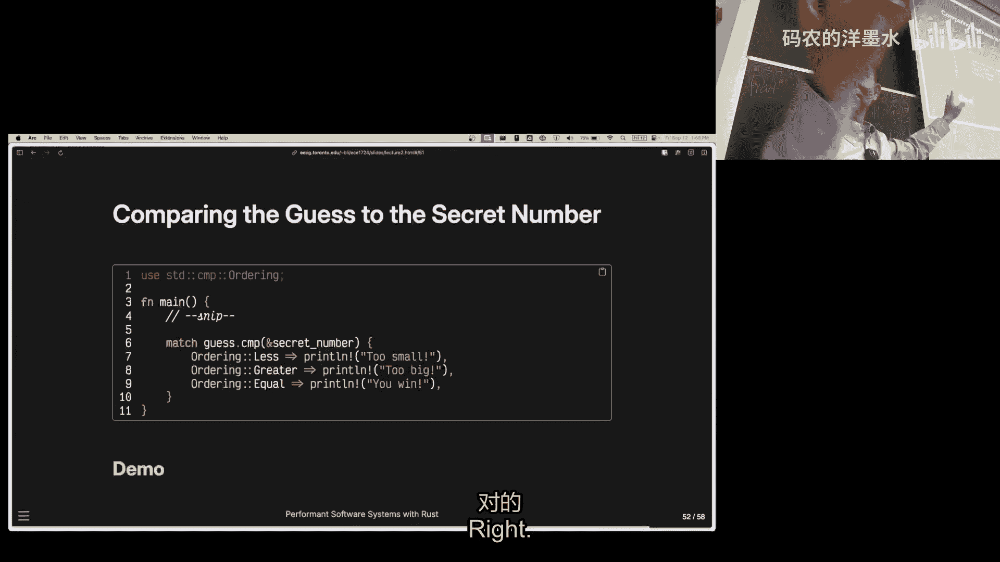

It's not gonna compile， right， Let， let's give it a try。 just put it in。 In fact。

 let's just copy this directly like here and just put it into my code right here， right after。

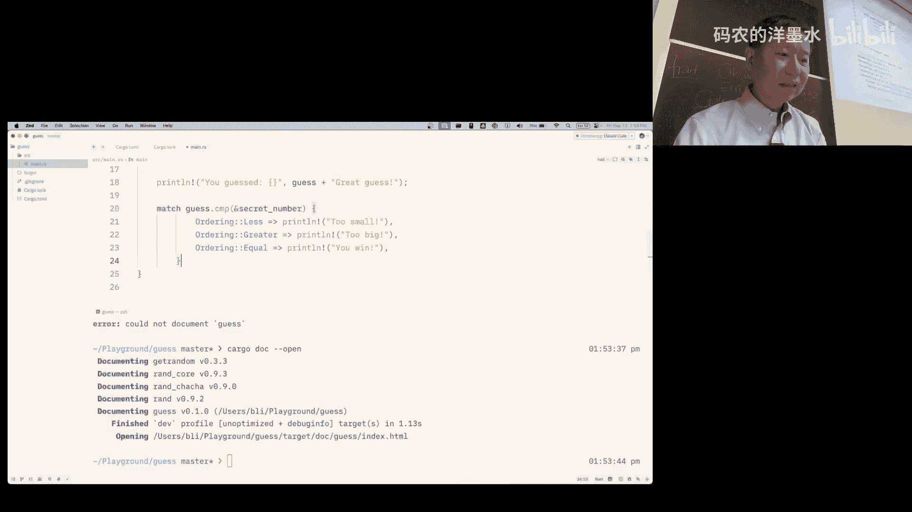

You know， just like this。Is it gonna Well ordering is not there。

 So let's copy and paste ordering here。 So just put the ordering here。 And as you can see。

 after I save it， it will automatically format it。 This is automatic formater， which is nice。

 It will rank all of the use you know， statements alphabetically。

 So that's exactly what I want it clean and simple。 And then I'm gonna just build it。

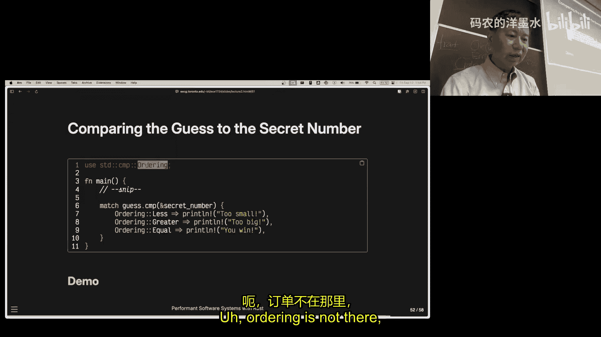

And the question is， will it compile？Now， it's not going to compile because， as you can imagine。

 this is， again， an E 0，3，0，8 type mismatch error。 So we wanted a。Number to compare with the number。

But gas is not a number guess。Its a string。RightSo we wanted to compare a number with a number。

 but this is a string。 So how do we fix it？We have to fix it。

 we're gonna have to compare a number with a number。 We cannot compare a string with a number。

 So that's why we're gonna have to convert the string into a number。 So the question is。

 how do we convert a string into a number。 So to do that this is our old code。

 We read it from the standard input to do that， We will just say。

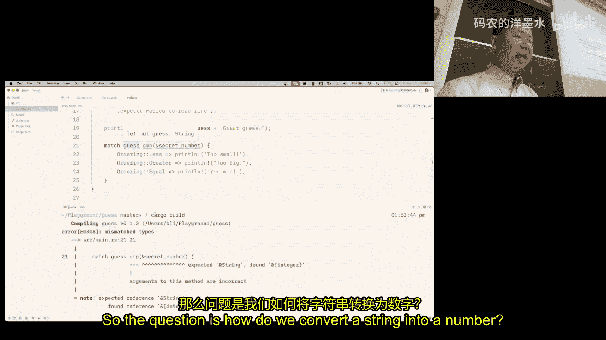

Dot trim， dot parse and dot expect。Why do we have that trend？第二。To get rid of the carriage return。

 exactly。 So it trim is gonna trim all of the leading white spaces and all of the trailing white space。

 And then in this case， we obviously have a trailing， at least a trailing white space。

 which is the character return。 Get rid of them before we convert into an integer。

 And parse is gonna do the actual personsing of converting to something。 And what is that something。

 Well， here we have this explicit type annotation， which is column U 32。😊，U 32。And that's， oh。

 by the way， that's not I 32。 That's U 32 that we have。And U 32 is what we have。

 and that's unsign integer， which only allows the positive numbers from 1 to 100。

 So U 32 is what we wanted。 And that's explicitly mentioned in your code。

 It's explicit type annotation。 rather than using type inference。 We're using type annotation。

 And this is something that we give to the compiler to tell it that this is。

Going to be expected to be an integer。 So that's what par is going to return。

 And that's something we're gonna to convert to an integer。

And expect is going to be here because parts can lead to an error。 Again。

 the return type of parts is going be a result type。 So we wanted to say， okay。

 if we cannot convert successfully to an integer， we're going try to crash and we're going to print something like an error message such as pre。

 please type a number。Question。So that's a very good question。 Will it return whatever specify。

 That's exactly what's going to do。 It's going to return the type that is specified。Now the actual。

Code has one additional thing I would like to mention。

 which is that we're reusing the actual variable name guess。 The identifier guess is reused。Previous。

 it's a guess， which is a string。 And now the gas becomes a U 32 integer。 And this is okay。In rust。

 And it's O。 And it's called。Shadowing。So shadowing is just a special term for Ru to really try to say that we are sort of。

第。Clearing a brand new variable right here。 But we're going to just reuse that name。

And because of this， you know， the previous variable is gonna just directly go out of scope。

 We're gonna have a brand new variable。 It could have a brand new type。

 It doesn't have to be the same type。 obviously， And this is something we can certainly do。

 And this is more elegant because we don't have to if we don't have support for shaling we're gonna have to say guess string or guess integer or some kind of a new name。

 And that kind of messed up the code。 The code is not as beautiful question。😊，Yeah。😊。

that's going to be a great question， it's a much more involved discussion。

 but we're going to come back to this but that's a great question。

 it's a great question growing how do we it's not even in chapter three of the textbook。

 it's going to be way later that we're going to talk about it。😊，All right。

 so that's something we could do and we can get the actual yes converted into an integer。

 but reusing the same name。And that's how we actually put it into the actual code and make it a compile time。

 So we're going just come just do this。 We're going make it a compile time。

 get rid of the compile time error right here， so。

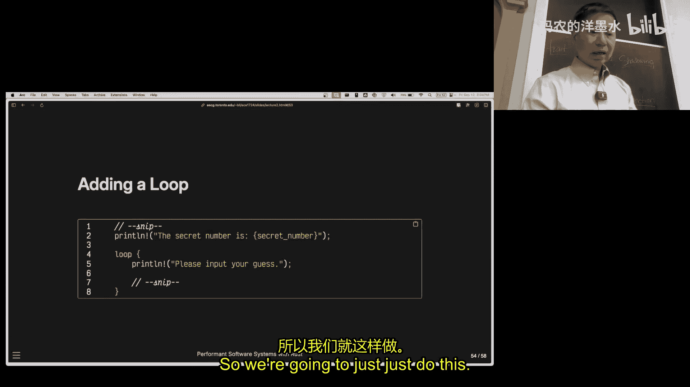

Just try to do this right here。What's going on here？You know。

 live demos are problematic because every time you do a live demo。

 something is going to go wrong and what's going on here。Anyway。

 let's take a break for five minutes and let me figure out what's what's the problem here。 Thank you。

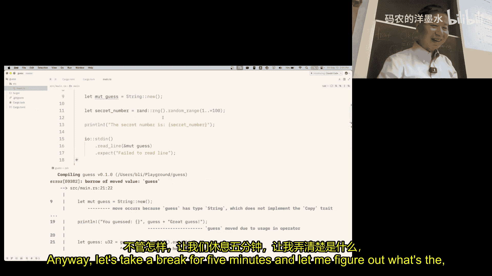

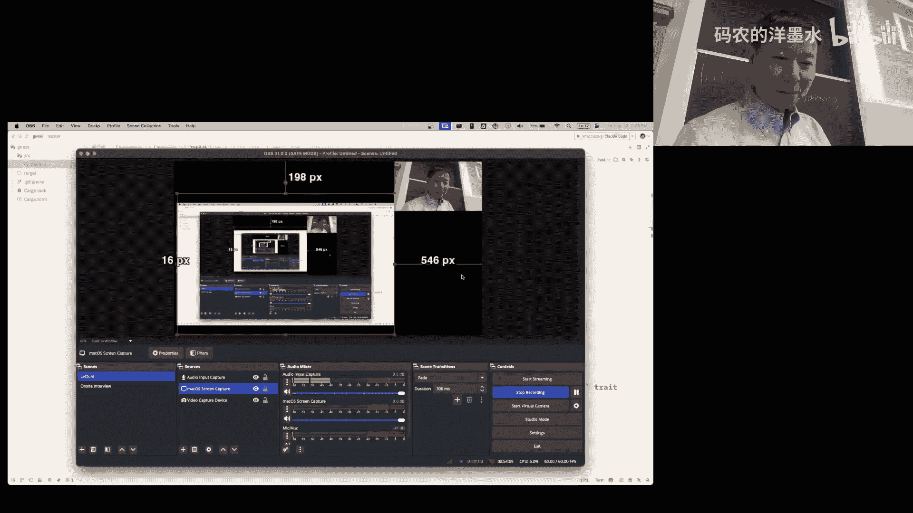