# Rust构建高性能软件系统：03：猜谜游戏 🎮

在本节课中，我们将通过构建一个简单的“猜数字”游戏来巩固之前学到的Rust基础知识。我们将从零开始，逐步实现一个程序，它会生成一个随机数，然后让用户猜测这个数字，并给出提示。通过这个项目，我们将学习如何导入库、处理用户输入、使用变量、处理错误以及进行基本的逻辑判断。

---

## 项目概述与设置

上一节我们介绍了如何使用Rust编译器和创建新项目。本节中，我们来看看如何开始我们的第一个Rust项目——“猜数字”游戏。我们将从查看初始代码和演示开始。

首先，我们需要创建一个新的Rust项目。打开终端，使用Cargo命令创建一个名为`guess`的项目：

```bash
cargo new guess
```

这个命令会创建一个新的目录，其中包含一个基础的Rust项目结构，包括`Cargo.toml`配置文件和`src/main.rs`源代码文件。

---

## 导入库与主函数

在Rust中，我们需要使用`use`关键字来导入标准库或其他第三方库（在Rust中称为crate）中的功能。这与Python中的`import`或C/C++中的`include`类似。

以下是项目初始代码，它导入了处理输入/输出的模块并定义了程序的主入口点：

```rust
use std::io;

fn main() {
    println!("猜数字游戏！");
    println!("请输入你的猜测：");
}
```

*   `use std::io;`：这行代码导入了标准库中的`io`（输入/输出）模块。`io`模块不属于“预导入模块”（prelude），所以我们需要显式地导入它才能使用其功能，比如读取用户输入。
*   `fn main() { ... }`：这是每个可执行Rust程序的入口点。`fn`是定义函数的关键字。
*   `println!`：这是一个宏（由`!`标识），用于向标准输出打印一行文本。宏是Rust的高级特性，这里我们只是使用标准库提供的这个宏。

---

## 变量声明与可变性

接下来，我们需要一个变量来存储用户的猜测。在Rust中，我们使用`let`关键字来声明变量。

以下是声明变量的代码：

```rust
let mut guess = String::new();
```

*   `let mut guess`：这里声明了一个名为`guess`的变量。`mut`关键字表示这个变量是**可变的**。在Rust中，**变量默认是不可变的**。这意味着一旦给变量赋值，就不能再改变它的值。如果你希望变量可变，必须显式地使用`mut`。这种设计有助于避免无意中修改了不该修改的值，是更安全的编程实践。
*   `String::new()`：这部分调用了`String`类型的**关联函数** `new`。关联函数是针对特定类型实现的函数，这里它创建并返回一个新的、空的`String`实例。我们通过`::`语法来调用关联函数。
*   **类型推断**：虽然我们没有显式写出`guess`的类型（如`let mut guess: String`），但Rust编译器能够根据等号右侧的值（`String::new()`的返回值）推断出`guess`的类型是`String`。这是现代语言中一个方便的特性。

---

## 读取用户输入

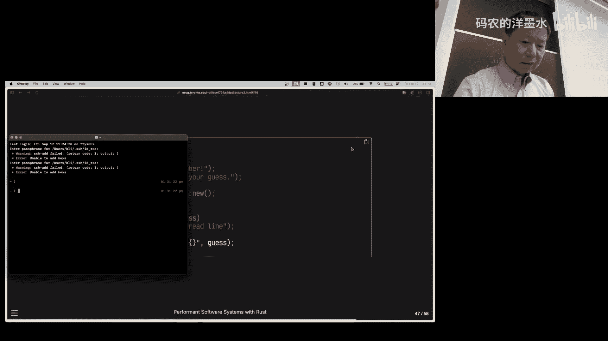

现在，我们需要从用户那里获取输入。我们将使用之前导入的`std::io`模块。

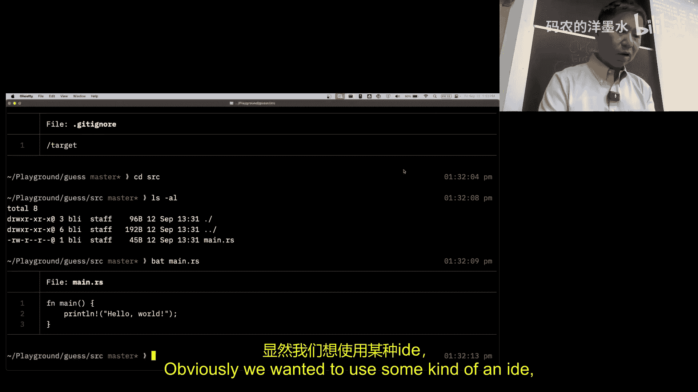

以下是读取用户输入的代码：

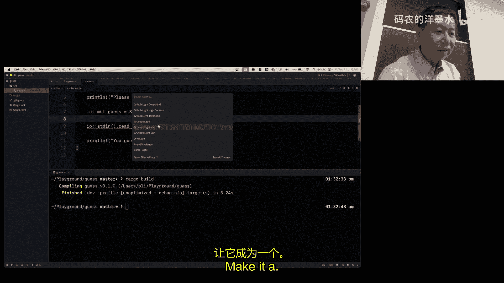

```rust
io::stdin()
    .read_line(&mut guess)
    .expect("读取行失败");
```

以下是该过程的详细步骤：

1.  `io::stdin()`：这个函数返回一个指向标准输入流（stdin）的句柄。
2.  `.read_line(&mut guess)`：我们在输入句柄上调用`read_line`方法。这个方法的作用是读取一行用户输入。
    *   `&mut guess`：这里我们将变量`guess`的**可变引用**传递给`read_line`。引用（`&`）允许函数访问我们的变量而不获取其所有权。`mut`表示这个引用是可变的，这样`read_line`方法才能将读取到的字符串存入`guess`变量中。我们将在后续课程中深入讨论所有权和引用。
3.  `.expect("读取行失败")`：`read_line`方法返回一个`Result`类型。`Result`是Rust中用于错误处理的枚举类型。它有两个变体：`Ok`（表示操作成功并包含结果值）和`Err`（表示操作失败并包含错误信息）。
    *   `.expect`方法处理这个`Result`。如果`Result`是`Err`，`expect`会打印我们提供的错误信息（“读取行失败”）并使程序崩溃退出。如果`Result`是`Ok`，`expect`会提取出`Ok`内部的值并返回它（在这个例子中，返回值是输入的字节数，但我们暂时不关心它）。这是一种简单的错误处理方式，后续我们会学习更优雅的方法。

---

## 使用第三方库生成随机数

我们的游戏需要一个秘密数字。我们将使用一个名为`rand`的第三方crate来生成随机数。

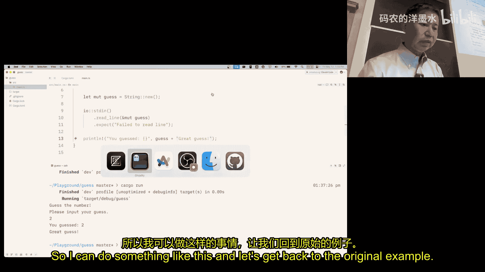

首先，我们需要在项目的`Cargo.toml`文件中添加`rand`作为依赖。你可以手动编辑文件，或者使用Cargo命令：

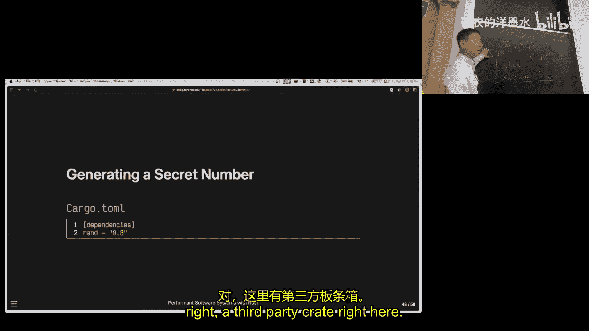

```bash
cargo add rand
```

这个命令会自动将最新版本的`rand` crate添加到`Cargo.toml`文件的`[dependencies]`部分。

**关于依赖和版本管理**：
*   Cargo有一个强大的依赖管理系统。`Cargo.toml`中指定的版本号（如`rand = "0.9"`）是**语义化版本**要求。
*   `Cargo.lock`文件会锁定所有直接和间接依赖的确切版本，确保每次构建环境一致。通常建议将`Cargo.lock`提交到版本控制系统。
*   运行`cargo update`可以按照`Cargo.toml`中的版本规则，更新依赖到可用的最新版本。

添加依赖后，我们可以在代码中使用`rand`来生成随机数：

```rust
use rand::Rng; // 需要导入Rng trait

let secret_number = rand::thread_rng().gen_range(1..=100);
```

*   `use rand::Rng;`：这里我们导入了`Rng` **trait**。Trait定义了类型必须实现的功能集合。`gen_range`方法是在`Rng` trait中定义的，所以我们需要导入这个trait才能使用它。Trait是Rust的核心概念之一，我们将在课程后半部分深入讲解。
*   `rand::thread_rng()`：这个函数返回一个特定于当前线程的随机数生成器。
*   `.gen_range(1..=100)`：在随机数生成器上调用`gen_range`方法。参数`1..=100`是一个**范围表达式**，表示从1到100（包含两端）的闭区间。这个方法会生成并返回该范围内的一个随机整数。返回类型通常是`i32`（32位有符号整数）。

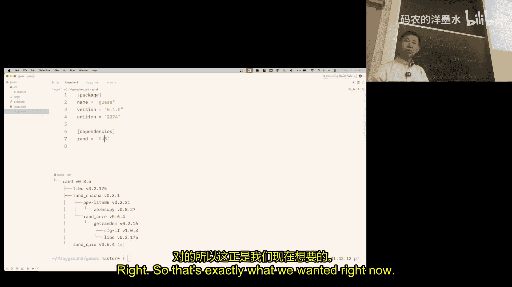

**查阅文档**：如果你不确定某个crate的函数如何使用，可以运行`cargo doc --open`命令。这会在浏览器中打开本地生成的文档，包含你的项目以及所有依赖crate的文档，非常方便。

---

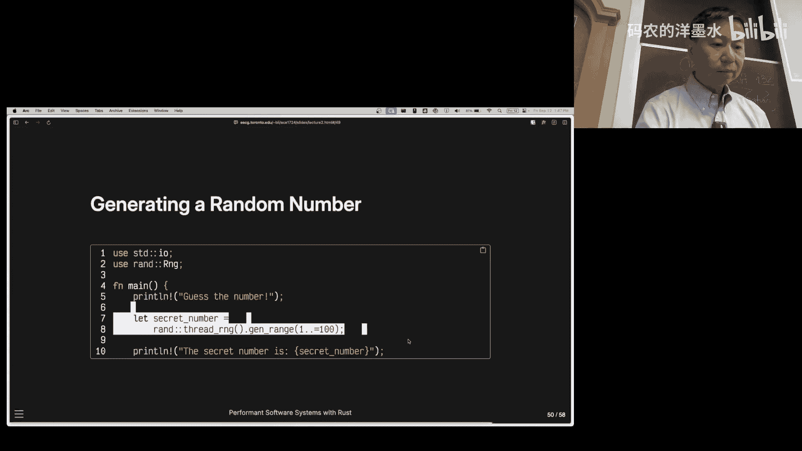

## 比较猜测与秘密数字

现在我们已经有了用户的猜测（字符串）和秘密数字（整数）。我们需要比较它们。但首先，必须将用户输入的字符串转换为整数。

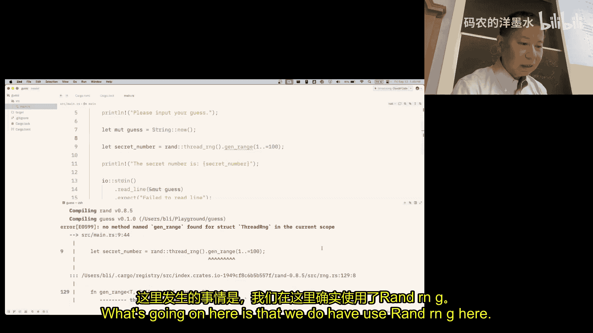

以下是转换和比较的代码：

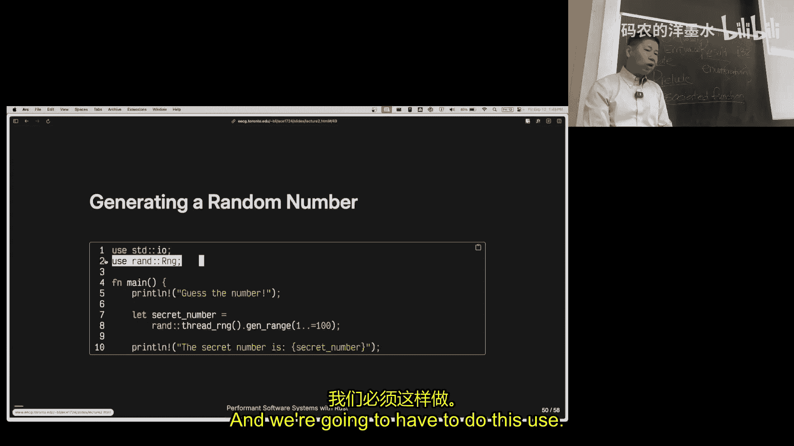

```rust
let guess: u32 = guess.trim().parse().expect("请输入一个数字！");

match guess.cmp(&secret_number) {
    std::cmp::Ordering::Less => println!("太小了！"),
    std::cmp::Ordering::Greater => println!("太大了！"),
    std::cmp::Ordering::Equal => println!("你赢了！"),
}
```

以下是该过程的详细步骤：

1.  **字符串转换与阴影**：
    ```rust
    let guess: u32 = guess.trim().parse().expect("请输入一个数字！");
    ```
    *   我们创建了一个**新的**变量，也命名为`guess`。这叫做**变量遮蔽**。新的`guess`遮蔽了之前存储字符串的旧`guess`。旧的`guess`变量在此之后不再可访问，新的`guess`是一个`u32`类型（32位无符号整数）的变量。
    *   `guess.trim()`：去掉用户输入字符串首尾的空白字符（包括按回车产生的换行符）。
    *   `.parse()`：尝试将修剪后的字符串解析成一个数字。因为我们在变量声明中使用了类型注解`: u32`，所以`parse`知道应该解析成`u32`类型。
    *   `.expect("请输入一个数字！")`：和之前一样，`parse`返回一个`Result`类型。如果解析失败（例如用户输入了字母），程序会崩溃并显示我们指定的错误信息。

2.  **使用`match`进行比较**：
    *   `guess.cmp(&secret_number)`：调用`guess`的`cmp`方法，与`secret_number`进行比较。`cmp`方法返回一个`Ordering`类型的枚举值。`Ordering`也是一个枚举，有三个变体：`Less`、`Greater`、`Equal`。
    *   `match`表达式是Rust中强大的控制流运算符。它根据`cmp`返回的`Ordering`值，选择执行对应的代码分支（在Rust中称为“臂”）。
    *   `match`必须是**穷尽的**，即必须处理枚举所有可能的值。如果漏掉了`Ordering::Equal`这个臂，编译器会报错。这保证了代码的健壮性，避免了未处理情况的发生。

---

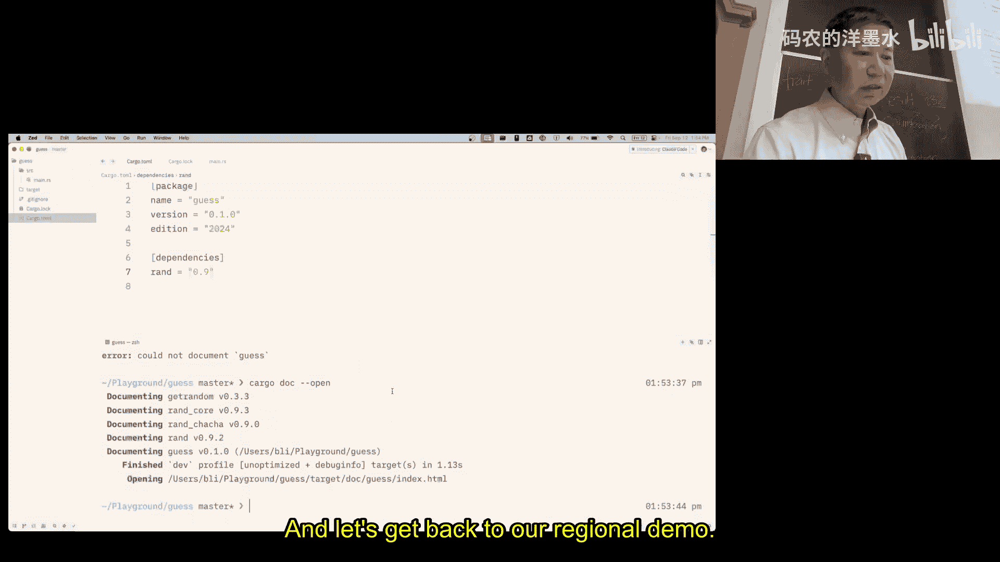

## 添加循环实现多次猜测

目前的程序只能猜一次。为了让游戏可以持续进行直到猜中，我们需要引入循环。

以下是添加循环后的核心代码结构：

```rust
use std::io;
use rand::Rng;
use std::cmp::Ordering;

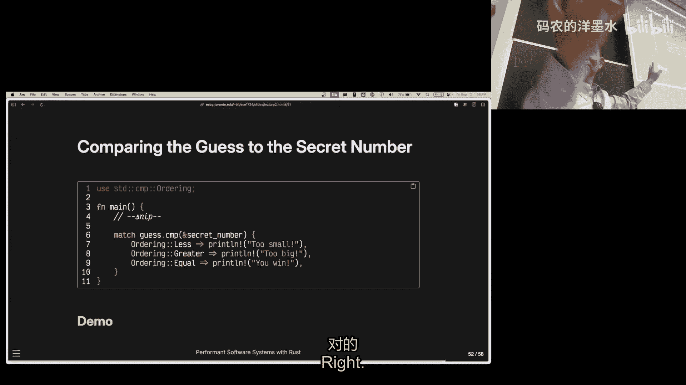

fn main() {
    println!("猜数字游戏！");

    let secret_number = rand::thread_rng().gen_range(1..=100);

    loop {
        println!("请输入你的猜测（1-100）：");

        let mut guess = String::new();

        io::stdin()
            .read_line(&mut guess)
            .expect("读取行失败");

        let guess: u32 = match guess.trim().parse() {
            Ok(num) => num,
            Err(_) => {
                println!("请输入一个有效的数字！");
                continue;
            }
        };

        match guess.cmp(&secret_number) {
            Ordering::Less => println!("太小了！"),
            Ordering::Greater => println!("太大了！"),
            Ordering::Equal => {
                println!("恭喜你，猜对了！");
                break;
            }
        }
    }
}
```

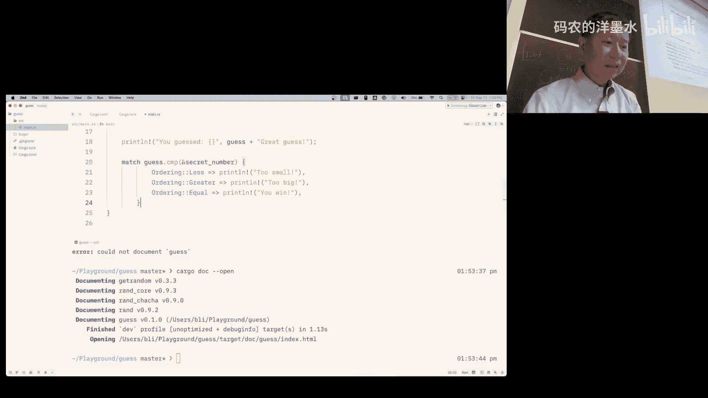

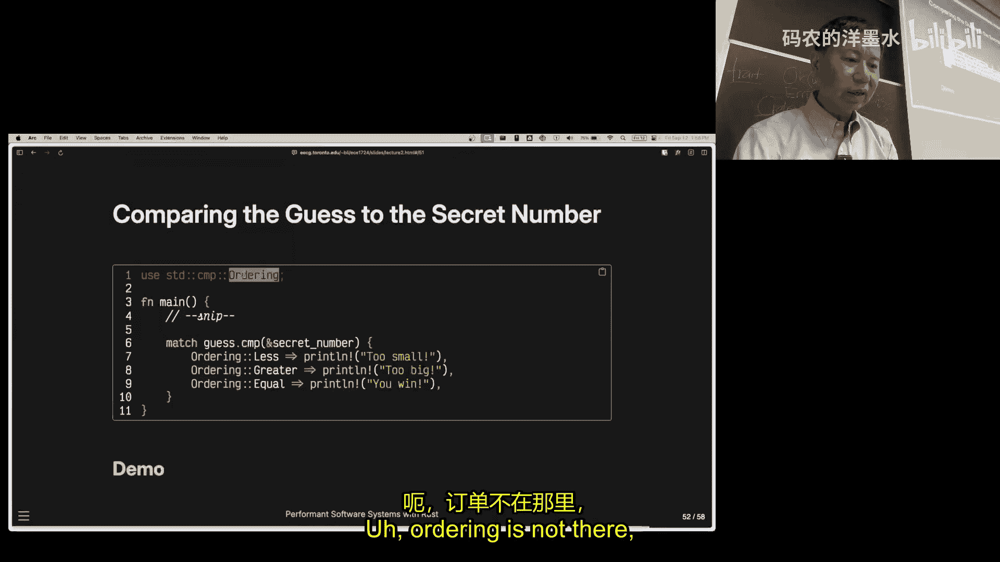

以下是循环实现的关键点：

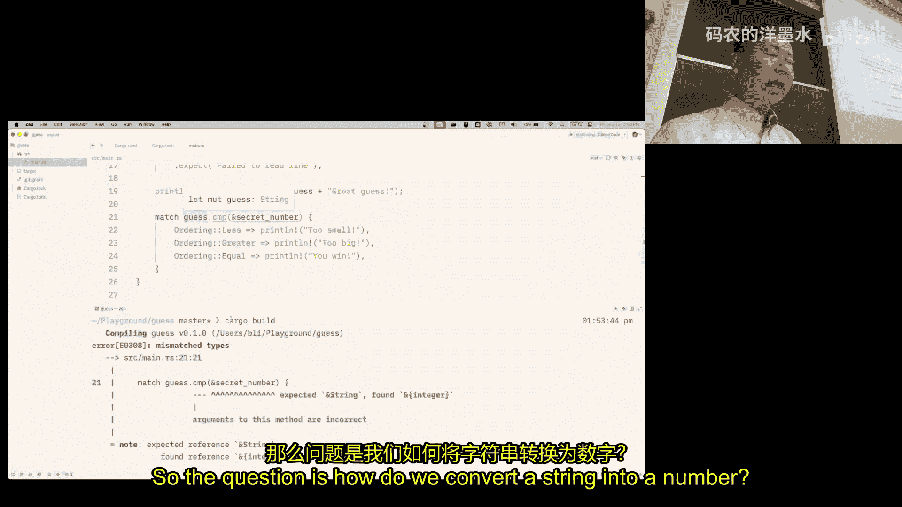

1.  `loop`：这是一个无限循环关键字。它会一直重复执行其代码块内的内容。
2.  **改进的错误处理**：在将字符串转换为数字的部分，我们不再使用`.expect`在出错时直接崩溃，而是使用了更完整的`match`来处理`Result`：
    ```rust
    let guess: u32 = match guess.trim().parse() {
        Ok(num) => num, // 解析成功，返回数字
        Err(_) => { // 解析失败，下划线 `_` 是一个通配符，匹配任何错误值
            println!("请输入一个有效的数字！");
            continue; // 跳过本次循环的剩余部分，开始下一次猜测
        }
    };
    ```
    这样，当用户输入非数字时，程序会提示错误并允许用户重新输入，而不是直接退出。
3.  **退出循环**：当用户猜对数字时（`Ordering::Equal`臂），我们打印胜利信息，然后使用`break`关键字跳出`loop`循环，游戏结束。

---

## 总结

本节课中我们一起学习了如何构建一个完整的“猜数字”游戏。通过这个项目，我们实践了以下核心Rust概念：

1.  **项目创建与依赖管理**：使用`cargo new`创建项目，在`Cargo.toml`中添加依赖，并通过`Cargo.lock`锁定版本。
2.  **导入与模块**：使用`use`关键字导入标准库模块（如`std::io`）和第三方crate中的功能（如`rand::Rng`）。
3.  **变量与可变性**：使用`let`声明变量，理解默认的不可变性，并使用`mut`关键字使变量可变。
4.  **用户输入**：使用`stdin().read_line()`读取用户输入，并理解其返回的`Result`类型用于错误处理。
5.  **错误处理**：初步接触`Result`枚举，使用`.expect`进行简单处理，以及使用`match`进行更优雅的模式匹配和错误恢复。
6.  **类型转换**：使用`.trim().parse()`将字符串转换为数字，并处理可能发生的转换错误。
7.  **控制流**：使用`match`表达式进行模式匹配和值比较，利用其穷尽性检查确保代码安全。使用`loop`创建无限循环，并用`break`控制循环退出。
8.  **变量遮蔽**：在同一作用域内重用变量名，用于类型转换等场景。

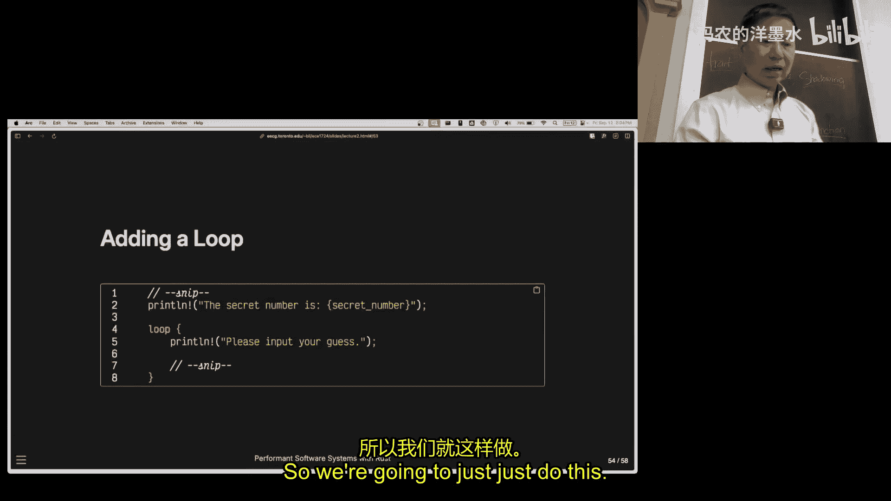

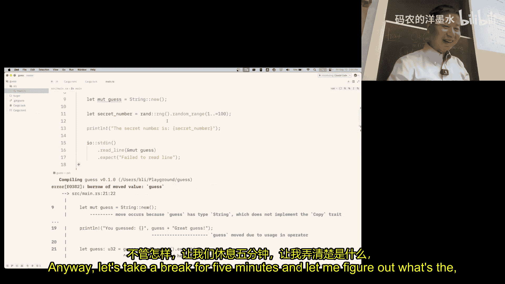


这个简单的游戏涵盖了Rust编程的许多基础但重要的方面。在接下来的课程中，我们将以更快的节奏深入探讨字符串、所有权、结构体等更复杂的主题。