# 【全集 附课件】多伦多大学 使用Rust构建高性能软件系统 中英字幕 1080P p04 Lecture 4 - 基础编程概念 -BV16V62BhEuf_p4-

Okay， so let's get back to the elector。

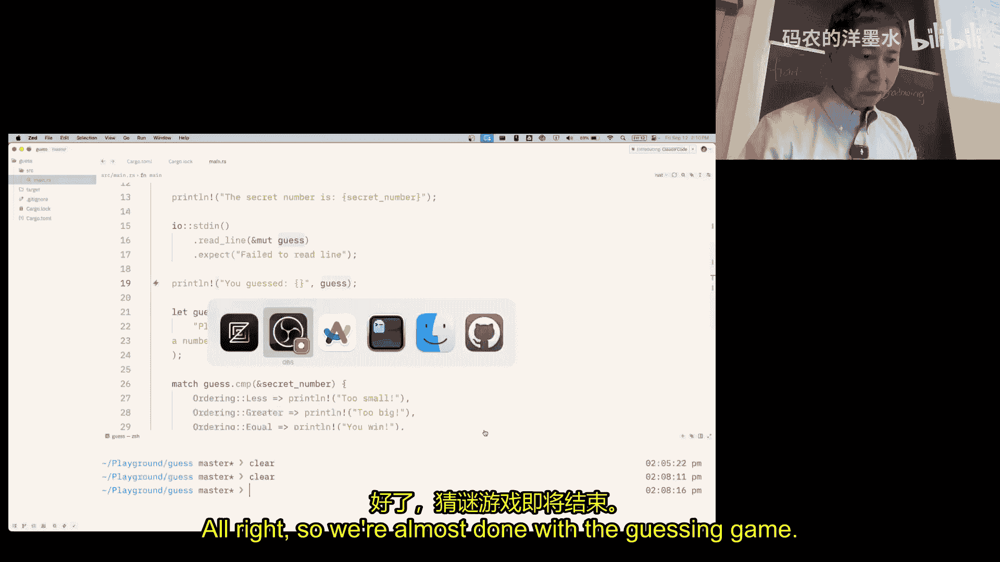

All right， so we're almost done with the guessing game。嗯。

We just need to add a loop and to add a loop， we just say loop and that is pretty simple。 In fact。

 we will have other ways of doing loops we're going to talk about later today as well。

 but for this particular case， I just need to add a loop and that's something we could just directly do。

And let's just say add a loop right here。

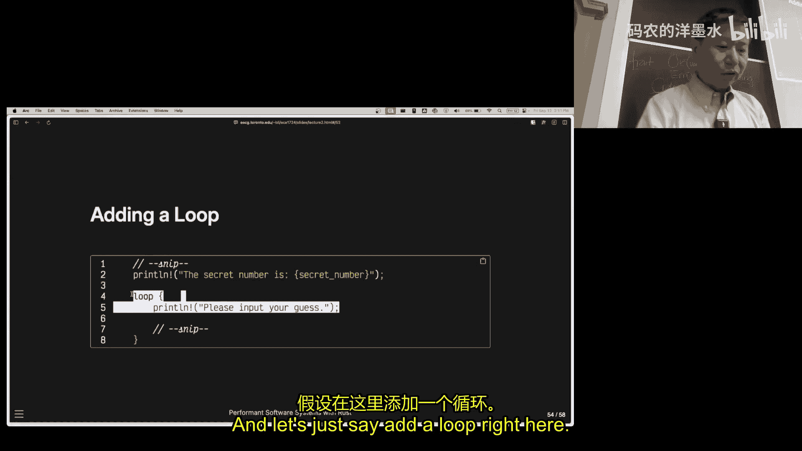

Inside the loop。And， again。Maybe add the loop right here。Please input your guess and。Right here。

 So that's something we could do。 and it hopefully compiles。 Yeah， it does compile。

 and that's how we add a loop。

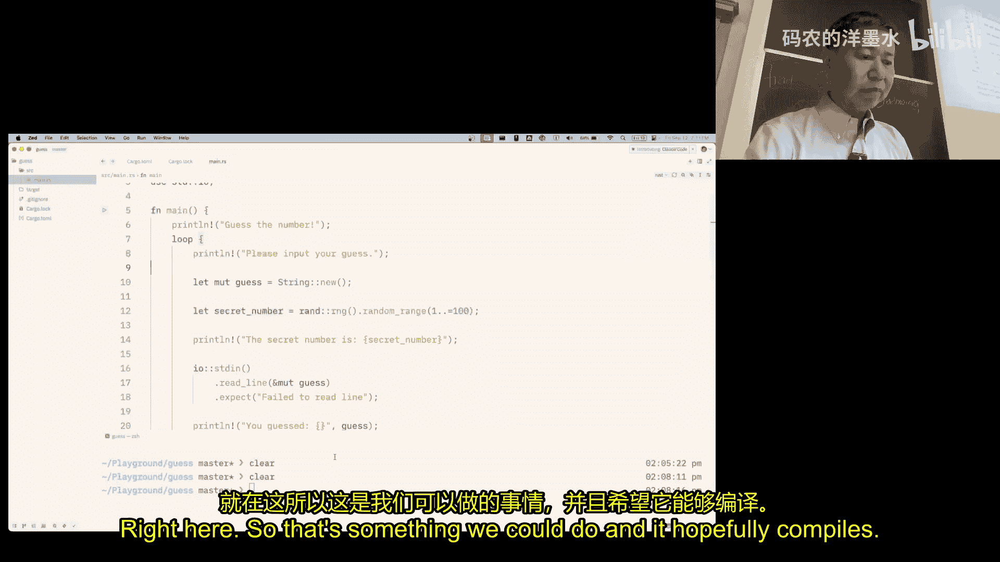

But after we add a loop， we will have to somehow exit the loop and to do that。

 what we could do is that we could just print your win at the time when the guess is correct and then just break out from the loop using brake This is very simple as same thing as C andC plus plus and so on。

 so just directly say break。

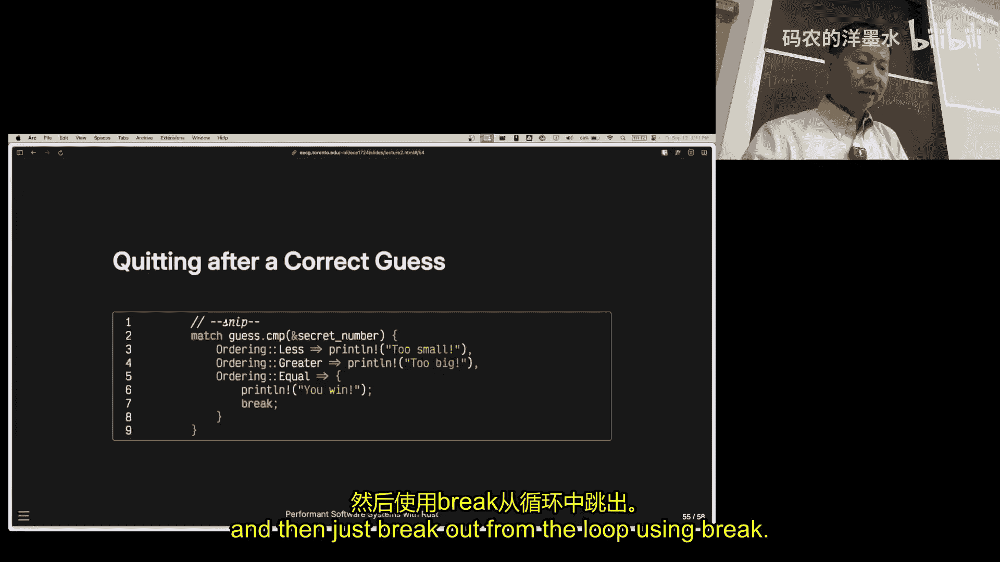

And that would be good enough for exiting the loop。

 And then we would like to also handle invalid input because the desirable behavior of our code is that when the user enters something invalid。

 we will prompt the user to somehow guess again， rather than kind of crashing right there。

 it's crashing is fine， but it's not as desirable。 So we would like to use this new way of handling a result type。

 which is。

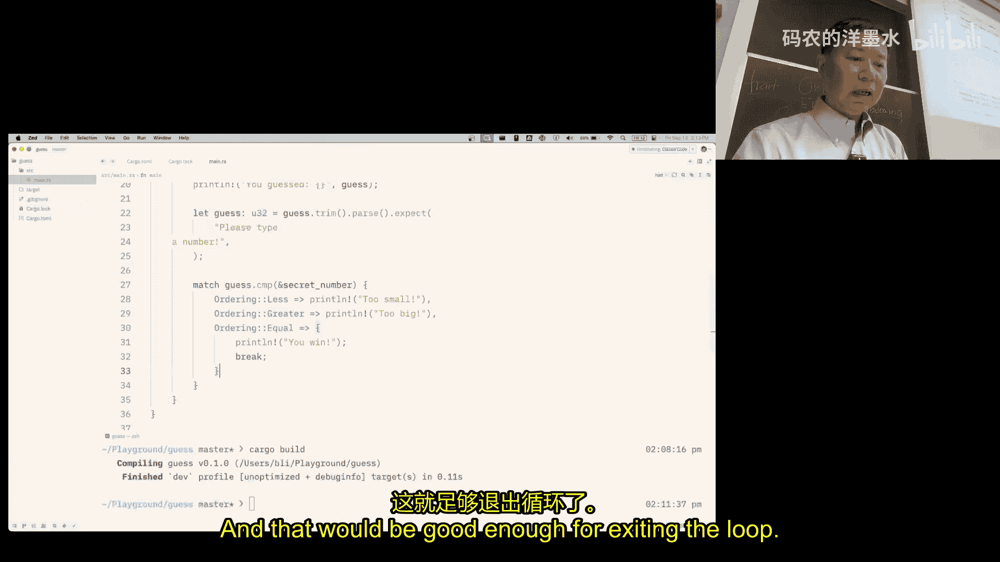

We're going to take the actual return value of parse。And that is the result type。

And that result type is either OK variant or an error variant。And again。

 as we mentioned both okay and the error variance， they are kind of like a holder they can hold a value and in okay。

 the value is the number that we actually have successfully parsed and what we wanted to do is that we wanted to use match again with two arms and one is to handle the okay and the second arm is to handle the error and the first one very simple。

 we just need to return you know as a return value of that expression。

 how do we you know it's just like a function， any expression will have a return value or you can think of it as the value after evaluating the expression So match is an expression。

And the return value of that expression or of evaluating that expression in this particular arm is going to be。

The number that the O variant contains or holds。And the second arm is going to be the era。

 And we do have an underscore。 What does that mean。Yeah。It exactly。

 it's just like a catch all kind of a special character to tell us that we're catching everything。

 So as long as it matches anything over there， it doesn't really matter。 What is the value。

That would be a successful match to this particular arm。

 And that means that it's gonna be something we're gonna handle。

 And here were calling continue to continue into the next iteration of the loop。

 So that's hopefully what we want it rather than the result。

 So let's try to improve the code using this rather than the expect。 We kind of use this。

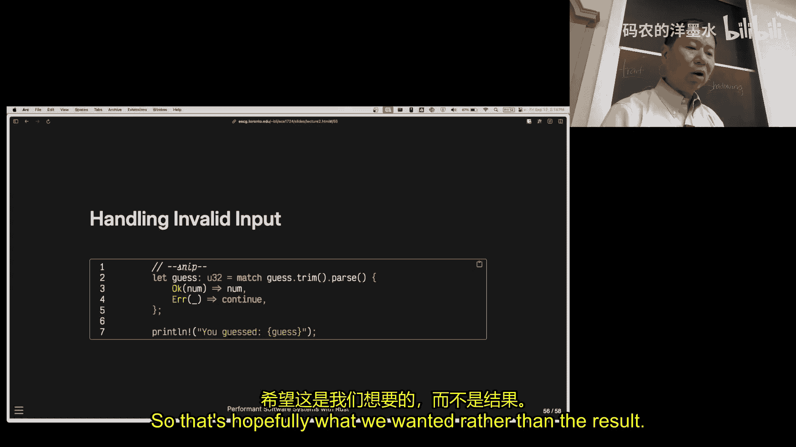

To improve the code。Allright so。Now， if we do something like this。It means that the。

 the result evaluating this expression match is an expression。

 Either it's the number or it's just the continue is gonna be assigned。

As the value to this particular variable， this new variable guess。

 And that's something we could certainly do。 No problem。 And that's。嗯。

Much better than expect than trying to crash if we have aarrow。

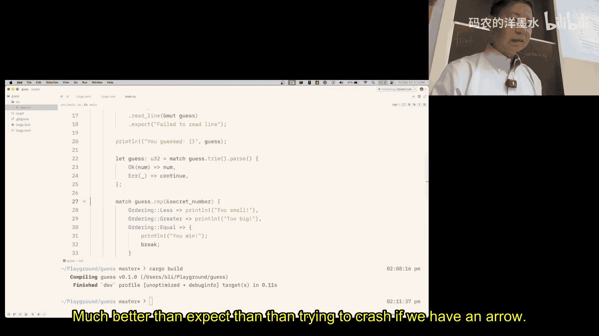

So that。

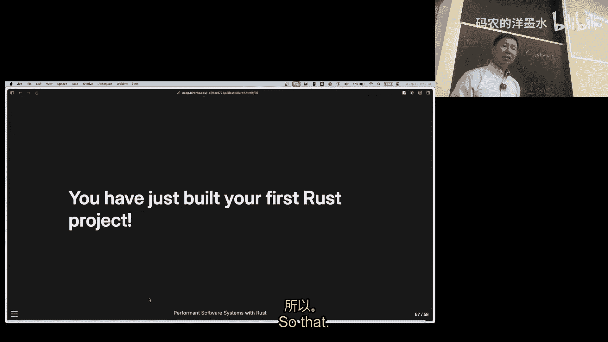

There we have everything。 So I'm gonna have to。Hopefully I'm lucky and I'm going to run it。Oh。

 let's see how it goes。 Se number is 6。 Well， that's no good。

 We should not tell the user the secret number， but little well， let's， let's give it a try。

 Well 55 is too small。 Se number is 21。 Oh， that's no good。 We should not change the secret number。

 So secret number should be outside。 So I'm gonna just put it in。

 and I should not tell the secret number。 So'm gonna have to remove that print out。 And。

So let's try to do it again。 Oh now I don't know the secret number， then it's too hard to guess。

 So anyway。If it's actually better for us to go back to know the sequence number here。

 that's going to be much easier for us to do this。 so 50， 70，61 and you win。So that's what we want。

Allright， and one more try here， if I say bye。It will not crash， right， That's what we wanted。

 Allright， So 29， and that's what we wanted。 Allright， so that's our very first project。

 It's obviously a simple program。 But this simple program gave us a lot of starting points。

 And a lot of these are still kind of advanced。 for example， the enum， you know， the shadowing。

 the string types， you know， type annotation， explicit type annotation type inference。 All of that。

 we're gonna have a lot of coverage later on。 So don't no worries。 if you are。

'm not sure about something in this particular example。 So now let's go and try to。

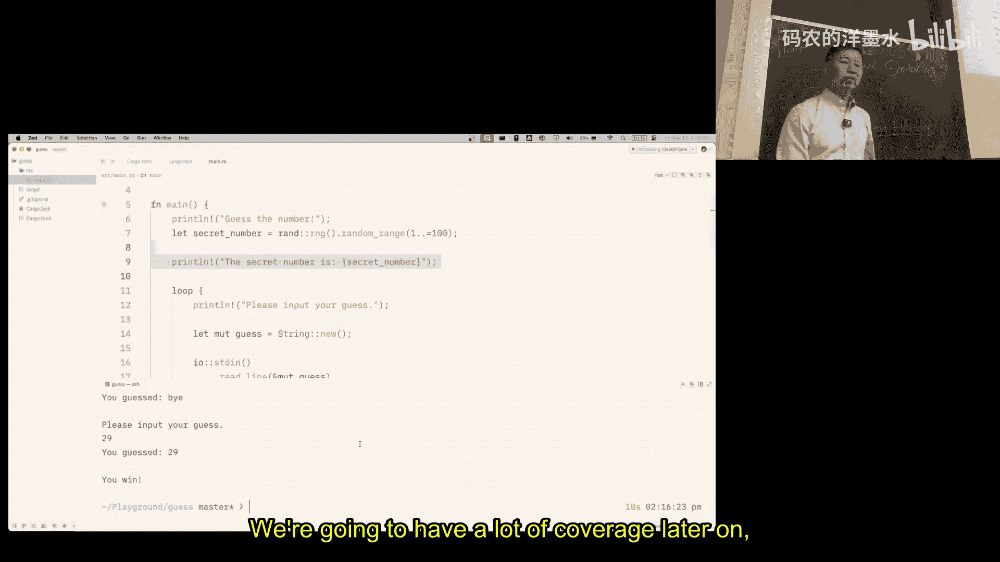

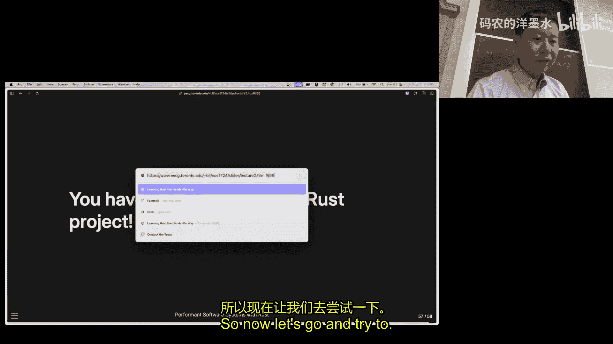

Look at the next。Episode， in terms of our slides， we're going to go to the basic programming concepts。

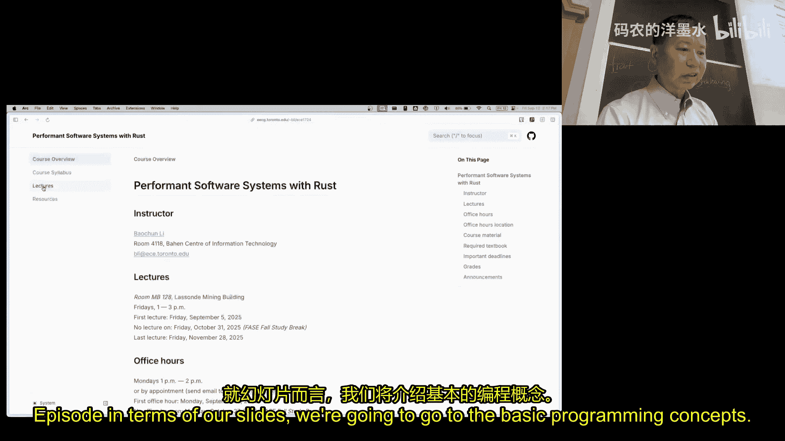

So in this particular course， as we have done in the previous lecture。

 we have been doing not just slides， but also demos。 A lot of these ideas。

 we're going to have to use demos to actually try to kind of。Reinforce these ideas。 So again。

 these live demos are hard， as you can see， lots of problems that we bump into。

 hopefully we're not gonna bump into problems I cannot fix right on the spot But if the demo is not going well。

 bear with me， I'm gonna skip to the next demo。 Allright but we're gonna try to get started talking about variables。

 So we talked about variables， our guess is a variable。

 and we talked about shadowing and so on in our example just to summarize what we talked about。

 variables are immutable by default in the sense that you're only allowed to bind the value to this particular variable once rather than you know more than once。

 And if you want it to have a mutable variable。 you have to explicitly declare the variable as mutable。

 which is what we did in line number three right here。

 So we have an immutable and we have a mutable variable。

And if we actually try to modify a mutable variable， for example， adding one to it。

 it is okay to do it。And its not gonna be a compile time error。However。

If you are trying to modify an immutable variable， what's going to happen。Compile time error， right。

 So it's gonna be a compile time error。 And that's something that is gonna。

 the compiler is gonna say error cannot assign a new value to an immutable variable。

 We're not gonna show a live demo here because it is too simple。

 but you can imagine it's gonna be a compile time error。 So that's easy to understand。

 And this is exactly what the compile is going generate。 cannot assign twice to immutable variable。

Right， and after that， it will give you some help in the sense that it's gonna help you to say， okay。

 maybe you should just call it a mutable variable before you actually try to modify that。

 And this kind of error， which is error E0，38，4 happens all the time。 all the time。 which is great。

 which is what you want， because by default， you want to declare all of your variables and immutable immable until you need to modify it。

 when you need to modify it， you will change it to mutable and that is a great habit of program。

 you should not by default put everything as mutable and then just change them as you wish no。

 you should by default， not add M U T to your variable and add M U T anytime you have this compile time error。

 So that's great。😊，And now we have constants。So constants。

 as you can see from same thing from C and C plus plus。

 these are you know just constant values and the naming convention for these constants are they they are all uppercase with underscores to separate the English words in the actual constant identifier and to declare a constant rather than using let。

Which declares a immutable variable ormutable variable here， we use cost。😡，Rather than let。

 we use cost。Now， the difference， what's the difference between an immutable variable and a constant。

What's the difference between these two， an immutable variable and a constant y。It's what？

It's determined at compile time， exactly。 And you cannot basically have a computed value based on some other variables。

 you know， to actually bind a value to that particular variable。

 which is what we did in the in the guessing game， right， here。

 everything will have to be done at compile time。 You know。

 the value of that constant will have to be known at compile time and computed compile time。

 So it should not depend on any value that is only known at run time。So exactly what question？

Exactly， but you know， you're basically assuming that everybody or including myself knew C++。

Which is a bad idea。 Don't know C plus plus， forget about C plus plus， whatever that is there。

 forget about it， bad habits over there。 Just remember that over here question。一下的。

Oh so the question is， can constant be shadow， No， you can you cannot do this。

 And the reason for that is because that constants。

 and we're going to come back to this after we talk about global variables can only be declared in the global scope。

 You cannot even put it in into the block of code into like a function or like a you know like a match expression or something。

 It can only be in the global scope。 So this basically refers to code that is。

Basically computing the values at compile time， the values of these constants。

 and after you compute values at compile time， the compiler is going to replace these named constants。

Everywhere in the code， just as if you're directly using the value in that location。

 So this is just a convenience， just a convenient name for a particular variable value and something similar to constant。

 something called static。So static， again， if you know C plus plus bad idea， don't know that。

 The reason for that is they're kind of similar， but not exactly the same static here。

Is a global variable。And that's similar to C plus plus is a global variable。 Now。

 what is a global variable， A global variable is something that。😊，In the global scope。

RightSo it's not going to be in the local scope and that means it's not going to be declared anywhere inside of function。

 including the main function， it's going to be outside of any of the local scopes is in the global scope and the same thing applies to constants。

 So both constants and static or global variables， they are global。

And that means that they will need to be in the different portion of the actual virtual memory that your program as a UniX process is going to occupy。

Which is something called a data segment。 And we're gonna come back to the data segment a little bit later when we talk about memory next time we talk about memory。

 But the basic idea here is that it's not on the stack。 is not on the heap。

 It is in the data segment。 So that's gonna be where we find our global variables and our constants。

 So both constants and globals we don't support type inference。

 They require explicit type annotation。 So here's how we declare our constants and globals here。

 global would be a static both of them。 the naming convention is all uppercase。

 and were gonna have a explicit type annotation assign a string slice to our global variable language。

 assign a constant value of 10 to our threshold constant of the type integer I 32。

 And and then we can directly use it anywhere we wish。 For example， I can print。The actual。

print the actual。The actual values， and then we could actually try to。Assign now， for constants。

 we cannot assign， and we can also not assign anything to a global variable。

 And the reason for that is because they're not really in the local scope。

 They're in the global scope， They're in the data segment of the virtual memory of your local process。

 So that's why you cannot assign。 cannot modify these， you can， if when you try to modify them。

 it will be a compile time error。 So that's something that we have。 And we can use them。

 but we cannot modify them。 So consider them to be sort of like more constant。Alright。

 I probably don't have enough time to demonstrate the constant global。

 So we're gonna skip the demo right here。Now let's talk about scope and shadowing。

 We talked about shadowing in our guessing game， but let's think about scope。

 scope is the same idea as any of the other languages such as CNnc plus where you use brace brackets to identify a block of code。

 same thing here， a block of code starts from opening brace and ends with a closing brace bracket and variable bindings are constrained to live within the block of code and that is the scope of that variable so that is going be a collection of statements within the brace brackets and we're gonna have shadowing that supported just like in the guessing game and it's okay to declare brand new variable with the same name even the same type even with a different type as the previous variable So that's something we could actually try to do。

And here's an example of the shadowing in the guessing game。

 So we are having the guess and we redefine guess。 But now we have a U 32 integer。

So that's shadowing。And now let's get to the data types。

 And we're gonna have a slightly longer story to tell you today about data types。Now。

 rust is what we call not just a statically typed language， which you know。

 CNncC plus plus can also be called a statically typed language， but I would like love to call it。

 you know， this is just one of my own terminologies。

 I would love to call it strict statically typed language in the sense that this is statically type。

 and there will be a lot of compile time checks on these static types。

 As we have previously seen the E0，3，0，8 errors in our demos where we see that there's a type mismatch that's where the type checking comes type checking happens。

 So the compiler will have to know， the types of all variables at exactly compile time。 You cannot。

Really defer this particular decision of the types of variables to the runtime。

 That's not something that RuP supports， and this is something that is very strict。

 very strictly enforced by the compiler all of the types。

 either they are inred using type inference or you do type annotation explicitly they will have to be known by the compiler at compile time。

😡，So my question is。Why。Why do we try to design rust？

As a statically typed language or in my own terminology， a strict， statically typed language。

 stricter than C， stricter than C plus kind of strict。

Why can't we just use a dynamically type language。Try to have a little bit more discussion right here。

Let's talk about Javascript。 and let's talk about Python， because both of these languages。

They use dynamic types。 And by comparing with Javascript and Python， we are able to。

Understand the benefits of static types more intuitively。So let's try to compare。

So here we have a very simple function。 And this some function is add。

 We're adding two I 32 typed integers， and we're gonna return an I 32 with the right arrow。

 It would be the return value with return type。 and we're gonna just return x plus y。

 as you can see here in rust。 We don't have to say return。 you know。

 it's not like in C and C plus this is actually one of my favorites。 You just directly say x plus y。

 you have to say return x plus y。 and it doesn't have to be in only in the functions。

 return value from functions， but also kind of the evaluation of expressions。

 whatever you return from that evaluation。 that's something you don't have to say return as well。

 So just say x plus y without any semi columnn， that's the return value for that particular function。

 So that's great。 That's what we are doing for this ad function。

 But how do how do we do the same thing with jascript。 Well， here's jascript。

 We just say function rather than Fn， just a plus B。 and。😊。

Well here JavaScript would have to say return similar to C and C plus plus I're going to have to say return。

 you know， I didn't like this， I prefer x plus y， but it's okay， it's just language。

 just syntax and just say A plus B， which one do you prefer？😊，The top word about。Well。

 for this particular example。I would actually prefer to bother。What why？ Well。

 it's because that at the bottom basically say a plus B。But it can be， two integers。

Can also be two floating point values。 doesn't have to be two integers。 So I can add whatever I wish。

 can add， you know， two strings if I wish， right， anything， whatever I wish to do。

 I can actually do it in Javascript in rust。 No， in rust。

 you're gonna have to add two not just the integers to I 32 type integers。

 If you want to add two floating point values， you're gonna have to have another function declared。

That's pretty bad， right， That's kind of inconvenient。 But， you know。

 that's the cost that you pay for having the static types。So here it looks like I prefer ja。

 but you know， if we need to add to floating point v numbers。

 JavaScript version is going to give us data automatically， but not the rust version， right。

 So that's something I kind of prefer the dynamic types， but Ru doesn't support at。

 Why is rust a better idea。In what situation is Ru a better idea， In other words。

 what are the benefits of static types。What are the benefits here。Right， so let's think about Python。

Let's think about Python。Before we get back to JavaScriptscript。So in Python， let's again。

Try to implement something。First version again， on the top is gonna be the rust version。

 as you can see from FN， whenever you have FN， that would be the rust version。

 So we're gonna try to pass a string inside into this function。

 And this function is called get length。 And it's gonna get obviously the length of the string。

 So we're gonna call the dot length method of that particular string type。

 And it's a string slice that we put in as the parameter is gonna return U size。

 which is an architecture dependent integer type。 And that would be uns integer。

 and that's something we're gonna return。 So again。

 everything is strict The parameter type is strict。 The return type is strict as well。😊。

So if you were to compile this code， what happens？😡，Y。Exactly， it's a compile time error。

 It's not crashing。 Crashing is like a runtime。 It's no， it's a compile time error。 You。

 you don't get to run it。 And the reason why it's compile time error is。

That it doesn't match the type， right， So you're passing in J， but you're expecting a string slice。

So that's something that is not going to work。Right， so that's going to be a compile time error。

 So compiler is going to give you arguments to this function are incorrect and。

We expect a string slice， and we found an integer。 So that's what the compiler is going to tell us。

What about Python， Well， Python。We're gonna do something called de。 And to define that function。

 We're gonna pass in a string， and we're not gonna declare the type for the parameter。

 and we're not gonna declare the type of the return value。

 It will just simply return the length of the string。 Sounds easy。 Sounds great。 dynamic types。

 Very convenient and so on so forth。 What happens if we say， get length，10。In太。Yep。What happens？不哪位。

It would like allow it。So you think it's going to allow？Exactly。

 it's a run error at runtime because we're calling land function。

 and that function only applies to the strings。 So you that function is gonna give us a runtime error。

 right， So get length 10 is gonna give us a runtime error and that runtime error reads last time I checked type error column object of type int has no land。

😊，That's the actual runtime error。Now， here's the problem， which one would you prefer？

Would you prefer a compile time error or would you prefer a run time error？Yeah。Yeah。Exactly。

 so nobody should prefer a runtime error。 Everybody should prefer a comp time error because a runtime error means。

If it's a cell phone， it's a mobile app， it's going to crash back to the Springboard。

 if it's a website that' you the server is going to crash。Something bad is going to happen。😡。

That's the runtime error and you might say it's fine。

 it's gonna to tell me the runtime error right there。

 but what if it's you know a Python driven web server。

 you know whoever who the user might be is interacting with the web server using a web browser and is not able to read that error message right there。

So nobody should ever prefer a runtime error， everybody should prefer a compile time error。

 and this is exactly what rust static typing is going to give us the actual benefits of static typing will actually convert as much as possible。

Run time errors to compile time errors。But can't runtime errors be easily called and fixed in Python。

 Sure， I mean， if you're able to read the console log and read that error， you can catch it。

 You can fix it。 No problem。 But what if this is something like an execution path that you can。

 you never tried。 You never tested that path。 and it just crashes at runtime in the production website。

 that's gonna to be a problem。And let's get back to JavaScript right here。

 JavaScript sometimes had problems too。So what if I'm coming back to this ad function in JavaScript。

 if I'm actually calling ad5 and 10， the first one is an integer and second one is a string。

 what happens。😊，Yep。Exactly， it's going to give us 510， and that is not what we intended。

We intended this to be。Adding the values of 5 and 10。

 rather than concatecnating 5 and 10 by converting 5 to a string and concate2 as a string。

 And that is silently done by Java。 and that is horrible， horrible。This is like a nightmare。

 you're going to lose sleep over this。😡，You know， because this is extremely hard to debug。 very。

 very hard to debug。 Very difficult。 And this is something that you don't want to have。 And however。

 this is what we call a logical error。 And this is something that can easily be called。

By static typing in rust。 And that's exactly why we give up。

 give up a little bit of inconvenience in terms of declaring different functions with different types。

And even there， we could have some way of mitigating those。By using trades and so on。

 And we gain a whole lot。 We converted a lot of。Runtime errors and logical runtime errors， not just。

 you know， crashing runtime errors into compile time errors。 So in rust， you know， the。

 the saying has it that。If the program compiles。Pretty much it runs correctly。

 It's going to be successful。 So that's really nice to have。😊。

So logical errors can also be converted to compile time errors。 That's a great thing to have。

 And that's all due to the static typing and the rusts strict static type make it much easier to catch all kind of errors in rust。

 So hopefully by this time， you will be convinced that rust is。😊。

One of the greatest programming languages ever。Because it converts a lot of runtime errors。

 including logical and crashing errors to compile time errors。And of course， if you must use Python。

 for example， you're doing machine learning， you're going to have to use Python or you're doing web servers and websites。

 you have to use JavaScript in those cases， sure， use Python， use JavaScript for everything else。

What should you use？Obviously， rust， nothing else， right， There's nothing else that even compares。

Alright， so let's get to the scalar data types。 And we talked about it。

 I'll just give you a few examples for integer types。 We have 32 bit。

 We have the signed integer types。 I 32 unsigned U 32，32 means thats 32 bits。

And each one of these integers will have 32 bits that we use to represent that integer。

 or we could actually have whatever number of bits that the architecture is going to give us。

 So which called architecture dependent length for that particular integer type。

 And that is the I size and the U size。 And obviously。

 I size is not compatible with I 32 U size is not compared with U 32。 So。

If you actually try to mix them， it's gonna be a mismatch  E 0，3，0，8 error again。

 mismatch of types and so on。 There be no silent conversion that's in C and C plus plus， you know。

 nothing like that。You know， strict type right here。Floating point types。

 we have 32 bit floating types and 64 bit floating types and very nicely calling them F 32 M F 64。

 really nice。😊，And now we can do some arithmetic operations。 obviously， we can produce the sum。

 We can produce a difference。 We can produce the product， we produce the quotient， whatever we wish。

 certainly， there are you know these arithmetic operators available to rust just like any of the other languages that you have。

 we can actually do integer division as well， just like other languages were truncating towards 0 to the nearest integer。

 and we can do remainder as well， which is the percentage。

 And that's the same thing at C and plus plus and all of the other languages as well。

 So all of that would be available。 And of course， tons of additional operations are available。

 you can refer to whatever that is the the reference for if you need to use additional operations。

Nothing special over there。The bullying type， the bullying type is a special type， and this is。

 of course， you know， very different from integer types。

 How many bits do we use to restore the bullying type。😊，Internally。Yeah。8， exactly8。

 we cannot just use 1 bit， right， gonna have to be， you know， by the line。

 So 8 bit to store the bullolean type。 And however， internally it's 8 bit。

 but we only have two types two values， two potential values2 or false。 And of course。

 I can use type inference， just say let T equal to2 is gonna be a bullan type variable or we can just explicitly do type annotation that's fine as well。

 Whatever that you prefer。 And bulling types are not really very often used inside rust。

 you typically， you don't typically do bullan type declarations of variables。

 you directly use these bullolean type values by evaluating an expression that returns a bullan type value in most likely in if statement So that's something we could actually have。

😊，Now， character types， very similar to other languages。 We have character types。

 We can say let's C equals to single code Z。 and that's the same as the C and C plus the programming language where you have the type inference over here and assign a character to this variable C。

 And we could do explicit type annotation column cha， same thing as C。

 and that's really nice to have and double the single quote。

 and that's bound to this value that we have。 and we don't even have to limit ourselves to the conventional characters。

 We can use emojis， you can use CJK characters， whatever you wish to use。 It's okay。

That's something that we can put in， how many bytes do we use to store a character type？How many。F。

 exactly， why， why do we have four？Well， because we need four characters， you know。

 in the Uniode standard to store all of the emojis and everything out there。 You know。

 two characters are not enough。 even gonna to have to go beyond two characters。 So four characters。

 sorry， not four characters。4 bys are needed to store a character type。So internally。

 the character type is stored using UTF8， which is basically a industry standard for storing characters using bytes。

 four bytes， UTF8 encoding to actually try to store the character。Alright。

 so now we are going into a little bit more complex data types， compound types。

 We have two compound data types。The first one is the tuple type。All right， the top type。

So what is the tab type？Well， it basically a type that we use to group together some values with a variety of types。

 just a bundle of multiple types。 That's the topple type。So once we declare this， however。

 we cannot grow in size or shrink in size。 Once it's declared， it is declared right there。

And it's going be quite useful if we are returning multiple values from a function。Because in Rus。

 we can only return one。Type， and that type， if you need multiple values from a function。

 can be a topple type。 Basically just bundle multiple types into the top of type。

 And here's an example。We have。The double type。 And we are declaring that by using type annotation。

 explicit type annotation。 So we have an I 32。An F 64 and a U 8。

 So you can see we can have different types in that bundle in that tuple。

 and we can immediately bind the topple 5006。4 and 1。And then we can actually try to look at。

The use of tu types， which is the more most often used way way of using double types is the return value from a function。

 So here I wanted to return multiple values。 And that's exactly how we use the double type to represent two values to I 32 values。

 And when we need to return anything。 we just say。Prenractices， area， commara。Perrameter。

 and that's something that is a topple type。Value， and that's what were returning right there。 Again。

 we don't have to say return。 So this is something that we can use to easily return multiple values。

 And that's actually one of the greatest uses of the top type。😊，Now。

 we could also use something called de。And this is very similar to JavaScriptscript or Typescript where you have de structuring。

Where you could actually try to take a coupleple。And in this case。

 we're using type inference to define our tuple type here rather than explicit type annotation。

 because this is possible。 we just directly assign 506。4 and1。

 it will give give us type the type that is inferred。

 and then we're gonna destructure that by saying let parentheesis x Y Z x would be the first component where be the second one。

 Z will be the third component of that particular tuple and that's gonna be the de and that uses path batch to do the destruct so that we can print individual component of that particular tuple。

 We don't have to do the destructuring though， we could actually try to say x dot 0 get to the first component。

 obviously with0， just like anywhere else。 We're using0 represent the very first element in that tuple and x dot1。

 the second element and x dot 2， the third element。

 and that's something we could actually try to do as well。

This is obviously not ideal if you use this a lot， you will have to be very careful because it is very difficult to read this code。

 What do you mean by x dot0， Like what is that dot0， right， it's very difficult to read this code。

 so don't use it too much。 if it's the AI that generates this code。

 considering changing to a different AI you know this is not very good AI is just not readable。

 not very readable。 And obviously we have other ways of doing this。

 And we're gonna come to those ways of doing this by usingstruct rather than using dot0。

 dot1 and dot0 and so on。Alright， so the special topple type is the unit type。

 We talked about unit type last time， and it is the tuple without any values。

 So it's just the parentheses right and that would be the unit type and that's the type that is representing an empty value and it is also the type that we use in rust to represent an empty type。

 And because that functions and the expressions will always have to return something some type。

 So if you don't explicitly say that it returns a U 32 or whatever， then by default。

 like the function main， for example， in our guessing game by default， it returns a unit type。All。

 so that's something that is the default。 if we don't say what is the type， it returns。

The second kind of compound type is the array type。

 This is kind of similar to the arrays in C and C plus plus where you have a fixed length array。

And that array is going to have the space for data inside that array。

 but the data elements in the array will have to be of the same type。

 This is different from the topple type and the data in the array in rust will always be allocated。

On the stack。Alright， so whenever you have an array， it is going to be allocated on the stack。

 This is very different from in CNC+， where arrays could be anything。Here， arrays fixed length。

On the stack。 Alright， that's what we wanted。 So nothing is gonna be on the hip。

And if you want to have something on a heve and you wanted to grow and shrink in size dynamically at runtime。

 do not use arrays。 You're gonna have to use something like vectors。

 which is sort of like the lists in Python。 And that is。

Kind of part of the standard rust library and you can directly use that。

 you don't have to import anything， directly use that。

 and that's something that you could use to represent elements that can grow and shrink in size。

So here's an example， we have an array similar to C， we use the square brackets。

 here's the first line is' going to be using type inference and the second line is going to use explicit type annotation over here have we're using I32 semi columnn 4 to say this is four cells in the array。

 each one of them is an I32 type。And here were basically saying were doing type inference。

 but the initial values， we have three as the value。

 but we repeat that five times and then of course， similar to C。

 we could refer to individual elements inside the array by using the square brackets。

 so a square bracket0 is going to access the first element inside the array。Very simple。

 very much similar to C。But again， this is something that we typically don't use in our programming。

 so arrays are not really often used， mostly because it has a fixed size， a fixed length。

 typicallyypically we wanted something that can grow and shrink dynamically。

 so typically we wanted vectors and something else rather than the arrays。嗯。So here's the question。

 What if you want to access an element and it is going beyond the bounds of the array。

What happens there？A compile time error or a runtime error。Well。

 it cannot be a compile time error because you really don't know what is that index until the runtime。

 That index could be entered by the user， right， So it could be entered by the user。

 You only know the index by， you know， having the user input first， for example。

 and that index could go beyond the about。 So it cannot be a compile time error。

 It's a runtime error。 Obviously， you do know the index will be a compile time error。

 the in compiler will know。 But if you have a variable and you don't know the the value of that variable。

 then will be a runtime error。 But the runtime error is still better than C and C plus plus。喂。

Because over there， in those old school programming languages。There'll be no errors。Right。

It will give you something called a segmentation fault or something like that or cord dump。

 And or even worse， it does not even give you the segmentation。 That's even worse。 you know， that's。

It's where all of the security problems comes in， so that's even worse。In rust， it's gonna panic。

 panic is just in rust terminology is just a runtime error。 Sometimes we call it a runtime panic。

 So whenever you say panic， it's a runtime error。 only at runtime。

And the compiler can't really know the value used to index the array。

 So you have to basically report it at runtime。 But it's still better than see where it doesn't give you the runtime error。

 In other words， by default， it's gonna have all of the bound checks。Right。

That's what you have question。Perfect question。 It's a very good question。

You should not be in this class， by the way。Just joking。 Great question。 The question is。

 what about bound checks of arrays， Will it affect performance， It does affect performance。

 That is why the bound checks will only be happening if you compile in debug mode。

 if you actually debu in release mode， It will It will give you the the。😊，The segmentation faults。

 So it's not like Ru cannot do segmentation faults。

 It will be able to do it if you don't compile in debu mode。Alright， so now we have functions。

 Obviously， we have seen functions before， and there are no restrictions on the order of function definitions。

 The return type is declared after the actual right arrow。 the unit type is the default。

 We've mentioned that before。 The last expression in the function is the return value。

 And that's a beautiful thing。 I prefer that。 Don't have to say return。

 Don't have to say semi column。 Just get rid of the return。

 get rid of semi column clean and simple x plus y。 That is the return value。

So that's what we have in this example where we actually try to have is divisible by with the left hand side and right hand side both as U32 type integers returning a boolean value and we're going to return false if the right hand side is0 and we're going to have。

啲啊嗯。Return value being left hand side， modular， right hand side equals equals zero。

 and that expression evaluates to a boolean type value， and that's going to be the return value。

As you can see here， we also got into the if statements， which we're gonna to talk about next。

 but you can see that over here， this is the same idea as in C except we got rid of the nasty and ugly parenthses。

 you know no need for parenthes。 So that's great。 So that's the if statements that we have。

 and same in C， no need for parenthses just like any expression。

 evaluates to value as can rush should basically clean up all of the stuff from the previous languages。

s clean and simple， very nice to have that's what we prefer。

 right Of course you could do the same thing as before in C， you could do if statements。

 you could do nest if statements else if else and so on all of that is possible you don't have to go with match。

 you could do with this， no problem if that's what you prefer no problem and this is something you could certainly do to do the control flow But on top of that the if statement can also evaluate to an value。

 So it's like expression。 So you could assign。The result of evaluating the statement to a。

Variable in this case， the variable is big underscore n and the if statement is n great if n is less than 10 and n is greater than negative 10。

 then we're gonna say we're gonna print something and we're gonna return 10 plus n。

 And that's the kind of evaluating this particular if statement as an expression。And that's great。

 So we then have to say return column， nothing like that， because it's not a function。

 It's an expression and。😊，Otherwise， we're gonna try to say n divided by 2。 and we're gonna。

Assign this result of evaluating this expression。 the if statement is an expression to the big N。

 And then we're gonna have a semi column at the very end。

 So don't forget to put in a semi column right there at the very end。

 because that's exactly what we have to conclude the actual。😊，Let statement， right。

 to bind the value to a new variable， big underscore n。 And of course， here。

 this is a inmutable variable。 It's assigned only once。

 and we're going just print it out right there。 So that's exactly what we have。😊。

For the if statement。 And then we have the loop。 And previously。

 we talked about the loop in the guessing game。 and we have a break keyword over there。

 That's exactly what we can do inside the loop。But on top of that。

 the loop can also be an expression， just like an if statement， beautiful， beautiful thing。

 the loop can also evaluate to something over here。

 basically we basically have to break out of the loop。 and after we break out of the loop。

 at the same time breaking out， we evaluate to an expression， which is counter times2。😊。

And that's something we assign to result。 After the loop is done。

 we're having the expression evaluated finally and assign it to result。 and then we print it out。

 So that's something we could certainly do with the loop。

But loop is not the only reserved keywording rush that we can actually have a loop。

 obviously we could actually use a while loop just like in C except that we don't have the parentheses which is kind of ugly。

 so no more parentheses just while number is not equal to zero。

 we're gonna print out we're gonna same number minus equal to1 just dec by one all of that is great we can have that no problem and same thing as in C except we're gonna have to declare this variable number as a mutable variable。

😊，And of course， we can also use a force statement。

 except that a four statement will not be kind of the ugly， ugly force statement in C。

 It will become beautiful and how do we make it beautiful？ Well。

 we to have to make it more concise and also safer in the sense that we don't have to use indexes explicitly to iterate through a loop。

 Here's how we do it。 We have a。😊，Alright。1020，30，40，55 elements。

 And we're gonna say four element in a。An element would be the actual。

Variable that we have to represent every single cell in that particular loop I can print it out inside the loop。

 beautifuli， right， exactly what you did in Python。 in jascript and so on， beautiful over there。

 That's kind of iterating through the loop。 And then we can also even if we need to count。

 We don't have to say4 I equals to1。 and I greater than less than whatever I plus plus not nothing like that。

 We just need to say four number in a range。😊，A range is from one to4。

 What if I need to count downwards， just count four to one to say that range dot ref reverse。A range。

 ref is a function of the of the range is a method in the range。

 and that range would be part of the rust standard library。 So one dot dot4 would be the range。

 And that's something that we have。 So the result would be 3，2，1 lift off。

 And that's exactly what we wanted。Alright， so that much better， looks much nicer。

 And that's what we have。 And that's it for today。 And next time we're gonna to get started talking about ownership。

 and we will release assignment number one right after this and also project ideas this weekend as well。

😊。

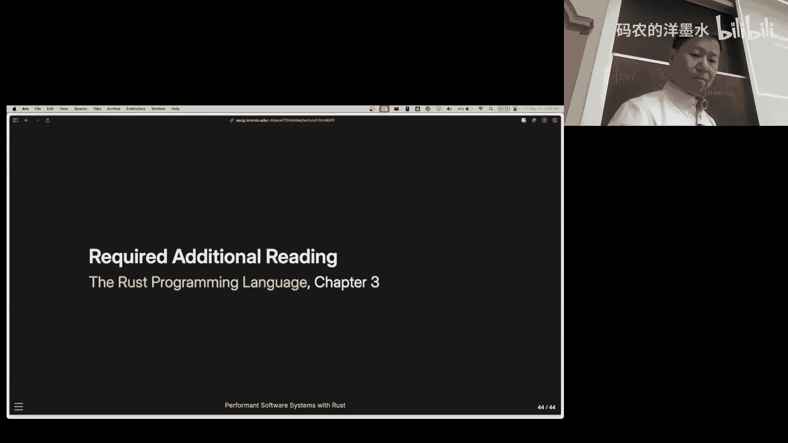