# 使用Rust构建高性能软件系统：第4讲：基础编程概念 🚀


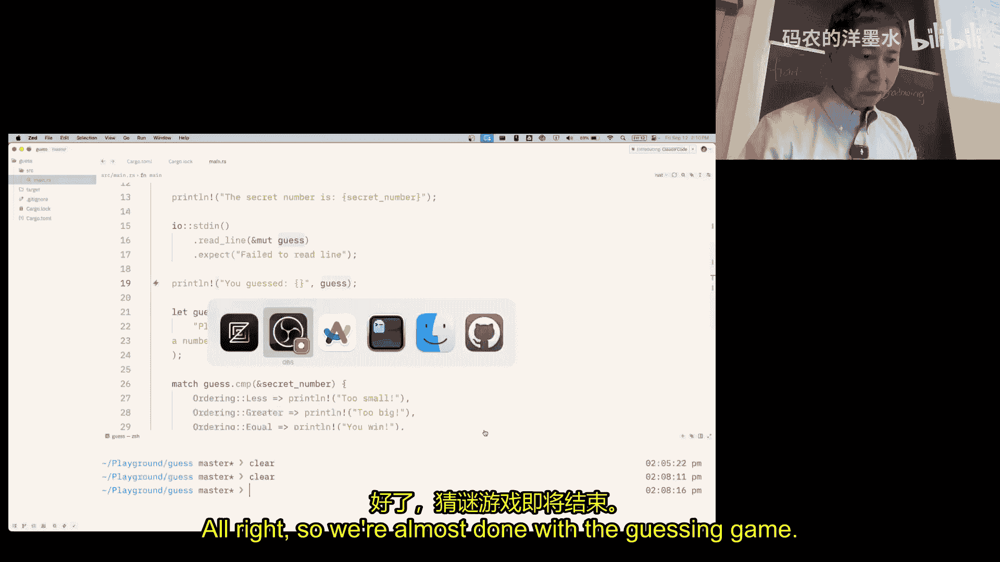

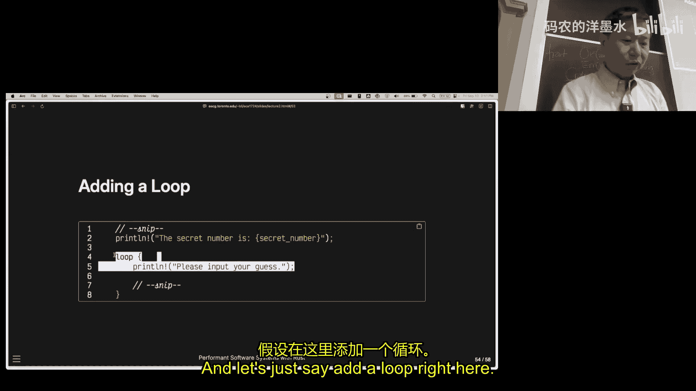

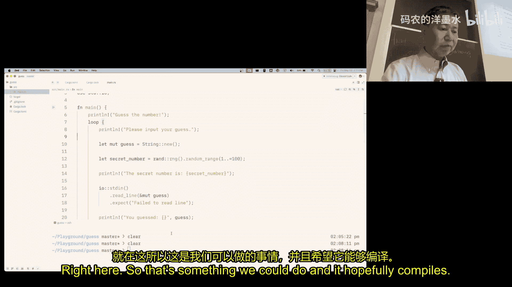

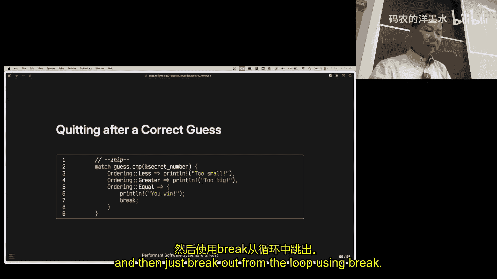

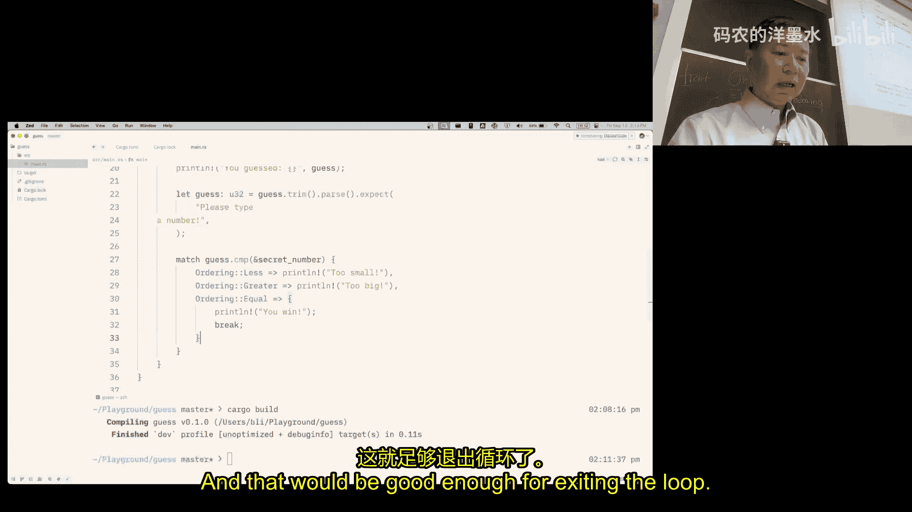

在本节课中，我们将学习Rust语言的基础编程概念，包括变量、常量、数据类型、控制流（如循环和条件语句）以及函数。我们将通过一个简单的“猜数字”游戏示例来理解这些概念的实际应用。

---

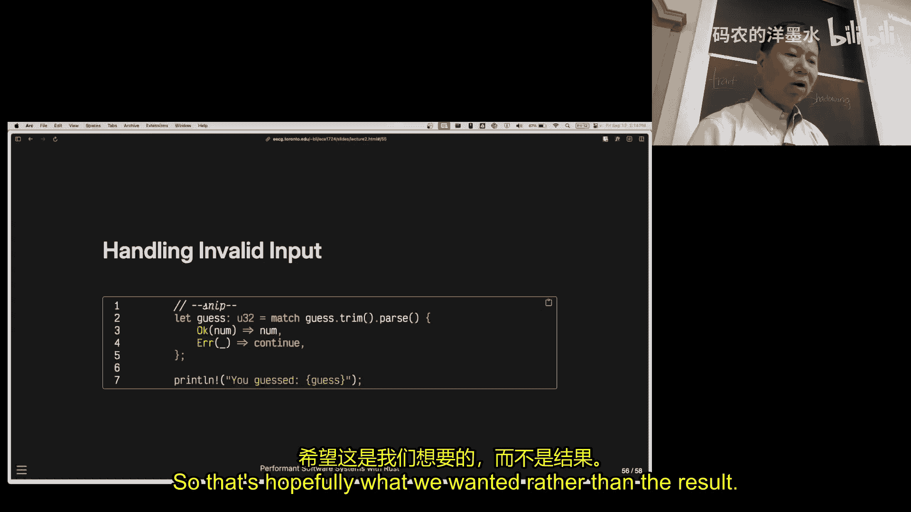

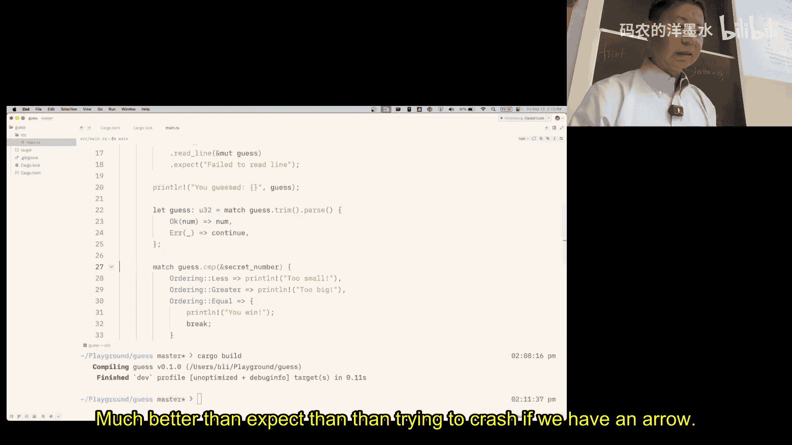

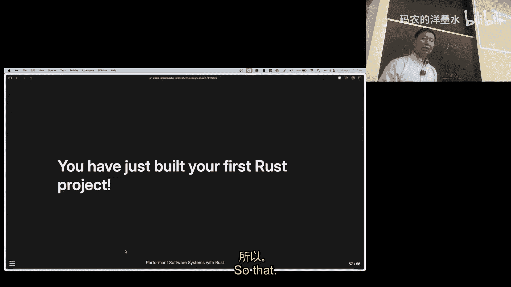

## 变量与常量

上一节我们介绍了“猜数字”游戏的基本结构，本节中我们来看看Rust中变量和常量的定义与区别。

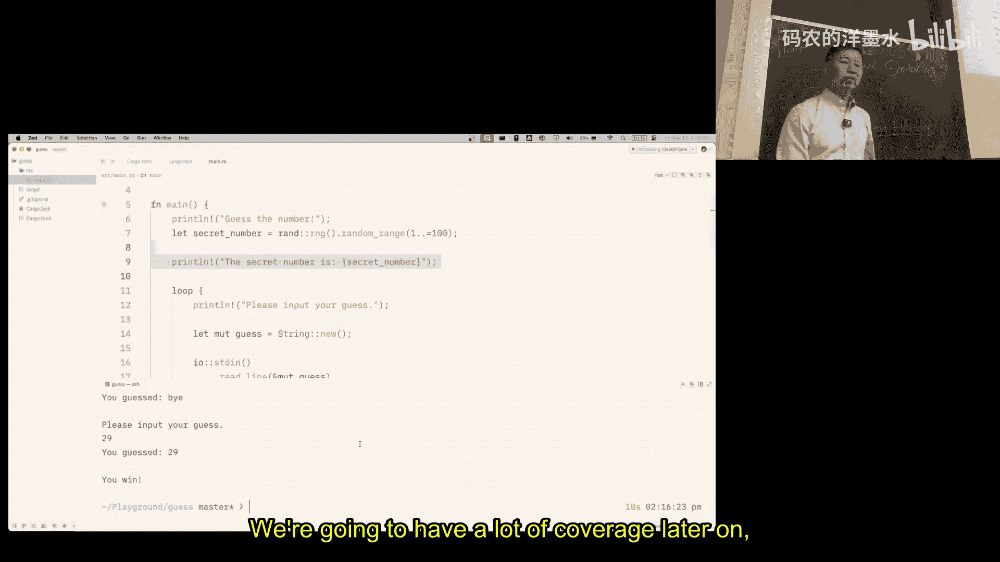

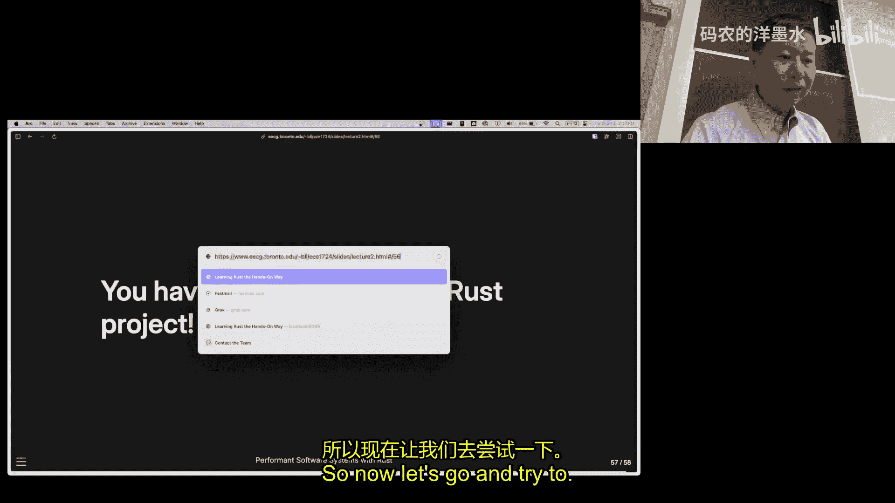

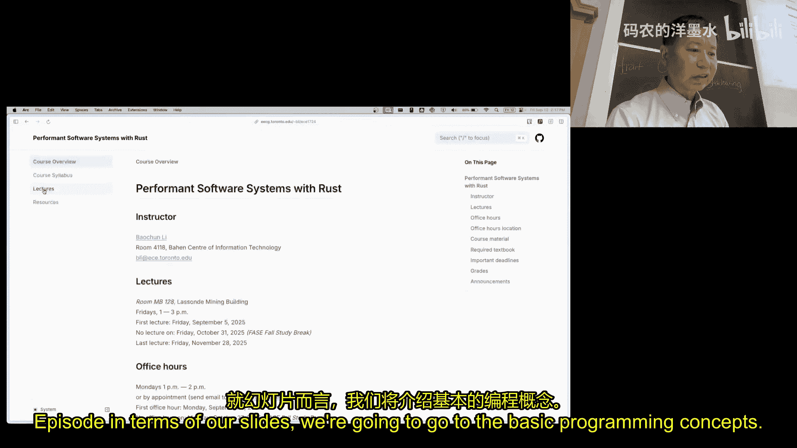

在Rust中，变量默认是不可变的。这意味着一旦给变量绑定了一个值，就不能再改变它。如果需要可变变量，必须使用 `mut` 关键字显式声明。

**代码示例：**
```rust
let x = 5; // 不可变变量
let mut y = 10; // 可变变量
y = y + 1; // 允许修改
```

常量使用 `const` 关键字声明，并且必须在编译时就知道其值。常量的命名约定是全部大写，用下划线分隔单词。

**代码示例：**
```rust
const MAX_POINTS: u32 = 100_000;
```

静态变量（全局变量）使用 `static` 关键字声明，也存在于全局作用域和数据段中，但生命周期更长。

**代码示例：**
```rust
static LANGUAGE: &str = "Rust";
```

---

## 数据类型

Rust是一种严格的静态类型语言，这意味着所有变量的类型在编译时都必须已知。这有助于将许多运行时错误转换为编译时错误，提高代码的可靠性。

以下是Rust中的主要标量数据类型：

*   **整数类型**：例如 `i32`（有符号32位）、`u32`（无符号32位）、`isize`（架构相关有符号整数）。
*   **浮点类型**：例如 `f32`、`f64`。
*   **布尔类型**：`bool`，值为 `true` 或 `false`。
*   **字符类型**：`char`，表示单个Unicode标量值，占用4个字节。

Rust还有两种复合数据类型：

*   **元组（Tuple）**：将多个不同类型的值组合成一个复合类型。元组长度固定。
    **代码示例：**
    ```rust
    let tup: (i32, f64, u8) = (500, 6.4, 1);
    let (x, y, z) = tup; // 解构
    let first = tup.0; // 通过索引访问
    ```
*   **数组（Array）**：固定长度且元素类型相同的集合。数组在栈上分配内存。
    **代码示例：**
    ```rust
    let a = [1, 2, 3, 4, 5];
    let first = a[0]; // 访问元素
    ```

对于需要动态大小的集合，应使用 `Vec`（向量）而非数组。

---

## 控制流

控制流结构允许根据条件执行不同的代码块，或重复执行某段代码。

### 条件语句：`if`

`if` 表达式允许根据条件执行代码。与许多语言不同，Rust的 `if` 条件不需要括号，并且 `if` 本身可以作为表达式返回值。

**代码示例：**
```rust
let number = 6;
if number % 2 == 0 {
    println!("数字是偶数");
} else {
    println!("数字是奇数");
}

// if 作为表达式
let result = if condition { 5 } else { 6 };
```

### 循环

Rust提供了几种循环方式：`loop`、`while` 和 `for`。

*   **`loop`**：无限循环，直到遇到 `break`。`loop` 也可以返回值。
    **代码示例：**
    ```rust
    let mut counter = 0;
    let result = loop {
        counter += 1;
        if counter == 10 {
            break counter * 2; // 跳出循环并返回值
        }
    };
    ```
*   **`while`**：条件循环，当条件为真时继续执行。
    **代码示例：**
    ```rust
    let mut number = 3;
    while number != 0 {
        println!("{}!", number);
        number -= 1;
    }
    ```
*   **`for`**：最常用且安全的循环，用于遍历集合。
    **代码示例：**
    ```rust
    let a = [10, 20, 30, 40, 50];
    for element in a.iter() {
        println!("值是: {}", element);
    }
    // 使用范围
    for number in (1..4).rev() {
        println!("{}!", number);
    }
    ```

---

## 函数

函数使用 `fn` 关键字定义。Rust不关心函数定义的位置。函数的返回值类型在箭头 `->` 后指定。如果未指定返回值，则默认为单元类型 `()`。函数体中的最后一个表达式将作为返回值，无需 `return` 关键字（除非提前返回）。

**代码示例：**
```rust
fn add(x: i32, y: i32) -> i32 {
    x + y // 最后一个表达式，作为返回值
}

fn is_divisible_by(lhs: u32, rhs: u32) -> bool {
    if rhs == 0 {
        return false; // 提前返回需要使用 return
    }
    lhs % rhs == 0 // 正常情况下的返回值
}
```

---

## 错误处理：`Result` 类型与 `match`

在“猜数字”游戏中，我们使用了 `Result` 类型和 `match` 表达式来优雅地处理用户输入错误，而不是让程序崩溃。

`Result` 是一个枚举类型，有两种变体：`Ok(T)` 表示操作成功并包含结果值，`Err(E)` 表示操作失败并包含错误信息。

`match` 表达式允许根据 `Result` 的值执行不同的代码分支。

**代码示例（来自猜数字游戏）：**
```rust
let guess: u32 = match guess.trim().parse() {
    Ok(num) => num, // 解析成功，返回数字
    Err(_) => continue, // 解析失败，跳过此次循环迭代
};
```

这种方法将潜在的程序崩溃（运行时错误）转换为可控制的流程，是Rust安全哲学的核心体现。

---

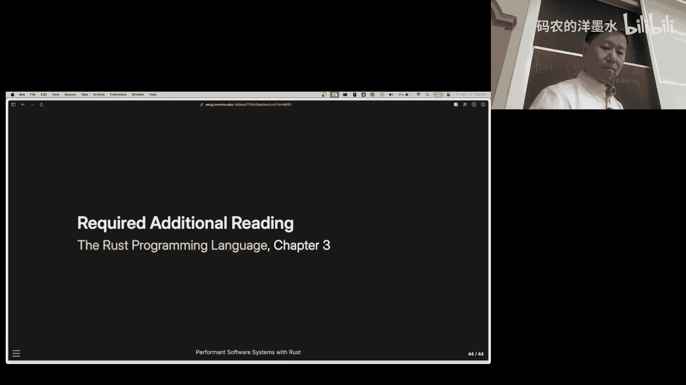

本节课中我们一起学习了Rust的基础编程概念。我们了解了变量与常量的区别、Rust严格的静态类型系统带来的好处、如何使用元组和数组组织数据、以及通过 `if`、`loop`、`while`、`for` 控制程序流程。最后，我们通过 `Result` 和 `match` 看到了Rust如何鼓励开发者编写更健壮、错误处理更完善的代码。这些概念是构建更复杂Rust程序的基石。