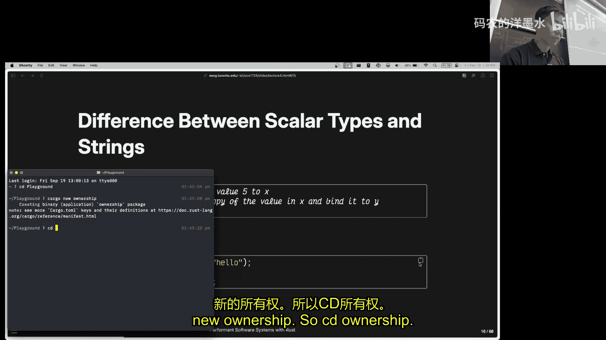
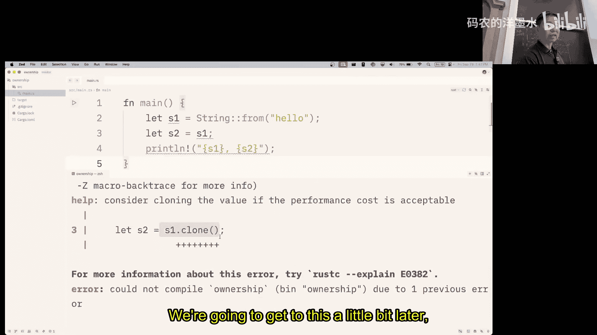
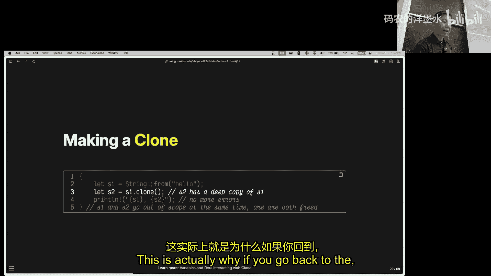
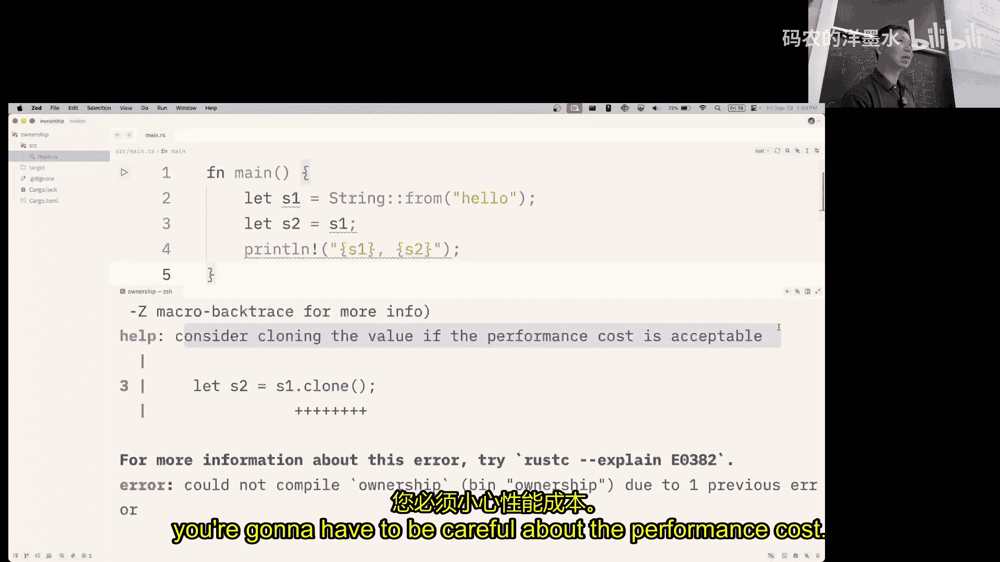
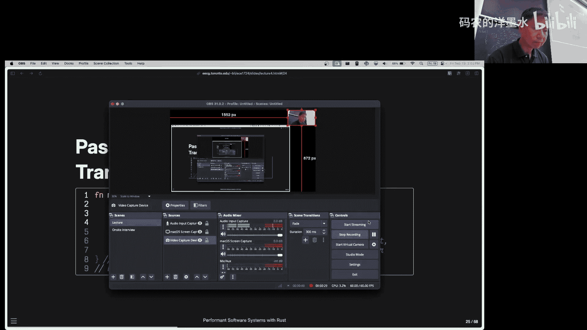

# 【全集 附课件】多伦多大学 使用Rust构建高性能软件系统 中英字幕 1080P p05 Lecture 5 - 所有权与弦类型 -BV16V62BhEuf_p5-

Okay， so let's get started。O。That's good enough。 So let's get started。

 So today we're going to talk about something really important and kind of hard to understand as well。

 So what we are going to do is that we're going to tap into some of the more advanced and probably unique features of the Ru programming language so pay attention we're going to take it slowly and we're going to show you quite a bit of demos just to just so that you could understand everything by the end of today's lecture。

If you have any questions， feel free to interrupt me and ask these questions as we go。

What we care about would be， how do we actually。Tackle the dreaded error。 E 0，3，8，2。

 That is something that we will bump into many， many times。In our journey of rust programming。

 B of moved value。 This era is something that， you know。

 I remember when I was programming on the airplane， I was trying to you know， right refactor。

 actually， thousands of lines of coding in literally in one stretch of about 6 to 7 hours and the code does not compile。

 simply does not compile。 and I have hundreds of different kind of compilation errors。

 and this is just the most prominent one。 So many of those errors are related to the borrow of moved value。

 I spent hours， literally hours trying to fix all of these errors of E0，3， a2。

 and this is something that is quite interesting。 And that's the topic today。

So let's start from the very beginning。Now， let's start from a look or a brief review。

 if you have ever had an operating systems course of how the program or in this case。

 basically a process that is a running program use its。O memory。 so the memory is virtual memory。

 so it's not really a program cannot see the physical memory。

 the operating system kernel makes sure that each running program or process is going to see virtual memory。

 and we wanted to have a brief review of what the program can see。

One portion of that memory is called the stack。And that is containing all of the local variables。

 all of the parameters that we use for calling a function， all of that would be part of the stack。

 and sometimes we call them local variables because these variables are actually on the stack。

And they are local to the function call， to the function where they are declared in。

And these functions， when we call them， they're kind of organized in the last in first out order。

 So the last one that is called is at the top of the stack。

 and that is the first function that we're going to get out of that stack when it returns。

So when we call a function， we push。What we call a stack frame。

 each function is corresponding to a stack frame onto the stack。

 this is actually why sometimes we call the stack a core stack。

And when we return from this particular stack， we pop the actual function out of the stack。

And the stack is very fast and this is actually why we prefer to use the stack if we can。

 and the reason why it is fast is because popping from the stack only requires moving the stack pointer to the next stack frame。

And that's something we could actually try to do。Now， if we illustrate the stack。

Using a figure on the board。Then we can actually think about it as growing from the top to the bottom。

 And the top would be the higher addresses。 So these are the higher virtual addresses to the bottom。

 So this is a high。Addres， whatever that address is。

 we wanted to start from the top and we grow to the bottom。

 So the top of the stack is always at the bottom。And as we push。

 we push to the bottom as we shrink the stack， we grow， we actually go back to the top。

 So this is kind of the main function， for example。

 and this is how we actually store our local variables in each one of these functions。

 as we call these functions。 So each one of these functions has its own stack frame and the frame contains the local variables and the actual parameters as well。

So all of these are part of the stack frame on that stack。

 as we start to pop from the stack as the functions are returning， we simply just。

Move the top of the stack to the previous stack frames。 We simply need to move the stack pointer。

 and the stack pointer is typically stored in the register in the CPU。 So this is very fast。

 very easy to use。 So That's why we typically prefer using the stack。

Now as opposed to the stack we do have a heap as well。 if you actually know about operating systems。

 you will see you will actually understand that the he is where we have sometimes we call a dynamic memory allocation。

 we call it dynamic memory allocation because we wanted to dynamically allocate memory we want to allocate memory as we run the actual program and release the memory as we don't need it。

So typically in previous programming languages that you might be familiar with， such as C。

 we have Maoc to allocate memory， and in C++ we have the new。

 which is a kind of the reserved word that we could actually allocate memory and both of these functions or keywords。

 they will really return a pointer and the pointer obviously is the address。

So this pointer can be stored。In a typical variable。

 in just a regular variable as part of the local variables。 so a pointer could be part of the stack。

Typically， depending on the architecture， it's 64 bits， for example。

And when we need to release the memory dynamically at runtime。

 we just need to specifically release it in CNncC plus plus in C。

 we can call free in C plus plus we can actually call delete just to delocate the memory that the pointer points to So that's something we could certainly do and that's a little bit slower than using the stack and the reason why it's a little bit slower is because we kind of wanted to search for the proper location of the memory when we need to allocate memory because typically malloc or new。

 we have a size that we need to request and that size we need to accommodate that somewhere in on the heap so it takes a little bit of time to search through the heap and see where where should we store that piece of memory that we have requested this sort of like a restaurant。

 you have like a group of people coming in， you wanted to make sure that we have a right size table so we're kind of searching through the restaurant。

To see which table is the right size for that group of people。

 So that would be something that is a little bit slower than if we were to do it on the stack。

The stack， as we mentioned， grows downwards。And to from the higher addresses to the lower addresses。

 But the heap is the opposite。 The heap grows upwards。 So if we actually look at the heap。

 for example， this is where it starts。 It actually grows upwards。 And this is the heap that we have。

 And this is。The actual gap。 So this is unused memory， in particular。

 unused virtual memory between the stack and the heaps。 So the heap grows upwards。

 the stack grows downwards。And this is just an illustration of what we have drawn on the board。

 We haven't covered data and code。 So code is where we load from the executable file。

 So as you can see from the name it contains the executable code。 What about data。

 What does data contain。Any ideas。We mentioned that last time were the day before or the the lecture before。

 yeah。Global variables， exactly， and one more thing。Consts， right， So constants。

 which basically are literal constants。 We know the value of these kind of data or global variables。

 Both of these are what we call in rust terminology。 We call them static。

 which means that they are global。 So when they' are global， theyre kind of in the data segment。

 And below that would be the code segment。 And both of these。Both of these are fixed。

 which means that we know exactly how many bytes they take， you know。

 because they're kind of loaded from the executable file。 So both of these are fixed。

 This is dynamic growing upwards。 This is also dynamic growing downwards， and this is the gap。

Alright， so that's the basic idea。And then let's get into rust。

So rust has a completely different way。Of handling dynamic memory， which is the memory on the heap。

 before we go into what kind of differences do we have in rust compared to the other programming languages。

 let me first state the rules of the game。 This is what we call the ownership rules。

 And we're gonna to pound on these rules again and again in more demos and examples throughout this particular lecture。

 But let's just throw out the rules first so that you understand the rules。

First is that each value in rust。Has a variable。And that has its owner。

That's the kind of value that you have。 And this is on the heap， and it has its own owner。

And second rule。There can only be one owner at a time。So you cannot have two owners， just one。

1 at a time。 Each value has an owner and can only have one owner at a time。

When the owner the last rule， when the owner goes out of scope。This value will be dropped。 again。

 we're talking about the heap。 When we say dropped。

 this is a terminology special to Russ programming language。

 It basically means that we're releasing the memory。 We're dealocating the memory。

 which is the equivalent to delete in C plus plus and free in C that we have previously mentioned。

The only difference right here is。As we actually drop them， they are completely automatic。

 We don't have to explicitly delocate the memory。 So let's take a look at。

One very simple example here。So here， let's look at the variable scope。

 which we have talked about before， just want to revisit that idea。So， we have a。Variable S。

And this variable S。Before it is declared and initialized， it is not valid。 So before it is declared。

 it is not valid right there because it's not yet declared。 obviously， once it's declared。

 it comes into scope and it is valid from the point of declaration。And then we can use it。

 We can print it out， for example， and it's going to remain valid until it goes out of scope。

And for this particular example。Here is where it goes out of scope。

This scope of S is currently over at this particular line。 and at this point， it is no longer valid。

 So this is what we talked previously talked about about scope， very easy to understand。

 We have a few additional ideas and little additional examples coming up about the scope。

 But this is the simplest example about the scope and obviously defined by the brace brackets。

 and and the braces would be something that we have talked about before that defines the beginning and the end of a block of the code。

So if you actually run this code， you will get hello because that's what's printed from the content of S and fun fact。

😊，Starting from this point on， we're gonna use an advanced feature of building my slides。

 So this hello is actually not what I typed in the slide， this is generated。 In fact。

 this is generated by running the code up there directly using the rust compiler and the rust runtime。

 using a sort of like a Jupyter notebook， but for the rust programming language， not for Python。

 and it will compile as we compile the presentation。 it will run。

 and this is exactly the output of running that code。 So this is not what I you know put in manually。

 This is what rust compiler generates。 So anything that is below that particular block box of code。

 it will be the output of running that program。 This is to make sure that it will make any mistakes。

 So anything that does not run will not even generate something like that。

 So when it's generated the code really works compile。It runs， and this is the output。

 So that's completely automated as we actually compile the code。

So now let's go back to talk about ownership。 So we have revisited the scope of the variables。

So we need to data type that is stored on he， and the reason for that is because our ownership rules。

They only apply for values that are on the heap。 So here's the he。 It's dynamic memory。

 for anything on the stack。 We don't really have the ownership rules over there。

 So it only matters when we are talking about values on the heap。So。

We need a type that dynamically allocates memory。 Now， previously， we have seen a lot of types。

 and these are more concrete types of like integers， floating point values， tuples and so on。

 they are， you know， with fixed sizes， which means that they can be easily stored。

On the stack as local variables。 So we don't really have to have them on the heap。Of course， you。

 if you choose to， you could do it， but you don't have to do it。And however。

 there's an exception that we previously have not had a lot of time talking about。

 We just briefly talked about it， which is the string type。

 The string type is an exception because at compile time。

 we typically don't know the size of the value of that particular type。

 So the type is something that might actually grow at run time。 So previously。

 you have seen the simplest string type， which is the literal constant of strings。 And those strings。

 they we know the size because they are constant。 So theyre part of the data segment。

 So those are you know， known sizes， they are immutable。 But that's not typical。

 So typically we want to store a string that is unknown at compile time。

 That is only known that run time。 For example， even for a literal constant may want to get the constant from the user input。

 So if that's the case that user input would be something。That is only known at runtime。

 So we don't really know that information at compile time， so。How do we get to that， Well。

 we're gonna to use the string type， you know， and the string type， we have seen this code before。

 which is。String column column from， hello。And this is something that is creating a string。

 it's like you， allocating memory for that string。😊。

And then initializing that string from this literal constant， which is a。

And that's what we're trying to do here and once you actually try to say string column column from string is a type column column from is associated function of that particular type。

 so you kind of created the brand new string because that's what that particular function returns and that string is allocated on the heap right here。

And this is。Where we start， when we talk about ownership rules and everything about ownership。

 we use strings as examples， because these are types that are allocated on heap。 Of course。

 there are way more types out there that we're gonna to talk about later that are allocated on he。

 that this is something that we use as an example throughout today's lecture。

 This is something that we wanted to talk about。Allright。

 so we also wanted in this line number two of this code， want to make it a mutable string。

The reason we want a mutable string is because we wanted to show that this string can actually grow。

 and that takes advantage of the fact that anything on the heap can actually grow。

 We could actually try to know allocate more memory on the heap。

 So to grow that we could use a function called push string。

 And this is just one of the many functions available for the string type。

 except that this is a method of the string type in the sense that you basically say S dot push string rather than string column column push string。

 You say S dot push string in the sense that I want to push whatever that is taken in as a parameter。

 in this case， comm world into that string S and pending it to that particular string。

 So as we print out what's gonna happen， we're gonna get hello world。 So that is again。

 generated by the rust compiler and the rust run time in the notebook and that's something that is printed out。

 So far so good。 we now have a string。 we can。😊，We can grow this。

 and let's use this example of all future discussions about ownership。

So let's try to talk about allocating and releasing strings on the heap。

 So now we're talking about this dynamic type， which is a string。

We have previously had an example of allocating memory for the string S。

 manually using the string from and we wanted to。Try to emphasize again。

 when the variable goes out of scope。Which we have previously talked about。It's gonna be。

Automatically released。Alright， so when the variable goes out， goes out of scope。

 because it's on the heap in this particular case， this is the variable S， the string S。

 it's on the heap。 when the memory， when the variable goes out of scope。

 we want to release the memory that is allocated to that particular string S。

And that is very different compared to CNC plus+， we do it in a completely different way。So in rust。

 there is no need to manually call free or in C or delete in C++ explicitly。

 there's no need to do that。In fact， we don't even have something like that corresponding to it。

We actually in rust a very advanced feature of rust， actually had something that says， oh。

 don't free， don't free， tell the compiler， do not free， do not free up the memory。That's possible。

 but we don't have anything to manually free the memory。

 So that's something that is very different from CNC plus， plus。

The reason why we don't want to allow that is because that this is a very bad idea。

To have the manual ways of freeing up memory on the heap is one of the worst ideas ever created in programming。

 very， very bad idea。 There are many， many things that can absolutely go wrong。 For example。

 what if we do it late， or you know， we never remember to do it。 We completely forgot about it。

That's going to be memory leaks。 So these are memory leaks that are very difficult to really try to find out and fix。

 And there are obviously advanced developer tools to find them。

 but not really guarantee that all of the leaks are found。In the other case， the other extreme。

 if we do it too early， if we do it too early， it's already released， and then we use it。

 then it's gonna be invalid memory access， and that is gonna be a core dump。

 a segmentation fault in CNC plus plus again， bad idea， very bad idea， lots of headaches。

 lots of you know， sleepless nights because of the memory access。

 and the third problem could be a double free。 if we free it up， but we try to do it twice。

 and then it's gonna corrupt the memory allocator。 The memory can take it。

 but it might not like it in the sense that it actually can crash the system， which is no good。

 You don't want to have that。And again， it's very difficult to find out these problems because sometimes it's completely silent。

 Sometimes it doesn't react to that particular double free。

 Some of the other times it's gonna just crash mysteriously。

 And sometimes it does not crash when you do the double free。 It crashes 2000 lines later。

 and that is going be impossible to fix。 So there's no way that anybody can see there's a double free right here。

2000 lines later。 It crashes。So this， all of these are reasons why manually freeing memory is。

A bad idea。 So we don't do that。The reason we migrate to something else which is go which is used in go in Java and Java and so on so forth called garbage collector is because we don't want to manually free up the memory。

 the garbage collector basically says you don't have to manually do it， I'm going do it myself。

 in the garbage collector which is a low priority thread and kind of try to get in from time to time and see if there are any memory that needs to be freed up。

 let's free them up。Bad idea， again。Not a very good idea。 Again。 Why performance。

So every time you the garbage collector kicks in， it's going to take up some CPU cycles and it's going to slow down your main threat。

And that's going to be slower。 It might be just slower by a little bit。

 but that little bit changes quite a bit if you're running it as a server， for example， web server。

And if the garbage collector kicks in too late， then the memory is kind of allocated very quickly and can easily go out of memory even before the first chance the garbage collector kicks in。

 very bad idea as well。So can we， the question is， can we actually try to allocate memory and automatically release a memory once the variable goes out of scope and people have thought about it many for many years or decades and many ideas such as you know。

 reference counting， automatic reference counting， all kind of ideas of doing it。

 automatically semi-au， you know， kind of all kind of ideas in the past decades， thinking about this。

And the rest way of doing this。Is exactly along the lines of doing it automatically。

 but have a kind of like a much better way of doing it automatically compared to previous ideas。

 such as in the swift programming language， we have something called automatic reference counting。

 which ARC， which actually frees up automatically， but it's， you know。

 it's not as good as the rust way of doing this in the rust way of doing this if we actually take a look at the previous example。

 we have S coming in， we change this， we grow this string S when it is in scope。

 And then it will remain valid until it is out of scope。 And when it's out of scope。

 it will be automatically released。😊，As simple as that， you might say。

 why couldn't anybody think about this idea。 This is so simple， right， question。So the question is。

 that's a very good question。 The question is， what do you mean by automatically release。

 Is that done by the compiler， Is it done by some kind of a runtime， know， like a garbage collector。

 No， it's not the runtime， it is the compiler。 So the compiler automatically generates the code。

 and the right location， which is basically the drop function， it drops the actual variable right。

 right there， when it goes out of scope when， wherever it goes out of scope。

 it's gonna to drop that particular variable， and that is kind of generated by the compiler as it compiles the code。

 So there is no runtime penalty or runtime performance penalty for that。Now in C+。

 we actually have something very similar。 So if you're a really advanced C++ programmer。

 you can actually achieve something kind of similar to rust， not exactly the same。

 but kind of similar。 and in C++ people gave it a very bad name。

 very hard to understand name called resource outlook acquisition is initialization or in short， RII。

 if you actually have ever heard of R AII。 This is something that tries to do something similar to what rust is doing。

 So the idea in rust is not really brand new it is kind of inspired by R AII in C++ with RII。

 the resources are acquired in the constructor。For example。

 the resource could be a file handle when you open the file， that would be the resource。

 any kind of resource， including allocating memory。

They are done in the construct and they are released。In the de structure of an object。

 because C plus is an object oriented programming language， Ru is not。 So in C plus。

 you have the notion of a construct and de structure。

 And and that's kind of required by this paradigm。 This programming paradigm。

 C plus plus the compiler doesn' enforce that。 You're gonna have to be a very good programmer to do it。

 That is the problem in rust， the compiler forces you to do the right thing in C plus plus。

 you have to know your stuff to do the right thing。 So you have to kind of de allocatelocate memory。

 you know， release the actual file handle everything in the de structure And in C plus plus。

 there are some assistance in the standard library called smart pointers。 two examples。

 unique pointer and shared pointer。 These are from the standard C plus library。

 that you should be using if you're using C plus plus。

 because they actually follow the principle of R AII except that a lot of people。

 they just simply use star。Which is the pointer。You can call it the raw pointer in the sense that really。

 it's not a good idea to use the star。 The raw pointer。

 you should be using the unique pointer in the shared pointer right here because that follows our AII。

 And the main difference between C plus plus and rust。

 The reason why I wanted to open the sidebar story to talk about C plus plus is to emphasize how good rust is。

 So the main difference is rust does not even allow you to delete manually in C plus plus that is allowed。

 So that kind of power is a bad idea。 You don' wouldn't want anybody to have that power at all。

 You want to make sure10 percent of the memory is released。By the compiler。

 So that's something that you wanted to do。And Rut tries to do that by enforcing the ownership rules at compile time。

And these ownership rules， we started with the ownership rules。

 and we're going to talk about it again and again， they are enforced by the compiler。

 100% extremely strict。And。You know， because they are so strict。

There are things that you cannot do in rust， but you can do in C plus plus。Or can do in sea。

But those are the things。That seems to give you a lot of flexibility and grow power。

 But you should not be allowing。 And the reason for that is that they just simply。

Toarrow pro that you should not trust anybody to use that kind of power。

 So those power are taken away from the programmers in rust in rust， if you cannot compile the code。

 you cannot run it。So， and the compiler enforces these very strict rules of ownership。

 If you cannot run it， there's no way that you can actually， you know。

 use the actual power that Cnc C plus+ had。So now let's go back to our previous discussion about local variables and heEAP and let's think about the differences between whatever types that are concrete types that can be stored in the stack and the string type。

 which is the type that as our example today。On the actual steep he。So for the local variables。

 the simplest concrete types would be you know， integers。 So in this case。

 you have an integer x equals to 5。 That would be a local variable。It's a concrete type。

 It has a fixed size。 We know how what's the size of that particular variable，32 Bs， for example。

And then if we want to make a copy of that value。We can simply make a copy。 We just say。

 let y equals to x。 What happens。What， what's gonna be printed， You're gonna have print。

 You're gonna print 5 comma 5， right， because the value is copied from x to y。

 and that happens all the time。 And that's because that X and Y， they are both local variables。 They。

 they have the fixed sizes。So we could copy the value out of it without a lot of work。

 It's very fast。 Everything is on the local stack。 very fast。 We allow that。 No problem。

 So we can copy the value because they are on the stack。

Very different from that would be the strings， strings， theyre not on the stack。

 And that means that strings， they are allocated on a heap。 So what happens if I do this。

What happens if I do this。有。Just take a guess。S1 has。要嘅。It's a compile time error， right？ So let's。

 let's give it a try。 actually， So let's， let's copy the code and let's try to open a。

 open a new terminal。Playground。 Let's try to do a cargo， new。What's the name what。

What's the good name for today's cargo。Project。Let's call it ownership。Alright， cargo new ownership。

 So see the ownership， and let's try to create an editor So that's something that we typically do。

 And then let's open the main main dot R S and let's make it bigger， big， big big。

 and then let's try to copy that oops。

Let's try to copy that code right here。And then。Cargo built。And you can see。

We cannot build correctly。And why can we build correctly where it says。E era E 0，3， A 2。

 That's the dreaded error that we talked about at the beginning of today's lecture。 B of Mo value。

Borrow of moved value。 where， where did we have that。 Well。

 it will have more explanations right here。 So move occurs because S has type string。

 which does not implement the copy trade。 So what is the copy trade。

 We're going talk about that a little bit later。 But the idea here is that the value of S1 is moved right here。

 It says value moved here， Where is it moved into。It is moved into S 2。 So because strings do not。

Implement the copy trade， it cannot be copied。And because it cannot be copied， you have to move。

 So in rust， either you copy or you move， You cannot do anything else。 So if you cannot copy。

 you will have to move。 In this case， S1 value is moved。Into。S 2。

And then you're trying to print S1 after the move。And that is the dreaded era，0，3，8。

2 borrow of moved value。 So you cannot borrow。After you move that value。

 So that's something that you cannot do。 And it will tell you S 1 dot clone。 That's the suggestion。

 We're gonna get to this a little bit later。 But that's the basic idea。

And so this is the era value borrowed here after move and borrow of move value。 So that's the error。

So we want to have a deep dive here。We want to talk about what happens when you say S 1。 sorry， what。

 what's the code S 2 equals to S 1。 When you say S 2 equals to S1， what happens。Well， before S2。

 we try to try to copy， let's take a look at what S1 had。So， S1。

Let's try to repeat what's on the slide by putting on the board just so that you have a better understanding here。

 So S1。 So what does S1 has。 So S1。You can imagine this to be astruct。

 even though it's kind of implemented inside the actual type， I'm going to talk aboutstructs later。

 but you imagine this to be sort of like a a structure， like a data structure。

So in that data structure we have kind of three different fields， we have the pointer。

And the pointer would be just like a C pointer， or something like that。But in Ru。

 we don't really have the notion of a pointer， but you can imagine this to be internally implemented so that it contains an address。

And then you have the length and the length contains the actual number of bytes that we have in that particular string for this particular string。

 hello。 we kind of assume that you know， each one of these would be just one by。

 and that's something that is really indeed true in the real world implementation。

 but it's not always true， depending on the characters。

 So we're going get to that a little bit later， that kind of intricacies of string storage a little bit later。

 but for now each one of these would be just one byte。 So the length would be5 for hello。

 and then we have the capacity。And the capacity would be something we couldn ignore。

 and that is the amount of memory that is allocated for this particular case。 We just allocate5 bys。

 and that's going to be kind of the representation of a string。

 And where is this table distractstruct。 Where is this。Is it on the hip or is it on the stack？

It is on the stack exactly。 So this is on the stack。 What is on the heap。 Well， on the heap would be。

The actual storage of the string itself， which is hello。Right， that's the actual storage。On the hip。

And here on the stack， we have a pointer to that。We have a pointer to the storage on the actual heap。

 So this is the heap， and this would be the stack。Right so that's something that we understood。

 Now let's talk about what happens if we declare another string type variable which is S2。

 so what happens is S2 so this is S2 also had the pointer and it has the length and it has the capacity and we have those as well so this is S1 and this is S2 and both S1 and S2 they are both on the step and right here if we wanted to copy。

The string type， because the string type contains a pointer。You know。

 to the actual storage on the heap， it does not implement the copy trade。

 which means that you cannot simply copy this。If you simply copy this， you really。

We'll have to copy whatever that is on the heve， and that is not。Possible with strings。

 So with strings， because you cannot copy and in rust， we call it， if you cannot copy。

 you have to move。 So when you actually say S 2 equals to S1， if you say something like this。

It means that you are。Making sure that whatever that is in the S one's value would be。In S2。

 and then because we cannot copy， this is not something that implements the copy trade。

 this involves values on a heap。We will have to move。

Which means that this will have to be invalidated。 And by invalidating this， what do I mean Well。

 why mean that if you try to do something with it， it's gonna be a compile time error。

 That's what we mean by invalidating this memory。So you cannot even do it。

 You cannot even run it because it's a compile time error。

So now let's back to going back to our example here。

 So our example we have S1 equals to hello and we have S2 equals to S1 and we mentioned that is going to be kind of be invalidd iss a compile time error。

 one reason why it's a compile time error is that there's an interesting question philosophically if you don't make it the compile time error。

 both S1 and S2 is going to go out of scope after the print line at the end of the block and you know we mentioned that when a value on the heap is going out of the scope。

 we're gonna to have to drop it， but in this case if you don't do the move then which one should you drop。

You don't even know。Right，So you can have to move。 Otherwise， it's a double free error。

 You're basically dropping both。 That's a double free error。 That's bad。

 extremely bad for the memory allocator。 And certainly。

 we can have to move because we wanted to make sure that there's no double free error right here。

 So S1 cannot even be valid。 It's kind of enforced by the compiler。So again。

 what we're doing here is that we're making a socalled shallow copy。

 This shallow copy does not this terminology does not exist Ru。

 This is borrowed from C plus C plus plus land where we are actually copying the pointer rather than the actual content that a pointer points to。

 So this is not a deep copy。 deep copy basically copies the content that it points to。

 We're doing a shallow copy。 Only the actual pointer。

And then we're going to evaluate invalidate the original。 This one is going to be invalidd。

 and this is what we call a move in rust terminology。

 we don't have the term shallow copy or deep copy。 We don't call it that。 We call it the move。

And so when we actually try to do this， then。You know， S1 is moved into S 2。

 whenever you try to do the print line again， again， as we have demo。

 it is going to be an narrow borrow of moved value。 So the compiler does not allow you to proceed。

So far， so good， right， understood。 Everything's understood before we move on to the next part。

All right， so now what happens with this code？So this is。A string， S string from hello。

 And then we're gonna try to say， make it a mutable string。

 And then we're gonna say S equals the string from a Hawaiii。 And then we're gonna print it。

What happens here？Is O。Just try to， you know， assign as a different value because it's a mutable variable。

 right， Is it okay。How many of you say this is a compile time error。Okay。

 so how many say that this just is gonna run。 Okay， great。 So it shouldn't be a compile time error。

 This is， you know， this is gonna run。 And， of course。

 what we're doing here is that we're basically assigning the the new value to this S。

 But what happens to hello。😊，What happens to hello。The compiler would be smart enough to say， well。

 that string， the original one that is replaced。Is going out of scope， and that is thed。

The compiler is gonna drop it。 No problem。 So here we have a hoi world。You know， no problem。

 It's gonna compile， not an issue。 So this is something that is。Kind of a new rule for scoping。

 So when we kind of overrite with a new value， the original string， that string， hello string。

 the scope ends right there。 we drop right there。So that's kind of like a new rule right there。

 This is a subtle thing， but it makes a lot of sense。Alright。

 so now let's get to our compile time suggestion， which is making a clone。

 So if you really want to print both strings， you want to do a deep copy。 But in Ru。

 we don't call it a deep copy。 We call it。A clone。 So a clone would be S1 dot clone。

 And that means that we will not copy the pointer， rather， we will。Cllong， hello。

Right here so that we could actually try to let S2 point to the cloned string。

And that is a deep copy。And this is a very good idea。 In other languages。

 you don't have such good ideas。 That's why I don't like the other languages。 the other languages。

 they don't actually give you this dot clone thing。 The dot clone thing is explicit。

 This basically is in your face。 Its just tells you out loud that we're making a deep copy right here。

 right here right here， make sure that you're aware of the performance cost of making that copy。

 You know， if the string is very large。 You know， something that is too slow that you have very careful。

 if you're clonening within the big busy loop， you have to be very careful。

 So all of that is your choice。 Well， in other languages， they just say two equals well。

 it's just like you know， something is automatic。 see plus， plus。

 something called copy construct blah blah bh， bh， bla， It's just completely wrong way of doing this。

 you want to be explicit。 Every time you do a deep copy， you call clone。 and that is。😊。

Understandable by other developers， other programmers。 It is easy to read this code。

 And you know that there's a performance cost。 This is actually why if you go back to the。

 to our example， it says， consider cloning the value If the performance cost is acceptable。

 You gonna have to be careful about the performance cost。

 And that's something that is suggested by the compiler as well。 So that would be the clone。

 And because there's a clone， we're not moving。 So no more errors right here。

 And S 1 S 2 will both get out of scope and they will both be dropped automatically。

Qu。That's a very good question So the question was。

 is the clone only for strings or are they for other you know types as well。

 there are or a lot more a lot of other types as well。

 obviously yeah because a lot of them requires cloning however you could actually try to if they're you know if they're not define for some of the types for example。

 your own types， you could actually there are some some ways some shorthand forms for you to automatically define clone for for your own types。

 so which means that later on you could just even for your own types you can say dot clone for making a deep coffee automatically question。

Oh， we're gonna get into that momentarily right next slide。 In fact， if I'm not mistaken。

 if I remember。 so get to our example again， this is obviously a scale of value。

 and that is on the local local stack。 And we're gonna just make a copy。 And that's 5，5。

 And we haven't caught clone right here。😊，So why don't we call clone。

Why do we make a copy of X automatically right here。

 But we don't do the copy of strings automatically。Well。

 we sort of have already talked about it before， right。

 So we talked about it in the sense that there's a difference between a string and these scalar types with fixed sizes。

 The integer is on the stack only。 of course， not only the integers。

 these stack only data is not expensive to copy。 So there is no reason to invalidate this and move it into something else because it is very cheap to copy。

And。In rust， we can create our own types anytime。 And when we create our own types。

 you can also mark the type as something that is suitable for copying。

Which means that they will be on the stack rather be rather than on the heap。

 And because they're suitable for copying， they are basically a fixed sizes。

 And you basically copy that。And by doing， by marking your actual type。

As implementing something called a copy trait。 And we're gonna talk about traits later。 But for now。

 you can think of it as a property of the type。 So the actual type。

 even your own type could be copied on the stack。 And just like integers。

 integer actually implements the copy trade。Question。If you implement the array with the copy trait。

 yep， exactly。And if the type implements the copy trade， however。You cannot。Drop it。

So to the copy trade and what sometimes we call it the drop trade。

 So if you actually try to implement the drop trade。

 you actually allow the compiler to drop it automatically。 So the copy trade and drop trade。

 they are kind of exclusive。 They're mutual mutually exclusive。 So if you implement the copy trade。

 you cannot drop it。 So if you implement the copy trade， then the variables of this particular type。

 for example， integer， they will not be moved， rather they will be trivially copied。

 On the other hand， if you implement the drop trade， which is， you know。

 the other alternative to the copy trade。Then you certainly cannot implement the copy trade。

 If you implement the job trade， it means that the type is has information on the heap。

 Has data on the heap， which means that you need to release it。

 And that would be done by the compiler automatically when the value goes out of scope。

And that's something that we will be doing。 And， of course。

 a type cannot be having both the copy trade and the drop trade。 If you have the drop trade。

 you can clone， but you cannot trivially copy very simple to understand kind of idea。

And then we're gonna to go to your question， which is passing a value。To a function。

 But before we do that， let's take a break for five minutes。

 And we're gonna talk about passing value to a function。

