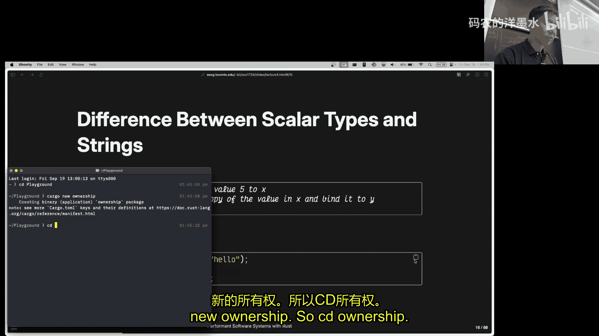
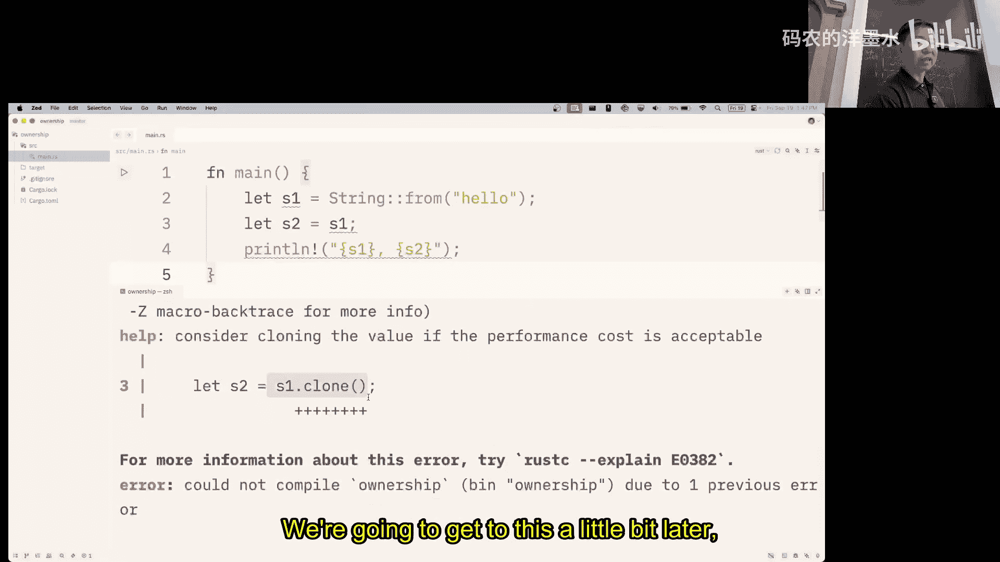
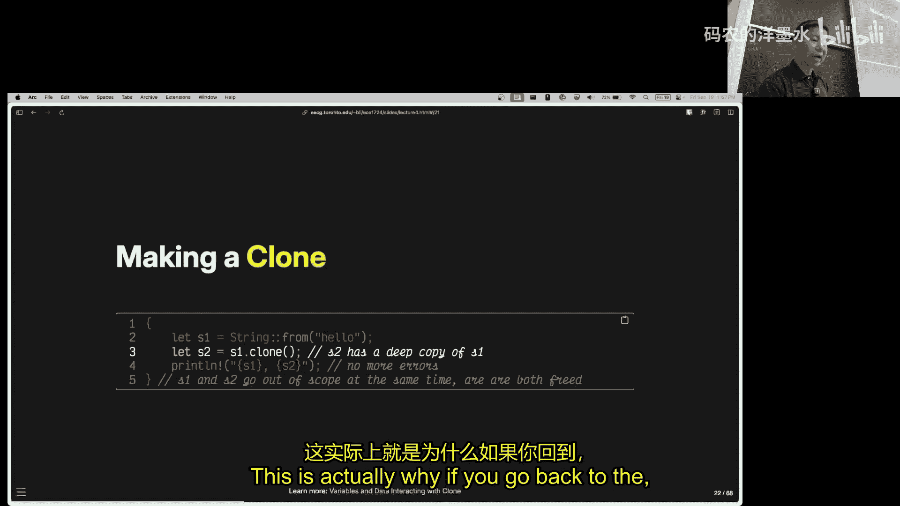
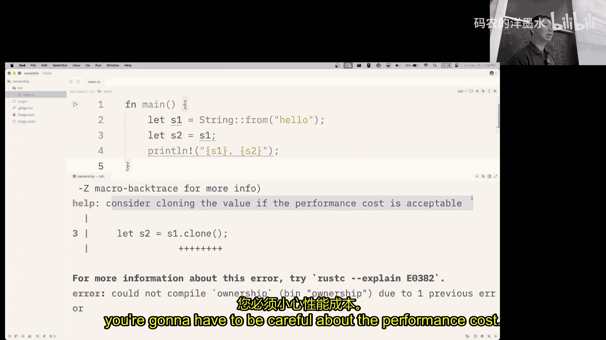
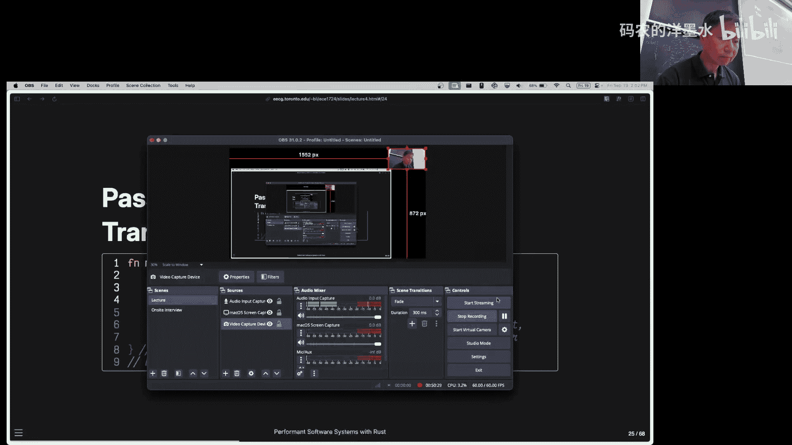

# Rust编程：第5讲：所有权与字符串类型

在本节课中，我们将要学习Rust编程语言中一个非常重要且独特的概念：所有权。我们将深入探讨内存管理，特别是堆内存的管理，并理解Rust如何通过所有权规则在编译时确保内存安全，从而避免常见的内存错误。

## 内存布局回顾

上一节我们介绍了本课程的主题。在深入Rust的所有权之前，让我们先简要回顾一下程序如何使用内存。

一个运行中的程序（进程）看到的是虚拟内存。操作系统内核确保每个进程看到的是虚拟内存。程序内存的一部分称为**栈**。

栈包含了所有的局部变量和函数调用参数。这些变量是局部的，因为它们声明在函数内部。函数调用以“后进先出”的顺序组织在栈上。当我们调用一个函数时，我们将一个**栈帧**压入栈顶。当函数返回时，我们将其栈帧弹出栈。

栈的速度非常快，因为从栈中弹出数据只需要将栈指针移动到下一个栈帧。栈从高地址向低地址增长。

与栈相对的是**堆**。堆用于**动态内存分配**。程序在运行时动态地分配和释放内存。

在C语言中，我们使用 `malloc` 来分配内存；在C++中，我们使用 `new`。这些函数或关键字会返回一个指针（地址）。这个指针可以存储在栈上的一个普通变量中。当我们需要在运行时释放内存时，在C中调用 `free`，在C++中调用 `delete`。

堆的分配比栈慢，因为需要搜索堆中合适的位置来存放请求大小的内存。堆从低地址向高地址增长。

栈和堆之间是未使用的虚拟内存。我们还有**代码段**和**数据段**。代码段从可执行文件加载，包含可执行代码。数据段包含全局变量和常量。在Rust术语中，这些被称为 `static`，意味着它们是全局的。代码段和数据段的大小是固定的。

## Rust的所有权规则

现在，让我们进入Rust的世界。Rust处理动态内存（堆内存）的方式与其他语言完全不同。

在深入Rust与其他编程语言的差异之前，让我先陈述游戏规则。这就是我们所说的**所有权规则**。我们将在本讲中通过更多演示和例子反复强调这些规则。

以下是所有权规则：
1.  Rust中的每个值都有一个变量作为其**所有者**。
2.  一个值在任意时刻只能有一个所有者。
3.  当所有者离开作用域时，这个值将被**丢弃**。

我们讨论的是堆上的值。在Rust术语中，“丢弃”意味着释放内存，相当于C++中的 `delete` 或C中的 `free`。关键区别在于，在Rust中，丢弃是自动完成的，我们不需要显式地释放内存。

## 变量作用域

让我们先看一个关于变量作用域的简单例子，重新理解这个概念。

```rust
fn main() {
    {                      // s 在这里无效，它尚未声明
        let s = "hello";   // 从此处起，s 是有效的
        println!("{}", s); // 使用 s
    }                      // 此作用域已结束，s 不再有效
}
```

变量 `s` 在声明和初始化之前是无效的。一旦声明，它就进入作用域并从此点开始有效。然后我们可以使用它。它的作用域在当前代码块（由花括号定义）结束时终止，此时它不再有效。

运行此代码将输出 `hello`。

## 所有权与字符串类型

所有权规则只适用于堆上的值。因此，我们需要一种在堆上动态分配内存的类型。

之前我们见过很多具体类型，如整数、浮点数、元组等。它们有固定大小，可以轻松存储在栈上作为局部变量。然而，有一个例外，那就是**字符串类型**。

字符串类型是个例外，因为在编译时，我们通常不知道该类型值的大小。该类型可能在运行时增长。之前我们见过最简单的字符串类型，即字符串字面量常量。那些字符串的大小是已知的，因为它们是常量，属于数据段，并且是不可变的。但这并不典型。

通常，我们想存储一个在编译时未知、仅在运行时才知道的字符串。例如，我们可能想从用户输入获取一个字符串。用户输入的内容只在运行时才知道。

我们将使用 `String` 类型。`String` 类型是我们之前见过的代码。

```rust
fn main() {
    let s = String::from("hello");
    println!("{}", s);
}
```

`String::from` 是一个关联函数，它创建一个新的 `String`。这个字符串分配在堆上。当我们讨论所有权规则时，我们将使用字符串作为例子，因为它们是分配在堆上的类型。当然，后面我们会讨论更多分配在堆上的类型。

我们还想让这个字符串可变，以展示字符串可以增长，这利用了堆上内存可以增长的特性。

```rust
fn main() {
    let mut s = String::from("hello");
    s.push_str(", world!");
    println!("{}", s);
}
```

`push_str` 是 `String` 类型众多可用函数之一。它是一个方法，意味着我们使用 `s.push_str(...)` 的语法。它将参数（此处是 `", world!"`）追加到字符串 `s` 的末尾。打印输出将是 `hello, world!`。

## 分配与释放

现在我们来讨论在堆上分配和释放字符串。

我们之前有一个使用 `String::from` 手动为字符串 `s` 分配内存的例子。我们想再次强调，当变量离开作用域时，内存将被自动释放。

当变量离开作用域时，因为在这个特定情况下，变量 `s`（字符串 `s`）在堆上，我们想要释放分配给该字符串的内存。

这与C/C++完全不同。在Rust中，不需要手动调用C中的 `free` 或C++中的 `delete`。事实上，Rust甚至没有对应的操作。Rust有一个非常高级的特性可以告诉编译器“不要释放内存”，但我们没有任何手动释放内存的操作。

我们不希望允许手动释放内存，因为这是一个非常糟糕的主意。手动释放堆内存是编程史上最糟糕的想法之一。很多事情都可能出错。

例如，如果我们释放得太晚，或者完全忘记了，就会导致**内存泄漏**。内存泄漏很难发现和修复。另一方面，如果我们释放得太早，然后继续使用它，就会导致无效内存访问，引发段错误（核心转储）。第三个问题是**双重释放**。如果我们释放了内存，又试图再次释放，可能会破坏内存分配器，导致系统崩溃。

所有这些原因都说明手动释放内存是个坏主意。因此我们不这样做。这也是为什么我们转向使用垃圾回收器（如Go、Java等语言中的）的原因——我们不想手动释放内存。垃圾回收器是一个低优先级线程，会不时运行来检查并释放需要释放的内存。

但垃圾回收也不是一个好主意。原因在于性能。每次垃圾回收器启动，都会占用一些CPU周期，减慢主线程的速度。如果运行的是Web服务器等，即使速度只慢一点，影响也很大。此外，如果垃圾回收器启动得太晚，内存可能在被回收之前就迅速分配完毕，导致内存不足。

那么，我们能否在变量离开作用域时自动分配和释放内存呢？人们对此思考了许多年，提出了很多想法，如引用计数、自动引用计数等。Rust的做法正是沿着自动化的路线，但比以往的想法（如Swift编程语言中的自动引用计数ARC）要好得多。

在Rust的方式中，如果我们看之前的例子，`s` 进入作用域，我们修改并增长字符串 `s`。只要它在作用域内，它就保持有效。当它离开作用域时，它会被自动释放。

你可能会问，为什么以前没人想到这个主意？这看起来很简单。问题是，什么是“自动释放”？是由编译器完成的，还是由某种运行时（如垃圾回收器）完成的？不，不是运行时，是编译器。编译器自动生成代码，在正确的位置（即变量离开作用域的地方）调用 `drop` 函数来丢弃该变量。这是由编译器在编译代码时生成的，因此没有运行时性能损失。

在C++中，实际上有非常相似的东西。如果你是一个真正高级的C++程序员，你可以实现类似Rust的功能（不完全相同，但类似）。在C++中，人们给它起了一个很难理解的名字：**资源获取即初始化**，简称RAII。

RAII的思想是，资源（如文件句柄、分配的内存等）在构造函数中获取，在析构函数中释放。因为C++是面向对象的编程语言，所以有构造函数和析构函数的概念。但C++编译器并不强制要求这样做，你必须是一个优秀的程序员才能做对。这就是问题所在。

在Rust中，编译器强制你做正确的事。在C++中，你必须懂行才能做对。你必须在析构函数中释放内存、关闭文件句柄等。C++标准库提供了一些辅助工具，称为智能指针，例如 `unique_ptr` 和 `shared_ptr`。你应该使用它们，因为它们遵循RAII原则。

Rust与C++的主要区别在于，Rust甚至不允许你手动删除。在C++中，这是允许的。这种权力是个坏主意。你根本不想让任何人拥有这种权力。你希望100%的内存由编译器释放。Rust通过在编译时强制执行所有权规则来实现这一点。

这些所有权规则由编译器100%严格执行。因为它们如此严格，有些在C/C++中能做的事情在Rust中不能做。但这些事情看似提供了很大的灵活性和强大功能，实际上却不应该被允许。原因很简单：你不应该信任任何人使用那种权力。

在Rust中，这种权力被从程序员手中剥夺。在Rust中，如果代码不能编译，你就不能运行它。编译器强制执行这些非常严格的所有权规则。如果你不能运行它，就无法使用C/C++所拥有的那种权力。

## 栈与堆上的类型

现在让我们回到之前关于局部变量和堆的讨论，思考一下可以存储在栈上的具体类型与作为我们今天例子的 `String` 类型之间的区别。

对于局部变量，最简单的具体类型是整数。

```rust
fn main() {
    let x = 5;
    let y = x;
    println!("x = {}, y = {}", x, y);
}
```

`x` 是一个局部变量，它是一个具体类型，有固定大小（例如32位）。如果我们想复制这个值，我们可以简单地复制。`y` 将得到 `x` 值的副本。打印结果将是 `5, 5`。这是因为 `x` 和 `y` 都是局部变量，有固定大小，所以我们可以快速复制值。这一切都在本地栈上，速度很快。我们允许这样做，没问题。

这与字符串非常不同。字符串不在栈上，这意味着字符串分配在堆上。



```rust
fn main() {
    let s1 = String::from("hello");
    let s2 = s1;
    println!("{}, {}", s1, s2);
}
```

如果我们这样做会发生什么？这是一个编译时错误。让我们尝试一下。我们将代码复制到一个新的Rust项目中并构建它。构建会失败，错误是 `E0382`：**对已移动值的借用**。这正是我们在本讲开头提到的可怕错误。

错误信息显示：移动发生是因为 `s1` 的类型是 `String`，它没有实现 `Copy` trait。`Copy` trait是什么？我们稍后会讨论。但这里的要点是，`s1` 的值被**移动**到了 `s2`。因为字符串没有实现 `Copy` trait，所以它不能被复制。既然不能被复制，就必须移动。在Rust中，你要么复制，要么移动，不能做其他事情。如果你不能复制，就必须移动。在这种情况下，`s1` 的值被移动到了 `s2`。然后你试图在移动后打印 `s1`。这就是错误 `E0382`：对已移动值的借用。移动后你不能借用该值。编译器建议使用 `s1.clone()`，我们稍后会讲到。



让我们深入探讨一下。当我们说 `s2 = s1` 时会发生什么？在说 `s2 = s1` 之前，让我们看看 `s1` 有什么。

你可以把 `s1` 想象成一个结构体（尽管它是在类型内部实现的，我们稍后会讨论结构体）。在这个数据结构中，我们大致有三个字段：一个**指针**、一个**长度**和一个**容量**。

指针就像C语言中的指针，但在Rust内部，它包含一个地址。长度包含该字符串的实际字节数（对于 `"hello"`，假设每个字符占一个字节，长度就是5）。容量是我们为此字符串分配的内存量（这里只分配了5字节）。这个结构体在哪里？在栈上还是堆上？它在**栈上**。那堆上有什么？堆上是字符串本身的实际存储内容，即 `"hello"`。

栈上有一个指向堆上存储的指针。现在，如果我们声明另一个 `String` 类型的变量 `s2`，`s2` 也有指针、长度和容量，它们也都在栈上。

如果我们想复制 `String` 类型，因为它包含一个指向堆存储的指针，并且没有实现 `Copy` trait，所以不能简单地复制。对于字符串，因为你不能复制，在Rust中，你必须移动。所以当你说 `s2 = s1` 时，意味着你要确保 `s1` 的值进入 `s2`。因为我们不能复制（这涉及到堆上的值），我们必须移动。这意味着 `s1` 将变得无效。无效化意味着如果你试图用它做任何事情，都会导致编译时错误。你甚至无法运行它。

在我们的例子中，`s1` 被设置为 `"hello"`，`s2 = s1`。如前所述，这将导致编译时错误。一个哲学上的原因是，如果你不把它设为编译时错误，`s1` 和 `s2` 都将在代码块结束时的 `println!` 之后离开作用域。我们提到过，当堆上的值离开作用域时，我们必须丢弃它。但在这个例子中，如果你不移动，那么应该丢弃哪一个？你甚至不知道。所以你必须移动。否则，就是双重释放错误。你基本上会丢弃两者。这是双重释放错误，对内存分配器非常不利。因此，`s1` 甚至不能有效，这是由编译器强制执行的。

我们在这里所做的是所谓的**浅拷贝**。这个术语在Rust中并不存在，它是从C/C++领域借用的，意思是我们复制指针，而不是指针指向的实际内容。这不是深拷贝。深拷贝会复制指针指向的内容。我们做的是浅拷贝，只复制指针，然后使原始指针无效。在Rust术语中，我们称之为**移动**。我们没有浅拷贝或深拷贝这些术语，我们称之为移动。

因此，当我们尝试这样做时，`s1` 被移动到 `s2`。每当你尝试再次使用 `println!` 时，正如我们演示的，都会出现错误：对已移动值的借用。编译器不允许你继续。

## 重新赋值与作用域

那么这段代码会发生什么？

```rust
fn main() {
    let mut s = String::from("hello");
    s = String::from("aloha");
    println!("{}", s);
}
```

我们有一个字符串 `s`，然后尝试给它赋一个不同的值，因为它是可变变量。这样对吗？这会编译吗？它应该不是编译时错误，会运行。当然，我们在这里所做的是将新值赋给 `s`。但是 `"hello"` 怎么了？编译器足够聪明，会说：被替换的原始字符串离开了作用域，因此被丢弃。没问题。所以这里会打印 `aloha`。它会编译，没有问题。这是作用域的一个新规则。当我们用新值覆盖时，原始字符串（`"hello"`）的作用域就在那里结束，并在那里被丢弃。这是一个微妙但很有道理的规则。

## 克隆：进行深拷贝

现在让我们看看编译器的建议：进行克隆。如果你真的想打印两个字符串，你需要进行深拷贝。但在Rust中，我们不称之为深拷贝，我们称之为**克隆**。

克隆意味着 `s1.clone()`。这意味着我们不会复制指针，而是会克隆 `"hello"`，让 `s2` 指向克隆后的字符串。这是一个深拷贝。这是一个非常好的主意。在其他语言中，你没有这么好的主意。在其他语言中，它们不提供这种 `.clone` 操作。`.clone` 操作是显式的，它明确告诉你这里正在进行深拷贝。如果字符串非常大，你需要意识到这种复制的性能成本。如果你在一个大的繁忙循环中进行克隆，必须非常小心。所有这些都是你的选择。

在其他语言中，赋值可能是自动的（比如C++中的拷贝构造函数），这是完全错误的方式。你希望是显式的。每次进行深拷贝时，你都调用 `clone`。这样其他开发者、程序员很容易理解这段代码。你知道这里有性能成本。实际上，如果你回到我们的例子，错误信息会建议：如果性能成本可以接受，考虑克隆这个值。你必须小心性能成本。这也是编译器建议的。

因为有克隆，我们没有移动。所以这里不再有错误。`s1` 和 `s2` 都将离开作用域并被自动丢弃。

```rust
fn main() {
    let s1 = String::from("hello");
    let s2 = s1.clone();
    println!("s1 = {}, s2 = {}", s1, s2);
}
```

一个很好的问题是：克隆只适用于字符串吗？还是也适用于其他类型？显然，它也适用于许多其他类型。很多类型都需要克隆。然而，对于一些类型（例如你自己的类型），如果没有定义克隆，你可以通过一些简写形式自动为你的类型定义 `clone`。这意味着以后即使对于你自己的类型，你也可以调用 `.clone` 来进行深拷贝。





## Copy Trait 与 Drop Trait

回到我们的整数例子，这是一个标量值，在本地栈上。我们只是进行复制，打印 `5, 5`。我们这里没有调用 `clone`。为什么我们自动复制 `x`，而不自动复制字符串呢？

我们之前已经讨论过，字符串和这些有固定大小的标量类型之间有区别。整数只在栈上。当然，不仅仅是整数，这些仅栈上的数据复制起来不昂贵。因此，没有理由使其无效并将其移动到其他地方，因为复制非常廉价。

在Rust中，我们可以随时创建自己的类型。当我们创建自己的类型时，也可以将类型标记为适合复制。这意味着它们将在栈上，而不是堆上。因为它们适合复制，基本上有固定大小，你可以复制它们。通过将你的类型标记为实现一个叫做 **`Copy` trait** 的东西（我们稍后会讨论trait），你的类型就可以像整数一样在栈上复制。整数实际上就实现了 `Copy` trait。

如果一个类型实现了 `Copy` trait，那么该类型的变量（例如整数）将不会被移动，而是被简单地复制。另一方面，如果你实现了 **`Drop` trait**（这是 `Copy` trait 的替代方案），那么你肯定不能实现 `Copy` trait。如果你实现了 `Drop` trait，意味着该类型在堆上有信息/数据，需要释放。这将在值离开作用域时由编译器自动完成。

当然，一个类型不能同时拥有 `Copy` trait 和 `Drop` trait。如果你有 `Drop` trait，你可以克隆，但不能简单地复制。这是一个非常简单易懂的概念。

## 本节课总结



在本节课中，我们一起学习了Rust所有权系统的核心概念。我们回顾了程序内存布局，理解了栈和堆的区别。重点掌握了Rust的三条所有权规则，并通过 `String` 类型深入探讨了值的移动、克隆与复制。我们明白了Rust如何在编译时通过严格的规则避免内存错误，如双重释放、内存泄漏和悬垂指针。我们还初步了解了 `Copy` 和 `Drop` trait 如何影响类型的行为。这些知识是理解Rust内存安全和编写高效、安全Rust代码的基础。