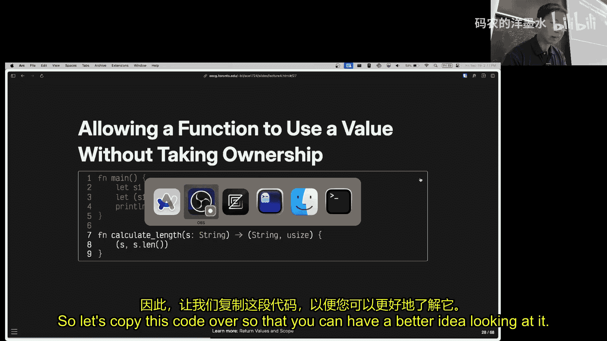
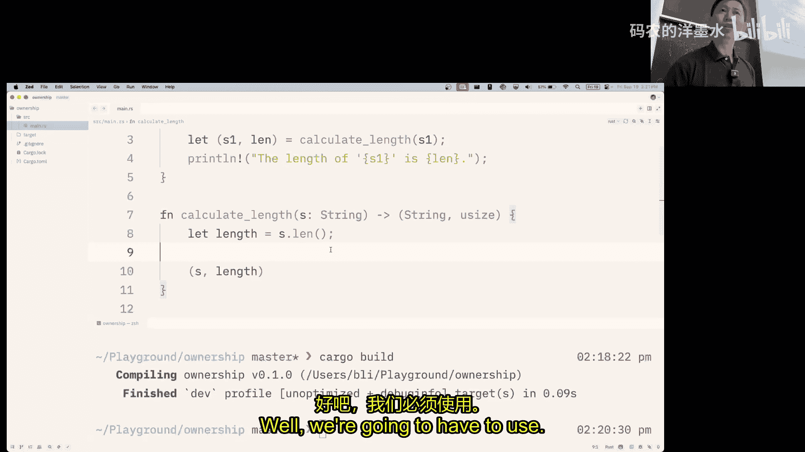
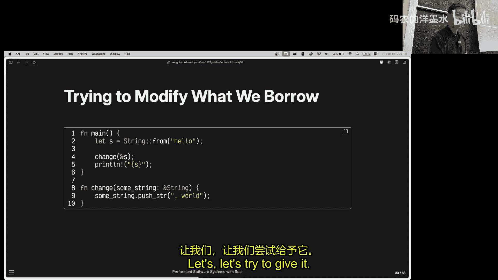
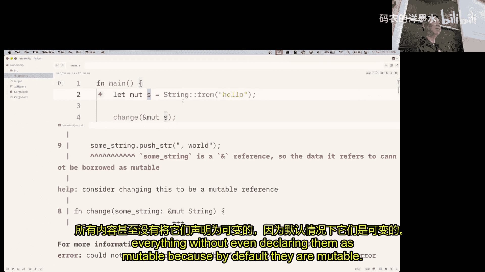
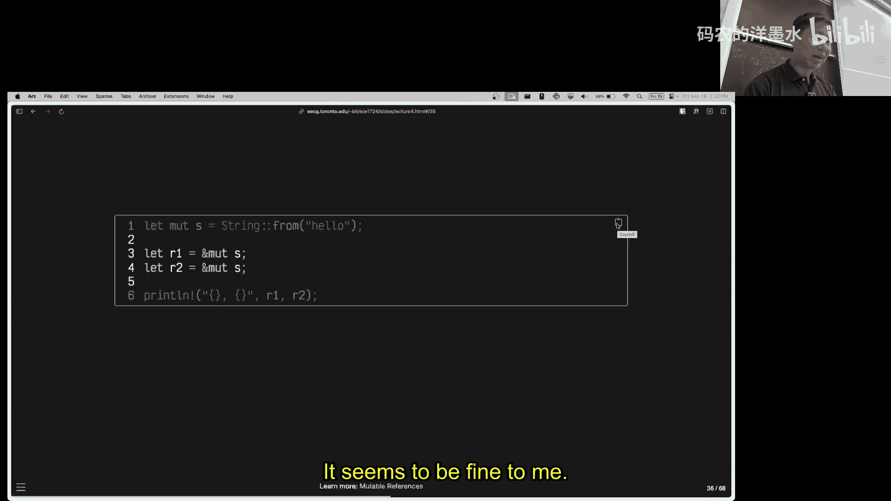
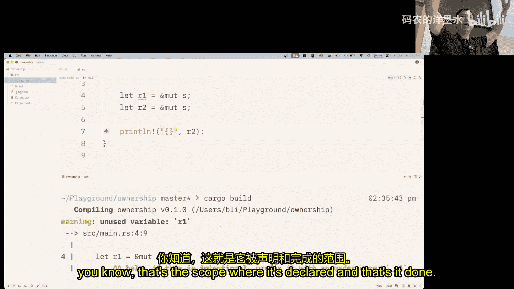
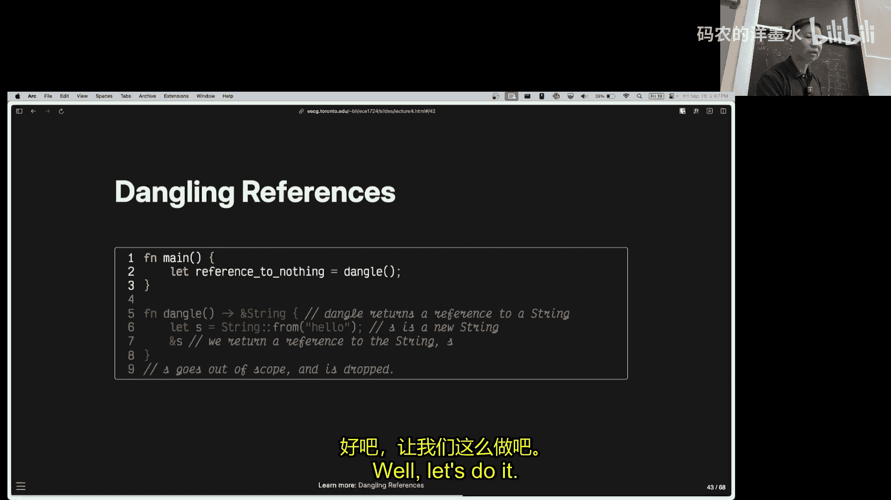
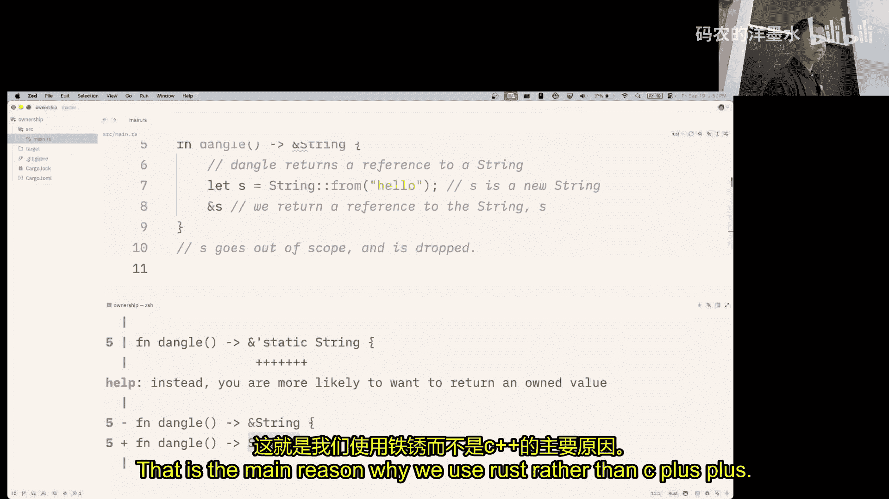
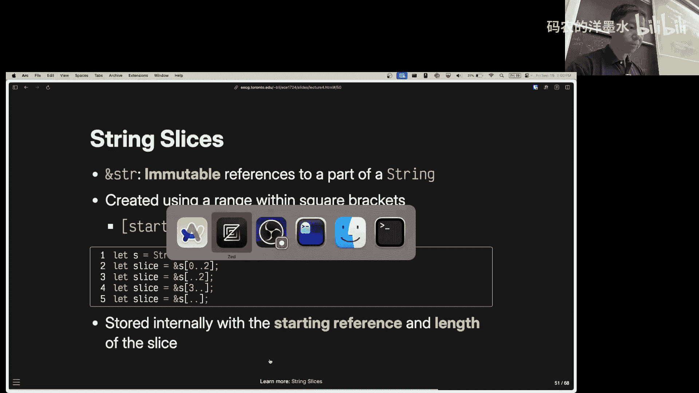

# 【全集 附课件】多伦多大学 使用Rust构建高性能软件系统 中英字幕 1080P p06 Lecture 6 - 字符串切片 -BV16V62BhEuf_p6-

All right， so let's get started again。So now let's talk about something that is a little bit more involved。

 assuming that everybody is fully aware of what we just previously talked about the preliminary ideas about ownership now let's talk about calling functions。

So in rust， when you pass a value as a parameter to a function。It is the same as an assignment。

 same thing。 In fact， this is not only limited rust。 the other languages，'s a lot of them。

 they do the same thing in C， for example， it's the same thing。

 You pass something to a function as a parameter。 It is an assignment。

And let's take a look at this case where we have a function， let's call it takes ownership。 you know。

 as you can see from the name of the function is's taking ownership。

 we're going to show you the function next slide， but you know， we have a string S hello。

 and we're sending that string into that function as a parameter。

And because we said that calling a function as a parameter is basically the same as an assignment。

It moves。Right，Because an assignment， either copies or moves， in this case is a string type。

 so it must move， so it will move into the function。

So that's why we actually call it takes ownership。 It takes ownership of that particular strain。

And because of that reason。After the takes ownership。

 the S is no longer valid because it moved already。 If you actually try to use it。

It will be a compile time error。And however， this is not the case for scaltype or any of the concrete types that actually implements the copy trade。

 if you actually have these simpler types that are only on the stack implementing copy trade。

When you call a function again， this is exactly the same as an assignment。

 You will just copy the value into the parameters。Of that particular function。

 So if you're calling a new function。Just like in CNNC plus plus。

 the value will be copied into the next。Stack frame belonging to the new function on the top of the stack。

 and that copying is going to happen because this is an assignment of a type of the copy trade。

And then towards the end of this main program both S and X will go out of scope and because S value is moved。

 nothing special is going to happen because it's already invalid， nothing special is going to happen。

 nothing will be dropped or anything because it's just no longer an owner of the value the ownership has transferred into the function itself。

And， of course， for x， nothing happens because x is not a。Of kind of a type that is on the heap。

So let's take a look at this function。 Take ownership。 What does it do。 Well。

 the takes ownership has a parameter， and that parameter has the string type， and the string type。

 obviously， is something that does not implement the copy trade。 You're gonna have to move。

 So that's why the S moves into this particular function。 And we can print the value of S。

Once we have taken the ownership。And when you finish that function at the end of that function。

 S is going to go out of scope。 And because of that reason， it is going to be dropped right there。

And that is done by the compiler automatically by inserting the drop function call。

And the same applies to the makes copy for， you know， for integer types。

 We don't do anything as it goes out of scope because this is not something that is on the heap。Now。

 let's go into this a little bit deeper。We just mentioned that going into calling a function by using a parameter。

 passing a parameter that is an assignment， the same applies to returning a value。

So when you return the value from a function， it is also treated as an assignment， same thing。

 which is， again， the same as any of the other programming languages。

So let's say we have some kind of a mysterious function called Gis ownership。

 and that gives ownership is going to return a strength。

So that string is going to move outside of the function into the string S1。

 And the reason for that is because whatever returned as a string。

 it is an assignment because of the assignment is a string type， it must be。Moved。

 rather than copied。And then we have S2， which basically takes a new string， and that is hello。

And then we have a new function。 and that function called takes and gives back。

 So we pass S 2 into that function。And then we're gonna return a string。

 and then we take that return value。 and then we give it to S 3。And because of that reason。

 S2 is moved into that function， takes and gives back。And its return value is again moved。

 And in this case， moved into S 3。 So we will be a lot of moving here。 Both times。

 both the calling and returning， they are moving。And at the end of this function。

 both S1 and S 3 will be dropped。 S2 has already been moved。

 which means that it is already invalidated。 And that means that nothing is going be special。

 nothing special is going to happen to this particular S 2。

So now let's take a look at GiI ownership well what how do we implement this well there's a simple implementation here。

 we just create a brand new string， say string column column from yours。

 and then we're going to try to return that particular string that we just created because we're returning it。

 we're moving it outside of that particular function。😊，And takes and gives back。

 takes a string and returns a string。 when it takes a string。

 ownership transferred into the function。 When it returns a string。

 ownership transfers out of the function。 If we simply say S right here， then we're trying。

 what are we trying to do， We're trying to say。I'm gonna take ownership。

 and then I'm gonna return it。 So I'm gonna give back the ownership outside of that function。So1 S。

Is going out of scope， out of this particular function。

 Nothing special is gonna to happen because ownership has already transferred to outside of the function。

So that's the basic idea。Alright， everybody is on the same page at this moment。

 Everything's clear for this particular example， right， before we go into even more details here。

So now this sounds， you know， easy to understand。 But it's kind of unwieldy。 It's kind of kind of。

Not very convenient， so。We wanted， hopefully， to allow functions that use a function user a value。

 but without taking ownership of that value。Let's have an example here。

To justify that particular need， to motivate that need。So here's an example。The first one， S1。

 we're going to have hello。And then we're gonna to have a function called calculate length。

That function， as you can see from the name is trying to say， I'm gonna take S1， which is hello。

 I'm going calculate how many bytes are there in that particular string。

 I'm going to return both the S1 and the length。And then we're gonna print out the length of that particular string。

 S1。How do we implement， calculate length？ Well， here's my implementation。 Take a look。

 pay special attention to this function。 right here。 This is the function。So what are we doing here。

 Well， we're taking us as a string as a parameter。We are returning a topple， and this tuple。

 the first component， first element， will be a string。

And the second element will be the length of the string。 And that's of type U size。

 Its an integer type。 And we're gonna have the length of the string as the second element of the top。

What happens with this code。So let's copy this code over so that you can have a better idea looking at it。

Sos make it a little bit smaller， let's copy this code over。So this is the code that we have。

What happened with this code？Well， first of all， can we compile this code？Not really。 why， Well。

 because you can see from the editor， it actually gives you the。😊。

The actual hints that this is not compilable。 So what might be the problems here。 Well。

 you can actually take a look by hovering on this。 it says value moved here。 Oh， my goodness。

That's our dreaded error right there。 Borrow of moved value。 So let's compile it。

 try to see what's happening here。 So cargo build compiling formally。

 So it says borrow of moved value E 0，3， a2 again。 You know， something that we have dreaded。

 as we mentioned， you know， I'm spending hours fixing these issues。 Why， why is this an error。 Well。

 it says。You know， move occurs because S has type string， which does not implement the copy trade。

 Obviously， string does not implement the copy trade。 We know that where's the move， though。Well。

 it's as value moved here。 value borrowed here after move。What happens。Well。

What do you mean value moves here， where's the move？Well， as we mentioned。

When we return something out of the function。It is an assignment。

And whenever there's assignment with strings， it is considered a move。

So it is moved right here by us returning this outside of the function。 that is a move。

And we move it first， and then we borrow this。That's no good。 So after it's moved。

 it's no longer valid。 It's moved， and we cannot use it。When it's moved。Alright。

 so how do we fix this issue。So I wanted to return the string。

 and I want to return the length of the string。 How do we fix this issue。要哎呀要。

Exactly getting the length， calculating the length before you return， right， So that's how we fix it。

 So how do we do that。 Well， without resorting to AI， I hope I've turned it off。

 but it's great that we have this empty sheet of paper rather than this AI giving me the code all the time。

 you know， and what we're gonna do is that we're gonna try to。😊。

Say let length equals to S dot length。RightSo that's really nice。 And then we're going to say length。

😊，Right here。Right，So let's try to see if it works。 Oh， it works magically without AI。 That's great。

 So just make a little bit more beautiful。 Just one more line of code and one more line of code being the empty line。

😊，Beautiful cold。 Very nice。😊，Except that it's not beautiful enough。

Because it's still kind of inconvenience， kind of unwieldy， right。

 You're trying to take the string and you try to calculate the length by returning the length of the string。

 It'd be great if we don't take ownership and then return the ownership back together with the length。

 right， It'd be great if we just say， let me calculate the length of the string。

 returning only the length。That's going to be great， right？How do we do that？Well。

 we're going to have to use。

A reference， exactly。 So now。The references， the idea of references enters the game right now。

 And wow， it whole opens another whole can of worms that we're gonna take the next couple of slides to talk about。

So this is the issue that we have demo， and that's the actual compile time error。

 And how do we actually use a reference to allow functions to use a value without taking ownership。

So here's what we have just now， the correct code。And this is the。

 the actual runtime result of the running it。So now let's talk about using a reference。

So what are references？Well， you might say， oh， I've seen this term。 This is in C plus plus， right。

 C plus plus call it references in C， we call them pointers。 Well， in rust。

 even though we call it the same name reference， it is different from C or C plus plus。

In the sense that in C plus plus， a reference could be like a null pointer or anything like that in in rust。

 we don't allow that。So references will always be valid。 We always be valid。 Otherwise。

 we will have a compile time error again。 So references， just like in C plus plus， allows you to。

 you know， have a reference to the value in Ru， we have its own terminology and it would be great if you think in Ru's own terminology rather than always resorting to the old timers way of doing this。

 We call it a borrow， a borrowing of a value。 Alright。

 we're borrowing of value by creating a reference。😊。

So rather than saying we create a reference to this， we say we borrow this。 So that's pretty nice。

 Sam thing as borrowing a book。 So someone is an owner。

 we mention that we only have one owner anytime。 Otherwise， the ownership will be transferred。

 and now I'm borrowing that book。So I'm not the owner， but I'm just borrowing this。😡。

So I'm not taking ownership。 This is for convenience。 I don't have to have the reference。

 as you can see I can create a function without using a reference by just transferring ownership in and then back out。

 So that's fine。 but now it's more convenient with the reference similar to C plus plus we're going to use the M percent and and that's going to be the same as C plus plus except the terminology。

 we call it a borrow and then we could also dereference it by using the star which is the same as in C plus plus。

But unlike in C in C plus the pointers there， they are very restrictive。

 These references can never be no or dangling by dangling， I mean。

 whatever that is referenced is gone。 And that's a dangling reference。

 And that's something that it will never be allowed by the compiler。

 So it is always going to be the safest kind of a reference in the world。

 So you never worry about these references going， going bad， going wrong。

 going something just completely uncontrollable， no nightmares about these references。

 because the compiler is so strict。 And if the compiler allows you to compile， it's gonna be good。

So now let's go into our previous example and see how do we implement it using a reference。 Well。

 we're gonna try to say we have a string S1， same as before。

 And now we pass a reference to S1 into this particular function。 Cal length。

 and we only return the length because now we're not taking ownership。

 we're not giving ownership into the function。 So function is not taking ownership from the main program。

 And then。You can see here's the reference。 N% string is the type。

 is the reference type of that particular parameter S。

 And then we're gonna return just the u size and integer， which is the length。

 The how many bytes that we have in that string。So here S goes out of scope at the end of the function。

 what happens？What happens here？Well， nothing happens because S does not take ownership。

 so nothing is dropped。So nothing is dropped because it doesn't have ownership。

So that's something that is really nice to have。 Someone else is the owner。As a borrower。

 if the borrower goes out of scope， nothing happens。 So that's good。

So now let's try to do something here。Let's try to modify what we borrow inside the actual function。

 Let's just simply call the function change。 And let's just try to use the push string。

 which is the function that we have the method of the string type that we have seen just now by pushing a new pending another string at the end of the previous string。

 Can we do this。Let's， let's try to give it， give it a try。 Let's copy this and just try to go here。

 and let's try to just。

Do this。 Can we do this。Not really。 as you can see， it's a compile time error。

 If you hover over this， it says cannot borrow some string as mutable at is。

 as it is behind a N% reference。 What does that mean， Well， it means that。The reference type。

Just like any other。Concrete type， like an integer。You know。By default， it is immutable。

Just as we mentioned before， types are by default， immutable。 So over here。

 when you have an immutable reference type， it means that the actual content that the reference。

 the data that reference is referencing。Is not mutable。So if that's the case。

 then we cannot push a string something to the end of the string。

 We cannot change the string because it is not mutable。How do we fix this？Tell me， how do we fix it。

Let's copy the code。 Let's try to fix it right here。 Without AI， let's try to fix it。Whats that。

The compiler， the compiler compiles just like this。This is what the compiler is going to report。

Right。Oh， you mean， will the compiler give me some help。 Let's give it a try。

 Let's see if the compiler gives us any help。 cargo Bu。Y， it does give me some help。 Okay， fine。

 We don't have AI， but we have a friendly compiler。 so that's great。😊，It adds right here。

 So let's try to do that just as the compiler suggested。嗯。M percent mute。

 which makes it a mutable reference。Right， and if you just do that， it's gonna do something here。

 It says， you know， something that is not right here。What's the problem？

Expected a mutable reference right here， but found a immutable reference。Right， so what do we do。

 Well， of course， you can compile again and ask the compiler help you。 But， you know。

 you can imagine this would be having， you have to define this as a mutable reference。

 And if we do that。It says， cannot mutate an immutable variable。 S S is not mutable。

 So you're gonna have to say let S as a mutable reference。 sorry。

 a mutable string so that the content is mutable。 So not only the reference has me。

 the actual string will have to be mutable that the reference borrows。

So three places where you saymable，mable，m， three places before you can ever mutate that string。

Which is fantastic。 This is the best news ever， because that it gives you out loud that you're mutating this string。

 You're really trying to change it。 This is your intention。😊，Explicitly。

 you have to change it three times， three places just to change that strength。

This is exactly what you wanted。 This is why rust is a good programming language compared to a lot of other places where you actually mutate everything without even declaring them as mutable because by default。

 they are mutable， bad idea。

Alright， I'm going to tell you why it's a bad idea later on。 We。

 we have more reason why it's actually a bad idea to have mutable strings。 Sorry。

 mutable references to strings。And then we have finished our demo。 We fixed it。

 and let's try to have mutable references。 and mutable references just a summarize that we have mentioned allow you to change the value underneath that the reference borrows and is represented by N percent mute。

 It's kind of strange at the beginning。 but after a while。

 you will feel very much comfortable with these things。 Every time you have mute N percent mute。

 you will be able to see that this is a mutable reference。😊。

And then we have our previous example that we have done correctly。

 three different places that we add mute。 and we are taking a mutable reference as a parameter to that particular function。

 And now we could change the value of that screen。 So that actually prints out a low world。

 So that's great。😊，Now here's the question。Can we create。Two mutable references。To the same value。

Here's an example。Have a value here。 S， which is hello。I have R1。

 which is a reference that's mutable to S。 And we have R 2， which is mutable to S。 And then。

 you know， rather than you know， changing the value。 just simply print them out。Can we do this， yep。

有。有。Yep。So。So the question is， does it take ownership。

 There's nothing that takes ownership because it's a reference。

 So a mutable reference is still a reference。 So reference means that we're borrowing and we're not taking ownership。

Al， so the S， which is sorry， not S。 some string in change would be a reference。

 It's a mutable reference。 So it's not taking ownership。 And that's， you know， it's okay。

 And because it's a mutable reference without taking ownership， but I can still change the value。

Alright， so that's the basic idea。 That's for convenience， right， You could take ownership。

 but you're gonna have to transfer it back。 And that's not very convenient。

So for this particular case， can we do this。No。So let's take a look。Let's give it a try。

 It seems to be O to me， right， No， it seems to be fine to me。 Let's give it a try。

Let's say we're gonna have this。 Let's just remove these in the main program， and。Let's try to。

 you know， remove the change as well。Let's try to just leave this part portion alone。

 And let's try to do that。 Well， it's already saying。No， it's not going to work。

 so let's try to compile it formally。Build， and we see cannot borrow S。

 S mutable more than once at a time。 It's it's something new。 It's a new era。 It's called E 0，4，9，9。

 cannot borrow S Smable more than once at a time。 It actually very， very clearly stated the rules。

You cannot borrow。Something as a mutable reference， more than once。

So now you've done that in this code。 So that's why it's a compile time error。 You did it once。

 And then second time， and it actually tells you， where's the first mutable borrow。

 Where's the second mutable borrow and the first borrow later used right here。

 And that's not possible。Alright， that's not possible。Now， let me try to answer。

 ask you this question。What if I remove this？Just remove this。And save it。Will it work。

Let's remove it。It works。There's a warning。Obviously， because it is not used。

 the value is declared and it's initialized， but it's not used。But then it it， it finishes。 it。

 it compiles， right， There's a warning called these unused variabless。 but then it compiles why。

Why does是 compile。Any ideas， yeah yeah。Exactly， the， the scope。If I hear you correctly。

 the scope of R 1 ends。At R2 right here。 Why， Well， the compiler is smart enough that it will end。

The last time when it's used and it's not even used。 So that's why it ends right there。Now。

 if we go back and add that print， that's gonna be different because if we add that print。

 it will be used right here。 And that means that the scope is going to have to last until this time when it's last used。

 And that is where the second mutable after the second mutable reference is declared。

 And this is why the compile time error says。First borrow later used here。

 It will tell you that your second borrow is going to be before the first borrow's last use。

And that is where the problem is。Quush。If we just try to。Very good question。

 so what if we just print R2？😊，Any ideas。It's going to work。 Let's give it a try。 I think so， too。

Right， let's give it a try。Oh， it's it should be one right here。Yeah， so it works。 So it finishes。

 It compiles， except that there's a warning of unused variable R Y。 Y， exactly。

 So that basically tells you another story about scope， right， So in Ru。

 the scope is kind of intelligence。 It's a smart scope。

 in the sense that it will until be going until it's the time of last use。 If it's not used。

 Obviously， it's gonna to be， you know， that's the scope where it's declared and that's it done。😊。

So that's really nice to have。 And that solves a lot of the future problems we're going to get into。

 So， but for this one， before we go and try to delete the print line， it is going to be error。 Now。

 here's another question。😊，Can we have one mutable reference？And another immutable reference。Yeah。

Twomable references。Y， so the the。Yeah， so exactly。 So your question was。

 if I understand it correctly， why do we have， you know。

 do we not allow to mutable or multiple mututable references， Exly， it's about race condition。

 We're gonna get to that， right， right next。So， so the question is。

 if you actually have an original owner plus a reference， Does it have two owners。 No。

 that has just one。No， because only you can only write with there's only one writer over there。

 So you don't really have two writers。 So when you actually use the reference to write， that's。

 that's where you write it。 That's， you don't have the second writer。Right。It will compile。 Yeah。

 if you only have one mutable reference， Yes， no problem。But。

 but you haven't asked me answer this question yet。

 So you're going jumping ahead to the race condition。 We're going to talk about race conditions。

 But for the motivating this。 But what about this question。It should be okay。Anybody else。What。

 what do you think。Yes or no。No， okay， Why not。Can read the wrong value in the case where you have。

A special case granted that you have concurrency， right。

 When you have like concurrent threats progressing at the same time， you could actually have。

A wrong value that you read out， right， So that's， that's a very good reason。 And that's why in rust。

 we don't really try to do that。 We cannot allow that。 So here。We have a mutable reference。Oh sorry。

 it is the immutable reference R1 for the S， no problem right here。Another immutable reference。

 no problem right here。Suddenly， a mutable reference。That's where we have a big problem。

And the reason is， Rus compiler does not allow a mutable reference to coexist with an immutable reference because we have potential race conditions。

In concurrency， inconcurrent software。And this is going to be a error。 E0，50。

2 cannot borrow S as a mutable because it is also borrowed as immutable out of the concerns of time。

 we're not going to show you the demo right here。 You can trust me this is going to be the error that the compiler generates。

 It will not allow you to borrow this as mutable。After it is already borrowed as immutable。All right。

 so that is。A restriction。And we can call it the borrow rules， for example。

And let's try to summarize these rules。 What are the house rules related to references and mutability of references。

First of all， you cannot borrow a mutable reference more than once， so you can only borrow it once。

You cannot have a mutable reference while having an immutable reference。

 You cannot have the two kinds of references coexisting。And however， on the other hand。

 you could actually have multiple immutable references at the same time。

And that basically means that you either have one writer。

 which is a mutable reference or multiple more than one readers， which is an immutable reference。

 you cannot have both。You cannot mix and match。So as a summary。

 you can either have one mutable reference or multiple immutable references。

 one writer or multiple readers。But not both。Question。What's that。Can you have a reference over it。

 You could， but you don't typically do that。 But we're gonna get to that a little bit later。 Alright。

 you don't typically do that because that requires a lot of work。 You're gonna have to really try to。

You know， put the。You don't， you don't do that。You could， if you really want to do that。

 you could actually use other ways of doing it， but you cannot do it like in the conventional way in CNC plus+ y。

2 references are both mutable on the same data。 It's not okay。 Yeah， correct。For a function call。

 Yeah inside a function。 No problem。 Yep， so you can it's not O if you have two mutable references。

So why， why do we have these house rules？Well， as we mentioned that just now that we might have race conditions。

 or in other words， we can have data races， the reason why this is important is this is where the most elusive bugs happen。

And these bugs are related to concurrency when you have concurrent software。And you might say。

 what if my software is not concurrent？😡，Do can we do this？ Well， conceptually。

 if your software is guaranteed to be not concurrent， like if it's always a single thread and so on。

 then sure， you don't have data races。But in rust， the compiler。

 the designers of the compiler assumes that everything is concurrent。

Which basically means that it's actually better to be conservative for the compiler to enforce these rules over the beginning。

 even if your code is not concurrent， and that's something that we wanted to have。

 And this is not true for the other languages。 In the other languages， you could actually have。

Data races， because you have two or more pointers accessing the same data at the exact same time。

 And one of them is writing。 And there's no mechanism using use to synchronize。 In other words。

 you don't have locks， you to exclusion locks。 you don't have anything like that。

 which is taught by the operating system class。 But nobody is careful enough to actually do that。

 And because of that reason you have data races。 And data races are the worst nightmare ever in software。

 And this is the reason for that is because sometimes they happen。 of the other times they don't。

 They might happen once every year。 you don't know。 So that's gonna be a problem。

And the data races in rust is completely。Prevent it。

We have a guarantee that the code is raised free because data races in rust are compile time errors。

 and that is really nice to have When the code compiles， it will have no race conditions whatsoever。

 And that's great。 That's fantastic。 You might say， you know， can I put in locks myself。 Sure。

 if you wish to do that， you could later on， we're gonna to talk about it。

 if you really want to do to， to have like mutable references that are， you know。

 multiple userr to the same place， you could do that。😊，You know， in rust。

 So rust is powerful enough to support anything。 but in general at， you know， at the very beginning。

 we don't want， you know， the beginner programmers to have access to all of those powerful tools。

 Those powerful tools can be done in rust， but typically we do not do not allow that to happen。

So now we have the compile time error that you know to fix that。

 we're going to basically say we're going to use r1 and R2 before we actually have the mutable reference and that means that after the print line right here。

 R1 and R2 are both out of scope and that's when you have a mutable reference and that is no longer a problem because now you no longer have mutable references and immutable reference happening at the same time and the reason for that is because r1 and R2 is already going out of scope。

 no problem whatsoever。Which is great。RightIt's going out of scope already and all of that scoping and everything is like when is it last use。

 all of that is done by the compiler， When the compiler compiles， it figures everything out。

 This is why a lot of people complaining， oh， Ru compiler is very slow。

 I prefer it to be slow to solve that problem。 All I need to do is to buy a faster computer right。

 I prefer this to be slow。 so that I don't have to spend hours of time or you know hundreds of hours of time fixing some kind of a bug elusively happening at runtime。

😊，Alright， so that's something that I I would love the compiler to be slow in that sense。

 So this is what happens if after you basically move the print line upwards before the mutable reference。

😊，So now let's talk about dangling references， dangling references this term。

Refers to the case where you have a reference。That is borrowing a value with the value itself is no longer valid。

For example。Here's what we're trying to do to hopefully create a dangling reference。

 I'm going to call a function called denangle。 I'm gonna return from that function。

 Yeah and then assign that return value to reference to nothing。 And then in denangle， what do we do。

 Well， in dangle is gonna return a string。 But rather than returning a string itself in transfer ownership。

 we're returning a M percent string， which is a reference。And in this case。

 it is an immutable reference to that string。And we're going to create a string right here。

 and then we're going to try to return the reference an immutable reference to that particular string。

All right。Why is this code a dangling reference， Well， it's because at the end of that string， sorry。

 at the end of that function， the string S is gonna go out of scope。

Which means that it will be dropped automatically by the compiler， following our rules。

And whatever that is returned is no longer borrowing a value that is valid。So。

That is where you actually try to assign dangle， the return value to that variable reference to nothing。

 And that is a dangling reference。So what happens if I take this code and put it through the Ru compiler。

Well， let's do it。

Let's try to do it。 Let's copy this。And let's try to copy that in。And as you can see， cargo build。

It will say。A lot of things。 But at the very beginning， it says。E 0，1，0，6 missing lifetime specifier。

This is another dreaded era that a lot of people， they missing lifetime specifier。Later on。

 when you program thousands of lines of rust code， you will see this a lot。

And this will- you're going to have to pull here just to figure out how to fix this。

What is a lifetime specific， Well， that is going be a long time later that we're going to talk about。

 but here what we're doing here is that it will actually say the expected named lifetime parameter M percent right here。

 and this function return type consider contains a borrowed value。

 but there is no value for it to borrow from aha， this help I understood。

This help I understood this function's return type contains a borrowed value。

 but theres no value for it to be borrowed from。Value is dropped， nothing to be borrowed from。

And then the help is consider using a static time lifetime。 However， this is uncommon。

 So don't use it， you know， and then instead， you are more likely to want to return an own value。

 So it basically the compiler will give you multiple options but say， okay， prefer。

 try to prefer the second option， which is to return a string itself rather than the actual reference to a string。

 a immutable reference to a string。 Otherwise， you have a dangling reference。 But all in all。

 you know， this missing lifetime specifier。 forgetget about what lifetime is for now。

 is justptic way of telling you that you cannot have a dangling reference。

 That is not allowed by the compiler。 The compiler is gonna give you a compile time error。

 which is what you expected。In rust， we cannot allow a reference that is no or a reference that is dangling。

 Don't underestimate the power of doing this at compile time。 All of the other languages。

 there are tons of no references dangling references everywhere that it becomes a big headache over time。

 so。That is the main reason why we use B， rather than C plus plus。

Alright， so now this is gonna be a compile time error， missing lifetime specifier。

So to fix the compile time error， as the compiler suggested。

 we're gonna have to return a string so that the ownership is moved out of the function rather than returning a reference and the the reference is dly。

Right， that's how we fix it。So now let's reiterate the house rules of references。

 including mutable and immutable references， just including everything that we have talked about。

 just refresh our memory about the rules。 numberumb one， the references must always be valid。

 we know no reference， no dangling reference。 Nothing will be there。 references must always be valid。

 numberumb two， because of race conditions at any given time。

 you have either one mutable reference or multiple immutable reference， you cannot mix and match。

 you cannot have multiple mutable references。 And finally。

 data will not go out of scope before the reference to the data does。

 This is kind of something that is required by the compiler。 If the data goes out of scope。

 it must be dropped and that reference must be dangling and that's not allowed by the compiler。

And that these are the house rules， and that's something that we must always remember。

So now here's an example。Here's the problem。The problem here is to write a function。

That takes a string of words。And returns the first word it finds in the string。

 It's sort of like a basic C programming class。 But let's take a look at what's the best way to do it in rust。

So I a function， let's call it first word， I' going to take a string。

And as we mentioned that we probably don't want to， you know， take ownership。

 So let's just take a immutable reference of that string。 And the question is， what should we return。

 Well， if you go back， we want to return the first word it finds in the string。

 What should we return。Yeah。A string slide。 We haven't even talked about it well。

 except informally so。We， we haven't talked about it。 We will use this example to talk about it。

 right， We haven't talked about string slices yet。 So this is a motivation for that that we wanted to talk about。

 So forget about that。 So what should we return。A character。Or。Well。

 one idea is to just return a string， like the first word， right？

 so but that is probably not a very good idea because you basically do a deep copy of only the first word。

 but it might be okay because the first word， if it's not too long。

 you could actually just return the first word as a deep copy。 So that's fine。But， you know。

 intuitively， we be way better if we don't make that copy of the first word， right。

 And the reason for that is because， you know， we might want to number one。

 avoid memory copying and number two。 prefer to have some kind of a reference into the string。

 But for now， let's try to say， maybe we return an index。

 And that's kind of very typical in the kind of beginner C and C plus programming。

 we kind of return an index， which is sometimes a good idea。 So let's return an index。

 Let's try this idea。 So return an index would be a returning integer， which is a U size。

So what we do。 Well， first of all， we convert the string as that we take as bytes。

 As you can see here， we don't。 we basically as dot as bytes。 We don't have the， the weird。

 kind of ugly C plus plus grammar and C grammar where you have the right arrow and there's no need for that kind of that stuff。

 We just say dot。 So which means that you you can just feel free to forget about what you you remember from CN NC plus plus here。

 beautiful， beautiful code S dot。 You know， it's a reference。 I use it because I borrowed the book。

 I can read the book。 No problem。 right， That's what we have。

 We don't have to have a special way of reading my borrowed book。 just like。😊，A book that we own。

 So S do as bys。 So we convert to a array of bytes。 And then we're gonna iterate through that bys。

Aray and to iterate， we're gonna use iterer。 Iter is。

 we're gonna to talk about iterators along many classes later。

 but this is basically a special way of iterating through multiple elements in that array。

 And you know， an iterator is going return as the name suggested， an iterator。

 basically And that iterator we also call dot enumerate will convert that itererate iterator into topples and each tuple contains the index and then the item in that iterator as a reference into that item。

 So right here we're basically taking whatever enumerate returns， which is a tuple。

 And we're gonna to put that in the for loop。 And we say four parentes I comma M percent item。

 What does that mean。Well， it means that we're taking this as a destruct。

 We're taking whatever that is returned by enumerate， and we destructure it。

 and we put it in the for， which means that we destructure every single other element of that iterator。

And after the de， we get I and we get idle。And when we say 1% item。

 we get the actual item that the references。Is going into。

And that that means that we can actually use that item and try to read it out and say， is it a space。

 if it is a space， we return the index of that space， in this case。

 that would be the index right after the first word because we're looking for the space。

And then we're gonna try， try to say， if we cannot find the space， just return the entire thing。

Right。So that's the rusty way or the kind of idiomatic rust way of going through a number of bytes in an array。

 In this case， this array represents characters in the string。 And this， again。

 this assumes that we only have basic ASI characters in that string rather than anything more special。

 So that's kind of a way of implementing it so that we return the actual index。😊。

But here is the problem of this idea of implementing the index， even though we could implement it。

 it's not the best idea because there's no guarantee that the index returned。

Will be valid in the future。 Here's an example。 So here we have S。

We take that index and return the value of5， looking for the first word。 index is5。

 which is the space。 the index of the space right after hello。 And then wed say S do clear。

 were pulling the carpet or the rug underneath the table。 So that's no good。

 This empty stock clear empties the entire string， making it equivalent to an empty string。

 and that means that the word even though it still has a value of five。

 it is no longer valid because the value underneath that particular index changes。

So that means that returning an index， even though it sounds okay。

 it's not a very good idea and that motivated。The string slice。And the string slide basically says。

 I wanted to return something special。 So going back to this particular string， I want to return。😊。

你好。A slice of the string。 That's why we call it the string slice。 A slice of the string。

 And previously， we looked at the string slice。 and we previously。

 we mentioned that we do have a string slice。 In fact， all string literals are string slices。

 And we said that it looks like this。😊，And percent stir。

 And this is basically a way of saying that this is a string slice。 And this string slice。

 as you can see， is a reference。 It is a reference into a slice of that string。

 So that would be the string slice that we have and it's an immutable reference to a part of a string and obviously it' immutable。

 It's basically a slice that we use to return the first word。

 And that could be created using a range using square brackets。 for example。

 the starting index and the ending index。 So， for example， if you say0 dot dot 2。

 that would be 0 and1。 that would be H and E。 And dot dot 2 would be something like。

From the beginning to to2，2 will be one past the last character。

 And then3 dot dot that's gonna be starting from index 3。 And then dot dot without both sides。

 is gonna be the entire string。And a string slice， just as you expected。

 stored internally with a starting reference and a length of the slice。 So a starting reference。

 sort of like a pointer。And it one points to wherever it starts and a length。

 which is how many do we have， How many characters do we have， As you can see。

 it is a very simple way of representing in an immutable way， a portion of that stream。

And that's something that we're gonna continue to talk about next time。

 We're gonna get into the string types。 But before we conclude， just a reminder。

 we do have assignment number one released， and we also have the project ideas。

 we are continuing to add more ideas into the project ideas。 But the preliminary version is online。

 So feel free to take it take a look。 and I welcome any questions in the discussion forum。 Thank you。

😊。

