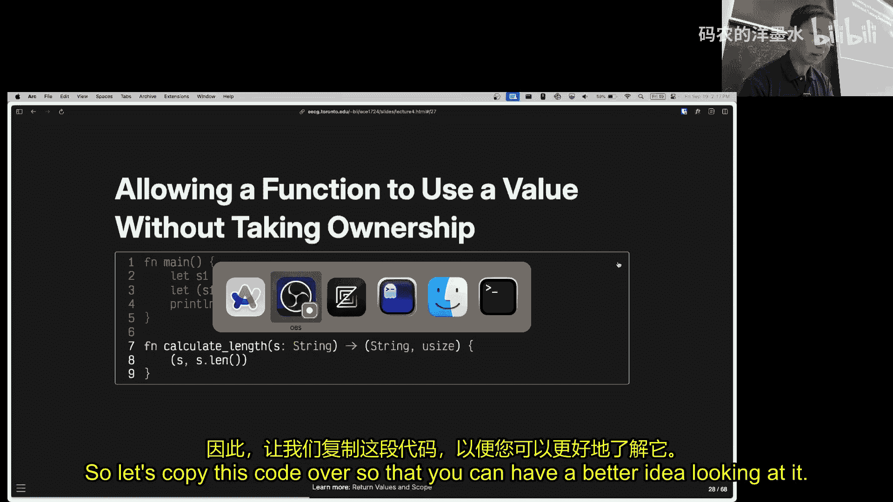
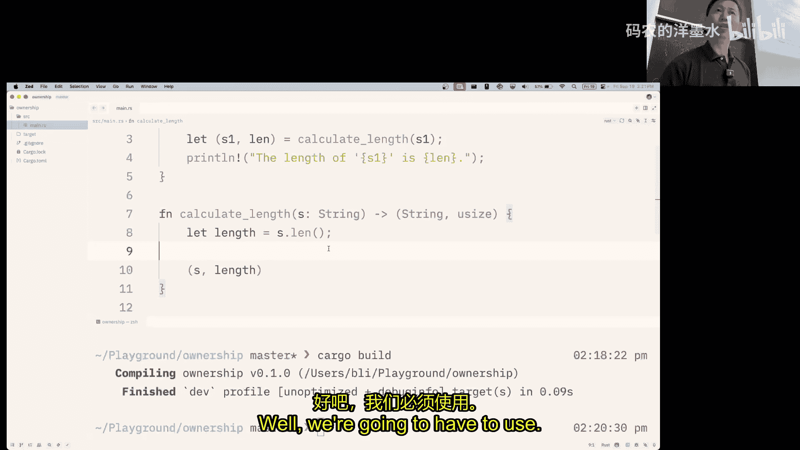
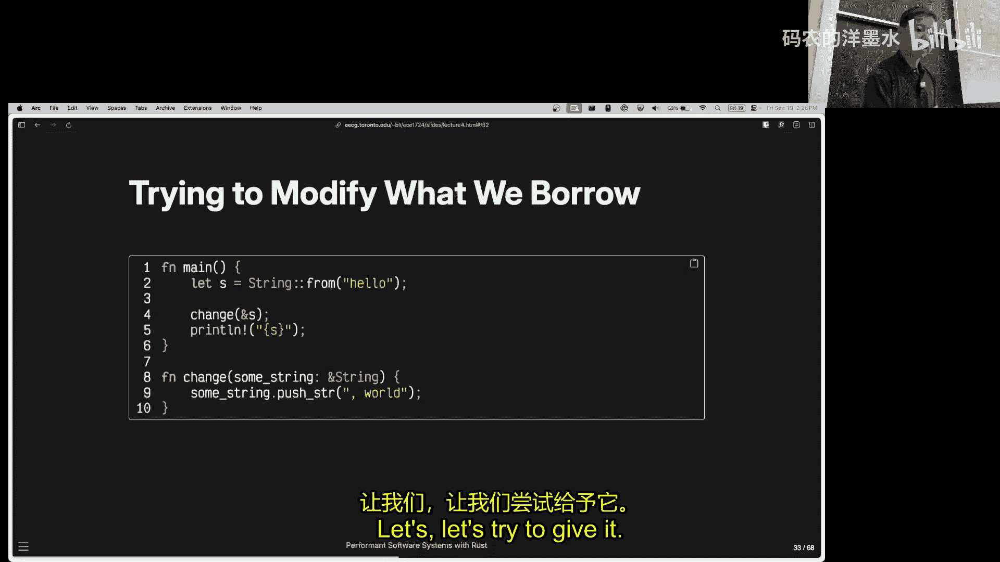
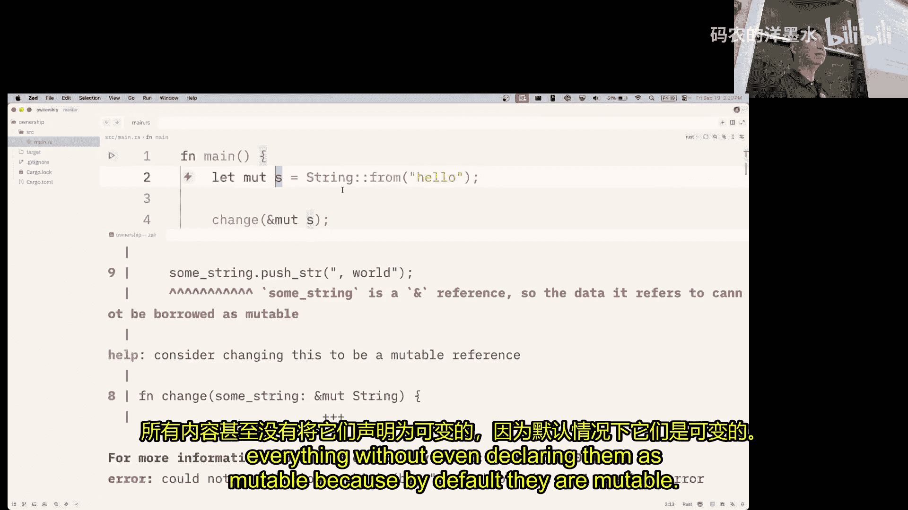
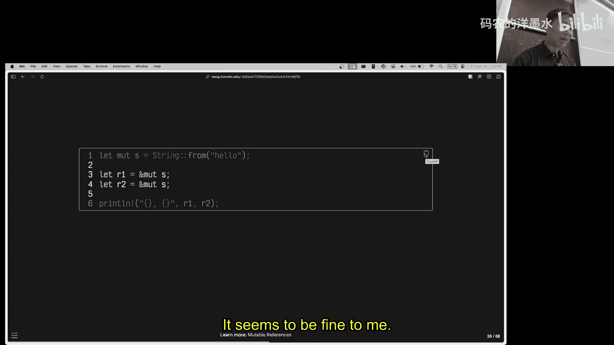
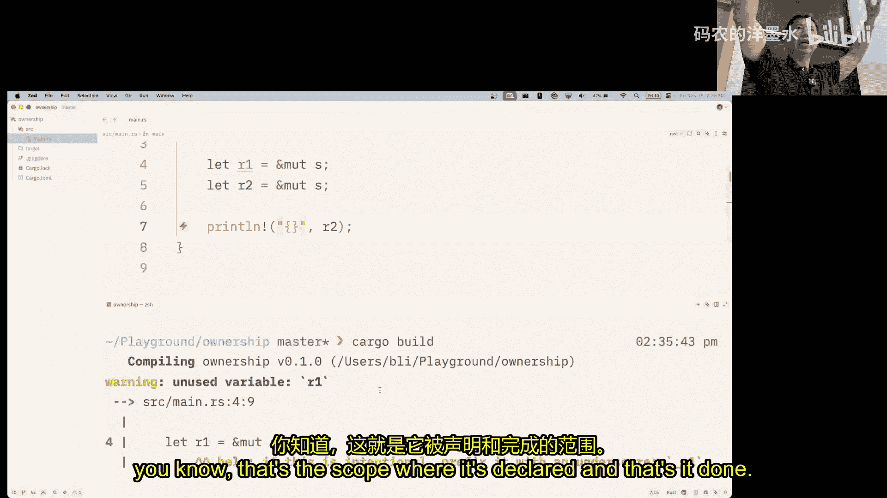
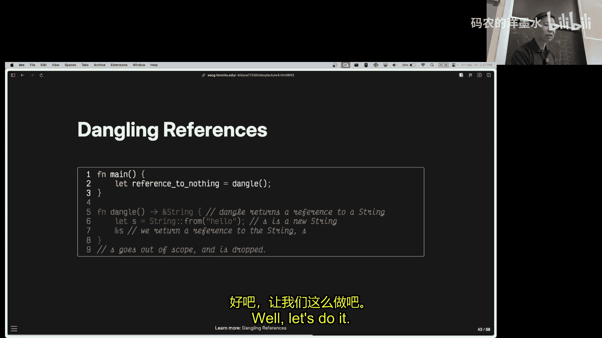
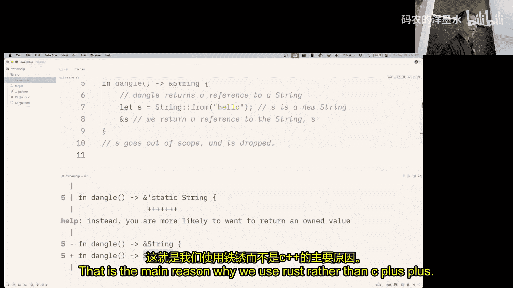
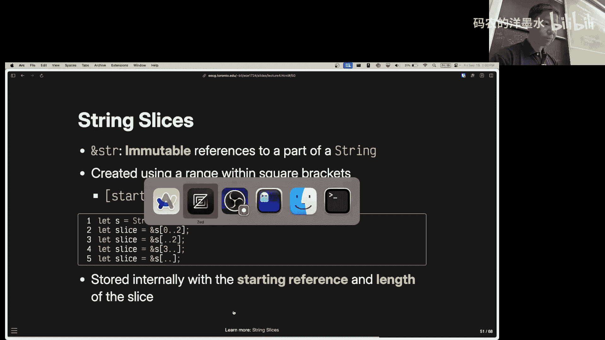

# Rust 编程：第6讲：字符串切片与引用

在本节课中，我们将学习 Rust 中关于函数调用、所有权转移以及引用的核心概念。我们将探讨如何通过引用来借用值，以避免所有权的转移，并理解 Rust 为确保内存安全和避免数据竞争而制定的严格规则。

## 函数调用与所有权转移

上一节我们介绍了所有权的基本概念，本节中我们来看看函数调用时所有权是如何转移的。

在 Rust 中，将一个值作为参数传递给函数，其行为与赋值操作完全相同。事实上，这不仅限于 Rust，许多其他语言（如 C）也是如此。当你将一个值作为参数传递给函数时，它本质上就是一次赋值。

让我们看一个例子。我们有一个名为 `takes_ownership` 的函数。我们有一个字符串 `s`，其值为 “hello”。我们将这个字符串作为参数传递给函数。

因为函数调用传递参数等同于赋值，而赋值对于 `String` 类型意味着移动（move），所以 `s` 的所有权会移动到函数内部。这就是为什么这个函数被命名为 `takes_ownership`——它取得了该字符串的所有权。

因此，在 `takes_ownership` 函数调用之后，变量 `s` 将不再有效，因为它已经被移动了。如果尝试使用它，将会导致编译时错误。

然而，对于实现了 `Copy` trait 的标量类型或任何具体类型，情况则不同。当你调用一个函数时，这同样等同于赋值，但值会被复制到函数的参数中。就像在 C 或 C++ 中一样，该值会被复制到栈顶属于新函数的栈帧中。这种复制之所以会发生，是因为这是对实现了 `Copy` trait 的类型的赋值。



在这个主程序结束时，`s` 和 `x` 都会离开作用域。由于 `s` 的值已被移动，不会发生任何特殊的事情，因为它已经无效。对于 `x`，也不会发生什么，因为它不是堆上的类型。

让我们看看 `takes_ownership` 函数做了什么。它有一个 `String` 类型的参数，而 `String` 类型没有实现 `Copy` trait，所以 `s` 会移动到这个函数中。我们可以打印 `s` 的值。当函数结束时，`s` 会离开作用域，并因此被自动丢弃（`drop`）。对于 `makes_copy` 函数中的整数类型，当它离开作用域时，不会发生任何特殊操作，因为它不在堆上。

## 返回值与所有权转移



我们刚刚提到，通过参数调用函数等同于赋值，返回值也是如此。

假设我们有一个名为 `gives_ownership` 的函数，它会返回一个 `String`。这个字符串会从函数内部移动到外部的变量 `s1` 中。原因是，作为 `String` 类型返回的值，在赋值时必须是移动而非复制。

接着，我们有一个变量 `s2`，它创建了一个新的字符串 “hello”。然后我们调用一个名为 `takes_and_gives_back` 的函数，将 `s2` 传递给它。该函数会返回一个字符串，我们将返回值赋给 `s3`。因此，`s2` 被移动到函数中，而它的返回值又被移动到 `s3`。这里发生了大量的移动操作——无论是调用还是返回，都是移动。

在这个函数结束时，`s1` 和 `s3` 会被丢弃。`s2` 已经被移动，这意味着它已经失效，不会发生任何特殊的事情。

`gives_ownership` 的实现很简单：我们创建一个新的字符串，然后返回它。因为我们返回它，所以将它移出了函数。`takes_and_gives_back` 函数接收一个 `String` 并返回一个 `String`。当它接收字符串时，所有权转移到函数内部；当它返回字符串时，所有权转移出函数。如果我们简单地返回 `s`，那么我们是取得所有权，然后将其归还。当 `s` 离开函数作用域时，不会发生任何特殊的事情，因为所有权已经转移到了函数外部。

## 引用的引入：借用值



以上概念听起来容易理解，但操作起来可能有些笨拙和不便。我们希望允许函数使用一个值，但不取得其所有权。

以下是一个例子，用以说明这种需求。

我们有一个字符串 `s1`，值为 “hello”。我们想调用一个名为 `calculate_length` 的函数来计算其长度，并同时返回 `s1` 和长度值，然后打印出字符串 `s1` 的长度。



`calculate_length` 函数的实现是：接收一个 `String` 类型的参数 `s`，返回一个元组，其中第一个元素是 `String`，第二个元素是表示长度的 `usize` 整数。

这段代码能编译吗？不能。为什么？因为当我们从函数返回某个值时，它是一次赋值。对于 `String` 类型的赋值，它被视为移动。所以，`s` 在返回时被移动了，然后我们又尝试在移动后借用它（打印），这是不允许的。

如何修复这个问题？我们可以在返回之前计算长度。修改代码，先使用 `let length = s.len();` 获取长度，然后返回 `(s, length)`。这样修改后，代码可以正常工作。



但这仍然不够方便。如果我们能只计算并返回长度，而不需要取得和归还所有权，那就更好了。这时，引用的概念就登场了。

## 引用详解

引用在其他语言（如 C++）中也被称为引用，在 C 中被称为指针。但在 Rust 中，尽管名称相同，引用与 C/C++ 中的有所不同。在 Rust 中，引用永远有效，不允许空引用或悬垂引用。在 Rust 的术语中，我们称之为“借用”（borrowing）一个值。



我们通过使用 `&` 符号来创建引用（借用），这类似于 C++。我们也可以通过 `*` 来解引用，这也类似于 C++。但与 C/C++ 中的指针不同，Rust 的引用受到严格限制，永远不会是空或悬垂的。编译器会确保这一点，因此你无需担心引用出错。

现在，让我们用引用来重构之前的例子。我们有一个字符串 `s1`，现在我们传递 `s1` 的引用给 `calculate_length` 函数，并且只返回长度。因为函数没有取得所有权，所以当函数结束时，`s`（引用）离开作用域，不会发生任何丢弃操作，因为引用不拥有数据。

## 可变引用

现在，让我们尝试在函数内部修改我们借用的值。我们创建一个 `change` 函数，尝试使用 `push_str` 方法在字符串末尾添加内容。我们能这样做吗？

不能。你会得到一个编译时错误：“cannot borrow `s` as mutable, as it is behind a `&` reference”。这意味着，默认情况下，引用类型（就像其他具体类型一样）是不可变的。当你有一个不可变引用类型时，它所引用的数据是不可变的。因此，我们不能修改字符串。

如何修复？我们需要一个可变引用。在 Rust 中，要修改借用的值，需要在三个地方明确声明可变性：
1.  变量本身必须是可变的：`let mut s = String::from("hello");`
2.  函数参数必须接收可变引用：`fn change(some_string: &mut String)`
3.  传递参数时必须使用可变引用：`change(&mut s);`

只有在这三处都声明了可变性后，你才能修改字符串。这明确表达了你的修改意图。

## 引用规则

现在有一个问题：我们能创建对同一个值的两个可变引用吗？例如：
```rust
let mut s = String::from("hello");
let r1 = &mut s;
let r2 = &mut s;
println!("{}, {}", r1, r2);
```
这段代码能编译吗？不能。编译器会报错：“cannot borrow `s` as mutable more than once at a time”。这是 Rust 的借用规则之一：你不能多次可变借用同一个值。

但是，如果我们不使用第一个可变引用 `r1` 呢？例如，只声明 `r1` 但不使用它，然后声明 `r2` 并使用它。这时，由于 `r1` 在其最后一次使用（这里根本没有使用）后就结束了作用域，所以在 `r2` 创建时，`r1` 已经不在作用域内，因此代码可以编译（可能会有未使用变量的警告）。Rust 编译器具有“非词法作用域生命周期”的特性，它会智能地判断引用的实际使用范围。

另一个问题：我们能同时拥有一个可变引用和一个不可变引用吗？例如：
```rust
let mut s = String::from("hello");
let r1 = &s; // 不可变引用
let r2 = &s; // 不可变引用
let r3 = &mut s; // 可变引用
println!("{}, {}, and {}", r1, r2, r3);
```
不能。Rust 编译器不允许可变引用与不可变引用共存，因为可能存在数据竞争的风险。即使你的代码当前不是并发的，Rust 编译器也保守地强制执行此规则，以确保代码在任何潜在并发环境下都是安全的。



以下是引用规则的小结：
*   在任何给定时间，对于同一数据，**要么**只能有一个可变引用，**要么**只能有多个不可变引用，不能两者兼有。
*   引用必须始终有效（无空引用、无悬垂引用）。

这些规则在编译时强制执行，从根本上防止了数据竞争，这是 Rust 内存安全的核心保障之一。

## 悬垂引用



悬垂引用指的是引用所指向的数据在其生命周期结束前就被释放了。Rust 编译器会阻止这种情况发生。

例如，考虑一个返回字符串引用的函数 `dangle`：
```rust
fn dangle() -> &String {
    let s = String::from("hello");
    &s
} // s 在这里离开作用域并被丢弃。返回的 &s 将成为悬垂引用。
```
这段代码无法编译。编译器会报错：“missing lifetime specifier”（缺少生命周期说明符）。这是一种告诉你不能返回悬垂引用的方式。要修复它，应该直接返回 `String`（转移所有权），而不是返回它的引用。

## 字符串切片

最后，我们讨论一个实际问题：编写一个函数，接收一个字符串，并返回它在字符串中找到的第一个单词。

一个初步的想法是返回该单词的结束索引（例如，空格的位置）。但这种方法存在问题：返回的索引在未来可能失效。例如，在获取索引后，如果原始字符串被清空（`s.clear()`），那么该索引就不再指向有效数据。

这引出了**字符串切片**的概念。字符串切片是对字符串一部分的不可变引用，其类型写作 `&str`。你可以使用范围语法来创建切片，例如 `&s[0..5]` 表示字符串 `s` 中从索引 0 到 4（不包括 5）的切片。

字符串切片在内部存储了一个指向起始位置的指针和切片的长度。使用切片来返回第一个单词是更好的方法，因为它直接引用了原始字符串中的数据，无需复制，并且与原始字符串的生命周期相关联，安全性由编译器保证。

我们将在后续课程中更深入地探讨字符串类型和切片。

## 总结

本节课中我们一起学习了：
1.  函数调用和返回值如何导致所有权的移动。
2.  如何使用引用（`&`）来借用值，以避免所有权的转移。
3.  可变引用（`&mut`）的用法和限制，以及为何需要多处声明可变性。
4.  Rust 严格的引用规则：一次只能有一个可变引用，或多个不可变引用；引用必须始终有效。
5.  这些规则如何帮助在编译时防止数据竞争和悬垂引用。
6.  字符串切片（`&str`）作为解决部分字符串引用问题的优雅方案。



理解这些所有权和借用的概念是掌握 Rust 编程、编写安全高效代码的关键。