# 【全集 附课件】多伦多大学 使用Rust构建高性能软件系统 中英字幕 1080P p07 Lecture 7 - 结构与枚举 -BV16V62BhEuf_p7-

All right， so let's get started now。Today， we're going continue to talk about the ownership and strengths。

 and then we will。

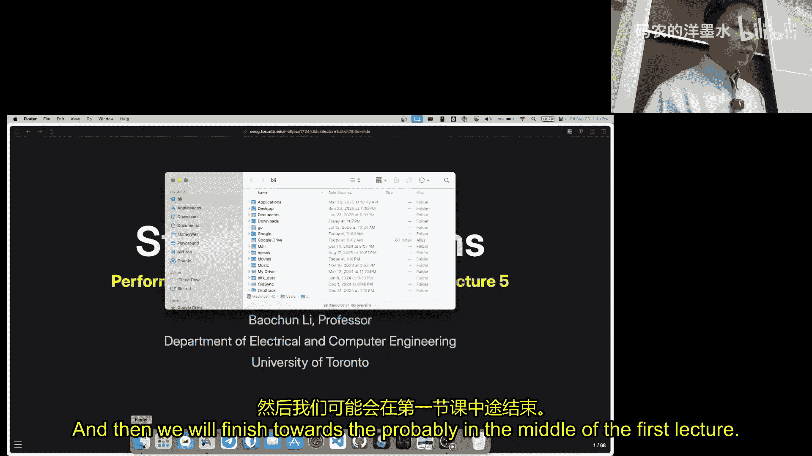

Finish towards the。Probably in the middle of the first lecture and we're going to switch to struts and Nams。

 so first of all， let's finish our discussions about ownership and strings and last time we talked about ownership and just want to briefly summarize what we talked about last time。

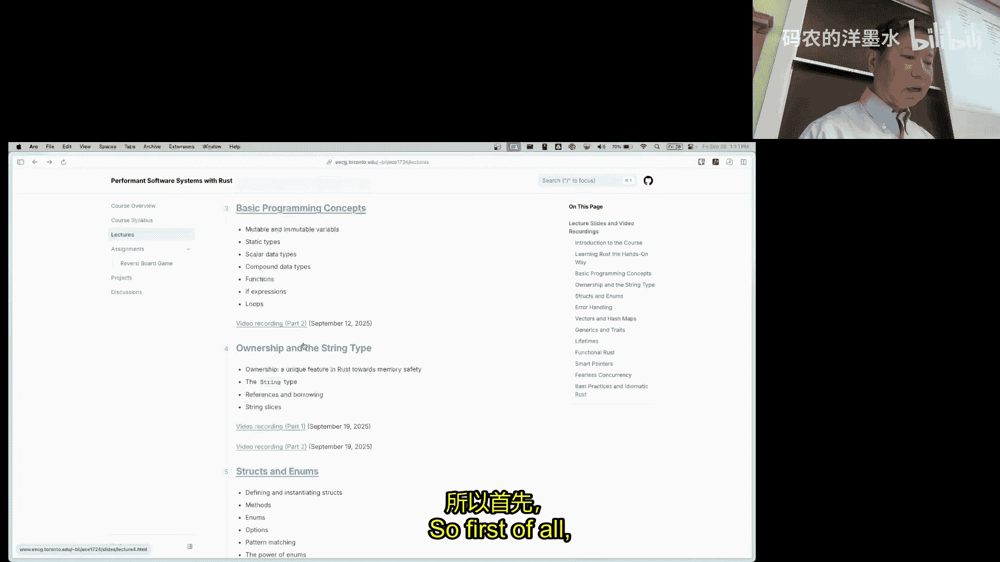

嗯。

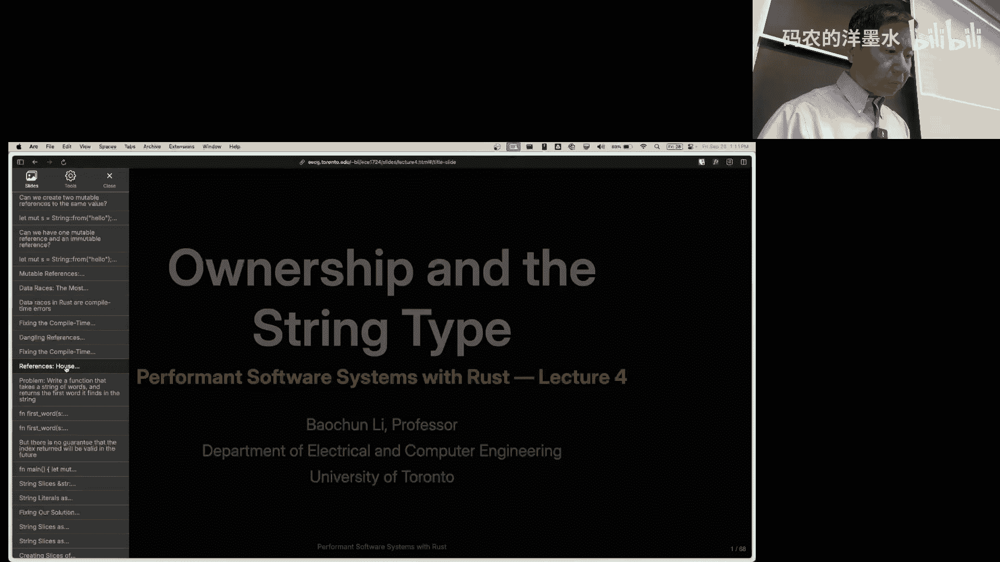

So we talked about some of the important house rules， the first one is related to valid references。

 references will have to be valid， and then you can only have either one mutable reference。

Or any number of immutable references。 you cannot mix and match。

 so you cannot have a mutable plus immutable or multiplemutable references。

 and then data will not go out of scope before the reference to the data。

 So that's all of these are enforced by the compiler。

 So the compiler would be the ultimate judge in terms of whether or not these rules are really really correctly followed in your code。

 and that would be very different from other programming languages where a lot of these are left as runtime errors。

So last time we talked about a simple problem which is writing a function that takes a string and return the first word that it finds in that string and we use that problem to motivate string slices if you actually remember so the first question we asked was what do we return so one possibility is to return an index and if we try this idea we mentioned that we could actually return the index。

 no problem we use an iterator we use enumerate， return the actual tuple with the index and the reference to the item and then eventually if the item matches the space and we're going to return that index so all of that is good except that this is a bad idea in terms of a design there's no guarantee that that index is always going to be valid in the future and one example that we showed last time was we first take the actual first word and we return the index and then we're going to clear。

The actual string， making it an empty string。 And because of that reason。

 the index is no longer valid。 however， the compiler。Will not be able to see that particular mistake。

 And that's something that shows why this design is a bad design and。

That motivated the string slices that we mentioned last time so string slices just like any other slices that we're going talk about later on we can have slices on arrays and other things as well but most importantly we have these slices on strings these are immutable references and these are references to a portion of the string and that could be the entire string but that's a portion of the string and then we could create these string slices simply by having the starting and ending index and that's just a range in rust with the square bracket basically that's a range type and then we could use that range to specify the beginning and the end index with particular within that particular string to define our slice of the string。

And for example， we could have from 0 to 2 basically starts at 0 ending at2。

 And then we have from the beginning。 So if we don't specify anything that would be the beginning of the string to 2 from three to the end and from the beginning to the end。

 which basically includes the entire string。 So all of that would be possible。

 And we talked about last time。 it's just a way that we try to create our string slices。 And then。

We could use the string slices as you know just references within the string and internally these are stored as the starting reference。

 you can think of that as just any reference before we talked about string slices we have a string and inside a string we have a reference as well to the actual content of the string on the heap and that's something that we have here as well the only difference is that string slices would be simpler than the string in the string you have the capacity and you have the actual length of the string over here。

 you basically just have the length。 you have the starting reference and the length is very simple to store the string slices and this kind of string literals that we mentioned at the very beginning of this course。

 these are as we mentioned before these are of type string slice which is written as M percent STR or we can call them store we can actually just pronoun them as。

And that's something we could actually do And with string slices。

 we could actually rewrite our first word function and this function as a starting point。

 what we could do is that we could keep the actual parameter type which is just a reference to the string itself。

 and then however we're going return the string slice rather than the index of that particular string。

 So the index as we mentioned， is not going to be a good idea because the compiler will not be able to catch the mistake。

 So let's see what happens if we define it as the string slice the stir right here。

To implement this would be very simple， we do the same iterator， saying enumerate。

 everything's the same， but except for instead of returning the actual index， we're going to return。

String slice from0 to I including0 not including I。

 so that would be the string slice that we're returning。 And otherwise。

 if we cannot find that we're going to return the entire string as the first word of that string。

 So to actually call this function， you can see that what we're doing here is that we're defining our string hello world that's our typical string。

And then we're calling the first word function with an Empersand string。

 which is just the reference to that string， and then what it returns would be the string slice。

 the star。And after we clear up everything， which we did before。

 but we mentioned that the compiler will not be able to capture that mistake， what happens？

After we clear the screen。And we just try to print the first word。 What happens。If we just do that。

 clear the string， well， we mentioned it in the actual。Common section。

 it's going to be a compile time error， right？ So if we have a string slice。Already returned。

 and then we kind of modify whatever that that string slice referring to。

 A will be a compile time error。And that's exactly what we wanted。

 We wanted it to be a compile time error。 We don't want it to be like a runtime mistake that we cannot catch or much harder to catch。

 We want it to be a compile time error。 And this is a typical E0，50。

2 error where it says the compiler is gonna say cannot borrow as as mutable because it is already borrowed as inmutable going back to our house rules for references。

 you cannot have a mutable borrow and an immutable borrow at exactly the same time。

 which is basically what we're doing right now with the line number 16。

 We already have an immutable borrow， which is returned and given to word。

 And then we're trying to do a mutable borrow， trying to change the string underneath the actual reference。

 So that's something that we cannot do as' a compile time mistake。

 And that's the beauty of rust in this particular case。We can of course。

 improve the first word function by changing the actual parameter itself rather than making it an m percent string。

 which is a reference to the string type we could actually just make it a string slice I would like to argue that this is something that gives us even more flexibility even though you know you can think of this as pretty much the same you know you're taking a string or string slice pretty much the same。

 Well we could actually have a little bit more flexibility for example。

 we have this my string which is the hello world that we previously had。

 we could call first word with a slice of that particular string because the actual parameter is a string slice that fits the parameter correctly so that would be something that is allowed。

 it could be partial of that string or from zero to six for example or could be the entire string just the dot dot we could also just try to say M percent。

My stream。And you can see that this and percent my strings， my string is basically a string type。

 This basically a reference to the string。 However， this also works。

 which is allowed by the compiler。 So the compiler takes that string reference and basically tries to change it。

 you know just convert the type to the string slice because that makes a lot of sense。

 These two are absolutely compatible with each other。

 a string reference should be compatible with the string slice。

 So that's what the reference the compiler is going to do It's going to do this implicit coercion that tries to change this to the string slice so that it is compatible without compile time errors or warnings to the actual string slice that we have defined for that parameter in the first word and of course we could actually pass in string literals because we mentioned string literals are string slices。

 we can pass in the string literal directly with the dot dot。With the 06。

 all of that would be possible， we can pass it in directly。

 which basically is okay because the string literal is a string slice， all of these would work。

 which means that by defining the parameter or as a string slice。

 we can accommodate more flexibility as compared to defining it as a reference to a string。😊。

And this of course carries over to other things， to slices of other types， collection types。

 for example， if we have an array that we previously mentioned。

 arrays are fixed length collection types on the stack rather than going to the heat because it's a fixed size。

 anything fixed size， we have it on the stack。And then this array。

 we could have a slice of that array as well， just like a string slice。 Sam thing。

 We defined it using the starting and ending index， Everything is going to be the same。

 So what do we expect that this thing will print。What will this line number three print？

It's going to be true。Right， so that's going to be something that we have and。

That's basically what we have， you know， so that's the kind of the strings。

 the idea of a string slice applied as a slice of the actual array right there。Alright。

 so now I want to open the new chapter and talk a little bit more about the string type。

 a little bit more in depth。 We talked about most of the things that we will talk about later on。

Previously， so， for example， we talked about how do we create a string and things like that。

 I just want to have a more of a review， systematic review of what we talked about。

 And then going a little bit deeper into the string type internally。 So what is a string。

Previously we talked about it many times and we mentioned that it is going to be stored as a vector of bytes on the heap right so so the string is basically a reference to that vector of bytes on the heap and that's something that we have。

 it is a reference to the vector of bytes on the heap so internally it is defined as a vector and vector is basically a vector type in the rust standard library we will talk about a vector type later on so this is not you know if you're not familiar with it this is fine but you can imagine this to be a vector of bytes because U8 is8 bits and that will be a8 bit integer and that is a byte so that's a vector of bytes and of course we're using the vector type from the rust standard library to define that string。

So because it's a vector type， as compared to the array type， which is fixed length。

 this one is a growable type， which basically means that we're going to have to put the data on a heap and we cannot to do it on the stack。

And because it's a vector of bytes， it is encoded using UTF8， which is a typical way of encoding。

 and this is something that we're doing when we're encoding any string as a vector of bytes。In rust。

 unlikeing some of the other questions。Oh the question is I put a keyword pop as before the struct and what does it really mean well what it means that thisstruct is not only visible in this particular file but also visible in the other files and the other files can directly use this particular struct so that for strings obviously have to make it a public public type which basically expands the visibility of this particular struct to the other files beyond the file where this type is defined。

That's a very good understanding。 so the understanding was。

 is it assuming that we have something that is always private and only after you put in the P。

 it becomes public that understanding is absolutely correct and that visibility issue something we're going talk about way later when we talk about modules and basically multiple files to define a much larger project and those are the rules are very simple over there but you know you can imagine right now you can imagine this is something that is by default private。

 but only after you put in the P， it becomes public。Alright， so now for the strings in Ru。

 unlike some of the other programming languages， there as C and things like that， which makes it。

 you know， harder to use all kind of different unicode characters over here。

 you can just use anything。 You can obviously use any language to you know， to write your string。

 you can also use emoji characters for sure。 And that would be， you know。

 like a modern feature of a modern programming language。 a modern programming。

 It always allows emoji is in the actual strings。 And this is something that rustt is a part of。

 Rust is one of these modern programming languages。 And。😊。

So this is the question here is what are the different ways that we can create and use the string right now？

 So we talked about a few ways， for example， we can actually create a brand new string just by using column column new on that string type。

 and this is as we mentioned briefly before is an associated function it's associated with the string type。

 so we can create a new string It's like a constructor in C plus plus over here。

 this is another different kind of a constructor is an associated function as well。

 the from function from a string literal。 We construct a string type instance。

 and we could actually use the two string method of the string literal as well。

 So all of that would be possible to create a brand new string。

 And now how do we actually grow the string by app pending to a string。 So one way of doing that。

 as we already mentioned before briefly push string push underscore STR。

We could actually push it by appending a string slice to the end of an existing string， instance。

 and that would be something that we can certainly do。

 And this is the actual output of running this program。 By the way。

 forget about the just ignore the unit type over there。

 That would be an artifact of my of my sort of like a rust powered Jupiter notebook kernel。

 So it's just ignore the actual unit type。 It's almost impossible to remove it。

 but you can ignore that。And then we have the。The， the second way of growing the string。

 which is kind of a special way of pushing in not a string slice， but just a single character。

 If we want to push in a single character， just say dot push。

 And that would be growing the string with by appending that single character。 So that's fine。😊。

And then we could actually have the way of concatecnating two strings。

 we could do that using the two strings， S1 and S2， one is hello， the other is world。

 and then we just use the ad operator。And when we use the ad operator。

 what we're doing here is that we're adding S1 and a reference to S2。So here the rust compiler。

 we're going to talk about this coercion， this kind of implicit D coercion later on。

 much later a few lectures later， but for now you can imagine this to be just an implicit conversion of the actual type from the string reference to the string slice。

 which we mentioned before when we talk about calling first word here we're using the same implicit D coercion here and this basically adds a string by concatenating it with a string slice similar to push underscore STR this one you might prefer because this one seems a little bit handier。

 a little bit better in terms of the beauty of the code depends on your preference。

 whichever one that you prefer it's okay but for this one basically you have to imagine because of the ownership rules as1 has been moved and is no longer。

validalid it's moved into S 3。 So why， because when we're actually implementing the addition operator。

 what we're so this is the output of this。 And when we're implementing additional operator。

 we're basically implementing this as ad function。 So we're adding a string slice。

 which is S in onto myself this myself is something that we're gonna talk about later today。

 So we're gonna have more discussions over there。 But over here， this is easy to understand。

 You're adding a string into onto myself is sort of like a more of a method on the string because it operates on myself。

 And over here， we're implementing that plus operator using this ad function。

 And it's gonna return the string。 And because of that reason you can imagine this to be something that transfers ownership。

Of of the you know， the myself into the actual return value， which is that string。

 So that's why S1 is actually moved into S 3。 And it's no longer valid。 of course。

 this is a little bit harder to understand because you don't quite understand what that self really means。

 But today， later today， we're gonna talk about it after we talk about the methods and associated functions onstruct and string。

 Obviously， it's astruct type。 We're gonna talk aboutstruct type。

 We're gonna talk about this method which uses self。 And however， here， self is just。

 you can imagine this to be just myself。 And， of course， this is not a reference。

 You're gonna have to move rather than it's a reference。 It's not a reference。

 This is basically something that you gonna have to move。All right， so keep that in mind。

 We're going to talk about self a little bit later today。

And now let's talk about the different way of concatecnating strings with I think it's kind of like a simpler approach with a macro。

 And previously， you have seen one macro。 What is that macro you have seen。Printf。 Oh sorry。

 not printf。Print line。Exclamation mark， right， so that we a macro。

 whenever you have an exclamation mark that we a macro in rust。

 macros in rust in terms of defining them is extremely advanced。

 And that's something we're gonna not gonna cover in this course。 And however。

 a lot of these macros have been predefined already。 And the print line is one and format is another。

 So format basically says we're gonna take all of these strings。 S1， S 2， S 3。

 just like in print line， we can actually put them within the actual braces so that we could actually parameterize a parameterize。

 our generation of our string。😊，And that would be the actual result。

 which concs all of these strings with the dash and dash。

 and that would betict toe with the dashes in between。

 and that would be the result that we're gonna print。 So after that， we're gonna print tickt toe。

 and that's kind of another way of concting string。 you might prefer this one rather than the addd。

 The reason for that is because you can put whatever that you need in between these strings。

 for example， the dash characters。 So this is another way of concocting strings that you might prefer as well。

 in addition to the push string and the push and the ad operator。So now we have。So， now we have the。

Another question in C and C plus plus as well， we could actually try to index into a string。

Which basically takes， in this case， just zero or whatever index that you have and try to。

Get the character at that particular index。 Can you do the same thing with。

With the string type in rust。No， because I mentioned that is not allowed and what would happen here。

 what would happen is that it's going to be a compile time error。

 So the compiler is going to say something cryptic。 It's going to say you know type STR。

 you know cannot be indexed by integer， you know the string indexes are of ranges of use size。

 the trade is not implemented blah， blah， blah。Basically。

 we are implementing the string type in the Ru standard library that does not allow indexing。

And there's a very good reason for that to happen。 The Why don't we allow indexing while， you know。

 in other languages， we do。Well， first of all， you don't need index。

 as you can remember in our first word function， when we implement that function。

 how do we implement it？We did not use indexes。 In fact， we very rarely use indexes in rust。

 We typically use what a combination of iterators and enumerate and the for loop that basically the enumator is going to return the index。

 obviously as a tuple at the first part of the tuple and that for loop is going to iterate through the result of that return value of which is the return iterator。

 So that's something that we typically do。 that's a kind of an ergonomic way of doing this。

 is way better than using you know the indexes in index into the actual internals of that string。

 that's not the right way to do it。 So we don't we don't even allow this in string types in rust。

 And the second reason why this is not allowed even if you want it to index。 remember internally。

 were storing the string type as a vector of bytes。 So what do you mean by0 and1 and 2 and so on is。

It is like hard to understand do you mean the byte number0， byte number one。

 or do you mean character number0， character number one。

 that's going to be kind of vague and ambiguous So let's get into this a little bit just by a little bit strings are encoded。

🤢，Internally using this UTF8， which basically means that you are using this as the encoder and because of this encoding that happens。

 a character can take one byte if it's within the ASI you know international standard or two bytes if it is you know like just the CJK character。

 you know Chinese Japanese Korean character or even more than two bytes， for example。

 if it's an emoji， it may not even fit into you know 65536 characters you know that particular range。

 it might go beyond and because of that reason you need more bytes so in if youre emojis you probably would need four bytes to store those emojis so it can take one byte2 bytes or even four bytes and because of that reason it'd be very hard to tell exactly what you mean by the index。

But there's something else that is actually quite clear already。

 which is the string slice that we previously mentioned。 So over here。

 if we have a hello and we kind of put in the emojis， for example，3 emojis。

 and we say I want to slice from 0 to 4， including0 no including including for。

 So that's going to be something that you print out and that's going to be。😊，One character。

What is that， Why is that？It's just one character。Why is that？0，1，2，3， that would be four bytes。

 right， that four bytes would be just one character。Because this emoji is encoded with four bytes。

 so if you actually use the string slice， it's going to give you the actual one emoji character as the outcome of using that particular string slice so that's something that you could actually directly use if you wanted previously to use indexes now you could just use the string slices。

 but you're going have to keep in mind that when you use string slices。

 we're talking about the straight slices in bytes rather than slices in terms of characters。Allright。

 so if we actually try to use another kind of a method which is the dot Chars method。

 then we get the characters， so if for example if you have a for loop， line number four。

 you have a for loop that basically say take the same string and want to print out all of the individual characters by using dot Charrs method to access the characters which is the preferred way of doing this。

 then you can imagine you will print the individual characters right。

And that would be very different as compared to if you use the dot bytes， if you use the dot bytes。

 if you want to print the actual result of the dot bytes， in this case。

 this would be the string slice from zero to4， which I have shown previously。

 it was just one emoji character， but if we actually try to print the bytes of that emoji character。

 we're basically printing the internal representation。

 the internal values of individual bytes for that emoji character。

So you can imagine that we're gonna print four different values。

 So that's gonna be happening right here。 So the first four loop， we print individual characters。

 So we have four characters sorry，3 emoji characters in that string。

 We're gonna print all of the three characters。 And in the next loop。

 we take the first character by taking the string slice from 0 to 4。

 And then we're gonna print in the internal values of that， particular emoji。 and that we four bytes。

 We're gonna print out all of these values by using dot bytes。

 So that's something that we can certainly do as well。😊。

This is just a brief overview of the internal UTF8 encoding of the values of characters inside a string。

Now， strain types， by the way， question。ゼロ中。It's going to be a compile time error。

 So if you say 0 to 3， it's going be a compile time error。 It will not be able to， to do that。Oh。

 actually， it's not a compile time error， right， it's it's I think it's gonna be。

 So depending on what you wanted to print， right， if you say the dot charts。

 I don't think you're gonna print it。 You're gonna it's gonna be probably at that time。

 you're gonna be a runtime error。 And however， if you just print dot bytes。

 you will be able to print them， right。Now， just one question here。 sorry， not one question。

 one common here。 that was the string type。 So different languages in the past for decades related to the string type。

 You can imagine this to be something would be very simple。 like a string type。 You know。

 just a bunch of characters should be quite quite simple to do。 But the question here is。

 is it really that simple。 You can imagine this is something that needs to be growing。

 You have to have a globalable type， which means that it has to be on a heap。

 you have to accommodate a whole range of different values。

 different kind of characters inside a string。 You gonna have to define the actual methods and associated functions of that string properly。

 so that they're kind of easy to use。 for example， our first word example。

 we are actually implementing this as you know like an implicit D coercion between the strings reference to a string slice。

 All of that is kind of designed。To be like that。 And the other languages。

 they don't really have that design， which makes their strings。Much harder to use。 And。

 and of course， there are high level languages like Python and Typescript and Javascript。

 These you can easily use their strings。 But then you lose the system level access to those strings。

 So all of that would be a trade off。 You know， a lot of these things are quite delicate in terms of design。

 and string type is a very important type。 And different languages have very different designs。

 And this we have just presented is the design inside the rust programming language。

 So now let's go to the。

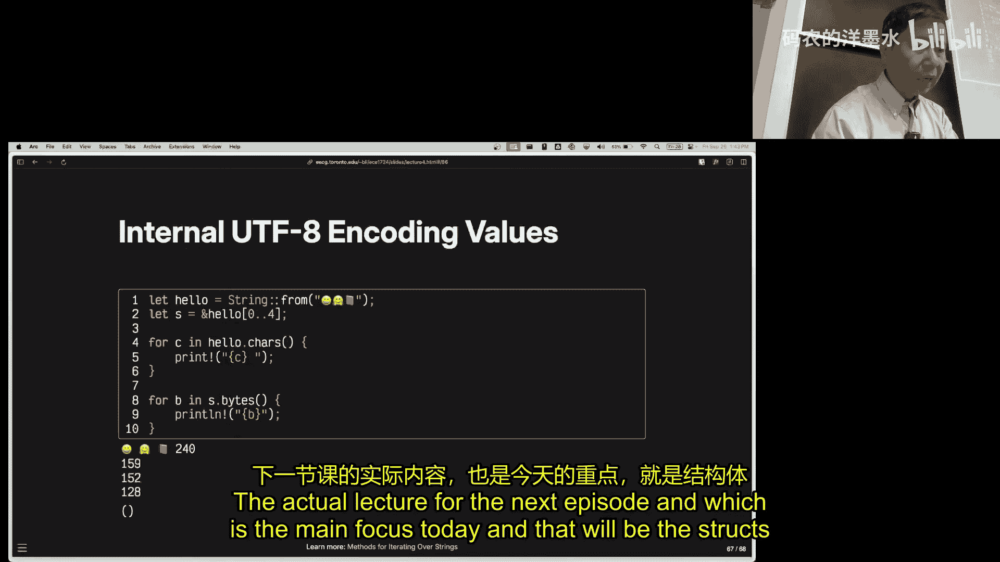

The actual lecture for the next episode， and which is the main focus today。

 And that will be thestruct and enums。 So we're going to talk aboutstruct first。

 and then we're gonna move on to ens。

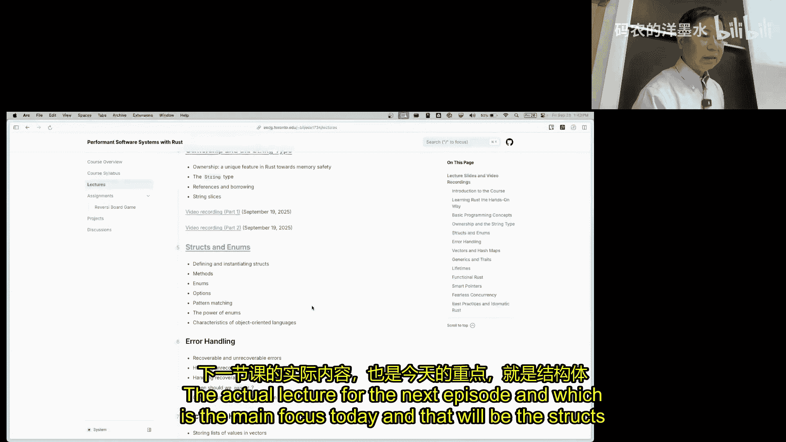

Allright， sostructs， you can imagine this to be the same as the struct in C Yeah well sort of similar but not exactly the same。

 it's actually a little bit more flexible than the structing C。

 you can also imagine this to be the same as a class in Python or a class in Java or a class in somewhere else where you can actually have classes or for example C++ you know it's not exactly that as well so we're going to have to get into whatstructs are inside rust it's kind of similar but has something special in the recipe that we're using to define and to design this particular part of the programming language。

Just like tuples， which we talked about before when we talked about collection types。

 we actually have pieces inside thestruct that can be of different types， just like tuples。

 the only difference betweenstructs and type tuples is that instructs the pieces they have names right so that would be very different compared to tuples in tuples we don't have names So we have a formal name for this would be the fieldsuds this actually is kind of similar to the terminology that we use in C+ plus for example。

And here's an example。We're going to reuse this example later on in this particular lecture as live demos and so on。

 so we're going to keep this in mind so we have a userstruct and we have four different fields。

 we have the active username email and signing count signing count is number of sign ins and that would be a simple integer username and email。

 these are strings， obviously and the active is how active you are and that would be of true or false it's a Booleing value。

So that's kind of simple to understand。 We can use that as a web backend， for example。

 to represent a user。 Here's another little bit more complex example。

 this is actually written by me it's code that I actually have written as part of my network simulator I just want to give you a real worldorl example usingstructs and here I'm usingstruct to define my packet。

 which is the simulated packet inside my network simulator and this packet would have a time I have the time of creating this packet and the time that the packet is sent to the next switch the size of the packet invitetes the packet I and also the flow I the flow identifier that the packet belongs to this is just a portion of the things that we have in thatstruct and here we actually have made it public as you can see we wanted to use this type of astruct type everywhere in the actual project。

And we also have a。Type， which is time。 And here we're defining our own named type rather than always say F 64。

 We basically name it time。 This would be our type that we have。

 It's just like it's exactly the same as a 64 bit floating point。 What's the point of doing this。

 Why do we actually have to define our own type。Y。More readability， which is great。

 But the other is maintainability。 In the sense that if we wanted to change the type。 For example。

 later on， we wanted， you know， to change it to 32 bit floating point or 128 bit floating point would be way easier to change this rather than finding all of the places where this is actually used。

 we can directly just change it right here and finding all different thousands of places where it's used is actually much。

 much harder to do without errors。 So it's a a pro process to do this kind of global replacement。

 So doing this right here is going be much easier。😊，Alright， so let's get back to our userstruct。

 and the userstruct， we can certainly create an instance of that type。 And over here。

 we can combine the creation of instance with the actual definition。

Of the of the values that we have in the individual fields。 For example， here。

 were actually creating a user one with the value of individual fields as true for active。

 different strains for username and email and the signing account is gonna be one。

 So this is like a new user。 So that's something that we can certainly do。

 And we can imagine this to be always， you know， possible in in rust。

 It's the same as the other programming languages。Now we have something interesting。Now let's try to。

Right to individual fields in thatstruct。 Can we do that， Yes， we can。

 And what we typically do is that we're gonna use the dot notation。

 Use  one dot email accesses the email field of that particularstruct。 the instance of thatstruct。

 So here we have the instance being user one。 Thestruct being user and the email is the field。

 And we're basically just replacing this with another string。 Is that gonna be okay。

Will this code compile？Why not。Oh， that's very true。

 So because user one is not mutable so but but you know。

 let me try to just because we are kind of short of live demos today and just want to give you a little break and enter my password here and just get started with a live demo。

 Oh， I entered it wrong's okay。Allright， so let's try to playground。 Let's try to cargo new。 Oh。

 let's make it a little bit bigger。 cargo new。What's a good name Str？And。

Cannot be used as the package name。 Okayk，struct lecture。Alright。

 so now let's go tostruct lecture and， and let's try to。

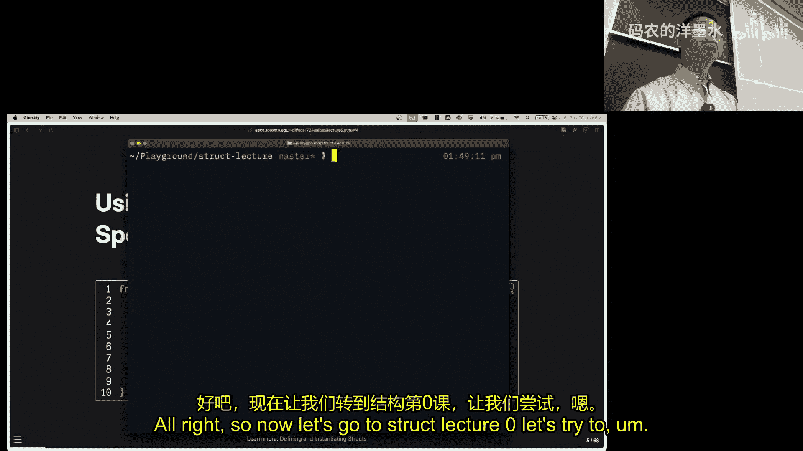

Openness up in my editor。 So this is my editor。 And let's open this particular。File， make it bigger。

So you can use it。 And you say you can see this。 And let's try to paste this and try to see what's going on here。

 Immedialy， you can see there's some after we do the cargo check， there's some kind of a。

Like a little problem right here， let's hover over this。And says。

 cannot findstruct variable a variant of union type user。

 This is because that we forgot to copy the user。 So let's copy the user here， which is right here。

 Let's copy that and put it right here。

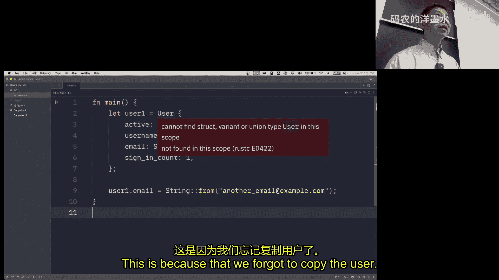

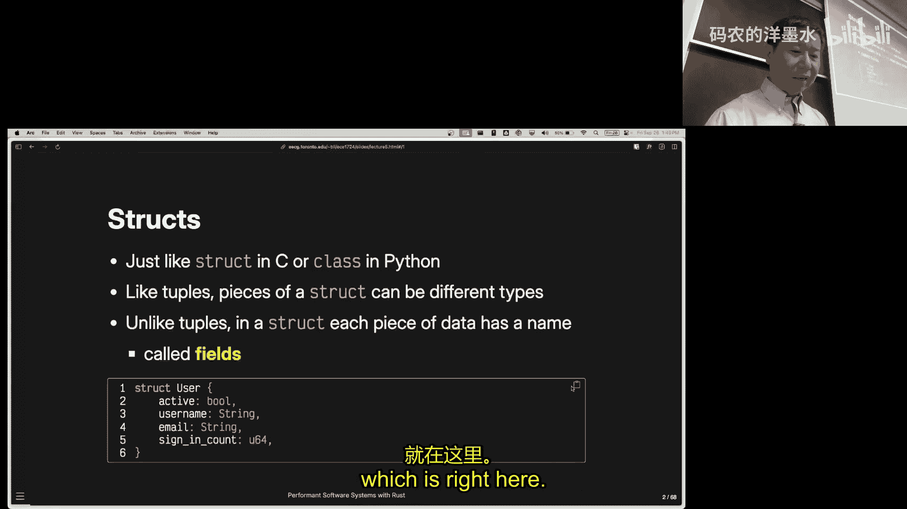

And that this would be the user。 And immediately， you can see this becomes a different error。

 Consider changing this to be mutable。 And this is because right here。

 cannot assign user 1 dot email as user 1 is not declared as mutable。 My question is。

 can I change this to be mutable。 Just the email。Just change email to be mutable。No， so in Ru。

 we cannot change individual individual fieldss as mutable。 either one。

 either you change the actual entire thing as mutable。

 The entire variable as mutable or in the entire variable will become immutable as a default。

 So you cannot change individual fieldss to be mutable。 So we're gonna have to do this。

 which is suggested by the compiler already。 consider changing this to be mutable。

 So just change it to mutable。 And then immediately， I can actually compile it。😊，And。I can。Cargo run。

I can actually run it。I have some warnings， but it actually finishes compilation and running。

 So which means that this is going to be okay。 So let's get back to our original question here。

 So this is not going to be okay because this is not mutable。

 So don't forget if you want to change individual fields within a particular instance of astruct。

 You're gonna have to make that entire instance mutable。 So we just had a live demo。

 and we actually put in the mutable。

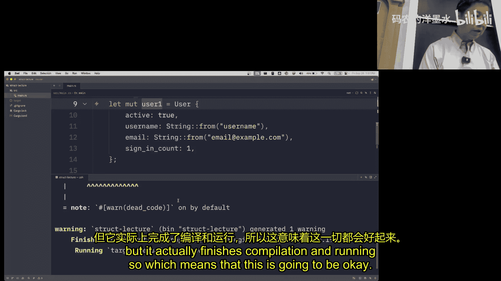

And now question here。Can we use references inside thestruct for fields， for the types of fields。

 Can we use references。 For example， we have the username and email， right。

 Both of these are strings。 previously， I basically our first word and we say， oh。

 rather than 10% string， gonna have， you know， the actual。String slice， the Empers stir。

 Can we do that。Right here。And on top of that， we're going to just say rather than string from。

 which just directly assign a string literal。I do this。Is this possible？Well， you know。

 let's just give it a try。

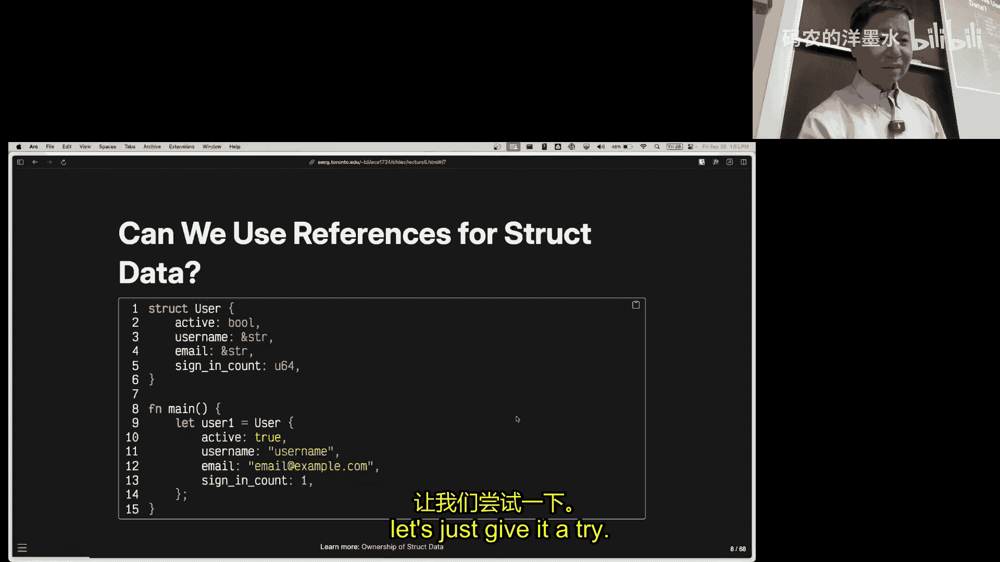

So we're going copy this and get back to our editor。Close this a little bit。And let's try to。

Just defined thisstruct， just like before inside this， and we save it。And it's after we save it。

 you can see there are some problems here。 And let's try to see what the problems are by doing a cargo check right here。

 You can see the cargo check basically says。E010，6 missing lifetime specifier。

Expecting a named lifetime parameter right here， considering introducing a named lifetime parameter。

 that's the help because it's missing right here and this actually gave me the actual the possibilities of adding the lifetime specifier explicitly and all of that is kind of suggested right here。

Let's try to first follow the rules and just try to see if we can just add the lifetime specifier and。

Just follow exactly what the compiler mentioned。 and let's say。 And now cargo check。

We basically have it。 it compiles The compilation finishes。

 There's some warnings of unused variables。 But in general， it actually works。

 If you want to get rid of the unused you know， this， this particular warning。

 you could actually put in this dead code warning， turn it off。And put it right here。 So that's。

 that's going to be fine if you really want to try to turn it off。 And， but in general， this is okay。

But what are these lifetime specifiers now the lifetime specifiers。

Would be something that is much more advanced a topic that we're going to talk about a few lectures later after we talk about the simpler topics。

 but in general， you can imagine this to be something that carries over。

 you know you know helping the compiler to check whether or not we can follow our house rules。

 Remember one of the house rules is that the data that you're referring to cannot go out of scope before the reference goes out of scope。

 So sometimes the compiler will not be able to check for sure。

 I have a guarantee that this rule is followed。 So this is where you need a lifetime specifier just to help the compiler。

And right here， we don't seem to need that kind of complexity， right， We don't seem to need。

 you know， like the compiler we have to check lifetime。

 We're gonna help the compiler check lifetimes and so on and so forth。

 We don't need to have that kind of complexity。 So itll be way better。

 even though we could add the lifetime specifier。 And when it's missing when that actually does compile。

 but we don't have to have that。 So in general， itll be still a much better idea not to use this idea。

 So this would be the lesson that we learned in this live demo rather than adding the lifetime specifier and just。

 you know， try to use this throughout this entire code base。😊。

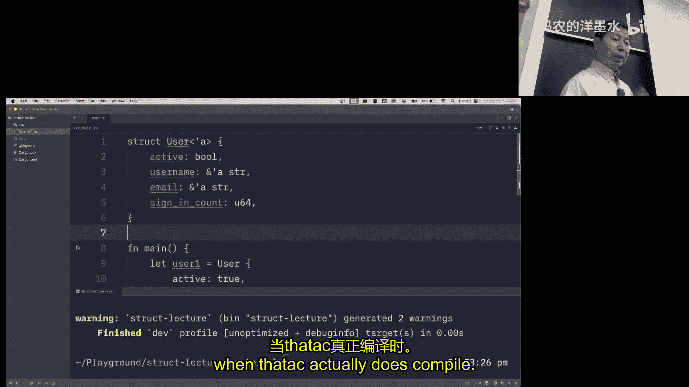

It'd be way better if we just use the string type rather than the string slice， right。

 So returning back to our original definition， we had a string type in our username and email。

 So now let's think about how we actually try to return an instance of astruct type from a function。

 So here our function is called build user。 It takes an email and the username。

 And basically it just constructs a new user with a signing count of one and active is two。

 And what it does is that it has the return type as the userstruct type。

And it will construct that user。Which is exactly what we did before。

 remember that is what we did right here， let user one equals the user that user with the braces。

 that would be how we construct a brand new user。 The only difference is right here we're doing the assignment explicitly to that particular local variable user one and over here we're returning that particular instance as a return value from the user so there's no difference。

Because returning anything is the same as assignment inside rust。 Now， here's an interesting。

Question， can we simplify this code。And in a lot of other languages， you cannot do that。

 You cannot simplify this code。 but here in our code， we could actually simplify this a little bit。

By getting rid of that column username and column email。How beautiful is that？You know。

 username comma。Email comma done。 We're done。 We're taking advantage of the fact that the actual parameter names。

 the， the parameters are called email and username。

 And it's the same name as email and username inside thestruct itself。It's the same name。

 So we're taking advantage of that， which is always recommended。 So if you wanted to do this。

 you always keep the same name from your parameter。 and that would be very handy。

 You just say comma and you don't have to say username， column username。

And because we use these things all the time in our code。

 this is way better than not having this shorthand。

 So this shorthand of initializing a the fields of a particular structure by using the same name from the parameters of the function is going to be very useful。

😊，Alright， so now let's think about the second way of updating of assigning a particularstruct to another。

 basically local variable user 2。 So in user 2， we wanted to copy user  one into user 2。

 So what we're doing here is that we're creating a user 2。 And for active。

 we use user ones active status for user name， use user ones username for email。

 we have another different email。 And for signing count， we have user one signing count。

 So this sort of like astruct update。 We are updating user  one。

 And with a slightly different email and copy that into user 2。

So that would be something that you have taken for granted。 This is something that must work。

 but we could actually try to simplify this particular syntax as well by using thestruct update syntax。

 which basically says I'm going take whatever that is different between user one and user2。

 which in this case is email and then we're gonna just say email would be whatever email we want for user2。

 and for everything else we're gonna say dot dot user1 So this sort of like。You know， destruct。

 destruct user one， kind of expanding the user one with a destruct operation。

 and that would be a much simpler syntax for us to to copy the rest of the fields from user  one to user 2。

So the only requirement is that whatever that is changing will have to be coming first and whatever that we are you know keeping from user1。

 well have to come last and this is okay withstructs because instructs when you're defining astruct it doesn't really matter if what's the sequence of defining different fields because all of these fields have names So which one whichever comes first is going to be okay to take advantage of this particular update syntax。

 you're gonna have to take whatever that needs to change first and then the dot dot user one expands the rest of the fields from user one So that's like a nice update syntax。

 Now my question right here for you is are we moving user one into user2 or are we copying user one。

트 유설2。We're moving and why？Exactly， because user1 dot username is a string type and string type is something that is on the heap。

 It contains a reference to the data on the heap。 So that means that this is not。

 it does not implement a copy trade， right， It does implement a drop trade。

 and that string type is obviously something that we are moving， We're not copying。

 It doesn't implement a copy trade， However， what if I change that username so that the username is also a string from。

What if we change that， are we moving or are we copying？Well， in this case。

 we are indeed copying the rest of the fields from user1 because all of the other fields in user 1。

 they are just primitive types。 All of that， including bullying type and the integer integer type。

 they all implement the copy。 So if you our user name is also a string from as a brand new string。

 then we are copying。😊，Al， so the question is are we moving or are we copying when we are using thestruct updates indextax depends on what are we actually doing underneath。

 So that this is the case where we're moving， but if we're actually also doing username column stream from。

 then we are actually copying。So the question is， are we moving or copying and that question we just answered？

All right， so now we have a few more things to talk about related to drugs and before we do that。

 let's take a break for about， let's say five minutes because we do have a lot of material to talk about today。

😊。

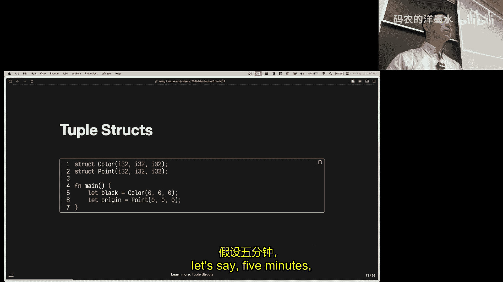

And we're going to come back at 2，06。

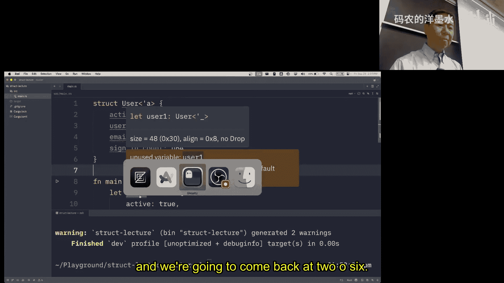