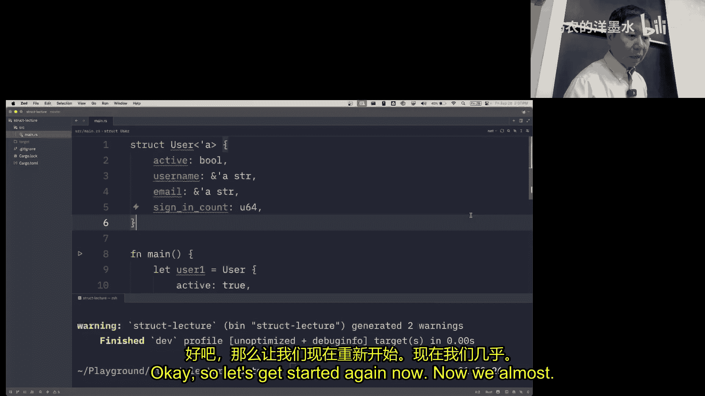
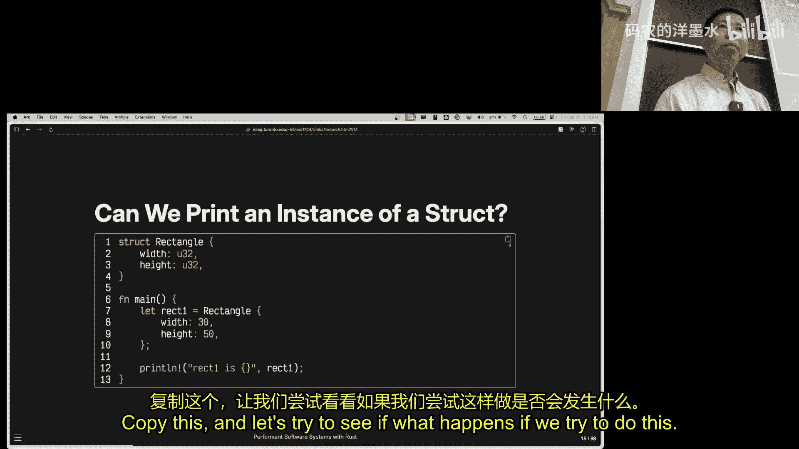
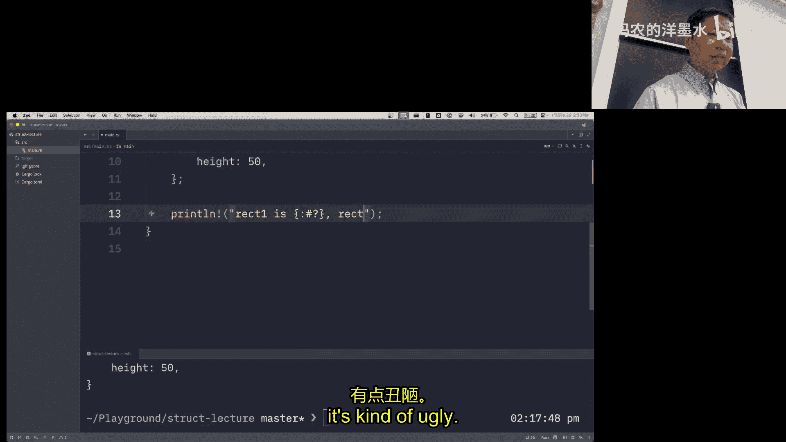
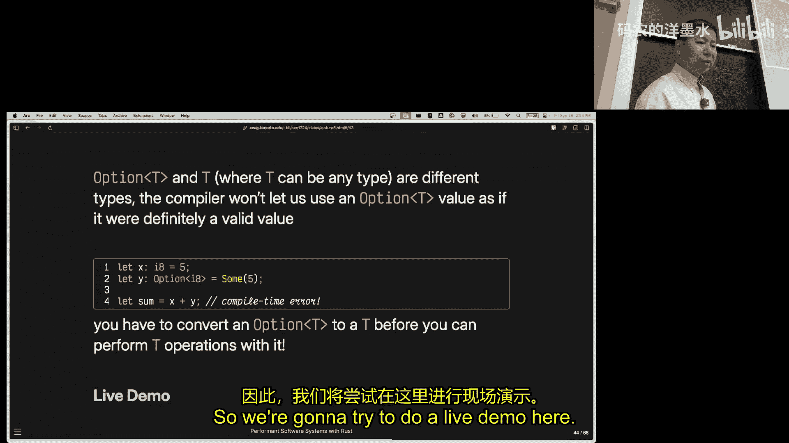
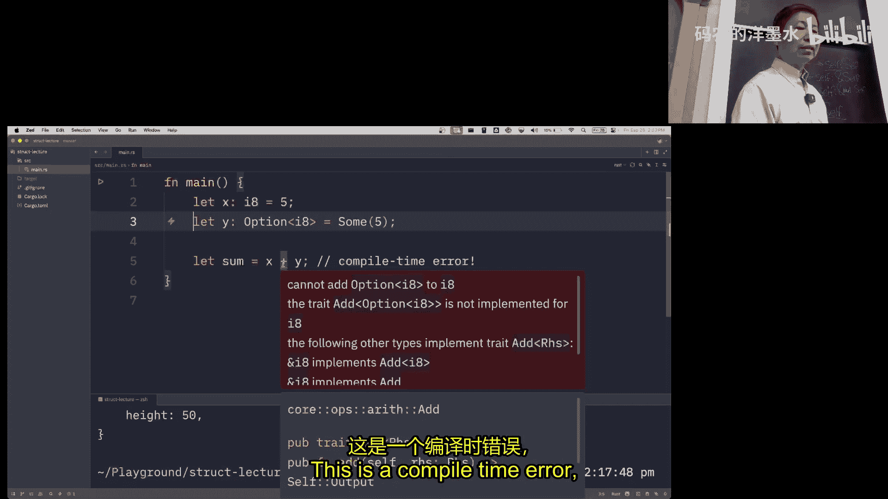
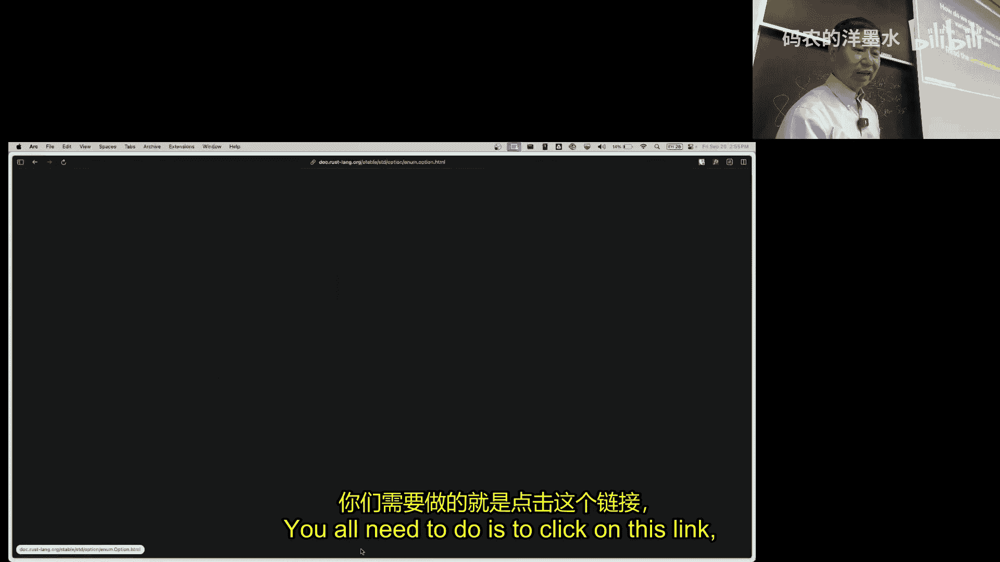
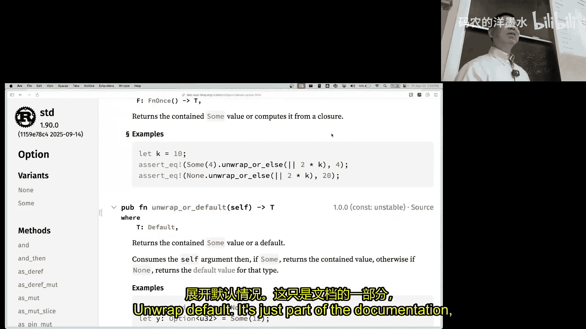
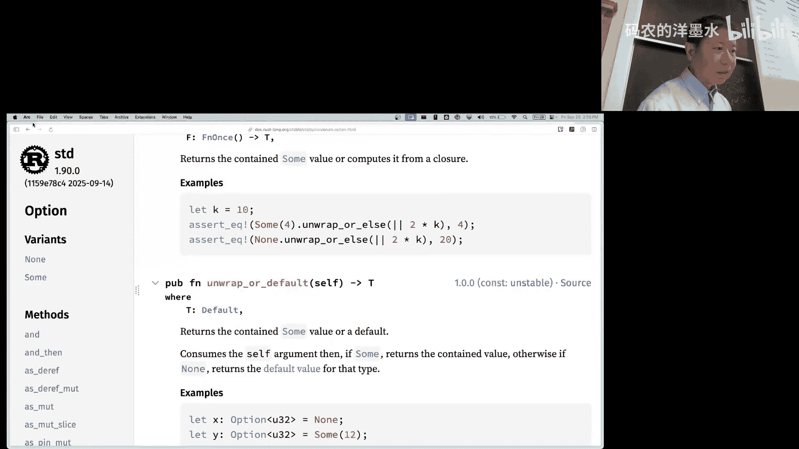
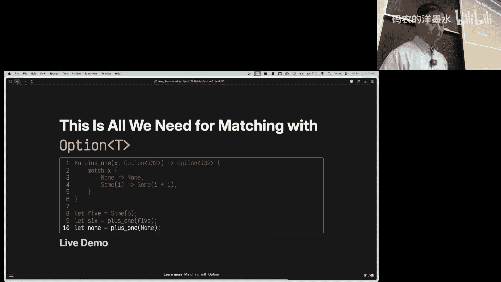

# 【全集 附课件】多伦多大学 使用Rust构建高性能软件系统 中英字幕 1080P p08 Lecture 8 - 面向对象语言的特征 -BV16V62BhEuf_p8-

Okay， so let's get started again。

Now。Now， we almost。So we're almost done with talking aboutstructs the actual regular cases ofstructs。

 but we do have some special cases in this case， this is a tupo struct。

 a tuplestruct is sort of like a tuple except that we give a type name So in typical tuples they are unnamed we just say parentheses。

 whatever we can have different types， we don't have to have the same type in this case。

 we do have the same type I 32。 but you know the difference between the typical tupo and the tupostruct is that the tuplestruct actually had a type name。

 and the good thing about having a type name is that even though for example， in this case。

 we have two tuplestruct color and point。 and they're just you know having all of them having three elements of I 32 types。

 but they are of different types。 And because we gave them different names and that would be the difference and that's number one。

 a little bit more readable， but number two， more importantly。

 we do have compiled time type type checking。For these different types， so for example， in this case。

 if we actually define our instances of these tuplestructs black in the region。

 we actually have different types， the color type and the point type and that explains the difference between tuplestructs which are kind of different types even though thestructs they actually are the same and unnamed tuples so typically if we want it to be more strict in terms of types。

 we want to give them names and it's also a little bit more readable as well。

One more kind of interesting special case forstruct is called unit likestruct。 These drugs。

 they sort of like unit types。 They're just nothing。 They contain nothing。 and in this case。

 let's say struck always equal and we could actually define an instance of thatstruct。

 and it's a type。 and the type name is always equal。

 and that's it that's what we put in to the as the type and that's what we are using for defining this instance subject。

 So the question is why we need unit likestructs。 Well。

 the answer to that question is a little bit more evolved。 we actually have。嗯。You know。

 it will involve discussions from a few lectures later when we're talking about traits。

 So sometimes we wanted these unit lightstructs to actually contain no data。

 but implement the actual functions of a particular trait。 So these are kind of。You know。

 implementing only the methods， but not necessarily the actual data， having data。 So which。

 which is typically okay。 So this is something that not very often used。 It's kind of rare。

 but this is。Interesting， and wed like to bring it up as well。

So now let's enter into something a little bit more interesting。 Can we print the actual。

Values of a particularstruct。 For example， in this case。

 we have a very simple rectangle and individual fieldss are width and height。

 Both of them are integer，32 bit integers。 And can we just print it out。아你。Any guesses。

 Ill just print it out。No， yes。No。Why not。Exactly， that's， that's a precise answer。 Very good answer。

 It doesn't know how to do this。 You might say， why doesn't it know how its just two integers。

 It just print out the two integers。 Well， still， you're asking a little bit too much， right。

 it doesn't really know how to print this particular drug。 If you want to print an integer itself。

 It knows how to print it， but it doesn't know how to print the drug because you didn't tell how to print this particular drug。

 So let's try to print try to。Copy this and let's try to see if what happens if we try to do this。

 so we are going back to this particular question， this rectangle right here and as you can see what happens is it's basically a compile time error and this compile time error says rectangle doesn't implement the standard column column format column column display trait。

Because this is not implemented。For rectangle。 again， we haven't been talking about traits。

 but you can imagine these traits to be kind of prescribed， you know。

 properties that a particular truck will have to implement for something to happen。 So in this case。

 if we want to print the content of this particular truck。

 we have to implement the actual display trade from the rust standard library in this case。

 standard format library。 So in this case， we don't have this。

 But if we actually try to look at this。Look at the actual compile time error error。 So cargo check。

 look at the actual compile time error。 You might say help。This is not implemented。 So。

 but in format strings， you may be able to use。Column question mark or column pound question mark for pretty print instead。

 So， you know， let's try to do that。 You know， since it gave me this help。

 let's try to say column question mark。And as you can see， it doesn't really help me too much。

 It still give me a compile time error。 But this time， it's a different error。It says。

Rectangle cannot be formatted using column question mark because it doesn't implement debug。

The trait debug is not implemented for rectangle。 It seems like by adding the column question mark。

 we're kind of changing the trait that that thestruct will have to implement from the standard format display to the debug trait。

So that's something we actually wanted to implement and it gave me some help。

 It says the trade debug is not implemented。 note， add pound derived debug to rectangle or manually implement debug for rectangle。

 which basically manually implements the trade。 So rather than manually implement the trade。

 which we'll talk about later when we talk about trades let's just follow this rule。

 let's say add pound debug pound derived debug by adding this pound。

 we're basically trying to add something called an attribute。

So this is an attribute in rust that we're adding to this particularstruct。

So we're adding this pound derived debug， this attribute。

 and this basically added something for the compiler to help me。To implement this。

Debug trade for this particular rectanglestruct。 So this typically called a derived trait。

 because this is not something we explicitly implement ourselves。

 This is just derived by the compiler。 mostly because that this is something that is so easy to do just to print some debugging information about a bunch of integers inside thestruct。

 It's kind of easy to do。 we could derive that automatically。

 we don't have to implement it ourselves。 unless we need some kind of a prettier printing that we wanted like a special way of printing thisstruct。

 Otherwise， we could just say pound derived debug adding this attribute， which is a derived trait。

 and that will be very convenient for us to be able to print out this particularstruct。

 So now we could actually try to do this。 and cargo run。

 you can see that we can finish compiling it and it will print it in the format of rectangle with the brace bracket。

width column 30， height column 50， which is something typical。

 like something that we expect that is going to happen。 and that's what we wanted。

 It's a simple addition one line of code and we're able to print it out this is called debug because this is typically used for debugging right if we wanted to debug this code and we want to know individual values inside it struck。

 we wanted to do this and add the derived trait for the debug trade。

We can also follow the the column pound question mark。

 and that's also part of the note that in our previous compile compiler help。

 So let's try to run that。And it's going give me a little bit prettier way of printing out this rectangle with kind of the indentation and everything。

 So， you know， a little bit prettier with the column pound question mark。 Otherwise。

 it's column question mark。 Can we do this。Can we actually try to do this。Can we do this？

This is okay。We talked about it very briefly when we talk about printline， this is going to be。Fine。

So if you actually try to save it， you see that。You can run it。 It's gonna to be the same thing。

 And the reason why it's fine is that we could actually put in the actual variable directly inside the brace brackets。

 inside the print， and it's going to work same as it's just the same thing with the exception of an expression。

 So if you have an expression， you cannot put the expression inside there。 if it's just a variable。

 you can actually put it right there， that's not a problem。Allright， so either way。

 thiss going to be okay。 I would prefer the first way because I don't like this， this kind of。

 it's kind of ugly。 I prefer this。

That would be much better。 Alright， so now let's finish the live demo。 And this is the derived trait。

 by adding this attribute of pound derived debug。 We are able to derive this debug trait automatically。

 and so that we can actually print it out by using the simplified version or the prettier version of printing out this particular rec one。

😊，So now I would like to refactor the code， refactor a little bit of code。So。

We could actually define area a function inside this particular rectangle。But rather than doing this。

 the typical way of saying， let's take two parameters width and height。

 And let's just say the areas with times height， we would love to do it as a function inside thestruct itself。

 thestruct rectangle itself。 So rather than doing this。

 which is kind of the the way that we typically do withoutstruct。 Now， I wanted to write it as。

An actual function that takes an rectangle。 So in this case。

 I like to take a function of a rectangle。 And in this case。

The rececttangle rather than width and height is gonna be a reference to a rectangle because I don't want to take ownership。

 I want to just borrow the the actual rectangle as a reference。

 And then we're gonna just use the dot notation to access the width and height。

 And we'm gonna return the， the the product of the two。 So that's something we can certainly do。 and。

That would be how we use it。Priint line， the area of rectangle rec 1 is area M percent rec 1。

That's pretty， pretty interesting。 That's kind of like a naive way of implementing the area。

 I would love to make it a little bit better。 This， this way is okay。 You know。

 it's taking the rectangle， M percent rectangle。 It's okay， but how can we improve this。

 Can we improve this， Well。Just to save a little bit of time， probably not using the live demo here。

 it's going to work。 and to improve this， we need to use methods。Just like functions。

 we wanted to define this function within the context of the actualstruct itself。

 So thestruct itself is the rectanglestruct。 So we could actually try to define it as part of thestruct。

 So thestruct， unlike in C， it does not always have just data Sometimes it does have methods of thatstruct as well。

 The methods are not limited tostruct。 later on today。

 we're gonna talk about enums and enums can have methods as well。 And even later。

 we will have a few lectures later， we're gonna talk about trade objects and trade objects can have methods as well。

 So all of that would be fine。 And as a method， you can imagine this to be something that I define on top of myself。

So the first parameter is always self or some variant of self。Which basically makes sense。

 This is something that operates on myself。And that's something we have previously have already seen very quickly。

 But you can think of this as something that represents。The instance itself， myself， of thestruct。

And this method， is going to use this as the first parameter。

 And so it's as if we're calling the function and passing the instance itself as the first parameter into that function。

So we can give the same name as one of the drug's fieldss。

 so the methods name doesn't have to be different from the fieldud names。

 you can actually have different names because one is the method and the other is the feud。

And one example here is like a gatherter here。 So here's the g。

 We have the same strap as before the rectangle， we have to derive the bug over there so that we can print it out and then we have the actual input block。

An input block is used to define the methods inside that particularstruct。

 we're basically implementing thatstruct with the additional methods。

 and in this case the method is area。So we could have other methods， for example。

 we could have the gather like a width you know or the height or whatever。

 anything that we can obtain individual values from individual fieldss that's all good。

 but in this case we're doing a little bit more we're basically doing the same thing as before we're taking the instance itself and computing the area of that particular rectangle and that's something we can certainly do and how do we use this。

😊，We use it by saying。Taking rectangle  one dot area。

 And we're calling area on top of this particular instance。

 This is equivalent to passing this rectangle one into this area method as the first parameter。

Alright， so equivalent to doing that。 And if you take the look back to our definition of the function itself。

 you can see that this method doesn't just say self， it says M percent self。

 So we're not basically taking ownership of the actual instance， we are borrowing the instance。

 So the M percent self is borrowing the instance。 So whenever you have self。

This is equivalent to saying it's just equivalent， just a synthetic sugar。

 You can imagine this to be。To saying self columns。 So is the name of the actual parameter column。

 which is the type after the column and the type would be self。With the uppercase S。

 that would be just myself。 You know， that would be taking。The actual ownership。

And if you actually just say n% self， and that is gonna be equivalent to saying self。Now。

 I want to be the reference of myself。 as you can imagine right here。

 I'm calling this just like that。 This M% self right there。 So that's gonna be。

Dot area that's going to be calling area。 but with the reference of rec1 passed in as the first parameter。

 this is always going to be the first parameter because the method itself will have to be the first parameter。

 So we're taking the reference of rec1 and pass into the area method as the first parameter。

 We could actually we don't have to make it， you know M percent， which is an immutable reference。

 we can actually make anmutable reference。 How do I make an immutable reference。Any ideas？

A mututable reference。 How should I write it。Well， just like any other mutable references。

 we're going to write it like this。Right。Just like that。 And that's gonna be the same as a self。

YouSttic sugar to amutable reference。Of。So。Right， so these are just shorthand forms。 It's much。

 much easier to have these shorthand forms because it doesn't make sense to say， you know。

 self column or whatever。 But this uppercase self basically means just the instance itself。

That makes a lot of sense， right， So uppercase self is's just the instance itself。 So， for example。

 if in my function， I would like to return myself， how would I do that？ Well。

 at the last line of my code in that particular function， in that method， I can just return self。

 And that's gonna to be just myself。😊，Right，That's going to be passing ownership to whoever who is calling this。

 And if we wanted to return an N% self， that's going to be an immutable reference。

 All of that would be fine if you wanted to return。The instance itself。

 you just use uppercase S to represent that particular instance。

 So this self would be the same as this。 And right here， same thing。 It's just shorthand form。

 much easier to write because we do this all the time。So okay。

 so where is the right arrow operator in the other languages such as Cnc C+ plus。

 we talked about it before， but I want to talk about it again once more。And previously。

 we were talking， say wreck1 do area。 We're not saying， you know， recc 1。

 you know the reference of this。Dot area， which is right here。 We're not doing that。

 The reason for that is because。The rust compiler understands these things。

 and it's going to do all of that automatically in rust。

We do something called automatic referencing and de referencing in the sense that if you say P1 dot in a distance。

It is going to be， you know， calling the instance the dot notation on the actual P1 as the actual instance。

 So that's something of astruct。 So that's something that is taken for granted。

 That's understandable。 But if we say M% P1 dot instance， this gonna be。

Just the same as P1 dot instance。You know， this because we have this automatic reference and D reference。

 and we understand the compiler understand that P1 is is something that needs to be， you know。

 taken the reference to because our first parameter is N percent self。

 We need to take the reference of P1， but we still call P1 dot instance。

Because the compiler will automatically infer oh， I needed the reference。

 But now I don't have the reference。 I'm gonna just automatically reference that。

 And that's something we can actually do。 But in Cnc C plus plus。

 we typically do the right arrow thing， which basically distinguishes the two。

 and that is completely unnecessary because the compiler understands this。

 The compiler understand it so that we don't have to worry about it ourselves as programmers。

 So this is all the same in rust。 And sometimes we want to dereence。

 Sometimes we want to say star P1 dot。 And that in C plus plus is like right right arrow。

 So that is in rust is just the same as P1。 You just say directly say P1 do instance。

 rather than star P1 D references you don't have to say that。 And you don't have the right arrow。

 Nothing like that。 All of that is completely done automatically about the rust compiler。

 which is a very handy feature。This is something that we wanted。

 It makes the code much more beautiful。 We don't have to worry about what is the type right here。

 What do we expect in that parameter is the M% sva or whatever。 No， we don't have to worry about it。

Alright， so can we have multiple input blocks。 We can。 So in this case。

 we have the rectanglestruct and we can actually implement a particular。

 you know area as the method of this rectangle。 And that's what we did。

 And we can add another input block later on in the code to have a different kind of method here。

 and we're taking self a reference to self again， because I don't want to take ownership。

 And I'm gonna try to compare this with another rectangle。

 So take a reference of another rectangle and try to compare my width height with the other rectangles width and height and see if this rectangle myself can hold the other rectangle。

 So all of that would be possible。 We can have multiple input blocks。 No problem。

So now let's enter associated functions。 again， this is something we talked about before。

And we want to come talk about it again in the context of ourstructs and associated functions。

 they don't have self as their first parameter， and theyre not called methods because they don't have self as their first parameter。

 So they're kind of often used for things that are most typical use would be constructors。

 For example， our string from that from would be associated function and that constructs a new string。

 So here's another example with our rectangle example。 we have。

The square and the square basically returns a new rectangle。

And this new rectangle is basically trying to construct。

Something it constructs a new instance of self。 and that's something that is with the width size and the height size。

 And the size would be something that you pass in as a parameter。

 So this is something that is really kind of returning myself type as a type right uppercase S。

 that would be the type。 My own type。 Re of my own type。

 and that would be a new instance of my own type。 So that would be called the constructor in C plus plus。

 even though it's not the terminology is not used in the rust programming language。

 And when we call this particular kind of a construct associated function。

 we can directly use the column column， just like our string column column from string column column new。

 just like those cases， and the column column is used many， many different places。

 This is one of the places。 the syntax to call associated function to a particularstruct。

 We can also use column column to。particular function in the module in the name space。

 All of that would be possible。 So it does have multiple meanings。 In this context。

 we're talking about calling an associated function。 So that's something we can certainly do。

 And that's something we have been doing before with the string type as well。 The string。

 as you can see， is just astruct。All right。We're done with the drugs。 now enter enums。

 This is the highlight of today's lecture。As you can see， I'm a big fan of Ru。

 Why am I a big fan of Ru。Because rust has enums。 And the other， you can tell of the others。

 they have enums。 No， they don't。 They don't have enums as good as rust's enums。Well。

 let's take a look at why rust synuns are good。 What are enums。 Well， theyre enumererations。

 which means that they allow you to define type byum enumerating different kind of variants。

 The term variant is what we typically used in rust language。 We call them variants。

 which are different kind of alternatives of that particular enum type。

So because these are different kind of alternatives and variants。

 it is possible to have only one whenever you have a value for that enum type。

 it is only one of the possible set of values that you have in that enum that you have defined in that enum。

 For example， if we have a shape enum， we could actually have a shape can only be one of these rectangle triangle and a circle。

 So you cannot have both a rectangle and a circle。 So that's great。

 And another example would be IP address， the kind of an IP address。 in this case。

 we have different only only two different kinds。 IP V4 address or IPV6 address。 And in this case。

 you cannot have both。 you cannot only have one。Wwhichch is very easy to understand。

 So here's another example in my network simulator is a real worldor example it's written by me Obviously this code is very simple。

 it is even though it's a real world example， it's still very simple it trying to represent the type of a flow using enums you can only have two different types packet distribution or TCP。

Alright， so now let's try to create some instances of these enum types。So first of all。

 I would like to say let's try to have an instance。

 let's call it four of this enum type IP address kind and we're taking the V4 variant and6 is taking the V6 variant and I could certainly just call a particular function using this different variant and this function the parameter。

 the only parameter is of this enum type IP address kind and I can call this function using either IP address kind V4 or IP address kind6 as you can see we're also using the column column syntax to represent different variant of that particular enum type。

So that would be the simplest way of using and defining an enum type。But that's not all。

 So we would like to do something a little bit more。 you know， out of this Eum。 That's， you know。

 that's not the entire reason why I love Es in rust。 You know， in rust。

 we love Eums because that is much richer in terms of how what are the things it can represent。

 Let's take one example。 Let's say I have some data。 That is an I address。

 And the I address obviously can have a kind and can have the address itself。So， you know。

 the kind we already define the enum type， so that's something we can certainly use as the type of this kind field inside the struct。

 and then I can directly use the struct， for example。I can define home。

 which is in instance of the IP addressstruct and the kind is V4 and the address is you know a particular string that represents a particular IPV4 address and then we have the loop back which is an IPV6 address the kind is V6 and then you know the address is a string from a typical V6 address column column1 so all of that would be okay would be good idea。

But its not the best code。 This code is not only not the best。 This is ugly code in rust。

The reason why this is okay in the other languages is that the other languages they don't have the as good enum types as rust in rust。

 we don't do it this way， This is no good。You know， distract， you know， with a kind and address， No。

 we don't do this。 It's bad。This is where you should change your mindset。

 This is where you should start to appreciate。The value of these enum types。

 And we're gonna to have a lot more examples today talking about the enum type。

 But how are we going fix this， Why is this code ugly and why， how can we fix this， Well。

 let's take a look at how do we fix it。There is a better way we can directly put the data into the variant itself inside the enum type。

 and the name of each variant becomes now a function that also constructs an instance of that particular enum which is supported by the rust compiler。

 and here's what we can do。Rather than defining the IP address as astruct。

I now define this directly as a enum。And I'm gonna say， okay， IP address have two twin kinds。

 only V4 and V 6。 So V4 is gonna take a string and V 6 is gonna take a string。 How do we use the Eum。

 Well， to use the Cum， same idea as before， we defined a home and the loop back and the home is gonna say IP address column column V 4。

 which is the way that we represent the V4 variant with app parenthes。

Whatever value that you want to put in， which is the string， Sam thing with loop back。Alright。

 so this is how we construct an instance of this enum with the variant that contains some data。So。

 that's great。😊，You can， you don't have to put just a string。

 You can put any kind of data inside the enum。 You can put strings。 You can put， you know。

 the primitive numericalmeric types integers， floats or whatever。 You can putstruct。

 You can even put enums into enums， not a problem at all。

 Anything you can put into as data into these variants。

So that opens an entire set of additional superpowers to this game。

 This game is now much more powerful。 So here's an example， I wanted to have a message。

 And this message is an enam， which basically means that only one of the variants is possible。

 So the first variant called quit。 And here， I don't have anything。 No， no data。

 just like before V 4 V 6 in the first example， IP address kind， No data。

 So it's very simple variant。 And then we have the move variant that contains some data。

 What kind of data are we talking about。 Well， this is。😊，Strt， right， This is a struct。

 You can see we have the named fields。 X and Y。 We have the type of these fields。 So that's a struct。

 So we can put a struct as data into that enum variant。 No problem。 And I can put a string。

 Certainly， that's a right。 And finally， I can put， you know， a tuple。 In this case。

 it's just like a tuple struct。 because a tuplestruct， basically is a named struct。 a named tuple。

 sorry， And this is sort of like a named tuple。 We put it as a tuple as the data of that particular variant。

 which is called change color。😊，And this is very handy。 This is way better than this。You know。

 if you're talking about using， you know， C plus0， whatever that doesn't have this particular strong way of doing genomeums。

 you would be able to do this。 You're gonna have to saystruct， quit message，struct move message。

struct write message， andstruct change color message and you're gonna put in different kind of values in different kind ofstruct types。

So the question is， sorry， the question is， why are enums better？Then doing this。

 then using four different construct types。So why do I say the instructor is ugly， don't do that。

 just use ens， why is that y？😡，Exactly， so let me paraphrase what you're talking about。

 So for others who cannot hear you。 So what we have here is that we have four different types。

 And if we have a method that expects a message type， we cannot do that。

 We're gonna have to have four different methods， you know。

 or to basically have four different signatures of the same name of the methods and so on。

 And and even if we have four different methods for four different types。

 it still doesn't give me that comp time， convenient checking of the fact that only one of these four differentstructs are possible。

Okay， so the enum is going to give me just one type so that I can pass in one type that as a parameter to that particular function。

 and I have this compile time checking that only one of these is possible。

 so that's exactly what we wanted。So now here's an even better way of defining the I addresses。

 The V4 doesn't have to be a string because we know that V4 IPV4 addresses。

 there are four different you know bytes。 So we basically have four bys U 8 bys。

 And that will be a V4 address and V6 address we just use a string just like before。

 And in this case， I can you know just use these are named sorry， Tuplestructs。

 So I just use that tuple the 1，27，0 and 0 and1 to initialize this I address for home for the V4 address and for the V6 address。

 we do the same thing just passing the string has the data for that particular variant。

 So that's even better way of defining I addresses because we allow something like this。

 So now let's take a look at what how the rust standard library did it。

 It turns out I addresses are so important that it's actually part of the standard library in rust。

 You don't even need to include any of。Cates from third party crates。

 This is part of the standard library。 So in standard library。

 we certainly have a struck for every single four different2 two different kinds。 V4 and V6。

 previously， we basically just have a topple Now we have more for IPV 4 address and IPV6 address。

 and then。We have to see them。And the Eum had two variants， V4 and V6。

 this is exactly taken from the Ru standard library， and V4 is of type。

 IPV4 address and V6 is of type IPV6 as， these are two strs basically that we have previously defined。

So here's a real world example of my network simulator that I've been using as examples。

 I do have a need for representing different routing protocols in my simulator。

 So basically have a routing protocol shortest path would be with the shortest path variant。

 but it is defined as the shortest pathstruct as the data of that variant and the path from config is basically taking routes from the configuration file。

 and that's something that I can use the path from configstruct to actually represent。

 and that will a completely different set of data that we have in thatstruct in this case。

 this is path and we have a vector of node index and all of that would be the path from configstruct。

 and that would be this second variant path from config。 But regardless。

 I have the peace of mind which is checked by the compiler that only one of these two variants are possible when we're defining a variable using an instance of this particular。

Eum type。All right， so that's the real world example。We can also define methods。 as we mentioned。

 we can define methods onstruct。 We can also define methods on methods and trade objects。

 And in this case， sorry， enums and trade objects。 In this case。

 we're trying to define methods on enums。 So previously we have had a message enum type。

 and we have the queryd。 We have the move and so on。 And now I want to just add a you know。

 a function to it。 And this case， this function is a method because the first parameter is M percent self。

 So it becomes a method。 And the method basically is trying to say a core method。

 And we just do the same thing as before as ourstruct type。 It's an input block。

 and we just put in our methods and associated functions into that input block。 No problem。

 And how do we use it。 Well， in this case， we can just say。

 let's create a instance of that enum type。 how do we do that。 Well。

 we're gonna have to use the variant right。 and then we're gonna。The data in that rare variant。

 that right data， the data is actually a string。 So we're going to put a string inside。

 and then we're going to just call that particular method。 This is the same as ourstructs。

 methods for ourstructs。So now we are ready to talk about the most important well， so far。

 at least most important。Type that we can get from the rust standard library。

And that's called the option enum。 The option Eum is a value。That is， you can see from the name。

Optional， so it doesn't have to have a value。 It can be something or it can be nothing。

 So thatll be the option inum， so。When the option enum has a value of nothing。

 it looks like no values in the other programming languages。

 where variables can always be one of the two states， a no or nil， depending on the language。

 or non no value， like a valid value。Now。The interesting sidebar story right here。Is that rust？

Fixed the four decade software engineering mistake。That Tony Ho introduced。Single handedly， and。

He himself， Tony himself actually talked about it。 He said in 2009 that the null references。

 the introduction of these null references is a billion dollar mistake。 This is what he said。第三。

I call it my billion dollar mistake。At that time， I was designing the first comprehensive type system for references in an object oriented language。

 My goal was to ensure that all use of references should be absolutely safe。

 That was more than four decades ago with。Checking performed automatically by the compiler。

Something that we wanted and rust actually delivered。

But I couldn't resist the temptation to put in the null reference simply because it is so easy to implement。

 It's just， you know， null reference would be a 0， a value of 0。

 It's very easy to implement kind of a reference。 So this has LED to innumerable errors。

 vulnerabilities and system crashes， which have probably caused a billion of pain and damage in the last 40 years。

 He said it in 2009。 And we're still suffering from that pain since that time。

2009 would be something like 15，16 years ago。 So， you know。

 we suffered for another 16 years since that time。😔，Rust got rid of the no reference。Instead。

 we're handling the fact that a value could be absent by using the option。

So this is the actual code from the rust standard library where actually defined the option。

 This is how it's defined。 there are only two variants， none or some。 if it's sum。

 then the data would be of type T。 So this here we're using generics and generics is something we're going to talk about way later。

 but still you can imagine this to be just any arbitrary type。

 it doesn't really matter what is the type or kind of parameterizing。Prameterizing the actual。

Enum with that generic type T。 So if you say option I 32， thatd be， you know， sum I 32。

 if you say option F 64， that's gonna be sum F 64。 This definition captures all of those possibilities by using generic types。

So T is just the generic type parameter， which we will introduce later。

 It means that some variant of the option Num can hold one piece of data of any concrete type。

 whatever type that you have。 and each concrete type that gets used in place of T makes this option T a different type。

 This is not a property of the actual enum， This is a property of the generic type。

 for whenever use generic type to parameterizing the actual type that you have。 in this case。

 an option type， you basically have the compilers guarantee that every time you have a different concrete type。

 It will become a different type after you have the option。

 So that will be the way that we define the option type inside the rust standard library。

So here in the example， we have different option types。

We have the first one is sum 5 were using type inference。 We can immediately。

 the compiler can immediately infer that this is an option。Type with the T becoming， what。I 32。

 right？ So that's an integer Here。 we have a character that means that it's an option type。

 but with T becoming a character。So here this is a third example。 But in this example。

 were having an initial value of none， which is the actual variant of the option type。

 the first variant of the option type。 And we cannot infer the type here because we really don't have this concrete type in that value。

 So we're gonna have to do explicit type annotation by having the column option I 32。

 basically saying this is an option I 32 type。So that's something that we have。But the question is。

 why is this a better idea？电eno。Why is having option T。Any better than having the null reference。

Why is this any better， Why did we say that rust saved。You know， were fixed。

 the billion dollar mistake that Tony Hor mentioned。Well， here are some of the reasons。

Option T and T。Where T can be any type， they are absolutely treated as different types by the Ru compiler。

 The compiler will definitely not let us use an option T value as if it is of a T value。

A type T value。 So there are two different types for sure。 Obviously， because one is an en。

 the other is the actual type。 So here's an example。We have X is 5。

 which is an I 8 type explicitly annotated。 Y is an option。 I8 type， again。

 explicitly annotated by having this sum initial value of sum of 5。 sum is the variant。

5 is the data in that variant。 And now let's try to add the two。😊，No。

 you cannot allow that to happen。 It's going to be a compile time error。

 This is not going to be allowed by the Ru compiler because these are two different types。

So we're gonna try to do a live demo here。 Let's try to take it and try to run it。

So， here。Let's try to remove this， remove this， remove all of that and put in our code。Alright。

 so here's our code。 And let's try to compile。 And well， we don't even have to compile。

 It says cannot add option I 8 to I 8。 This is because the trade add option I 8 is not implemented for I 8。

 Basically that trait would be the addd operator。 You have to implement that trait。

 And this is something that is not implemented。 And that means that we cannot allow that addition to happen。

 This is a compile time error to different types。

All right， two different types， we cannot do that。So this idea of compile time checking eliminates the entire suite of different kind of risks of incorrectly assuming a no。

 no value， when the value can become now。 Alright， when the value can become now。

 it will have to be a different type。Alright， so that's the essence of this kind of a compile time checking。

When you actually have a type that is not an option， then this value will never ever become nu。

 and that is guaranteed by the compiler as well。 In other words， the value will always be valid。

 you will never have something that is an invalid kind of a value here。

 So if you wanted the invalid value， you wanted to accommodate that that way you can have to use the option enum type。

😡，To have a value that can possibly be known， you must explicitly say that this value can be nu by using the option inum type and to explicitly handle the case where the value is no。

All right， so that。By just doing that， fixed our billion dollar mistake。So the question is。

 how do we get the value T out of the sum variant。You know， I have the sum， which is the option。

 Sometimes I wanted that value。 inside the sum。 How can I get it out from the option T。Y。You do what？

You ask nicely， that's a very good answer because what you do is that you ask the documentation。

You know， the reason why you ask the documentation is because。

That there's just too many ways of doing this。 way too many ways。 So where's the documentation。Well。

 it's right on this slide。 You all need to to do is to click on this link。 this tiny little link。

 and that would be the documentation。 So this is Eum。 You know， there are tons of different ways。

 you can say， as ref as mute。 you know， as slice and all of that would be all good。

 And then you have the unwrap。 And this obviously returns to contain some value consuming the cell value。

 All of that would be possible。 You know， you don't have to use the unrap and you can use unwrap or。

 for example， that would be unwrap or else。 all of that would be possible。 unwrap or default。

It's just part of the documentation， however。

You know， I'm just joking。 So obviously， you don't want to use the documentation。

Joking aside， I want to。Teach you a new way of doing this。 which is using match expressions。

 We talked about match expressions when we talk about a guessing game。 So in this particular case。

 I have an enum。 For example， like my enum is the coin。 It's a coin type。

 And it's just four different variants， Very simple。 No data。 Each one of these variants。

 And I all I need to do if I wanted to do match。 I can just say match for individual arms of the match。

 I would actually return a different value as the result of evaluating in the match expression。😊。

So that's something I can certainly do。 very simple to understand。

 but I can actually try to find out that what are the benefits of using match as compared to if。

 You can certainly use the if。 But the major difference between if and match is that if。

Will have to evaluate to a bullying value， the expression。 But the match。

 you can use any type in that match。 So here's another example of a kind of a better match。

 So here's an enum。 Basically had two different states， Alaska and Alabama。

 And then we have a coin and the last one， which the same coin as before the last one quarter variant will contain some data。

 which is our enum。 So we have enum inside enum。 So that basically quarter could be， you know。

 representing a particular state in the United States。 So now we have the match。 And the last one。

 The last arm is a little bit more complex。 So basically， you are putting the state。😊。

And you say coin， column， column quarter， parentheesis state。

And what you're matching is a coin is basically a coin is offtype enum coin and that basically says I take that enum variable which is coin and I want to do kind of this pattern matching to this particular arm and I see that if it's actually matching the quarter variant。

 and I'm going see what is the data inside that variant and that would be the state。

 so once I do this pattern matching， I can directly use state inside the block of code that is in that arm so in this case I can print out the value of the state using debug。

 for example， and that it's going to be printed， for example。

 is say state quo from Alaska value incense is 25 which is the return value of the function which is the result of evaluating the match expression。

Right。So this is all we need for matching with the option。 So with the option type。

 because as an enum， I can directly say match X， none is going to none。

 which is the result of evaluating the match expression。

 and sum is going evaluate to whatever I want to do。 For example， in this case。

 I want to return an option type。 an option I 32 type， which means I want to say。

 I'm going evaluate the sum。 But I'm going to take the data in plus one。😊。

So that's something I can certainly do。 And if I do that， I can say let5 equals some 5。

6 equals plus one calling this function with that option。

 and then I can actually try to say plus one none。 All of that is good and I don't have time for the live demo so I'm gonna close here。

 I'm gonna have the live demo next time， but we have covered enough grounds by rushing a little bit more today through our live demos and the slides and we are able to release assignment number two right after this so that you have enough knowledge to do assignment number two。

 Thank you。😊。

