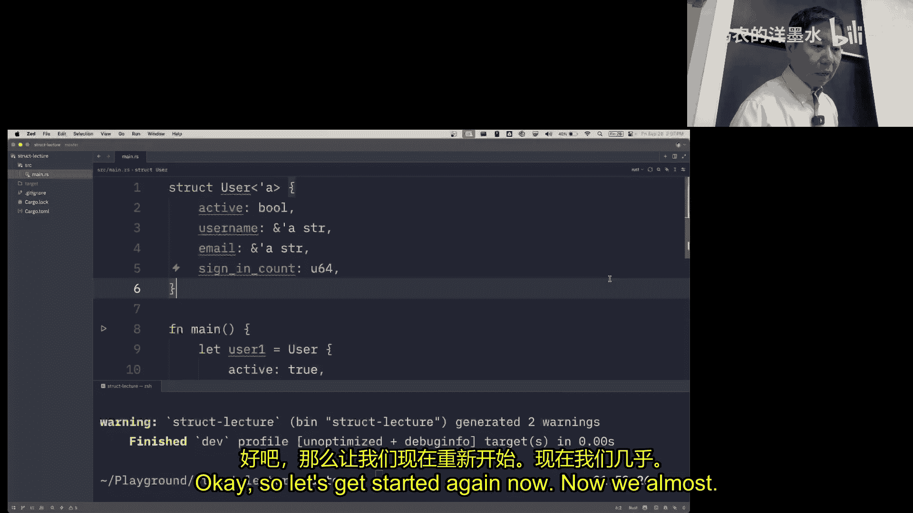
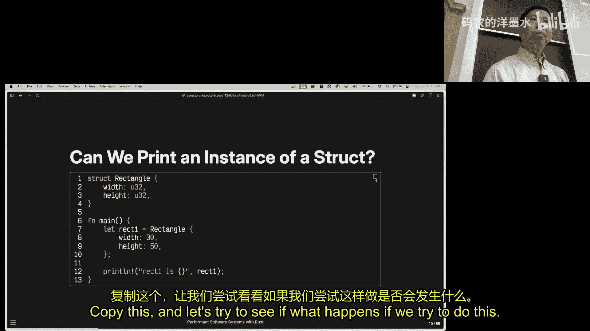
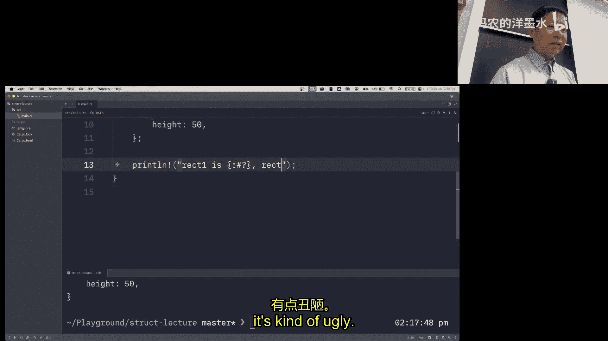
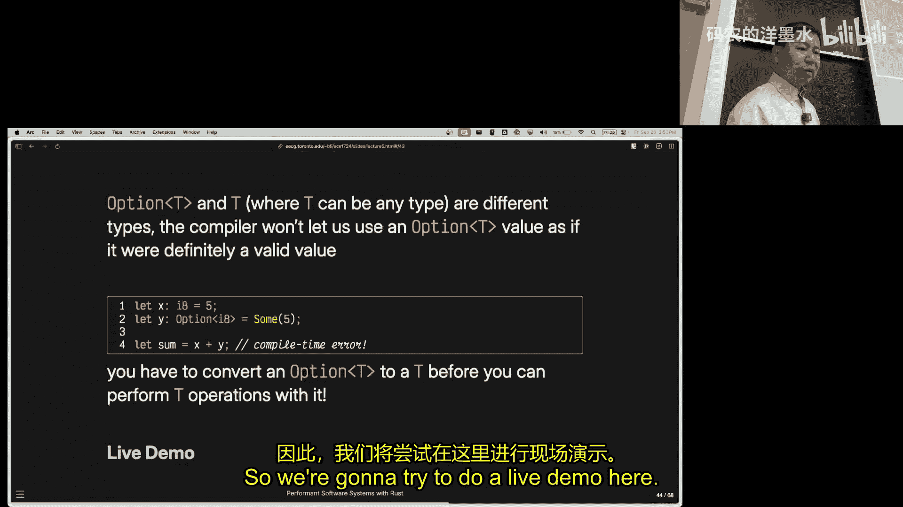
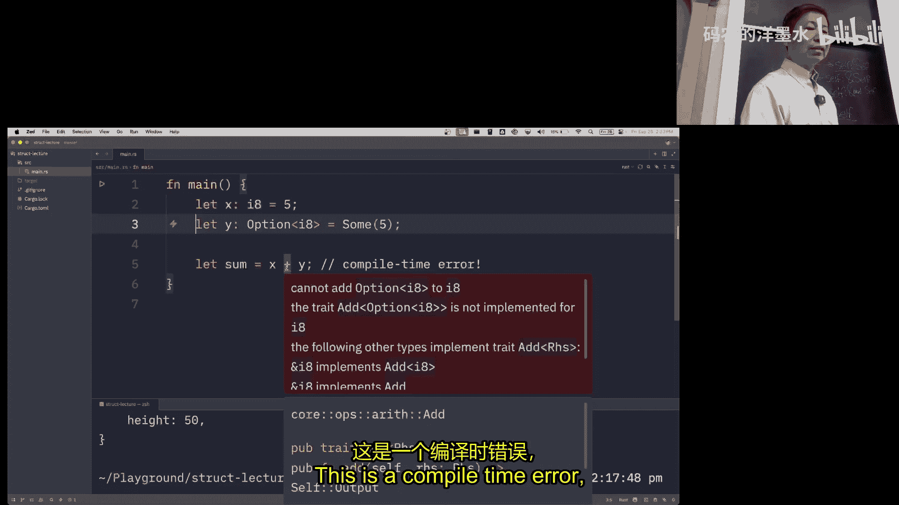
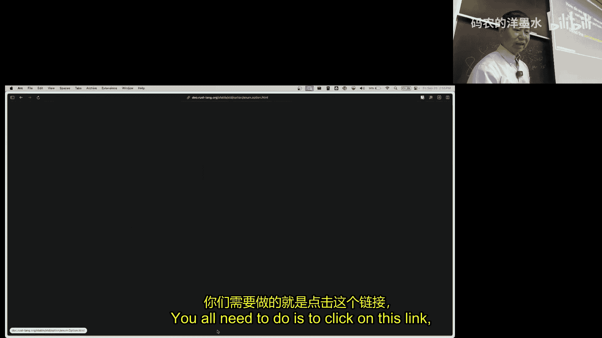
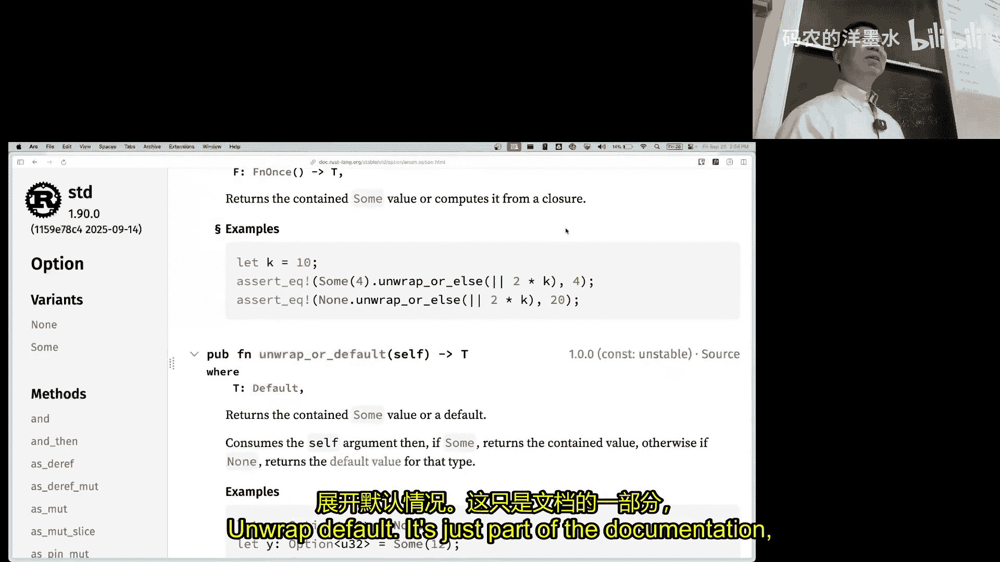
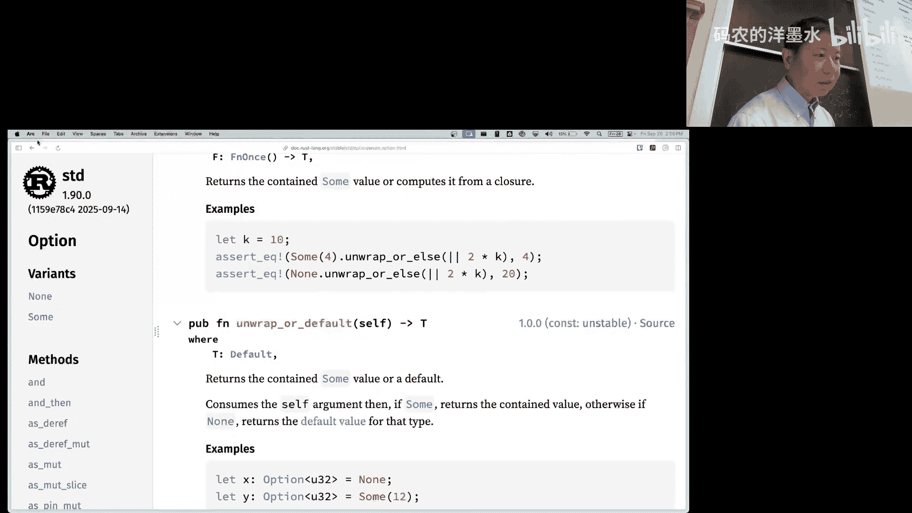
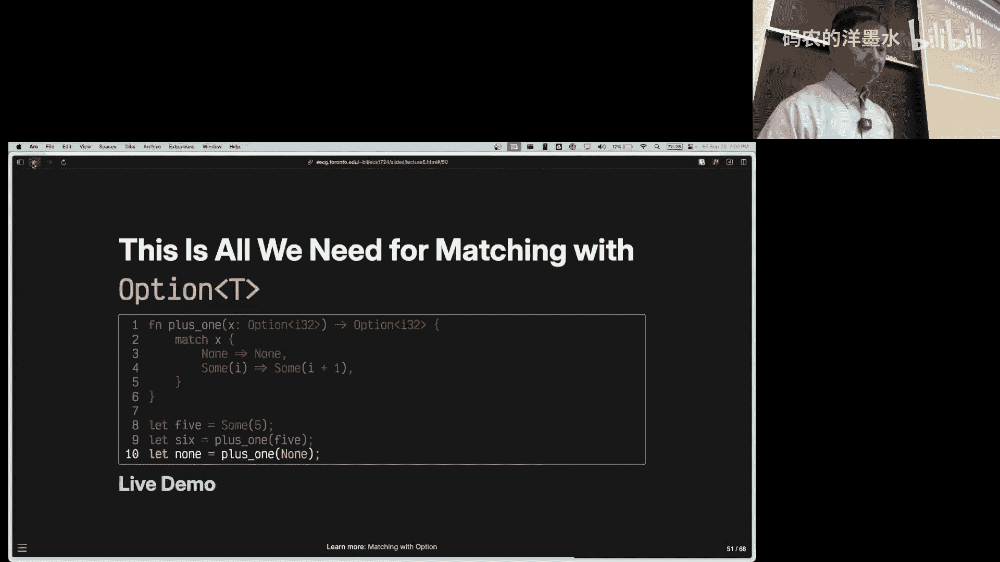

# Rust编程：第8讲：面向对象语言的特征



在本节课中，我们将学习Rust中面向对象编程的核心特征，包括结构体（structs）的特殊形式、方法定义、枚举（enums）的强大功能，以及如何使用`Option`枚举来安全地处理可能不存在的值。

---

## 结构体的特殊形式

上一节我们介绍了常规结构体的使用，本节中我们来看看结构体的几种特殊形式。



### 元组结构体

元组结构体类似于元组，但拥有一个类型名称。与普通元组不同，元组结构体提供了编译时的类型检查，使得代码更严格且更具可读性。

```rust
struct Color(i32, i32, i32);
struct Point(i32, i32, i32);

let black = Color(0, 0, 0);
let origin = Point(0, 0, 0);
```
在上面的例子中，`Color`和`Point`虽然都由三个`i32`元素组成，但它们是不同的类型，编译器会进行类型检查。

### 类单元结构体

类单元结构体不包含任何数据，类似于单元类型`()`。它们通常用于实现特定的特质（trait）而不关联数据，这在后续讨论特质时会非常有用。

```rust
struct AlwaysEqual;



let subject = AlwaysEqual;
```

---

## 打印结构体内容

默认情况下，Rust不知道如何打印自定义结构体。尝试直接打印会导致编译错误，提示该结构体未实现`std::fmt::Display`特质。

为了调试，我们可以为结构体派生`Debug`特质。这通过添加`#[derive(Debug)]`属性实现，它允许我们使用`{:?}`或`{:#?}`格式化符来打印结构体。

```rust
#[derive(Debug)]
struct Rectangle {
    width: u32,
    height: u32,
}

fn main() {
    let rect1 = Rectangle { width: 30, height: 50 };
    println!("rect1 is {:?}", rect1); // 简单调试打印
    println!("rect1 is {:#?}", rect1); // 美化调试打印
}
```

---

## 为结构体定义方法

我们可以将函数与结构体关联起来，使其成为方法。方法与普通函数的区别在于，它们的第一个参数总是`self`（或其变体），代表调用该方法的实例。

以下是定义和使用方法的步骤：

1.  使用`impl`块为结构体定义方法。
2.  方法的第一个参数是`self`、`&self`或`&mut self`，分别表示获取所有权、不可变借用或可变借用。
3.  使用点号（`.`）语法调用实例上的方法。

```rust
#[derive(Debug)]
struct Rectangle {
    width: u32,
    height: u32,
}

impl Rectangle {
    // 一个借用实例的方法
    fn area(&self) -> u32 {
        self.width * self.height
    }

    // 一个可以修改实例的方法
    fn set_width(&mut self, width: u32) {
        self.width = width;
    }

    // 一个获取器方法，方法名可以与字段名相同
    fn width(&self) -> u32 {
        self.width
    }
}

fn main() {
    let mut rect = Rectangle { width: 30, height: 50 };
    println!("Area: {}", rect.area());
    rect.set_width(10);
    println!("Width via getter: {}", rect.width());
}
```
Rust编译器会自动处理引用和解引用，因此无论是直接实例、引用还是可变引用，都可以使用`.method()`语法调用方法，无需像C++那样使用`->`操作符。

一个结构体可以有多个`impl`块。

---

## 关联函数

关联函数是定义在`impl`块中但不以`self`为第一个参数的函数。它们通常用作构造函数，通过`::`语法调用。

```rust
impl Rectangle {
    fn square(size: u32) -> Rectangle {
        Rectangle {
            width: size,
            height: size,
        }
    }
}

fn main() {
    let sq = Rectangle::square(10);
}
```

---

## 枚举

枚举允许你通过列举可能的变体来定义一种类型。一个枚举的值只能是其定义的变体之一。

### 基础枚举

最简单的枚举变体不包含任何数据。

```rust
enum IpAddrKind {
    V4,
    V6,
}

let four = IpAddrKind::V4;
let six = IpAddrKind::V6;
```

### 包含数据的枚举

Rust枚举的强大之处在于其变体可以直接包含数据，可以是任意类型，如字符串、元组、结构体，甚至是另一个枚举。

```rust
enum IpAddr {
    V4(u8, u8, u8, u8), // 包含一个元组
    V6(String),         // 包含一个字符串
}

let home = IpAddr::V4(127, 0, 0, 1);
let loopback = IpAddr::V6(String::from("::1"));
```
这种方式比使用一个包含`kind`字段和`address`字段的结构体更加优雅和类型安全，因为它将数据和变体类型紧密绑定在一起。

### 为枚举定义方法

和结构体一样，我们也可以使用`impl`块为枚举定义方法。

```rust
enum Message {
    Quit,
    Write(String),
}

impl Message {
    fn call(&self) {
        // 方法体
    }
}

let m = Message::Write(String::from("hello"));
m.call();
```

---

## Option 枚举

`Option`枚举是Rust标准库中用于处理值可能存在也可能不存在的情况的核心类型。它消除了`null`引用的风险，被视作修复了“价值十亿美元的错误”。





`Option<T>`的定义如下：
```rust
enum Option<T> {
    Some(T),
    None,
}
```
- `Some(T)`：表示存在一个类型为`T`的值。
- `None`：表示不存在任何值。

### 为什么 Option 比 Null 更好？

1.  **编译时检查**：`Option<T>`和`T`是两种完全不同的类型。编译器不允许你将一个`Option<T>`直接当作`T`来使用，从而避免了在期望有值的地方意外使用了`None`。
    ```rust
    let x: i8 = 5;
    let y: Option<i8> = Some(5);
    let sum = x + y; // 编译错误！无法将 `Option<i8>` 与 `i8` 相加
    ```
2.  **显式处理**：任何可能为“空”的值都必须显式地包装在`Option`中。要使用其中的值，你必须显式地处理`None`的情况，这迫使开发者考虑所有可能的状态。



### 从 Option 中获取值






有多种方式可以安全地从`Option`中提取值，最常用的是`match`表达式。

```rust
fn plus_one(x: Option<i32>) -> Option<i32> {
    match x {
        None => None,
        Some(i) => Some(i + 1),
    }
}

let five = Some(5);
let six = plus_one(five); // Some(6)
let none = plus_one(None); // None
```
`match`表达式强制你为`Option`的每一种变体（`Some`和`None`）提供处理分支，确保了代码的完备性。

---



本节课中我们一起学习了Rust中结构体的特殊形式、如何定义和使用方法、枚举的强大功能及其数据承载能力，以及如何使用`Option`枚举来安全、显式地处理可能缺失的值，从而在编译阶段避免许多常见错误。