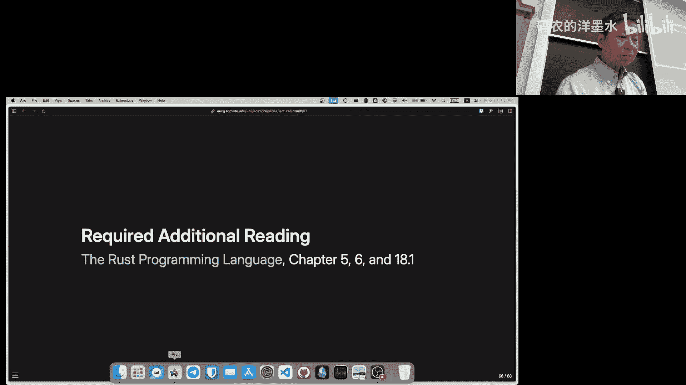
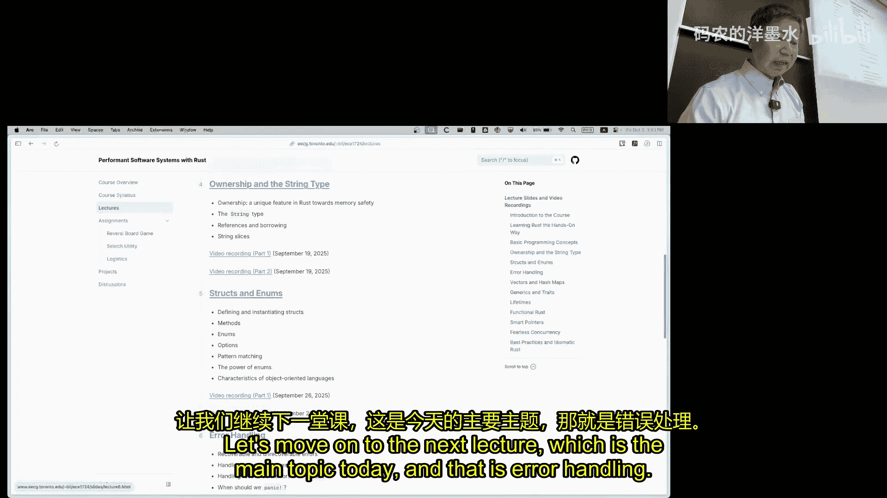
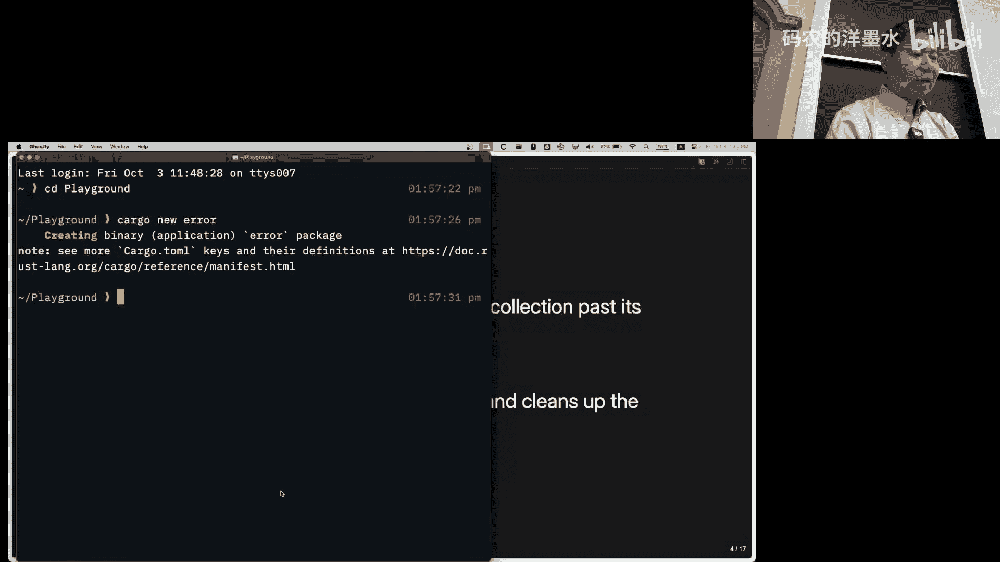
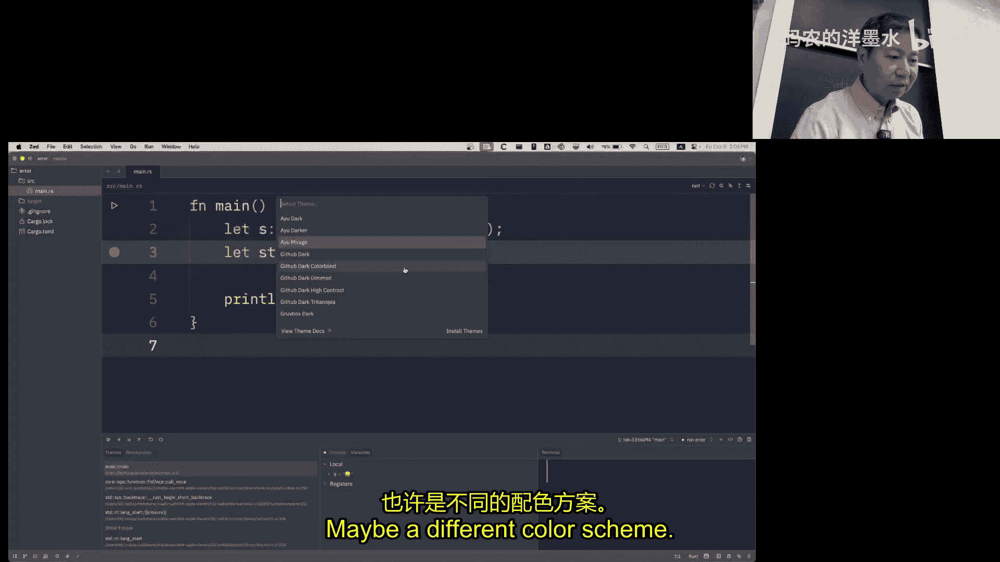
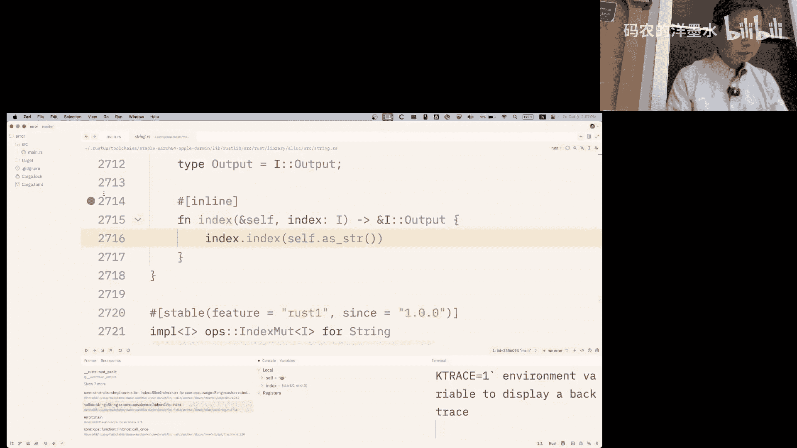

# 【全集 附课件】多伦多大学 使用Rust构建高性能软件系统 中英字幕 1080P p09 Lecture 9 - 错误处理 -BV16V62BhEuf_p9-

All right， so let's get started。All right， so last time we almost were。Somewhere in the middle。

 we're almost done with talking about the actual enum itself。 I just want to briefly read。

kindind of reintroduce enum a little bit in the context of the option enum because that was where we left off last time when we were talking about the option enum。

 we mentioned that this would be a very simple enum which requires that only one of the variants would be valid and this is something that replacing the no pointer in the other programming languages and it's very simple。

 it can be either something or nothing corresponding to no or non no in the other languages and we also mentioned this is lovely。

 I just want to repeat this once again， the billion dollar mistake by Tony Hor in 2009 he mentioned that you know he just inadvertently added without being able to resist the temptation at the time when he was trying to design。

Compilr he inadmittently added this no reference， which is a major mistake that led to innuable errors。

 vulnerababilityities， security problems， system crashes everything causing a billion dollars of pain and damage。

 not only in the past 40 years before this， but also continuing since that time。

The last way of doing this of fixing everything that we were talking about related to null pointers is to get rid of the null pointer by replacing the null pointer with the option enum and the reason。

That this is even possible is because of the rich semantics of enum that rusts rust can can offer enum previously at the very simplest way of doing enums。

 we just alternative values， but like alternative variants， but in this particular case。

 we allow some value in each one of these variants。

 So that would add kind of a degree of richness into this enum。

 so that we can express the option using this enum， So only two possibilities。

 none which corresponds to the nu pointer and the sum which corresponds to a valid kind of data piece of data。

 and it doesn't really matter what the type of that data is and that would be using the generic type T。

 So T is the generic type that as we mentioned， we will talk about generics later on。

 but today we will be using this not only for the option enum。

Also for the results in them and this is something that will be replaced with a concrete type when we are defining the option at the time。

 so we will have different option types， for example。

 we can have an option type with with an integer， we can have something with a character as the type of the data as the T we could do a type annotation where we have an I32 and this is you know important if we cannot infer the type。

 for example， if we were to initialize the the option variable absent number with a nonvalue this is where we cannot infer the type。

So last time we talked about it， but just want to repeat what we're talking about。

 just give you some context， why do we actually do the option T rather than having no。

 what's the benefit of doing this？And one as a starting point。

 we need to keep in mind that the option T and T these are completed two different types because of the extremely strong typing system in the rust programming language we cannot allow operations on different types if the operation is meant for the same type。

 for example here we to doing this ad， this addition we cannot really do this between an option type and the actual concrete type so because these are two different types and last time we did a demo for this and this is kind of intuitive and this is one very important feature in the rust programming language that helps us to kind of get rid of this idea of anything could potentially be no no no no no that's not true either you know that it can be a nonvalue which means that。

It is defined explicitly as an option type， or you know for sure that will never， ever be none。😡。

In which case you will make it a concrete type。 So that would be something that is important。

 And if you wanted to allow this possibility for this to be a no reference or no pointer or whatever。

 a no value， you will have to define it explicitly as an option type and opting in so that， you know。

 the entire code base， all of your source code would be aware that this is an option type。

 and you cannot really do the addd between an option type and the actual type。

Now the question is how do we get it out and last time we said read the documentation but just kind of half joking。

 we do have to read the documentation， we will talk about the documentation a little bit later today when we talk about the result type we get back to the option type at that time。

 but one important way of getting results out of the option type which is sort of like you can think of it as a canonical way where you can think of it as a rusty way or like ergonomic way sort of like in Python we call it a pythonic in rustt we call it a rusty way of doing this is to use match expressions this is important to remember because this is kind of very rusty。

 very ergonomic in rustt， so we last time we briefly talk about how do we actually use the match expression to evaluate to really try to process these enum typed variables in this case。

We have an enum with just four simple types four simple variants for example。

 and then we use the match just to go into each one of these variants。

 one variant corresponding to one of the match arms and then we will get the result of evaluating that expression directly using this match arm so that would be something that we have talked about before and it's pretty intuitive and this is very different from using the if statement because kind of the inertial or the momentum after learning the other programming languages is to use the if statement because very rarely in C or C plus we use something like switch you very rarely in rust you use match a lot more compared to the other like using if statement for example and the reason for that is fundamentally if statements you know we'll have to evaluate the expression inside that if statement we'll have to evaluate a bulloleying value。

Which is just true or false。 not good enough in most of the situations where you basically have more than true or false。

 So in match， you just go with each one of these variant， having its own match arm。

 and that would be good enough。 And you could also try to have the match expression binding to the actual data inside the enum。

 So the inside the enum， for example， in the quarter variant， you have the data US state。

 which is another enum， obviously， we could put the enum as data into one of the variants of another enum。

 And because of that reason， when we write the match， we will be able to process that particular。

Variant using this match arm。That。Kind of does pattern matching。 So if， you know。

 to the left hand side of that particular right arrow， you see that pattern matching。 So you say。

 if this variant is coin quarter and if this is true， then we match。

The actual pattern and we get we extract the state out of the data value of that particular variant。

 and that's you know a fundamental and very rusty way of extracting values from any Eum。

 including an option Eum and later on today we will talk about the result Eum， any Eum。

 if we want to extract something， you do this pattern matching inside match。Which is great。

 which is the rusty way of doing this and this is intuitive。

 nothing wrong with doing something like this is actually very much recommended。

 This is way more powerful than the if expressions in if statement expression you're going to have to say if and then else。

 if and else。😊，Not not right because over there you don't really have the strong typing system。

 you cannot do type checks， you cannot do one of these things。 it's very。

 very limited if you start to use the if expressions as compared to the match expressions so match expressions are favored and of course to the right hand side of the right arrow you could actually try to evaluate to some value and that's the result of evaluating this match expression and。

At the same time， you could have a block statement， you can print something。

 you can do whatever that you need to do in that match arm。

 and that's something that we have talked about last time， and this is in general。

 how do we actually use match expressions to extract the data out of a particular variant inside the enum。

So that's something we talked about last time。 And we kind of stopped short about talking about how do we use this to try to process the option types。

 And it's the same principle。 We just use the match expression。 In this case。

 we have a plus one function。And the parameter that we pass into that plus one function is an option type。

 and the option type， the T is I 32， is an option of I 32。

 And we will also return an option type as well。 So in that particular function。

 we will do the match。 So we will try to say， let's take X， let's try to match to one of these arms。

 And if x is a none。 we're gonna return none because we're gonna return an option type。

 And if the x is any kind of integer， if it's the sum variant。 we will extract that integer。

 And then we're going wrap it up with another sum。 and then we're gonna return that。

 So that's what we' are doing right here。And of course we can call this by just passing in a5 into the plus1 a will get six and6 is basically sum6 right so it is the sum variant of the enum option and then we have the possibility of passing a none in this case a will return none as well。

 so very simple just exactly as before when we're talking about processing any enum using the match here we're just using the same way of processing enums to process our option type。

 we will have better ways of doing this later on today。

 but this is something that we could actually try to do。And just to save a little bit of time。

 I probably wouldn't want to do the live demo here。 We will have more demos later on today。

 so no shortage picture of demos today so we're going skip this particular live demo。

And then we will try to。Keep one thing in mind， which is again， the power of the match expression。

 the power of the match expression we talked about before when we talked about a guessing game。

 that matches are actually exhaustive， which means that if you do something like this。

 what would happen？Any ideas？Yeah。It's going to be a compile time error。

 And the reason for that is because you missed a particular variant in that。Enno。

 which is the option enno， and that variant would be leading to this you cannot have that。

 you cannot miss that variant in that match， so that would be leading to this compile time error。

 which actually gives you the hint that none as a variant。has not been covered in the match。

 so that's something that's really great。 we loved something like this because inadvertently you will typically write code that misses a particular arm or you know you kind of didn't really think about that and this will allow you to make sure that all of the things are covered。

😊，Of course， in a lot of cases， you might want to。Just want to have an arm that matches。

All of the other variants except for the variant that you want to process in particular so in this case I want to process the quarter variant and I'm going return evaluate to 25 however。

 for everything else I wanted to have an arm that matches that so that's something that we could do by having this catch all pattern and in this case we can just for example have a panic we're not gonna talk about panics today as well when we talk about error handling and the panic is you know just matching every other variant and that's something we could replace with an underscore because the underscore is saying that since we're not using that particular data so that piece of data other underscore coin we're not using it inside our panic it will be way better to get rid of this compile time warning that this variable is not used by just use。

An underscore。 and we could， of course， we don't have to have panic。

 We can just evaluate to a unit type value as well。 So either way。

 we will have a catch or pattern inside the match。 And this would be typically an underscore。

 And that's a placeholder for all of the other kind of variance that we have in the Eum。

Has to be a static type。It will return either 25 or a unit。So that would be okay。

Because the unittype is， compatible with the integer。Yeah， so they are not two different types。 Yeah。

 that's， that's gonna be。 Yeah， if it， it would be returning two different types， that's not return。

 That's not allowed。Yeah， yeah。Alright， so again， I'm going skip the live demo right here。

 mostly because that is a pretty simple， you know， example right here and the match obviously evaluate the expression that we will have to。

You know， return up that particular value that it evaluates too。嗯。

Now there is one kind of a shorthand form and today we will talk about a few more shorthand forms。

 these are sometimes we call it synthetic sugar， so we're basically having putting sugar into my coffee and obviously that is not recommended in coffees but it's okay for rust so this is synthetic sugar。

And this is something that is， you know we have to be careful about the sugar。

 so we don't want to put too much sugar to the point that is becoming less useful or less readable。

 which is typically the case for c plus plus it's just too much sugar but we wanted to put the right amount of sugar to really try to make it simpler and easier to understand today we're going to have more examples of such sugar here。

 and if less is one of the synthetic sugar that we will talk about。

 So very typically we're gonna to have some code like this。

 we're going to have some kind of a match of matching a particular enum in this case。

 the enum is obviously the option enum and we could have a。A sum and you know。

 any of the other types， in this case， obviously， there's only one other type， which is none。

 we're gonna return， you know， the unit type， for example， just do nothing for anything else。

 except for one variant。 do nothing for everything else except for one variant。

 If we start to do something like that， we kind of tedious to always say match， you know。

 and then you know， they catch all operator sorry to catch all pattern to get to all of the other variants。

 except for this one， it's kind of tedious。 So we could get started using the sugar right here。

 which is the if let syntax。 So if lead is very different from if you know。

 if is sort of like evaluating an expression must be a boole to or false。

 If lead is just synthetic sugar for the match expression。 So in this particular case。

 we have the sum， which is pattern matching， just similar to the match。

This we're matching sum with the match。 We're extracting the match out of the the sum variant。

 the data out of the variant from the option type。 and then we will。😊，Try to。Say， is it going to be。

Something that we will try to process。 So obviously all of the other variants。

 we're not gonna process only this particular variant。 So that's why we have an if let statement。

 And the others， the catch all pattern and everything we're not gonna write。

 And in this particular case， we're just saying take the config max。 take the max out of it。

 you know， to do pattern matching and then process it。 That's it。 that's all we need to do。

 is's exactly the same as the match expression。 It's just synthetic sugar。

 This is more concise control flow。 It looks better。

 in a lot of cases where we only need to process one variant。

 this is something that looks way better。 And this is also something that is very typical for option type。

 and for the option type， a lot of cases， which is we're interested in the data。 and that's it。

 If it's none， we're not going to do anything and we're gonna do the if let for the option type。

Alright， so now a little bit of detour here。 we're going talk about a little more about enums。

 We're going talk about the power of enums。 and the reason why we want to add this particular episode today is because enums are just so powerful is one of the most important features in the rust programming language that people just don't appreciate。

 just so beautiful， a piece of feature， a feature inside the language。

 we just want to talk about a little bit more， just tell you why this is so beautiful。

 why this is so powerful and starting from the quote from the famous Excodextra。

 who is ACM touring award winnerner， the inventor of lot of things in operating system design in algorithms and shortest path。

 for example， know he basically mentioned if thebuging is the process of removing software bugs。

 then programming。😊，Speed the process of putting them in。And this is actually。

Cannot be more true or more valid in the AI era where you。

You are putting in even more code and probably 10 times 100 times more code into your buggy software and putting in more bugs because of the assistance of AI。

Alright， so now we have this struct kind of a type， which is， for example， in this case。

 a very simple point。 and why we're going to talk about thisstruct。 Well。

 we're going to talk about it because this is in contrast with the enum type。 The struct types。

 you can think of them as product types。 So these two X and y they're kind of two dimension two different dimensions。

 any value of X and Y would be possible inside thestruct。

 basically entire space in the two dimensional space。But which is not the case for Eum。 for Eum。

 these are some types in the sense that only one of these variants are possible。 you know。

 we could have data in either one of these variants。 We don't have to have data。 In this case。

 this is a Web event Eum。 We can have click， which。

Where we need the data where where are we clicking we can have page load page unload these are the types that we don't really have associated data and then we have key press with the character the key that we pressed and the paste which is the string that we pasted in all of that would be。

Great to be expressed inside an enum。 And enams are some types。

So now let's get to one very simple example just to show you the power of enum types。

 let's say we wanted to。Write or design a type for a Christmas tree。

And there are only two things we care about， whether or not it is alive and whether or not it is growing。

 and two things we care about about the Christmas tree now。

Here we could obviously define it as astruct type， you know， it can be a life。

 having a booleyan value to represent that in a growing。

 have another bullying value to represent that。 And this is very typical if you were to you know。

 do this in a different programming language outside of rust outside of rust。 you know。

 you don't really have the power of Eums。 One major major example is the goal language。

 It doesn't have E said oh no， you're gonna have to simulate Eum somehow is just like so complicated from the get going from the starting point。

 goal is no good because of that reason。 And。Why is Eam good Well。

 this will have to be done in a better way， this is not very good and the reason why the first one is not very good is because you know when of the fact that when when the tree。

 the Christmas tree is not alive。It cannot be growing。 And that logic was not built into the type。

 which means that when it is not life， it can be growing if you were to do it in the firststruct。

And that kind of， you know。Constraint is not expressed in the type itself。Instead。

 you should have a enum。 So the enum would be two variants alive and dead。

 And then the alive will have the actual data。 and that data will be a booleing value。

 whether or not it is growing。So if you were to express it using the Eam Christmas tree rather than astruct。

Christmas tree， you would be able to express the constrain that when the tree is not alive。

 it cannot be growing because growing is not even in the that variant。So the bottom。

 the one the enum is doing is the correct way of expressing this particular type rather than the struct。

😊，Destruct is a bad way of doing this。And of course。

 you want to encode enough constraint or as much information。

 as much constraint as possible into your type system so that the compiler can help you to check the correctness of your code。

 and that's why you wanted to do the bottom。And so if we were to define a tree that is growing and alive。

 we're going to just do it like this， a Christmas tree that is alive and growing inside the data and then we just do a match and we will say if it is a we're going try to say print that it is alive so that's something that we could certainly do and obviously in this case it will be a non-exhausive match and that will give me a compile time error just like when we mentioned before with the the coin enum and here what we are doing here is that it's just something that is preventing all kind of bugs where you don't really have the catch all pattern or the iflet synthetic sugar to process the otherer。

The other variant inside that particular enM so you cannot really have this potential possibility because the compiler is doing all of the type checking for you。

 the match will have to be exhaustive all of that compile time error actually helps you that helps you in your real worldorl programs and this is why you should be very careful when we design your types in your project the types are super important and in a lot of cases。

You know， these days， if you were using AI to generate a code， you're going to have to be careful。

 The AI may or may not give you the correct code because the AI cannot think。You know。

 the AI can only remember， can recall。 And it obviously has vast amount of knowledge to remember。

 It can remember a lot of things way more than what we can do， but they cannot think。

 It cannot design， cannot design something that is logically the best way of doing this。 The， the。

 the rusty way of doing this。 In this case， this would be。A very good example of the power of Edom。

And now let's switch gears to one more thing， which is object orientation and the reason why we talk about this is since we're just talking about good things about rust and bad things about languages anyway。

 we wanted to talk about this because this is one of the best things about rust compared to some of the other programming languages。

 unfortunately C+ plus among them and。This is about the entire programming paradigm of what we call object oriented programming。

So Joe Armstrong Strong， who is the creator of Ireland。 Unfortunately， I was， you know。

 relatively wellknow， but not too many people are using it， kind of failed。 but， you know。

 it's still a good language。 He basically said that there's a major problem of object oriented programming。

 The problem with object oriented programming is that this kind of programming。

 They've got all of the implicit environment that they carry around with them。

And you don't want that， you want a much more constrained and much smaller kind of environment。

 but it will actually give you a lot more as you wanted the banana， which is the analogy。

 but you got what you got was a gorilla holding the banana in the entire jungle。

 so you got way more and that is a lot riskier compared to if you only get what you need to get。

So the question now is whether or not rust is object oriented。

 since we're talking about object orientation。 Now， before we answer that question。

 we're gonna have to say answer the question， what do we mean by an object oriented programming language。

 What do we mean by that， What are the characteristics。Of object or programming， Any ideas。

What do you mean by object oriented programming without looking at the future slides， obviously。

What do we mean by that？Polymorphism， what does that mean？The class can assume。

Maybe assume different types， maybe， you know， something like that， polymorphism。

 anything else that you typically think about in terms of object orientation。Inheritance exactly。

 and that would be inheriting from the parents right。

 so it could have a child type inheriting from a parent type， anything else that you can think of。

Maybe encapsulation you know if you remember a lot of object orientation you would think about encapsulation as one of the characteristics which basically means that things must be private inside the type。

 they should not be outside exposed to the outside public so that would be encapsulation you kind of say these are private members of the object you know nobody else in the world can see them that's encapsulation so these are the three things we talked about before and objects typically starting from you know what it does it contains the data obviously it contains some behavior which typically would be called methods in the other languages and this is a classic way of thinking about these objects starting from 1994 the design patternss book written by the Gahana four and rust is obviously object oriented if you're using this kind of loose definition becausestructs they contain data。

😊，Enums obviously contain data， they actually have variants that contain data， which is great。

 and we could also have these input blocks that can add additional methods and associated functions to these types。

 obviously that would be you know based on this definition object oriented。

 these could be object oriented。😊，And we talked about encapsulation one of the three things about object orientation。

 and encapsulation basically says that you have to hide implementation detail。

 and this implementation detail would require， you know。

 some kind of geters and setrs and access methods to get them out and put new methods。

 new values in and all of that。That's something that is also。Provided by rust， right， rust。

 if you think about this encapsulation， it is also object oriented in the sense that fieldss inside structures and private。

 and they cannot be directly access。 But in fact， by default， They're private。

 If you want to make them public， you have to put in the pub to make them public。 by default。

 they are indeed private。 if they're private by default， you need access methods。

 gatherers and setrs and so on to really try to get the value and set the value of these private methods。

 sorry， private fieldss。 So that would be something that is very important。All right， so that so far。

 we do have an object oriented paradigm in rust。 However。

 what about the other things that we just talked about in rust in object orientation， inheritance。

 for example， this is where you have a major problem。

This is where you know things start to break here the idea is very simple。

 an object can inherit the data from the parent， you know。

 maybe even multiple inheritance from multiple parents， you know， the data from multiple parents。

That is where it gets riskier。So rust is not object oriented intentionally。 It does not support that。

 which is not true for a lot of other object oriented or multipar languages such as Python。

 Python is multipar。 It does support object orientation， and it does have inheritance。

 You can have a base class and have inherited classes in Python。 Rust is not object。

 It intentionally does not allow that。And for those people who are used to think in an object orient way。

 they will initially feel that it's very， very inconvenient。

 You just wanted to inherit how come I cannot do inheritance。 It's kind of in inconvenient。

 but it is intentional。Because object orientation in the sense of inheritance is an extremely bad idea。

It's a very bad idea and polymorphism in polymorphism in object orientation。

 object oriented programming is actually directly coming from inheritance。

 you have to have inheritance in order to have polymorphism and all of that is kind of combined is not an extremely good idea in terms of the design of a programming paradigm。

So next time when you think about object orientation， you're going to have to think， oh。

 there are good things about it， which is encapsulation， you know data and behavior。

 those are good things， but inheritance is not a good thing。Instead。

 what should we do Well we're going to talk about it later。

 but we have been briefly talked about talking about it。

 which is the trait we're going to use the trait rather than using inheritance if we ever need to reuse code obviously we need to reuse code but over there trait would be something that we are using and we could implement we can have default implementations of methods inside traits but traits cannot have data you cannot basically put data into these traits and this is something that is quite similar to a few other programming languages that are relatively more modern such as Swift such as Kotlin these are kind of languages where you get kind of things like protocols and interfaces and so on these are very similar to traits and rust just designers they prefer to have their own terminology rather than calling interface or protocol or whatever it's called a trait and that's something。

That the replacement of inheritance， you don't get to inherit data using trade because traits cannot have data at all。

 And that's extremely good。 That is excellent because inheriting data is a fundamentally bad and flawed design。

 It's a bad idea。 and people have thought about it many， many times over the past two decades。

 and this is agreed upon it a bad idea。Some of the other programming language characteristics of objectiented programming languages polymorphism that we mentioned。

 polymorphism is all about having you know sort of like types that can be determined dynamically at runtime something like that it is also kind of a more advanced feature in object oriented programming languages。

 a lot of you may not even you know use it on a daily basis。

 but this is something that is related to inheritance its actually something that you have to have inheritance to implement this in like C++ and so on。

 and the idea here is that you can substitute multiple objects of different types at runtime if they inherit from the same base parent class or rust programming language we call them types so this kind of polymorphism is also a bad idea。

Because it's based on the inheritance。 We wanted to implement dynamic typing over at runtime。

 but not using this way。The reason why it's a bad idea is sometimes we bump into something called inheritance hell in the sense that we of we have no idea at runtime what kind of type we we're getting。

 what kind of parent that we're getting what kind of child class we're getting。

 We just don't know and a lot of very elusive box can be happening because we expected this type and we got that type and we didn't know and all of that will be a problematic thing。

 So this is not very good and this is something in the conventional way where a child type can be used in the same place as the parent type。

 So how do we do this。We use， first of all， generics。

 so we use generic types and generic types would be quite useful because we can actually try to have a level abstraction in terms of types。

 However， generic types is not really dynamic in terms of runtime runtime dynamic types is not something like this can be supporting but generic types would be good enough for a lot of cases already where you kind of abusing polymorphism which is not needed。

 you kind of abusing polymermorph like you don't have to change the type at runtime。

 you just needed a compile time。 that's where you use generic types in rust for。

And if we ever needed to have different types or accommodate different types at runtime where we don't really know the type at runtime at compile time。

 then we do something following the design principle of bounded parametric polymorphic which rust actually does support and what it does is that it uses something called trait objects D and we're gonna see an example of that later today。

 we're going to talk about it in more detail down the road and trade bounds as well。

 just to impose some constraints。 So even though we want kind of dynamic types at runtime。

 we don't want it to be too dynamic， we want to have some constraints over there。

 you know in terms of what kind of trait that this thing implements。

 you know that's something that we wanted。And that's what we typically call bounded parametric polymorphism。

 And that's the right way of designing these things in rust。

 And that's why rust is a better programming language compared to the old fashioned object oriented programming。

 which we should abolish。 Alright， just don't use them。

 abolish them and we will discuss all of these things later on。 But just today。

 we just want to briefly talk about it。 And then let's move on。 Oh。

 this is actually the content in chapterer 18。1 that we just talked about。 And let's move on to。

Let's move on to the next lecture， which is the main topic today， and that is Er Handley。

So error handling is the main topic we want to talk about today。

And this is something that is very important。 So previously we talked about the no value and we use the option type to completely get rid of all of the bugs。

 the million dollar mistakes， billion dollar mistakes over there。

 but now there's another kind of a design mistake by the other programming languages。

 which is how do we have no errors。And the other programming languages， including Python。

 including C plus plus， they did it so wrong that people rarely handle errors。

 They just don't handle errors， you know。You know， why do I have to handle errors if you。

 if I must to try catch and you know， why would I have to do that， It just I don't handle them。

And that's something that rust fundamentally fixed by using its own way of handling errors。

 And today we're going to talk about it。 So two kinds of errors。 and this is very intuitive。

 we have the recoverable errors where we have， for example， this file is not found。

 We want to open the file。 The file is not found。 and that is a recoverable error and this is typically when we want to retry the operation。

 we don't want to just panic and get out of the program。

 but that would be you know kind of a benign kind of an error。

 but we do have the unrecoverable errors， obviously。

 and these are kind of runtime issues where we know that we cannot continue。

 if it's something that we know that we cannot continue。

 obviously we want to terminate immediately and that's when we panic the panic macro with exclamation mark that will be how we handle these unrecoverable errors and that would be a very intuitive way of thinking about errors。

You know， for example， if we're trying to access the location beyond the end of a collection。

 that's going to be something， for example， a string of which is a collection of U8 integers。

 thatll be something that is unrecoverable， we should bail out。

 we should terminate the program if this is something that should be a runtime error。

 we should not continue and that would be when we panic。So this is something that is quite intuitive。

 you know， two kind of errors， recover and recover of people， you know。

 obviously you can't understand that except that the other languages。

 they don't do the right job to separate the two cases。 they use the same thing， which is exceptions。

And exceptions in the other languages， most other languages。

 they kind of are used to handle both kinds of errors， recoverable and unrecoverable。

 and they're both kind of handled using exceptions and that would be not ideal。

 It's not going to be a good idea to do something like that because you have major differences of handling the unhand errors you wanted to have a different way of handling the unrecoverable errors。

Most of our errors are recoverable， and they should be handled in a way better way than kind of mixing it up with unrecoverable errors。

 It has to be a more graceful way。As well。 So we wanted to think about what is a better way of handling these kind of recurbo errors as compared to just using exceptions for both kind of errors。

And exceptions， which is kind of introduced initially from UC++。

 but kind of later are carried forward by using from the other languages。

That's not the right way to do this。And for unrecoverable errors， the rest runtime can just panic。

 or we can explicitly panic if we think that the error we bumped into is unrecoverable。

 We have to terminate。 We can just panic。 and that would cause a runtime crash immediately。Allright。

 so let's first talk about the unrecoverable error because this is something that it's much easier to understand。

 it's how do we process unrecoverable errors， the basic idea is just a panic。

 we just you know have something that is terminating the program so this is typically caused by some kind of unrecoverable error for example。

 as we mentioned we access in collection beyond the end and that will cost the code。To panic。Alright。

 and that's kind of how the， the libraries will actually just terminate。

 or we can directly call panic macro directly。 So that's something that we can terminate if we think this is the right place that we should terminate the program。

And we're going to， for example， print a message， we're going to walk back the stack and clean up the data from each function。

 and then the rest executable is going to terminate and the operating system is going to take over。

And this is typically how we do it when we actually wanted the full trace。

 what we typically call a back trace， this is the kind of the trace of the full stack as we unroll as we clean up。

 walk back the stack。 we're gonna print out what they contain and that would be something that we can easily try to do by using a rust_ back trace and add that to the environment as an environment variable。

 give it a one value or give it a full value we'll be able to just print out different levels of the state of the actual stack at the time of crashing。

 So here I would like to do a live demo here。 just want to。😊，Give you。

A good idea of what it can contain。 So let's open the terminal。

 Let's go to my playground and just as before， let's go cargo New。 Let's call it error。

And let's go to era and let's start Z。 And let's kind of see what's going on here。

 So initially it has this hello world。 So let's get rid of the hello world。

 Let's do some programming。Without AI， Okay， so let's see if I can do it。 Oh， panic。 So hello world。

 So that would be great。 So that's a panic。 And let's try to cargo run here and cargo。😊。

Run is gonna give us a panic。 So it says panicked at source code line number two。

 which is exactly this particular line。 and it will give me the message of the panic。 That's a macro。

 that is just like what you expected。 And then it will say run with rust back trace。

 and let's just run it cargo run。 And that will give me a little bit more。 as you can see。

 just a little bit smaller font。 a little bit more。 And for each one of these lines of code。

 I'm gonna have a little bit more information about this before I reach the panic。

 It also tell you a little bit more note and says some details are om minuteted run with rust underscore back trace fool。

 and that's something we can try back trace fool。 and then cargo run。 And that would be good。

 And because we get a little bit more information。 You know， like previously， it was emit minute。

 some of the unimportant part of the stack trace。 And now we get the full trace。 So that's great。😊。

So that's what we wanted- what if I wanted to do it with cargo run dash dash releasease？

Which basically does not include the debug information。Yep。Can we still see the back。Oh。

 let's give it a try。 It does。 It sees the backs， except it doesn't have the debug information。

 The debug information， if you actually compare with the previous one。

 which is sort of like the line number， right， the line number， the source code。

 that would be the debug information。 Now， we don't have that anymore。

 So we only have whatever that is built into the release binary， the release executable， right。

 So that's something that' is great。 Now， panic is not you know，😊，Like very。Good example。

 we certainly we don't want to panic immediately after we get into Maine。

 So let's have a better example。Let's say we wanted to。Let's say we want to access a string。

 You know， weve learned about a string slice。 We can actually access。

 if we directly access a string using an index， what what would happen。 We mentioned that before。

 So we， let's say I have a string。嗯。For example， let's say let string S。Equals to string new。

 let's say， hello world。And if we directly say printline。The actual S。

What would have happen if we do something like this？We want to get to the diverse character。

 which is typically the case。 Well， as you can see immediately。We get。嗯。F takes zero arguments。

 not new from。 And immediately， we get a compile time error。

 which is the type S TR cannot be indexed by integer。 So this is what we mentioned before。

 We cannot index a string directly using integer。 But however。

 we mentioned also that we could actually do it by slice。 right。

 So we could actually try to say let let's say string slices equals to n percent。

 which is how we do slice0 dot dot4。Can we do that。Certainly we're going to have to change this。

 say string slice， can we do this？Let's give it a try。 cargo run。 And this is something that is good。

 Oh， hell， that's no good。 So let's make make it for5。 That's much better。 hello。

 that' would be great。 So this is great。 except that， you know。

 we mentioned that we could actually go beyond the actual beyond the the end of the collection。

 right， So if you do that， then we have this say index is out of bound and we could actually do rust back traces。

 And we're gonna see all of the the panics and all of the the stack traces until we don't want is a bit too much。

 Let's say one。 And we get you know， like which library did we use this is basically a trade inside the library inside the rust standard library。

 all of that And eventually we will reach this case where slice error fail。

 and that's gonna be something that actually panics。 And that will be the。😊。

Panic that is caused so we can see the slight trace。 So let's say we have something that really。

Let's say， we have a emoji。 Can we put in an emoji。How do we put in emoji？All right。

 so let's put in an emoji here。Alright， so that's an emoji。 And let's try to say2。Right。

 let's say two。And that would be also kind of if you actually try to compile， it should be OK。

 so cargo build， it should be okay， but if you actually try to try to run it，Which is。

What we're doing here。 And we also have a panic。 and it basically says。

Byte the index 2 is not a chart boundary。 It is inside the emoji。

 So the emoji is taking more than two characters。 So we're going to have to expand that。

 So how many characters are we using depending on the emoji， Some emojis are using three。

Integer characters and some of the others using four in this case it's probably using4 let's try to give it a try。

 I tried it before it uses4 so we're going to have to say0 to0，1，2。

3 so we allow all the way to4 and then were able to print out the emoji。Right。

 if we actually downgrade it to3， we will still have some kind of。A crash。

 So this would be something that I can do for， you know， a simple panic。

 And just before we take a break， just want to show you something cool here。😊。

So here I could actually make a break point right here。 I can break right here。

So this is how I make a break point。Al right， so in the case where I have to break and I can just break before I reach this line。

 and then I can actually just run。I just use this run and say debug， run or run release。 So run。

 debug and we'll start to give me all of the， you know， let's see。Maybe a different color scheme。

Alright， so I will give me a lot more of the details right here in terms of， you know。

 I do have one break point and then each one of the break point。 I have different frames。

 This is sort of like during the process of running it， I can see the stack frames。😊。

And this is obviously available for any standard debuer， including C plus plus debugger。

 And in this case， we have the rust debugger。 And obviously， I can see the stack frames。

 And I can see the actual local variables right here。 I can see individually。

 it actually uses four different you know U 8 integers to represent that particular emoji。

 And all of that is kind of part of the debugger。 I can easily do that。 and I can just continue。

 For example， right here， I can continue。 Oh， now it crashes when it crashes。

 it will very conveniently go into the actual line of code that actually causes the panic。

 which is right here。 And on top of that， I can actually go to different kind of。😊。

You know this is like different stack frames。 they will go and walk to different frames and tell me where that line of code is and that line of code is in dot rust up two chains or whatever it's part of the rust standard library and I can easily see the source code of that standard library because all of that is visible is public and that would immediately tell me why do we have the panic and obviously here we're using the string library but in typically typically case we have a much larger project we have our own libraries。

 our own modules that we are using and in this case we can see oh the panics but what caused the panic can go back to the stack frame I can see individual frames where we actually have the you know the last step in that particular frame before we call the next function and the next function cause the next function eventually caused the panic。

😊，And of course I you know would be would love this kind of debug information way more than。

 you know the command line back trace print out this is much more visible and a much better way and this is actually one of the reasons why we use a debugger。

 we very typically use debuggers for kind of segmentation fault cord dumps and all of the runtime errors there where use debugger for c plus plus this however。

 is where we intentionally wanted to panic we want to terminate and this is where we use the debugger for All right。

 so take a break for five minutes， whether let's get back to the lecture again that to。13。

