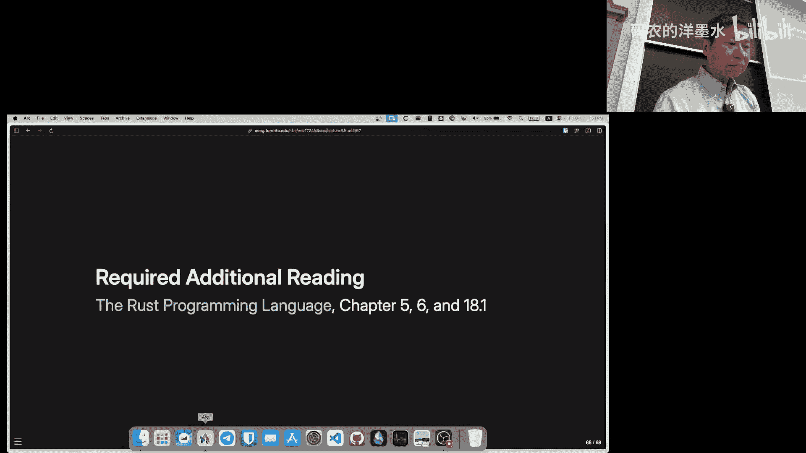
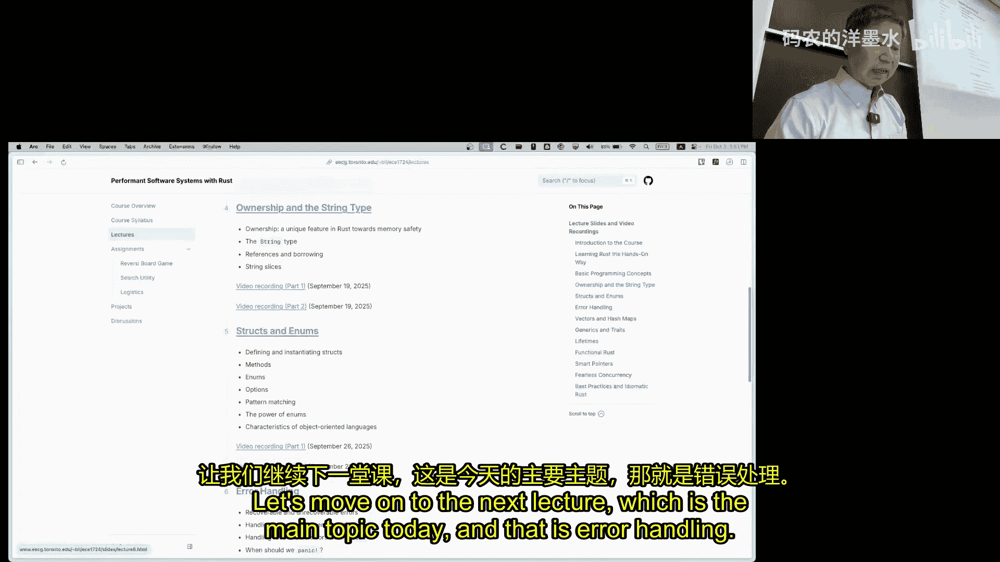
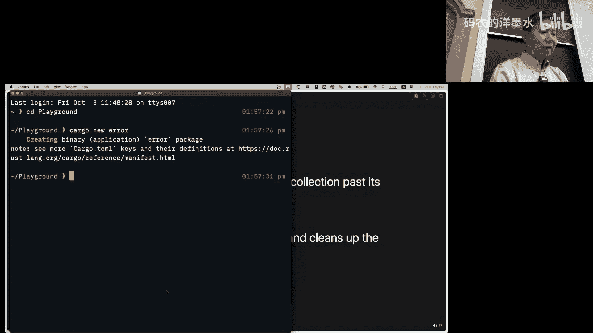
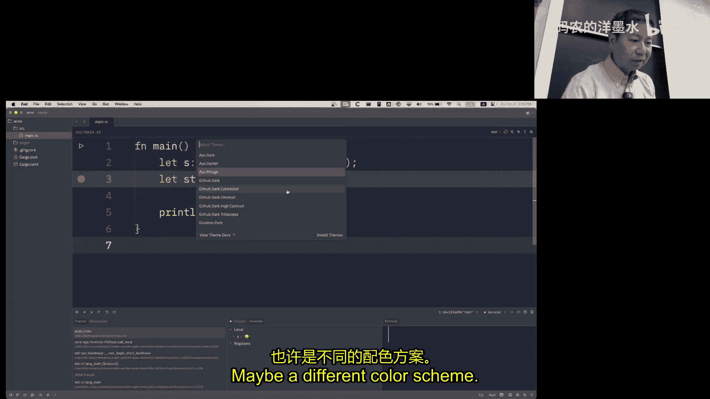
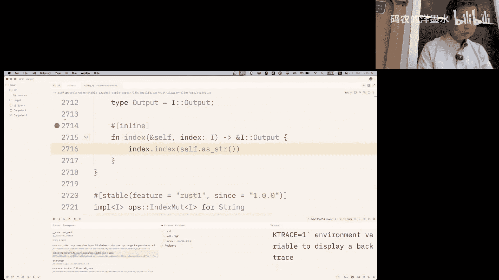

# Rust编程：第9讲：错误处理

在本节课中，我们将要学习Rust中强大的错误处理机制。我们将从回顾枚举（enum）的强大功能开始，特别是`Option`枚举如何优雅地处理空值问题。接着，我们将深入探讨Rust如何区分可恢复错误与不可恢复错误，并介绍处理这两种错误的核心方法：`Result`枚举和`panic!`宏。通过本节课的学习，你将理解Rust如何通过其类型系统，从根本上避免其他语言中常见的错误处理陷阱。

## 回顾枚举与Option类型

上一节我们介绍了枚举的基本概念，本节中我们来看看它在处理“空值”问题上的具体应用。

在Rust中，我们使用`Option<T>`枚举来替代其他语言中的空指针（null）。这是对托尼·霍尔（Tony Hoare）在2009年提出的“十亿美元错误”的直接回应。空指针的引入导致了无数的错误、安全漏洞和系统崩溃。Rust的解决方案是彻底摒弃空指针，用`Option`枚举来明确表达“有值”或“无值”的状态。

`Option<T>`枚举的定义非常简单，它只有两个变体：
```rust
enum Option<T> {
    Some(T),
    None,
}
```
*   `Some(T)`：表示存在一个类型为`T`的值。
*   `None`：表示没有值，对应于其他语言中的`null`。

这里使用了泛型`T`，这意味着`Option`可以包装任何类型的值。例如，`Option<i32>`表示一个可能存在的`i32`整数。

需要记住的一个核心原则是：`Option<T>`和`T`是两种完全不同的类型。由于Rust强大的类型系统，你不能直接对`Option<T>`类型和`T`类型进行运算。例如，你不能将一个`Option<i32>`和一个`i32`直接相加。这强制你在代码中明确处理值可能缺失的情况，从而避免了因意外空值导致的运行时错误。

那么，如何从`Option`中取出值呢？最符合Rust风格（“Rusty” way）的方法是使用`match`表达式。

## 使用Match表达式处理枚举

`match`表达式是Rust中处理枚举的强大工具，它比传统的`if`语句更强大、更安全。

`if`语句只能判断布尔值（true或false），而`match`允许你根据枚举的具体变体来执行不同的代码分支。更重要的是，`match`必须是**穷尽的**（exhaustive），即你必须处理枚举的所有可能变体，否则编译器会报错。这确保了代码的健壮性，不会因为遗漏某个情况而产生bug。

以下是如何使用`match`处理一个自定义的`Coin`枚举：
```rust
enum Coin {
    Penny,
    Nickel,
    Dime,
    Quarter(UsState), // Quarter变体包含一个UsState类型的数据
}

fn value_in_cents(coin: Coin) -> u8 {
    match coin {
        Coin::Penny => 1,
        Coin::Nickel => 5,
        Coin::Dime => 10,
        Coin::Quarter(state) => { // 通过模式匹配提取state
            println!("State quarter from {:?}!", state);
            25
        },
    }
}
```
在`match`的分支中，箭头`=>`左侧是模式匹配，右侧是匹配成功后要执行的代码块或表达式。对于包含数据的变体（如`Quarter`），我们可以直接在模式中绑定其内部数据（如`state`）以供使用。

处理`Option`枚举的原理完全相同：
```rust
fn plus_one(x: Option<i32>) -> Option<i32> {
    match x {
        None => None,
        Some(i) => Some(i + 1),
    }
}

let five = Some(5);
let six = plus_one(five); // Some(6)
let none = plus_one(None); // None
```
这个`plus_one`函数接收一个`Option<i32>`，如果值是`Some(i)`，则返回`Some(i+1)`；如果值是`None`，则直接返回`None`。

有时，我们可能只关心枚举的某一个特定变体，而对其他所有变体执行相同的操作。这时可以使用“通配符”模式`_`：
```rust
let some_u8_value = 0u8;
match some_u8_value {
    1 => println!("one"),
    3 => println!("three"),
    5 => println!("five"),
    7 => println!("seven"),
    _ => (), // 匹配所有其他情况，并返回空元组`()`，即什么都不做
}
```

## If Let简洁控制流

`match`虽然强大，但在只关心一个变体时，写法略显繁琐。Rust提供了语法糖`if let`来实现更简洁的控制流。

`if let`是`match`的一种简写形式，它只处理你关心的那个模式匹配成功的情况。

以下是使用`match`和`if let`的对比：
```rust
// 使用match，需要处理所有变体
let config_max = Some(3u8);
match config_max {
    Some(max) => println!("The maximum is configured to be {}", max),
    _ => (), // 必须包含这个分支来处理None情况
}

// 使用if let，只处理Some变体，更简洁
let config_max = Some(3u8);
if let Some(max) = config_max {
    println!("The maximum is configured to be {}", max);
}
// 如果是None，则跳过代码块，什么也不做
```
`if let`后面跟着一个模式（`Some(max)`）和一个表达式（`config_max`）。如果`config_max`的值与模式`Some(max)`匹配，那么变量`max`将被绑定到`Some`内部的值，并执行随后的代码块。如果不匹配，则跳过代码块。

`if let`牺牲了`match`的穷尽性检查，换来了代码的简洁性。它非常适合处理`Option`类型，因为我们常常只关心`Some`的情况。

## 枚举的强大之处：和结构体的对比

为了更好地理解枚举的设计哲学，我们将其与结构体（struct）进行对比。

结构体可以看作是**乘积类型**（Product Type）。例如，一个包含`x`和`y`坐标的`Point`结构体，其可能的值是`x`所有可能值和`y`所有可能值的笛卡尔积，构成了一个二维空间。

而枚举是**和类型**（Sum Type）。对于一个枚举变量，在任意时刻，**有且只有一个**变体是有效的。这使其能够精确地建模“多种可能性中的一种”这种场景。

考虑一个设计“圣诞树”类型的例子。我们关心两个属性：树是否存活（alive），以及是否在生长（growing）。一个关键约束是：**如果树死了，它就不可能生长**。

如果用结构体来设计，这个约束无法在类型层面得到保证：
```rust
struct ChristmasTree {
    alive: bool,
    growing: bool,
}
// 可以创建一个“死了但还在生长”的树，这不符合逻辑
let dead_but_growing = ChristmasTree { alive: false, growing: true };
```

而使用枚举，我们可以将逻辑约束编码到类型中：
```rust
enum ChristmasTree {
    Alive(bool), // bool表示是否在生长
    Dead,
}
// 现在，Dead变体根本没有“是否生长”这个字段，从根本上杜绝了矛盾状态。
let tree = ChristmasTree::Alive(true); // 一棵活着且在生长的树
```
通过枚举，编译器可以在编译期就帮助我们检查代码逻辑，避免无效状态的出现。这是Rust类型系统帮助编写健壮代码的绝佳例子。

## Rust与面向对象编程

既然谈到了类型设计，我们简要探讨一下Rust与面向对象编程（OOP）的关系。

传统的OOP有三大支柱：封装、继承和多态。
*   **封装**：Rust通过`pub`关键字控制模块和结构体字段的可见性，默认私有，完美支持封装。
*   **继承**：Rust**刻意不支持**传统的类继承（尤其是数据继承）。Rust设计者认为，继承是一种有问题的代码复用机制，它常常导致紧耦合和复杂的层次结构（“香蕉-大猩猩-丛林”问题）。在Rust中，代码复用主要通过**特质（Trait）** 来实现，特质类似于其他语言中的接口（Interface）或协议（Protocol），但**不能包含数据字段**，这避免了数据继承带来的问题。
*   **多态**：Rust通过**泛型**和**特质对象**来实现多态。泛型提供编译时多态，而特质对象（`&dyn Trait` 或 `Box<dyn Trait>`）提供运行时多态。这是一种更显式、更受约束的多态，被称为“有界参数多态”，它比基于继承的动态多态更安全、更清晰。

因此，Rust吸收了OOP中优秀的部分（如封装、将数据与行为结合），而摒弃了被认为有缺陷的部分（继承），并提供了现代化的替代方案（特质和泛型）。

## 错误处理概览

现在，让我们进入本节课的核心主题：错误处理。错误处理是编程中至关重要的一环，而许多语言（如使用异常机制的C++、Java、Python）的处理方式存在缺陷，导致开发者常常忽略错误处理。

Rust将错误分为两大类：
1.  **可恢复错误**：例如“文件未找到”。我们通常希望向用户报告错误并重试操作，而不是终止程序。
2.  **不可恢复错误**：通常是程序中的bug，例如访问数组越界。遇到这种错误，程序无法继续安全运行，应该立即终止。

许多语言使用**异常**来处理所有错误。但Rust认为，将可恢复错误和不可恢复错误混为一谈是不理想的。对于可恢复错误，应该有更优雅、更显式的处理方式；对于不可恢复错误，则应该快速失败。

在Rust中：
*   对于**不可恢复错误**，我们使用`panic!`宏，它会导致程序立即终止并打印错误信息。
*   对于**可恢复错误**，我们使用`Result<T, E>`枚举类型来显式地传递和处理错误。

## 不可恢复错误与Panic

当程序遇到无法处理的严重错误时，应该触发panic。这可以由Rust自身在检测到非法操作时触发（如数组越界），也可以由开发者主动调用`panic!`宏触发。

调用`panic!`宏时，程序会：
1.  打印错误信息和panic位置。
2.  展开（unwind）调用栈，清理每个函数中的数据。
3.  最后退出程序。

为了诊断panic发生的原因，我们可以获取**回溯（backtrace）**信息，它显示了panic发生时函数的调用链。通过设置环境变量`RUST_BACKTRACE=1`，可以在程序panic时打印回溯信息。

让我们通过一个简单的例子来演示panic和回溯：
```rust
fn main() {
    let v = vec![1, 2, 3];
    // 尝试访问不存在的索引，这将导致panic
    v[99];
}
```
运行上述程序（设置`RUST_BACKTRACE=1`）会触发panic，并打印出详细的调用栈信息，帮助你定位问题根源。

## 可恢复错误与Result类型

对于大多数预期内可能发生的错误（如网络中断、用户输入错误），我们不应该让程序崩溃，而是应该优雅地处理。Rust使用`Result`枚举来封装这类操作的结果。

`Result<T, E>`枚举的定义如下：
```rust
enum Result<T, E> {
    Ok(T),  // 操作成功，包含结果值
    Err(E), // 操作失败，包含错误信息
}
```
这里`T`代表成功时返回的数据类型，`E`代表错误时返回的错误类型。





一个典型的例子是打开文件：
```rust
use std::fs::File;

fn main() {
    let f = File::open("hello.txt");
    // f的类型是 Result<File, std::io::Error>
}
```
`File::open`的返回值是一个`Result`。如果文件`hello.txt`存在且成功打开，则`f`是`Ok(File)`；如果文件不存在或没有权限，则`f`是`Err(io::Error)`。

我们必须显式地处理这个`Result`值，不能假装它一定会成功。最基础的处理方式仍然是使用`match`表达式：
```rust
let f = File::open("hello.txt");

let f = match f {
    Ok(file) => file, // 成功，返回文件句柄
    Err(error) => {
        panic!("Problem opening the file: {:?}", error); // 失败，触发panic
    },
};
```
上面的代码在文件打开失败时会直接panic，这相当于将可恢复错误转换成了不可恢复错误。有时这是合理的（例如，配置文件缺失导致程序无法启动），但很多时候我们需要更细致的处理，比如尝试不同的文件路径、创建新文件或向用户报告错误。

`Result`枚举和`match`表达式相结合，强制开发者面对所有可能的错误路径，这是编写健壮、可靠系统软件的关键。

## 传播错误

在实际开发中，一个函数中发生的错误，常常需要传递给它的调用者来处理，这被称为错误传播。在Rust中，错误传播可以手动实现，但比较繁琐。幸运的是，Rust提供了`?`运算符来极大地简化这个过程。

假设我们有一个从文件中读取用户名的函数：
```rust
use std::fs::File;
use std::io;
use std::io::Read;



fn read_username_from_file() -> Result<String, io::Error> {
    let mut f = File::open("hello.txt")?; // 如果打开失败，`?`会立即将错误返回给调用者
    let mut s = String::new();
    f.read_to_string(&mut s)?; // 如果读取失败，同样立即返回错误
    Ok(s) // 一切顺利，返回包含用户名的Ok
}
```
`?`运算符的作用是：如果`Result`的值是`Ok`，则提取出其中的值并继续执行；如果是`Err`，则**立即从当前函数返回**这个`Err`。这使得错误传播的代码变得非常清晰简洁。

`?`运算符只能用于返回`Result`（或`Option`，或其他实现了特定特质的类型）的函数中。它是Rust错误处理工具箱中极其重要的工具。

## 何时使用Panic，何时使用Result

选择`panic!`还是返回`Result`，是一个设计决策。以下是一些指导原则：

**使用`panic!`（不可恢复错误）的场景：**
*   示例、原型代码或测试中，需要快速失败并显示错误位置。
*   程序遇到了表明其自身存在bug的情况（如数组越界、逻辑错误）。
*   在某些情况下，你比编译器拥有更多信息，可以确定`Result`一定是`Ok`，但编译器无法证明。这时你可以调用`.unwrap()`或`.expect(“error message”)`方法，它们在值是`Ok`时返回值，在值是`Err`时触发panic。请谨慎使用。

**使用`Result`（可恢复错误）的场景：**
*   错误是预期可能发生的，并且调用者应该有机会以某种方式处理它（例如，重试、使用默认值、报告给用户）。
*   你正在编写库代码，应该将错误的处理权交给调用者。
*   操作失败并不代表程序整体失效（例如，一次非关键的HTTP请求失败）。

## 总结

本节课中我们一起学习了Rust强大而独特的错误处理哲学与实践。



我们首先回顾了`Option`枚举如何优雅地解决空值问题，并通过`match`和`if let`表达式来安全地处理枚举值。我们深入探讨了枚举作为和类型的强大表达能力，它能将程序逻辑约束编码到类型系统中，由编译器来保障正确性。

接着，我们分析了Rust与面向对象编程的关系，理解了Rust如何取其精华（封装、组合），去其糟粕（继承），并通过特质和泛型提供现代化的抽象机制。

最后，我们系统地学习了Rust错误处理的核心：区分可恢复错误与不可恢复错误。对于不可恢复错误，我们使用`panic!`宏快速失败；对于可恢复错误，我们使用`Result<T, E>`枚举类型来显式传递错误，并通过`match`表达式或`?`运算符进行优雅的处理和传播。



Rust的错误处理机制强制开发者面对错误，做出明确的选择，从而在编译期就消除了大量潜在的错误处理漏洞，这是构建高性能、高可靠软件系统的基石。