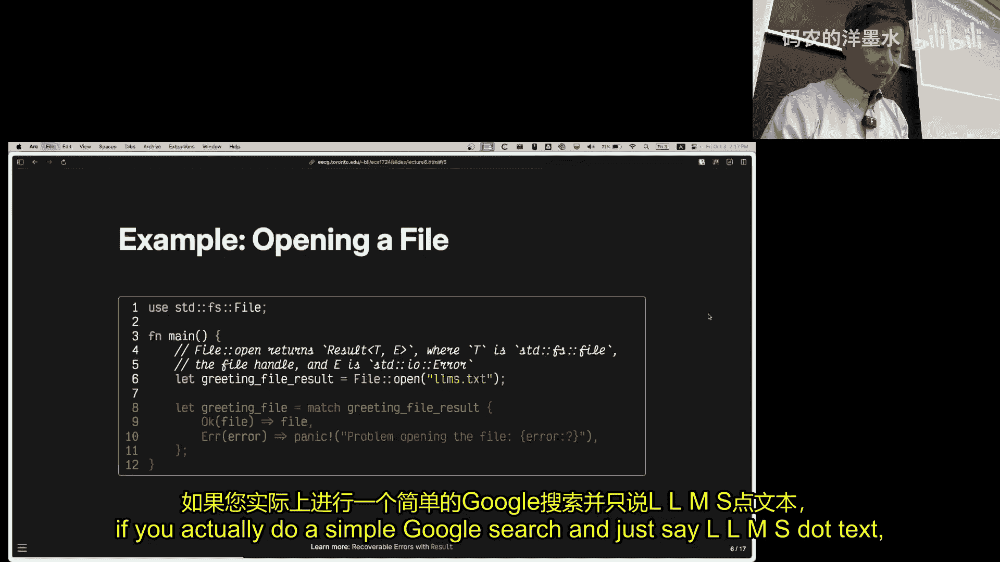
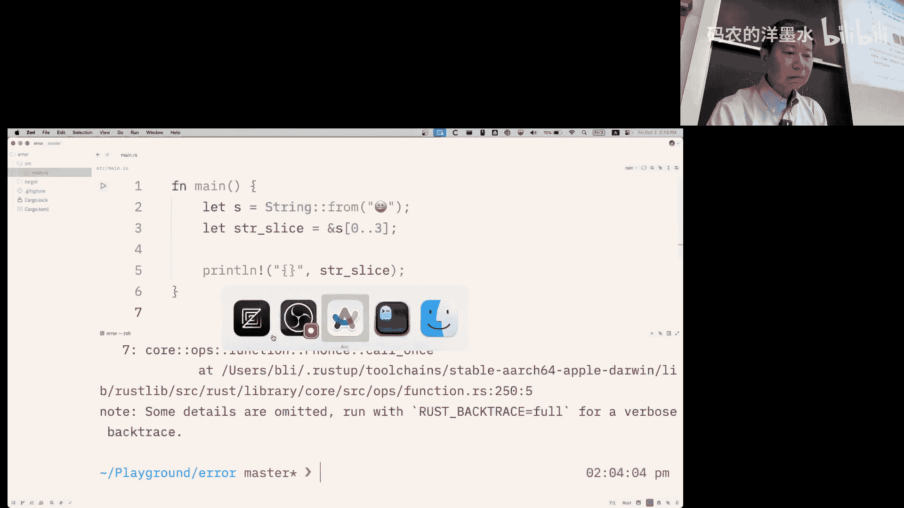
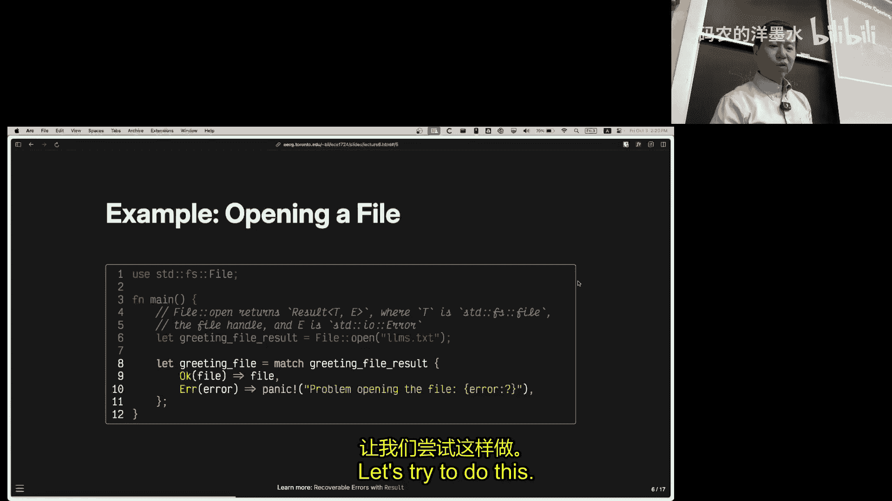
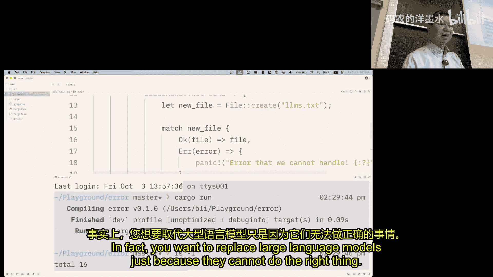
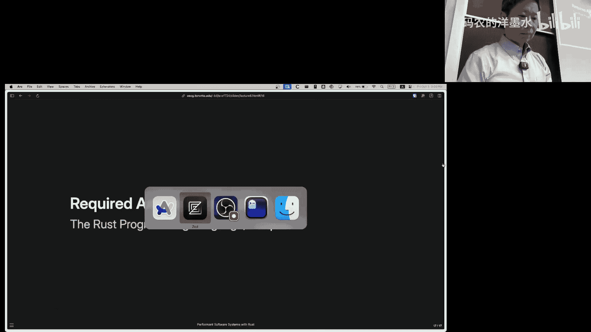

# 【全集 附课件】多伦多大学 使用Rust构建高性能软件系统 中英字幕 1080P p10 Lecture 10 - 用于验证的自定义类型 -BV16V62BhEuf_p10-

All right， so let's get started again and we just had the live demo on the unreable errors。

 but now let's talk about recoverable errors and today this is the main topic today。

So the question is， is there a way to catch the panic。

 there's no such thing as catching in because we're not doing exception handling。

 there's no such thing as exceptions， that's why we don't do try and catch or anything like that。

 so just forget about those things。Panic means by panic， it means terminating the program。

 that's it that's the definition of the term panic。 So there's nothing like catching。

 there's nothing to catch basically unlike the other programming language where you kind of say， oh。

 I'm going to try to catch and if I cannot catch and finally well no， don't do that。Do this， right。

 The recover errors with the result type。 And what is the result type。Again， once again。

 the lovely enum comes in。 We have the two variants。

And we use generic types to represent the data in the two variants。 Okay and error。 And in okay。

 we have a type in error， we have a different type。 You know。

 it doesn't really matter what these types are， but we do have to have two different types。

 E and E inside the result。And these are generic type parameters just like the option T。

 you could initialize it， you know when you define your own type， it could be a concrete type。

 obviously or you have to make it a concrete type， we're going to talk about generic types later on。

 but for now you can think of them as you know when you define the enum result it can be generic。

 but when you actually really try to use it it has to be something concrete in place of T and E。

So let's think about one example。And here's the example。

 We're gonna have a live demo of this particular example。I'm gonna try to open the file。

And as you can see， open the file， opening a file， you know， you basically can bump into errors。

 For example， the file may not be found， right the file may not exist。

And that's when you cannot successfully open the file。And to handle that。Our standard Ru library。

 which is the standard FS file， has an open。Method and that sorry。

 this associated function of the file type。 the open open function。Will return a result。Type。

 and the result type is going to be。A standard F S file。

 which is the file handle in place of T and the standard I O error。

 which is the concrete error type in place of E。And that's what the file open function is going to return。

And in this case， let's say we're opening a text file called largege language models。text， LLM。text。

This actually means something LLMSs S dot text， Do you know what that is？

This is actually if you actually do a simple Google search and you say LLMS do text。

 you will see that it's actually a proposed standard file。

 that you wanted to put into your website if you actually design your own website iss actually much better to put in an LLMS S do text at the root folder of your website you know。

 just to give the large language model， something of a much easier job to parse through your actual website。

 for example， let's say your website is a restaurant。

 and that restaurant is gonna have to have the open hours， weekly hours， you know introduction。

 you know， in the menu and you know， things like that， you wanted that to be。

You know， easily obtained by the large language model。

 You don't want the large language model to part some jascript and whatever。

 just to get to the open hours。 So you want to put in this。 So the large language model。

 whenever they call the website will easily see what the open hours are。

 And that would be something that is really nice。 And you can put the menu in markdown and so on so forth。

 the large language models， the best thing format for them would be the markdown。

 So that's why you put in the markdown and so on so forth。 So that's how you develop modern websites。

 You put in something that is large language model friendly。 So let's get back to our story here。😊。

And our story here would be to open this file， and of course， it can fail。

How do we handle the case when we have errors Well， again， this is result type。

 but result type is an option sorry is a enum and because it's a enum。

 we should use the match expression and the match expression is going to have a one arm for every single variant So we have two variants okay in an error。

 we're going to extract the file， extract the error。

Because of the packet matching and we get the file， if it is file， we're gonna return the file。

 you know， that will be similar to some， you know， in the option。

 we're gonna return whatever that is in that sum over here， return whatever in that。 Okay。

 And then as the result of evaluating this match expression。 And then however。

 whenever we have an error for this simple case， we panic。

 we say problem opening the file whatsoever。 right so we could actually do this。

 Let's try to do this。 Let's have a live demo。

Allright， so let's try to do this。 get rid of this code， oops。

Get rid of this code and let's paste in this code that we have this is a live demo here so let's see let's save it oh there's a compile time warning so it doesn't really matter so let's just get rid of that warning with an underscore okay so that's fine so now we can try to compile this and try to run it。

So let's compile it。 cargo run。And。You can see that we panicked and the panic message is there's an error and we are printing out。

 as you can see。We're printing out the error right here， right in the panic using the debug trade。

 Remember the debug attribute。 you know， that's something we're doing with the column question mark。

 And that error would be actually， in fact， I would prefer we put an error right here。

 It's a little bit easier to read。 So that would be something that I can do。

 And here I have a panic and printing out the error。

 error would be basically astruct with the code and the kind。 and error kind is actually not found。

 So it's actually something that says tells me the file is not found。 and does have a message。

 which is no such file or directory。 So that will be something that is part of that is the content of the error using debug to actually try to print it out。

 And that's the panic message that we have。But you know， we at。We're not very happy with this code。

 This code is not ideal， why， because we should not panic when the file is not found。 Instead。

 what should we do？A try again opening it。 Well， we should create a new file， right。

 We should create a new file when this is something that is not found， right， so。How do we do that？

 Well， let's do it。Let's try to do it。When the  error is not found， we should not panic。Right。

 we should create a new file。 Let's do it。 I turned off。 I hope I turned off the AI。

 So I highly recommend you do the same thing。 If you want to learn something if you have AI on the side。

 there's no way you can learn。 Absol no way。 there's no way。 I disagree。

 strongly disagree with some of the sentiments from other， you know， papers where， you know。

 educational papers where professors say， AI is gonna help teaching you。 No， no， no。

 it's not gonna help teaching you。 It only makes you laziier here I don't have AI。

 but it doesn't mean that I cannot do autocomple， I can do autocomp， Let's take a look。 So match。

 why do I do a match。 Well， because I basically have an era。

 I only want to handle the case where the era is file not found。 So let's match this era。 and。

 you know， let's try to see what I can do with this era。😊，And。

I only want to handle the case where it's not found。 So let's say we have the the kind。

 which is the kind message。And is not found right So the kind is basically defined。

 This kind is in the era。 So let's try to do it right here， use SDD。Iio error。Kind。

 and this  error kind is basically right here。 Er kind。And you can see whenever I say error。

 it will automatically tell me that there's error kind。 And if we don't have this， in fact。

 if you just say error kind， it will basically I'm just have this。

 and will give me all of the different kind of errors right here。 I can say not。

 It will start to get to the not found。 So I do have completion。 I don't need some copit completion。

 You know， this is good enough。 This is using you know。

 plain old language LPs language service protocol server protocol， very。

 very old many years of tri and true technology here。 So I do have error found right here。

 And I can get started doing this。 What should I do when the error is not found。 I should create。

 right， So what should I do right there。😊，How do I create a new file。Well， I'm gonna have to。

Use the file create， right。 So if it's not found， I'm gonna try to say。Use file create。

 So the file create file create is going to be similar to file open right here。

 we have file open here。 And that file open here， it would be so large language models text file open here would be something that returns a result。

 And the same thing applies to file create。 create is gonna return the result as well。 intuitively。

 right， create will potentially have errors。 So how do we handle that result。

 We're gonna have to have。😊，A match。Right， so we're gonna have to have a match。

 So we're gonna basically in this case， rather than so in this case。

 we're gonna have to have a match。 So this match is gonna basically say。File， create。

 whatever that is file， create。 I'm gonna have。In fact， let's just do the old fashioned way。

Let's try to have basically a new file。Equals to。File create， just like before。

And let's try to match。The new file。Actually doesn't have to be underscore。

 just match the new file here。And try to see what's going on here。

 so basically we have two different possibilities。 we have the case where we have the OK right。

 so we have OK， we extract the file and then we have the case where we return the file。

And then we have the error。And then over there， we have the error。

 just like before we wanted to handle that error。 in this case， you know， we really don't want to。

 we don't want to， we don't have anything else to do。 So here we can do panic。

 So error that we cannot handle。And put in the error， just like before。

And that's something we could do。嗯。And that's。Let's put in the brace brackets。

And that's something that we could。What happened right here？We need to have a。Oh， right， right here。

Okay， thank you， thank you very much。😊，嗯。As you can see， live demos are not easy。

 very likely you have problems。 Okay， so now we have a little bit of here。

 expected error found error kind。 though， this is should be errorero dot kind， right。

 So this is basically error dot kind would be the kind。 So that would be。Aero dot kind。So what。

 what happens here， attemptinging to take value， or should be。Oh， kindness。No， kind is not a method。

啊。Attempting to take value of method kind on type。Let's see。The function。Oh， yes， it is a function。

 It's not a， it's a method。 It's not a， it's not a field。 Okay， great。 So what else do we do。

 did we have anything else right here， We had okay。Therell one more of these。All right。

 so we have the arrow right here， so we basically have to have right here。And。Missing arm。

 so something's not matching here。Something's not matching here。Missing arm not covered。

 what is not covered？Right here， right， so。Anything else， what should I do， panic right here。

 and let's copy this right here。All right， so now we have。Now we have the the panic， and that's。

That seems to be good。 So let's try to cargo run。Oh， it runs。That's great。 So L O S dash A L， Oh。

 we have the large language models dot text。 All right， so it's created。 As you can see。

 it is not so simple。 with a few people helping me， I was able to do it。😊，呃。

Much easier if you use AI for it， obviously。But again。

 I would urge you to get rid of the AI assistance， mostly because this is kind of the kind of pain that you're going to have to go through。

Painful， I understand。 you're gonna have to go through to really try to understand what's going on。

 right， For example， just now， I'm missing an arm。 I have this kind that is not correct and things like that。

 All of those things， it takes some time for us to digest information to think about it。

 And sometimes it takes like hours of time。 just to think about your code， hours of time。

 But then you end up getting more information。 You get more indepth knowledge about your own code rather than。

 you know， large language model， give give it to me， give it to me and things like that。 So。You know。

 the more you use large language models。The less code that you're able to write by yourself and the less code that you're able to write by yourself。

 the more replaceable you are， you know， and you certainly don't want to be be replaced。 And that's。

 that's a good thing。 In fact， you want to replace large language model just because they they cannot do the right thing。

 Allright， So that would be a live demo。 I survived good。😊。

他的一个是。Oh， the question was if you don't know whether or not you should terminate the program， Well。

 there are only two cases， right， you either terminate the program or you handle the errors right。

 So we I'm going to talk about the differences between the two a few moments later。

 We're going to talk about when do we just terminate and what's the better time that we just terminate and when do we handle the errors okay。

Allright， so now here are some of the shortcuts for panic whenever we have an era we could use the match。

 but in a lot of the cases in the match， we're gonna to put panic panic panic and it's a little bit of a problem over there it's a little bit too much work so that's why we have synthetic sugar right here and this is basically not synthetic sugar。

 This is a library library function and this library function is unwrap unwrap is basically a function on the result over here we basically say you just directly。

Pic whenever the result is what an error， right， When the result is an error。

 you just panic and you just panic giving the line number and so on。 It's just crashes。

 And that is not recommended。 Well， you could do it， but it's not recommended。

 What's the recommended way of doing this。 Well， you could actually try to say， expect this。

 I think is a much more recommended way of doing this。 the reason for that is because。

D unra is going say， I'm gonna panic。 I'm gonna panic right at this line of code。

 I have no idea why here。 I said， I panic。 I know the line of code。 I keep that。

 but I give you a message。 What do I mean， Why am I panicking right now。

 So the expect would be much better。 And this is what we used at the very starting point when we have the guessing game。

Allright， so now let's talk about a little bit more advanced。 by the way before we move on to this。

 you know， panic would still be a good idea if you really wanted the match。

 some people don't want the know the unrap or the result。

 they really wanted the match and that's fine。 Mat is good。 I mean， the synthetic sugar is optional。

 you don't have to have the unrap or the expect you could actually use the match if you really wanted to do that and panic right there。

 that's fine as well， So either way is good， not no alternative is better than the other。 All right。

 so now let's talk about the propagating errors。 This is another a little bit more advanced topic about the result type but this fundamentally is about how do we handle errors generally fundamentally what is a good。

 why is result type a better way of handling errors Now in the past。

 in other languages where you use catch and you use exceptions。

 you basically I'm gonna throw an exception。 Someone else is。Catch it。

 but I have no idea who is catching it， but someone else is。Here we're doing a different way。

 We're using a different way of propagating errors upstream to the calling functions。

 So here a function runs into the error。Instead of handling the error by itself。Sometimes。

 or in a lot of times， it will be a way better idea to propagate the error to the calling function。

 Whoever who's the color would actually be in a better position of deciding。What to do。So。

 for example， file open or file create file open， when it bumps into an error。

 it should not handle that error by itself because it doesn't really know how to handle the error in fact instead it should actually propagate the error up to whoever who is calling file open and the same applies to file create and this applies to your own functions when you bump into errors。

 you may not want to handle that， you might want to propagate up to the calling function。

 So here's an example。 we have the a case where we are reading a username from the file。

 So we're gonna to design a function and this function returns a result because our function internally can have errors。

Right，That's why we return a result。 Whenever a function returnly can have errors。

 we're gonna return a result。 Again， this is way better than catching and exception And blah， bh。

 blah， This is way better。😊，Because we explicitly express our intention that we will have errors in the function。

Rather than implicitly saying， oh， I don't know。 There could be an exception。 You could catch it。

 You don't have to catch it and throwing things like that。 So here you can have to handle this。

 You know that return value can be。A arrow。 right， So that's what we're doing。 All right。

 so internally， we're opening a file， same thing as before。

 And then we are reading a username from that file。And username from that file would be。

Let's try to change the font size and see if I can。Yeah， I can put it in here。 The。

 the username would be read from the file， and we're reading from the file by using this。

This function called read to string。 We're taking our file， which is the username underscore file。

 That's the file handle。 And we wanted to only do it when the file open is successful。

 and how do we achieve that。 So take a look at the previous code。 when it's not successful。

 we're going to return the narrow out of the function。

So that's you know the return type which is why the return type is a result And over here we are actually trying to read from that file into the string username and that's the new string that we launched before this particular match expression and the match expression the result of evaluating the match expression will be the actual return value because it's the last expression that we have there's a shorthand form in rust and the match obviously is handling a result again because read to string is going to return a result and we're gonna to try to say if it's okay。

 we're gonna take the username and return that and username would be our mutable string that is passed in as a mutable reference to the read to string function and that's what we're returning however。

 we're not going return directly the username we're going try to wrap it around okay。

Because we're returning a result and this is a variant in the result。

 we're going to have to say okay username rather than username itself， which is good。

 which is what we wanted。 Otherwise we're going to return an error and of course that we have to wrap around using the error variant as well So this is great and this is how we can actually design our own functions。

😊，That return a particular error。RightWe explicitly say that the return type is a result。

 It can contain an error， and we basically have an error right here。

 We can also have an error right here before we actually go in and read a string out of the file。

 we could actually have a failure， an error opening the file。 And that's when we return the error。

And for both of these errors， it turns out the errors are of type I O error because those are from the standard library。

 So that's the type of the error that we have in our result。 And of course。

 the the O part would be a string， which is the user name that we're reading out。

 So that's something that we're designing our function for。 And this is a little bit of。You know。

 inconvenient because it's a little bit too much code。

 you can write it like this if you prefer if you think this is a good style， this is not a problem。

 you can write it like this， I think it's pretty good style， but however。

 if you prefer you could actually have synthetic sugar， a shorthand form。

Using the question mark operator。And how do we use the question mark operator？Well。

 the question mark operator basically says。嗯。File open， large language models dot text question mark。

And the return value of that file open is assigned to username underscore file。

 and what does that really mean that question mark。

 well it turns out that the question mark basically says if it's an error。

You will directly return that error to the color of that function。 And if it is not an error。

 if it is okay， you can extract。The content of okay， and assign it。To the username underscore file。

 which is the return value of file open。 And that would be exactly what we did in the match， right。

 So we're basically doing the same thing， but it's a shorthand form It's synthetic sugar。

 which if you prefer， you could do it。😊，If you don't like the question mark， you don't have to do it。

 but if you prefer， you can use the question mark。So the question mark。😊。

Actually makes it much more convenient to write these  error handling code so that we are not afraid to return result。

 You know， our code is not always match， match， match。 You know， we are not afraid to say。

 let me return result because every time I'm trying to do this， I can actually do a question mark。😡。

So and then if it's okay， we're gonna to do the same thing as before， we're gonna have a username。

 we're gonna read it out from the file， put it into the username。

 and we put a question mark there as well， in line number four。

 and the reason for that is because that the question mark over there is again。

 talking about if there's an error， thatarrow will be propagated up to the call otherwise。We just。

 you know， we just put。TheO user name。As the return value。 So that will be much simpler than before。

 It's only six lines of code。 But you can simplify this even further， if you wish。

 just in case in case that you don't like this， if you want it。

 you could do like something like this。 So you could say user name， create a brand new string。

 and then open the file question mark dot， which basically says whatever that you return， you know。

 is not a error， it's an okay， whatever you return out of that file， It's a valid file handle。

Go to read to string because that's exactly what you did。 You know。

 read to string is gonna take the file handle dot read to string。

 That's the return value of file open。 And so you don't have to say username underscore file So that's something we can certainly do and then we can pass in username over there with the question mark right there and then you have an okay username there as well if you wish you could do it like this as well。

 so you don't have to use the previous one or the one before either way。

 whatever you prefer in terms of style， you could do it either way。

 So the one that we actually showed you the match， you know expression with more match and more match all of that can also be simplified using the question mark。

And over here。嗯。You do have this basically。another way of doing this， which is even simpler。

 which is just to use the reto string directly。 And that's associated function rather than basically file handles method and you can directly take that and then you can return whatever it returns。

 And because whatever it returns is exactly the same type as a result string and IO error。

 you could actually try to take that as the return value and that， you know。

 basically took advantage of the fact that just coincidentally reto string returns whatever that you wanted to return in this particular function。

 And this just you know， just the coincidence because whatever you want to implement it's already implemented as an associated function inside the standard library for the file system module。

All right， so it turns out if you actually try to use the question mark。

It also works with the option type。 And the option type is something that we mentioned also had two variants。

 And you could actually try to do this as well。 using the question mark。 Here's an example。

You have the last character of first line。 So I'm taking any text。 I'm trying to take the first line。

 I'm gonna try to return the last character of the first line。 And obviously。

 that character may not exist。 What if the file is empty。 What if the first line is empty。 Now。

 you may not actually have a character at the end of the last line。 So that's why it should。

By design， we turn an option rather than。A anything else。 And over here。

 we're not talking about an era here。 We're talking about。Basically， a nu。 So if it's a nu。

 it basically says， you know， it's just like you can't get anything。 That's fine。

 So we're not bumping into an error。 We're just not able to read the last character of the first line。

 So it should be an option rather than the result， right， you can see the difference， right。

 So it should not be a result。 It should be an option。

 So you want to retrieve something based on a particular index from something like a string or a collection。

 any other collection。 you wanted to make sure that if the index goes beyond the scope of the the the range of that particular collection。

 You want to get a none out of it rather than an error， certainly you don't want to crash。

 You want to get a none out of it rather than error。 And that's why by design。

 This is a better design to return an option rather than the result。Allright。

 so what are we doing here Well， first of all， we are taking the text。

And text dot lines well dot lines is going to return what an iterator we're going to talk about iterators later。

 but it's going to return an iterator and that iterator basically itererates through multiple lines basically of that particular file of that text and then of course we want to get the first line so we take the iterator called next once and that's a feature of the iterator if you call it once it will give you the first item and that will be the first line of the text and then however that first line may not be。

There， the file can be empty， right， If the first line is not there。

 it will next is going to give you none as an option。 So you wanted to return that none directly。

 out of the function to the call because you wanted the call to know that you cannot get the character。

 So that's why you have a question mark right here after next， you want to get that none returned。

 You know， that's what the question mark is for。And then if you can get the first line would be part of sum and that question mark will automatically get out of that sum and then you say that first line。

 you know， we get the characters and then we get the last and it turns out the last is a function that is a method of that particular iterator of which is the iterator of the characters。

That can be a nun or can be a character。 And that's exactly what you wanted。 You want an option cha。

 So if it's a cha， it will be a cha， some cha。 And if it's a none， it will return a nu。

 And that's exactly what last is going return to you。

 and that's exactly what you will return to the calling function。

So that this is an example where the question mark also works for the option and this is again synthetic of sugar。

 but this kind of good sugar you agree with me right this is something that really makes the code handier a little bit easier to understand。

 easier to read， especially after you got used to it。And Maine， as a sidebar story。

 can also return result。So Ma， how how can main return result？ Well。

 we might want it to return result because we might actually make function calls that。

Can actually return errors。So these functions are， you know， returning a result。And we might want to。

 if we need to， we don't have to， but if we need to， we might want to say。

 let's propagate the result out of main。And what do you mean by that， Well。

 in the conventional operating system terminologies， a process， operating system process。

 it could have to have an error code returned back to the operating system kernel and that error code typically is00 means that you terminated the program normally but otherwise you could actually have a negative number。

 which is when you have errors。 So sometimes you wanted to say， okay。

 I wanted to propagate some errors to the operating system kernel。

 even if it's the main function and you can do that if you wish the main function doesn't have to return nothing like a unit。

 you could actually let it return a result type in this particular case I'm returning an IO error because the operating system sorry。

 the file open is going to return IO error if we have a problem opening that particular file and we're using the question mark right after the large language model text after we call the open to。

Indiiccate that whenever we have a arrow， we want to propagate that error out of that。

Main function to the operating system kernel。And if it's the correct result。

 we're gonna continue to use it。 the greeting file。 And then at the end of the main。

 we want it to return。 everything terminates normally and so on。

 So we're gonna have to return an okay， And this is very important because this is。

 you have to match the return type。 and the return type is results。 You have to have an okay variant。

 So that okay variant is right there。 The type is gonna be the unit type。

 and that's something that we can do。So this is something that is good。

 except that it will require that everything inside the main program must。

 when you have a question mark， must return an IO error， you cannot have any of the error types。

 otherwise a compile time error， and if this is the case。😡。

We could change it just slightly change the type of the error to accommodate multiple errors。

 multiple error types doesn't have to be IO error。 And to do that we're gonna have to use something called di error and this is kind of starting to look kind of strange。

 but it's not ugly by the way， this is beautiful， beautiful。

 beautiful code and the reason for that is because di is a trade object as we mentioned before we kind of say。

 I really don't know what kind of error at this particular moment。

 but any error is fine as long it is error as kind of implementing the error trait。

 So that's a trade object。 And that's great。 And the box basically says you know any trade object you really cannot have the object by itself。

 you know you cannot put it anywhere。 you have to put it on a heap and to put it on a heap。

 I have to put a box on it。And this is very， very good idea。

 This is is one of the best ideas in the history of design in rust。

 It was not initially designed like this。 Ru before 2015 didn't have the box。

 In fact it was a different syntax using the star。 and that's a bad syntax。

 Now we have the box and this is a much better syntax because now we explicitly say that this thing is on the heap is on the heap。

 So this is kind of the box D error， you have to have the box without it。

 will be a compile time error。 We're going to talk about all of these later on。

 the di error rich trade object。 we're going to talk about the box。

 which is kind of putting things on the heap。😊，Later， but this is， again， beautiful code。

 This is not something that， you know， it's， it's strange right now because you haven't looked at it before。

 but it beautiful code。 And we can now accommodate any kind of errors as long as it implements the error trade。

😊，So now let's get into the topic。 when should I。Palic。When should I panic？

This is actually a design decision， you know， these kind of things you need humans for， you know。

 large language models cannot do this kind of design that well。

 well it can give you some suggestions， that suggestions might not be correct， it might be okay。

 might be good， might be excellent， but it may not be the best。

 we want to have our own awareness rather than you know depending on large language models。Of course。

 panic， which is equivalent to unwrap and equivalent to expect because all of these they panic internally。

 when do we do that， well， when we have information and confidence that the panic condition will not be valid。

So in the sense that we know that we will never， ever panic， we have the confidence that well never。

 ever panic。 This is when we panic， we put in panic， because we know that we will never。

 ever panic When we panic must be a team member changing the code before that line right So we panic right there because the team member will have to see the change right that is。

 you know to leading to a panic， The other reason the other case where we actually panic is when we're designing a library。

When we're designing a library for someone else to use。

 we wanted to have data and that data will have to be valid。

 we have to have make some assumptions on that data。 For example， our guessing game。

 our guessing game in the very beginning， we are guessing from one to 100。

 so that data will have to be from  one to 100。 and if I develop a library to really take user input and try to implement a guessing。

I wanted that。Input to be between  one and 100。 Otherwise， I'm gonna to panic right there。

 And the reason for that is because if it doesn't meet my assumption， all my follow up。

 all my later processing。Will not be having a valid assumption。 So rather than saying， oh。

 if the assumption is not true， let me process it differently。 No。

 we're gonna panic right at the bottom right at the top。

 and then we're gonna try to process and process and process more。 with that assumption in mind。

 For example， the number is between one and 100， then we start to process that number。

 assuming it's between one and 100。 So that's something that we when we're designing a library。

 this is very important， we panic when we need to one good example would be you know the string library。

 when you're trying to do a string slice， that slice function is gonna panic right there。

 if the slice is not according to its rules。 if you it's beyond the bound or somewhere in the middle of a of emoji character you're gonna have to you're gonna have to panic right there。

Here's an example of the first bullet。 So the example here is basically saying， I have。My I address。

 It's a constant。 and this constant must be a valid address， which means that if I call parts。

 it will always be successful because I have a constant right， However。

 I do want to put in an expect right here， because parts is gonna return a result。

 So I have to process it no matter what。 rather than putting unrap or a match。 you know。

 it's most most convenient to say an expect。 it's better than unrap。

 I prefer having expect than having unrap because expect is gonna give me documentation in my code。

 and the documentation basically said this absolutely should be valid will be no case where it's gonna panic because we have this I address that is hard coded So if my team member changes this IP address to some other IP address not valid。

 It's gonna panic right here because of that assumption。 So my current I address in that constant。

Is never going to be panic。 And that meets our first criteria。 This is when we panic。

RightAnd this is something that is typically when we panic， but in not a lot of other cases。

 we're gonna return result and the result we can handle ourselves。

 this is up to the design of your own Again， this is a very big issue。

 we're gonna bump into this issue a little bit in assignment number two。

 but a lot more in assignment number three and we wanted to decide if we want to handle the error in our own function or should we propagate error up to the calling function。

 whoever who is calling my function should get that error and should handle the error if I need to propagate up。

 I implement a code to propagate up if I need to handle it， if that's my design。

 I'm going handle it right here for example， I could panic right here， if if I need to。And again。

 this is a design decision。 typically you propagate it up， but not always the case。

 sometimes you panic because you basically the assumption is not valid。

 as we mentioned with designing a library， assumption is not valid。 we panic right there。

Here's another example which is creating a custom type for data validation and this is going to our guessing game example where were previously writing a guessing game saying okay parsing the user input and we get a number out of it and if the number is not in the range of one to 100 we're going say okay let's print a message to the user to help the user and then let's go back to the next iteration of the loop。

 so all of that is good， except that this is not the best way of designing this code。

 this is the code that typical large language models or typical students its going design。😊。

But this is not the best way of design this code。 The best way of design this code is create a type that basically。

Encapsulates the information， the constraint that is in between 1 and 100， and this is how we do it。

 The type is let's call it guess， and it has a value which is the integer。

 and we make the integer we allow in negative value， so it's an I32。😊。

And then we will say when we create this drug， it's more like a constructor。

 typically it's a new associated function inside drug。 when we create it， we panic。

If it is not subject to our constraints， however， this is very good design。 The reason why is。

After we're not panicking。We will have a guarantee from this point on。

 whenever we start to use the gas。It will be a valid value from  one to 100。

 So thats this is fundamentally different from the previous design to have this particularstruct means that I have a guarantee So all my code that processes to getstruct type variables will have that constraint applied already because if it's not there。

 I'm going panic when I create this。And then I have a private。 So this is a private value， right。

 the private， It's encapsulation。 And then we have a。Keder to get that value。However。

 we don't have a set， we don't want to set that value in the sense that we can only create it with a new value and we can only get this value and that's great。

 and that's by design and certainly we don't want to make this value public， why。

Because if you make this public， anybody can write new values into this and the constraint that we're enforcing right here is no longer valid。

Right， so we certainly don't want to set the value by making it public。

 by allowing someone else to set it by making it public。 So this is great。

 And that's what we have talked about today。 And next time we're going to get started talking about more more important content。

 which is。😊，Collector types， and then we're going to move on to something that lot more challenging。

