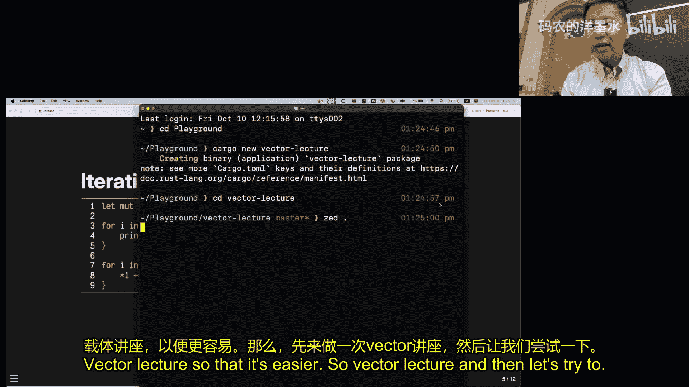
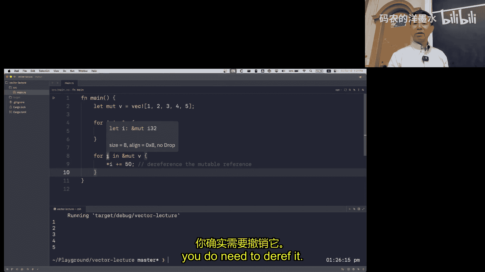
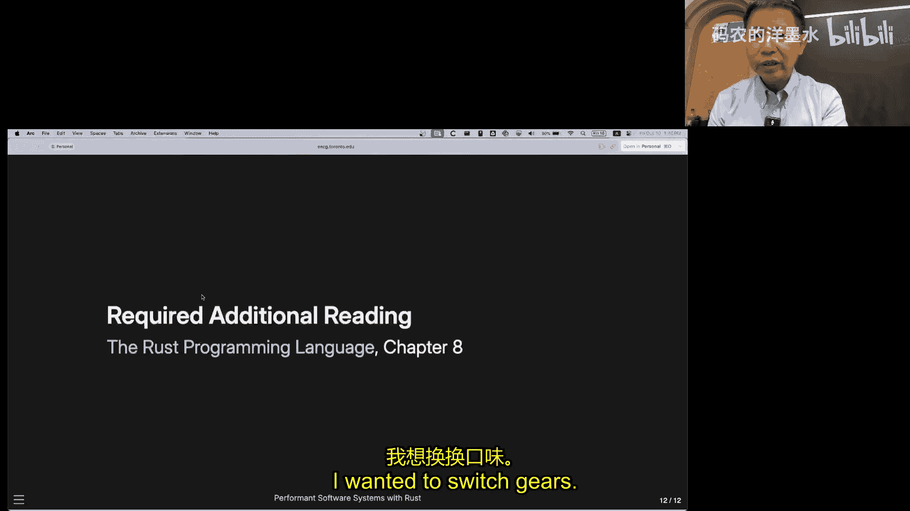
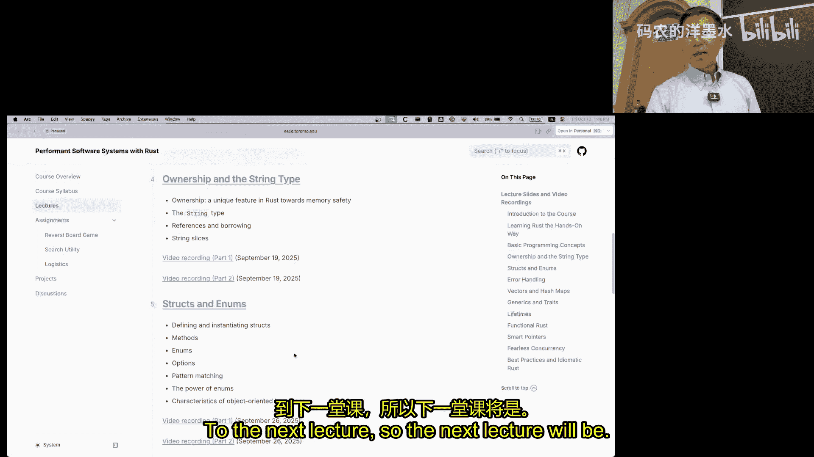
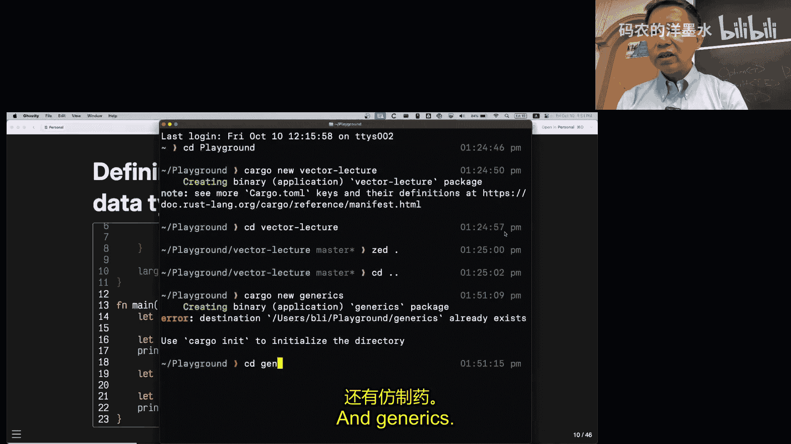
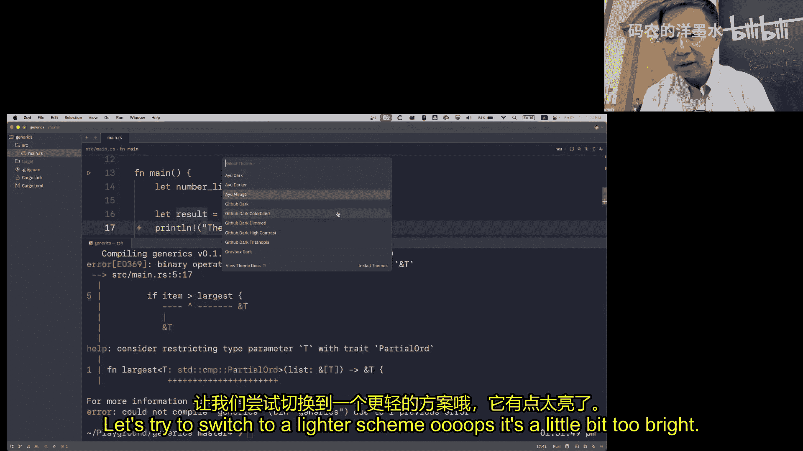
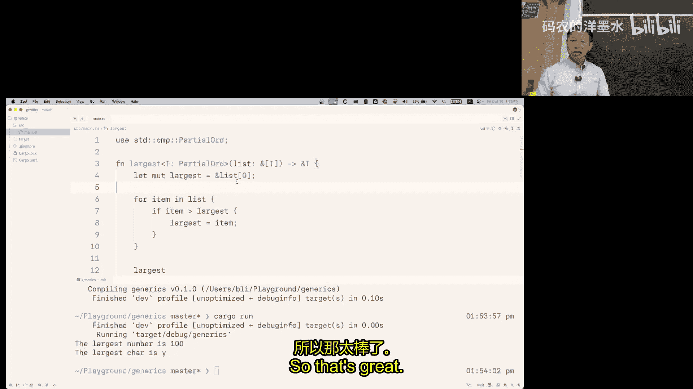
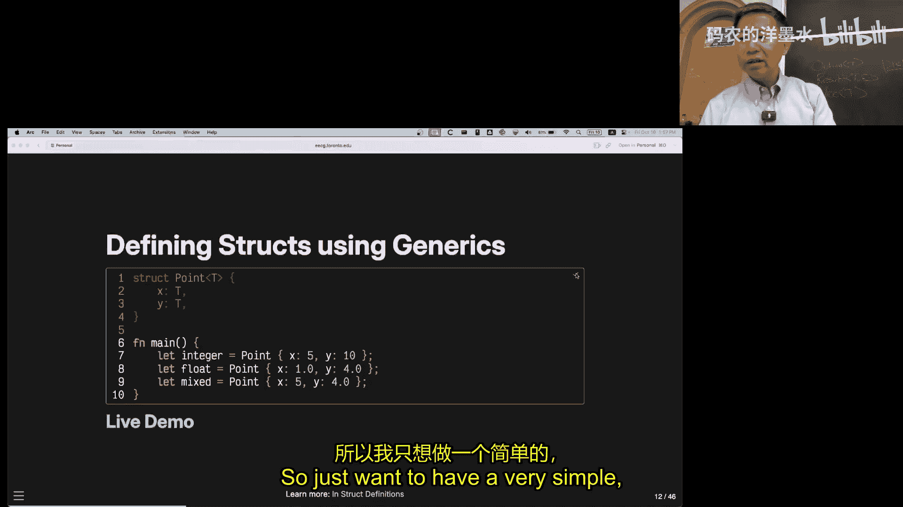
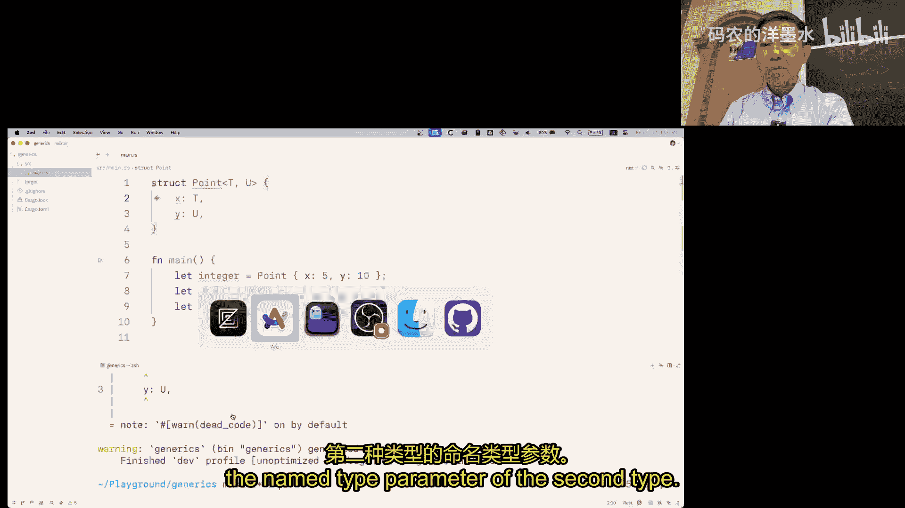
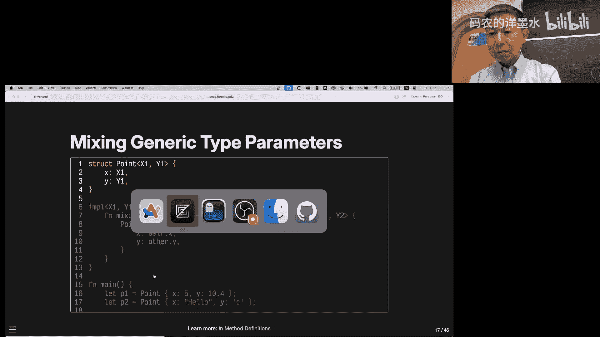

# 【全集 附课件】多伦多大学 使用Rust构建高性能软件系统 中英字幕 1080P p11 Lecture 11 - 向量与哈希 -BV16V62BhEuf_p11-

All right， let's get started now。Just to as a benefit to all of you who come here。

 I'm gonna let you know， I'm gonna announce， but only in person， that the next lecture。

 which is gonna be very important about lifetimes， will not be recorded。

 which means that if you don't come， you won't get to see it。

 There is no requirement that in the University of Toronto of recording any lecture whatsoever。

 So all of the recording is completely the bonus。 and the next one will be no longer recorded。

 but we're gonna continue recording from the one after that。 Alright。

 so the next lecture will not be recorded。 and this particular news will only be announced in person。

 So this one will be recorded。 However， I'm gonna cut off the internal announcement from the beginning of the video before we release the video。

 alright。All right。Okay， so let's get started again。

Now today we're gonna to talk about two very important parts of rust。

 The first part is relatively easy because we have seen these things before slightly not completely。

 and the second part of today's lecture， which is about generics and traits as we mentioned from the previous lecture we are actually advancing to more advanced material of the language。

 So starting from second half of today's lecture， we're gonna to have to pay attention a little bit。

 because a lot of these are kind of you can think of it the crust of rust like the good stuff the really fascinating stuff but before that let's first try to talk about vectors and hash maps these are from the rust standard library vectors we have seen before we have mentioned that strings are just defined as vector of you。

8 bytes so a vector is simply just a growable store and because it has to be growable。

 it has to be on the he so it cannot be on the stack and it contains multiple values。

 but these values will have to be of the same type So for example。

 the string is just a vector of characters and we can easily define a character we have seen it before in our previous examples。

 this is a very simple macro exclamation mark and that macro basically helps us to define a vector with an initial values。

 So in this case the initial value will be a vector of integers and of course we don't have to use you know kind of implicit type inference。

 we could actually try to have explicit type annotation in this case。

 we can create a brand new vector without any initial value。In that vector。 And in this case。

 we're gonna have to annotate the type。 This would be a vector of I 32 type。Alright。

 now the vector is defined， as you can see with the with the bracket T and that we're going to talk about later today。

 So that is something we have seen before。 This is the use of generic types previously like last time。

 What do we talk about last time。Result， right， result and and also option， you know。

 both the result and option。 These are using generic types。

 Reult is for error handling option is basically get rid of the the null value。

 which is a billion dollar mistake。 So we have this。

 And we continue to use the generic types here when we define a vector。 In this case。

 this is a vector of just any type。 It's generic type。

 But we're gonna have to have the same type for all of the value stored in that global vector。Now。

 we can certainly use methods defined on the vector。 For example， here， we have a method push。

 This is for inserting a value into the vector。 These are the kind of like standard things in any programming language。

 For example， you have similar things in Python， similar things in Java script。

 similar things in Java， maybe even similar things in C plus plus， basically， we wanted to， you know。

 use whatever API that is provided by the standard library to actually insert values into the vector。

How do we read values out of a vector。 So here we have a vector of 1，2，3，4，5。 is a a simple vector。

 And in this particular line， line number 4。What we're doing here is we're taking a reference。

 And in this case， we're taking a reference of only one element inside that vector。

 starting from index 0。 So index 2 will be the third element。 And that third element。

 We're taking a reference of that element。 So third is defined as a reference to an integer。

 So it's a reference of an element inside the vector。 However， we can directly print it out。

 We don't have to do the ugly， ugly star third， you know。

 from C and C plus no we don't have to do that。 We can immediately just print it out。

 we can print the reference。 The rest compiler knows that we want the to D reference that particular reference。

 And then we have the。嗯。The line number 7， we wanted to have a different way of getting it。

 Why do we need a different way of getting it。 If you actually take a look at line number four。

 we can certainly do this。 but this number two， this index can easily go out of bounds。

 So when the index go out of bounds。 What's going happen here。 Well。

 what's gonna happen is that gonna be a panic， which is a runtime crash。

 a panic we talked about before， it's gonna be just a crash， a termination of the program。

 And in a lot of cases， especially something like this。 we certainly don't want to have a panic。

 this will still be useful。 if we have a loop， for example。

 we have a four loop go through all of the elements inside the actual vector still gonna be useful。

 But in this particular case， this line number four。

 we probably wouldn't want to directly get the element that index number two。

 by using just a direct reference。 because of the。Possibility of having a panic when the index goes out of bounds。

 So we want to have a safer way of doing this。 And it turns out the the standard library。

 the vector type does have a method called get。 and that get is going to return。An option， right。

 So we might be able to have。A out of bound index。 and that index is going to return a nu。

 So if you actually use an out of bound index， it's going to return a nu。

 And that is exactly what we wanted。 We don't want to panic if we have something like that。

In most cases， we don't want to panic。 So we wanted to get a nu。 but in this case。

 the third will be a different type。 rather than the reference to I 32。

 It's gonna be an option of a reference to I 32， because there's a possibility of none。

 So that's why in order to print it out。 we need to have a match or we need to unwrap。

 which will panic is no good。 So we don't want to unwrap the option we want to have a match so that when the return value is a nu。

 we can properly print out something that is suitable for an index that is out of bound。

 So that's great。 So that is gonna go out of scope at the end of the block。 So that's great。😊，Now。

 I wanted to also talk about ownership rules。When we talk about the vectors and also references into the vector。

 it is not intuitive， you know， but we're going to have to emphasize this。

 So here's a actual vector just like before。 And then in this particular line。

 we actually do the reference。 And that is a borrow。

And here this is an immutable barrel because we didn't write try to write into that reference。

 So it's an immutable barrel。 So we're doing an immutable borrow of one element inside the vector。

 only one element。Now I wanted to push something into it。So you might say that's fine。

 I'm getting the first element we'm gonna pushing to the end of the no that is not that is not allowed in rust。

 It's gonna be a compile time error。 and the reason for that is because you're pushing into the vector after you get an immutable of the vector so that immutable of one element of the vector is treated as an immutable of the entire vector and that's why you cannot have another mutable in this case。

 when you push anything into it， you need to have an immutable borrow of that vector V the reason for that is because the actual method of push is implemented as an immutable of self that means that you need to have sorry。

 amutable of self， not an immutable amutable of self and self would be V right here。

 so that would be a mututable and intuitively you need a mututable， when you push anything into it。

 So this is going to be compiled。Time error and why is this， Well。

 even if you wanted to get a reference of the first element at index0 and you're pushing towards the end。

The reference of the first element can still go invalid because this is something that is happening on the heap。

 When you're pushing to the end， it might be happened that there's no space allowed on the heap。

 So you're gonna have to move the entire vector to a different place depending on the memory allocator and it might be rare。

 but it might happen。 If that's the case。 then the reference to the first element might actually become invalid if you're pushing to the end of the vector。

 So this is gonna be a compile time error cannot borrow V as mutable because it is also borrowed as immutable。

 So this basically is what rust helps us to enforce ownership rules。 Great idea。

 we wanted this compile time error。All right， so what about eer rating over the values in a vector。

 This initially becomes also a little bit of unintu here。Alright， so what do we have， Well。

 at first line， we have the same vector。And then from line number 3， we have something strange。

 We have this 4 I in the M percent V。 So M percent B basically says I want to basically borrow elements inside that vector。

 you know， by getting a reference to each one of the elements。 So what is I。What is I。

 what is the type of eye？It is basically a reference， right。

 The type of I is a reference to this I 32， which is the reference to individual elements inside that vector。

 right， So that's， that's how you do it。 So let's， let's have just a quick demo right here。

 So let's copy this。And let's start a ghosty terminal right here。 And let's do the same thing。

 Cargo New， let's call it vector。Vectctor lecture so that it's easier。 So vector lecture。

 And then let's try to。

Copy and paste。The actual content right here。Alright， so。Pae the content right here。

 And let's try to compile it。So view is fine。 And we're gonna have to take a look at this。

 So basically， if you actually use the editor and hover around this。

 it is actually giving you the type of that particular variable。 So right here。

 this basically is n percent I 32。 So that's exactly what we have expected。

 It's a reference to individual elements of that particular type。

 Obviously V is basically a vector of I 32。 That's kind of by type inference And this is basically that mutable vector right there。

 So I mentioned that even though this is a reference， we can still directly print out this reference。

 we don't have to dereence it。 rust actually understands it。 So if you actually try to run it。

 It's gonna do this no problem。 So this is exactly as we expected。 And over here。

 this is becoming a mutable reference of I 32 because we're going to get a mutable reference of vector v and we're going through a loop and go。

Individual elements kind of sounded strange。 But once you get used to it， it's natural。

 It's the way that it should be。 And and then over here。

 we have to dereence it because we wanted to modify the actual value rather than just read out of that value。

 So we dereence it。 and then we just add 50 to it。 And then， of course， we can print it out。

 as we wish。 So this is something that we are trying to do here。 again， if you just print it out。

 you don't have to dereence Otherwise over here， if you have a mutable reference if you want to change the value。

 you do need to dereence it。 Allright， so that's the the basic idea right there。 And let's try to。

Use aeno。This is kind of like a special trick because a lot of the cases in real worldor programming。

 we sometimes require storing multiple types into a vector。 previously。

 we mentioned that a vector can only contain one type， a single type。

 now we have the need of using multiple types。 So one solution to this。

 without getting too complicated using you know， other kind of traits and things like that without getting too complicated。

 which we will talk about later， is this little trick。

 which is I find fascinating to use myself in my real worldor programming it's simple。

 very elegant and works well， if you know what are the types that might be happening inside the actual vector。

 What are the concrete types。 In this case， my concrete types that I have in a vector would be an932 could be after 64 could be a string。

 So what I can do is that。Just define an enum because for each element。

 it can only be one of the three types cannot be， you know two of the three。

 So we're gonna we can use enum， no problem。 and we're gonna to use our standard practice of each variant that going to take a value and the type of the value would be the types that we allow inside the vector。

 So in float text individual types inside each variant and then what we can do is that we can now construct this particular vector。

 but rather than using the actual raw types of I32 F64 and so on， which is not allowed。

 we're gonna just use an actual enum because the enum type is something that is the same type across different vectors。

 but the data value inside the enum type would be different depending on the variant that that you actually use。

 So that's gonna be still according to the rules conforming to rules and we are able to accommodate multiple types inside a vector I find this to be very useful。

My real world programming， you might as well very nice trick。

 and especially in the case where you know what are the types， for sure。

 that can happen inside that vector。Alright， so now let's go to yeah， question。入。Yeah不し。就是。调。都。No。

 it's an assignment。 So you basically assign the actual value of I to sorry。

 the value of individual element to I so that you can print it out。 You can do something。

 but you cannot mutate it。 right， Y， it's an assignment。For example。

 I stored him the back or something。Then you would not be able to do it。 Yeah， so the question is。

 if the element inside the vector does not implement a copy trade， then you would be able to do it。

Then you're going to have to have a reference， basically。All right。

 so now let's try to talk about hash mapps。Hh maps are just key value stores。

 And we have probably you might have exposure to hash maps in other languages。

 except that they don't use the same terminology。 What is hash maps in Python。

What is the terminology over there？How's that exactlyactly， It's a dictionary。 And I。

I'm not too sure which one is better。 Hash maps better or dictionaries better， but， you know。

 they're the same thing。 Key value stores。 And they are not that often used inside rust。

 So that's why hash maps。Defined as hashmap K comma V is actually defined in the Ru standard library。

 but it's not part of the prelude。 It's not part of the prelude that we bring in without using anything。

 So you're gonna have to use this first before you can actually try to define your own hash maps。

 So it's basically saying that's not as often used as a vector。 So here it's a simple idea。

 We're storing a mapping of keys two values。 So we have a key of type K of the same type。

 and then values of type V and again of the same type。

 And we're gonna store that key value store on the heap。 So same thing as the vectors。

 We're gonna have everything on the heap because it has to be global we can have new keys。

 And this typically is implemented using a hash function more advanced ways you can actually define your ownh hash function and so on't。

Have to。 There's a default hash function used by the hash map implementation。

 And then it is useful when you wish to look up data using keys rather than indexdices。

 And this is very useful in a lot of different cases。

 so useful that sometimes you might even want to bring out bring in a third party crate just to make it slightly faster than the rust standard library in very peculiar cases that you might encounter。

 So it's quite interesting。 quite important in terms of performance。😊，It is similar to dictionaries。

 as we mentioned in Python。And now let's talk about how do we use hash maps。 First of all。

 how do we insert key value pairs into the hash maps。

 If you actually wanted to insert a key value pair。

 it's going to move ownership into the hash map itself， except if you were to insert references。

Alright， so the first line， again， as we mentioned， is not part of the prelude。

 you're gonna have to do the reuse standard collections hash map。

 This is something you're gonna have to bring in first before you can use it。

 And then just like in the vector， we just use the new associated function to， you know。

 create a brand new empty hash map。 And then， of course， we want to insert key value pairs。

 In this case， we're inserting。The keys are strings and values as integers。

 so we can actually just insert them using the dot insert method of the actual hash mapap。

 And the first parameter is the key second one is the value。

 very intuitive And then we can start to use them to use them。

 We have this very ergonomic way of doing this similar to Python。 But you know。

 similar to vectors as well。 So for key dot key comma value。

 So we're gonna have the key and value sort of like the using patent matching extracted from individual elements in of that hash map。

 So we're going through all of the key value pairs for each one of these key value pair。

 we're doing kind of pattern matching， we extract the key。

 we extract the value so that inside of for loop， we can print out the key and print out the value when we need it。

 So this is something that' gonna print blue 10 and yellow 50 because we kind of extracted them and printed them out。

 So that's pretty simple。And。Then let's talk about updating the hash map。 updating the hash map。

 we can use。Insert and insert is gonna just update if the actual key is exactly the same as what we already have inside a hash map。

 So if there is some kind of a duplicate will not insert duplicates。

 it will update the actual value for that corresponding key。 So for this case， it will print out。

The actual blues 25， right？ So blue 25 will be printed because 25 updates 10 after the second insert。

 So this is something that will be printed out。And then what if I'm trying to add the key and value only if a key is not present。

 So in this case， let's say we first insert a key of blue， a value of 10。And then， we wanted to。啱。

Use a kind of a peculiar way of doing this。 We first try to use thought entry。

 This is a method that returns a mutable reference of that particular。

Of that particular hash hash mapap scores。 And then we're gonna going to try to say of that particular key value pair with that yellow as the key。

 And then we're gonna to try to say， let's try to add this key and value。

 only if the key is not present。 So we're not trying to update it。 We're just trying to add it。

 only when it's not present。 So in this case， we're basically saying we get this mutable reference corresponding to yellow。

 And then we will try to use the dot or insert to really try to say if it is not present。

 we will insert the key of 50。And what will be printed if we do something like this？Well。

The blue will not be updated， right， because in the previous way。

 we update the blue with the new value。 But if that's not what we wanted， we wanted to say。

 I'm gonna only insert。When the key is not present， rather than updating it， if it is present。

 we will use this dot entry and then dot or insert to do it。

 This actually is more often used I find myself using this a lot more often than using the previous way。

 because this is typically the semantics that we wanted。 We want to the insert。

 but only when we don't have the key already inside the hash mapap。

 So I find myself very often used dot entry dot or insert rather than directly insert。Right。

 so that's something that we can do。 And it's kind of weird in the sense that you could actually try to。

 in other languages， programming languages have something slightly more slightly simpler in terms of the syntax。

 But over here， this is how the rust programming language is doing something like this。嗯。

So here's another example that tries to update the value based on the old value by first reading the old value and try to update that。

 So let's say we have a hash map new， which is map。 And it's a mutable hash map。

 And then what we can do is that we can take our string， which is text。

 And we gonna try to split the string by the white space。 In this case。

 we get individual words from that particular string。 Hello world and so on。

And then for each one of these words。I wanted to try to use our previous method of inserting。

So I wanted to basically do the map dot entry and then see if that word is in the hash map。

And then if it is in the hash map， we will try to update it。If not。

 we will try to initialize the value。 In this case。

 we just wanted the counter for each one of these words。 We'll try to do a word counting algorithm。

 So in this case， the initial value will be 0。 So we're gonna to use our previous idea inserting0。

 if it's not present when it's present， we want to increment the count by one。 How do we do that。

 Well， mapped out entry conveniently returns the actual reference。 It's a mutable hash map。

 So the reference is a mutable reference。 So that reference is going to be something that I can de reference。

 and then I can modify the value of that de referenced location。

 So that's something that we wanted to do。 So what will be printed。Over here。

 So what will be printed is that we get the actual counts of the words。 In this case。

 world is happening twice， count of two， wonderfulnderful and hello， they're counted one。

 So that's how we do it。 So this is kind of a ergonomic way in Ru to do it。

 but kind of not intuitive initially， once you get used to it。

 It becomes more intuitive but not intuitive initially。 But， you know， I like this kind of syntax。

 I like how this is written。 And I think eventually you will like it as well。

 Its kind of ergonomic way inside the rust language to update a value based on the old value by using the reference the reference star to actually try to do it。

😊，Alright， so that's all we wanted to talk about in terms of the hash map and the。The vector。

 So now I wanted to switch gears。

2。To the next lecture。 So the next lecture will be。

Related to generics and traits。 And this， again， is the main part of the day today's story。

 We're gonna get started talking about generics， and we're gonna move on to traits and becoming a little bit more hairy。

 a little bit more advanced as you go。 And this， again。

 is entering parts of the world in Ru that is more advanced。 That is something that is。You know。

 a little bit more challenging to understand， so I wanted to take the step at a time。

 kind of slow down a little bit initially， and then we're going to talk about whys and why nots and things like that。

 and then we're going to gradually build up our pace towards the end of the lecture。All right。

 so let's get started talking about generics。 We have seen generics。

And we know that generics are used to remove the duplicate of code so that we can replace the specific types with a space placeholder。

 And that's something we have seen before。 What are the things we have seen before。

What are the things we have seen in terms of using trades。要。The， the， the option type， exactly。

 I have a little cheat sheet of my， my note right here so that in case I forget about it。

 I have something to cheat right here。Alright， so what are the other things that we have talked about。

 We have option。And option T， what are the other things we have talked about in terms of generics。

We just talked about it， right？Result。Right， anything else that we talked about。

 And this is T of and E two types， right， two generic types。 And we talked about vector， for example。

 that would be something that we talked about， right， the hash map， for example。

 that we just talked about。 So a lot of these that we talked about。

 And these are obviously using generics。 And we will now try to see how are we going to define our own types。

And our own functions and our own methods onstructs with generics。 So this is going to be。

Rather than using the standard library， we're gonna build our own library。 That's what we wanted。

 So let's start from a very simple program just to find the largest number in the vector of numbers。

 Just refresh our memory of vectors a few moments ago。

 And then let's try to build up the story about motivating generics。

 So here we have some code to find the largest number in the vectors。

 So we have a vector of integers， I 32s， just like before。😊。

And then we wanted to get a reference of the first element， a element with index 0。

 And we assume that is the reference to the largest number。Alright。

 so now let's use our typical trick of the for loop getting individual references of the actual elements inside a vector。

 just like what we mentioned before。 And then let's try to compare number with largest number would be the reference to individual elements inside the for loop。

 and the largest would be the reference of the largest number so far So that's what we're doing right here。

 largest equals to number a sign number to largest if number is greater than largest， you might say。

 oh， this sound weird。's it's kind of strange if you actually used to CN and plus was where number and largest in the if statement。

 they are actual values and largest equal to number in the assignment， they are references。

 Allright So kind of strange。 but you know， that's how it works。

 And this is kind of typical is ergonomic interest rust。

 And this is something that you should get used to。 And of course， when we want to。😊，Print it out。

 It will print out a value at that reference。 largest would be the reference to the largest value inside a vector。

Alright， so now let's say I wanted to find the largest number in two vectors。

 The first vector would be a vector of 34，50 and so on。 The second vector would be vector of 1222。

12 and 34 and so on。 And itd be silly。 if we were to cut and paste the code， right。

 Nobody's doing that or copy and paste the code。 Nobody's doing this。

 We needed what We needed a function。 right， We need to take this code out and extract it to a function。

 So let's extract to a function。 We need to create this abstraction which we previously have already seen a function that takes the code。

 the common code out。 So this is the function。And its quite easy to define this function， because。

Our value parameter would be the list， and that's going to be a reference of the vector。

And then our return value will be the reference to an integer。

 which would be the actual largest element inside that vector。

 And then we're gonna have the same code as before。 except that rather than just printing it out。

 We're gonna return largest。 And that， again， largest would be of type reference to I 32。

 right So that's what we have initially， it is the first element of index 0。

 So now let's take a look at how do we use the largest function。 And that's pretty simple。

 We just use it just like before， you know， we're gonna take the reference of the vector a number underscore list。

 And now we have two different vectors。 So we can just call this function two different times。

 and we have。Eliminated duplication of code。And that's great。 That's what we wanted。

 We want to eliminate code duplication。 And as a general principle in your code， you should never。

 ever copy and paste code。 these days， even large language models learned that they should not copy and paste code。

 you should never do that。 Okay， so we have achieved that。

 But now the question starts to the plot thickness。 Now。

 what if I wanted to find the largest item in a different vector with a different type， In this case。

 the vector of。Characters， so if that's the case， then our largest will no longer be applicable because our largest basically is of type I 32 and of vector of elements of I I 32。

 And in this case， if we have to accommodate a different kind of a vector with a different type inside a vector。

 we're gonna have to write two functions。 a largest underscore I 32。

And a largest underscored cha in order to process two different elements。

 two different vectors of different element types。And that is， again， silly。

 The reason why it is silly because that we again， have code duplication。 It's exactly the same code。

 It is just the type that is different。And this obviously has to be eliminated。

 This code duplication has to be eliminated。 And this is something that。Obviously， motivated。

The actual generics， you can pretty much very easily start to imagine that now we should start to introduce generics right here Without generics。

 we cannot do this， alright。Alright， so now we want to introduce generics。

 but now we wanted to do it in our first example， which is when we declare a function。

 So in this case， we are declaring a function。 and we just want to change our function rather than I32 and underscore chart underscore I 32。

 we wanted to have a generic type。 and the generic type in terms of the type name。

 this is basically like a value parameter。 It's a type parameter right in terms of the type parameter name we could basically have any other any name。

 It doesn't really matter。 but you know， the convention basically says there has to be upper case。

Probably just a single character would be good enough because you won't have so many different types or different kind of ways of that's gonna be ugly。

 So single character would be good enough。 So if it's just one type， that's gonna be type T， right。

 uppercase T。 So that would be quite easy to understand。 And， of course， our previous example。

 we could actually have two types。 And we can say T E K V， whatever upper case， you name these types。

 not a problem。 It's a type parameter， just like a value parameter inside functions。

But notice that the type naming convention， typically we have the upper case， so that's Cam case。

 and notice we have this bracket t in between the function name and the actual parenthses which defines the value parameters。

 and the reason for that is because。We wanted to tell the rust compiler that this is a generic type。

 The type T is a type parameter。 So we want to tell the compiler it's a type parameter has compared to the value parameter。

 And to do that， we have to put in the bracket T in between the function name and the parenthees。

 Again， initially， it looks kind of you know， ugly， it looks kind of uncomfortable。

 But once you get used to it， you will feel that is' a natural thing， right。

 So it's something that initially you're gonna forget。 But of course， when you forget。

 the compiler is gonna help you to add it back in。 but eventually。

 you will feel comfortable about this。And this is something that we wanted to put in。And。

Now we can use our function， and our function is using a generic type。 And now， in terms of using it。

What we can do here， initially， we can imagine that this is gonna be something like this。

 So we're gonna pass in the first vector into it。 And then the second vector is gonna be a vector of characters。

 We're gonna pass again into this largest rather than largest underscore I 32。

 a largest underscore cha。 We basically just have largest， because largest takes any E type。

 It's a generic type。😊，Right， so initially， this would be kind of intuitive。But now。

 let's try to see if it actually works。 So let's try to copy and paste the code。

 So this is my little trick。 I'm gonna click this， copy， and let's paste it。

And let's try to cargo new， let's say， generics。And generates。

Let's try to open the new project。All right， so this basically is our new project。

Let's trying to use this。Allright， now we have。Our code right here。So this is our code。

And let's try to compile it。Now， if we actually try to compile it， you can see that。It doesn't work。

 The compilation actually fails。 So something is missing。 Again， the compiler is trying to help us。

 probably a better idea to use a different color scheme here。

 Let's try to switch to a lighter scheme。 Oops， it's a little bit too bright。

嗯。Let's use my favorite one。 Okay， so this is a nicer color scheme。 Alright， so basically， it says。😊。

That item is M percent T largest。 also M percent T。

 And this is exactly what we have in line number 5。 So take a look at 9 number 5。

 We do have item and largest。 These are both M percent T。 and basically。

 it says that binary operation greater than cannot be applied to type T。

And the reason for that is that。It doesn't really know how to compare two different types。

These are generic types， which makes a lot of sense， because a lot of types， they cannot be compared。

 right， So that makes a lot of sense。 In this case， we know that characters can be compared。

 I 32 can be compared。 But you know， in general， we don't know for any generic type。

 So this is great。 This is fantastic for a compiler to help us to identify this particular issue。

 The generic type T is a little bit too broad。😊，To actually try to use that T in our function。

 So that's great。 And of course， the compiler is super helpful。 It basically says help。😊。

Consider restricting type parameter T with the trait。Partial word。 This is basically a trait。

 And we're gonna talk about trace later on today。 And it also gave us the actual code。

 sort sort of like a large language model， except that is not。 It is a compiler。

 And that's fantastic。 So we're gonna just copy and paste this code directly into our code。😊，And。

Directly into our code， and let's try to do it again。Oh， now it compiles。 and let's try to run it。

So now it runs， so it comps and it runs。 So that's great。 So what are we doing here。😊，Of course。

 I can actually try to do this by first， try to use standard compare and partial。

 So you can see without even large language models， I can actually complete this。 No problem。

 I love it。 And so now I can actually just have partial word rather than just having to say standard compare partial or everywhere in the code。

 whichever you prefer。 you might prefer having standard compare partial word inside the code。

 That's fine as well either way。 I prefer something like this。 It'll be cleaner。

 But what we're doing here is that we're trying to somehow。😊，You know。

Restrict the kind of types we are talking about。So this is kind of interesting。

 We're gonna to talk about this quite a bit later today。

 Is it like a trade bound We're basically trying to use。Some kind of a bound on this type。

 So as you can see， this trade partial or， which is a trade coming from a standard compare library。

 is a trade。 It's a name of trade。 We have to bring in the name of the trade into our scope by the use。

 And then we're gonna just try to bind the actual types。

 So were only considering types that are implementing this trade。

 which means that these types can be compared with each other。

 The values of the type can be compared with each other。

 So we know for sure that I 32 implements partial or。

 And we know for sure that characters implement partial order。

 And because of that reason the compiler happily accepted the code。 and we are able to run it。

 So this is like a trade bound。 we're going to talk about it later。 But for now， intuitive。

 very intuitive。 We're basically limiting the amount of types that we are supporting in this largest function。

 So that's great。😊。

And now let's continue。 And this is the live demo we have just shown。

 And now let's talk about strs question。你这 not好。现在。So the question is。

 can we have a generic with a particular type， We're gonna talk about it。 Okay。

 we're gonna talk about it next。All right。So now let's talk about thestructs。

 and we just talked about a function。struct would be something we typically see every day。

 So certainly we can use generics insidestructs， not just in the function。

 And certainly we're gonna do the same thing as before。

 just like in functions in between the actual name of thestruct in this case。

 the point and the definition withstruct is in this case， the actual brace brackets with the X and y。

 We're gonna have the type parameter， which is T。 And then we're gonna put the T to actually say this is the type of x and this is type of y。

😊，Alright， so if we do something like this， what we're doing here is that we are trying to say both X and y is off type T。

 and they are both of the same type。 Obviously， So then we can actually try to use it。 For example。

 X and y would be 5 and 10。 I 32。 Both of them can be floating point values but we cannot use the line number 9 mixed in the sense that we have an integer for x and the floating point for y。

 that is not allowed by the compiler because ourstruct basically says they are of the same type。

 So we cannot basically have that。 So just want to have a very simple quick live demo right here。

Let's try to remove this。And let's try to put in the code， the new code right here。Oops。😮。

Re moveve this as well。Put the new code right here。 and let's try to cargo build。

So cargo Bu basically says expected integer found floating point number。

 and this is mismatash types is again， against violating the contract that we have in the drug definition。

 and this is something that is not possible。 But how do we actually allow this。Yeah。

 just by using the。Using the enum。 No， not really。 We don't have to use enum right here。 You know。

 this basically， we're just allowing two different types inside the truck， yeah。That second。我知。Oh。

 a T and V。Yeah， I agree with you on the second generic but type， But I would love to have。You。After。

 right after the T in the alphabet。 So you。😊，Let's try to you right here。And let's save。Os。

 it's gone， right？ It's gone， so。Now， we basically say the。

This kind of that code in the sense that we're not using anything。 But， you know。

 it basically finished compiling， right， It's gone。The actual compile time error is gone。

 So you will be whatever other name， whatever you prefer， you will be the second type。

 the named type parameter of the second type。 So that's great。

 So that's something that we have and that's something that we support to actually define multiple types。

s so far， it is still intuitive。 And we're gonna get into kind of uncharted territory very quickly。

 But so far， this is okay，s still intuitive。 but， before we move on。

 just to want to emphasize that if you want to have a U in thestruct itself。

 you're gonna have to put it in the actual bracket， right。

 have to t comma U rather than only T because both of them will have to be known to the rest compiler to be named type parameters just like functions value parameters。

 These are type parameters belonging to thatstruct。😊。

Alright， so now let's look at our Eums。 we have seen the Eum option T。 We have seen the Eum result。

 and all of these are just as intuitively as we have previously talked about。

 They are talking about the type of the value of the variant in that Eum and that type can be generic。

 And that is great。 And that's exactly what we wanted。 So that type can be generic。 And in this case。

 option。 And the result in the option we only have one type。

 And the result we have two different types。 T and E。

 E will be the error and T the type of the error。 T will be the type of the actual O K value，😊，一呢。Oh。

 you can use any letter。 So of course， you the convention is to follow camel case。

 So the convention is basically starting from an uppercase， something like tea， you know， you know。😊。

Something like this。You know， that's something that would be good。 But， you know， typically。

 we don't have that many types。 So basically T by itself would be good enough that any。

 any type name would be fine。 So you can feel free to have any types。 Typically。

 one character would be good enough。 You don't have that many types in your generics。All right。

 so now let's get back to our pointstruct， our pointstruct we have this x and y。

 both of them are the same type， just like initially as we have defined it。

And then we will have the input block。So this is something that is obviously has to be supported because we wanted to define methods on thesestructs。

 even though thestructs have generic types， just like any other struct without generic types。

 We want to define methods in that over that in that particular struct。 And in this case。

 we have a method X。 And I wanted this method X to return。Just the X value， the field， X， right。

 So because the field X is not public。 So I want to return that value。

 So I'm gonna return a reference to that value in this particular case。 So a reference to X。

 And that would be of the type。M percent， right， because we know that x is of type T。Now。

 in order to write this function， we do have to do one little thing。

 in addition to the point bracket T， we do have to say input bracket T。

So we actually will have to define the named type parameter as a part of the input block。

 not just say point T implement point T， no， we're going to have to say input T and then point T。😡。

So you might find it kind of a little uncomfortable because its inconvenient。 but， you know。

 the rust compiler requires this。 the input block will have to know that this M percent T is not the name of a concrete type。

 It is the name of an actual。Gderric type。It's a type parameter， right。

 It's a name of a type parameter。 So in order for the rust Comp to know that you have to so in you have to say input T。

 And， of course， the point T is thestruct name。 So you're gonna have to say import T point T。

 That's something you're gonna have to say。 And that's kind of a little inconvenient here。

Conceptually or theoretically， you don't really have to have the same。Name in the input block。

As compared to the actualstruct block。 So right now I have the same name， both of them are the T。

 but you don't have to have the same。So the input block would have a different name， that's fine。

You know， that would be something that is allowed。 And， but typically out of convention。

 in this simple case， we will have the same name。 Alright， the same name。 But later on。

 we're gonna have another example with some something something a little bit more complex question。过。

Point X， self point X， is that what you're saying？7。有。おな。The inside the function， yes。

 so inside the function， you're gonna have to change The M percent T will have to say M percent A。

Yeah， and we will see an example of that as well， which actually is required because we have something else。

All right， so and to use it， I will basically say dot X。

 and that's something that is just like before， no problem。And， of course。

 we could actually try to define methods on the concrete types as well。So in this case。

 I have this point。And this point is not of type T。 It's not using a generic type。

 This basically answers your previous question that you could actually have a point。

 but with a concrete type。And the reason that we allow something or even support something like this is sometimes I wanted this method to be only implemented on that particular concrete type。

Which means that only when the type T is off type F 32， I have this function。 Any other types。

 I don't have this function at all。 It's not even there。

right so that would be something that is possible and this is in this case is something that we wanted because the point。

 only one is a floating point， I can actually start to do this square root and which requires a floating point and that's the distance from the region and that's something that we wanted to have like a nice additional method。

For those floating point type points。 But I don't want this method for any of types。 So that's fine。

 And that's something I can directly say in Po point F 32。

 And I wanted this function only for the point F 32。 So point F 32， obviously。

 is basically a concrete type F 32。Related to the actual X and Y， right。

 So that's something that I can define a new method for only that type。Now。

 something a little bit more challenging。 But before we move on to this。

 I'd like to take a five minute break。 and we're gonna come back at 12。Minutes after the hour。

