# 【全集 附课件】多伦多大学 使用Rust构建高性能软件系统 中英字幕 1080P p12 Lecture 12 - 通用数据类型 -BV16V62BhEuf_p12-

Apologies for the short break， but we do have quite a bit of material to cover。

 So I wanted to get started again。 Now here's a kind of a funny part of the part of the， you know。

 kind of the use of generic type parameters in the input block。So right here we have this。

We do have this x1。Y 1， which would be indicating that X and Y， they are of different types。

 or they can be of different types。 They can be of the same type as well。

 but they can be of different types。And now we wanted to basically say。Im pole x1， y1， point x1， y1。

And inside that input block。I not only have x1 y1 as the generic type parameter for the input block。

 but also have x2 Y2， but the x2 Y2 will be not be the generic type parameter of the input block。

 but that would be the generic type parameter of the function itself because it is in between the function name and the value parameters of that particular function。

 So basically we have x2 Y2 as the actual generic type parameter of the function itself。

 and then of course， we can start to use in that function。宝。😮，X 1， Y 1 and X 2， Y 2。So in this case。

 what we can do here is that we can say I'm going to return a point and that point is of type x1。

And Y2， Y2 as a named type parameter， is brought in。By this function。

 which is part of the function name parameters。 And X1 is kind of brought in by the input block。

All right， that's what we basically have。So now what we have is that we basically have the input block S1。

 y 1， and then function x2 y 2， and then one did the first parameter x。 sorry。

 the first field x to be of x1 type。 And the second of the Y2 type。 So the first one is myself。

 the second will be brought in from the other point type。 So to use it。

 I basically say I have two points。 And I just want to mix up the two P1 dot mix up P2。

 and P1 is basically mix up is is a method on self。 So self dot x would be basically5。

 and the other dot y will be C。 So basically5 and C will be printed right here。Right。

 so that's something we can certainly do。 And this looks a little bit strange。

 but basically explains to you that we could have quite a bit of flexibility by mixing up three different things。

 One is the type parameter of the function。In this case is the method of thestruct and the other one is the actual type named parameters of the input block and then finally。

 of course when we declare the actual typestruct， we also have the generic types that would be the type name parameters of the actual struct parameters as well。

All right， so that's something we can certainly do。And now you might wonder。

 at this particular moment， the sidebar story， you might wonder， what if actually。

I do all of these things。 It looks kind of like lot of overhead。

 lots of runtime overhead to figure out which type are we doing here。 Like， for example。

 which type is it There is it type integer， Is it type character， Is it type string， Is it type flow。

 Which type are we using here。Do we have the runtime overhead？

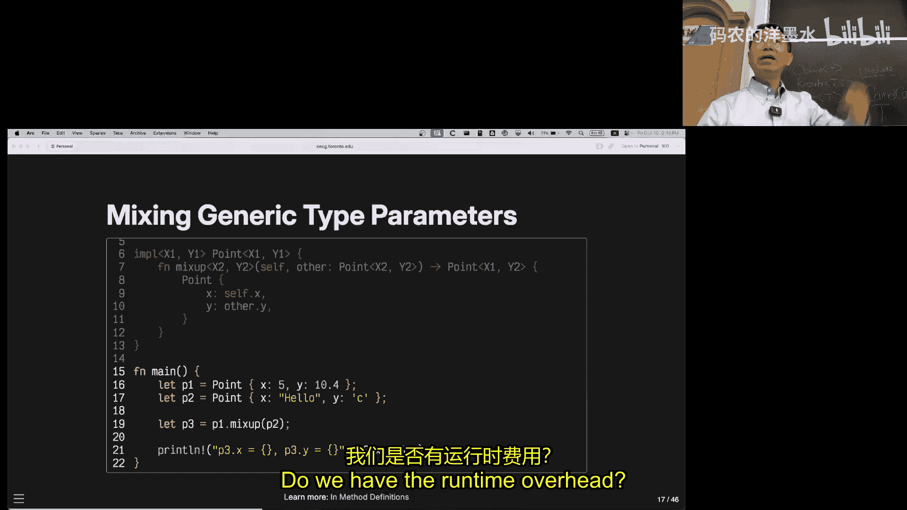

For something like this。Now， this is a little bit of an advanced topic。

 but it's comforting to know that we don't have any run time。

OverheadAnd this is part of the kind of the rust promise。 you can think of as the rust manifesto。

 you know， the kind of the promise that we have from the designers， the programming language。

 that every single abstraction in rust is going to be zero cost abstractions in the sense that the abstractions。

 they have no runtime overhead at all。 No runtime overhead。 everything is done at compile time。

 you might complain that the compiler is slow， slow， slow， which is true， it is very slow。

 As I mentioned before， if you don't like the rust compiler speed by a faster computer right。

 That's how you do it。 it is slow， for sure， But if we way better to have a slow compilation process compared to having runtime overhead。

 like Java， Javascript type squ go。 and all of the other languages， Python， by the way， Python。

 you know， giving。A little bit faster recently with 3。14 because of the multithreading support。

 but still it is kind of super， super slow here in rust， nothing like that。

 no abstraction that is taking overhead at runtime。 Everything is done at the compile time。

 So does not add any additional overhead when it introduces any kind of abstraction。

 even though we have quite a complex abstraction over here in terms of using generics。

Using generic types will not make your code run any slower than compared to run doing with doing the same thing with concrete types。

 And how do we achieve this by using the Ru compiler。

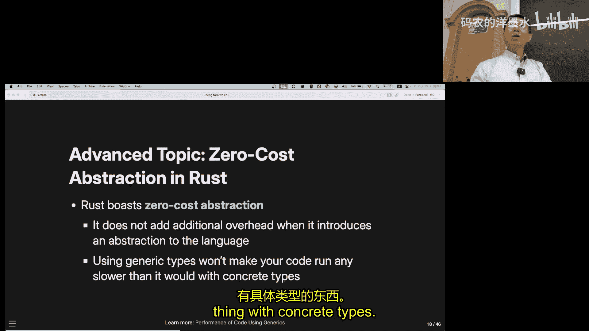

We do something called a monomorphization， It's a big word。

 but what we're doing here is just something very simple。

What we're doing is that at the compiling time， when we're compiling the code。

 what we're doing is that we're converting all of the generic types。 T E X 1， Y 1， x 2。

 I do all of the， the generic types in the code into specific code that we need， obviously。

 generic types will be general of any type。 But in our program， we only use a couple of types anyway。

 in terms of the concrete types that we use， even though the types are generic。😊。

When we use these types， there are only a few different kind of concrete types that we might be using。

 or probably even one。 If we're using the standard type library， for standard rust library。

 for example， vector， we might use just have one type of that vector。

 So the compiler is gonna figure out what are the types that you really need。

 And then it will convert all of your code。With the concrete types。 So， for example。

 in the Eum right here， the option T， A will just convert into option underscore I 32 and option underscore F 64。

 because these are the two types that you are using anyway。 The compiler is going to figure it out。

 No problem because you basically supplied 100% complete information to the compiler。

 It just takes a little while for the compiler to figure out。 but no problem。

 There's no way that it is going introduce any additional overhead。Now， let's move on to trades。

So traits would be something that we previously talked about as well。 briefly。

 every time we talk about traits， we basically say， oh， we're gonna talk about it later。

 More details are coming up。 Now is when we need to talk about more details。 So what is a trait。

A trade is considered one of the highlights in the Ru programming language。

 one of the things that it stands out。Beyond the pack of the other languages that does not support traits。

 either natively or nicely or beautifully。 It basically is something that is a contract。

 It defines the functionality that is common across multiple types。

 defines the functionality or you can think of these functionality as behavior that a particular type can share with other types。

 So that's something that we wanted in a lot of cases。

 We wanted to kind of have a little contract that you can implement that contract。

 And that's what a trait is for。So what do we mean by functionality or behavior in a lot of cases。

 it basically implies methods。That we define on a particular type， for example， astruct type。

 a method on the enum type。 So these methods that we define， and we call in a type。

 they are considered behavior。 And that's something that we can share across multiple types。

 and that will be the contract that we define in our trait definition。 So different types。

 they share the same behavior。 And if we can call exactly the same methods on all of those types。

 that's something that we can define in the trait。 And vice versa， once once we have the trade。

 we will be able to say， now this type will have to conform to that trait for us to use it， you know。

 because we're using the trade。

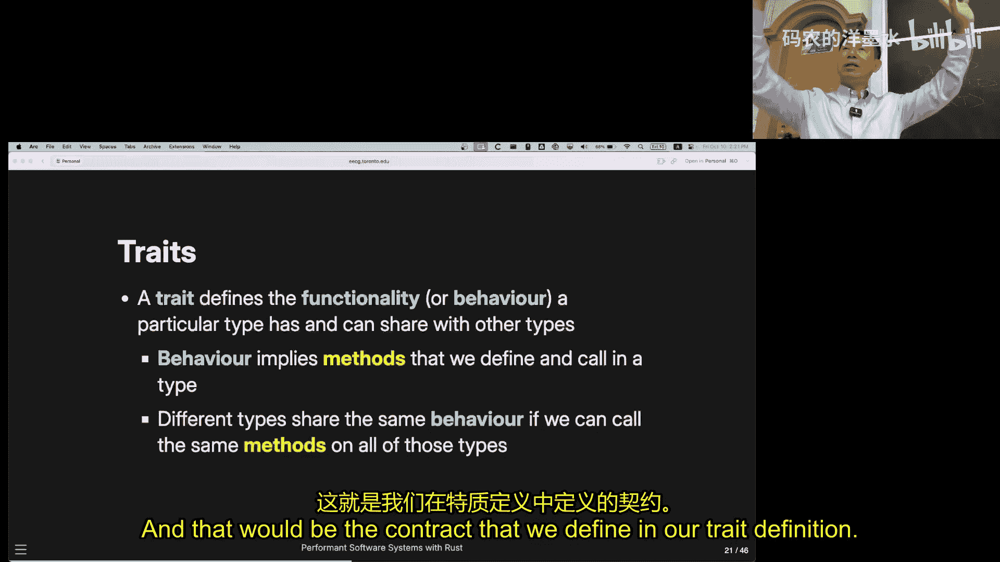

So the trade definitions are used to group the actualstruct or enums or whatever。

Of the same behavior。 So that's something that we actually are trying to use the trades to do。 Again。

 as we mentioned in other programming languages， they kind of have something similar in Java。

 You have interfaces in Sw， You have the protocol。 You know， they have something similar。 and。

 of course， in object oriented languages。 You have the base method， you know。

 base class with the methods They are abstract functions or whatever。You know， they're not as good。

 We wanted this。 And I'm gonna show you why in the following discussions of all of the nice features of trades。

Alright， so let's get started from our very first example。So suppose we have twostructs。

 One is a news articlestruct。And the other is sort of like a social post。

 some kind of a tweet that we have。 A tweet is a social post。 obviously。

 And both of these kind of strikes， they are kind of having different content。

 like a social post will be very different from a news article， but。

Both of them should be able to support one method which is to summarize yourself。

 I want to summarize myself， so that summarize myself kind of a method。

 I wanted to extract it and I wanted to put into my contract and I want to give a name to that contract so that trait will be called。

 for example， summary。😡，And that is gonna to return a string。

 A string would be the summary of the news article， or the tweet。And by doing something like this。

 summarize Empers self returning a string。 you have a method signature。 So that signature。

 like we have to return a string。 have to take yourself as an mpers self。

 not a mutable not a mutable reference， but the reference of yourself。

 immutable reference of yourself。 that particular signature is actually enforced by the compiler。

 If you wanted to implement this particular trade， you have to have this particular method implemented using this signature exactly this way。

 So that's kind of a good thing about having this trait in the sense that you enforce the exact signature by the rust compiler。

 if you don't have the exact signature when you implement the trade， it's a compile time error。

 So that's something that we want。 So now let's try to implement the trade on the type。

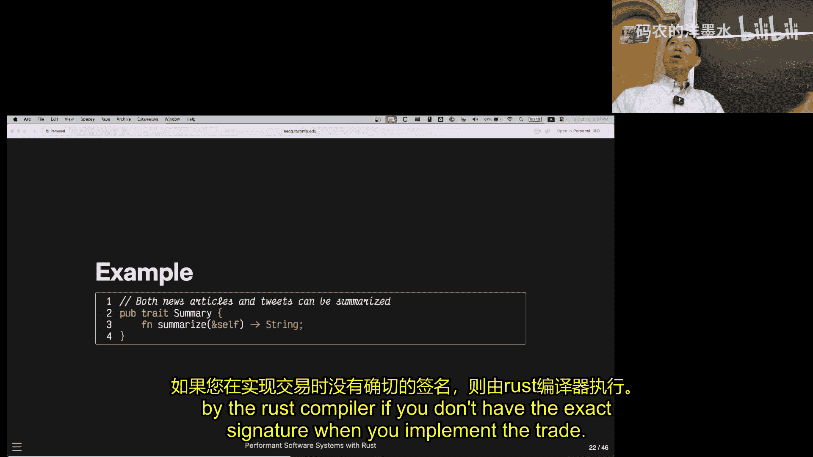

So this is kind of our terminology。 we say we implement the trait on this particular type。

 for example， our type would be a news article， it could have a headline could have location and so on。

 And regardless of what it has in terms of the content of that particular news article。

 I wanted to implement the trait。sumary。So how do we do that Well， we have something kind of again。

 a little strange。 But once you get comfortable， it will be second nature， we say in summary。

 we have to say the name of the trade first。 for news article。

 So you're implementing the trade for this particular type news article。 Allright。

 so you're implementing type on the implement the trade on the type。

 So we use import something for something I the traits name for the actual types name。 Allright。

 so the news article， I wanted to implement it。 So we have the exactly same signature。 Otherwise。

 it's not gonna work at line number 9。 and then inside that implementation I basically supply my own implementation of the summarize。

Method inside the news article type， so for example， I have access to my headline。

 the author and location， basically print them out， and that would be my summary。

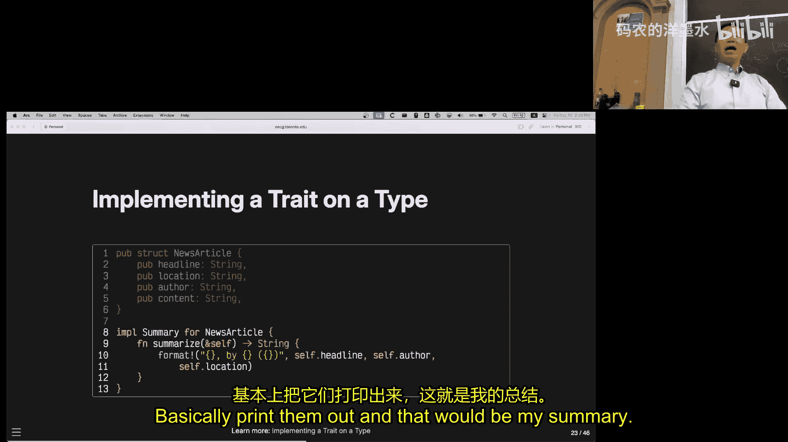

Alright， so the same applies to our tweet type。 In this case。

 we basically have username content and reply and retweet， for example。

 the second the third and the fourth。Field would be boolean values。

 and then we can do the same thing I summary for tweet。

 and then we could actually have summarize again， same signature， exact signature match。

 otherwise a compile time error， and then we're going to format it using something that we have inside the actual tweetstruct。

😊，So it's going to be a different implementation， but the signature of that summarize will be exactly the same。

Alright， so now so far， so good， right， so far， it's easy。 in， you know。

 we're just implementing a trade by having our own。Method。Now， how do we call a trade method。

Let's say we have a in the main program。 We have an aggregator。So in our aggregator。

 we basically have。Oh， before we do that， I have some cheat sheet here。 I just want to emphasize。

One more thing。That。We have， in this particular case。

 kind of something interesting in the sense that not only we can implement our own。Strt。

 in this case， ourstruct tweet is our ownstruct， or ourstruct news article is our ownstruct。

 We can implement。Other struggles。Other types， for example。

 I can implement a public type from somewhere else。From the standard library。

That's something I can do。 I can implement。A public type。Alright， so， for example。

I can actually try to。Or I can say I should implement my trade on the public type。 Alright。

 so I can say implement。My trade， which is summary。4， let's just pick any public type。

 anything that we wanted。 from the standard library， for example， V T， that's something I can do。

 No problem。You know， that's allowed。 I can。 This gives us immense amount of flexibility。 So that's。

 that's great because this is public。😊，This is something that is public。 Allright， so I can do this。

I can also， interestingly enough， implement a public trade on my own type。Alright。

 that's interesting as well。 So I can actually implement。😊，A public trade we talked about。

 for example， the debug trade and the display trade。

 all of that trades are directly from the standard library that we bring into our scope that we can print using debug and the display。

 I can implement that display trade from the standard library。 This is a name of a trade， right。

Every， every time we after the import， it's the name of the trade。

 So that trade is a public trade from the standard library  for。My own type。For what， for tweet。

 for example。So this is something I can do for my own type， not a problem。All right。

 so that's something that I wanted to。Emphasize that both of these ads flexibility。Previous。

 our example only implements my own local。Trit on my own local type。

But now I can implement my local trade， which is my trade。 Some is my trade on the public type。

Or a public trade on。My own type。Right， all of these are good。 No problem。

 And this adds immense amount of power。 For example， I can， you know。

 just add whatever that I wish to add on a public type。

 I can extend the public type with whatever I wish to do。No problem。Now。Can I。Implement。

A public trade on the public head。Can I do that。A public trade on a public type。It's not intuitive。

 but rust compiler does not allow you to do something like this。 So you cannot import display。On。

A public type， for example， V。T， that's not something that is allowed。 This is not allowed。

 This is fine。 This is fine。 And why is this not allowed。 Well。

 the reason is kind of advanced this is typically called coherence。

 This is one of the design principles of of the Ru programming language。 And in incoherence。

 there are multiple rules。 And in this particular rule， it's actually called the orphan rule。

 But it doesn't really matter what's it called。 but basic idea here is that it the compiler wanted to make sure that other people's code will not break your code。

Right， will not break your code。 That's something that the rust compiler or the designers of Ru wanted。

 If you allow something like this， then it might happen that someone else's code is breaking your code。

 That's bad。 That's not what we wanted， because we bring in hundreds of other traits。

 all of the hundreds of other crates， not traits。 hundreds of other crates。

 All of the crates are someone else's code。 These are thirdpart code。

 I want to make sure that code does not break my code。

 So that's something that we're gonna have to follow the coherence through。

 And that's the design principle of Russell。 This is not allowed。

 And this just something for you to remember for fun。

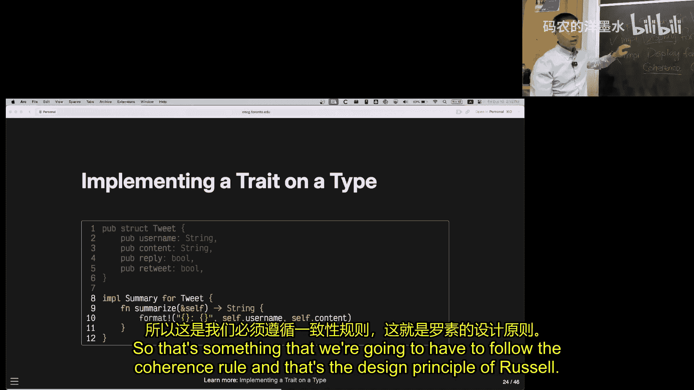

So now let's talk about calling。A trade method。 So they're calling a trade method。

 Let's say I have an aggregator。 And this aggregator is gonna basically is in the main program。

 It's gonna summarize it can summarize a news article， It can summarize a tweet。

 whatever it summarizes。 So in this main article in the main program。

 I can actually pass tweet dot summarize， or I can basically say news article dot summarize whatever it is。

 it is going to be fine。 And the reason for that is because that both the news article and the tweet。

 they're both implementing。The actual trait summary。 And that is why I can say tweet dot summarize。

Alright， but before I say tweet dot summarize， I not only have to put in bring in tweet。

 which I'm gonna have to bring in because I'm gonna have to define our own tweet as the instance of thestruct。

 But I also gonna have to bring in into scope， the actual name of the trait in this case。

 that's gonna be summary， as you can see in our previous definition summary is a public trait。

 So typically when we define a trait it's going to be a public trade。 And that's why we can bring in。

 and we must bring in。 Otherwise， it's a compile time error when we say tweet dot summarize。

 So Ru compiler， well have to know what is the trade that we're talking about right here。

 So that's something that we must do And we have seen it before when we talk about random number generation。

 you know dot R。 but to use dot R N， that is actually a trade method。

 that to bring in uppercase R N G， that's actual name of the trade So。We have done before。

 we didn't know why， but now we do。

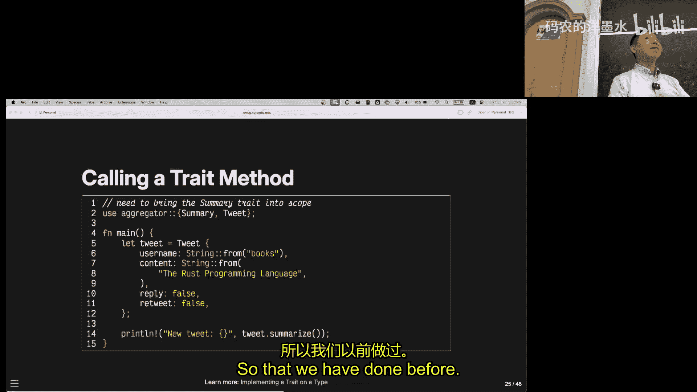

All right， so now let's talk about the kind of the tiny little trick， which is the default。

Impleation。The default implementation would be intuitive。 previously。

 without default implementations， you might actually have to implement this particular summarize for every single type that you have。

Right， so that's something that you might well have to do。

 But sometimes you're kind of too lazy because the implementation。

 sometimes there are a lot of the actual methods in that trade。

 You only want to implement some of these methods。 You don't want to implement all of the methods in your own type。

 So in that case， you might actually supply default implementations to some or even all of those methods。

And those methods with the default implementations you don't have to implement if you don't want to。

And if you want to， you can implement them。 it will overwride the default implementation。

But if you don't want to。The fact that they are default is that you don't have to implement it。

So here I have a very simple input block， input summary for news article。 In this case。

 I have this straight summary with only one method and that method already have a default implementation。

 That's why I can implement summary for my news article without even overriding any implementation。

 And the reason for that is all my methods already have default implementations right now。

 we only have one。

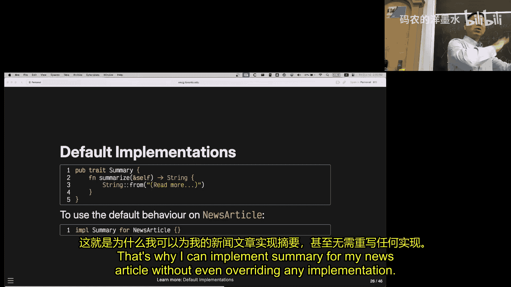

Al right， so that's something that I can do。 No problem。Allright， then。

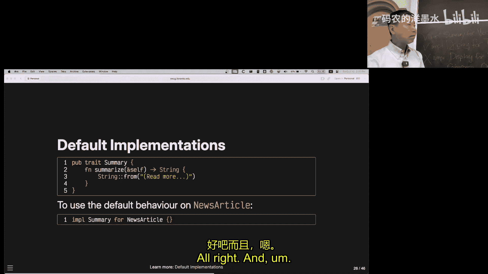

I can啊。Use default implementations inside implementation， I can actually call the other methods。

That is intuitive as well， but that also gave us more power。Right， also gave us more power。

 So we have， in this case， summarize and summarize。Cause self dot summarize， underscore author。

 and that， as you can see， at line number two is a new method inside that trait。

So it is another method in the trade that my default implementation of my summarize method can directly call。

Allright， so that's fantastic because I may not want to overwride my default implementation。

 but since summarize underscore author does not have a default implementation。

 my type will have to implement summarize underscore author， which the tweet type did。😡。

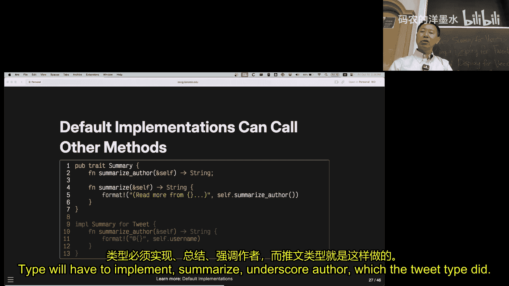

The tweet type did implement the summarize author method because it doesn't have a default implementation。

 And over here， it uses its own。Data， which is self thought user name。Right。

 its own data right there in the non default， right， this， this implementation is part of the tweets。

Own implementation of that summarize underscore author。 But our default implementation calls it。

 which means that our default implementation automatically gets self do user name。Right。

So you might say， why do I do this？ Well， this is beautiful。 Why do I say this is beautiful。

 It's because going back to here to the implementation。

It's because that even though my trade cannot have data， cannot have any fieldss， No data， nothing。

 It is only a bunch of methods， right， Just functions inside that trade。 No data whatsoever。

I can bring in data in my default implementation by calling the other methods that do not have default implementations that can access data。

And that is fantastic。 This is a major departure towards the good direction。😊。

Compared to object orientation。 Remember， object orientation， your base class， you know， have data。

 you know， and yourre derived inherited child classes inheriting from parent。

 They also inherit the data and the data that they inherit sometimes overwritten by their own data。

 sometimes the default data or something like that。Completely confusing， very much error prone。

 giving you something called inheritance hell， which are completely avoided by this way of doing things。

 So no data is allowed in your trade， nothing。Sometimes you find it limit。 Sometimes you might say。

 oh， the data is common across all of these。 Why can't we just have the username in my trade。 No。

 you cannot have that because we wanted to have。 We are to completely in avoid the inheritance style like a two decade problem in object orientation。

All right， so this is something that we wanted to do。

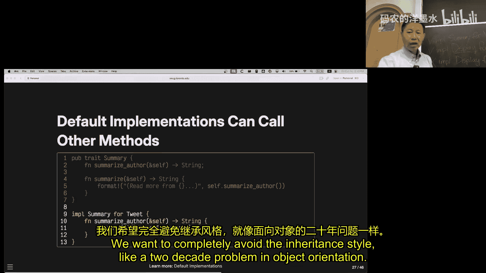

And beyond that。Here's something interesting。Why do I have to have traits？ Well， I have。

 I can have traits because I can call tweet dot summarize， right。

 That's why we bring in trade summary into our scope。 And then we're gonna use the dot summarize。

 But I can also have additional flexibility by putting。The trade as the type of my parameter。

In my function。 So in this case， have a function。 It's just the typical function。

 Let's say call it notify。 But this function had one value parameter item。

 And this value parameter is of the type。T summary。Which makes it more generic， right。

 This is much more generic， rather than saying it must be a type news article。 must be a type tweet。

 Now， I can say it can be any type。That can implement the trade summary。

This is one of the benefits of having traits overall。

 because I can actually define these functions that can take a generic type。Right， so previously。

 we have seen these things， you know， a type that is option return， an option and so on。 All of that。

 these are kind of something that are。Kind of more generics。

 but they are kind of generics inside the type itself。 And now we have these traits。

 They're also generic， but they're not really generic types。 And they are basically the traits that。

Other types can implement。So basically， were saying my item can be any type that implements the straight。

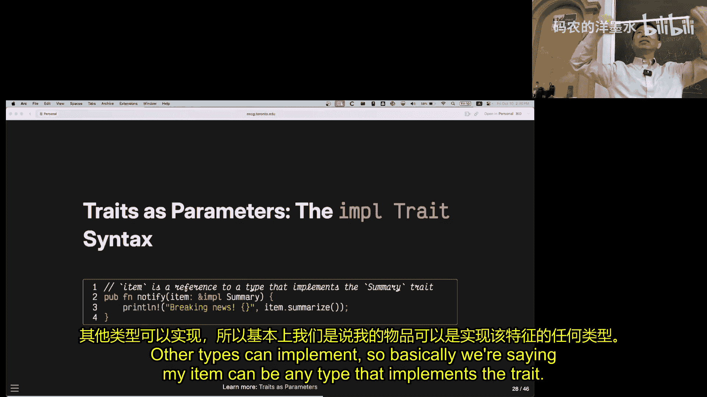

So that gives us additional flexibility， additional power。

 It's not just the generic type is something that is a trait。 Alright。

 so now I can inside that notify function because item is of the type of the trade。

 I can implement it using dot summarize。 because summarize is one of the methods in the trade。

 That's why I can say item dot summarize。😊，And that is something I can say。

An item is a reference to a type that implements the summary trait。So that's beautiful。

 that's something I have。But this is， interestingly。Just synthetic sugar。 It's just synthetic sugar。

 I love this sugar。 The sugar is great， but typically。

 we also want to introduce the non sugar version。😊，I wanted to sugar in some cases。

 sometimes I also wanted black coffee， right， So I wanted to introduce the non sugar version。

 So what is the non sugar version。So the non sugar version is exactly what we have seen before when we are actually using a generic type。

 Remember that we are basically having this largest， we have this generic type。

 But then our type is kind of bound by partial word， right？ Remember that。😊。

That is basically a trade。And we mentioned that just at that time。

 And now we're formally introducing the trade balance。

The trade bounces would be something that is bounding。The type， the generic type。

 but using the actual trade that we have defined or brought into scope。 And in this case。

 we're using summary to bind the type T。 This is a T， but this only takes。

Types that implements the trade summary。 Otherwise， compile time error。

 So that's something that is just the same， exactly same as before10% impulse summary。

 whatever you prefer， anything you prefer， you prefer black coffee， No problem。 It's good。

 ergonomic rust。 or if you prefer the import fine as well， Either way， whatever you prefer。

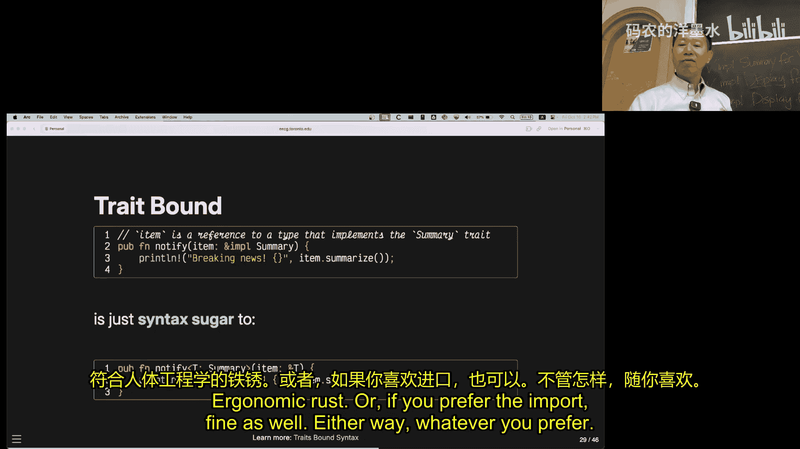

So why is the trade bound， the good idea？ Well， the compiler is going to use these trade bounds to check that all of the concrete types provide the correct behavior。

 We have seen it in our largest example where we have a less than and that less than can only work for the types that can compare with each other。

 And that's why we need to have a trade bound。 Otherwise we cannot use the less。

 So that's really great to have。 And now we have converted the runtime errors to compile time errors Now I compile time。

 We can say， no， this too generic。 We cannot compare any type rather than having a runtime error right here。

 So that improves the performance because we don't have to check these things at runtime。

And we can only， we only needs to check these things at compile time。

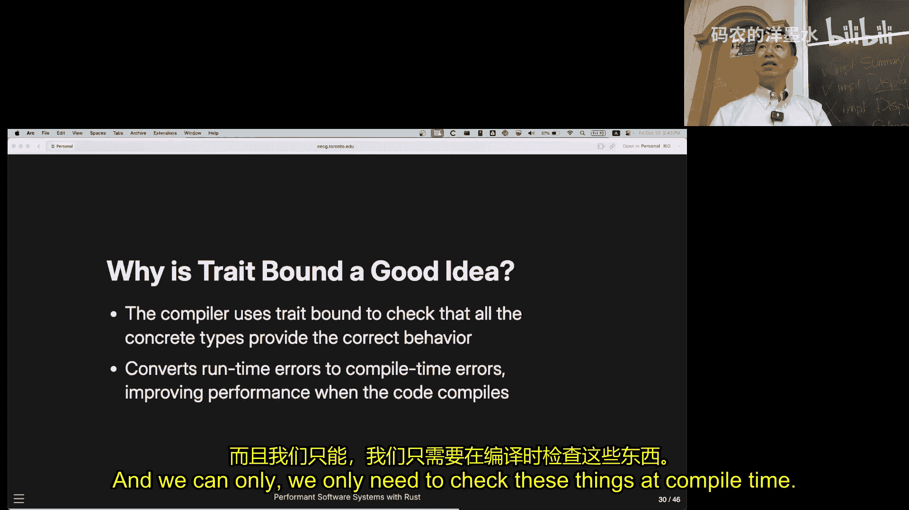

And however， we do have to understand。That the trade bounds。

 they are more expressive than the impulse， which is the sugary version。The imprate。

 the sugar version， would be a little bit less expressive。 So let's take a look at the example。

 The first version on the top that's the one with the imprate version。 that's with the sugar。

 So basically here I have two parameters。 item 1 and item 2。 And both of them implement summary。All。

 so that's something that is or a reference to a type that implements someone。

That's something we have at the top。 And at the bottom， we basically have a type T。

And that's the trade bound。 A T has to be bound by the trade summary。

 And then we have an M percent T for item 1， M percent T for item 2。

What's the difference between these two？What's the difference between these two？有。The second one。

 you have to have exactly the same type， but not the first one， right， the first one。You know。

 both of them just implement summary， but they can be of different types。 right。

 So regardless of what you wanted。They are different， right， You might want the first one。

 You might say， okay， I wanted to have two different types。 They are two different。

 As long as they both implement the summary trade， that would be good。 So that's what you wanted。

 The first one。 The sugary version would be a better version。

 because otherwise you're gonna have to have tea and you and so on。

 The first one would be a better version。If the second one is what you want。

 you want it both to be of the exactly same type that implements the summary trade。

 then the trade bound version will be a better deal because the compiler is gonna help you to check that they're the same type。

Alright， so depending on what you want， each one of these would be good。

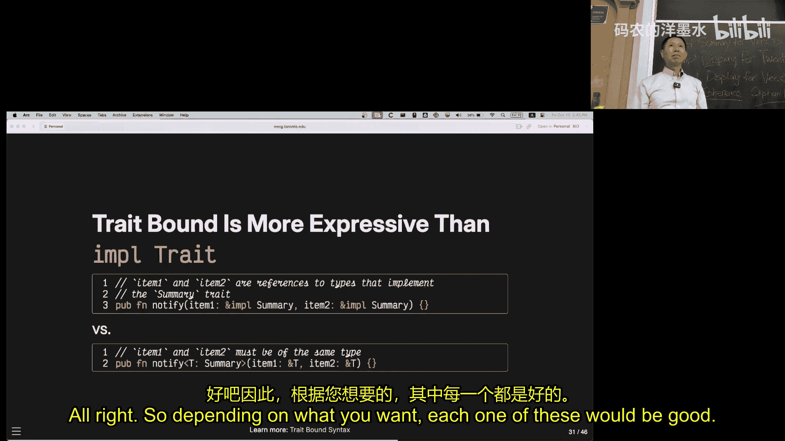

I can also， you know， we're trying to go into a more advanced territory now。

 I can also specify multiple trade bounds。 but now with the plus syntax。

 it's kind of foreign right now， but once you get used to it again， you will love it。

 just like I did now you could say， I want to bind this particular type T with not only the summary trade。

 which means I can call it dot summarize， but also the display trade。

 which means inside dot summarize， I can have a print line with you know， the actual。

Value of that type。So that's something， something that I can only achieve by saying summary plus display。

 I have two different traits， and my type will have to implement both of these traits。

 which is fantastic because these days in rust， it's very routine。 It's， you know。

 almost like every day that we have。😊，Types that implement multiple trades。 routine， right。

 You want to implement the debug trade。 You to have the column question mark。

 You want to implement display trade to directly print out the value。

 You want to implement whatever your own trade， anything that you wish。

No problem implementing all of these traits。 No problem。

 which is not the flexibility that we can accommodate in object orientation。 In object orientation。

 you cannot basically inherit from multiple base classes。 multiple parents， you know。

 that's you know， that's the root cause for inheritance hell in the sense that you bring in way more context。

 including all of their data into your own child class， no good。

 You don't want to inherit multiple inheritance is indeed supported by a lot of languages。

 such as C plus plus， but not in some of the languages for a good reason。

 because it just it's just no good。 But now we have the flexibility。 We implement multiple traits。

 We even bind the actual type with multiple traits。 no problem。 whatsoever， whatever you prefer。

 you prefer the sugar version of the non-sug version。 anything is fine。 But with the sugar version。

 you do have to have the parentheses， because the M percent impulse summary plus that has to be in the parenthees。

All right， now we have。Also， another sugar。Here on the top， we have the raw black coffee version。

 the non sugar version。And here we basically have two types。 We have the type T。 We have the type U。

 and the first parameter is of type reference to T。 And the second one is reference to you。

 And the first  one， I want to bind it to display and clone。

 And the second1 I want to bind it to clone and debug all of these are names of traits， obviously。

It's kind of ugly in the top the black version。 If you wish you can write it like that。 But。

 you know， it's not a must that you use the sugary version， but there is a sugary version。

 the white coffee version or the sugar coffee version would be using the so- calledled warehouse cloth。

 So you basically say tea comma you。But without the actual bounds of the displayed plus clone and so on。

 And then you say where T is bound by this and U is clamp bound by this。 Sam thing as before。

 except with a very long， you know， trade bound in between the function name and the parameters。 Now。

 you basically extract them into the where clause。

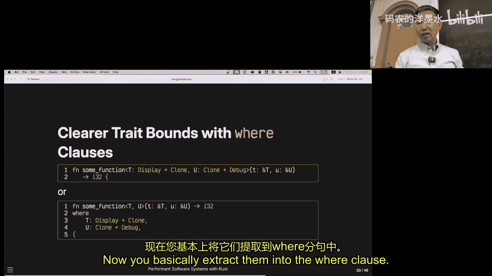

And now we have the also the impulse。Kind of a sugary version of the tray bond。 we can return。

A impulse summary。 So we can return a type that implements a trade。 in this case， the summary trade。

 So we say right arrow， return input summary。 And this basically means that we're returning a type that implement the summary in this case。

 if we basically have a tweet， I can return a tweet。 No problem。

 So this becomes returning a tweet struck。 right， So if we're actually returning a news article that will return a news articlestruct as the return type。

 So， but the function itself basically says return any type that implements the summary。 No problem。

 That's not a problem。 And it is going to be very helpful right now， it looks interesting。

 But you don't really realize how helpful it is。 But once we get started。

 talking about functional programming closures and iterators。

 these are the things that are coming up after we talk about lifetimes。 and it's gonna be covered。

Why returning types， implementing trade would be a good idea would be kind of helpful at that time。

 But not， not right now， we're gonna skip the benefits of doing this right now。 but， you know。

 we're gonna do this later。 But however， keep in mind that we cannot return multiple types。

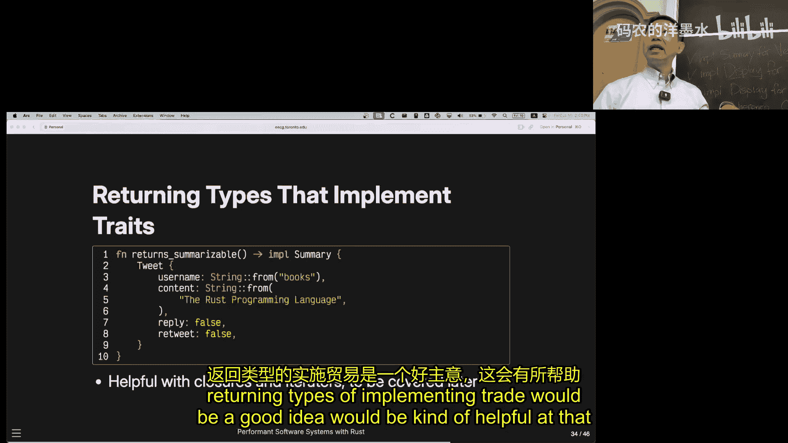

So we cannot have some kind of a bulloleying value。 for example。

 a switch that if the bullying is true， we return a news article and the bully as false as。

 we turn a tweak。 and that is not allowed。And because of the fact that we do this at compile time。

 we're gonna have to figure out exactly what is that type that we return at compile time。

 And because of our requirement that we are not going to do anything at run time。

 And we mentioned zero cost abstraction at run time。

 Everything will have to be figured out at compile time。 in this case。

 what is the type that you're returning， right， youre， you cannot figure out。

 And this is why we cannot return two different types。

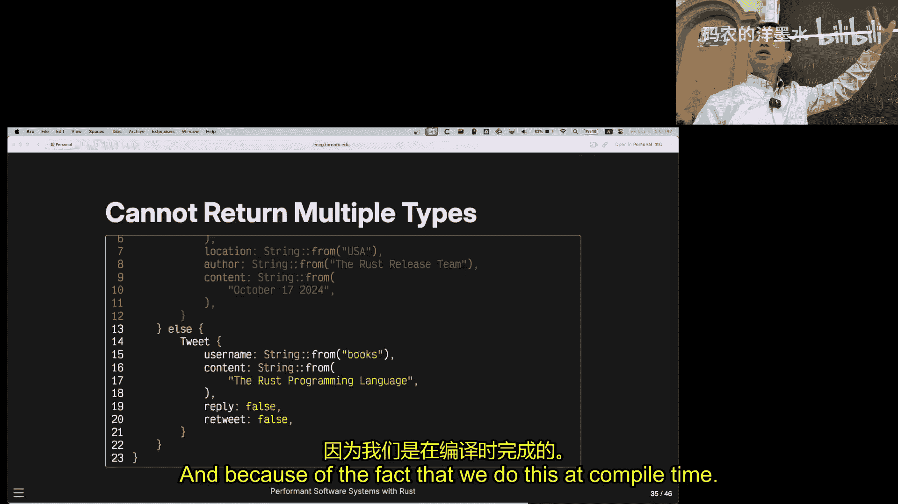

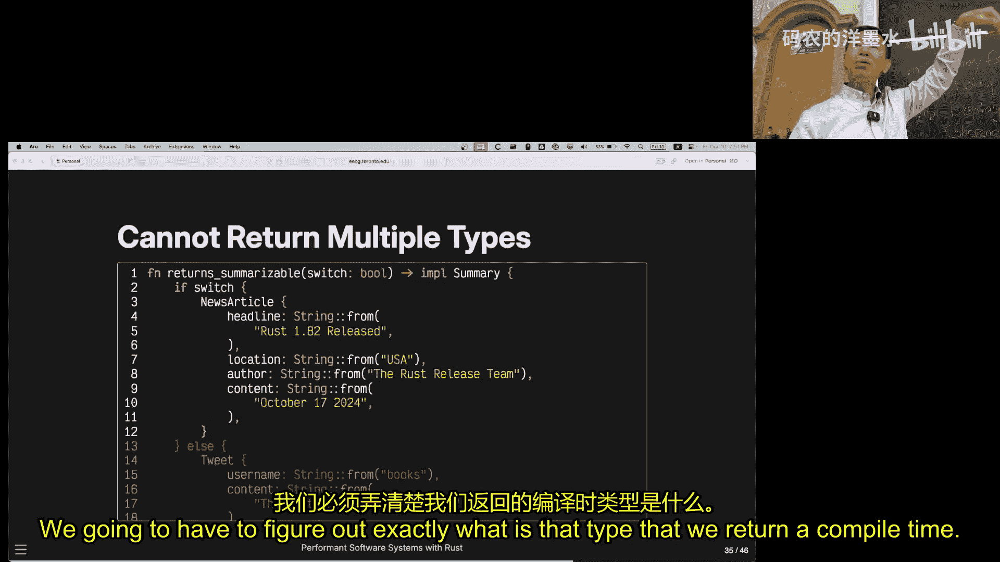

Even if both of them implement the summary trait。So that's not something that we allow。

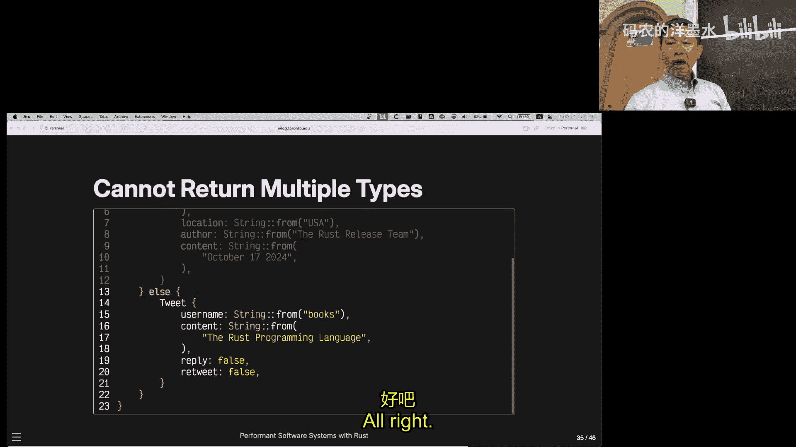

All right。So now let's look at using trade bounds to conditionally implement the methods。Alright。

 so we want to come conditionally implement a trade。 Alright。

 so that's something we want to use the trade balance in conditionally implement methods。

 not a trade。 the conditionally implement method。 So let's look at this。

 We're bringing in a public trade In this case， the display trade。 We have our standards dropped。

 which we have shown before with X and Y of the same type。We have a function。

 Let's say a new function。Previous， we have a new function using the generics， generic type T。

 So in this case， we basically have self。And self is a type alias of the input block。

 which means that basically self is just a pair of T in this case。

 pair of T is the type of the strap， and that is the self that's the type alias of the input block itself。

 whatever you're implementing in the input block which is pair of T。

 and that's something that you have for you know our standard way of doing you know implementing a function with the actual generic types。

But right now， we want to have a different way of doing this。

 We want to use the trade bound to do this。So in this case， rather than implementing just a T。

 we're implementing a T with the trade bound。And the two traits that we're bringing in in this particular example would be the display trade and the partial or trade。

 and these both traits are from the public， the rustic Standard library， these are public trades。

And what we're doing here is that we're only implementing this compare underscore displayed method。😊。

嗯。If the T， the generic type T implements the display and partial word。

 which is not true for our new method。 Our previous new method right here。

 this method implements the method for any。Tanthing。Alright， again， at compile time。

 we're gonna figure out which type are we talking about。 But when we're writing this。

 the semantics is this is for any。 But this one basically says this function only exists for those those types that implements the trade bound。

 which is the display and partial or for any other types that does not implement this。

 this function does not even exist at all in those types。Alright， you get my idea。

 So we do this processing at compile time。 So we kind of say， okay， this type we're using。

 but it does not really implement the display and partial or trade。 So we have the new。

 but we don't have the compare display。Which makes a lot of sense if you look at the implementation of compared display。

 the implementation is basically comparing the two values except X and Y and displaying the values by using print line。

 So if you do not have the trade bound， you have no idea if you can compare or if you can print。

 So if you wanted to compare and you want to print， you're gonna have to do this。

 you're going to have to say this only makes sense if it implements the display in partial word。

 Otherwise， as we have shown in the largest example， the compile time error。Alright。

 so this is fantastic。 Don't you， don't you believe， Don't you like it， Beauti， beautiful cold。😊。

There's no better way of designing code like this。 If you ever think about it， if you actually say。

 I'm going to design my own programming language， I'm going to do this。😡，No better way。

You have to do it like this。And this is beautiful code。

 This function only exists for those types that implements these two traits。 Nothing else。 You know。

 I， I even thought about this myself。 I thought， should I use like a multiply rather than the plus。

 No， no no， it has to be a plus， right， has to be both of these as V plus， right， It looks beautiful。

 Beai code。 once you get used to the rust language， You cannot tolerate any other languages。

 The other languages just cannot see them。 You know， they ugly Python ugly， You know。

 everything is ugly。😊，Well， I wouldn't say Python is Python is okay。

 but it's just a little bit too much。 It's a little bit too ergonomic。

 I wanted to get into the details like this， right。

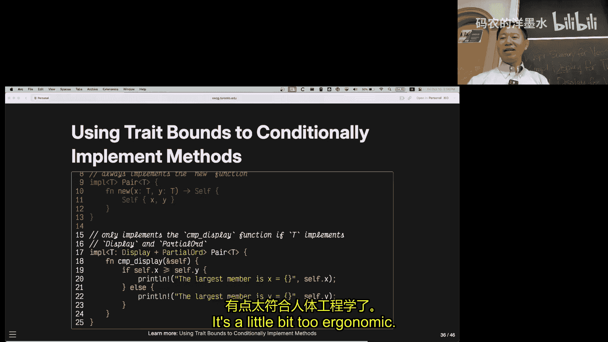

All right， one more thing， blanket implementations。So what are we doing here。 Well， to explain this。

 I actually put in a comment right here。 Com at line number one and line number two。

 We're using blanket implementations for conditionally implement a trade for any type that implements another trait。

 Let me repeat it again。😊，Let me repeat it again so that you can get the idea。 I want to implement。

A blanket implementation。For conditionally implementing a trade， for any type。

That implements another trait。Did you get it。No， I knew。 So that's why I gave you an example。

 So here's an example。I wanted to use this blanket implementation。I'm gonna have an input block。

 and input block is having a trade bound， which is a type T bound to the trade of display。

And only when this particular， you know， trade implement this type T implements the trade display。

 that is the T I wanted to give an implementation for。 I want to basically say。

To string is only for those。T that basically have a display。Alright。

 so this is used extensively in the Ru standard library。

 even though it's kind of strange because I can actually implement something called。

To underscore string。In that two string trade， that two string trade basically have the two underscore string method in that two string trade。

 but that two string trade is only going to be conditionally implemented for the actual type that implements the actual trade display。

Alright， so this is very useful in the sense that I can actually basically say， okay。

 I can bring in this two screen method to those types that actually implements display。😊。

So this particular example just again， implements the two string trait for any type that implements the displayed trait。

Okay， so that's what we wanted。 And if this is not what you wanted， of course， you can just say any。

 But if this is exactly what you wanted， you can do it in rust。

 which shows basically the power of rust with the blanket implementations。 So that's how we do it。

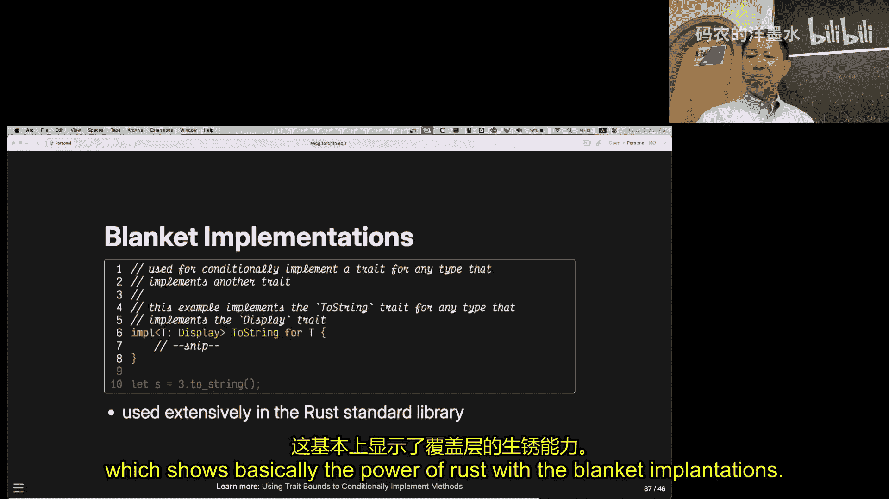

Alright， so we don't have time to talk about the associate types in traits。

 but that's good news because associate types in traits would be more of a advanced topic。

 We're gonna talk about the advanced topic of traits。 sotypes and super traits。

 at the beginning of the next lecture briefly。 they are in the different chapter in the Ru programming language book。

 and we pretty much talk to finish talking about all of the traits features。

 and Keep in mind that next lecture is gonna be a very important lecture。 Lifes。

 we're going talk about it。 Only one lecture dedicated to lifetimes probably a little bit over。

 and that's it。 We're not going to talk too much about lifetimes。 It is an advanced topic。

 we're gonna spend some time and it will not be recorded next time。 Thank you。😊。

