# Rust编程：第12讲：通用数据类型 🧩

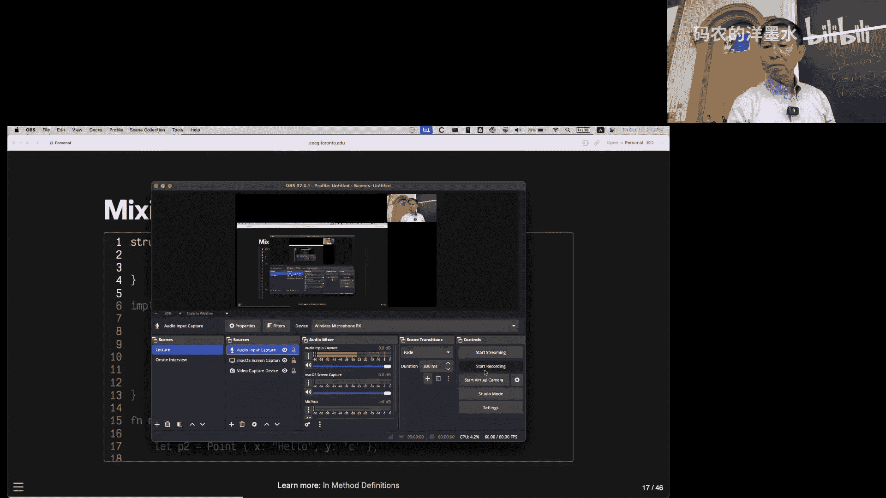

在本节课中，我们将要学习Rust中的通用数据类型，特别是泛型类型参数和特质（Traits）的深入应用。我们将探讨如何灵活地组合它们，理解其零成本抽象的特性，并学习如何通过特质来定义和共享类型的行为。

---

## 泛型类型参数的混合使用

上一节我们介绍了泛型的基本概念，本节中我们来看看如何在结构体、实现块和方法中混合使用不同的泛型类型参数，以获得极大的灵活性。

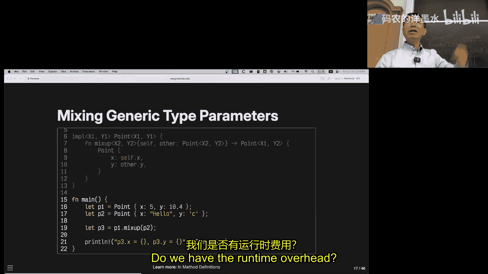

我们有一个结构体 `Point`，它使用泛型类型 `X1, Y1`。在为其定义的方法中，我们不仅可以使用结构体自身的泛型参数，还可以引入方法独有的泛型参数。

```rust
struct Point<X1, Y1> {
    x: X1,
    y: Y1,
}

impl<X1, Y1> Point<X1, Y1> {
    fn mixup<X2, Y2>(self, other: Point<X2, Y2>) -> Point<X1, Y2> {
        Point {
            x: self.x,
            y: other.y,
        }
    }
}
```
在这个例子中：
*   `X1, Y1` 是结构体 `Point` 和其实现块的泛型参数。
*   `X2, Y2` 是方法 `mixup` 独有的泛型参数。
*   方法 `mixup` 返回一个新的 `Point`，其 `x` 来自 `self`（类型为 `X1`），`y` 来自 `other`（类型为 `Y2`）。

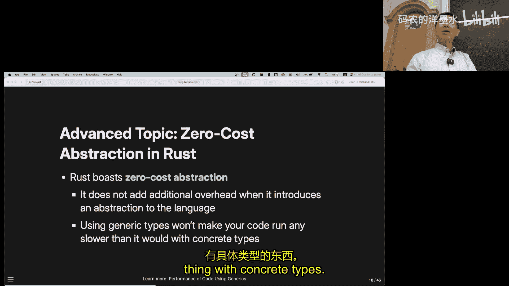

使用方式如下：
```rust
fn main() {
    let p1 = Point { x: 5, y: 10.4 };
    let p2 = Point { x: "Hello", y: 'c' };
    let p3 = p1.mixup(p2);
    println!("p3.x = {}, p3.y = {}", p3.x, p3.y); // 输出：p3.x = 5, p3.y = c
}
```
通过混合三种不同的泛型参数来源（结构体、实现块、方法），我们可以实现高度灵活的代码。

---

## 零成本抽象与单态化

你可能会担心，如此复杂的泛型是否会带来运行时性能开销？答案是：不会。这是Rust设计的一项核心承诺——零成本抽象。

所有泛型相关的类型确定工作都在编译时完成，不会增加任何运行时开销。编译器速度可能较慢，但这远比在运行时处理类型信息要好。

Rust编译器通过一个称为 **单态化** 的过程来实现这一点。

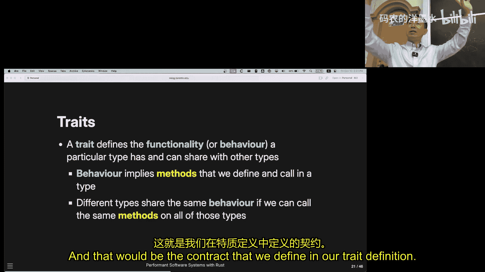

以下是单态化的工作原理：
1.  编译器分析代码中所有使用泛型的地方。
2.  它确定在程序中实际用到的具体类型有哪些。
3.  编译器会为每一个被使用的具体类型组合生成一份特化后的代码副本。

例如，对于 `Option<T>`，如果你在代码中只使用了 `Option<i32>` 和 `Option<f64>`，那么编译器最终生成的二进制文件中，只会包含针对 `i32` 和 `f64` 的 `Option` 代码，就像你一开始就手写了这两份代码一样。因此，使用泛型的代码在运行时与使用具体类型的代码效率完全相同。

---

## 特质详解

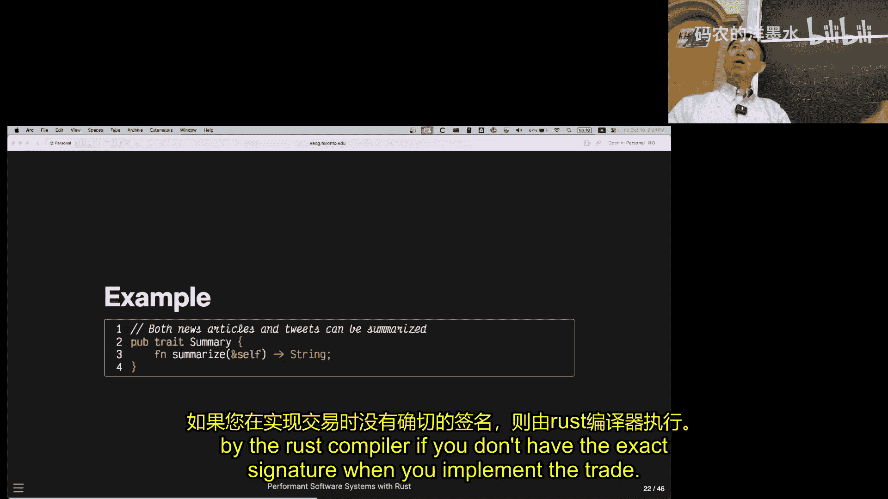

之前我们多次提到特质，现在我们来深入了解它。特质是Rust中定义共享行为的方式，它是语言的一个突出亮点。

一个特质定义了一组方法签名，它是一份契约，规定了实现该特质的类型必须提供哪些功能。不同的类型可以通过实现同一个特质来共享相同的行为。

### 定义与实现特质

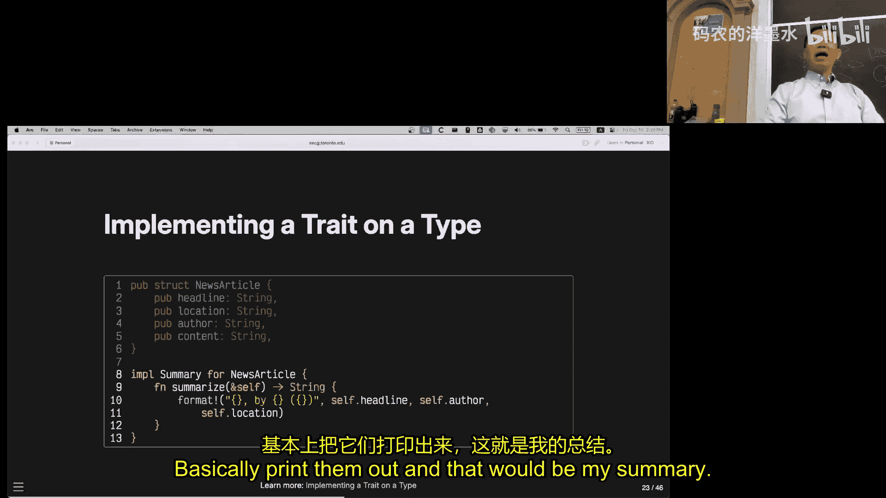

假设我们有两种类型：`NewsArticle` 和 `Tweet`。虽然它们内容不同，但都支持“总结”这一行为。

首先，我们定义一个 `Summary` 特质：
```rust
pub trait Summary {
    fn summarize(&self) -> String;
}
```
`summarize` 方法签名是契约的一部分，实现该特质的类型必须提供完全匹配此签名的方法。

接着，我们为 `NewsArticle` 类型实现这个特质：
```rust
pub struct NewsArticle {
    pub headline: String,
    pub author: String,
    pub location: String,
}

impl Summary for NewsArticle {
    fn summarize(&self) -> String {
        format!("{}, by {} ({})", self.headline, self.author, self.location)
    }
}
```
同样地，为 `Tweet` 类型实现：
```rust
pub struct Tweet {
    pub username: String,
    pub content: String,
    pub reply: bool,
    pub retweet: bool,
}

impl Summary for Tweet {
    fn summarize(&self) -> String {
        format!("{}: {}", self.username, self.content)
    }
}
```
实现特质时，必须严格遵循特质中定义的方法签名。

### 调用特质方法

要调用特质方法，需要将特质本身引入作用域。
```rust
use crate::Summary; // 假设特质定义在当前crate中
use crate::Tweet;

fn main() {
    let tweet = Tweet {
        username: String::from("horse_ebooks"),
        content: String::from("of course, as you probably already know, people"),
        reply: false,
        retweet: false,
    };
    println!("1 new tweet: {}", tweet.summarize());
}
```

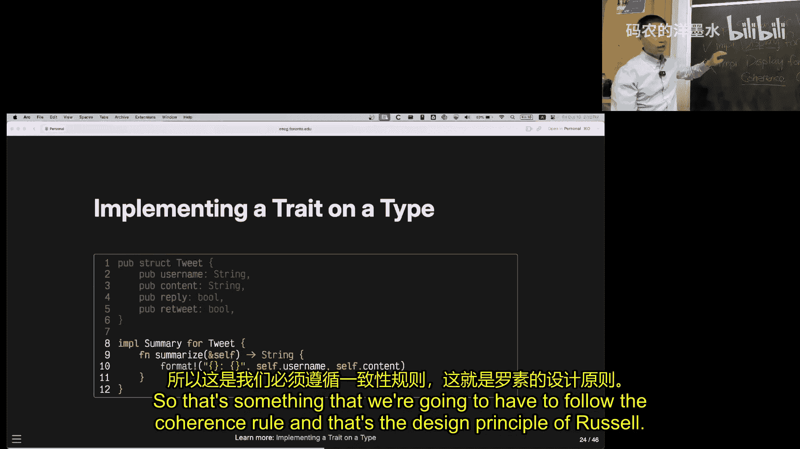

### 实现特质的灵活性

Rust在特质实现上提供了很大的灵活性，但遵循“孤儿规则”以保证代码安全：
*   **可以** 为当前crate中的类型实现当前crate中定义的特质。（标准做法）
*   **可以** 为外部库中的类型实现当前crate中定义的特质。（扩展外部类型）
*   **可以** 为当前crate中的类型实现外部库中定义的特质。（使自己的类型具备标准行为）
*   **不可以** 为外部库中的类型实现外部库中定义的特质。（防止破坏性修改）

这条规则确保了你的代码不会被意外的外部实现所破坏。

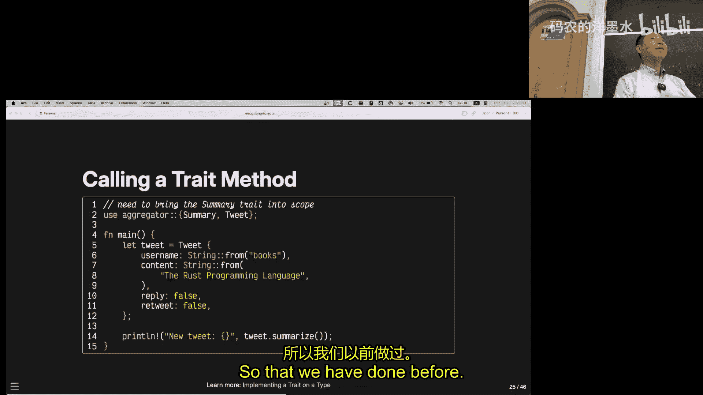

---

## 默认实现与特质继承

特质中的方法可以有默认实现。这为特质实现者提供了便利，他们可以选择使用默认实现，也可以选择覆盖它。

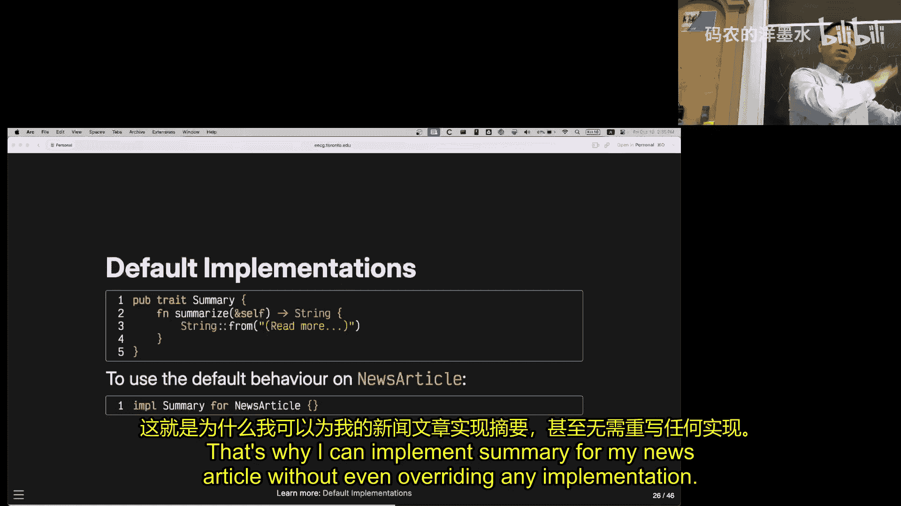

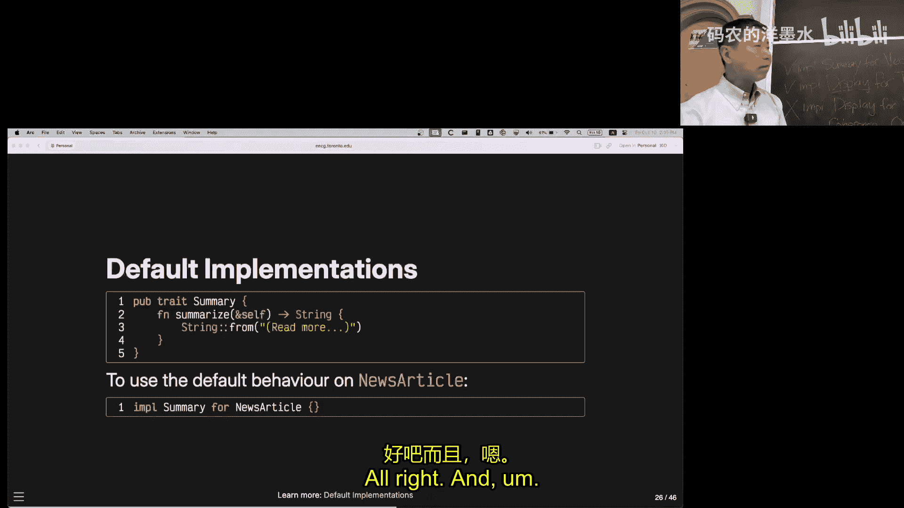

```rust
pub trait Summary {
    fn summarize(&self) -> String {
        String::from("(Read more...)")
    }
}

impl Summary for NewsArticle {}
// NewsArticle 现在可以使用 summarize 的默认实现
```

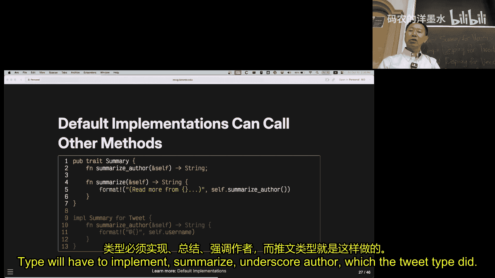

更强大的是，默认实现可以调用特质中的其他方法，即使那些方法没有默认实现。这允许我们在特质中定义基于其他方法的行为模板。

```rust
pub trait Summary {
    fn summarize_author(&self) -> String;
    fn summarize(&self) -> String {
        format!("(Read more from {}...)", self.summarize_author())
    }
}

impl Summary for Tweet {
    fn summarize_author(&self) -> String {
        format!("@{}", self.username)
    }
    // summarize 方法使用了默认实现，它会调用我们提供的 summarize_author
}
```
这种方式避免了传统面向对象继承中数据继承带来的复杂性（“菱形继承”问题）。特质只定义行为，不包含数据字段，从而更清晰、更安全。

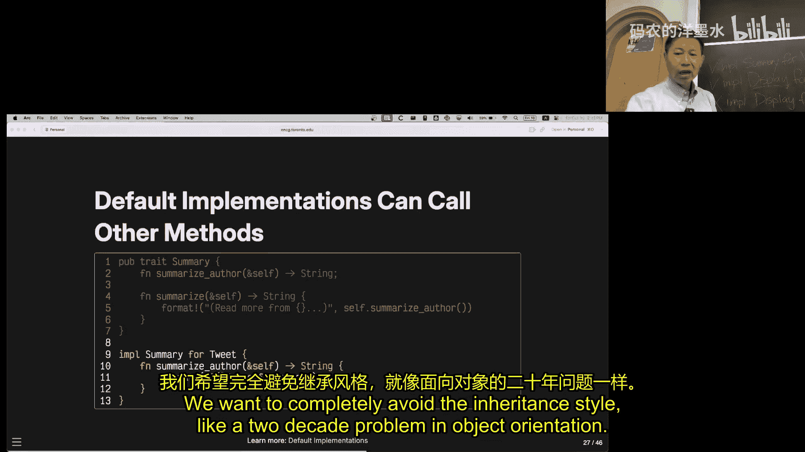

---

## 特质作为参数与特质约束

特质的一个关键用途是定义函数参数，使函数可以接受任何实现了特定特质的类型。这有两种主要语法：**特质约束** 和 **`impl Trait` 语法**。

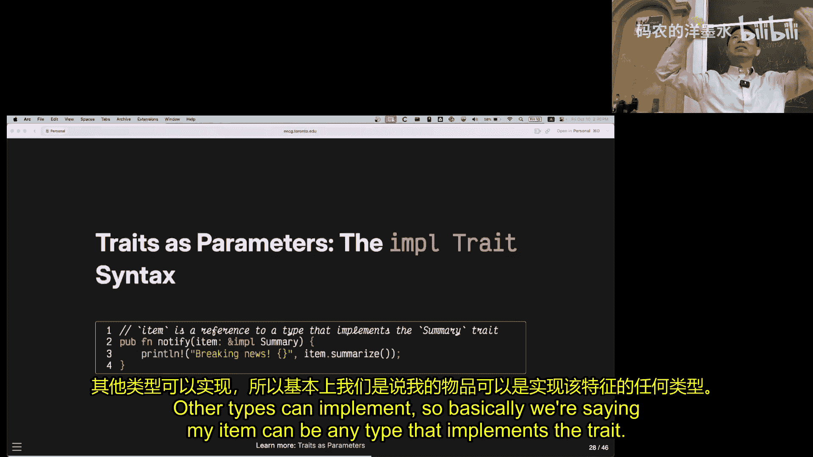

### `impl Trait` 语法（简便语法）

这种语法更简洁，适用于直接参数。
```rust
pub fn notify(item: &impl Summary) {
    println!("Breaking news! {}", item.summarize());
}
```
函数 `notify` 接受一个实现了 `Summary` 特质的类型的引用。

### 特质约束语法

这种语法更强大、更显式，尤其适用于复杂的泛型情况。
```rust
pub fn notify<T: Summary>(item: &T) {
    println!("Breaking news! {}", item.summarize());
}
```
这与上面的 `impl Summary` 是等价的。`T: Summary` 被称为 **特质约束**，它限定了泛型类型 `T` 必须实现 `Summary` 特质。

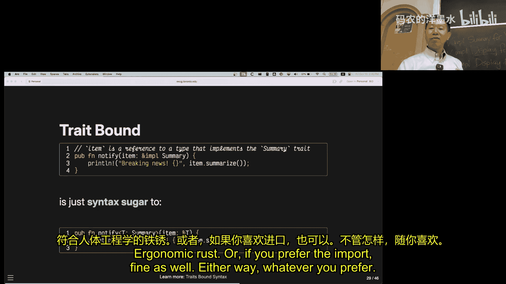

特质约束允许编译器在编译时检查所有具体类型是否提供了正确的行为，从而将潜在的错误从运行时转移到编译时。

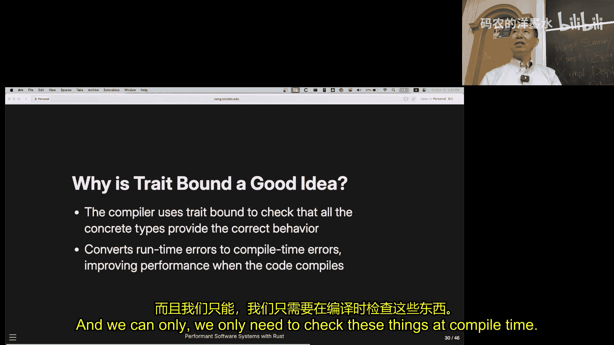

### 两种语法的区别与选择

`impl Trait` 语法是特质约束的语法糖，但在某些情况下，特质约束更具表达力。

考虑以下两个函数：
```rust
// 版本 1: 使用 impl Trait
pub fn notify(item1: &impl Summary, item2: &impl Summary) {...}
// item1 和 item2 可以是实现了 Summary 的 *不同* 类型。

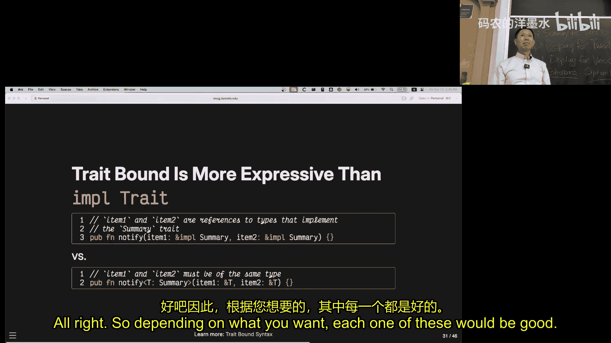

// 版本 2: 使用特质约束
pub fn notify<T: Summary>(item1: &T, item2: &T) {...}
// item1 和 item2 必须是 *相同* 的具体类型 T，且 T 需实现 Summary。
```
*   如果你希望两个参数可以是不同的类型（只要都实现 `Summary`），使用 `impl Trait` 更合适。
*   如果你强制要求两个参数必须是完全相同的具体类型，使用特质约束更清晰。

### 多重特质约束与 `where` 从句

可以使用 `+` 语法指定多个特质约束。
```rust
// 要求 T 同时实现 Summary 和 Display
pub fn notify<T: Summary + Display>(item: &T) {...}
// 等价的使用 impl Trait 的语法
pub fn notify(item: &(impl Summary + Display)) {...}
```
当约束很多时，可以使用 `where` 从句来提升可读性。
```rust
fn some_function<T: Display + Clone, U: Clone + Debug>(t: &T, u: &U) -> i32 {...}
// 使用 where 从句改写
fn some_function<T, U>(t: &T, u: &U) -> i32
where
    T: Display + Clone,
    U: Clone + Debug,
{...}
```

---

## 返回实现了特质的类型

可以使用 `impl Trait` 语法来指定函数返回某个实现了特定特质的类型。
```rust
fn returns_summarizable() -> impl Summary {
    Tweet {
        username: String::from("horse_ebooks"),
        content: String::from("..."),
        reply: false,
        retweet: false,
    }
}
```
这对于返回闭包或迭代器等复杂类型非常有用，我们将在后续章节看到。

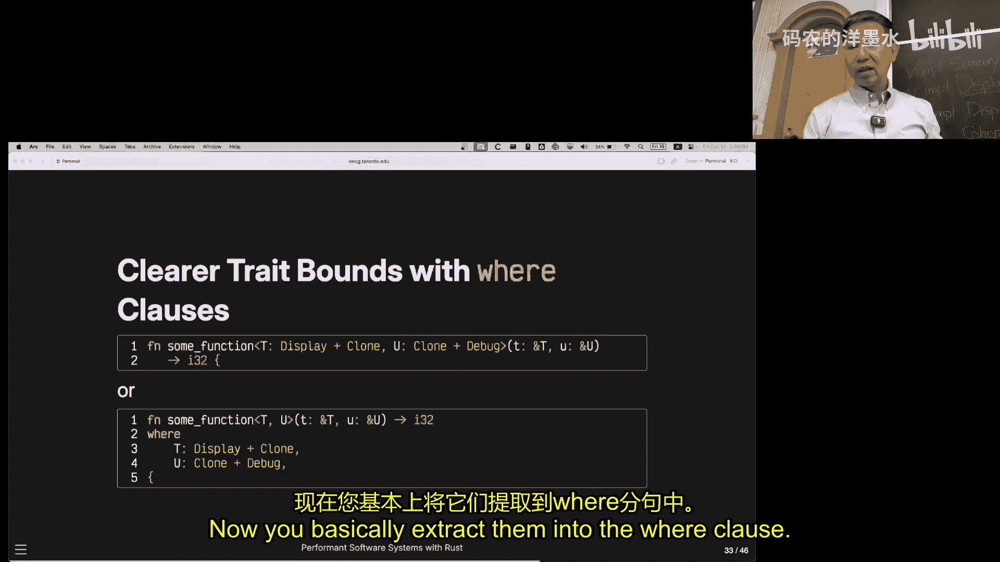

**重要限制**：虽然返回类型是 `impl Summary`，但**一次函数调用只能返回一种具体类型**。你不能在函数内部通过条件判断返回 `NewsArticle` 或 `Tweet`，因为编译器需要在编译时确定具体的返回类型。

---

## 使用特质约束进行条件性实现

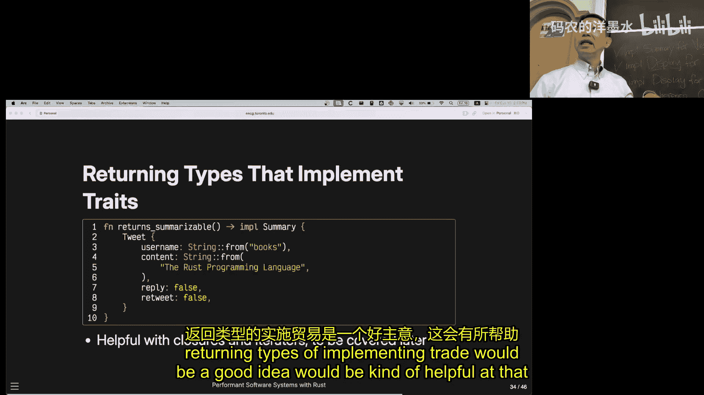

特质约束的另一个强大功能是，我们可以**有条件地为泛型类型实现方法**。一个方法的存在与否，取决于该类型是否实现了某些特质。

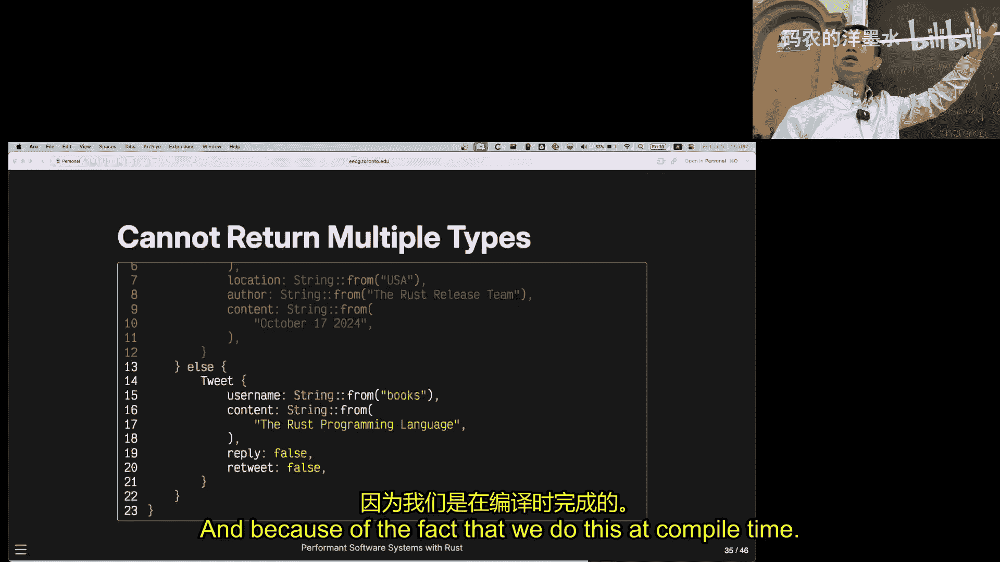

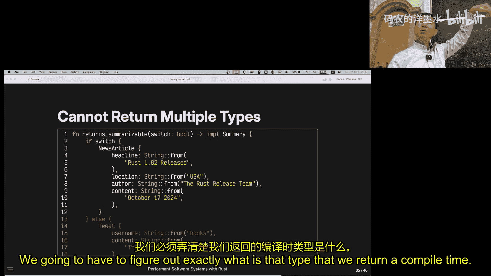

```rust
use std::fmt::Display;

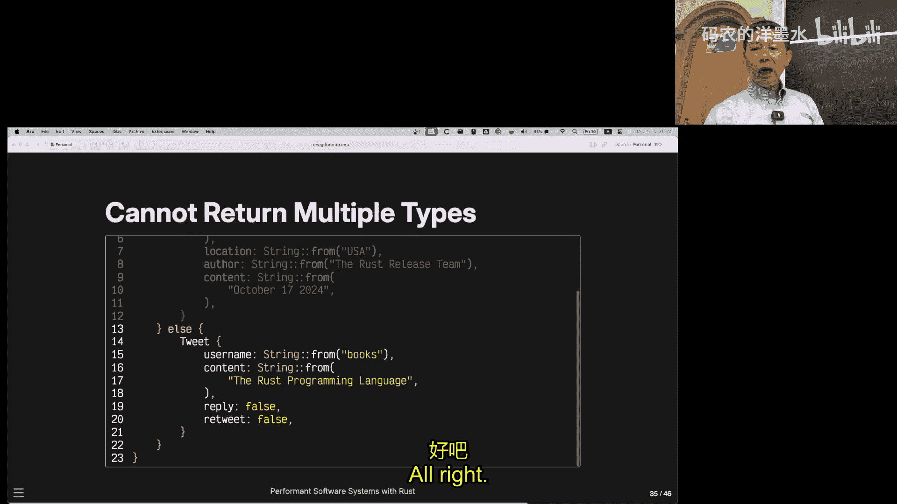

struct Pair<T> {
    x: T,
    y: T,
}

impl<T> Pair<T> {
    fn new(x: T, y: T) -> Self {
        Self { x, y }
    }
}

// 只有那些实现了 Display 和 PartialOrd 特质的 T，才会拥有 cmp_display 方法
impl<T: Display + PartialOrd> Pair<T> {
    fn cmp_display(&self) {
        if self.x >= self.y {
            println!("The largest member is x = {}", self.x);
        } else {
            println!("The largest member is y = {}", self.y);
        }
    }
}
```
在这个例子中：
*   `new` 方法对所有类型 `T` 都可用。
*   `cmp_display` 方法只对同时实现了 `Display`（可打印）和 `PartialOrd`（可比较）的类型 `T` 可用。对于不满足此条件的类型，这个方法甚至不存在。

这保证了代码的安全性：你只能在支持比较和打印的类型上调用比较并打印的方法。

---

## 覆盖实现

覆盖实现是Rust中一个高级但强大的特性。它可以**有条件地为任何实现了另一个特质的类型，自动实现某个特质**。

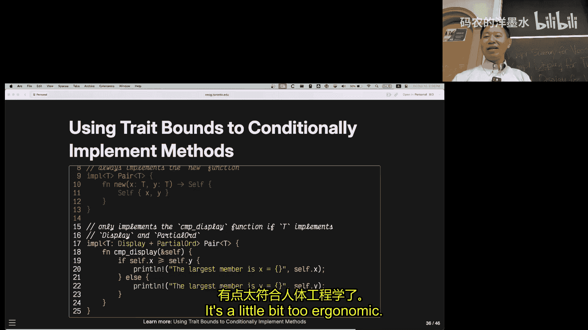

```rust
impl<T: Display> ToString for T {
    // ... 为所有实现了 Display 的类型 T 实现 to_string 方法
}
```
标准库中就有这样的例子：它为所有实现了 `Display` 特质的类型自动实现了 `ToString` 特质。这意味着任何可以显示的类型，都自动拥有了一个 `to_string()` 方法将其转换为字符串。

这种机制极大地增强了代码的表达力和复用性。

---

## 总结

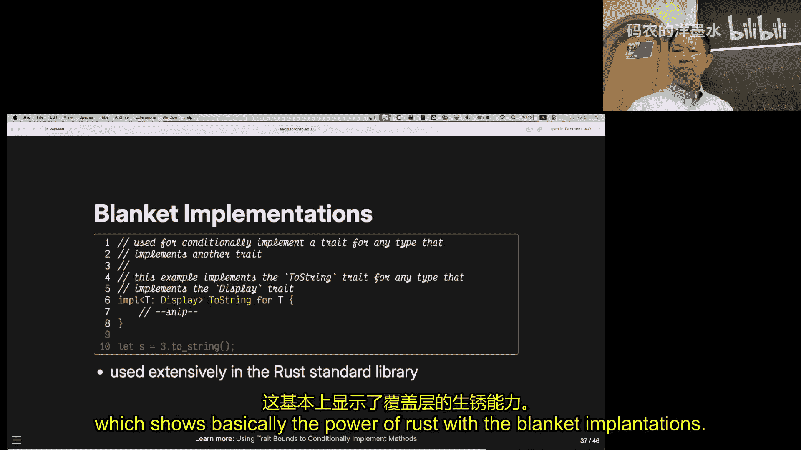

本节课中我们一起深入学习了Rust的通用数据类型。
1.  我们探讨了泛型类型参数在结构体、实现块和方法中的混合使用，展示了其灵活性。
2.  我们理解了Rust **零成本抽象** 的承诺，以及编译器通过 **单态化** 消除泛型运行时开销的原理。
3.  我们系统学习了 **特质**：
    *   如何定义特质作为行为契约。
    *   如何为类型实现特质，并了解了“孤儿规则”。
    *   如何使用默认实现和特质继承来构建灵活的行为模板。
4.  我们掌握了使用特质的两种主要方式：
    *   作为函数参数（`impl Trait` 和特质约束），以编写接受多种类型的通用函数。
    *   作为返回类型，尽管有单次调用返回类型必须一致的限制。
5.  我们学习了高级特性：**多重特质约束**、**`where`从句**、使用特质约束进行**条件性方法实现**，以及强大的**覆盖实现**。

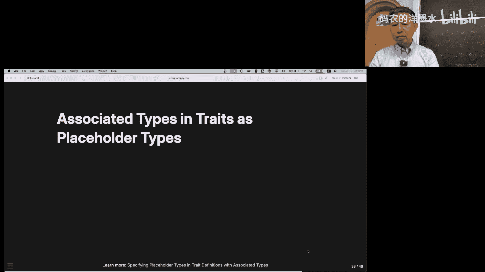

这些特性共同构成了Rust类型系统的核心，使其在保持高性能的同时，具备极强的表达能力和安全性。在下一讲中，我们将探讨Rust另一个独特且重要的概念：生命周期。