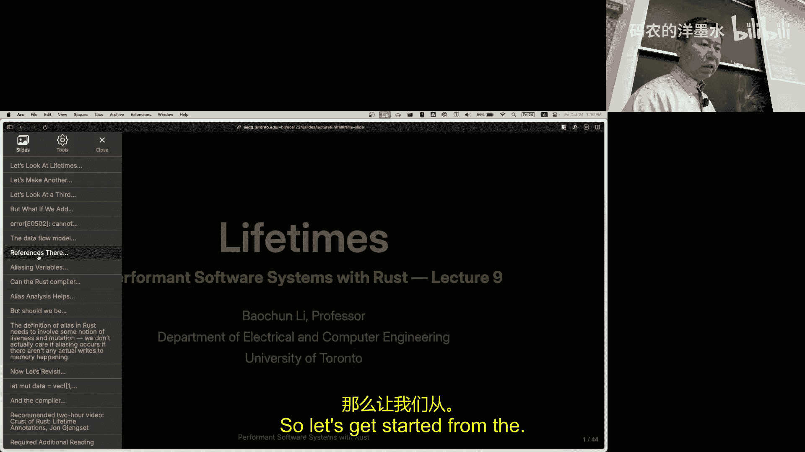
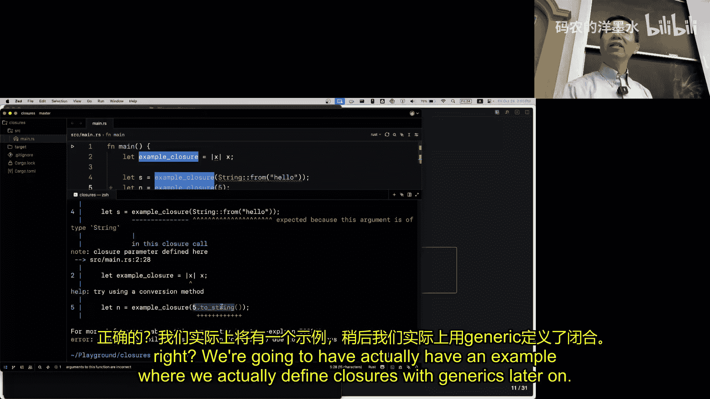

# 【全集 附课件】多伦多大学 使用Rust构建高性能软件系统 中英字幕 1080P p13 Lecture 13 - 函数式Rust part1 -BV16V62BhEuf_p13-

Alright， so let's get started。 Now， last time we talked about lifetimes。 And today。

 we're gonna just wrap it up。 probably the first 20 minutes。

 We're gonna to review what we locked talked about last time。 and we're gonna talk about aliasing。

 which we did not really finish discussing。 So let's get started from the。

The references。 And last time we said that just want to reemphasize that we have two different kind of references and we have the mutable and shared。

 So these are the two different kind of references that we have。 And we also mentioned two rules。

 These are always the case enforced by the Ru compiler。

 and we're gonna to have to remember both of these rules。

 The first one is everything we talked about last time about lifetimes is for the compiler to enforce this rule。

 This is about a reference cannot outlive。Whatever that is referring to， it's referenceent。

 And the second rule is。Basically about aliasing。 and we're gonna get into a little bit more about aliasing today。

 and it says a mutable reference cannot be alias。 And you know， if you remember。

 we previously used different languages talking about something like this。

 We said that you cannot have a mutable borrow and an immutable borrow and at the same time。

 you cannot have two different mutable references in the same time。 but the same time。

 what I really mean here is like previously we said it's the same scope。

 But now we're basically saying it's the same lifetime。

 there there are subtle differences between the two， we had shown a few examples over there。And。

 but in general， aliasing is kind of a more fundamental idea。 This is a more fundamental concept。

 What do we mean by aliasing towards the end of the previous lecture， We mentioned this briefly。

We said that a variable， and。Anything that points to anywhere in the memory。

If they refer to overlapping regions of the memory， for example， they refer to the same region。

 that would be the overlapping region。 That's the definition of aliasing。

 We said these two with alias if they refer to overlapping regions of memory。

 And if we go back to our previous rule， we said a mutable reference cannot be alias。

 which means that when the mutable reference is alive when it's alive。

 there should be nothing else that really refers to the same place， same region of the memory。

 and that would be that that can also be alive。 So that would be enforced by the compiler and this is something that is unique to rust。

 it's all about you know memory safety and everything， but it's a little bit beyond memory safety。

 We basically had shown we started to show one example didn't have time to finish showing this。

 spend a little bit more time talking about this today。One example。

And this example is really not about memory safety。

But we also used the example to show that this feature of rust that no mutable references can be alias。

 That feature， that particular guarantee from the compiler can also be used for compiler optimization。

 So this is our example here。So we have an example where we have a function compute and it takes two different parameters。

 An input， which is immutable reference and an output， which is a mututable reference。

And then we're gonna do something kind of funky， something kind of strange。

 We said that we're gonna dereference input。 if the value of this is greater than 10。

 the output is gonna restore one to that particular location and if the input is greater than5。

 we kind of multiply whatever we have in that location that output by two and then if we combine these two if statements you will see that input greater than 10 output would be one and input greater than 5 is's going to multiply by two。

 then obviously if it's greater than 10 the output is gonna be2 So that's kind of obvious if you combine these two statements So the question here is can the compiler try to optimize a little bit rather than going through two if statements。

 can we just go through one if statement Can we change the implementation of compute automatically completely by compiler by backend analysis of the compile。

They were saying， let's first cache the input。And in the register。

 let's call it cache to input and then we compare this value and see if it's greater than 10。

 if it's greater than 10， obviously because the previous original implementation says the output is going to be two。

 we're not going to go through both of this statement， we're going to store two directly into output。

 otherwise， if the cache input is greater than 5， we're going to just multiply by 2。

 which is the second if statement of the original implementation。

So this would be one comparison when the actual cached input is greater than 10 as compared to two comparisons。

So you might say， oh， that's not a big deal， you know， just two comparisons reduced to one。

 but that's still something。 you know， you still do some kind of an optimization right here。

 Obviously the compiler can do more， but the question is， can we actually do something like this。

Can we do this， Can we actually try to say， let's take the input and， you know， cache it。 Well。

 it depends。 It depends on whether or not this output。

Really can be alias or not if the output can be alias。

 then if you actually look at the previous case， when the output can be alias。

 you will not have a guarantee that the actual output is gonna to be too if the output can be alias because whatever that input points to might be actually pointing to overlapping regions of memory。

 overlapping with the output and that's something that you know a conventional C or C plus plus program can actually do because you really don't know what's inside in these references。

 you don't know what are the actual addresses in these references if they actually can be alias。

 then the previous code can actually affect output by actually having input So that's gonna to be a problem and if that's the problem。

 then we probably wouldn't be able to do something like that。

 because the input can actually point to output。And that's something that is not something that we could optimize。

And because of that region， that reason， if this is the code that is coming from a C or C plus plus program。

 then the compiler can do nothing to optimize this， but if this is the code that coming from rust。

 this is obviously rust code， then we actually have a guarantee that before we come into this function。

 this output because it's a mutable reference， there' will be no alias whatsoever。

 no other alive reference can actually refer to any overlapping regions of memory that this output represents。

 so that's not something that is possible that is guaranteed by the compiler and because of that even though we don't really have a lot of memory safety issues right here。

 we could actually do optimization。And this is very important。 In fact。

 this simplifies the compiler in terms of the way that it decides what kind of things can be optimized。

 and the compiler can actually do more optimization because of this particular reason。

 because of our rule that mutable references cannot be alias。

 There will be no overlapping regions of memory pointed to by the other immutable or mutable references。

 So that's something that is。Guaranteed by rust。 And this is something that is not guaranteed by the other compilers。

 And this actually helps us to optimize this code。 And you might not think it's actually important。

 it is actually quite important because the compiler these days can do a lot of things in terms of optimization。

 if you actually give it the chance。 Now the thing about you know， other programs。 And in fact。

 this is also the case for object oriented programming。

 So previously we mentioned that object oriented programming had something like a nice feature 30 years ago。

 people think it's a nice feature called polymorphism。

 You kind of like you have this dynamic runtime dispatch。

 You have no idea which function you're calling until it's the runtime when I do know which function I need to call depending on what the pointer points to what object it is is that the child is the parent or whatever。

 that's typically called polymorphism and it's a dynamic dispatch and that dynamic dispatch。

The bad idea， not only because of the semantics of this is actually harder to understand。

 but also one very important reason for that to be a bad idea is that it actually does not allow compilers to optimize the code because when you defer the decision of the dispatch to run time。

 the compiler， which is obviously at compile time， will have no idea which function are we calling and it will have no idea how to optimize the code because it doesn't know which function we're calling。

 So itll be way better to make it static dispatch， which means that I know which function to call any time I wish。

 I you know， I can't analyze statically at compile time。

 that gives compiler a lot of opportunities to optimization。 it will actually realize， oh。

 this is a whole chunk of code right here， It's actually just a little bit of code。

 So it can optimize to a little bit of code because it understands the code。

 The compiler certainly can do way more optimizations that。Can think。

As long as you're not using dynamic dispatch polymorphism in object oriented programming。

 which is a bad idea。Alright， so that's the about aliasing about compiler optimization here。

 And the rust can actually do this because the alias analysis helps。

 We have a guarantee that this mutable reference cannot be alias。

 And that shows us that the rights to output cannot possibly affect input。

 And that's something that we will be able to cache it。

 That's the reason why we can actually optimized。 This called to the second version compared to the first version。

 And that's very important。😊，And。So， we。Have the the second example and which is like to end asked the question。

 should we be concerned with aliasing in the this particular modified code and the reason that we already mentioned that we should not be concerned with this because input will have a guarantee that the doesn alias temp。

10 would be the output。 input will not change anything。 You know， it doesn't。

 it should not even overlapping in terms of the memory itself。

And that's why we could actually change we， we're not concerned with aliasing in this modified piece of code。

 And that's something that is guaranteed by the Ru compiler。

So just to sum up everything that we just mentioned the definition of aliasing in rust。

 it actually involves not just mutation。 You know， a mutable reference is all about mutation。

 Are we mutating anything in at that particular address at that location。

 but also a notion of liveness。 So any。Variable that we have in the code。

 we have the lifetime and that is inferred by the compiler。

 We will know what is the lifetime and the compiler you know will most likely infer。

 but last time we also mentioned when it's not able to infer。

 we will be able to say tick A tick B add the actual notation to help the compiler to inferre the liveness eventually the lifetimes of all variables can be inferred by the compiler after we gave it some help。

 And once we actually have the notion of liveness and mutation。

 then we are able to guarantee our two rules that we have。

 and we don't really care if aliaing occurs if there aren't any actual rights to the memory that is happening。

 So that would be one of the major benefits of using rust， not only about memory safety。

 but also about compiler optimizations。So just to wrap up and summarize what we talked about related to lifetimes last time and with one additional example。

lifetime involves。A region of code， right， So typically。

 it's unnamed because it is inferred by the compiler。

 but you could actually name it if like a tick K A tick B。

 if there is a need to add that particular annotation。

So that would be the region of code that a particular reference must be alive for。 Now。

 when a variable is not a reference， there will be no lifetime。 Only references will have lifetimes。

And the lifetime corresponds to a path of execution。 and that would potentially have ho in that path。

 We mentioned some exceptions last time。 Typ， it is the same as the scope of that particular reference。

 but they can actually have holes in between that particular scope。

 and that is something that can be analyzed by the compiler and inferred by the compiler。

 So the compiler can actually identify， oh， these are the holes I have in the scope that， you know。

 the thing does not have to be alive。 and we're gonna just exclude those regions from the live of that particular variable。

 that reference。 and thats something that the compiler can do automatically。

 and that allows way more code。 previously a long time ago and the very early versions of rust。

 These holes do not exist。 the compiler is very strict just the scope。

 and that excludes a lot of code。 and we wouldn't want to have that。

 We want to include as much code as we want。As we can。And then most lifetimes in rust。

 they are actually inferred by the compiler。 We don't have to worry about it。 It seems natural。

 typicallyp， if you tend to think in kind of the language of lifetimes。 if you。

 if you start to think about each one of these variables having a lifetime or you know simplified version of that would be having a scope。

 then you will think that it only lives till the end of that lifetime。

 And if you start to think about it like that， you will have fewer and fewer and fewer of E0，3，0。

6 errors， you know， that you cannot basically the variable does not live long enough。

 So thats that these are the errors， typically you get a lot of at the very beginning。

 but then when you start to think about it a little bit more you wont really try to understand for every single reference。

 what is its lifetime， it's gonna simplify your your way of。Programming。

 its gonna change your design。 Fundmently， it changes your design， because typically。

 if you're using the C， plus plus way of design your code， you get tons of these lifetime issues。

 does not live long enough。 does not live long enough。 But eventually gonna have to rethink。

 You're gonna have to think about something else。 And this is where actually。

 large language models does not help you。Because if you give it to the large language model。

 typically， what it does is that it's gonna clone。 It's gonna say， oh， I'm gonna clone， make a copy。

 make a copy， but not necessarily you clone。 sometimes it's okay to have a reference。

 you might want to have a reference rather than the clone。 So to avoid having lifetime issues。

 you need to kind of smartly navigate the actual design or even refactor the design。

 just twist it up and down a little bit so that the lifetime issues naturally go away rather than cloning here。

 cloning there。 know， if you have hundreds of lines of code。

 that actually makes the code worse rather than better。 So you know， some of the intuition with the。

 oh， if I have a the variable does not live long enough。

 they give the large language model I gonna fix it for me。No。

 not necessarily the case because large language models may not refactor the entire code。

 changing hundreds of lines just to fix that one compiler issue。 It will probably just clone for you。

 And that's no good。 And you don't want to do that。 You want to rethink the design。

 You want to think in the brand new way where the world actually had lifetimes in the past before us in C plus plus any of the other languages。

 The world does not have lifetimes。 That's when you have the leisure of your luxury of， you know。

 trying to use these references of wherever you wish。

 But now youre forced to think in the area in the world of lifetimes。

 Here's another final example about lifetimes。 Just want to show you a little bit about what the compiler is going do。

 So we have a vector， first line。And that vector， we are taking a reference to the first element of that vector at index 0。

 And then we're gonna push 4。To this particular vector。 And basically。

 we're adding a pending one additional item to this vector。 and then we're printing it out。

Priinnting out the actual reference， which is x， which is the first element。Is it okay。No。

 we know that it's not okay and very good。 But， you know。

 the compiler will have to give us a compile time error。 So the compiler is gonna just， you know。

 step step at the time， analyze this code。 So this is what the compiler is going to C。

 So whenever you have a variable in this case， any variable with references in this case。

 data would be such a variable because it's a vector and it contains references。 by references。

 I mean， basically will have to be stored on the heap all of the elements in that vector。

 So that would be something that need to have a lifetime。

 So the compiler will take a look at this and say， okay fine， this is where it starts。

 The lifetime starts right here， that would be let's call it tick a that would that's the first line。

 line number two there。 And then we have another reference， which is X。

 And the compiler is gonna see this and say， okay， the you know data with a square。of0。

 So what we're really doing is that we're kind of unwrapping the synthetic sugar。

 The sugar is basically saying that we're taking an index function and that index function is going to take the the data as the first parameter。

 the index， which is0 as the second parameter。 And then we're going to try to。

Use that result of the index function to assign it to this variable X。

 And X would be where you have a lifetime as well， because this is where you're using data。

 and data would be a vector。 and that vector has references。

 which means that it does have a lifetime。 So that's when you start the lifetime of take B。

 So you're gonna have to unwrap this synthetic sugar and saying figure out that this is also something that we need to have a lifetime。

 So that's take B right there。And then we have the。The push and that push。

 even though it's the third line， it actually has its own lifetime， which is tick C。

 and that's analyzed by the compiler。 And this tick C is a temporary scope。

 It's a temporary lifetime because we don't really need to do anything more than this push after the push happenings。

 So the C is just enclosing this push operation， this push call。

 and we're pushing to the end of the vector in that particular lifetime C。And then we have this X。

 which is to basically have this tick B right there。

 and here we basically have this error and the error is cannot borrowed data as mutable because it's already borrowed as mutable as immutable because basically these two lifetimes T B and tick C they overlap right they overlap because tick B is you know overlapping with tick C。

 and that is causing this particular error based on lifetime analysis。

 All of that is done completely by the compiler， you don't have to worry too much about it。

 but obviously if you remove the print， it is going to compile because there will be no more overlaps in terms of the actual lifetimes that the compiler can see。

 and that's something we have previously seen。 So this is what the compiler sees。

 it's going to do the static analysis of lifetimes of every single variable that actually。

As a reference， and then it will try to see if there are any overlaps where you have mutable and immutable overlapping at the same time。

And obviously， we don't have time to talk too much about lifetimes either last time or today。

 But there's a recommended two hour video crust of rust， Life annotations。 It's on YouTube。

 Two hours is a long time， but I think it's， it's good。 I actually spend way more than two hours。

 I spend five hours watching the two hours because I'm gonna have to pause go back。

Listen to it again or watch it again。 pause， go back and watch it again。

 There are a lot of very advanced material in this particular video。

 and it's considered some of the best related lifetimes on YouTube。

 So highly recommended you take a look if you worry about lifetimes。

 Otherwise you will at least read the chapters in the in the Ru book。 by the way。

 it is kind of intentional that our lecture material is kind of structured that is。😊。

Around the same as the textbook， but kind of extending when we needed the extension。

 but typically around the same as the textbook so that you can take a look at the lecture notes and then you read the textbook at the same time。

 and you kind of understand both of these kind of at at the same time。

 So that's something that is intentional。 We kind of try to mirror the textbook as much as we can。

 So let's。Go back to lecture 10。Alright， so the lecture 10。

 the next episode is all about functional programming。All right， so functional rust。

 that's all about functional programming and this is only two little sections in chapter 13 in the rust book。

 but it's actually a little bit deeper than that。 So we're going to spend a little bit more time probably spend as much time as we can to really try to dig into this because functional programming is not natural to a lot of the kind of programmers。

You know， if you really came from places like C and C plus plus or even Python。

 you may not be very familiar with functional programming。

 even though like C plus and Python actually supports functional programming。

 you may not be familiar with it。What it does is that we're trying to treat functions as sort of like firstclass citizens these are things that are treated as just like variables that we could actually try to apply。

 we could use， we could compose them， these a very classic way of doing programming。

 this came from more than 50 years ago， but it just never took off you know for example in Java if you used to write in Java programs you know you rarely use functional programming these functions are firstclass citizens they can actually be stored in variables。

 they can be used as parameters when you call some of the other functions， they can be named。

 you can bind them to names， they don't have to be named， for example。

 and they can be passed as arguments， you can return from the other functions as you know little functions can be returned as just like a return value just like。

Me variableable。 and that would be something that is a first class citizen。

 That's what we mean by a first class citizen。 This is kind of strange at the very beginning because at the very beginning。

 when you're used to so used to this， what we typically call procedural programming paradigm。

 this procedural way， like the C and C plus plus procedural。 All of that。

 you kind of you're used to that way of thinking， you cannot adapt to the idea of having this function as first class citizens。

 something that you can just pass a function， just like a variable as a parameter to another function。

 return a function any time。 You know， you don't really have that idea。 But today。

 we want to develop that。 if you're not used to it， we want to develop this。

 How many of you have used functional programming in Python。Hython， no， no okay，1 in C plus plus。

 Okay， quite a few。 That's great。 So C plus plus supports functional programming。 But unfortunately。

 a lot of the courses that are more traditional。 They don't teach functional programming。

 they should。😊，It supports it very， very well。 But unfortunately， that's the case。

 How many of you have used the ones that we just mentioned right here， Hacal en closuresure。

 That's great， because they're just so。😊，Unique， let's just put it this way。

 or I can call it academic in the sense that therere kind of like， you know。More pure， you know。

 from the Lsp areas。 they're kind of like the creators of these languages。 They're saying， okay。

 functional programming is the best that that is possible。

 Let's use functional programming as much as we can not in rust in rust。

 You can use whatever you wish。 You can use functional。 You can use， know， methods。

 conventional functions。 You can even pass conventional functions as closures， you know。

 in functional programming。 even that is possible。 it's a lot of flexibility in rust。

 which is kind of what I call the more pragmatic way of doing this。

 So you gain all of the benefits of functional programming。

 but you're not kind of locked in functional programming like these languages that are kind of academic and not as popular。

 So that actually gives us kind of the best of both worlds in some some sense。

 We have both flexibility and we have the benefit of functional programming whenever we needed those things。

 So that's great。 That's something that we wanted。 So no has。😊，Oh closure， except that our functions。

 little functional programming functions， we're gonna give them a new name。

 We're gonna call them closures， just like the name of our other programming language that is doing functional programming as a specialty closures would be our little names for our first class citizens using functions。

 These are， we can call them anonymous functions， because a lot of the cases。 In fact。

 most of the cases。😊，We don't have names for these functions。 They just， they have no names。

 And that's why we just call them closures。 and the same name is used elsewhere as well in C plus plus in swiftif and elsewhere as well。

 And they're kind of， you can save them in variables。 You know， no problem。

 You don't have to do that。 You can pass them as arguments。 That's very typical。

 That's actually the most typical way of using these closures。 And you can also capture values。

 This is the most important if you're not able to capture values from the environment。

 the environment would be， you know where the closure is defined。 That would be the environment。

 like the context。 And you wanted to capture the values from the environment。

 And that's something that。Gives it the superpowers。

 So if you don't really have the ability to capture values。

 then it doesn't really have a lot of power。 It's gonna to be the same as functions。

 Why would you do that？ Well， here we have the ability to capture automatically the actual values from the environment or the scope of that particular closure。

 And that's something that gives us the superpowers of using these closures。

And a lot of talk and not a lot of examples。 so let's try to get us into the first examples。

 which is the same example as the rust book。 So here we have an example。 every so often。

 the t-shirt company gives away some limited edition key T-shirt as a promotion two colors。

 red and blue anybody who wants a t-shirt can actually request a particular favorite color。

 If they actually make that request is's optional， they don't have to if they make that request。

 they will be given the t-shirt of their favorite color。 So that request will be satisfied。

 And if they don't give that request。 you know， it's optional。 anyway。

 then we're gonna give them whatever color that the company had the most in stock。Alright。

 so if the red had most in stock and give the red T shirt， otherwise we give the blue T shirt。

 that's it。 So that's the basic idea。All right， so let's start programming。

Very intuitively we wanted to have an enum to represent the shirt color so by this time。

 obviously we wanted everybody to really understand the power of enums you we' almost never you know kind of overuse the enums here obviously we want to use enums here thatll be shirt color red and blue and then we're gonna to have our inventory and that it is a struct and we can actually define methods on this particularstruct it's our ownstruct and obviously it contains a vector of shirts。

 each one of them with a particular color and that's you know our struct and where we can define methods on。

Allright， so let's define our method。 So the first method is most stocked and this is a very simple method that takes the actual inventory itself。

 it's a method。 so it's immutable reference to self as the only parameter and returns the actual shirt color and this is obviously a very simple implementationation that returns whatever color that has the most in stock。

 we're going to count the number of red color shirts， blue color shirts starting from zero。

 we' going have a for loop same thing as before four color in this immutable reference to this particular self dot shirts which is a vector and then we're going try to see how many do we have by having match because we'm gonna have two colors and the colors are stored in an enum So very naturally when we process that particular enum we need a match and this is exhaustive match。

 we only have two colors， we count the actual numbers and then。

Were going not just return either the red color to be the most stocked or the blue color to the be most stocked。

 All right， so this is a very simple function。 No closures are needed inside this function。

 And this is something we could actually try to define。And we can use that in the closure。

So how do we use this in the closure。 So this most stopped is returning a shirt color， right。

 so it doesn't really matter what what it does to implement it， but it returns to short color。

 So what we do is that we try to have the second method on the inventory。

 And let's just call it giveaway。And this method。Is going to take the second parameter of the method。

 It's going to be a user preference。 And we mentioned that the user preference is optional。

 We don't have to specify the red or blue preference。 So it is optional of color， short color。

And then it's gonna to return whatever shirt color that we need to give to the user。All right。

 so how do we implement this well？We're going to take。The shirt， the user preference。

 which is the an option of shirt color。 And we're gonna use a very special。😊。

Method on that particular option。And previously we mentioned there are many。

 many ways of processing an option option is simply just an enum of sum and none。

 but here we are using one of the ways and this way is just happens to take a closure as a parameter of that particular method and that closure is called unrap or else。

And that function is going take a closure。 And we have this simplest way of writing this closure。

 And this closure。 we have the two vertical bars。 typicallyypically， we just call them pipes。

 Why do we call them pipes。Why do we call them pipes， the two vertical bars。

 Why do we call them pipes。Typically you just say pipe。Yeah。Exactly。

 is the pipe that we have in a Unix operating system。

 the venerable Uni operating system where you use pipes all the time。 if you are good with Unix。

 And by the way， Unix， basically， when I say Uni， I mean， Macos and Linux。 All of the other variants。

 they basically went away。 P SD Solars。 They went away。 but it doesn't include windows。

 So that's why you should never use Windows， you should use a windows。 sorry， Unix variant。

 not windows。 if you use windows just use Uni inside Windows。 Now。

 here we have the pipes to represent the parameters。

 And here we're not really giving any parameters in the two pipes。 So this's empty。

 So that basically means that we don't really have anything explicit to say as the parameter of this particular closure。

 But that doesn't mean it doesn't have any parameters because you can see in the actual implementation of the closure。

 We say selfdot most stocked。And most stock is obviously a method on the inventory stock。 But self。

 what is self， Well， self is。You know， where the closure is defined， this is in the scope。

 and this is steam barber。So what we're doing is， even though we don't have anything in between the two pipes。

We capture self automatically from the environment where the closure is actually used。

 So that is the power of closure。 We kind of capture the environment automatically。

 which is basically， in this case， self。Right， and。This closure is passed into the unwrap or else。

And unwrap or else， basically it's one of the methods on the option。

 What it does is that it's very simple。 and we're gonna to show an implementation later on today。

 It's very simple。 what it does is that it takes that particular option。 if it's a sum。

 it will just return whatever in that sum， and if it is not a sum， if it's a nun。

 it will just run the closure。And whatever the closure returns， that's gonna be the result of。

Calling this unwrap or else method。 And this is exactly what we wanted， right， If it's a sum。

 we're gonna give， you know， whatever color that the user requests， we're gonna give that color。

 Otherwise， if it's a none， no preference， then we just give the most stocked color， red or blue。

 So our either way， we are returning the type of shirt color， right， because if it's a sum。

 we're gonna take shirt color， which is inside sum， and we're gonna return that otherwise， otherwise。

 we're gonna return the actual shirt color from the most stock because most stock returns a shirt color。

 right， So either way， we return the shirt color by calling this unwrap or else。😊。

And that's very powerful because really what we're doing here。

 this is like really ergonomic way of writing this。 by the way， this is a very simple example。

 you can write it， however you wish there are many。

 many ways of writing this particular implementing this particular feature。

 but this is kind of the more ergonomic or the more rusty way of doing this in the sense that we are doing this by using a library function unwrap or else is a library function。

😊，And we're passing in our own closure as the only parameter into that library function。

 Everybody got the idea so far。 Allright， So let's get into a little bit more into closures now。😊。

Alright， so let's think about type inference，2， two issues， T inference and annotation。Typically。

 the closures do not require you to annotate the actual type of parameters or the type。

Of the return value， unlike functions in， in functions， you must。

Declare and annotate the type of the parameters and the type of the return value。

 And this is the difference between closures and functions in here is because that typically we're not using them the same way。

 closures， they're not used in some kind of an exposed interface like functions to functions are more rigid。

 They're more exposed。 kind exposed to the users to call。

 So you have to define the contract in that particular parameters and return value what the types are。

 but closures， they're not so exposed。 They're more like passed in as parameters or in very rare cases stored in variables。

 These are you know， most likely passed in as parameters。 So in those cases。

 you're you're kind of not're using them only in the context right there you're not exposedosing the function to anybody else to call。

 So that's why you really don't have to annotate the types of the parameters。

 But if you really wanted to annotate the types for I don't know what。Reason， probably clarity。

 readability or something。 If you really wanted to do that， fine， you could do it。

Here's an example of annotating the types of closures。

 So you could actually try to say between the two vertical bars， the pipes， we have a nu。

 and that does not have to be annotated。 but if you really wanted to annotate it， you could say U 32。

 And then you return a type。 and that type is U 32， typically it is inference。

 but you could actually try to annotate it。And then inside that closure， you could implement it。

And in our previous closure， if you actually remember our previous closure right here。

 we don't really have the the brace braces， right， the beginning and the end of that definition of the closure。

 because we only have one return， right that the self that most stop is actually the return value。

 So we don't really need to have like really the brace brackets。

 And here we are actually having multiple lines of code。 in this case， three lines of code。

 we're returning numb， which is the same as the input parameter numb。 But before we do that。

 we're gonna print something， we're gonna try to sleep for two seconds。

 So we do something right there。 So that's why we have the brace brackets to start and end the actual closure just like a function。

 So if you actually look at the closures like this。 this looks very much like a function。 In fact。

 you could define this just like a function。 You can say fun， you know， Fn expensive closure。 know。

 with。😊，Practices， numb， U 32， and so on。 You can do it like that。 It's the same thing。

Except that we're， you know， right now， calling using a closure to do it。

 using the grammar of closure to do it。 We have the explicit type annotation for the return。

 and we have explicit type type annotation for the actual parameters。 And also。

 we actually assign it to a variable so that later on， we could use that variable。 anywhere。

 we have the luxury of using a closure。 for example。

 we can pass that variable to a function if we wish to。😊，But we don't typically have to do that。

 Typically， closures are anonymous。 You don't really have to assign it to anyone。Alright。

 so now let's take a look at the differences between a function and several grammatical ways of writing the closure。

 So function version 1 is just a conventional function just like before we have the parenthesesis we have the return type。

 we have the brace brackets to define the beginning and the end of the function。

 and then we could actually use explicit type annotation and assignment like before just like the previous light。

 and then we could simplify this by removing the actual annotation of X and the annotation of the return value。

 we don't have to have that。 the type inference is something that the compiler can do to infer what the type is。

 We're gonna talk about this inference a little bit later with another example。 But for now。

 you just believe me that the compiler can infer what we're doing here。In terms of the types。

 So even though you don't give it the types， it will be able to infer what the type is。

 So you just say x and then return x plus1。 And obviously， since that x plus one is the only return。

 The brace brackets are actually not required。 They're optional and the closure body and only one expression。

 This is the special case where we don't need the brace brackets。

 So all four add ones are pretty much the same。 except the closures are simple。

 Theyre more simplified because of the type inference， you don't have to annotate the types。

 And in a lot of cases， you don't even need the brace brackets。Alright。

 so now let's take a look at one example。 This is kind of like a silly example where we have a very simple closure。

This simple closure had。One parameterter。And it's X。 And we return one parameter， which is X。

 So that doesn't make sense。 It's like a silly closure。 But let's try to use it。

So we have two different uses。 We have the example closure from， you know， passing a string into it。

 And then we have another example closure call， and we're passing five to it。 What happens here。

What's going to happen。Any ideas what's going to happen？Y。对。It is gonna be a compile time error。

 And you know， roughly speaking， what's the type， What's the kind of error that we're talking about。

一。Exactly， so like line number three， we're passing a string into it。Right。

 so that would be kind of giving the compiler a sufficient amount of hint so that X would be a string。

But now， starting from line number 4， you're kind of using the closure in a different way。

 You're saying， okay， I'm passing a number there and that is not allowed because it's already inferred to be a string。

You cannot have a number。 You cannot have two different types for the sameclo， right。

 So if let's copy this， and just try it out。You know， just a little demo here。 So let's try to。Cargo。

 new closures and closures。And let's start our Z compiler。so嗯。

Let's try to cut and paste the code right here。And let's try to compile cargo Bu。

And if you compile it like this， you will see that it will say。Mismatched types。Why。

 because line number5， which is this line where we are calling closure with the5。

 this is where we are expecting the string found integer argumentsments to this functions。

 argumentsments to this function are incorrect Note expected because the closure was earlier called with an argument of type string。

And this is where the earlier call is， which is line number four and it's setting， you know。

 I love this compiler， you know output。 you't have to appreciate。 this is a lot of art。

 it's artistic， it's beautiful you know with the ASI you know like this stuff right here。

 Exp because this argument is of type string and right here and because there's no space right here。

 it will go to the next line and say in this closure call right here， oh my goodness lovely。

 lovely absolutely beautiful。 It's way more beautiful than any large language model's gonna give to you So if you read it if you you know if you are careful enough to read it。

 it's very nice it says closure parameter defined here。

 this is where you have try using a conversion method， for example。

 we actually give you this help to string so that you can match the type So this is about type inference and it tells you where the closure call is for the compile。

😊，To make that inference， to make it actually a string rather than anything else。 Allright。

 so type inference doesn't happen just completely magically。 It happens the first line of call。

 When you call it the first time， it will infer the type。 And then that's it。

 you cannot change the type， y。Oh， the question is。

 can't you define this as some kind of a generic type， You certainly could。

 You certainly could do that。 But then， of course， you're gonna have to use it in a different way because you're gonna have to define it as generic。

 We certainly can do that。 Anything can be done just like functions。

 And then you have to use it in a different way so they can actually pass a generic type。

 right in right We're gonna have actually have an example where we actually define closures with generics later on。

Alright， so now， before we go into the three ways of capturing values from the environment。

 which is the hardest part of today's lecture， Let's take a break， take a five minute break。

 Let's return at 20 20，8， and then get started with the hard part。

