# 【全集 附课件】多伦多大学 使用Rust构建高性能软件系统 中英字幕 1080P p14 Lecture 14 - 函数式Rust part2 -BV16V62BhEuf_p14-

All right， so let's get started with the hardest part of today's lecture， which is。😡。

There are three ways of capturing values from the environment。

 So I thought a lot about how should I deliver this particular part of the content。

 And I I'm thinking about the the most intrusive way。

 or the hardest way is to first tell you what are the three ways。

 And then we're gonna look at examples of each one of these。 And hopefully。

 you're gonna understand what these things are， depending on how well can I explain these things。

 These are harder to explain and harder to understand。Three ways of capturing values。Well。

 first of all， before we talk about the three ways， what do we mean by capturing values。 Well， we're。

 we're having a closure。 The closure has a scope， which is what we call the environment of that particular closure。

 And we mentioned in the most stocked example， We don't really need anything in between the pipes。

 We just directly capture self into that closure so we can call self do， you know， most stock。

 And that brings a superpowers of the closures。And that's what we precisely mean by capturing values from the environment。

 We're taking self completely automatically into the closure so we can directly use it in the implementation of that closure。

So the three ways of capturing values would be exactly the three ways that we pass parameters into any regular function。

 What are the three ways of calling a function， Well， we can borrow immutably， that's one way。

 borrow mutably。 That's the second way and we can take ownership。 That's the third way。

So these are the three ways of calling a function， and all three ways are supported。By the closures。

 And that's something that we want to get into having examples for these different cases。

So let's first take take a look at the first example， which is about borrowing immutably。

So how do we borrow immutably。Well， here we have a vector，1 to3， and we can use this vector。

 for example， we print out the list using the debug trade。 and then we are having a closure。

 This closure is just the closure that we define。 And then we assign it to a typical variable only borrows。

 and then we can actually try to just directly use that print line in the definition of the closure。

 So there's only one line of code。 and that would be where we don't need a brace bracket。

 and that is part of the closures implementation， and that says print line from closure list。

So what are we doing here， Well we're capturing the con the context the environment。

 We are capturing the environment， which is the list， right。

 The list is in the scope of that particular closure。 We're capturing that list automatically。

 and we're printing it out。 And then。😊，All we need to do here is that we can just say。

 let's print the list normally。Let's call the closure as it's defined。

 because if we just line number 5， when we just define and assign to a variable， it's not called。

 Obviously， it's just a function。 It's a closure。 That's not called。 Now。

 we're calling it by putting the parentheesis， calling the closure。 And then we're printing again。

So what are we doing here， What are we printing？ So let's just take a look。 Just copy this。

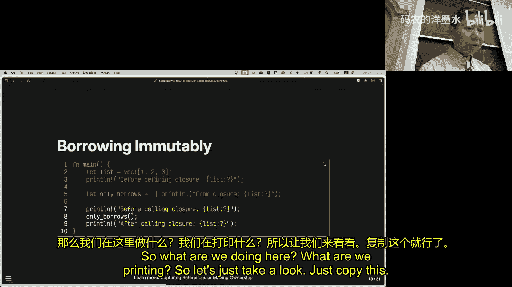

And let's try to copy and paste into our example code right here。And。好。😮，Alright。

 so let's try to run it。So， you can see， it's as。We expect it， right。

 We're printing the first time printing the second time calling the closure。

 which prints from within the closure the third time。 And then after calling the closure。

 we're printing it the last time。Just like we expected。

 So this is a very simple example of borrowing mutably。 sorry， immutably。 We。

 we have a vectors that we must borrow。 So that's borrowing immutably。

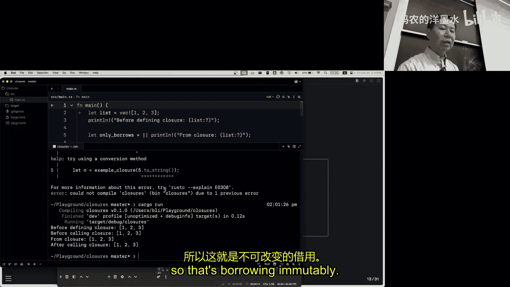

， so that as we expected， that's how we do it。Second case， borrowing mutably。

So here we're also capturing the environment。 but now we don't want to just print it out。

So we wanted to capture this， and we wanted to in between the print。

 We wanted to borrow this mutably， and we wanted to define this closure。 And inside the closure。

 we want to change the vector by pushing a new element into it。 So that's borrowing mutably。

 So what happens if I call this and then print again。 What happens here。What happens to this code？

So I print。I define the closure， I call the closure， and I print again。

 What happens again right here。Yep， compile time error and why。Or potentially modify the data。

 And when we're printing， we don't。Yeah sure。We're not sure of what。Well， what would the just。

 you know， just simply telling me what。Compile time error， roughly speaking that we will see。要。Well。

 like， what's the language the compiler is gonna tell us。Mutable borrow。

 something related to mutable B， you know， immable borrow， something like that， right。Exactly。

 so we do not allow the mutable borrows and mutable borrows to coexist。

 And that's exactly what we will see。 So， but exactly what we will see， Let's take a look。

 So let's change this to。

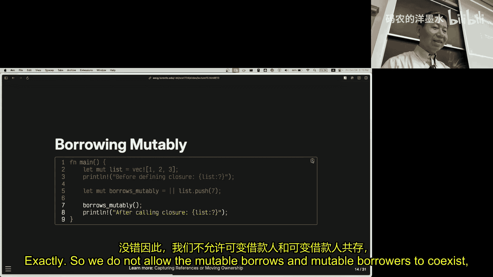

To this。 And let's try to。What happens here？What happens。Do we have any compile time mistakes？

Before defining the closure。We're doing this。 And after calling the closure， we are。嗯。

Pushing in anything。Anything here。Why is this？Why do we have this。But we have one right here。

Were capture。We're captured in mutable reference。 And then what where we are capturing the mutable reference。

 It's a mute。 It's， it's in the second case， right， It's a borrowing mutably。

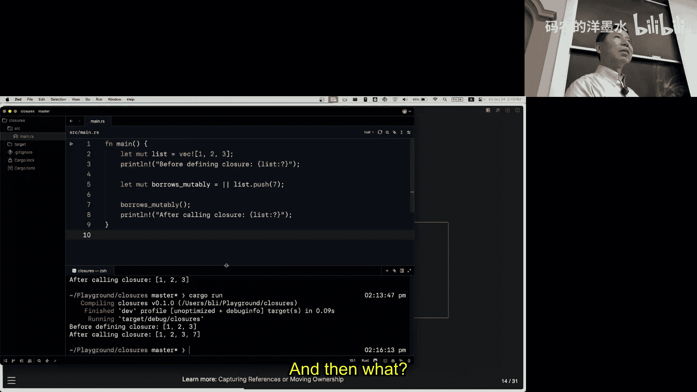

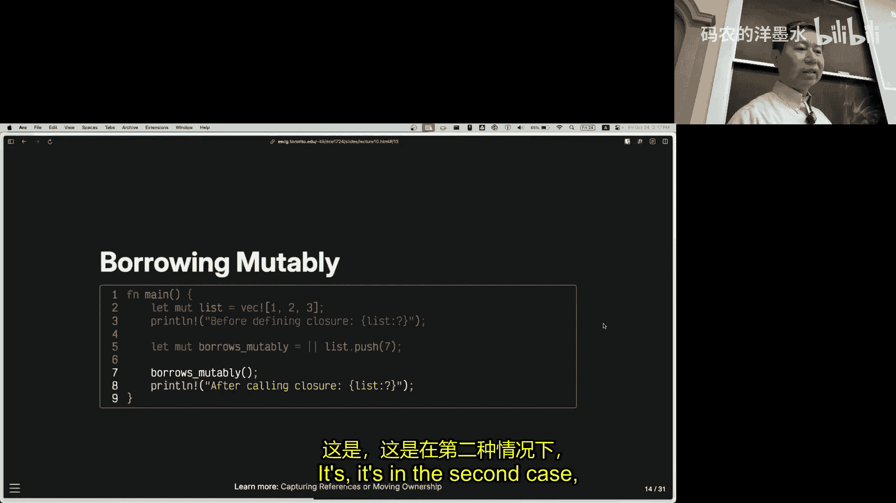

And what happens here。We're borrowing notably inside the actual closure。

 And then we are changing things inside the closure。And then we're printing them out。一。Exactly。

 it is related to lifetimes and what's happening with the lifetimes。Right。

 so in the lifetime of that is part of the actual closure， right？ So the whatever you capture。

 the lifetime of the closure of the whatever you capture in that closure is basically the closure itself。

 right， So you're not really overlapping in terms of lifetimes。

 And that is why we basically don't see a compile time error。

 rather than having somemable borrow mistakes， Muable borrow mistakes。

 We basically see some kind of a。Gap or， or like a hole in the lifetime， you know。

 where we don't really see。An overlap of lifetime。 And that is allowing us to do something like this。

 So that's borrowing mutably。

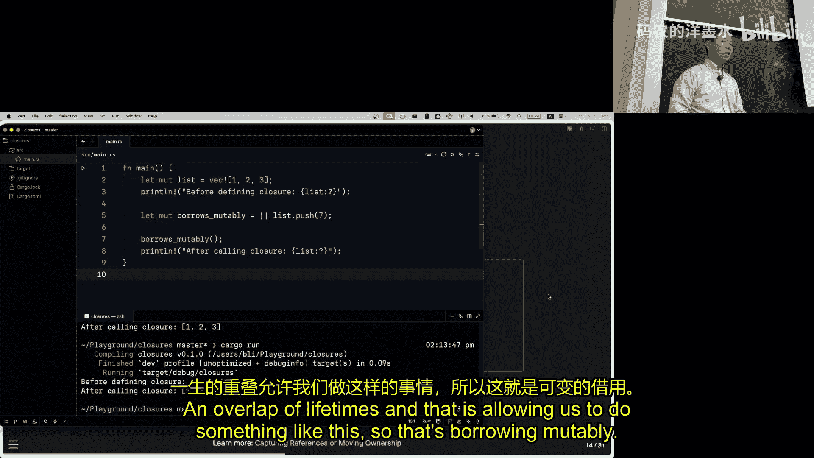

And then the third example is， again， we basically said anything we can do with functions。

 we can do with closures。 We can also take ownership。

 We can have more examples of taking ownership today when we talk about eitherers。

 But here by taking ownership in the conventional functions。

 What we mean here is we are actually trying to。😊，嗯。Really。Just like a conventional way。

 we're taking the ownership of the actual。The instance or the variable。

 rather than having a reference to it， right， So there are two ways we can have a reference or we can take ownership。

 Remember that。 So when the function is defined， we can take ownership and we can do the same thing right here。

 we can take ownership。And there are very rare cases where that we wanted to take ownership because of the previous success。

 Remember the previous example where we actually just borrow immably。 sorry， borrow mutably。

 And the compiler still allows us to proceed。 So in a lot of cases， mutable reference will be fine。

 There's no really conflicts of lifetimes。 in that sense。 But in very rare cases。

 we still wanted to take ownership。 And this is one of the rare cases。

Where we are actually talking about using threats。So we're creating a brand new thread using the standard thread library from Ru。

 which is ST TD thread。And then this threat library gave us a spa。

Associated function of that particular library。And that function is gonna spawn a new thread。

 as the name suggested。 And the question is， what is the actual code that we run in that new thread？

 Well， that's exactly what the closure as the parameter that we supply to that spa is gonna define the code that we need to run in the new thread。

So that's something we will talk about later on when we talk about fearless concurrency。

 you know threads， we talk about co-routines， you know everything nice and clean about rust。

 the only reason one of the most important reasons we use rust for anything related to concurrent programming rather than anything else。

 but here this is just a very simple example， but in this particular spawn we are expected to pass a closure in。

 but here that closure has something strange， rather than just two vertical bars and do something inside the closure。

 we're basically saying two vertical bars， but before the two vertical bars。

 we actually have the move。And move is a key word。And that move suggested to the compiler that we are taking ownership of the capture。

So whatever list。That we have。 We are moving that list from the environment into the closure。

 The ownership is moved into the closure， and。Then we can print it out。

And then after the spawn is spawned， it will be a new thread， It's actually running。

 And then if we call dot join， it will just use a typical operating system kernel system called join to really wait for the child threat to finish。

 And then a join actually returns a result that we can actually unwrap。

 So that's something that we can certainly do by creating a new thread and running this new thread with that particular closure。

 Now， why do we actually have to take ownership。😊，Any ideas。

 why do we actually have to take ownership。有。Because we want to take ownership because we don't want the other threat。

To modify this， exactly。 So we wanted to take ownership because we wanted to make sure that。

The parent threat is not changing it at the same time。 right。

 It's not writing to it at the same time。 So we don't really have this concurrency issues right there。

 right， So we wanted to do have this move， take ownership for that particular reason。 right。

 So this is one of the rare cases where we do want to take ownership rather than doing a mutable borrow or immutable borrow。

 And this is when we actually wanted to take ownership when we're spawning a brand new threat。

Alright， so now let's get into this previous example。 We remember the first example。

 the Thirt company example， where we have a giveaway function method。

 And we're using the unwrap or elself inside。The giveaway method。

 And that unwraper else is we we mentioned it's a rust library function。

 which is a function defined on。Otion。Right， so this is option。

 so what we are showing here is exactly the code that we see from the implementation of the rust standard library。

 So from the implementation rustta standard library， This is exactly the code that we have。

 So what do we do， We're implementing this option。 option is obviously taking a generic type and that type is T。

 So we basically say import and we have to have the T after the import as well between the import and the option。

 So both the option and import T。 And then we define this particular method。

 So this basically takes self。😊，And it's going to try to， try to return the type T。

 which is exactly what we wanted。 So we want to return shirt color， right， So that's what we wanted。

So what we， the semantics of unwraor elses we mentioned before is。If it's sum， if option is sum。

 we're going just unwrap the sum and just give x as the return because that's of type P。

 and then if we actually have a nu value in the option sorry， nonvariant in the option。

 then we basically have a closure and that closure is called F and that is passed in thats the second parameter of that particular unwrap or else you know right after self and that closure is called right here when we have a none。

Right， and what is that closure， Well， that closure can be any closure。

 So that's why we basically have a function F。That's a generic， as well。Right。

 that's a generic as well。 But that generic actually had a trait bound。 You know。

 remember this where clause， which is basically a trade bound。

 that we're bounding the generic type F to not just any function。

 It must be a function that number one。Implement the F N1s trade。And number two， returns the type T。

 Now， returning type T is easy to understand。 Reing type T is a must。

 You have to return the same type as whatever type in that option。 Obviously， if it's short color。

 you have to return shirt color， It cannot have anything else。 that is enforced by the compiler。

 That's great。 That's， that's easy to understand。 But what is that F N1s thing。Well， actually。

 from the name of that particular trade， you can see that trade basically says this function can be called。

At least once。咁咪 call。NoNot at least one， sorry。Just once。Alright。

 this function can be called just once。 So if that's the case， then。Basically。

 what we have is that we have。A way of defining the behavior of that function by using this particular trade called F N1。

 which is part of the standard library as well。 So let's get into this F N1 a little bit。And see。

 what are these FN1s business that we're talking about， What are these FN traits。

So the F N1 trade basically says a closure that can be called once。 Now， any closure。

Can be called once。 So when you say FN1， basically， it's just any closure， right。

 So the unwrap or else is very much a flexible method in the sense that it can take any closure as well。

 as long as it returns to type T。 and closure is fine because F N1 is more relaxed。😊，In that sense。

So what it does is that it moves the capture values out of its body。

 And that's the actual semantics of the FN onces。Trade， so it's called once。

And then it's moving the value that it captured out of its body。 sort of like it's stateless。

 It's not really my mutating anything。As opposed to and also all closures will at least implement this particular trait。

 So that's why the unwrap or else， as we mentioned， is the most flexible。

As opposed to F N mute trait， the F N mute trait， this trait actually binds these closures。

 the closures that don't move the capture values out of their body。

But may actually mutate the captured values。That's from the name that it suggested。

 the FN mute basically said it mutates the actual captured values。

 Anything that changes the capture values， those。Functions will be the F N mute trait。

 So if you actually say， I want disclosure closure that we pass in to this whatever method that we're implementing to really try to bind it to the F N nu。

 We're basically saying， you know， we expect some behavior that is more than F N onces。

In that closure， that closure may mutate the captured values。 So we're gonna see an example of that。

And then there's the FN trait， which is closures that don't move their capture values out of their body。

And don't mutate capture values。 or they just capture nothing from the environment。

 So that would be a third kind of trait that we actually have that you can actually say， okay。

 that's， you know， a little bit more requirements。 We require that they don't capture anything out of their body and don't mutate any captured values and。

 or they capture nothing。 So that would be like the contract that we have。

 So we're using these trade bounds to specify。 What do we expect from these closures that we have。

So the previous example unwrap or else basically says F and once would be good enough。

 It moves capture value out of its body。 That's fine。 So in this particular case， remember。😊。

That we have the previous example where we have F N onces。 And then we basically say we pass self in。

 It doesn't really matter because the self is gonna be， you know， not captured。

 It's gonna to be moved out of the body， no problem。 So that's why it's going to be okay。

 So that's you know， something that we expect from that closure。 no no problem。

 We can actually pass self in with no worries， no risks whatsoever。

 because we know that a function F does not capture the environment。

 Anything in the environment that does not capture。 So that's something we expect from the F N once。

Alright， so let's see another example of the F and mute trait where we bind our closure to that trait。

So here's an example。Again， this is like a lot of these examples are showing gradually showing us the beauty of rust。

 or at least the beauty of the rust standard library， where we are using these。

 you know functions methods from the standard library， you know。

 and designing our standard library the right way where we take closures and then we kind of be as generic as possible and things like that。

 so now we are having a rectangle struck just like before and we can print it out we derive the debug trade over there。

 And then we have this main function that first define a list of rectangles。

 different kind of rectangles。 And then we want to sort that list。However。

 we have something special because these， you know， instances of rectangles in the list。

 they have two different。Fuds in thestruct， width and height。

 we basically wanted to sort based on width。Rather than based on height or based on any combination of width and height。

 we wanted to sort based on width。And how do we do that。Now， in other programming languages。

 you tend not to think about it as using something like， like a library function。

 or you think about using a library function。 But you probably don't think about passing a closure into it。

But this is the right way to do it。 We use a library function。

Which is the sort by T function and sort by T function is a function of the vector。Type。Alright。

 and then。It's a method， it's a method of the vector type because it's basically list dot sort by key。

 And then that sort by key， we pass in a closure。Not closure， we have something very simple， we say。

Two pipes R。 And then we return R dot with。 What are we doing here。Where。

 we're actually passing a closure to specify that I wanted to look at the width field when I need to sort by P。

 You know， it's kind of。You know， initially， when you don't really think about it like this。

 it kind of feels like strange。 But after a while， after you start to think about it like this。

 you feel this is the only natural way of doing this。

 If you go to a different language that doesn't like see， for example。

 doesn't give you this superpower。 You will feel extremely uncomfortable。

 This is something thats really the natural way， you use the sort by key。

 But that you pass in the closure to tell sort by key， what is the key。😊，Obviously。

 this width will have to be something that can be used to sort， right， In other words。

 this width will have to be something that satisfies some trade， right。

 some trade that says that this particular width， in this case， is obviously can be sorted， integer。

 U 32。 But， you know， if it's a enum that cannot be sorted anything like that。

 and it doesn't satisfy the trade。 So you needed to have a trade to bind that， you know。

 whatever that you return， But then it's very importantly， this。

Actually may be caught multiple times。 So that's why this closure。Takes an FN mute。Trit， so。

 let's take a look at。Well， first of all， let's try to run it。 So let's take， take this code。

And try to run it right here。So here we have the， the code， just a little bit formatted。

 And let's try to run it。Alright， so we're able to print it out。 and it's indeed sorted by worth 3。

7 and 10。 And that's something that we expect the code to do and。😊。

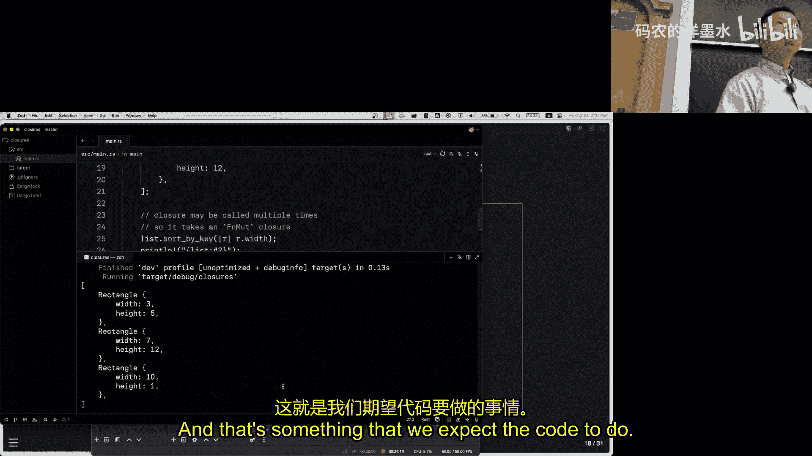

Now， if we actually try to do something like this。The question is。Will this code work。

 So the difference of this code and the previous code is that this code basically says。

 I'm passing a closure， but this closure。Is。Pushing the value。To the sort operations。

 which is also captured from the environment。 It's a vector that is defined before the closure。

 and it's captured directly from the environment。 And we are pushing a value into that into that vector。

 And then we return our dogworth。The question is， will this code work。Well， what do you expect。

 Do you expect this code to work。Let's try to copy this。

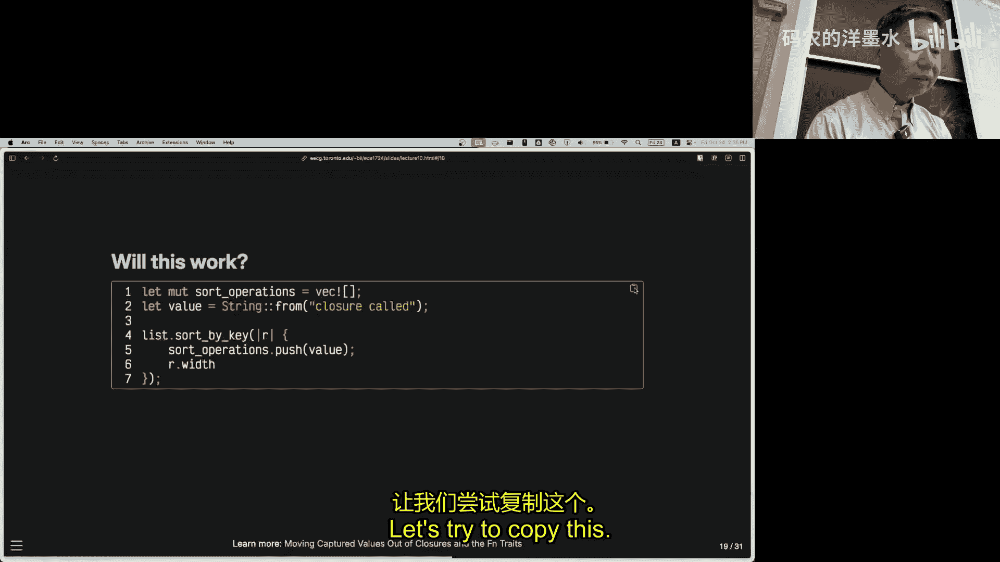

And let's try to paste this and try to see if we， if it， we have something that works。And。Allright。

 so。Here， you can see that we already got some hints that it might be a compile time error。Yeah。

 it is a compile time error。 So what happens？ Let's take a look at the compile time error a bit more closely。

 Oh， maybe I should really switch to。😊。

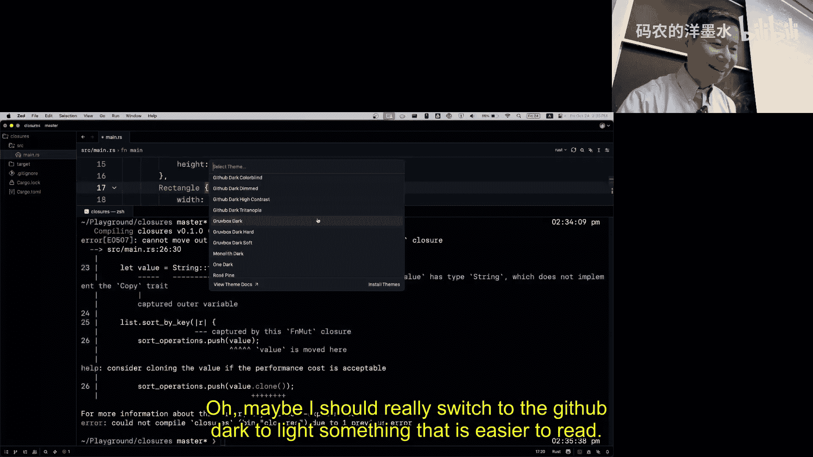

The Github dark to light， something that is easier to read。 Alright， so what。

 what are we talking about here says cannot move out of value a captured variable in an F N mute closure。

 Oh， this is where the actual trait。 F and mute comes in。

 So the first time you see this kind of error。 you kind of feel confused。 What do we mean by F。

 F N mute closure cannot move out of value captured variable in an F N。 So what are we doing here。😊。

So what we're doing here is that we're actually calling this value。

We're taking this value and we're pushing this value into the actual vector sort operations。

 And this value is a string。Which means that when we push that string into the actual vector。

The actual vector takes ownership of the string。Takes ownership of it。And this basically means that。

If you actually try to do it multiple times。You're not allowed because the value is gone。

 after it's taking ownership， it's actually part of the vector。 It's gone。

 You no longer have a second value that you can capture from the environment。 So if， but。

 but sort by K actually expects to call that particular closure multiple times because it needs to call it for every single element in the vector。

So that will give us to have this particular mistake in the sense that it says。

 cannot move out a value， a capture value in a F N mute closure。 So the first time you call it。

 it's fine。But the second time when you call it， obviously。

 you want to call it the second time or multiple times。You will have problems。

And that particular idea is actually captured by this FN mute trait。

 So because you define sort by key in your library So that expects FN mute trade into that particular library function sort by key。

That helps the compiler to market as a compile time error。Right。

 because you're capturing this in the in the function。 And that's something that really， you know。

 caught the compiler。 to be a compile time error。 So here we're basically saying you have more hints saying move occurs because value has type string。

 which does not implement a copy。 that's typically what we see for strings captured outer variable is the actual value that's outside of the environment that you capture in the closure。

 And this is where you can captured by this FN mute closure。

 which is right here are that is the FN mute closure that you have。

 And this is captured by this FN mute closure。 You know。

 just see that the compiler is trying to be as helpful as you can saying this expects to be F and mute closure。

 This is what is captured。 And value is moved right here。And that's the problem。Okay。

 so you cannot call this function multiple times， even though F M mut expects this to be called multiple times。

 you must allow disclosure to be called multiple times。 So here's more help。

 help consider cloning this variable for the， if the performance cost is acceptable。 obviously。

 if you start to clone and you're capturing what you're storing in the value is a cloned version。

 That's something that would be allowed by the compiler。

 So if we actually try to he that advice and call it clone。 it will be a no compile time errors。

But this is a silly way of， of， you know， this was here。 We're trying to say。

 let's count the number of Ps that we or the number of times that we called this particular closure。

 But this is a silly way of doing this。 We don't have to really push into a vector just to count the number of times we call it a closure。

 easier way would be something like this。 Can we do this。Let's say， count number。off。Times。

And that would be zero。 Can we do that， And then let's try to capture that and say count number of times。

pl。Eals to what。Can we do that， or there's no value here。So we don't need disclosure。Can we do that。

Well， if I save it。Oh， it doesn't seem like there's a compile time error。

Except for a warning of height， so we can， for example， print it out。And count number of times。

 right， So that's something we could do。 And let's try to run it。So if we do something like this。

 it would be okay。 And the reason for that is because we are satisfying the FN mute trade because we can call this function multiple times。

At this particular moment。 So now let's head back to our slides and take a look at this Oh the conclusion is that it moves value out of the closure by transferring ownership。

 obviously， into the vectors or operations。 And this can only be called once an FN ones closure。

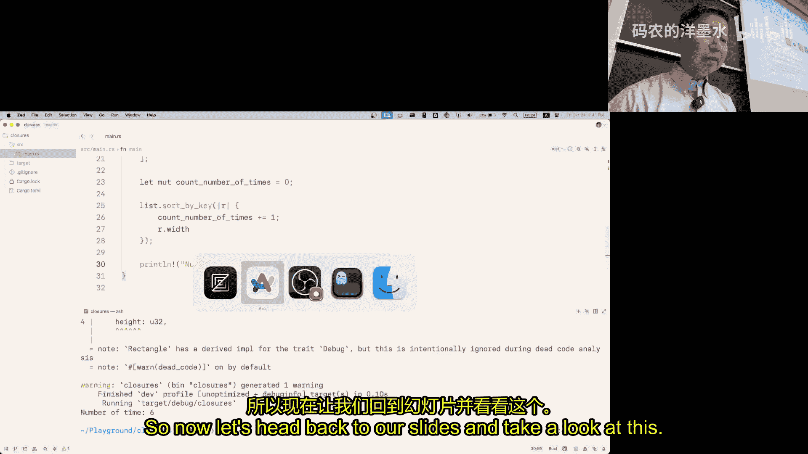

So， and this actually works。 This is something that we have just done。 It， it， it actually compiles。

 and this is satisfying our tradebound。 This is an FN mute closure。

 It only captures a mutable reference to this numb sort operations。😊，All right， so。

So we can take a look at this F N mute。 and we expect that maybe sort by key is defined， you know。

 in the standard library with the F N mute closure as the trademark， right， just like。

Our previous case， where we have。Remember， what is the library function that we previously talked about。

 FN1。The which function。The unwrap or else， exactly， just like that。 So how do we check， Well。

 we don't have a next slide to doing this。 So let's check by directly going to。A website。

 Let's do Google search。 Let's do sort by P rust。 And the first one， that would be， you know。

 let's searchify sort by P。 And this is sort by key right here。 So that's great。 See F M mute。

 Our friend F M mute is right here。😊。

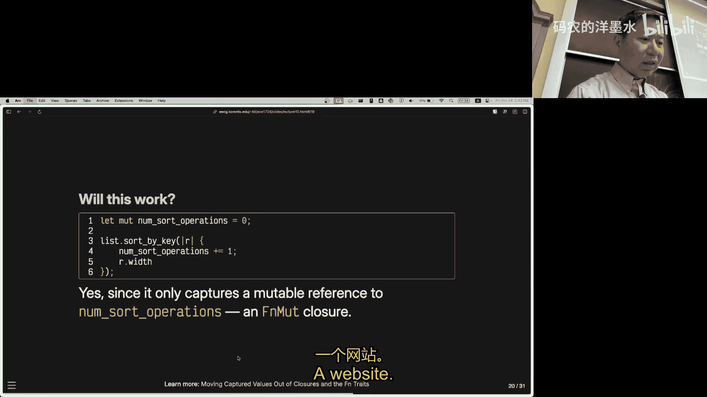

Right， where's our mute， Where's our friend， sort by key。Right here， F M mute right here。 See。

 that is the trade that we're doing。 So you can imagine that we are actually taking。

AMutable reference of self。 It basically means that we can actually allow the self to be mutated inside sort by key。

 In sort by key。 Obviously， it must be mutated。And we actually。Have the second parameter。

 which is F similar to unwrap or else， except that it is bound by FM mute。

 which basically means that we allow multiple times of calling this particular closure and this closure returns actual key K of type K and K must be sortable。

 It's bound by the or trade。 It must be sortable right here。

 So basically it will say that this closure。 It must be able to call it closure multiple times。

 You know， cannot just capture。 and you know， just do it once。

 And then it will have to return something that we can use to sort Okay， anything。

 So the I 32 would be a type that satisfy the the or trade。

 And that's something that is also mentioned in the library right here saying if the implementation of word for K does not implement a total order。

 blah， bh， blah， blah， blah and so on。So。This would be nice。 And， in fact。

 there's a little hidden treasure right here that you can actually call。 You can。

 you can click this little， little thing called source， and you can directly go to the source code。😊。

And this is sort of like， I don't know if you're into this。It's sort of going to a musical concert。

Like， you're appreciating the beauty。Like， this is beautiful， beauty of code。You don't think so。

 You never go to this musical concert。 Well， that's what I do。 I don't go to the musical concert。

 but I do read this thing because I derive pleasure reading this code。😊，Thiss beautiful， right。

 You just read not doesn't have to be rust， by the way， If beautiful Python code is also beautiful。

 beautiful type read code is also beautiful。 as long as beautiful code。 right。

 This is actually where large language models may not help you。 La language models can write code。

 But there's no guarantee this is gonna write beautiful code。 like this code。

 You cannot write this using a large language model， you're gonna have to have humans to write this。

 And this kind of comment is what large language models may not be able to give it to you。

 So this is something that you appreciate。 You know， you can read it。 Oh， my goodness。

 this is beautiful。 You know， trade bounds。 All of that。

 They all is like little things that eventually， each one of these had their own little semantic meaning。

 And once you start to click them into together， they become so generic and so。😊，你老。

Framework oriented so that anybody， anywhere can use this particular method that is defined on the vector。

 So that's really nice to have and。😊，I don't know。 It's， it's just， you know。

 it's a weird thing to do。 but there's a lot of entertainment of reading code， for sure。

 lots of things that you can derive pleasure from reading code。 Alright。

 so now let's go to my beautiful lecture slides。😊。

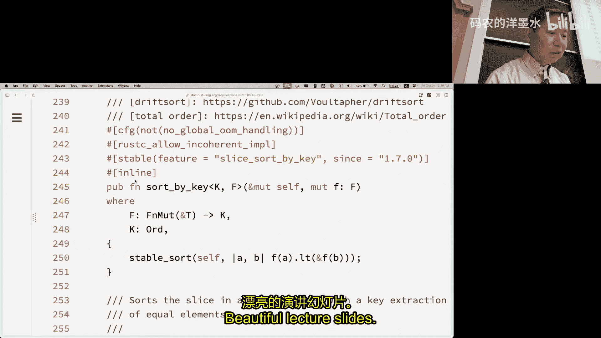

And let's talk about iterators。Right， eitherither errors we have talked about before。 Obviously。

 we have seen those things。 They allow you to perform a task on a sequence of items。

 We've seen those things before， but I want to get into a little bit more detail today。

Starting from the very first thing that you're gonna have to remember， I iters， they're always lazy。

When you create the iterator， nothing is done。 You just create one。Nothing is done。

 It doesn't start to iterate anything。 So these things are lazy。 By design， by the way。

 these things are lazy。There will be no effect until you start to use it or until you start to consume it。

 right， until you start to consume this， you start to call methods that consume the iterator to use it up。

 That's when the iterator starts to get into action， right， Initially， when you define it。

 It doesn't do anything。 These are lazy iters by design。

And iterators are also kind of a foreign concept to those people who are not used to iterators。

 So this is actually why I said you should not learn C or C plus， don't do that。

 Don't learn these languages， because they give you the wrong ideas。 For example， if you learn C。

 you will say4 I equals to 0 to I equals to whatever。J plus 1 or something。 No。

 you should never do that。 You should never go to indexes and try to iterate through an index in using some for loop。

 You always use iterators for those kind of things。 And that's the right way of doing this。

 Not only the rusty way， it the right way of doing this。

The reason why you do it in seed using the actual indexing is because the C does not give you the power of iterators。

 Allright， so we have seen this before。 We're using iterators， For example， here。

 we're using it in the for。But we wanted to say a little bit more about these iterators here。

 we have a vector 1，2，3。 And then line number 3， we are defining a iterator。

 calling dot either dot eitherer is obviously a library function that basically define the iterator on that particular vector。

 And now by calling dot either， we're not doing anything。 We're just creating the iterator。

 we are assigning it to the variable V1 underscore either。 And then inside a for loop。

 When they say for value in that iterator。 that's when we start to use up the things in that iterator。

 So the for loop underneath the carpet， it starts to。😊，Consume the iterator。

 It starts to take ownership。And consume the iterator。 You don't see that。

 but it's starting to do it。All right， so by the time when you create it， it's lazy。

 it does not do anything only inside a for loop， a will start to consume。Alright。

 so now let's take a look at the iterator trait。 We have seen this before because when we talk about the associate type of the traits。

 we actually talked about it。And this basically uses an associated type because it's type item。

 That's the type that we return in this next function。

 This is actually the only method that we have to implement in that particular trait iterator。

 All of the others， they actually have default implementations。

 we don't have to implement them ourselves。 when we implement the trade iterator only next。 And next。

 obviously take a mutable reference of self。 because we wanted to consume it。 So must be iterator。

 sorry， must be a mutable reference。 And then we return an option self column column item。

 So that self column column item， obviously we mentioned about it。

 It's just a generic way of talking about the type of that item inside the particular iterator。

 And we have talked about a few benefits of using associate type compared to really generic types。

 But why option。Why option？ Why do we have option。咩 one。Anybody else？ Why option， yep。Exactly。

 so we're gonna have to accommodate the case when we reach the end of the the era。

 We're gonna have to return none。 The next we'll have to return。 So that's typical。

 We're gonna have to have option right there。 And then let's talk about how do we use it。

So here's our iterator。 Okay， that's the iterator that is on the vector。

 and that is implementing our iterator trade。 And， you know， the next has been implemented。

 obviously。 And so we basically just called next。And when we call。

 it's gonna give us a sum because it's an option。 right， It's returning an option。 So we have a sum。

 And inside that sum， the eitherer is gonna just give us the actual。The reference to the。

 to each one of the， the elements inside the vector。 So we have 1，2，3 every time we consume。

 we call next to consume it。And the final next， we will get none out of it。

 So that's all of these assert equals will obviously assert to true。

 And that's something that we have as the behavior of next in that iterator。Alright。

 so now the advanced stuff。 this is something that we will see one more example coming up next。

 But this is the kind of the advanced stuff that even the Ru book does not say。

We have seen the do either， which is。Kind of like getting a iterator that we can call next and we can consume。

 And， obviously， the four itself caused next。 So that's why4 by， by itself， it actually consumes the。

 the actual iterator as well。But what is that into either。And what is either mute。So， interestingly。

With the either。The next is going to return an immutable reference。

 which is the M percent 1 M percent 2 that we have immutable reference to the values inside the vector。

So that's the eitherer。 So we are consuming the iterator。

 but we're not really doing anything in terms of writing into mutating the actual elements inside the vector。

 So that's like a read only iterator。 If we're talking about。

 from the perspective content of the vector。But what about if I wanted to change stuff in the vector。

 For example， you know， if we wanted to really try to change anything in the vector。

 I wanted to use an iterator to do that。 Of course， you can do it。

 And you can actually take thoseca into it and either mute。

So into eitherer basically creates an iterator。And it basically。Takes ownership。

 So now the iterator has ownership of the vector。 You cannot do the anything with the vector anymore。

Okay， the original it takes ownership。 So basically， from the name， you can see that intuitively。

 you're taking a vector or anything that has an iterator。 You basically put them into the iterator。

 So when you start to consume it， you start to basically do things to the actual iterator itself。

So it takes ownership。And then， of course， remember， when we call functions or closure。

 we have three cases， immutable reference， mutable reference and taking ownership。

 We must have something that returns onmutable reference here。

 And that is exactly the either mute and either mute iterates over mutable references。

 In other words， with either mute You're allowed to really try to mutate the actual values inside that vector。

😊，So depending on what you wanted， you might want to use either one of these either。

 which is typical read only either a mute。 you want to change things inside the elements of that vector。

 and into either， you want to take ownership and do something with that particular iterator after you have taken ownership。

 Either way， you have to know the differences between these three。

 And then you wanted to use the right iterator function for you to really create your iterator。

Allright。So now let's take a look at the methods。That consume。The iterator。Here's an example method。

And it this is sum。 sum basically takes the vector and calls next and it's consuming the actual content of the actual iterator。

 And that's why the sum is actually called consuming adapters。

 where basically writing the iterator that consumes the content because if you call sum。

 the thing is gone。 the the original one is gone。 So what you do is that you take the iterator。

 and you consume that particular iterator。 And then the iterator is gone。

 It has completely consumed after you call some。 and you the result of calling sum will be the actual total。

 And that's something that we can try to do with the sum method on that particular iterator。

 So that's something that is a consuming adapter。 Very simple。 you can。

Imagine this implementation to be something that basically takes next， next， next。

 and then basically consumes everything and then computes the sum and then try to return that sum。

 And because next by itself， consumes the elements inside that particular iterator。

But we do have one more thing to say， which is。The most important use of iterators。

 These are methods that really do not really consume the iterator。 They are adapting the iterator。拜。

Producing。A different iterator。 These are iterator adapters。 They don't consume the iterator。

 They produce other iters。 So instead， they produce different iters by changing something about the original iterator。

 And what is the best example of that， It is the map。So map is a very typical。

 It's a method on the iterator。 It's a very typical method that I really try to adapt。Aniterator。

And produces another iterator。 So here。We have a very simple example。

 But this simple example takes a neederator。Map is an iterator adapter， and it takes one parameter。

 and that one parameter happens to be， how do we adapt the actual iterator， And that would be。

 in this case， a very simple closure。And that closure， basically， say， for every single element。

 we add one to it。 So once we actually do the V1 dot eitherer dot map with that closure past in。

 what do we get。😊，Well， we said that this is a iterator adapter。 We adapt the iterator。

 We produce a brand new iterator， and that iterator changes the behavior a little bit。right。

But we don't get any results yet。 We just got a new iterator。 If we call back， we get an iterator。

 And we mentioned that iters are always lazy。 There's not nothing that， you know， the iterator。

Will do it once you have created an iterator。 So we're gonna have to take use of it。 take。

 take advantage of this。 The iterators are lazy and they will do nothing unless you start to consume it。

 So this is good。 But we're gonna have to consume it。 So how do we consume it。

We need to consume the iterator because they're lazy。 Otherwise。

 the closure will never ever get called。 It's just a iterer。

 a new iterator with that particular adapter。 and to consume it。 We need to call collect。

So collect is another method on an iterator。 And that method is just like， you know， some。

 it consumes that iterator。Except that， you know， different from sum。

 it doesn't really just produce the sum of the elements。

 It will take the elements and will construct the brand new vector out of it。 It consumes the iter。

 but constructs the vector out of it。 And that vector would be assigned to V 2。

 And that vector is obviously 2，3，4， because every single element。After they're consumed。

 they're adding one。To the element。Again， this is something that is kind of foreign at the very beginning。

 but map and obviously future as well。 We're going talk about future。 but we don't have time today。

 but we're gonna talk about future。 maybe next time it's something that is not unique to us。

 this actually applies to Python， a lot of other language C plus lot of types。

 lots of other languages。 but you gonna have to get used to it。

 You're gonna have to get used to iters。 And in this case。

 also closures to pass into it because without a combination of these iterator adapters and closures。

 this thing cannot be done。 So you should not be using。😊，A for loop and you know use iters。

 because it's kind of the more ergonomic way of doing this。Alright。

So that's everything I want to say today with we're running out of time。

 We'm gonna to talk about future it next time。 And that next time is gonna to be after the reading week。

 Next week is the reading week。 By this week kind， I'm gonna give you back the actual comments for the proposals。

 So what I'm hoping for is that in the reading week。😊，Youre gonna get started。

 at least working on the project， right， on the course project。

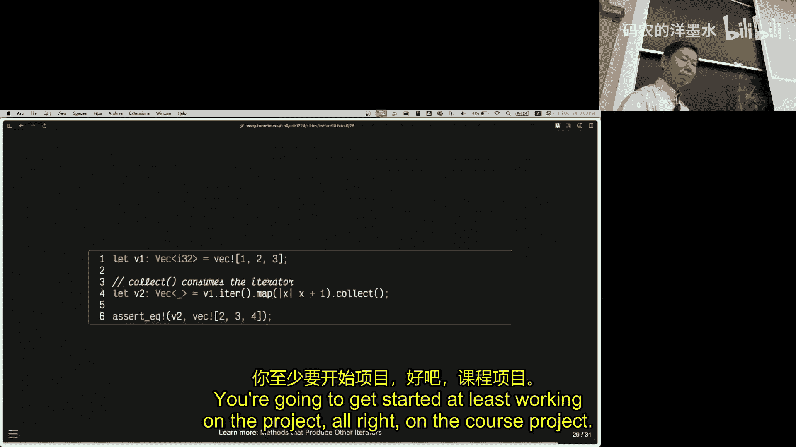

Thank you。

