# 【全集 附课件】多伦多大学 使用Rust构建高性能软件系统 中英字幕 1080P p15 Lecture 15 - 智能指针 part1 -BV16V62BhEuf_p15-

So we're approaching the end of of the course。 So were getting a little bit tougher in terms of the material that we will be talking about。

 probably starting from a few few lectures ago when we talked about lifetimes but definitely going into today's lecture and the next one。

 which will be about concurrency and asynchronous rust and a lot of the details that we're gonna cover including today。

 will be a little bit more challenging to understand compared to the material before。 Now， however。

 these are things that we use on a daily basis。 when you're actually doing a project in rust for example。

 the course project， which I hope you have already started and。We're gonna talk about iterators。

 and we're gonna finish the discussion of iterators that we left off last last time。

 And we're gonna continue to talk about smart pointers today。Now， in terms of iterators。

 last time we mentioned this， and this is something that is a a little bit foreign for those people who are not used to iterators for those C and C plus plus programmers。

 well， probably not C plus plus the modern C plus plus support iterators quite well。

 but kind of the more classical object oriented C plus plus。

So we typically wanted to use iterators over the， you know。

 the conventional way of iterating through a data structure using something like a loop rather than using a loop。

 you would want to use iterators。This is the modern way of programming。

 iterating through the actual items in the data structure， such as a vector。 Now。

 last time we talked quite a lot about iterators， but we haven't finished talking about they're just a brief review of what we talked about last time because it was before the reading week。

 like two weeks ago。 so iterators obviously allow us to somehow iterate through a sequence of items on。

 for example， on a vector。 Now， we mentioned， and we want to emphasize again that iterators are lazy。

 So these are data these iterators if you don't really try to consume them by calling some of the consuming methods。

They are not doing anything。 They're just sitting there。 They're lazy。So in an iterator。

 we could certainly try to use the iterator。 for example， in this case， the dot eitherer。

 it will actually convert this vector to a particular iterator that is having immutable references to that particular items to all of the items inside the vector。

 So because that iterator is something that we can actually have immutable references。

 We can actually have a for loop going through the immutable references and try to print out the values of the vector。

 So that's something we could certainly do。😊，And however， we could also try to consume the iterator。

So with that next method， which is a consuming method， we could actually。

 this is actually a method that is defined on the eithererator trait。 the eithererer eitherer trade。

 obviously using a generic type。 it is the type item。

 and the way that we define this generic type is using something that we previously mentioned it's called the associated type。

 and the associated type would be a way that we define the generic type inside a trait。 So here。

 the next method would be consuming the iterator and actually getting the actual next item。

 starting from the first time you call it would be the first item。 And then the next item after that。

And we， if we could actually just do this by calling next again and again。

 we will actually see that it will give us the actual immutable reference to each one of the items inside that particular vector。

 And the reason why next give us immutable reference is because the thought eitherer will actually give us an iterator with immutable references。

 That is the default way of using an iterator。So after we called all of the next and consumed all of the items on that iterator。

 we will get a nun at the end of that iterator。And we mentioned previously in the previous lecture。

 two weeks ago。Beyond either， which actually gives us the immutable references。

We also have two additional variants， and we have the inner， sorry， In either and the either mute。

 So with either， next will give us the immutable references。

 But if you are actually wanted to create。Some kind of an iterator that takes ownership。

That's when you call the into eitherer。 And we will have an example of this later on today。

 when we really need to take ownership of the items inside the actual vector underneath that particular iterator。

 So we wanted to do that。 So that's why we want to say into either。 We want to take ownership。

 And then finally， remember， there are only three cases。 There's the immutable reference。

 There's the taking ownership。 And then there's the mutable reference。

 So we have corresponding methods for each one of these either into either and either mute。

 If you wanted to eithererate over references that you must be mutable。

 you would have to have a mutable reference， because you want to change values。 for example。

 that is when you call either mute to create an iterator with mutable references。

 So three different cases。 We have three corresponding methods for these three different cases for creating an iterator for all three cases。

So next obviously consumes the actual iterator。 And we do have other methods。 For example， some。

 these are the methods that are examples of methods that also consumes the iterator。

And when I say consuming the iterator， we are basically saying that calling these methods actually uses up the iterator。

 That's these are typically called consuming adapters。 They are calling next internally。

 to actually consume the actual iterator。So here's an example of using some that we mentioned last time we have a vector。

And then we have an iterator from the vector with immutable references by calling dot eitherer。

 And then were actually calling the dot sum。 And obviously。

 the dot sum is not gonna change anything underneath the iterator。 So immutable references are fine。

 And then we just need to compute the total。 after we compute the total the iterator is consumed completely。

 So that's something that we will actually try to use as a consuming adapter to that particular iterator。

However， we do have other methods。 I I would like to argue that these are probably even more often used methods。

 There are more useful methods， probably that actually do not consume an iterator。 They are adapting。

An iterator。 So these are called iterator adapters。 They're not consuming the iterator。

 They're adapting the iterator。So what are these iters， Well， they， sorry， What are these adapters。

 They actually presume they are actually producing。A different kind of an itererate。And。

By changing the actual aspects of the original iterator。

And they're actually more useful than the typical consuming adapter。 And here's an example。

 The first example is a map。 So a map is an eithererator adapter。😊，And that creates a new iterator。

 We're adapting an existing iterator， and we're getting a new iterator。So the existing iterator。

 V1 dot eitherer。 That one is the typical iterator with immutable references。

 And now we call dot map。 and we pass in。A closer to it。Right， so that's something that we pass in。

 This is a simple closure of adding one to the item。

So what we're doing here is that we're trying to use that closure to adapt the original iterator and get a new iterator out of it。

However， what if we just simply execute this two lines of code， what would happen。If we just try to。

Try to run sorry， Try to build it。 Try to do cargo build on these two lines of code。

 What would happen。Well， because the mob。Is an iterator adapter。 It does simply adapt the iterator。

 It doesn't do anything to that eitherer。 It just produces another iterator。

And combined with the fact that the eithererer are lazy。Nothing is going to happen。RightSo in fact。

 if we just build it， we will actually get a compile time warning because the compiler is saying。

 okay， something might be a little bit of off the track here because nothing is gonna to happen here。

 and it will warn you that this is the exact wording from the compiler's message that eithererer are lazy。

And do nothing， unless consumed。So you get a neerator here， but you're not doing anything。

 And that's not typically what you wanted to do。And the compiler is gonna to give you a warning。

And that's kind of the nature of these eithererator adapters。 They're not doing anything。

And that's exactly what we wanted， because we do have another kind of like a magical method。

 So we need to consume this。 And how do we actually have the consumption of that new iterator that we just adapted to。

😊，We do have another kind of like a magical method to actually consume it。 What is that method。

 and that is the collect method。So the collect will consume the eithererator。

So what it will do is that it will take that iterator， consume it。You know。

 and produces another vector。 So if you actually try to take a look at the result of that can collect。

 it will be the vector of 2，3，4， adding one to every single item。

 And that is the result of collecting the actual iterator。 So you get back the original vector。

 and with new values in that vector。 So this is a very typical pattern that we use。

 We basically say something， dot either， you know， making it an iterator， dot map。

 do something to it。 And then finally， dot collect， try to get the vector back after the operations。

And this is actually very good idea of using this particular pattern rather than your typical for loop。

 This is because of backhand compiler optimizations， compiler is smart enough to do a lot of。

 you know， behind the scenes， operations， sorry， optimizations to make this faster than if you were to do it yourself。

 And it actually is more ergonomic way of writing code anyway。

 So until you actually adapt to this idea。 you will probably think that this is kind of weird way of writing。

 But once you adapted your mind， adapted this idea。😊，You will actually write better code。

 This is more ergonomic， better code faster as well。

 And this kind of pattern of writing code is what you should be getting used to in terms of kind of doing operation all of the elements on a particular data structure where you can actually have an iterator through。

Here's another。Adapting， sorry， either either adapter， rather than having a map。

 we could actually have something called a filter。 So line number 9。You actually have a future。

And this future is kind of like the other way that we adapt an itererate。

 This is an iter the iterator adapter。So what it does is that it takes a closure as well。

 just similar to the map。But this closure， at this particular moment， as you can see。

 this is a very simple closure。 we are actually capturing the environment。

 and we mentioned before that our closures typically have the ability to capture the environment。

 and that's what we are actually using。 That's what we did。 shoe underscore size。

 That particular parameter that was captured from the environment。

 which is actually one of the parameters of the function called shoes in size。

 So that U 32 value was captured from the environment into the closure。😊。

And that's something we're using to actually try to compare with the dot size field of ourstruct shoe。

 And that shoe is the actual struct in the vector。 So it is a vector of shoes。

So that's quite ergonomic way of actually trying to compare the size of each individual shoe of the vector with our shoe size that is passed into this particular function。

 we capture the environment first in that closure， we compare the actual size of the individual shoes in the vector and that is our closure and then we pass that closure as a parameter to the future。

Either a adapter method。And future。Needs to。Kind of return or true or false with with with a closure that returns a true or false。

 If it returns a true， the future will keep it， Keep the item。 If it returns a false。

 it will discard the item。 And because the fact， because of the fact that future is gonna discard the item。

 It will have to take ownership。And that is why we're using the other version of getting the iterator rather than using the dot eitherer。

 which gets immutable references。 Now， we're saying dot into iterer， which。Gives us ownership。

 So because now future has ownership， it will be able to say， no， I don't need it anymore。

 if it's actually returning a false。 If the closure returns a false。 And finally， because future is。

 again， an eithererator adapter similar to a map， It just creates an iterator。

 which if you don't call collect is not going to do anything， this is a lazy eithererator adapter。

 So that's something that we wanted。And again， very ergonomic way of writing this。

 if you wanted to do the future。 the same map and filter happens in other programming languages。

 such as Python and so on。 But， you know， a lot of people still write code that is not using the map and filter these days。

 if you're using a large language model generate the code for you。 it will be very smart。

 It will use the the better way of doing things。 You know， the map and filter。

 but you should do this as well。 at least you should be aware that map and filter are the better ways of doing this。

 So happens in rust and also a good idea in Python and other languages as well。 Javavascript。

 typescript and so on。And that is all we wanted to do for to say for the iterators。

 this is the chapter 13， but the main topic today， I would like to go into the actual smart pointers。

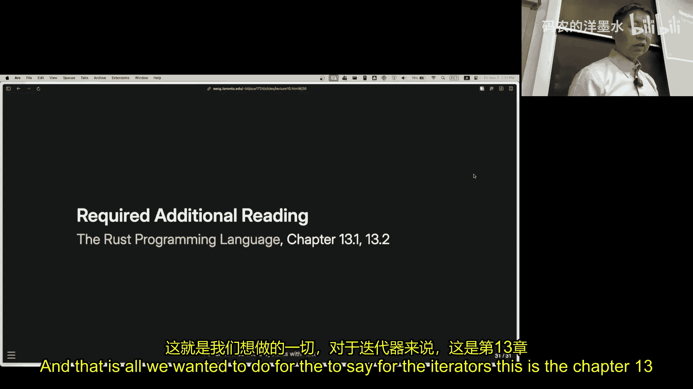

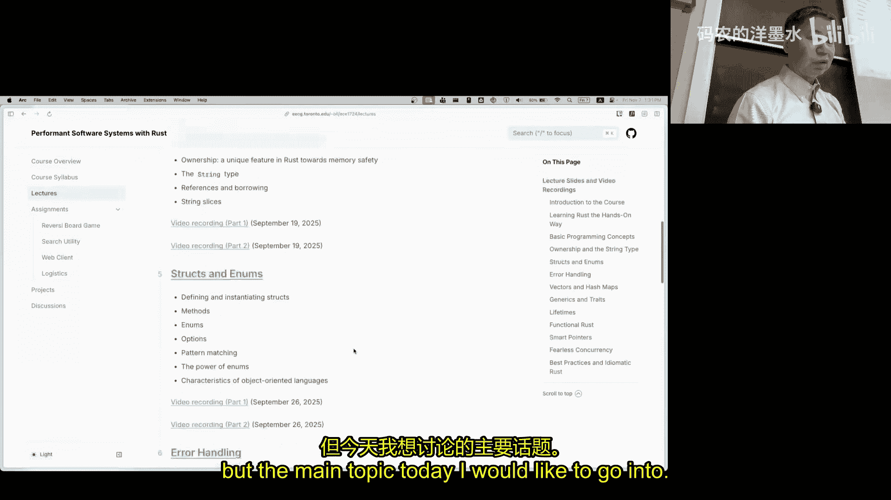

So here I want to get into lecture 11， including smart pointers。 So the question。

 before we talk about smart pointers， we need to first revisit the key idea of a pointer。

 So this is something that you hear from C And C plus other languages like well。

 except for Python and jascript， other lowlevel languages。 You see a pointer。

 and you understand what a pointer is。 a pointer is a variable that contains an address inside the virtual address space。

 So this is basically an address。Alright it。If you actually use the terminologies from C。

 the C programming language， it basically says it points to some data because some data resides at that particular address。

 So a pointer is an address。And that's something that we kind of， it's built into。

 It's wired into our brain when we learn the C programming language。In rust， nothing is different。

 in rust， a pointer。Is an address except that we don't call it a pointer。 We call it a reference。

 which is the fact， the same thing for C plus plus in some cases， in C plus plus some contexts。

 we also call it a reference， especially when we pass something to a function。

 We call it a reference。 And in rust， we just， we don't have the term pointers anymore。

 We just always call it a reference。And this is an address。 It's indicated by an M percent。 You know。

 it's an immutable reference or mututable reference indicated by M percent。

Regardless ofmutable or immutable， we will actually use an M percent。 So that is a pointer。

 It's an address is a reference called reference in rust。 And that basically borrows to value。

 it points to。 So all of the ownership rules apply。 Remember that our， our ownership rules。 You know。

 you can only have one mutable borrow or multiple immutable borrows。 right。

 So all of these ownership rules apply。So now coming to our main topic today。

 which is a smart pointer。So what is a smart pointer， We understand a pointer。

 which is an address or a reference。 What is a smart pointer。A smart pointer。It's a data structure。

And it's sort of similar to a pointer。But also， it has additional capabilities。

 It has additional metadata because we need additional capabilities。

 We need to maintain additional metadata。 So that's something that we wanted。

 We want more features on that particular reference。 So that's why we need a smart pointer。

And all of the metadata and everything is implemented， as you would imagine， using astruct。

And then we wanted to have the ability to dereference the smart point。

 Theyre just like when we're dereencing a actual reference， the typical reference。

 So we sometimes want to dereence， implement a de referenceence trade。

 We're gonna talk about that later and the drop trade。

 Sometimes we wanted to have a specialized way of dropping that smart pointer of releasing memory of that smart pointer。

 So that's something that we wanted to customize as well。 So if that's the case。

 we need to implement a drop trade as well。 So again。

 we're gonna talk about the drop later on as well。In many cases。

 a smart pointer owns the data it points to。 So that's kind of typical。

And here are some of the examples of smart pointers that we used。 a string。 That is a smart pointer。

 because a string is not a simple reference to the underlying data。 It also had additional metadata。

 Remember， what's the metadata that we talked about。 the length of the the capacity。 You know。

 that's metadata。 So that's something that we put into thatstruct， astruct。

 A string is declared as astruct。 So that's a smart pointer。A vector。

 So that's a smart pointer as well。 And that obviously also includes the actual length of that particular。

Vter， so that's something that we actually implement both the string and the V and other similar kind of data types。

 They are implemented in the rust standard library。 But regardless， they are smart pointers。

 And today， we will introduce a few more of these examples。

 A few more of these smart pointers that we wanted to use。 In fact， we very often use every day。

On a daily basis and the first。We like to bring out。The very famous box box tea。

 you might have seen it before， and you might kind of wonder what that is。 And today。

 we're gonna have a more in depthth analysis。 What do we mean by boxing something because sometimes a compilers error message will remind you。

 you need to box， you know， things like that。 We' gonna see a live demo today on that。

 So what do we mean by boxing it。 Well， it's actually pretty simple。 Nothings。

 it's very straightforward。 What we're doing here is that with the box。😊。

We are storing the data on the hipap， guaranteed on the H。Without a box by default。

The data is on the stack。 You know， the string is on the he because it a smart pointer。

 A vector is on the he because it is， again， its a smart pointer。 But if it's a I 32， for example。

 I 8， any of those other typical types are struck with all of these types。 You know。

 they are on the stack。And with a box， what you're doing is that you're saying the data is on the hip。

After I box it， the data is on the heap。 So box is indeed a smart pointer。

We are making sure that the data that we're boxing is on the hip。

 And this is coming from the rust standard library。And， of course， the data is on the he。

 but the pointer itself， obviously， is gonna be on the stack。Box has a very nice feature。

 It has zero performance overhead。 So there's no overhead of using the box。

And there's not a lot of additional capabilities either。 So why do we actually use boxs anyway。

 So in other words， why do we need to move the data from the stack。To the heap。So what's， what's。

 what's the reason， What are the root causes， What are the things we should actually use。

 What are the situations that we should use box， Well， we have three situations， the first。

I would like to transfer ownership。from one。To another， you know。

 sometimes we want to transfer ownership， obviously。 but we have a large amount of data。

 It's not something like a small amount of data。 We have a large amount of data。

 So if we don't use the box if we put the data on the heap。

 that large amount of data after you transfer ownership， you're gonna have to really do the copying。

 So that's something that you will try to avoid。In fact， this is actually one of the。

 the kind of like。嗯。Good practices。 These are best practices。 You don't have to use the box。

 You could put， for example， if you have struck with like over 1000 bys of data in that structure。

 you could keep thatstruct on the date on the stack。 But then， you know。

 it's not a very good idea because every time you actually try to do the copying。

 you're copying the entirestruct。 And that's a lot of copying。 That's 1000 bys in thatstruct。

And sometimes you're not so careful。 So you don't you really know how many bys each one of these truck they occupy because they're kind of complex。

So if you actually use something called。Which something that you should be using。

 if you use a command called cargo Cpy。How many of you are using cargo clipping in your project。2。

 the rest of you should be using it。 So after you do cargo build， you do cargo run。

 But then before you do cargo run， you do cargo clippy。 And， of course， cargo Cpy。

 if you it is gonna throw at you a lot of issues。 it will still compile， obviously， but cargo Cpy is。

The rust version of a Li。 So in Python， there arelins as well。 and in jascript and Tpescript。

 But the rust version of a Li is the cargo clippy。 and cargo clippy is gonna report these kind of issues。

 So if you have a struck with over 1000 bys of data。

 cargo clippy is going to calculate how many bytes are there in the drug。

 And then if it's over a certain threshold So typically 1000。 It will say， okay。

 it's a lot of bytes that you have in the drug， you should consider boxing it。

 which is exactly what cargo clippy is trying to warn you。 Now， you might ignore that warning。

 You say， oh， or you might just like the rest of you do not even run cargo clippy at all。

But it's actually a good idea to run it because if you box it。

 it actually makes your code faster because every time you do the copying， you only copy the pointer。

 the smart pointer， because you box it。 And， of course， for a lot of the issues of cargo clippy。

 if you actually bumping to like 10 issues， it's gonna take a lot of time to fix each one of these。

 if you actually want cargo clippy to fix them by by themselves by itself。

 you just say dash dash fix， it will fix a lot of the issues， not all of them， but a lot of them。

 because it warned you， it will know how to fix the issues for a lot of these cases。

 So try to write try to say cargo clippy do dash fix and then cargo clippy again and the rest of the warnings you fix by yourself question。

哇。To the heatap， yeah。Oh， because once we actually put all of the data on the heap。

 when you transfer ownership， you copy just a pointer， just a box itself。

 So that's a much faster copying rather than copying 1000 bytes to someone else。 For example。

 you're passing something a structural function。 You have to basically copy everything， yeah。Oh。

 we're gonna to talk about the dynamic。 you know， it is in the box。

 You could put it in the box for sure。 And that's something we're gonna spend a lot of time today talking about right up next。

Second， which is exactly what you mentioned the something that is related to trade objects。

 And that's something we're gonna talk about right， right next。 So that's， you know。

 like a question mark for now。 But this is something that we could， you know， it's a dynamic thing。

 You know， for now， you just understand it's something dynamic。 And we just put it in the box。

 And we must put it in the box。 If we don't put it in box。 We're gonna see a live demo。 We're gonna。

 you know， the compiler is not gonna give us a successful compile。And the final case。

Is where you have a type。But you don't really have a known size at compile time。

 And want you use a value of this type in the context that requires the exact size。

 And we're gonna have an example of this as well。 So it's kind of a very abstract。

 What do you mean by this， you know， having a type without known size。

 And what do you mean that you require an exact size。

 And we're gonna have the box so that we can get the exact size。

 So we're gonna have an example on this。 So three different cases。

And but the first one is the most obvious。 If you have astruct that is a largerstruct and you have a lot of bites in that truck。

 you probably would be better served。Boxing thestruct。Now。

 box is also kind of interesting because box， you can imagine this to be the simplest smart pointer。

 because what you're doing is that you're just saying， okay， this is a。 Have a pointer。

 and thestruct is on the heat now。 It's the simplest， smart pointer。嗯。

And it does have a size because a pointer has a size。 You know， it's， it's an addressla。

 It has a size。 So a box is， you know， does have a size。 We do know the size of a box。

And in typical languages， in fact， in CN andC plus plus and also before rust version 1。

0 in the early versions of rust before 2015， that's when rust became 1。0。 before that time。

 even in rust。 we actually don't just call it box。 we just directly call it the star or something like that。

 And that's you know， a smart pointer。 but you know。

 it's sort of like not a typical pointer is something that is a little bit smarter than the typical pointer。

 And then after rust turns 1。0， it became a box。 just to tell you explicitly that this is a smart pointer。

 and the data is guaranteed to live on the heap that this smart pointer points to。All right。

 so the box。You might not like it。 You might prefer the star， you know， in CNC plus plus， but。

 you know， we would prefer to call it a box rather than a star because really， this is。You know。

 data on the heve it's a pointer。 you know， it it's some simple meaning over there。

 but we want to make it explicit。 Just call it the box。

 make it explicit so that we understand it completely。 and a lot of programmers。

 they didn't really like it。 You know， they prefer the star way of doing things until they adapt to this idea where you have box here。

 a box there， you know， box everywhere。 And that's something that really tries to say， you use box。

 only when it's necessary。 Three cases。 A lot of the cases， you don't really need a box。 You know。

 it's just astruct would be good question。😊，Oh， yeah。 So a unique pointer， smart pointer。

 These are the C plus plus way of calling it。 And in Ru， we call it a box。 And in fact。

It differentiated itself from the other smart pointers that actually had， you know， the。

additional features。 a box doesn't have those features。 For example。

 unique unique pointer and smart pointer。 It is sort of like a smart pointer。 So it's in in C。

 C plus plus。And， and it's very similar to the C plus West smart pointer because this one is also taking a generic type as well。

Alright， so here's the example。 The， you know， in this example is a trivial example。 We have a。

Integer， which is a5， and we can certainly put it on the stack is's just you know。

 a few bytes I 32 value， but we could also box it。 if we box it。

 the value lives on the heap and we could certainly just print out the actual value of that B。

What happens when we run it。What happens when we run this code？Well， it's gonna run。

 It's gonna say B equals to 5。 But why， Why is that the case。Well， we have a box， right。

 which is a pointer， right？ And we're printing that pointer sort of Why do we， Why do we get 5。

 You know， that's in the box。So we mentioned and in， in rust， we are kind of dereencing it， right。

 We're doing it automatically。 We're dereencing it automatically。 Of course。

 you can dereencing it explicitly。 But if you actually do this like this。

 which is similar to any of the references。 We just print the referenceable de references automatically。

 which is what happens here。 So this is sort of like synthetic sugar， But that's the sugar。

 the good sugar that we want。😊，Now， when the box goes out of scope。

 it's very similar to a typical value that is going out of scope， it will be delocd。You know。

 if a typical value on the stack would go out of scope， the memory is gone。 You know。

 it will be deactivated， delocated。 same thing with the box。 when it goes out of scope。

 it will be delocated， but not only the box itself。

 the box itself would be the pointer that pointer would be delocated， but also。

For the data that it points to， the data it points to will also be delocated as well。

 So that is natural。And that is something that we're basically dropping， right。

 So we're dropping the box， not only the actual pointer。

 but also the data it points to will be deated。All right。

 so you might imagine that this box you know inside the rust standard library。You know。

 implement the drop trade so that we properly drop everything in the box。 right。

 So we're gonna talk about implementing the drop trade a little bit later。Alright。

 so now let's take talk to talk about the second case where。We want it。To use the box。

And this is the case that is related to trait objects。Previously， we talked about traits。

 and we mentioned that the trade is like a contract， right， It doesn't have any data。

 which is exactly what we wanted。 We don't want to have any data in that trade， only the methods。

You know， that's kind of like the actions that can be taken for any。St any Eum。

 anything that implements the trade， right， so recall that we could actually try to， you know。

 implement the trade and so on。 But we also have a very long time ago when we have the lecture talking about the Eum。

We actually， and， and the vector， we talked about a nice little trick where we could actually use the enum。

Have each variant of the enum corresponding to different types。

And then store the enum as the item on the vector inside the vector。

 So then we have like our own crude version of having a vector that accommodate multiple different kind of types。

 So this is exactly this kind of the code that we used at that time when we talk about this little trick。

😊，So we have an enum。 Let's call it spreadsheet shell that has integer floating point and text。

 which is a string。 So three different types。 And we wanted the vector to be able to store all three different types。

 This is very often。 This is very typical。 Sometimes we have vectors of， you know， the same types。

 But some of the other types。 we want some of the other types。

 We wanted the vector to have different types in that vector。So that is very typical。

So we could actually use the enum。 So inside the vector。

 we say we have the enum as the actual type of each item。

 and that enum can take one of the three possibilities。

And we could use the the variant in text and flow initialized to different kind of values。

 And this obviously stores all of these values inside the vector。 And that's very handy。

 And we can still do that。However， there is one thing that is probably not the best for using this idea。

 And what is that。What are the disadvantages of using this idea。That motivated the trade objects。

What might be the disadvantage of using this idea， Any ideas。

There's only one disadvantage of using this idea。And the disadvantage of using this idea is， yeah。

Exactly， so the answer to my question just now is that now I allow in text and float， but。

What about if I have。Another type。That the user wanted to define。

 And let's say this vector is kind of part of the library， part of the framework。

That is providing some convenience to the user。 And the user wanted to define its own type and store in that vector。

And that framework developer will have to have the ability to accommodate that。

And that's something that previously using this little trick would not be possible because this little trick。

 you have to know what are the types that can be allowed inside a vector And so that you can declare those types in that genomeum。

At compile time。 and you're gonna have to do that。 You cannot allow any other type that the user might supply。

 And as a framework developer， you don't really know。

And that's something that you're gonna have to use trade objects to solve。 Now。

 without trade objects in other languages， how do we solve it in C plus plus， for example。

 how do we solve it。We use。The ugly， ugly inheritance， right。

So the inheritance is where you have like a base。Space class。 and you have the inherited class。 And。

 you know， you basically say the space class would be something that we put into the vector and whoever who inherits would be possible to put into the vector。

 right。Because whoever who inherits the base class would be treated as a child of the base class and is allowed to be placed inside a vector。

 And that is the nature of inheritance。 And I keep talking about how ugly inheritance is。

 So you just have to trust me that you don't want to use inheritance。 Instead， use this。For now。

 kind of， you know， strange way of trade objects。 So what are these。 So just want to rehash the。

 the problem。That we just mentioned the type of cells in the vector are fixed。

 We want to write a library， a framework， a crate to be used by other people。 And for example。

 in a graphical user interface， you might want the vector to store all of the objects that can draw themselves。

 And， of course， defining a particular kind of astruct can draw itself is easy。

 You just need to have astruct， implement the draw method of a certain trait。 But， you know， ideally。

 we can put that trait into the vector and that's something that we want to do with trait objects。

 and trade objects is like the rust way of putting the trait into the vector and saying， okay。

 this vector contains any type。 as long as that type implements the trait。

 which is kind of a natural way of doing this， similar to the C plus plus way of inheritance。

 you know， a base class， anything inherits from the base class can be in that vector。

 same thing here。 Anything that implements the trait can be inside the vector。😊，Alright。

 so sounds very similar to the space abstract class in object orre programming。

 except that the abstract class is a bad idea。 Don't use that。Allright， so now let's talk about。

Using。Trade objects。Alright， so let's say we want to implement a vector that contains animals that can make a sound in our library。

Alright， that's a simple， simple kind of a trait that we can actually declare。

 The type of these animals are defined by users of our library。

 We don't really know what these types are。 We， would ideally want to put the types into the vector。

 So we define the trade。 It's a very simple trade。 Let's just call this animal。

 And the trade obviously does not have any data。 No data is allowed。 That's a good idea。

 And we only have methods。 In this case。 that's called make sound。

And that's a method that we have in that trade。 Anystruct that can implement the trade animal and basically implement make sound can be allowed。

Inside the vector。 So we're gonna use a trade object to achieve that。Now。

 a user of our library is gonna to define two concrete types， a dog。And a cat。 And these are animals。

 And these are different types。 they are of different sizes。 For example。

 a dog could be having a name， which is a string。 A cat will have an integer。

 which is the number of lives。 Let's say no more than 255。 So it's U 8。And then， of course。

 you could actually try to implement the animal trait with a dog。

 and that makes a sound and a different way of making a sound for a cat。

 So that's something that we can certainly do。 Very simple。

 Just keep in mind that the dogstruct and the cat structure， they are of different sizes。

 So we don't really know the size of that， you know， value in the vector。

 if we happen to put the trade object into the vector。 But before we do that。

 let's try to see how do we put the trade object into the vector。 So in Ru。

 we do have something called din。 So D Y and that's kind of like a reserved word di animal。

 that is how we say this is the trade object。😊，Allright， so a trade object would be。

Praracdtically saying this is any type that implements the animal trait。 So that's a trade object。

 That's the canonical definition of a trade object， The di animal， anything that sort of， you know。

 implements the animal trait。And as you can see， this is then is sort of like。

 you can think that it must stand for something like dynamic， which is true。 It is dynamic。

 And the sense， in the sense that we really don't know what is the type that is in that vector。

And now we could actually put the dog into it。 For example， we can assign the name。

 initial value for that dog and the cat in terms of the number of lives now。Will this And。

 and then we can have a for loop going through that particular vector。

 And then we could actually try to call mates out。 And that's， that's all good。 That's fine。

 Can we do this。😊，Can this code。Compile， so let's take a look。 Let's copy this。

And let's have a little ghosty session。 let's say。Cargo， new trade objects。A bigger。

 A little bit bigger。And let's create the trade object here。 And let's call it trade object here。

And let's try to get started with it。So we do have a main function here。

 So just want to make this a little bit bigger。闹。Let's try to copy this， oops。

Let's try to paste it in。Now， we not only have to paste the main function。

 but also have to paste this part in because that you know， thestruct would be implemented。

 would be declared。 So that would have to be pasted。

 And also we need to paste the actual animal trait itself。 So we're gonna put that in as well。

 So that's the animal trait that we have。 So let's try to paste that in as well。

 So that's the trade animal。 and we have the dog。 We have the catstructs。

 and we have the implementation of the dog and cat of the animal。 And then immediately。

 we see that there's some kind of compile time problems。

 Let's try to compile it and see what these problems are。

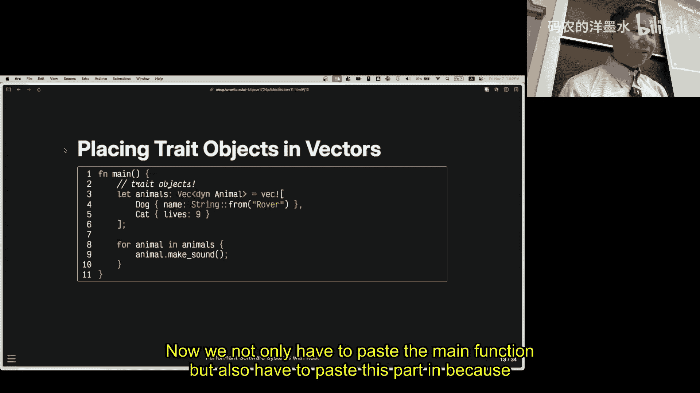

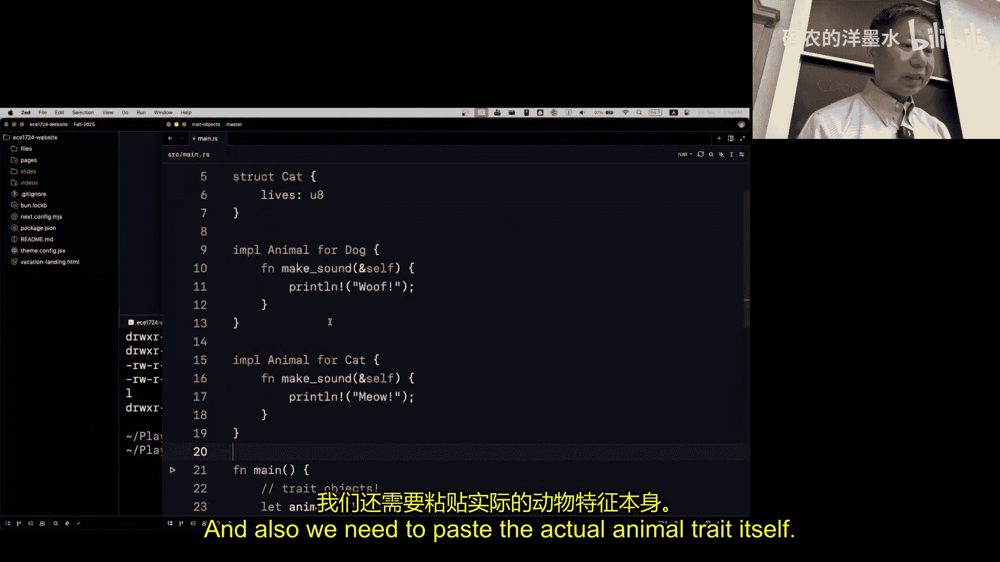

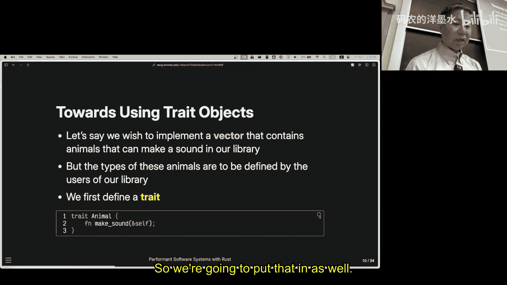

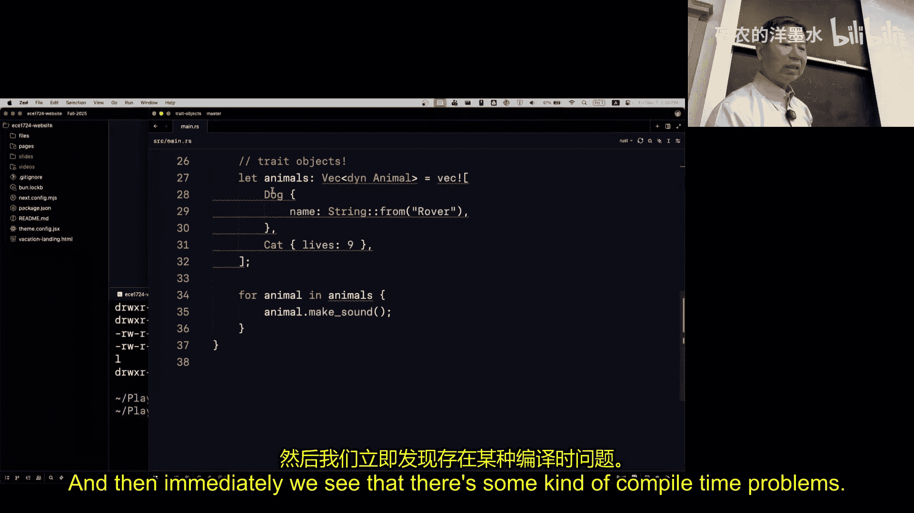

Oh， lots of， lots of errors， right。Lots of errors。 So let's try to make it bigger。 Lots of errors。

 So we have。

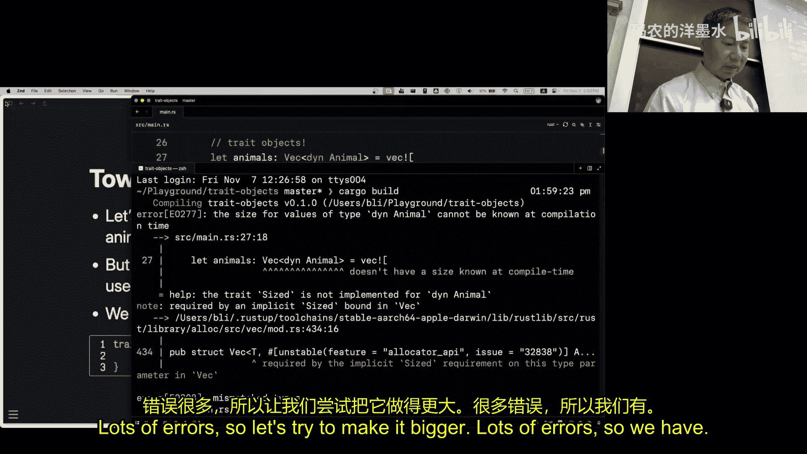

From the beginning。It says。Vectctor din anymore。 It doesn't have a size known at compile time。

Help the trait sized is not implemented for thin animal。

 So that's just the formal way of saying that thin animal is not sized。 In other words。

 we don't really know the size。 It doesn't have a known size。

 So anything that implements the size trait will have a known size。

 but thin animal as a trade object does not have a known size。You know。

 that's basically a trade object。 That's the nature of a trade object。

 We don't really know the size of a trade object。 It does not implement the sized trait。

 And then it starts to say note required by implicit size bound in V。 And what does that really mean。

 Well， it actually tries to go into the actual standard library of rust source code rust library ac source vector and the actual line number。

434 column number 16。 and you will see that over here， that is where we actually require T to be a。

Which basically means that that's the type that we can place in the vector。

 and that is required to be a。And that's the requirement。

 So everything that we put into the vector will have to be。A sized type。

 So it will have to implement the sized trait。 So that will be something that is a mismatch type。

 So this is a very good thing about， you know， strict type checking。

The best thing in the world is strict type checking。 That's what humans learned。

And large language models inherited over the past year that if you don't really have type checking at compile time。

 you are heading for issues。 And that's why， you know， Javascript became typepescript， you know。

 Python became type checked， Python， whatever。 And that's something that we must have in rust。

 Obviously， it's built into the language。 We check for types。 And here's a mismatch type。

 We want the type that is sized。 And here we have a trade object。 And so again。

 it will have additional。Now， additional errors here。 But let's ignore these additional errors。

 A lot of these， let's just take a look at the original code and say。

 how do we actually change this so that we know the size of this。

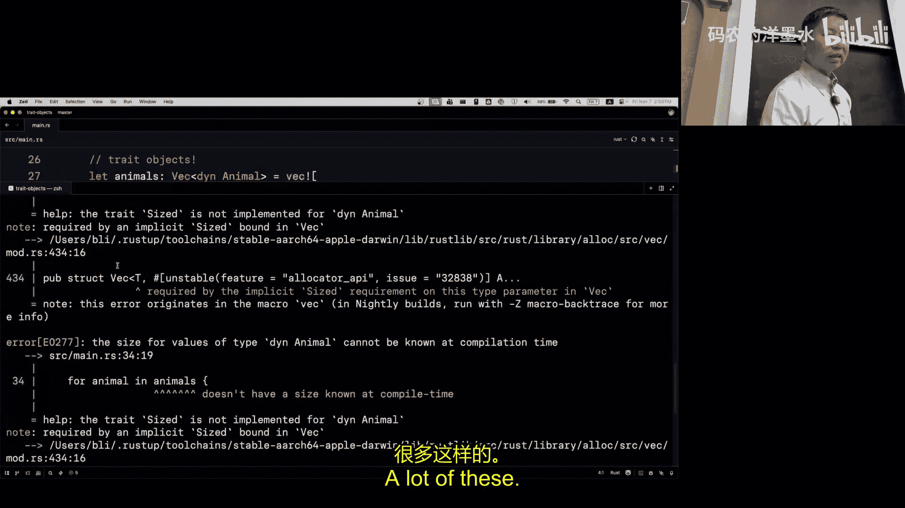

T inside a vector。And， and other answers except for how do we， how do we do this。

 How do we know the size， We talked about it already， right， gonna have to box it exactly。 So box it。

 how do we box it， Well， that's how we box it。 You know， just call it box。 You might say， oh。

 this is ugly box in what is that。 Well， as you get used to it， you will see that is not ugly at all。

 This is beautiful。 as you get used to it。 So beauty is in the eyes of the beholder， right。

 once you actually get used to it， You will see that this is beautiful， You know， di is not sized。

 box is sized。 But still， if we， we save it， we still can， you know。

 we have these additional problems。 And this is actually say what are。

 what is the problem right here。 What is， let's try to， you know， compile it again。😊。

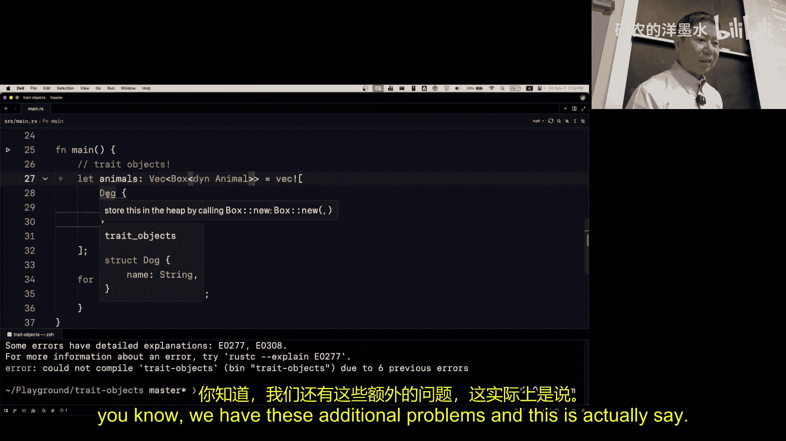

Cargo build compiled again， and we'll see that compiled again。 and we'll see still。

 we say mismatch types。We have dog right here。 Exp boxed in anymore。 We found dog。

So dog is not boxed in anymore。So there's no compatible compatibility right here。

 So we need to be compatible with the boxed in animal。 How do we do that。So we know that， you know。

 dog is implementing the actual animal trade。So it is a trade objective。 If we actually just say dog。

 but we need to。Box it too， right， We need to be compatible with the our type， which is a boxed type。

 So how do we box it。

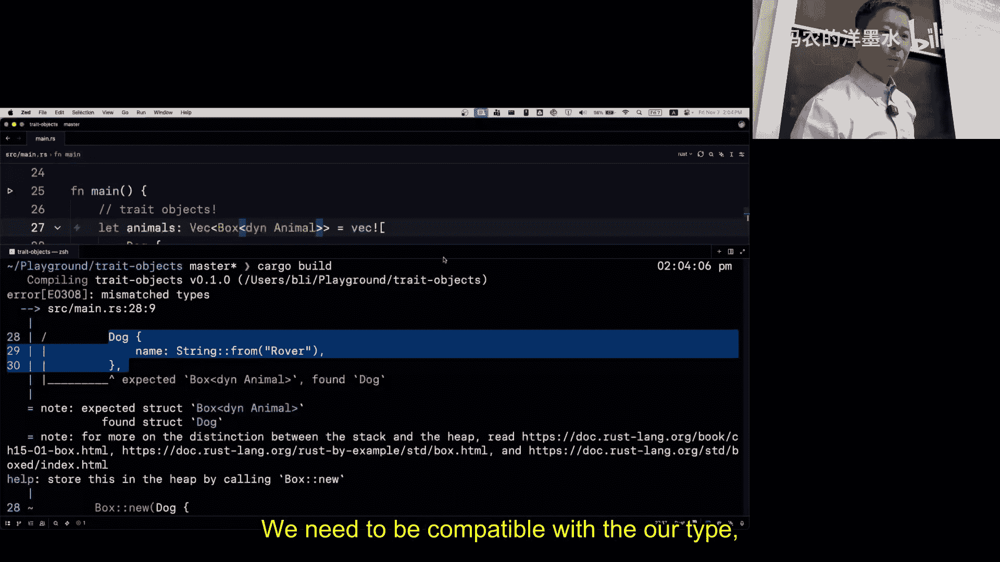

We're going to have to create a new box， right， Do We have to say box。Column column new。 And then。

That would be a。A box， right？ Just create a new box。 And that's pretty simple。

 And box column column new for the cat as well。 And that is a new box。

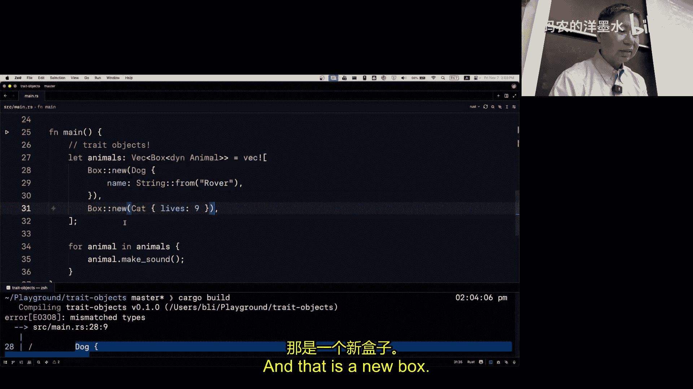

So now we are good。So， cargo built。Oh we just have a few warnings。 That's okay。

 These are the fews that we did not use。 That's fine。 And we just need to run it。Oh。

 we are able to make some sounds。 So that's exactly what we wanted。 We want to make sounds。

 And now we implement it。😊，This idea of a trait object by using this idea。

 we can put it inside our vector。 and this expands the scope of our previous way。

 The previous way is that enum， you have to know the actual types at compile time。

 And now anybody using this library can define thestruct implementing the trade and put the actualstruct into the vector。

 put the value of thatstruct into the vector。 So that's something that we are able to do using this。

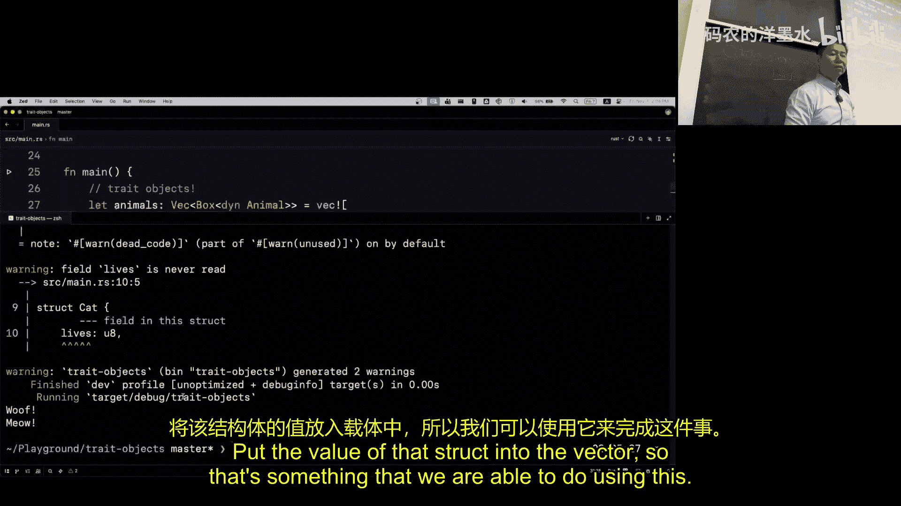

Trade objects。 So just want to re。We have done the live demo。

 Just want to recap the actual correct solution here。 and we could actually try to use the box。

 And then here we can actually say dot either。 We don't have to do this。 As you can see。

 the for loop actually takes an animal directly。 We don't have to have the dot either。All right。

So that's everything we wanted to talk about in terms of the trade object。

And why do we box the trade objects just to summarize trade objects， They are not having sizes。

 They don't know。 We don't know the size of these objects。 They are sometimes called DS STs。

 dynamically sized types。 and we don't know the size of these objects at compile time。

But the T inside the vector would require a sized trait， something that implements the sized trait。

 So all of the types with known sizes automatically implements the sized trait。 and the boxes。

 they have known sizes。 So by boxing the di animal。

 we are able to convert it to a known size because we know the size of a pointer A box is basically a pointer。

And generic types， they can implement the sized T。 And if we don't say T column sized。

 which is basically a trait。Bound， we're bounding it。 We don't explicitly bound it。

 It would directly say T。 It is。Implicitly saying that we wanted the sized T。 In other words。

 if we directly say to type T， that would be sized。 That's implicit。

 We don't have to say column sized。 And if you want it， we can opt out of it。

 We don't have to make it a sized T。 So if that's the case， we directly say question mark sized。

 That's kind of like a special way of saying that it doesn't have to be sized。You know， by default。

 it has to be sized， but we don't have to have it。 So we can say column question mark sized。

 and then we can opt out of this requirement that this type will have to be sized。

 So that's something that's a side bar story about the generic type。 And now it's 2，0，8。

 Let's break for 5 minutes and resume at 2，13。

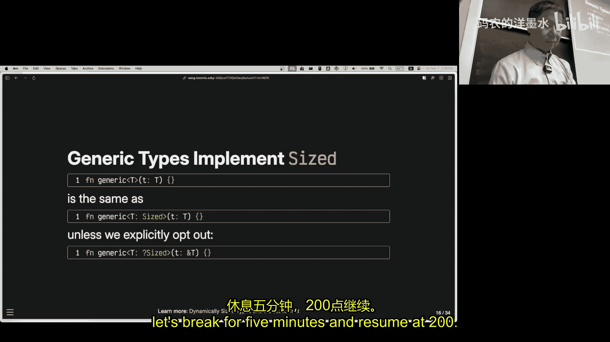