# Rust高性能软件系统：15：智能指针 part1

在本节课中，我们将要学习Rust中的迭代器剩余内容，并深入探讨智能指针的核心概念。智能指针是Rust中管理内存和数据所有权的强大工具，理解它们对于编写高效、安全的Rust程序至关重要。

## 迭代器回顾与深入

上一节我们介绍了迭代器的基本概念，本节中我们来看看迭代器的更多高级用法和特性。

迭代器允许我们遍历数据序列，例如向量中的元素。需要再次强调的是，迭代器是惰性的。如果不调用消耗迭代器的方法，迭代器本身不会执行任何操作。

以下是创建迭代器的三种主要方法：
*   `iter()`: 生成一个包含不可变引用的迭代器。
*   `into_iter()`: 获取数据的所有权，生成一个拥有数据项的迭代器。
*   `iter_mut()`: 生成一个包含可变引用的迭代器。

`next()` 方法是一个消耗型适配器，它会消耗迭代器并返回下一个元素。当所有元素被消耗后，它会返回 `None`。

除了消耗型适配器，还有迭代器适配器。它们不消耗原始迭代器，而是通过某种方式转换它，生成一个新的迭代器。

`map` 是一个迭代器适配器。它接收一个闭包，并将该闭包应用于迭代器的每个元素，从而生成一个新的迭代器。由于迭代器是惰性的，仅调用 `map` 不会产生任何实际效果。

```rust
let v1 = vec![1, 2, 3];
let v1_iter = v1.iter().map(|x| x + 1); // 此时没有计算发生
```

为了消耗这个新迭代器并获取结果，我们需要使用 `collect()` 方法。`collect()` 会消耗迭代器并将其结果收集到一个集合（如 `Vec`）中。这是一种典型且高效的模式。

```rust
let v2: Vec<_> = v1.iter().map(|x| x + 1).collect(); // v2 为 [2, 3, 4]
```

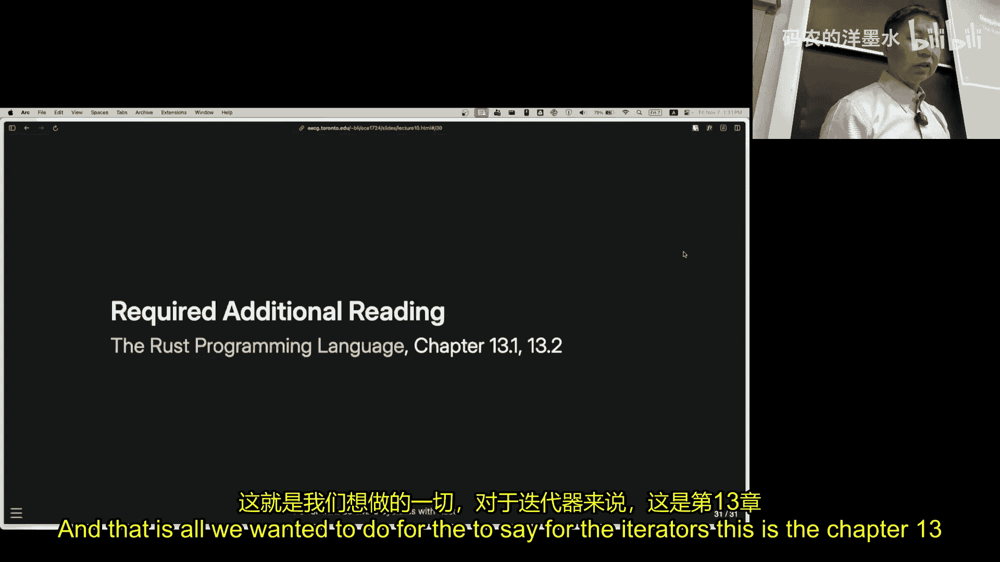


`filter` 是另一个常用的迭代器适配器。它接收一个返回布尔值的闭包，并创建一个只包含闭包返回 `true` 的元素的新迭代器。由于 `filter` 可能需要丢弃元素，它通常需要获取数据的所有权，因此常与 `into_iter()` 配合使用。

```rust
struct Shoe { size: u32 }
fn shoes_in_size(shoes: Vec<Shoe>, shoe_size: u32) -> Vec<Shoe> {
    shoes.into_iter().filter(|s| s.size == shoe_size).collect()
}
```

使用 `map`、`filter` 和 `collect` 的组合是比传统 `for` 循环更符合Rust习惯的写法。编译器能对其进行更好的优化，代码也更简洁清晰。

## 智能指针简介

现在，让我们进入本节课的核心主题：智能指针。

在讨论智能指针之前，我们需要重温指针的概念。在Rust中，指针通常被称为**引用**（使用 `&` 或 `&mut` 表示）。引用是一个地址，它借用（borrow）了它所指向的值，并且所有权的所有规则都适用于引用。

那么，什么是智能指针？智能指针是一种数据结构，它的行为类似于指针，但拥有额外的功能和元数据。智能指针通常拥有它所指向的数据，并可能实现 `Deref` 和 `Drop` 这两个特殊的 trait 来定制解引用行为和清理逻辑。

我们其实已经使用过一些智能指针，例如 `String` 和 `Vec<T>`。它们除了存储数据外，还管理着长度、容量等元数据。

## `Box<T>`：最简单的智能指针

`Box<T>` 是最简单的智能指针。它的主要作用是在**堆**上分配一个值。没有 `Box` 时，像 `i32` 这样的简单类型通常存储在栈上。使用 `Box` 可以确保数据存储在堆上，而 `Box` 本身（一个指向堆数据的指针）则存储在栈上。

使用 `Box<T>` 几乎没有任何性能开销。那么，我们为什么需要将数据从栈移到堆呢？主要有三种情况：

1.  **转移大量数据的所有权**：当你有一个包含大量数据的结构体（例如超过1000字节），并且需要传递其所有权时，在栈上复制整个结构体代价高昂。使用 `Box` 后，你只需要复制指针（`Box`本身），这要高效得多。工具 `cargo clippy` 会检测大结构体并建议你使用 `Box`。
2.  **处理 trait 对象**：这是 `Box` 的一个关键用途，我们稍后会详细讨论。
3.  **处理编译时大小未知的类型**：当你有一个在编译时大小未知的类型（例如 trait 对象），但需要在要求确切大小的上下文中（如将其放入 `Vec`）使用它时，可以使用 `Box`，因为 `Box` 本身的大小是已知的（一个指针的大小）。

`Box` 的使用很简单。当 `Box` 离开作用域时，不仅 `Box` 指针本身会被释放，它所指向的堆内存也会被自动释放，这是通过实现 `Drop` trait 来完成的。

```rust
let b = Box::new(5); // 值 5 被分配在堆上
println!("b = {}", b); // 自动解引用，打印 5
```

## 使用 Trait 对象实现多态

之前我们讨论过，可以使用枚举（`enum`）来让一个向量存储多种不同类型的值。但这种方法有一个明显的缺点：**类型集合在编译时必须确定**。如果你在编写一个库，希望用户能够定义自己的类型并放入你的向量中，枚举方法就无法满足需求。

在其他语言（如C++）中，通常使用继承来解决这个问题。在Rust中，我们使用 **trait 对象** 来实现运行时多态，这是一种更灵活的方式。

假设我们想定义一个 `Animal` trait，并让用户实现它。我们希望有一个向量可以存储任何实现了 `Animal` trait 的类型。

```rust
trait Animal {
    fn make_sound(&self);
}

struct Dog { name: String }
struct Cat { lives: u8 }

impl Animal for Dog { fn make_sound(&self) { println!("Woof!"); } }
impl Animal for Cat { fn make_sound(&self) { println!("Meow!"); } }
```

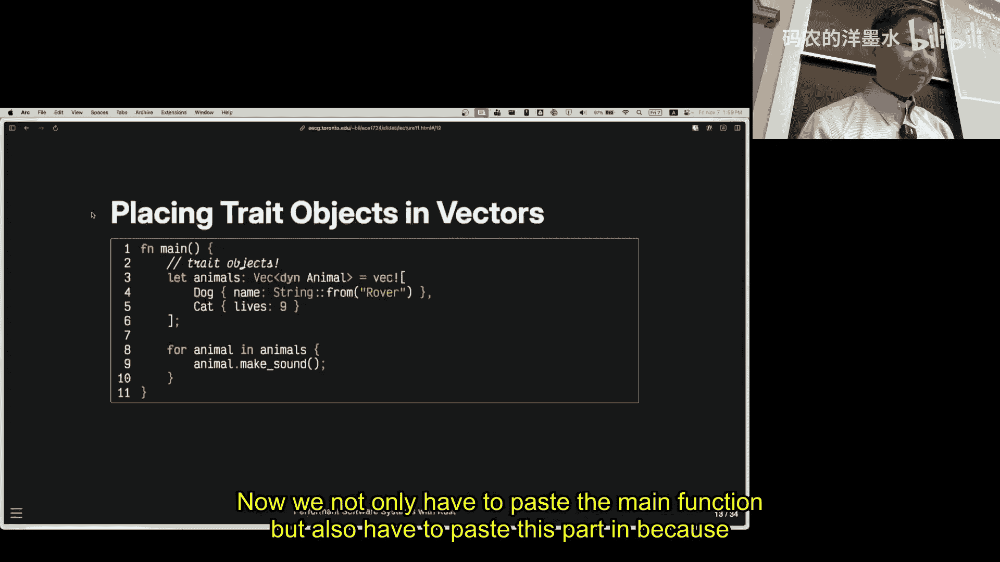

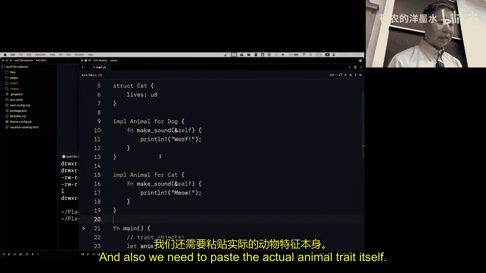

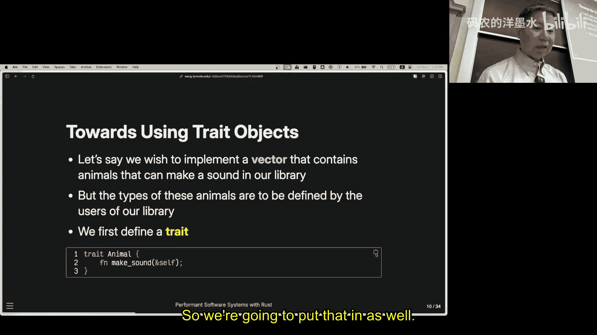

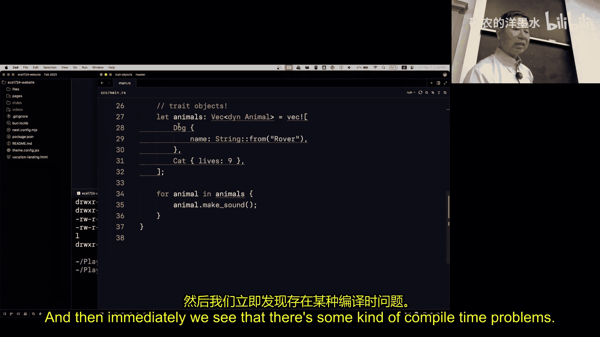

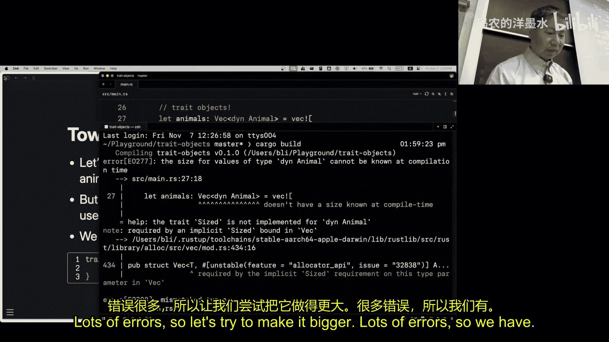

我们可能尝试这样写：
```rust
let animals: Vec<dyn Animal> = vec![Dog{name: "Buddy".into()}, Cat{lives: 9}]; // 错误！
```

但这会导致编译错误。错误信息指出：`dyn Animal` 是一个 **DST（动态大小类型）**，它在编译时没有已知的大小。而Rust的 `Vec<T>` 要求其元素类型 `T` 必须实现 `Sized` trait（即大小在编译时已知）。

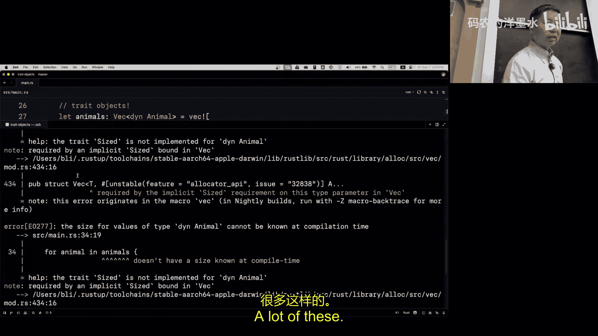

解决方案就是使用 `Box<T>`。`Box<dyn Animal>` 的大小是已知的（一个指针的大小），因此可以放入向量中。

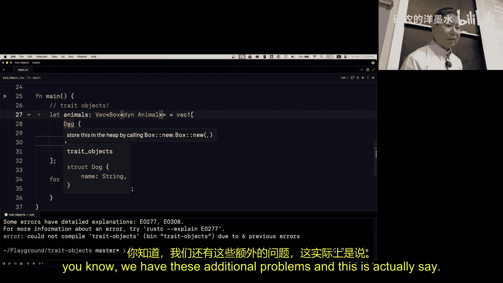

```rust
let animals: Vec<Box<dyn Animal>> = vec![
    Box::new(Dog{name: "Buddy".into()}),
    Box::new(Cat{lives: 9}),
];
for animal in animals {
    animal.make_sound(); // 动态调用正确的方法
}
```

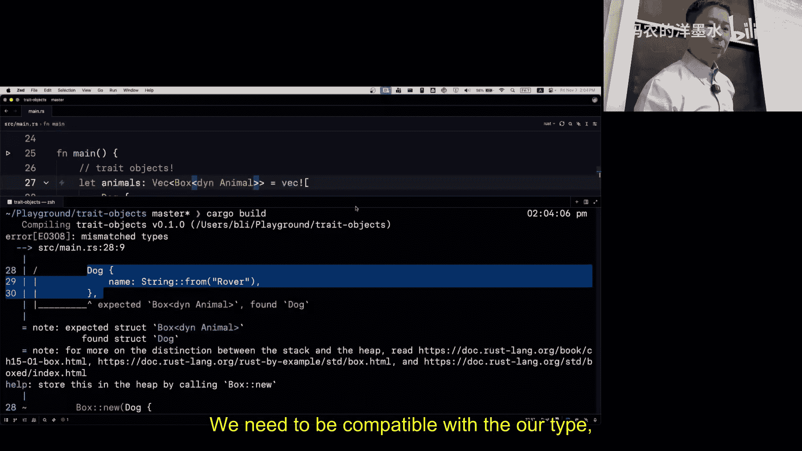

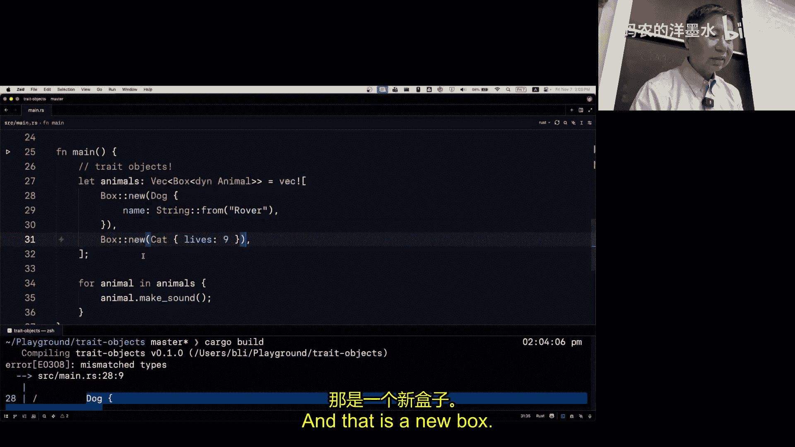

通过将 trait 对象放入 `Box`，我们成功地将不同类型的值（`Dog` 和 `Cat`）存储在了同一个向量中，并在运行时调用了各自正确的 `make_sound` 方法。这为库的设计提供了极大的灵活性。

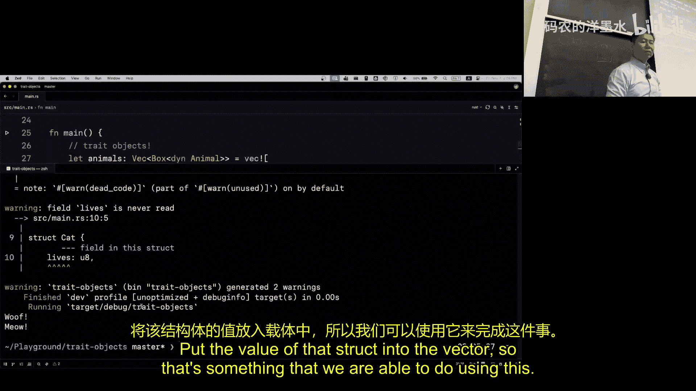

---

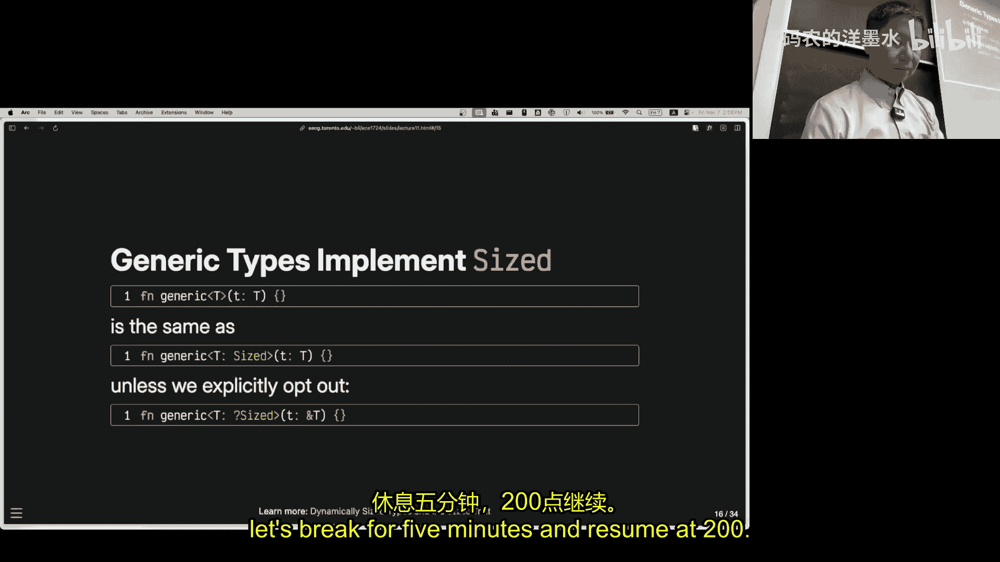

本节课中我们一起学习了迭代器适配器（如 `map` 和 `filter`）的完整使用模式，并深入探讨了智能指针的核心概念。我们重点介绍了 `Box<T>` 的三种主要用途，特别是如何利用 `Box<dyn Trait>` 来实现 trait 对象和运行时多态，从而编写出更灵活、可扩展的代码。理解这些概念是掌握Rust内存管理和抽象能力的关键一步。