# 【全集 附课件】多伦多大学 使用Rust构建高性能软件系统 中英字幕 1080P p16 Lecture 16 - 智能指针 part2 -BV16V62BhEuf_p16-

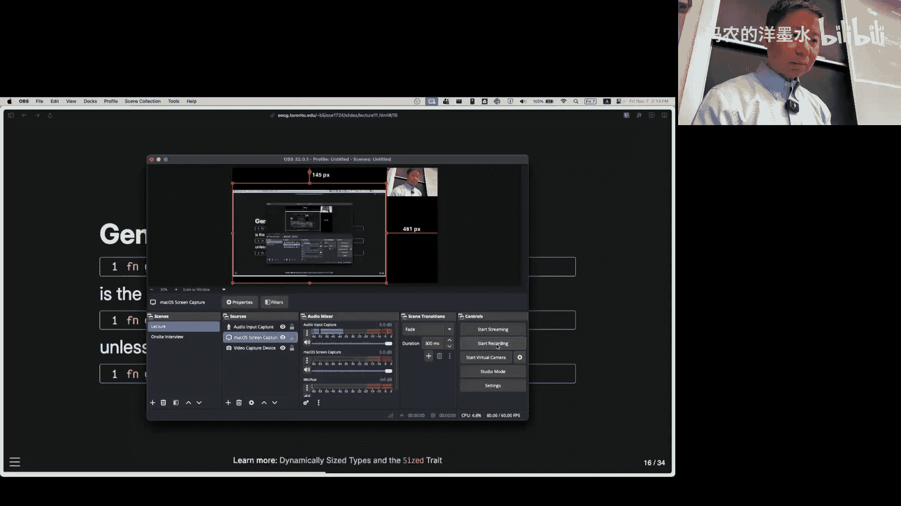

Alright， so let's get started。 So we talked about dynamic size types， which is our trade object。

And but we haven't talked about。The wide pointers yet。 And the wide pointers are， you know。

 kind of like the the terminology that we use。 sometimes we call them fat pointers as well。

 wide pointers are actual smart pointers。 So in other words， they are just， you know。

 pointers with metadata。 And。We actually use the wide pointers in our typical ways of defining our smart pointers。

 like our string and so on。 These are wide pointers。 And a lot of these wide pointers。

 they are basically sized and they are good ways of converting a dynamically size type to a sized type。

 right？ So， for example， the SR， the store。What is the store， Well， the store is a string slice。

 right， A string slice is a dynamically sized type。It is something that we don't know the sizes for。

 And this reason for that is， you know， we don't really know how long is that slice。

 So we really don't know how how many bytes are there in the string slice， right？

 So in order to make it something that we know what the size is， we make it an M percent。

 So that's why we every time we say M percent SR and we。

Pronouncce that as stir is that we wanted to have a wide pointer and that white pointer would be something with a known size。

And so why is it something that is has a known size。

 Because it not only has the address to that slice in the string， the string slice。

 it also has the length。Of the screen slice。So the compiler knows that this is something that we wanted。

We wanted the store Empers SR to be something that implements the sized trait。 Otherwise。

 we cannot put it anywhere that expects a size trait。

 So this is why we put a length there so that we have a pointer。 and we have a length。

 and that's exactly。

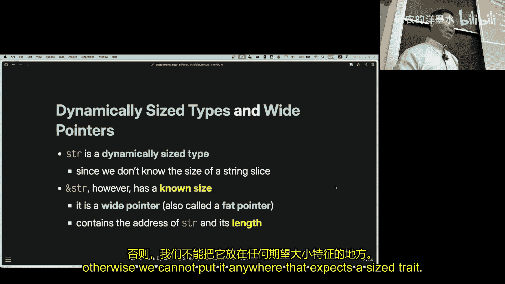

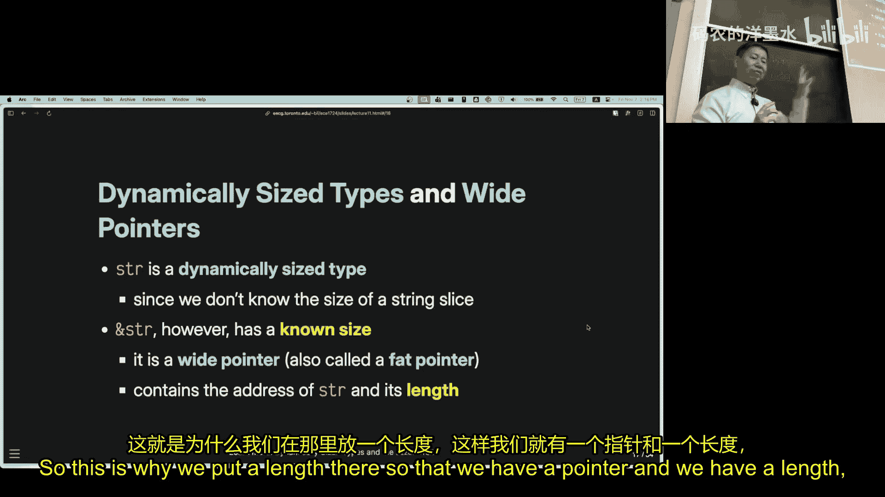

A wide pointer that we are talking about。 So this is a very typical way in rust that we convert something of a dynamically sized type to a wide pointer。

 So wide pointers for slices。 For example， the SR， which is a slice of string and bracket tea。

 which is a slice of a vector。 And that would be a view of continuous data that is in the memory And that is either a string。

 which is basically just a vector of bytes and or a typical vector of any generic type。

 and a white pointer to a slice would contain the address and the number of elements。

 The length of that particular slice， And that would be something that we could use to make it a sized type。

 So now let's talk about white pointer to a trade object。

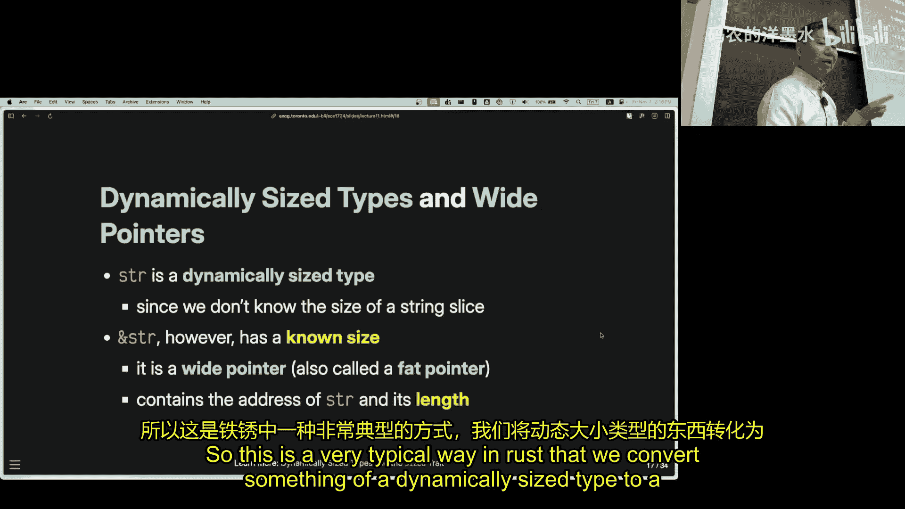

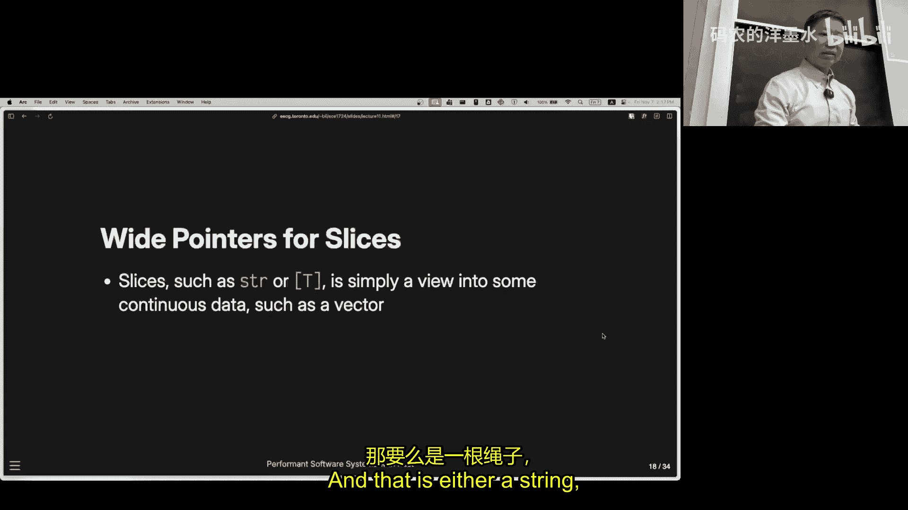

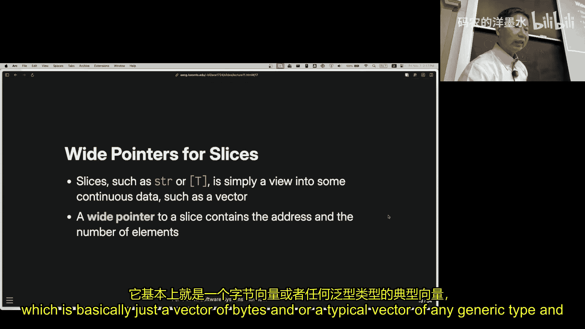

A white pointer to a trade object， such as the din animal would actually consist of a data pointer。

And the V table pointer。 So if you wanted to have a then anymore to be a size type。

 you wanted to have the address， obviously， and not only the address， you need the V table pointer。

 and the data pointer would address the data。 obviously， of some unknown type T。

 That is where that value of that unknown type T lives。In the physical。

 in the ver virtual address space。 And that is where the trade object is being stored。

 And that is a data pointer。 But on top of that， we also needed a V table。

Which is astruct of function pointers。And that is kind of happening behind the scenes。

 If we want the box of， you know， the trade object。

 This is something that is is actually in that box happening behind the scenes sort of like the actual string slice。

 the store and percent store。 You know， the length is happening behind the scenes by the compiler same here。

 It's happening behind the scenes。

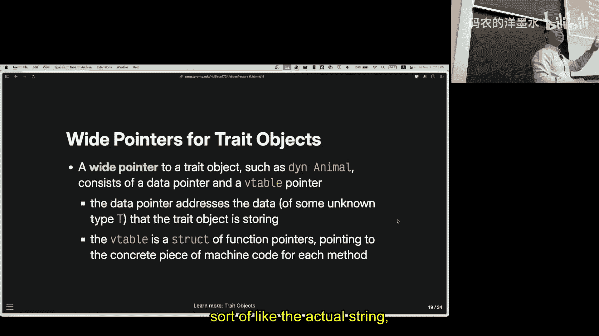

And the reason why we need this V table， which is basically a struct of a function pointer of a bunch of function pointers。

Which points to the concrete pieces of machine code。 It's a virtual table of every single method。

That only we know at at run time， we don't know this at compile time。 So this is something。

That we need， because that the dynamic。

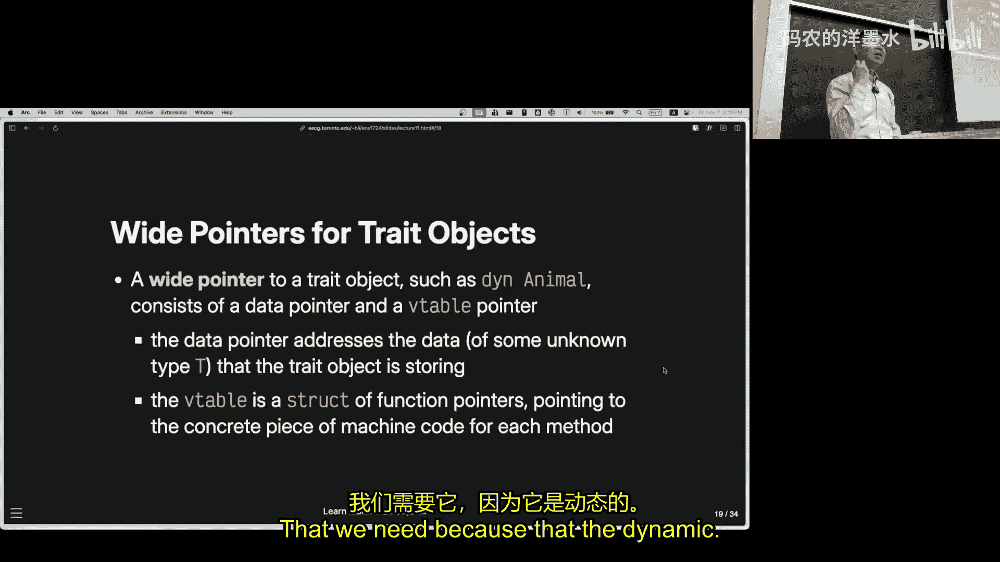

Nature of the trade object。 And when we say dynamic， typically。

 what we mean is that there is some knowledge that we do not know a compile time。

 And now we have to really get to at run time。 So for example， in this V table case。

 How do we actually which function should I call， We really don't know at compile time。

 we have to look at it at runtime。 So that's something we're gonna have to say regardless of which function we're gonna have to call。

 Let's， you know， give inside the V table， all of the methods。

 all of the pointers to functions in that drug。 And that's something we could certainly do in by the compiler。

 And that's happening behind the scenes。 which is exactly the case in C plus plus where we actually implement something called polymorphism。

 So polymorphism is like multiple child the children in of the parent You know。

 you don't know which one that you use by putting the abstract based class into the vector。

 You don't know which one in which one of the children that you wanted to。

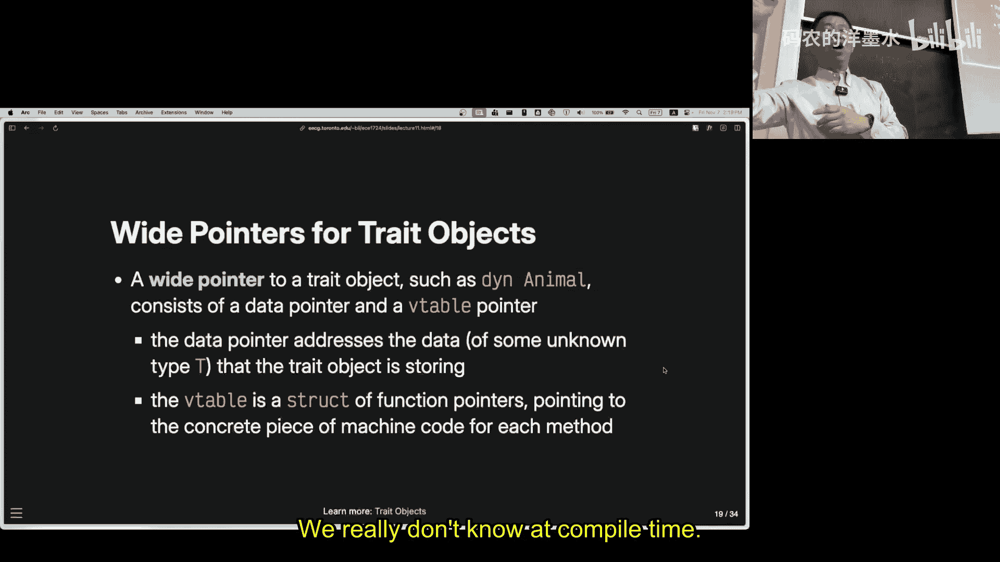

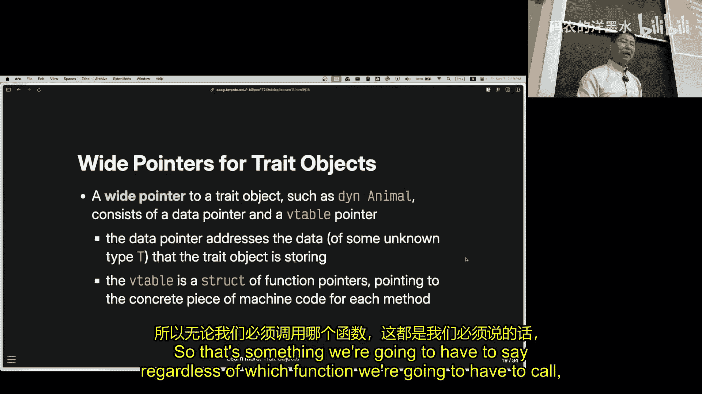

Same thing right here， except now we are using a dynamic。 we're using a trade object。

 and we're using the same V table idea as before as in C plus plus again， this is dynamic dispatch。

 So this is the same idea as before as the dynamic dispatch idea。 and in。

The C plus plus same idea as before。And。Again， we're using this to implement polymorphism。So。

 it is not。That Ru cannot do polymorphism。 It's just doing polymorphism in a different way。

 In a more constrained way。 And the constraint here is that a trait does not have data。

 It only had methods， no data。 And that's it。 Allright， So this is more constrained。

 but we can do polymorphism in this way as well。 And the downside of doing polymorphism。

Is that you basically have an additional lookup on that V table。

 So that would be additional overhead。 You do additional lookup。 So it's a little bit slower。

 And that's the overhead that you pay。 the price that you pay for using polymorphism。 But you。

 if you must use it， you use trade objects to implement polymorphism。

 which is the object oriented way of doing this。

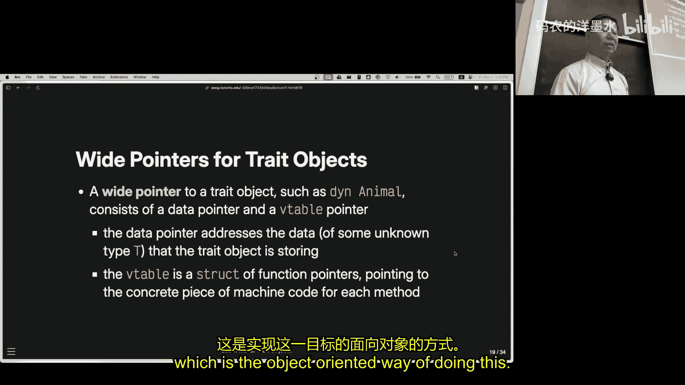

All right， so that's the basic idea over there。And then， let's get back。To the box tea。

A little bit of a cheating。Well， I forgot to bring my cheater notes， okay， so。

Let's talk about implementing two additional traits。 One is the。

D reference and the other is the drop trade。So let's first talk about the D reference rate。

 So D reference trait allows， obviously， values to be treated as references。

 So whenever you want to de reference a standard regular reference。You just say。Star， right。

 that would be a dereencing operator， right， just say star X， and that de references the reference X。

 X would be a reference， right， So that's something that's similar to any of the other languages in C H C plus plus。

 for example。 And then that de reference trade will sort of。

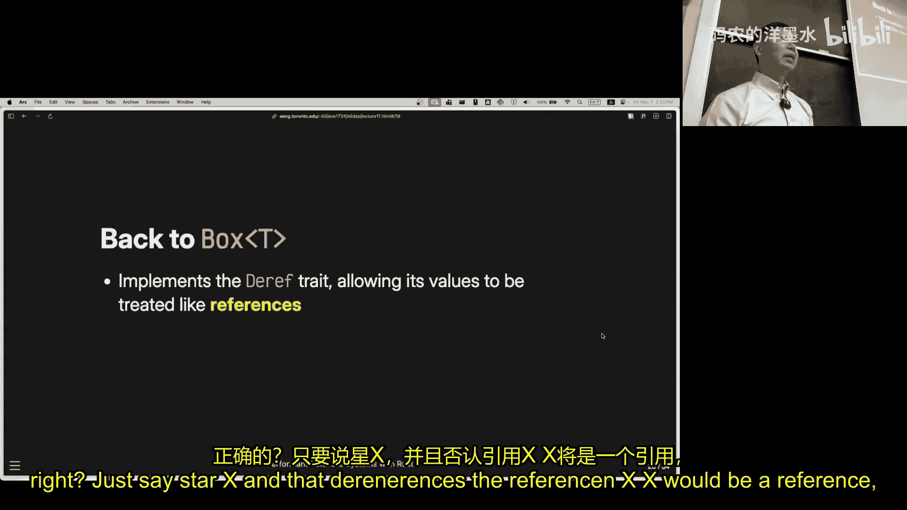

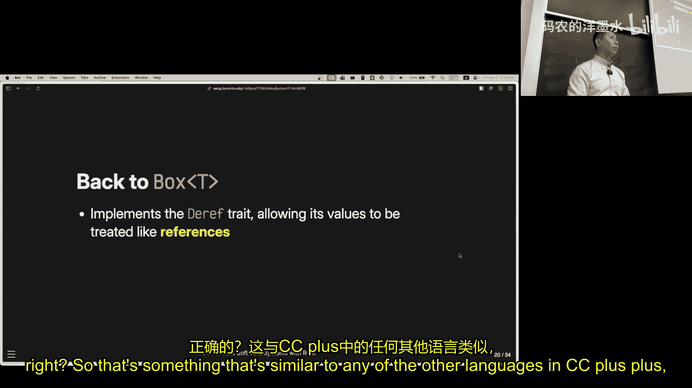

Transfer a smart pointer to an actual reference。 But there's a lot of things that we need to talk about regarding the D reference trade。

 And the second trade that we can implement is the drop trade。

 And the that allows memory that it boxes to be delocd。

 And we mentioned that that's what's happening。 because the box actually implements the drop trade。

 So that's what happening， not only the pointer is ded。

 but also the data it points to on the heap is thed when the box goes out of scope。

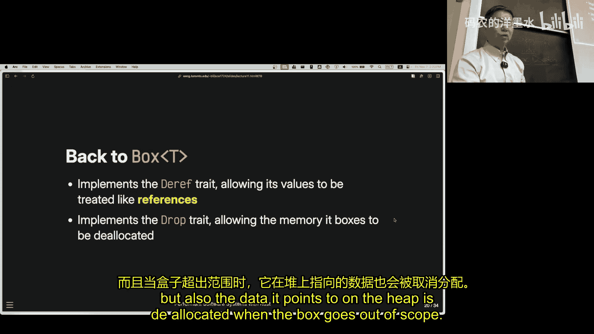

So now let's look at how do we actually try to use the box by dereencing it。

So we have x equals to 5 and y is a box of x。 Again。

 is' completely unnecessary because x is a simple integer。

 We don't have to box it and put it down the heat。 But let's say。

 let's say x is astruct with over 100 bys。 If you don't box it， cargo clippy will warn you。 So again。

 we're boxing it， put it on the heat。 And then when we de reference Y， do the star Y。

It will call the actual D Ref， you know， method in the D ref trade。

 And box actually implements the D ref trade。In the sense that it's just like de referencing any regular reference。

 So if you actually run this code， what happens。Run this called What happens。 Well， it will print。

True and true。 right， That what， that's what happens， right。

 because you can properly de referenceence it。 Box had already implemented the D ref trait。

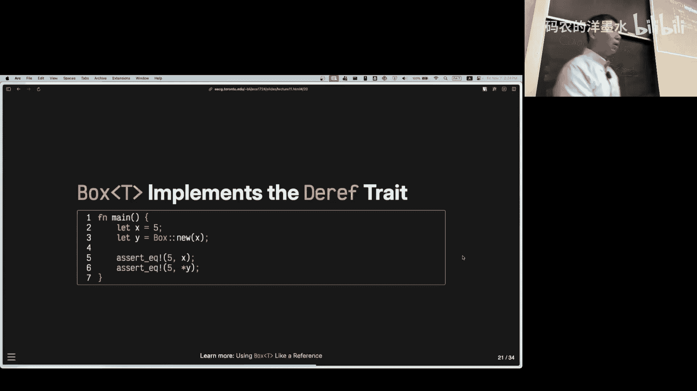

So let's say I have my own struct， and I wanted to de referenceence my own struct。

And which is possible。 So here I have something kind of strange。 I have astruct。

 and let's call it my box。And I， similar to box， I want to take a generic type。 So that type is T。

 So I wanted to make it a genericstruct。 So I basically say。

 struck my box with the bracket tea before the actual definition of the drug。

 And then the definition of thestruct is a simple。Ple。Right， this is a simple tuple。

 This tuple does not have anything else except for tea itself， right。So what is a tuple。 Well。

 tuple is just， you know， combining multiple values together。

 So here we're not really putting my box。 It' not putting anything on the he。

 It's still on the stack。 It is just kind of in a tuple， right， It's still on the stack。

 So it's the simplest possible way just to show you how we can implement the D ref trade。

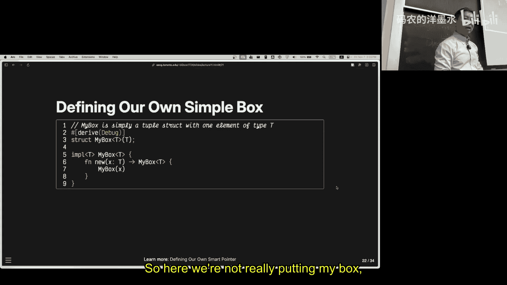

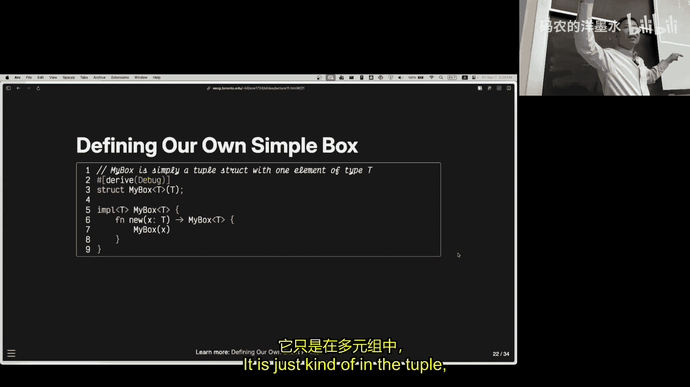

Alright， so now let's implement the new。function。And that basically is the constructor。

 and that constructs a my box over any type T。 So that will be my box。X。

 and that would be giving us the actual tuple。Alright， so that's something that we can implement。

 And that creates the box itself just by wrapping it up in the top。 It the same。Stack where it lives。

 So it's not really living on the heapve。 It's even simpler than the actual box。So the question is。

 can now can we use the my box new rather than box new and de referenceence it。

And the answer to that is， no。Obviously， because we cannot de referenceence it。

Before we implement the D trade。Right， this is our own box。

 This is not the conventional box from the rust standard library， which had implemented the ref。

 This one has not。 So we cannot de reference it。And we wanted to defef it。

 That would be a convenience that we wanted to provide。

 Maybe I implement my box to inside the framework and provide it to the users of that framework to that of that cr trait。

 Sorry， that crate， that particular library。So I want the D reference。 How do I implement the D ref。

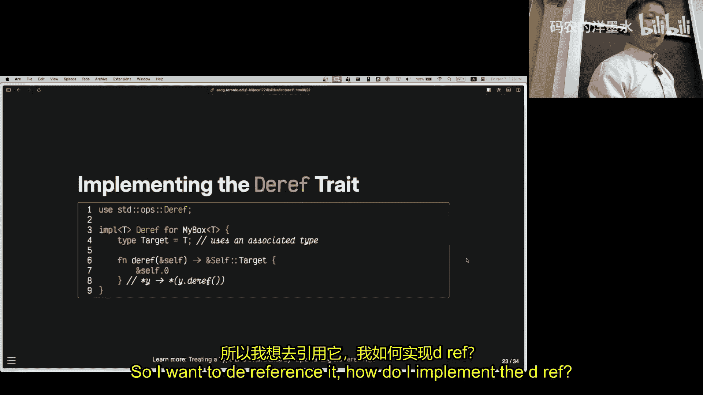

Now， first of all， since my type is a generic type T。

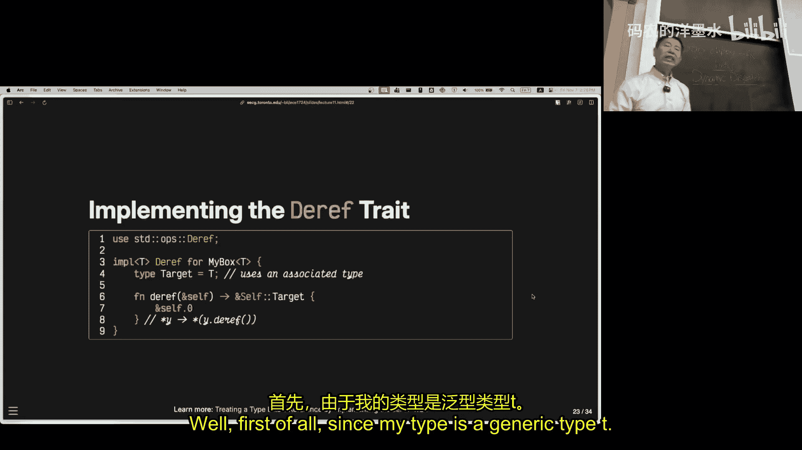

I wanted to implement this D so that it can operate on any type。And to do that。

 we need to make sure that this D ref is going to return an actual reference。

 which is a  N% and an actual reference。 But that is actual reference to our generic type T。

And how do we do that， Well， as we mentioned before。

 when we talk about eithererator and when we talk about other ways of doing this。

 we said that we did it in an associated。Type， so same here。

 we use an associated type to represent this generic type T。

 We say type target equals to T so that I can start to use target in our implementation of the D ref method in the D ref trade。

 and the D ref trade is brought in from the standard library。 So we have the D ref trade brought in。

 We implement that particular trait。And then we're going to have to implement the D ref method obviously。

 and it returns the reference to my actual type， which is the target。And over here。

 because it's a tuple， we just say dot0， that's the first item， we only have one item。

 so dot0 would be the item in that tuple， and that would be the reference that we're going to return。

😊，So M% self do 0。 That's the reference。 were going to return。

And then we can actually do the star Y because we implement the D ref trade。

 So what happens when we do the star Y。And underneath and behind the scenes。

 the actual compiler is gonna interpret the star Y as because y is no longer a regular reference。

 Now， Y is your own type， My box or any other smart pointer here。

 we actually at that implemented D ref trade。 We actually interpret as Y dot D ref。

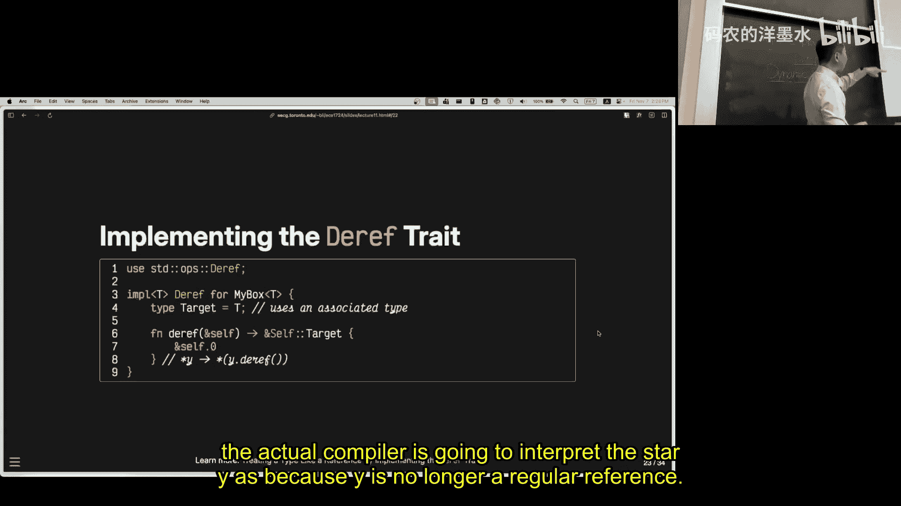

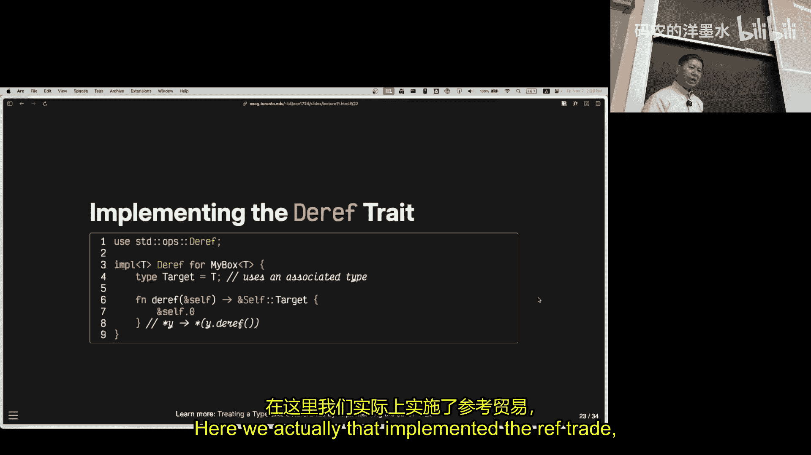

So we kind of first called D ref， and then we dered the result of calling the D ref。So star。

Y dot D ref is what the compiler actually sees when we see the star Y。

 So star Y is just synthetic sugar to star Y dot D ref。 After you de references the actual Y。

 you get the actual reference because M percent self target， That's the actual reference。

 And then we can de referenceence that regular reference。 so that's something that we do。

Behind the scenes。 And that's synthetic sugar。We can do a little bit more than that。 In fact。

 Ru does have something called the D ref coercion。 Again， this is kind of。

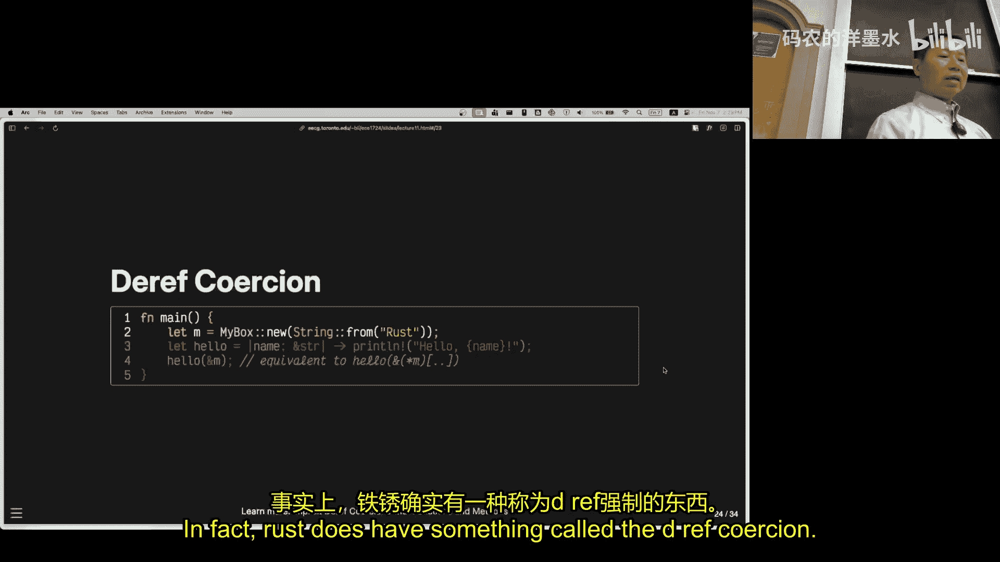

Sugy， sugar， like sweeter sugar here。 So you're thinking like， you know， we're doing something。

 but behind the scenes， we're doing something else。 That's basically sugar， right。

 So this is a little bit more sugar than the previous one。 So here， let's look at one example。

 So let's say we have the my box。😊，Same my box as before， but because we can take a generic type。

 so any type is fine， let's put in the string。That's a， that's a type， a string type， right。

All right， so now。We have a hello in the line number 3。 And that hello is what。It's a closure。Right。

 it's a closure。 a closure takes。A string slice， which is M% STR， right。

 That's a string slice as a parameter， which is a name。

 and then it prints out the actual hello with that name。In that closure。So that is a closure。

 Of course， it's a closure。 we can call the closure。So we can call the closure in the next line。

 So that's hello M percent M。 And we're calling it with an M percent M。And M% M is what。

 What is M percent M。Well。That is。Depending on what M is， right， M is an actual。My box。

 and that contains a string。Right， so what we're doing here with the M right there is that we wanted to first try to de reference it。

Get the actual string。And then we will get the string slice。Out of that。Okay， so we get the string。

 which is the string from。 That's a string type， right， So that's the result of de referencing M。

 We get a string type。But then we don't need a string type。 We need an M percent SR。 And previously。

 we mentioned that you can pass a string into the M percent SR。 And why is that。

 Because we can actually。Automatically do coercion。 And that is。

Coercing the actual string type into the M percent of that with the square bracket dot dot。

 which is the string slice of the entire string。Alright， so again， we are dereencing it first。

 and then we are converting it to a string slice。 And that's what happens。

When we have the M percent app。So again， this is D ref coercion。

 This is like additional sugar that we put in as compared to the previous one。

 which is kind of simpler over there。 and this code actually runs。

 this is actually from the rust kernels。 So this is actually compiling this code and running it。

 So always the canonical source if it doesn't run， it will not print out And just to make it like more general。

 let's talk about other like the general cases of D ref coercion and the D mute trade as well。

 So before the D ref mute trade is introduced， we talked about D trade。

 And we mentioned that my box implemented the D trade right So when we actually try to say n percent T when T is the D T basically implements the D trade with the target。

 remember the target is associate type with the target that is T。If we do this 10% E， you know？hen。

It's as if we're doing the M percent。You。And that is， in our previous example， the T is。The my box。

The U is the string。 So when we say M percent my box， that's as if we're doing M percent the string。

 which gives us the actual string slice。All right， with everything in that script。

So that is D ref coercion。 Again， this is something that is good sugar。

 because if you don't have something like this， it's gonna be too much kind of boiler platelate cold everywhere。

 it's kind of ugly。 Having this is much nicer。 And this is typically what you wanted anyway。

But then let's get into the Dra mut trade。 What is the difference between the D trade and Dra mut trade。

 Well， the D ref mute trade。Basically saying that rather than returning inmable reference。

 which is the D trait， we are now returning a mutable reference。

 That's where the D muted trait comes in。If you wanted a mutable reference。

 you need to implement the D ref mute trait。 And that is where you also have an associated type target type。

 And whenever you say M percent mute where T is the type that implements the D ref mut trait。

 it is as if you're saying M percent mute you you being the target type。

 same logic as before when we have the D ref trade with the immutable reference。

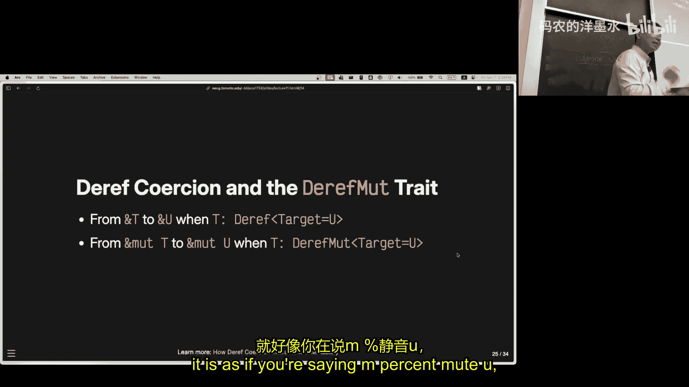

Alright， everybody got me at this particular moment， same logic， everything the same。

 same sugar except now we wanted a mutable reference to be the result of the referencing。Right。

 so we dere it when we're able to write to it。But then there's something really strange。

 something like this。We could actually try to have D ref coercion。 again。

 sugar here that basically saying， if you say M% mute T。

And T implements the D ref trade with the target of you， target type of you。

Then it's as your writing and present you。In other words， we're basically taking a。

Mutable reference and kind of doing sugar and actually convert to a immutable reference because T E actually implements the。

 the trade。With returning an imp immutable reference。 So this is also possible。 This is also sugar。

 It it's possible。

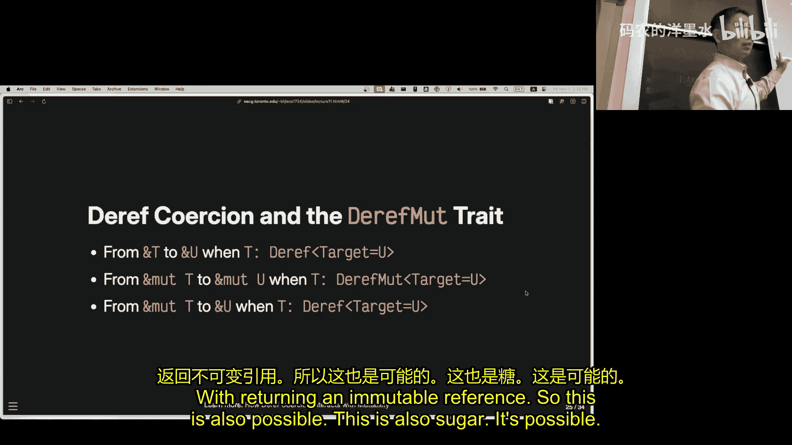

So in other words， whenever you said 1% mute something， it may not really be mutable。

 depending on what that he really is implementing。 If it only implements D ref trade。

 will'll give you an immutable reference。Now， can we do the other way。Can we convert？

An immutable reference to a mutable U M percent mute U when T implements the D ref mute trait。

That's really tough to answer。And the answer is， no， we cannot do that。And why。

 Because we are not sure whether or not there are other。

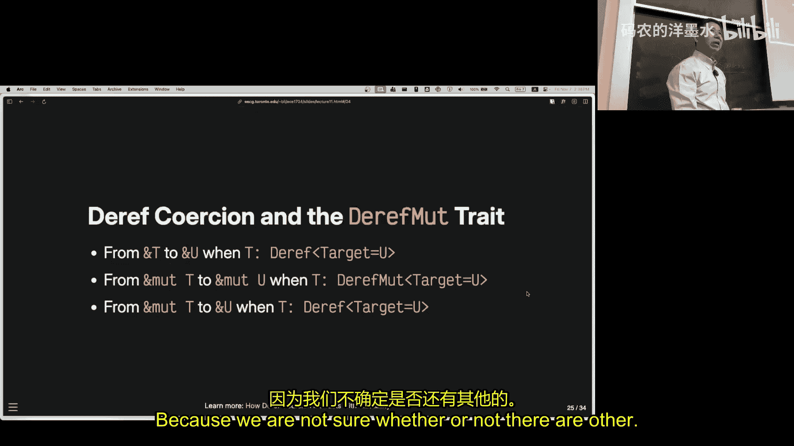

Imutable references。 And it against it violates our ownership rules。

 So we cannot really have the sugar that really converts。

Kind of like a immutable reference to a mutable reference。

 because we don't really know if there are other immutable references to the same thing。

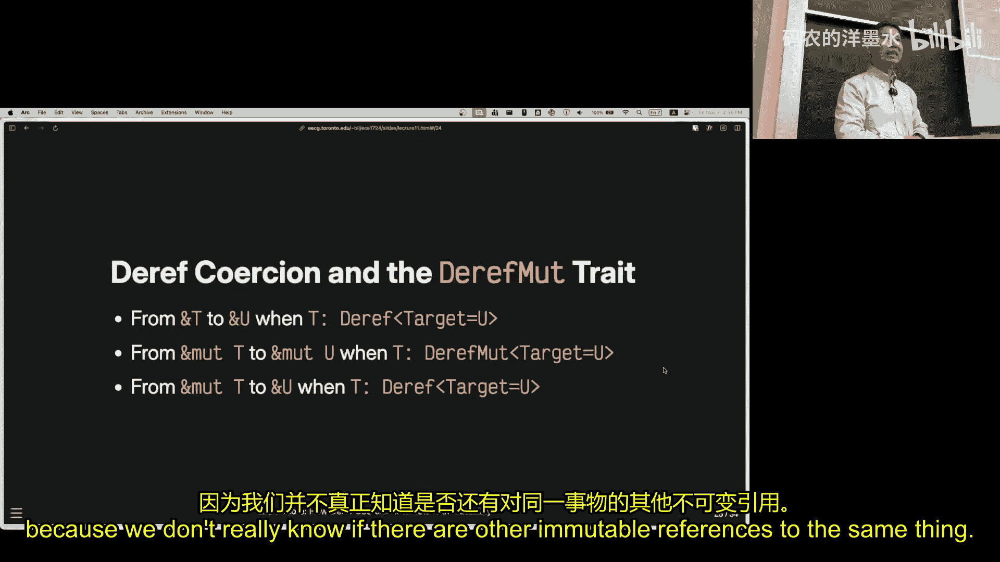

Alright， so that sugar is not here。 So three different kinds of D ref coercion。

 which is something that is really interesting because all of these Ts。

 theyre types that implements the D or the D mut trait。

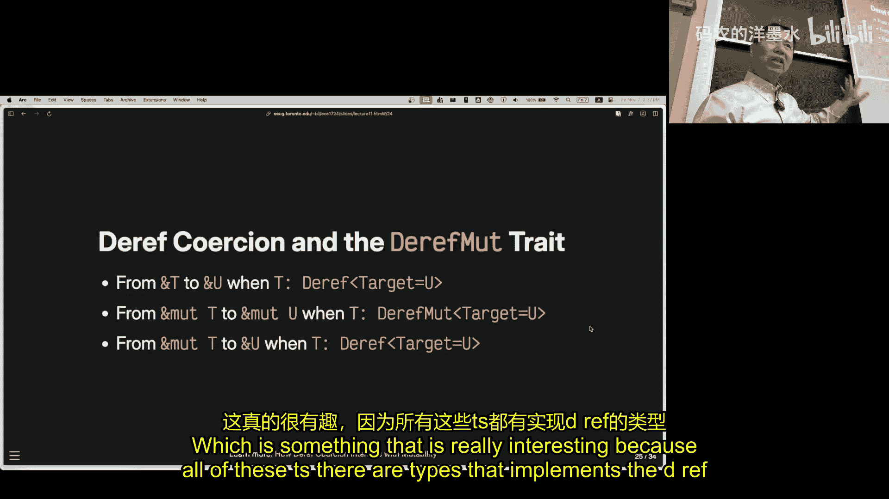

And so that you can dereence it。

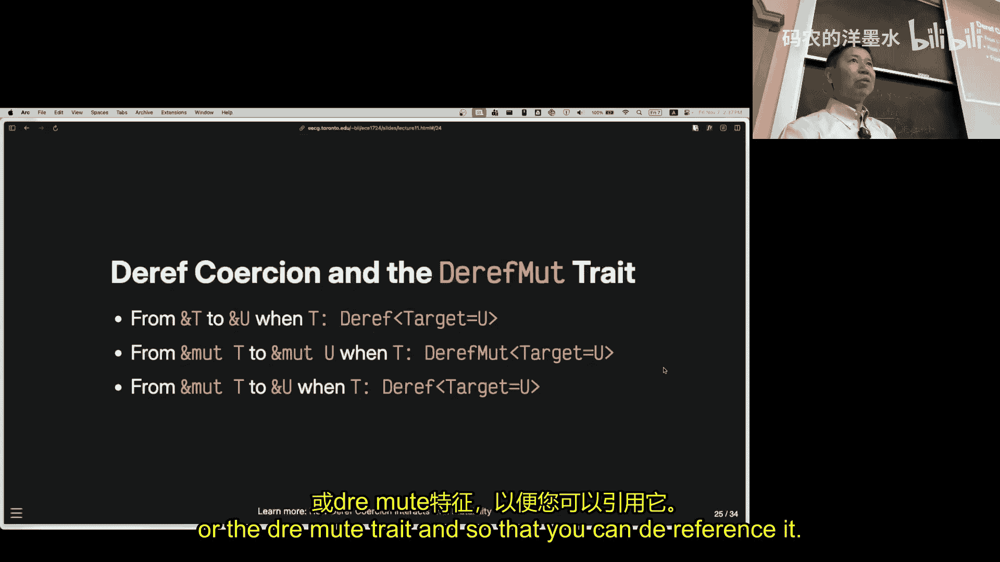

Alright， so now let's talk about the drop trade。This is also kind of interesting here。

 So by implementing the drop method， similar as the D ref method or D ref mute method in those two traits here we have the drop trade again。

 brought in from the standard library by implementing the drop method in the drop trade。

 which takes the mutable reference to myself。And just dropping myself。

You basically have additional logic that you wanted to drop。 For example， in box。

 you want to drop the actual data that the pointer points to， not just the actual pointer itself。

 So you wanted to specify the actual code to run when a value goes out of scope。 right。

 That's something that you want to explicitly drop。So here we have something very。

 very simple with the mybox， mybox trade and here you know we have nothing to do anyway。

 and it's basically on the stack so nothing to drop。

 so we just print out something so assuming that we have the this particular drop it implements the drop trade。

 then every time when values of this particular type。

 mybox type is dropped when it goes out of scope， this will be printed。Alright。

 so that's something that helps us to do debugging。 For example， that's really nice to have。😊。

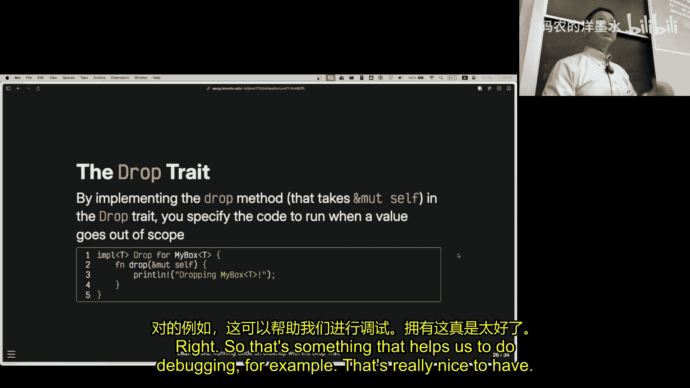

But what if I want to really try to drop it early， So typically， the dropping happens。

When the value goes out of scope， right？ But what if I want to drop that value early。

So can I actually call something like this？Can I basically say， so in this particular case。嗯。

Can I say why。Dot drop。Can I do this， Why dot drop。

 So drop is the method that implements the drop trade， right。

 So it implements the custom way of dropping the actual value， releasing memory or anything。

 Can I do why dot drop， yeah。Exactly， so the answer is correct。 And so the answer was no。

 you cannot do Y dot drop。 And the reason for that is because when y goes out of scope。

 the compiler is going to call Y dot drop。 And if you call Y dot drop。

 Then it's basically double free。 So you don't want double free and that is not allowed by the compiler。

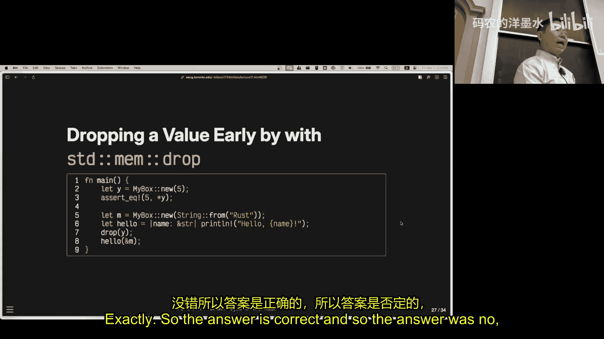

So you cannot do why dot drop。 But sometimes you do want to drop it before it goes out of scope。

 sometimes。You know， it' very rare， but sometimes you do want to do that。And inside that drop。

 by the way， you don't really have， you don't have to have just dropping memory or releasing memory。

 You could drop anything。 For example， you could have， for example。

 a memory connection that you wanted to close find， close that connection。

 a file that you wanted to close。 find， close that file that using the files handle or the files。

嗯 on。Basically， the， what's it called the basically some kind of identifier that identifies the actual file and。

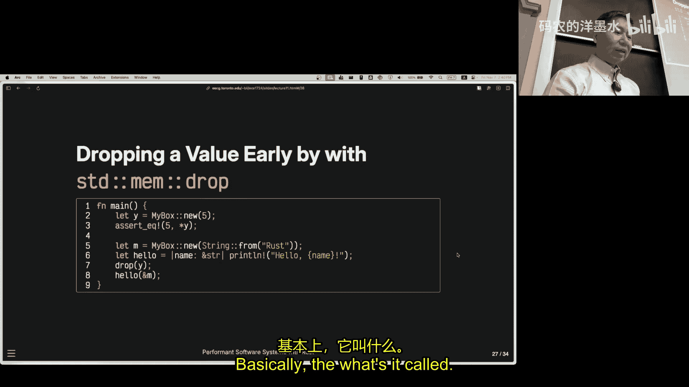

Or you could call， for example， anything that you would want to release。Alright。

 so anything you have a file or having anything that you wanted to drop。

 you could implement those inside the drop itself。So here， I want to do that release ahead of time。

 So since we cannot call why dot drop， this is not allowed。We would use the standard the。

 the this special way， which comes in from standard memory drop。 In fact。

 this is actually part of the prelude， which basically means that you could actually try to use it directly。

 You don't have to include it。And you don't have to kind of use it。 And you can say drop why。

 That would be sort of like a standard way of， you know， the function call。

 But underneath the implementationation of that， it kind of prevents the double free。

 kind of lets the compiler know that I'm dropping it。 Don't drop it yourself。 You know。

 prevents the double free。 So it's actually a little bit more logic。

 If you call the actual drop from standard memory。 So that's the standard way of dropping anything early。

 And that's what we can do right here， we can drop the y early， And before it goes out of。

 out of scope。Right， so that's something we could certainly do。

And just probably for the sake of time， we just want to ignore this live demo for now。

 but you can see that because we're dropping early， we are printing this early。Alright。

 so now we have two additional smart pointers that I wanted to talk about。

And the first smart pointer。Is the reference counted smart pointer or the R C。

And this is kind of interesting。 So we want to spend some time here。

And the reason why it's interesting is that it allows more flexibility than typical boxes。

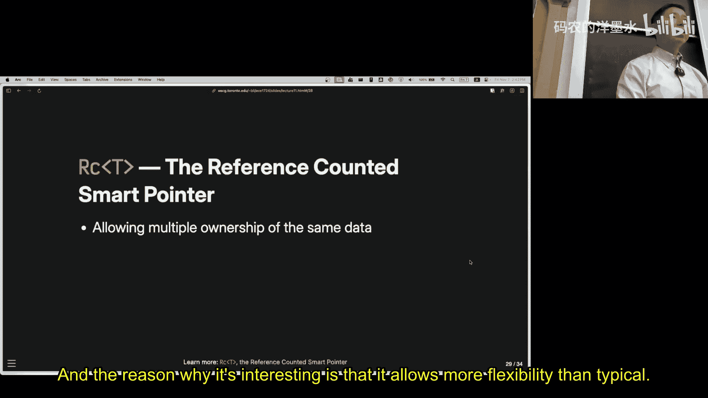

Here， it allows multiple ownership。Of the same data， multiple ownership。

Which is typically not allowed。 So typically you want to have only one owner to any data。

But R C allows multiple owners。To the same data。And this is read only。 R C is completely read only。

 There's no mutability。 You cannot really change the data underneath the R C。 Otherwise。

 you get a compile time error。This is completely read only， but it's a lot of cases is useful。

 For example， if you have a graph。Something like this， you know。

 and this like nodes pointing to the same node and so on。 You know， these are the edges E 1， E 2。

 And this， these edges， they point to the same nodes。

 You want both of these edges to own this node so that。Only when both edges are gone。

 this node can be released from memory。 So you needed multiple ownership。 in these cases。

 you wanted the R C。 A lot of the cases in our more complex projects wanted multiple ownership。

 So the conventional rules of having one owner is not sufficient for those requirements。

So that's why we have R C。 We use reference hunting。To re ensuresure the safety of memory。

And this is single threaded。 by the way， R C is single thread。 If you only have one thread。

 this is what you will use。Otherwise， if you have multiple threats or in the asynchronous rust case。

 which we will talk about next time， if you have multiple co routines。

Then you will need to use the atomic version of R C so that the implementation of R C。

 the reference company itself is atomic。 So the ARC or the arc。

 So these days when you actually see a lot of rust code， you see lots of arcs here。

 lot arcs there and everywhere is there's a arc。 This is because that these are the places that you need multiple ownership to the same data。

 And we're using multiple threads or multiple routines。 we do have concurrency。

 That's why we have arc。 However， if you know that this program is indeed single thread that you should not use arc。

 Why。Because Arc is more expensive compared to R C。Making something atomic had runtime overhead。

 So you need to lock and so on。 So that's something that you don't want to suffer。

 If you only have a single threat with the R C。

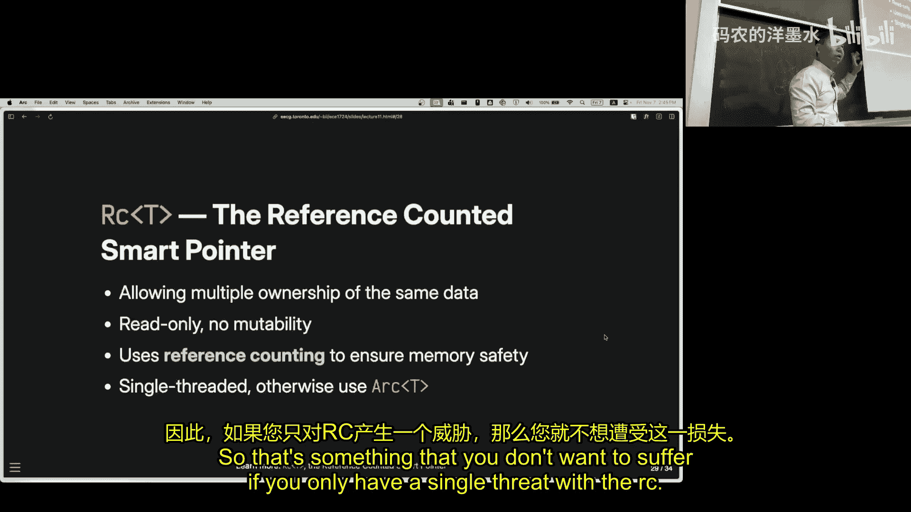

So for now， let's just use RRC。 But， you know， ARC would be the same thing。

So let's have an example here。The the textbook， our Ru programming language book。

 had a much more involved example， which we will not be able to cover in a short period of time。

 so I simplify the example here just to make it a little bit simpler。

 so we have first we have to import Rrc。

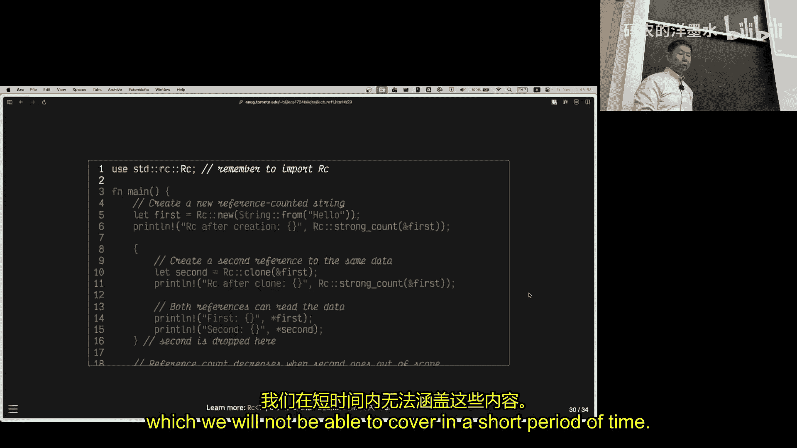

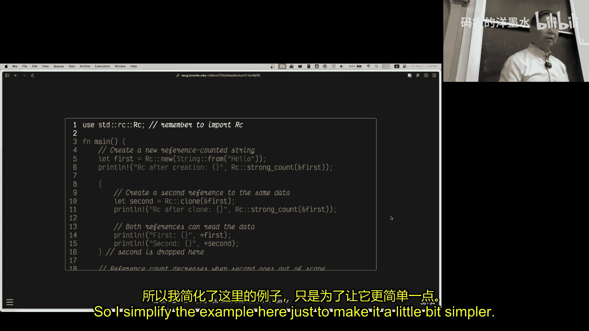

And then from the standard library， and then we just do RRC new。 This is very similar to B new。

 And of course， if we have ARC， it's called ARC new。

 we're just creating a new reference counted string in this case， we have this string from hello。

 So this underneath the RRC， we have a string right there。So， again， this is smart pointer。

 except that， you know， it's a little bit more complex than the box。

 We basically have a reference counted。Smart pointer。

And that we can call something called strong count to really try to look at the strong。

References to that particular underneath data， that piece of data。 In this case， we are looking at。

The strong count of that， the first one， which is first。

 And that would be having a reference count of one， because we just created it。And then， of course。

 inside another scope， I want to create a second reference can to do that， we basically call a clone。

So it say R C dot R C column column clone。 So that becomes that's an associated function of R C。

 And that clones the actual reference counted type， and that will increase。The reference count。

 So after that， if we call a strong count again， it will become2。

And then we could start to use these read only data by doing what， by de referencing。

Right so we are able to dereence it by just star first。 This is where all of the， you know。

 nice D D coercion comes in。 You know， we love the sugar right here because whenever you say star first。

 it will give you the actual data string so that you can print it out。😊。

So that's really nice to have。 And that's happening with the star second as well。

 So star first star second will actually refer to the same data because we're reference accounting to the same data。

 We have multiple ownership to the same data right here。😊，So that would be nice to have。 Now。

 we're reading the data。 It's read only。😊，And， of course， after we go out of scope for second。

 second will actually be dropped。 And once we drop the second。

 the reference count is decremented by one。 And that's when if we call it again， this will give you。

A strong count of one again。 So it's 1，2， and then  one， because the second one has been dropped。

So that's when the reference count actually comes in handy。Here。

 we are not paying additional overhead of copying the actual entire data structure inside that reference counted type。

 We are basically just incring the actual count。 So that's something that is really nice to have really handy。

 The only downside here。Is that this underneath the data structure underneath the reference counted type。

 that one is not ridable。 This is not something that you can mutate。

 This is completely immutable reference。 And that's something you can dereference and read it out。

 but you cannot write anything into it。

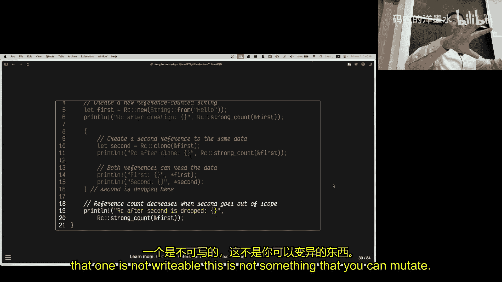

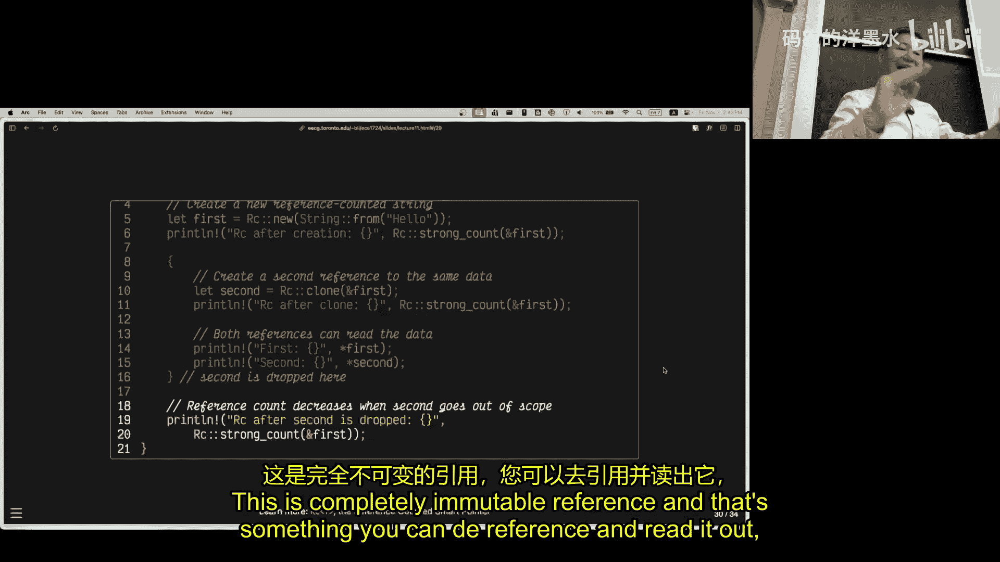

So that's the only inconvenience that we have。 But if we are okay with that。

 you are using the RRC or in the multi threaded version or multicolor routine version。

 you use the ARC， right， If you are okay with immutable reference， which is like 99。9 of the cases。

 You're fine with， is to be immutable。 You're just reading it out。

 You don't have to write anything back in。

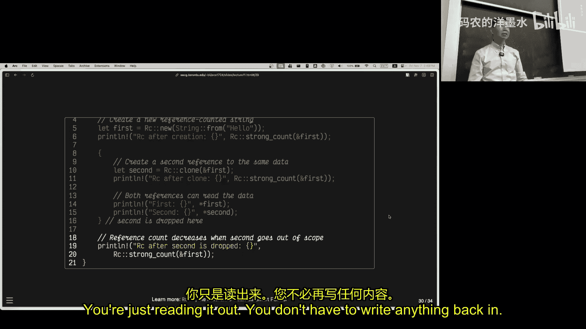

So， that's great。However， we do have one more smart pointer， which is the ref cell pattern。

 ref cell smart pointer that implements something called the interior mutability， mutability pattern。

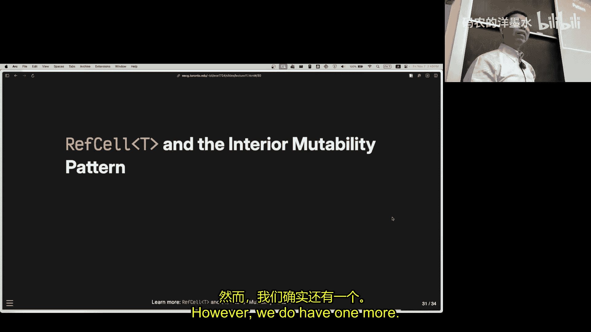

The interior mutability pattern is something that really allows you。

 This is a design pattern that allows you to。Change what's inside that smart pointer。

It allows what we call interior mutability。So that's something that is kind of allowing more flexibility。

And that's the rough cell。And interior mututability is basically a design pattern allows you to mutate the data inside。

 And this is different from the RRC。 RRC is like completely immutable。

 And this is also kind of violating our ownership rules。

 because here by using ref cell and the interiormability pattern。

 we allow changing things behind the scenes that you know， the data inside ref cell。

 even when they're inmutable references to that same data。And that is， you know。

 sort of weird because the rust ownership rule says we cannot do that。 And now we can。 We can do it。

So fundamentally， what we're doing， what we're doing with the refL T is that we have a single ownership。

 unlike the RC T。 So that's kind of simpler at an ownership level。

 But we have something a little bit more。

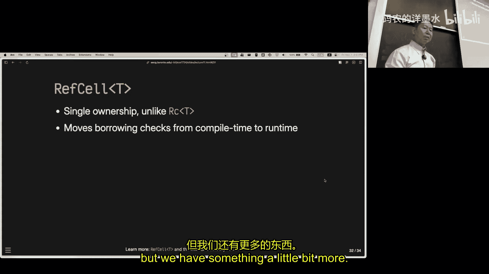

We move the borrowing checks from the compile time to run time。

 So we're still doing the borrowing checks。But we're moving all of the overhead of doing the borrowing checks to the runtime。

That's what we're doing。 fundamentally， when we're using the ref cell。 Sometimes you wanted that。

 you're okay with doing it at runtime because you're kind of confident that the borrowing rules will not be violated at runtime。

 but the compiler does not know。If that is the case， in rare cases， if that is the case。

 you use ref cell， because the compiler， when it's doing the ownership checks， the borrowing checks。

 iss kind of conservative。 So it doesn't really know what's happening at runtime。

 So it's doing a conservative check。 So sometimes you know that it's not going violate that rule at runtime。

 So you use the ref cell， even though the compiler does not know。

And you only use it when the compile time borrowing rules are a little bit too restrictive and you wanted to move it to the runtime。

 So now my question is， what happens when the borrowing rules are violated at runtime。

If we're using rougha， y。Yep， exactly。 they will panic。 So this is something that is intuitive。

You know， if you move anything to run time， you it's gonna panic if it violates the borrowing rules。

 The same borrowing rules over there， but it's gonna panic。Right there。

 when the borrowing rules are violated， we add additional overhead of checking for borrowing rules and runtime。

 And if the checks are violated， we will panic。

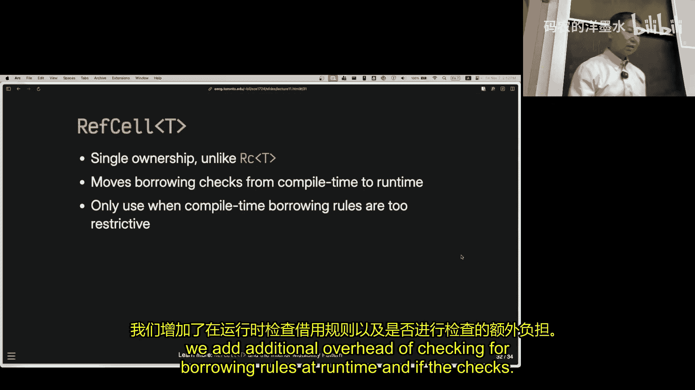

So that's gonna be violating the powering rules。And here's the good， good thing。 Here's。

 the good news。 We can actually combine the two。😊，We can use it with the R C。So that， of course。

 R C works only in single threaded cases。 In single threaded cases。

 you can actually have shared mutable state。 In other words， you can have multiple。You know。

 reference counted references to the shared mutable state。That's really nice to have。

 You can have multiple。😊，Inmable references to the same shared， mutable state。 And that's。

Kind of like the power of combining these two。 You also pay the overhead because you're using two smart pointers。

And what about the single thread， What about the multi thread case。In the multi thread case。

 we mentioned that in R C， we use A RRC to replace RRC in the multi thread case。

But then in the multi thread case， we don't use ref cell because ref cell is not threat safe。

 So we're using something called mu text。 So we're typically saying arc mu text。

 Mu text is basically a kind of like。Type defined inside the rust standard library that implements a threat save version of ref cell。

 which basically implements the locking using a mutual exclusion lock。 So that's the mut text T。

 So rather than saying R C ref cell T， you say arc mu text T。

 And because a lot of the complex rust code， They're typically concurrent。

 typically were having multiple threats or multiple cores。

 it is way more likely that you see the arc mu text T compared to the R C ref cell T。Alright。

 so in most likely， you will see a mu text。But you're gonna have to be very careful here because every time you have arc Mu text T。

 you basically have a lot of threads， multiple threads sharing references to the same data。

 and that data， you know， you're gonna have to protect against mutual exclusion against the race condition by having a mutual exclusion law。

 that is quite a little bit of overhead。 So you're gonna have to think about whether or not that is required。

 If it is required， you do have to share data across multiple data。 feel free use the arc mut text。

 Otherwise， if you can keep the data private to each one of these threads or coroutines。

 you don't want to share them across the board。

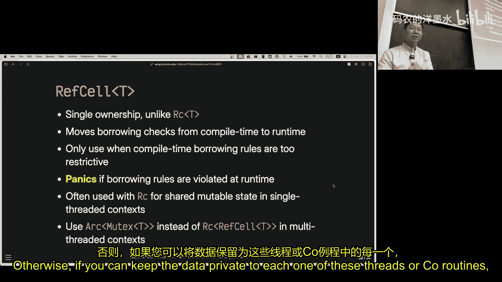

So now let's have one last example。 Let's look at how ref cell is used as combined with the RRC。

 So what you do is that initially you call new。 But then you use R C outside of ref cell。

 So you call ref cell new first here we're putting only one piece of data。

 which is an integer 0 with value 0 into that ref cell。

 And then we are making a reference counted and it a single thread K。 So R C new。 So again。

 in the multith case。 you will say arc new and then mu text new， same thing。

And then you will create multiple references to the same data。

 So here we have multiple references like before we use R C clone associated function clone in R C type。

 And then were basically cloning the Empers counter， the reference of that data。

 So we now we have multiple references to the same data。

 And then we can start to modify the value through the first reference。

 And then we can do it through the second reference。

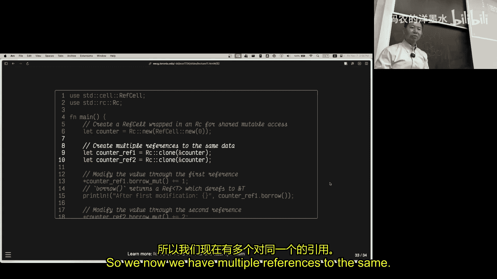

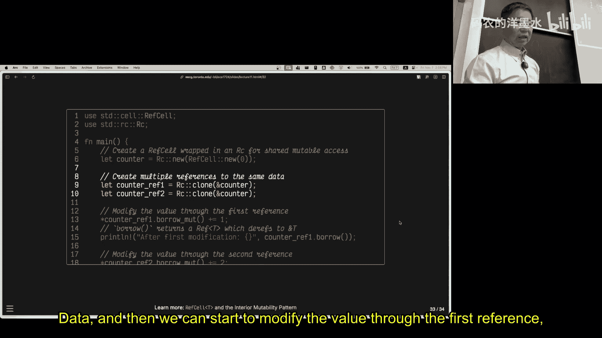

And here we're using something called borrow mute。So when we're actually calling borrow mute。

 we're calling it on the de referenced。Version of count underscore F 1。

 So star count underscore R 1 after you dere it， they reference it， it becomes the ref cell。

 It becomes the M percent counter。 And then on ref cell， we have the borrow mute。

 This is kind of as the name suggested。 you are borrowing this underneath data。Form formability。

 for mutation。 You are trying to change data before you change it， you borrow as a mutable reference。

And once you borrow this， then you could actually try to。You know， add one to it。

And so that's how you modify the value through the first reference。And that borrow。

 if you don't do borrow mute， if you do borrow， it will return a ref。

 which is basically the ref the actual inmutable reference， rather than the ref mute。

 which is the mutable reference。 Allright， so you could actually try to print it out by using a borrow。

 for example。

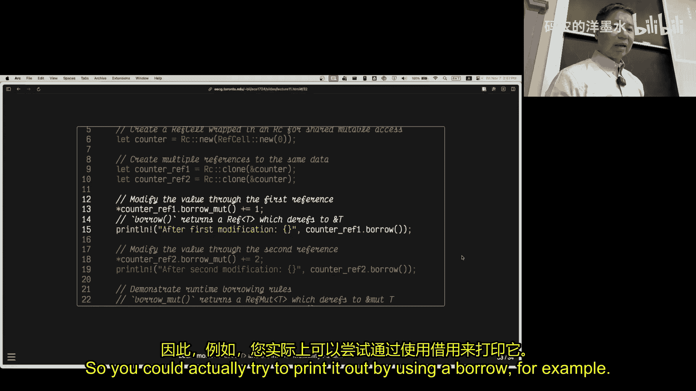

And you can actually try to do the borrow mute and try to de referenceence it and then try to add two to it。

 That's again。 But that one is using the second counter ref。 And， of course。

 we can actually try to borrow this again as a immable reference。

 and we're able to try to print out the value of it。 So we're changing it。

 And we can also try to read out of it。 So borrow mute is gonna get the imm the mutable reference and borrow is gonna get the immutable reference。

😊。

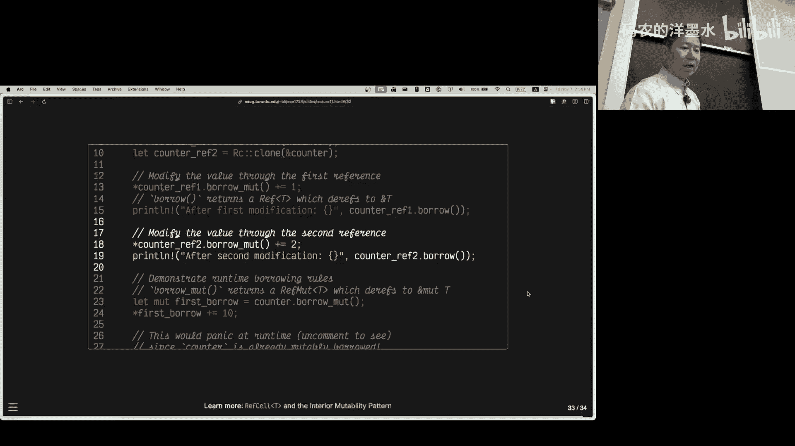

And now we can take a look at the runtime borrowing rules。 How do we actually try to enforce that。

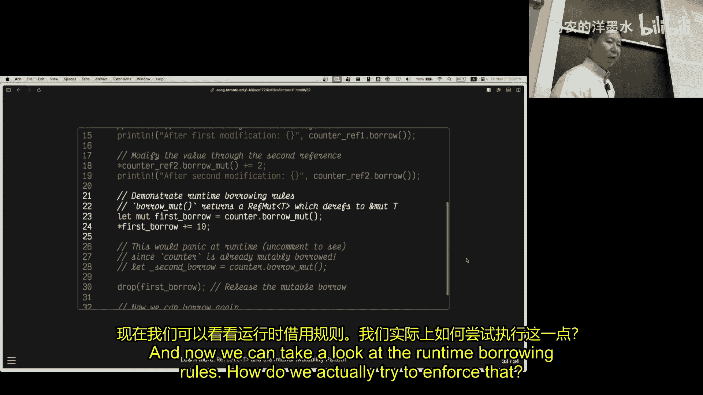

So now we're going back to counter。 So counter is， if we actually look at the。

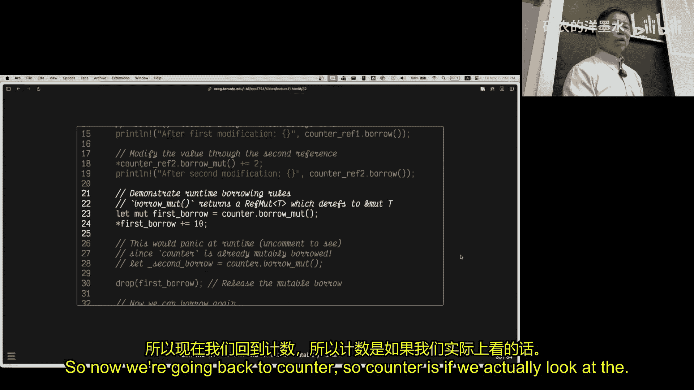

At the very beginning， it is the R C New of Ref New。

 and we are actually calling borrow mute directly using that counter rather than the clone version of it。

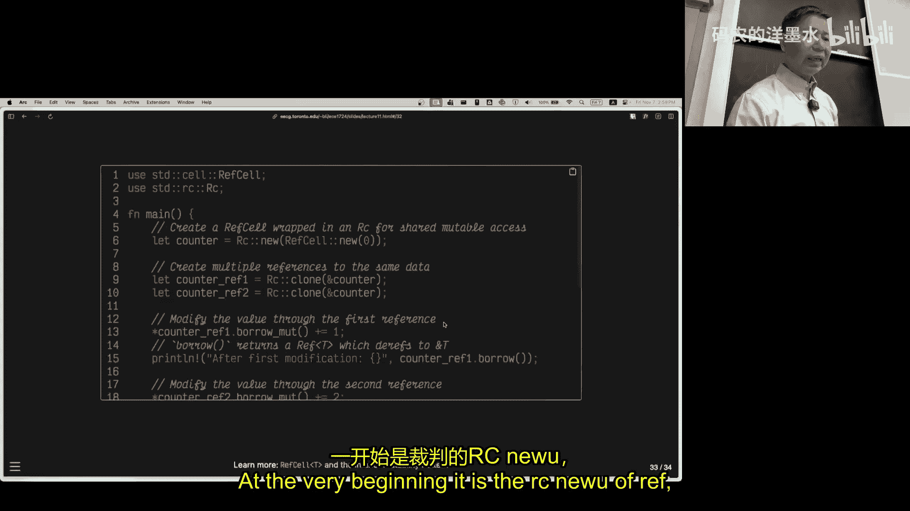

And that borrow mute is going to be our first borrow， and we can borrow this。

 and we can add 10 to it。And that changes the value underneath。 However。

 if we were to do another borrow mute， if this this commented out code at line number 28 is uncommented。

 if we actually do another borrow mute。

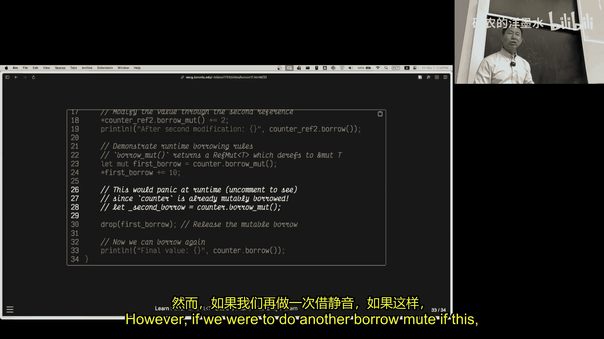

It is going to be a panic because the borrowing checks at runtime is going to see that you are borrowing again。

 and it is going to be a runtime panic because of that reason。

 So that second borrow will not go through because this is already mutably borrowed。

🤧And then， of course， you can any time you can drop the first borrow by actually trying to say now I can do a inmutable barrel again。

Same ownership rules。Without dropping the mutable borrow， you cannot do an immutable borrow。

 same as the compile time ownership rules。Except now we are enforcing this ownership rule。At runtime。

 So that's what we wanted to say about ref cell。 And again。

 this ref cell is only used in a single threaded setting。 typicallyyically。

 you are doing it in the mut text rather than ref cell。

 But that will be the topic of the future when we talk about multi threaded programming。

 So next time we will go into multi threaded programming。 and using also。

 we're gonna talk about asynchronous thrust as well。

