# 【全集 附课件】多伦多大学 使用Rust构建高性能软件系统 中英字幕 1080P p17 Lecture 17 - 无畏并发 - 线程 part1 -BV16V62BhEuf_p17-

Okay， so let's get started。Now last time we talked about smart pointers and today I'm happy to get started with something that is vitally important for rust。

 which is concurrenrency。 So we're gonna get started talking about concurrency today。

 but we will not have enough time to finish the discussion about concurrency we're gonna have two different parts。

 we have the first part which is about threats。 And then later today we're gonna get started with the second half。

 but then the second half is a little bit more challenging so we're gonna have to spend more time So it's going to spill over to the next lecture。

 So we won't be able to finish discussing everything today。 but we will get started obviously。

 and in rust， you might have heard about this terminology called fearless concurrency。

 this is a little bit of over exaggerating in the sense that。We still kind of fear concurrency。

 So it's not completely fearless。 In other words， rust， even though it solved a lot of problems。

 probably the past four decades of programming language design。 This is the best deal that we have。

 but we still have a lot of things that we have to consider。

 We have to really pay attention to and be careful about。 So we still have some fear。

 it's not completely fearless。 but we want to get started talking about。

So when we initially have rust before 1。0， the designers at that time。

 they thought similar to the other programming languages。

 they thought that they wanted to tackle these two big problems separately。

 one problem is memory safety and the other problem is all kinds of problems about concurrency。

And this baffled。All of the software industry for the past six decades on how do we deal with memory safety and how do we deal with all kinds of problems related to concurrency。

 So Rus thought maybe the designers or regional ideas would be that maybe we could have two different ideas。

 two different solutions to both of these two different problems。 and eventually。

The rust designers found out that whatever we just talked about before in terms of the ownership model。

 which is kind of unique to rust， at least all the way till right now。

 it's quite unique to rust and also type checking， extremely strict type checking。

 if you combine the power of these two， plus a little bit of additional ideas。

We might also be able to solve a lot of problems related to concurrency。 Again。

 it's still not completely fearless。 We might still have issues there that we have to be careful about。

 But still， it is way better than than other languages。 And also。

 we don't really need to introduce a lot of additional concurrent systems beyond ownership and extremely strict strict type checking。

 So today， we're gonna see examples of this。And。A lot of the runtime concurrency issues。

 race conditions and things like that。 And those previously were like headaches because they are at runtime and they're inadmittent。

 very hard to reproduce and so on so forth。 And now。Because of the rusts model。

 ownership model type checking and so on， they become compile time errors。

 This is the best deal ever。 You know， a lot of people say， okay， Rus is just one of the languages。

 It doesn't really matter。 we can use those。 go and you know whatever。 No， you cannot do that。

 This is the best deal ever， because whenever you start to have concurrency， you know， for example。

 Python 3。14， you know， 3。14， just released a few weeks ago。

 they started to basically have true multithreaded programming。

 whenever you have those kind of things， you start to share memory。

 whenever you start to share memory， you have concurrency issues and whenever you have concurrency issue。

 those are runtime headaches and we have tons of problems over the past four decades。

 this is the best deal that you can have。 and today we're gonna talk about it。Now。

 it's not the first language that had thought about this。 obviously， you know。

 people have thought about this in I， in pony， in go programming language， you might have。

 you might have heard about go， but you may not have heard about these exotic languages like Earl and Pony Earl was one of the oldest languages created back by a PhD student back in 1998 when I was a grad student and the actual PhD thesis was was written to really create this brand new language。

 Earl at that time， and the basic idea over there was to basically impose。Programming level。

Constraints so that the errors at runtime in terms of concurrency problems would be way fewer。

 would be much safer for concurrency。 Sam of， same idea about pony。

 Both of these were gonna talk about a little bit later。However。

 even though we are able to solve concurrency problems a lot better using these languages and including go as well。

They actually come with performance tradeoffs in the sense that they're kind of not so fast。

 Sometimes we want to best of both roads。 We want to have both concurrency safety and also no performance trade offs or very。

 very little performance trade offs。 But in general。

 we wanted to have a language that does not give us the actual constraints。

 the limits at the very beginning。 So when we start to use that language。

 already work with the constraints， that's not what we wanted。 We want to have a lot of flexibility。

 a lot of freedom of designing our own ideas using the language。 And that's what Ru is able to do。

 So we're going to talk about the actor model coming up。 and the Erland and Pony， both of these。

 they impose the actor model go pretty much not 90% imposed the actor model in the sense that we wanted to do only message passing between actors。

 Nothing else。But， you know， we， in rust， we don't do that。

 We allow the actor model to be implemented， but we also allow sharing states directly between threats。

 If that is faster。 if the performance trade offs is much less。

 So the actor model is something we wanted to talk about。 But Ru does not only support actor model。

 That's the good thing about this。 as compared to Earlland Pony and go。Alright。

 so before we get started talking about more details related to threats。

 I would just want to get started talking about concurrent and parallel programming。

And we're gonna get back to this。 We're gonna revisit this later on today。

 So we're gonna have more discussions here， but we want to bring it up first so that we can understand multi threaded programming a little bit better。

 What do you mean by concurrent programming。 Just want to put it simply。

 It means that different parts of a program， Ex。Independly。But may not be at the same time。

 They could be at the same time。But， they're just independent。

So they may not be at exactly the same time。And then parallel programming would be。

 in the sense that if we have different parts of a program， different logic， however。

 they do execute at the same time。For example， if you actually have multiple computers。

 each computer is running its own program， that would certainly fall into the category of parallel programming。

And typically。Paraleel programming is a little bit kind of like a smaller。

 It's a small subset of concurrent programming。 typically， if we say concurrent。 We you know。

 mean that it could be running at the same time or not necessarily at the same time。

 So may not be at the same time。 So it's kind of confusing exactly what really do we mean by concurrent programming because concurrent programming is like。

 you know， they are independent， but can or doesn't have to be at the same time。

 parallel programming basically say we have to execute at the same time。 But for now。

 we just don't want to get into this details we can get into this a little bit later today。

 But for now， we just want to mention that when we talk about fearless concurrency。

 we kind of imply the bigger picture。 the concurrent programming picture。

 It could include parallel programming。 also could include running the actual programs。

 completely independently， but may not be。At the same time。 So they might actually take turns。 So we。

 we will talk about this later on today。 But for now， when we talk about fearless concurrency。

 we mean concurrent programming or parallel programming。

 because concurrent programming includes parallel programming。 And let's try to talk about threats。

 Now， you might want to。Refresh your memory about operating systems courses related to threats。

 Obviously， threats。 if you use this terminology， we mean that we're running the code simultaneously by simultaneously here。

 I just mean concurrently。 So they could be parallel could be exactly the same time。

 or it could take turns and you know， basically just concurrent programming。

 So we're implementing this conceptual model of concept of concurrent programming using multiple threads。

 So we allow the execution of multiple threads to run in parallel at the same time。

 but also leads to subtle problems。And these problems。

 they are a conventional topic in a very typical operating system course。 Typically。

 we spend like an week on race conditions， another week on the deadlocks that can be a problem from race conditions。

 when we protect against race conditions， we might actually incur deadlocks。

 and we might spend another two weeks on race， sorry， on threat synchronization problems。 You know。

 the conventional producer consumer problem when we have multiple threats。

 We need to synchronize across different threads。 All of that， you know。

 multiple weeks of lectures in the typical operating system design course。

And is coming from multi threaded programming。 So if we don't do multi threaded programming。

We are not sharing memory。 If we're not sharing memory， then we don't have these problems。

 So if we just say multiple operating system processes， each one of them had their own address space。

 then we're not sharing memory。 In those cases， we don't really have these problems。

 only when we start to share memory。 That is when we have the race conditions。

 rest synchronization problems，steadlocks and all of that kind of problems。

 And the rust actually supports， obviously， supports multi-threaded programming。

The standard library uses a what we call kernel threats model。

 which is sometimes also called a one to one threat model。

 And you could actually have third party crates that can actually bring you other threading models。

 but the default from the rust standard library is the kernel threats model。

 which basically means that for every single thread in rust， we。Actually。

 have a corresponding thread or in Linux operating system。 We call it a task。

 a corresponding task in the kernel。 So each thread in rust corresponds to one task in the Linux kernel。

 So that is what we typically call the one to one thread model。 Now。

 the kernel threat model is very typical for。Modern operating systems we use the kernel threat 1 to1 model for Linux kernels。

 We use  one to one model for Macos， and we also use  one to1 models for Windows。

 All other operating systems， their history their history， theyre no longer used。All right。

 so now let's try to create a brand new thread。And we have seen the code before when we talk about closures。

 but before we show the code， we wanted to show that this is from the rust standard library。

 So we basically say you standard threat。 And then what we wanted to do is that we want to say let's call thread spawn。

 which is an associated function in the thread library。And we pass a closure to it。

 So what we're passing in to the spa function is a closure。

 And that obviously is some kind of a lightweight function that we will use as a starting point for this particular thread to start with。

 So this closure in this case， is gonna have a for loop。 and it's gonna print。

 and we will sleep one second between the printing。 And that's about it。

 that's what the closure is doing。 And in the main function。

 which obviously is the main thread as well， because the main function。

 the thread spawns the new thread。 So that's the main thread。 So the main thread we。

 we will have another for loop。 And that's something that we could certainly do as well。

 And let's just try to give it a run。 So let's try to have a quick demo here。 So goes the。😊。

Let's try to cargo new。Big bigger font。 cargo new threads。And。CD threats。That bigger font。嗯。

And let's try to just put it in。Alright， so this is the function that we have。

 This is the main function that we have。 And if we do cargo run。You will see。That。

Both the main thread and the new thread， they're running and they're running concurrently。

 or you can say in parallel and each one of these will print a message and then pause a second and print the next message so there are messages they look like they're interleaving because they're running concurrently。

Now these threads where are they running， Obviously。

 they're running on our CPU course and they don't really have to use the same CPU core。 Obviously。

 because we're using a kernel thread， one to one thread model in the sense that we are mapping to a kernel task and a kernel tasks doesn't have to be sharing the same CPU core with a different kernel task。

 They could actually spread across different CPU core。

 typically even with a laptop computer like what I have right here。 I have at least 10 cores。

 like you know， four performance core，6 efficient core these core and so on。

 So I have plenty of core。 if you have two threads。

 Most likely they're running on two different CPU core。

 but they are still sharing the same virtual address space so that's what we have in the thread。

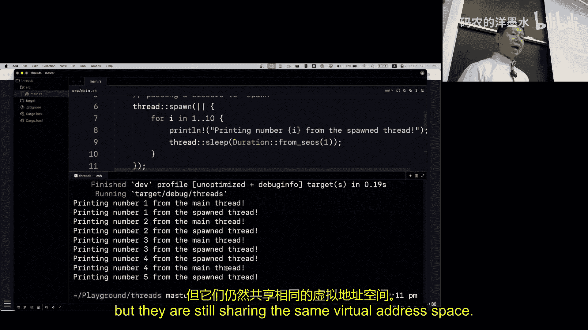

Now， just now， we actually have the simplest idea of spawning thread。 just let it run。

 but I wanted to improve that particular code by creating a join handle and that join handle conveniently is the returned value from the spawn function。

 So whatever the spawn function returns， that would be the join handle that towards the end of my main thread。

 I could actually try to join。 And when I call handle do join。

 what I'm doing here is I'm trying to wait for the spawned new thread to finish。

 Sometimes we call it the child thread or in this case。

 we don't want to just we just call it the spawned thread。And we want to wait for it to finish。

 So this is something we can do。 And because join actually returns a result， it could be an error。

 So I'm gonna just unwrap it。And that would be。All we need to do to wait for the spawn thread to finish。

 So that's really nice to have。 So I can actually try to。😊。

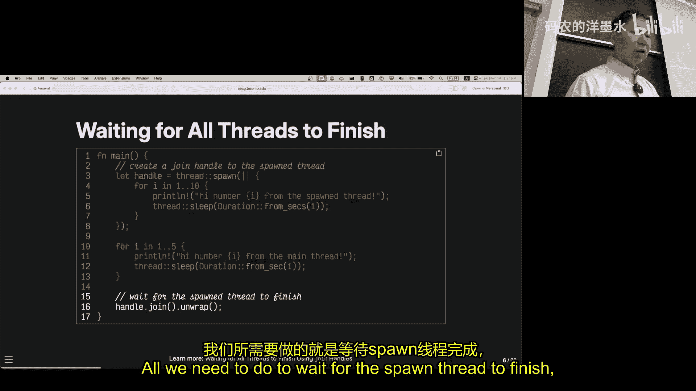

Just try to do this。Right here。 And so I'm just trying to run it again。Alright。

 so now what I it looks very much similar。 But what I have here is I have a guarantee that the spawn thread is gonna finish because as you can see。

 the spawn thread actually had 10 iterations。Previous run。

 we only allow smaller than 10 iterations to finish because the main thread terminated。

 When the main thread terminated all of its spawn thread will obviously will have to terminate。

 And now we allow the child thread or the spawn thread to actually get finish before we terminate the main thread。

 So this is very typical to really try to synchronize across multiple threads。

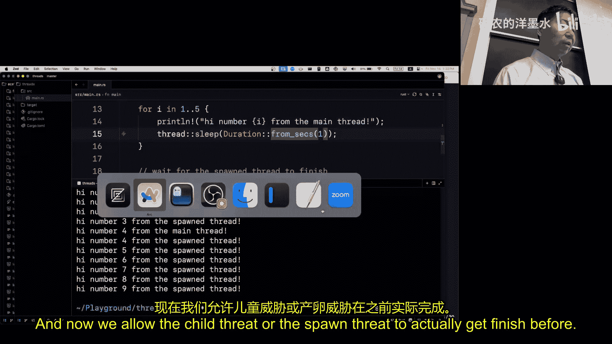

So we have seen the live demo here。And now let's try to look at one very important detail in our spa thread that we mentioned before when we talk about closures。

 right， when we talk about closures， we talked about capturing the environment。Of the parent thread。

 But in this case， what we have is that we have a closure in the spawn function。 So the question is。

 can we capture that particular environment in the parent thread。Inside a child thread。

 So we wanted to do that。 For example， I don't want to simply print anything within the actual function itself。

 I want to capture what's going on in the parent thread， and that would be a vector of 1 to 3。

 So I want to print that vector， for example， that would be nice if we have that ability to sort of capture the environment from the parent thread。

 So let's try to do it。 So it's something very simple。 The question is， can it compile successfully。

😊，Right， so let's give it a try and see if we can compile this successfully。 What do you think。

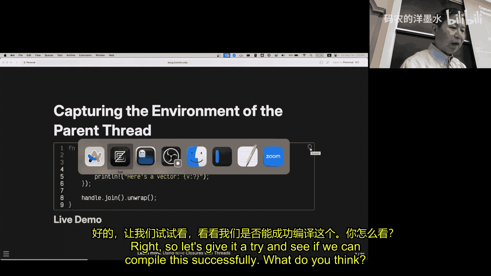

Let's give it a try。So I saved it。 and immediately after I save it。

 that you can see there are some compile time errors。 What do you think， why， why。

 what are the errors right there。Well， this one should be， this is a warning。

 so I just need to get rid of this。And we do have some errors。 What do you think over there。

What might be there， Let's try to switch to the， the light mode here from the easier to see。

 What do you think over there。

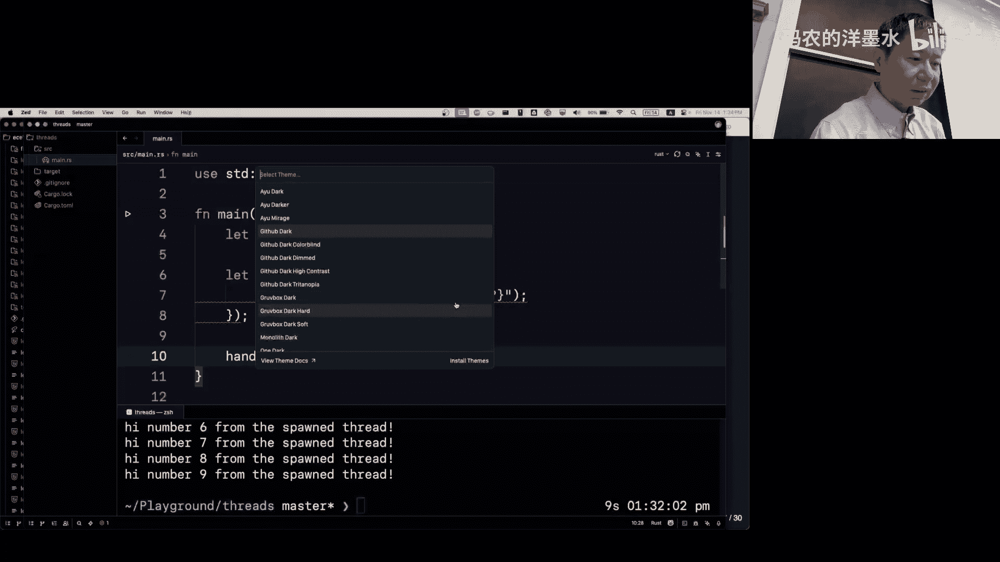

What might the problem over there？Yeah。The new threat may live longer than the main threat。

 That's exactly right。 So when we are doing the spawn and inside the spawn。

 we have a closure that captures the environment。 How did we capture the environment。To default？

You know， model of capturing the environment would be by a immutable reference。 right。

 We're basically getting an immutable reference。 That's the default。 Obviously。

 all three can be supported by Raz。 We can get a remutable reference。

 which is default and a mutable reference。 And we can actually do a。Ownership transfer。

 We can transfer ownership。 all of that would be possible。 but by default， if we do it like this。

 it will be an immutable reference。 We're capturing a reference to that vector。

 So that would not be a very good idea here because the threat can easily outlive。

The actual main threat， you might say， no， no， no， it's not outling because we have a drawing over there。

 So we， you know， we are waiting for the， the other thread to finish， but the compiler doesn't know。

 right， So that's something we have to check at compile time。 So in that sense。

 what we're doing here is that we're checking by using the ownership model。 And over here。

 we're basically saying this probably isn't you know。Let's take a look at d。The the problem here。

 So we basically say error E 0，3，7，3 closure may outli。The current function。

 So this is our lifetime model when we're actually trying to get an immutable reference。

 it borrows the actual vector， which is owned by the current function。 So when you。Borrow something。

 whatever you borrow will not should not outli the actual original value。

 So this is not something that the compiler will accept。

 It may outli the borrowed value here because it's in a different thread。

 It does have a very helpful message trying to help you to fix this。嗯。

So it tries to say help to force the closure to take ownership of V， use the move keyword。

 So if you wanted to take ownership of this value， which you should because otherwise。

 it's gonna outli the original value。 It might have a chance of outliving the original value。

 So in that sense， you will use the move keyword that we have mentioned before。

 when we talk about closures to basically capture this in a different way。

 capture this value from the environment by taking ownership。

 So that's something that we wanted by using this move。 So， again， that's something we can do。

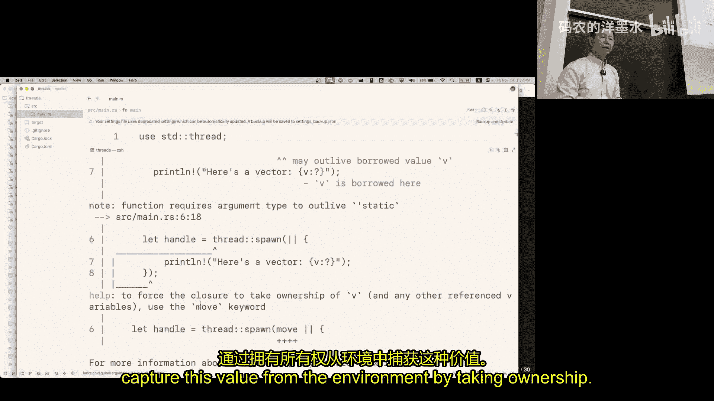

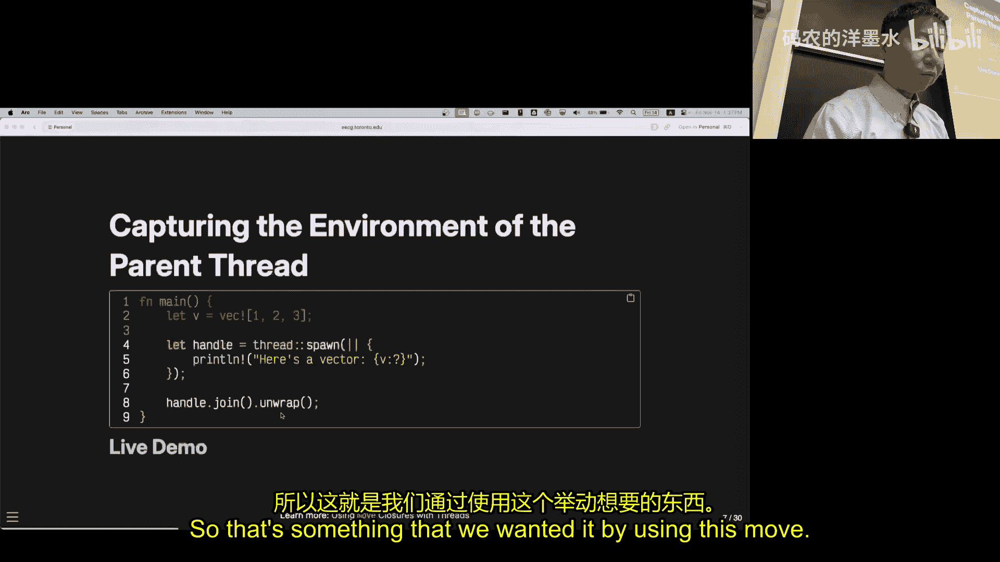

And。Let's try to just quickly move it。 So if we just quickly move it， as you can see。

 then it goes away and。Cargo run is going to have the ability to capture by taking ownership and print it out。

 So that's something that we can do。Now， that is very typical。

 as we mentioned when we talk about closures in threat spawn。 In fact。

 this is actually one of the most prevalent ways where we actually take ownership in other other places when we have closures。

 we typically don't take ownership。 But in this case， we typically do take ownership。

 because otherwise， we cannot do much with this particular vector， even just print out。

 So that's not something we want。

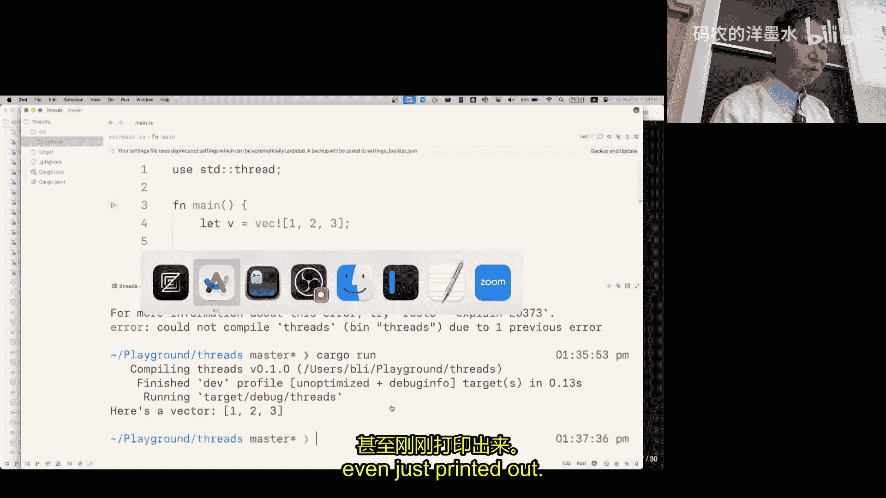

All right， so that would be the solution just to move to take ownership of the environment。Now。

 let's talk about。The actor model。 So the goal language， when it was created。

 I'm not a very big fan of go。 I， I didn't like the language。

 I think it's actually way worse than rust。 So don't use it if you agree with me。

But it did have a good advice in its documentation， which is， do not communicate by sharing memory。

Instead， share memory。By communicator。Alright， so do not communicate by sharing memory。 Instead。

 share memory by communicating to put it simply。😊，Do not share， communicate。Right。

 that's the basic idea。 And that's something that you must remember。 And that's something that。

 you know， back in early，1998， you know， people have written their PhD thesis to emphasize this idea。

 you know， in pony， people have created a brand new language again about 10 years ago。

 emphasizing this idea， Go， actually put it at the first class citizen in the language。

 just to emphasize that you should not share memory。All right， so if you start to share memory。

 if you start to really have the need of sharing memory。

You're going to have to think very hard about that design decision。Or in today's world。

 if you start to use the large language model and the large language model。

 generating a lot of sharing memory， kind of code。You're going to have to question that。

If you take that cold， it can easily go out of hand。 can easily start to be behave。Really strangely。

 really unpredictably and so on so forth。 All of the problems of the past four decades about concurrency is going to happen when you start to share memory。

 Instead， if you start to communicate using the actor model， it's gonna be a much nicer design。😊。

The only downside， as we mentioned before is that it's kind of performance trade off。

 It's a little performance trade off in the sense that in some cases， in some， I。

 I would call them special cases。 We're gonna talk about some of these special cases today。

 but in some special cases， you might want to share memory。😊。

Because you wanted the fastest possible way of sharing， of sharing states between threads。

 In those cases， you don't， you don't want to take the performance straight out。

 You wanted to share memory because you want the fastest performance。 only in those limited cases。

 you want to share memory。 Otherwise， you go with the communication。😊，Alright。

 so if the large language model give you， you know，10000 lines of code all doing you know。

 share memory stuff， you're gonna have to question that。

 You're gonna have to challenge the large language model。 So some of the large language models。

 If you challenge them， they're gonna give you， you know， a much better deal。

 It's a much better code that they can write if， its long you challenge them。

 So this is where design comes into play。 So we want to design it correctly。😊，And that when we。

 that's where we introduced the actor model。 I wanted to introduce this early on in the entire picture。

 before we go in to talk about more about threats。 I want to talk about the actor model。

And the actor is the basic building block。So you can think of an actor as。诶。Just。A threat。

So an actor is just a threat。 You know， that's something that basically。Had states。

 and it can run its logic through the state。 So it is an actor， but it is implemented。

 can be implemented as a threat。 That doesn't have to be implemented as a threat。 Later on。

 we're gonna talk about asynchronous programming。 But for now， it can be implemented as a threat。

It' the basic building block of concurrent computation。Now， this thread had states。However。

 the state is completely private。 So you are not going to have any state that is shared。

 That's why we're saying， communicate rather than sharing memory。

 Everything in this actor is completely private。And when you are actually trying to use this actor model。

To build more complexity， more complex systems， what you do is that you actually make these actors to talk to each other。

 So these map actors， they're going to send messages to each other and。

If you wanted to make an act or change its private states。From outside of the actor。

 the only way of doing that is to send a message to it and then let it change its private state by itself。

 You' are not going to do anything else。 There's no other way of accessing that state。

 The only way of accessing the state is to send a message。 So you will send。

A message or messages from the other actors。 So this is actor。 This is another actor。

 These are the actors that can only send messages to this particular actor。 And， of course。

 we can send actors message back and forth as well。 But this is for from the perspective。

 my own actor。And to send a message sometimes in terms of programming， we sometimes call it a handle。

 but it doesn't really matter how you implement it。 But， you know。

 this is basically just a way of sending a message。To this particular actor。 And， of course。

 we can send different kinds of messages。 There could be multiple types of messages that I can send to the actor。

So as you can see， this is actually a very simple model， conceptually， very， very simple。You know。

 you， you are not allowed to do anything else。 You cannot modify the state by going to visit that actor directly。

 You have to send a message to it。And when we' are saying， send a message。

 I'm not talking about calling a function。 I'm talking about really sending a message over something called。

A channel。So this is the mechanism of sending a message。To that particular actor。

 So we have to have a channel to send a message rather than saying， I'm gonna fake sending。 No。

 we're gonna send it literally over a channel。And， of course。

 the channel is something that is shared between the two actors。

 But the only thing that the channel can do is to relay these messages as a cu for the messages and make sure that they' are relayed correctly。

 So that's something that the channel will do。We are not able to do anything else in terms of these states。

 So there is no sharing of memory whatsoever。 And the actor model removes the need for lock based synchronization for anything about race conditions。

 Anything about deadlocks。 All of that completely gone。 Why， because we don't have sharing of memory。

And if anything， this should be your default model。 you should not use the， you know。

 the sharing memory as your default。 this should be your default model in terms of concurrency。is it。

第二。A they still shared。Yep， so that's a very good question。 So the question was。

 we're gonna send a lot of messages right across different actors， is it implemented as MPI。

 which is a message passing interface across multiple computers， by the way， you know。

 over a network in most cases in rust or is it just implemented by sharing memory Well。

 the actor model obviously we're talking about threads or you know。

 in future coroutines in the same machine which basically means that these channels。

 you can use the as conceptual channels， but they're not going over the network。😊。

So that means that they must be implemented by sharing memory， obviously， right， however。

They are implemented by professionals， right， in the sense that they have no box。

They're made sure to be extremely fast。 In fact， Rus actually had the fastest。

 some of the fastest communication channels in the world compared to go compared to pony and so on。

 theyre the fast Earlland， by the way， when Earlland was created， it was， we don't even have threats。

 at that time， the PhD thesis about sending messages across different processes。

 So that was very old。 But for now， if compared to go compared to Pony and so on。

 this is the fastest way of implementing the channel。

 And there are tons of different kind of channels。 We have channels from the rust standard library。

 we have channels from the thirdpart crates lots of extremely fast channels。

 and they're guaranteed to be correct。😊，Alright， so the difference between Ru and these languages。

 Erland and Pony is that these languages， they say， because it's a great design pattern。

 you must use it。And in rust， we don't say that。 We say you have the choice。 You could use it。

 but you don't have to。 You could share memory if you wish to do that。

 if that's something that you can， you know， guarantee that everything is safe。

 Everything is nice and clean。 And， you know， you， you're sure of that。 And then， you know。

 it's something that you， you have full confidence of。 And。

You just don't want to take the performance trade off of using the channels。 Then sure。

 you could share memory。 But otherwise， the default would be using the channels because this is actually not slow at all。

 This is actually very， very fast question。这是垃。Right。You small。So how come。Oh。

 removed the question is， how come by using the channel， It remove the need of a lock。 Well。

 it does not remove the need of a log for implementing the channel。

 but it remove the need of you using the lock because the， the。

 the assumption is that when you start to use a lock。It's gonna be a pro。 And these channels。

 they're tested。 They're battle tested。 So which means that they are completely bug free when they start to use the lock。

And they also have a lot of smart ways of doing things that is lock free。

 So you don't have to use a lock。 but there could be using a lock。

 And whenever they start to use a lock， it's actually。Very。

 very efficiently using the lock and error free。 So that would be something that you can depend upon。

 And you don't have to use a lot yourself。 And that is sort of like taking you away from assembly programming and going to high level programming。

 pretty much except that when you are doing assembly programming slightly faster than if you do high level programming question。

So in that sort of sense。Blocks and the memory shared， that's all abstract。

Program is a much a simpler way of doing。It's still there are。Exactly， so the question was。

 is do we still have locks under hood， We do in a lot of the cases。

 depending on the implementation of the channel， we could actually have a lock freeway of doing this。

 but a lock freeway is not like， you know， not without cost， obviously。

 typically a lock freeway is when you start to do spin loops。 That's when you don't have locks。

 but still， you basically have the implementation of a lock right there inside anyway。

 So you do have locks for sure。Obviously， because you， you have to share memory no matter what。

 because you're sharing the same channel in that sense。 But it's gonna be fast。

 way faster than if you do it yourself。 and it's gonna be error free。上那个。Exactly。

 the programme does not have， In fact， the programmer is not even allowed to think about it because you cannot even share state at all。

 You're gonna have to do the communication channel thing。Question。但是你。然后1万块。

Make your copy put it into their channel。And the other side sure that's。是关。

So that's a very good question。 The question is when you actually put a lot of things into the queue that like if the message is like a big message。

 for example， lots of states in the message， you want to put it in the queue。

 you want to copy into that particular channel。 And then you know。

 how do you actually try to make it less expensive。 Well， the trick over there， as you can imagine。

 is not to copy which is always the case in rust， It does not even allow you to copy because it's gonna take ownership。

The channel itself is， we're gonna talk about it with an example。

 The channel itself is going take ownership of whatever message that you wanted to send into the channel。

You cannot basically say， I'm gonna send something， but you're not taking ownership。

 The channel is gonna take ownership， which means that it's gone。

 After you send the message into the channel， it's gone。 You don't own the message at all。

And that's a very nice， almost like a perfect integration with the ownership model inside rust。

 You know， this channel idea。 So that's why in rust， it's like， it almost feels natural。

 You can feels like you' gonna have to use it。 Otherwise， you kind of wasting this ownership model。

 pretty much。😊，Alright， so let's get to this these channels。 Alright。

 so we're gonna try to talk about these channels。 A channel is a general programming concept。

 We can have all different kind of channels。By which data is sent。From one threat to an another。

And a channel， as you can imagine， would have two halves。

One half would be a transmitter or multiple transmitters。

And the other half will be a receiver or multiple receivers。

 So if we actually start to visualize the channel， we could see that we could have a channel with。

 So this is a channel。And。We could actually have a。1 or multiple transmitters。

 and one or multiple receivers。So that's something that is the conceptual model of this particular channel。

 depending on what you wanted。There could be different semantics that have been implemented either in the rust standard library or in a thirdpart crate。

 There are tons of different kind of highly efficient channels that are implemented in in rust to ecosystem。

 But depending on what you want， this is the actual mindset for you to understand the channel。

 So the transmitter have is kind of upstream location of a river you're sending rubber ducks in the river and the downstream of the river would be the receiver have。

 And you can you also consider this to be a communication channel， just like over the network。

 Either way you think about it。 And inside the channel， obviously， you could have a queue。

 So inside the channel， you have a queue like this。 So this is your queue inside the channel。

 And this queue， depending again， on the semantics that you want， could be a bounded。Capacity Q。

Or it could be an unbounded capacity。 So whatever that you wanted for bounded capacity。

 the benefit is that you know how much memory is gonna to consume。

And so you can basically have a tighter bound if you don't want to have a lot of memory consumed for that channel。

 for the unbounded capacity， a good thing about this is that you don't really end up losing or or failing to send a message into the channel。

 you can always succeed into sending it， but the bad thing about it is if you're not so careful。

 The memory usage is gonna go higher and higher as the program runs。

 And that's something you're gonna have to think about。So。That's the queue inside the channel。

And if either have transmitter or the receiver is dropped。In this case， if we have one receiver。

 the receiver is dropped， then we basically consider the channel to be closed。

 So that would be the semantics of this channel。 Very simple idea。

And I have drawn a typical example of a channel in the sense of a multi。Producer。

 single consumer channel， which is basically multiple transmitters， One receiver。

 you could certainly have。Something that is beyond this particular idea。

 But this is actually something that is the most prevalent， most often used。

 It's provided by the rust standard library for the multithed programming。 And， of course。

 if you only have one transmitter。 You can also use this channel。

 It doesn't really lose any performance。 If you just one one transmitter。 That's fine。

 That's the special case of a multipro single consumer channel， you could have multiple consumers。

 In other words， you could actually have a multiple producer， multiple consumer channel。

 that would be possible as well， but it's not provided by default of from the rust standard library。

 other thirdparty crates can support that。 you could also have something like something called a one shot channel。

 which basically it's a special channel where you can only send one message。 And that's。😊。

Done and the channel is done。 You don't have any further。

 And that's very useful when you have sort of like a request response。

Model of programming in the sense that your response could easily be and request as well。

 but most likely the response can easily be a one shot channel。

 So you could actually establish a one shot channel waiting for that response。

 So that's something you could do typically it's a little bit cheaper in terms of performance performance is better。

 So cheaper in terms of overhead compared to a typical MPC channel。 But this is the most typical。

 So in most cases， probably 95% of the cases。 We are okay with using an MPC channel。

 and the performance is super good because it is optimized for our usage。

So the rust standard library provides a MPC channel for the multi threading。Model that we are using。

So that is from the standard library， SD S。 and we are able to create an MPE channel by just saying we just。

😊，Call channel as an associate function iss gonna return a tuple。

 We just need to destructure the tuple， and we get the sender， and we get the receiver。

And you might say， oh， that's only1，1 transmitter。 What happens if we wanted multiple transmitters。

 What do you think。What it's just returning one transmitter。 If I want multiple transmitters。

 what do I yeah。Multiple producer， multiple consumer。 I just want multiple producers。

 I just want multiple transmitters。But right now， it returns one transmitter and one receiver。

 I want to have multiple transmitters transmitting to this channel。 What do I want， What。

 what do I do， y。Exactly， you just clone it。 So that would be a very simple conceptual model。

 It's a very cheap clone。 And obviously， this transmitter that is returned can be cloned。

 The receiver cannot be cloned。 And all of that would be very nice to have from the semantics of MPC。

 And you just simply clone it， and it will be used as additional transmitters sharing the same channel。

 So that's really nice to have。😊，So what you do is that you could also have some methods of sending。

And receiving。 So you could actually say T， X dot send， T X dot try send。

 R X dot receive R X dot try receive。 So there are two variants。 send and receive。

Versus try send and try receive。Both of these variants have their use cases。

 So we could actually use both of these。 and both of these return result in the sense that there could be an error trying to send into a channel。

 and obviously， when you have an error， you know， if it's a triend。

 it can easily be that the channel is full that you want to send into a full channel。 If it's sent。

 it could be an error when the channel is closed， right， then you cannot send into it。 Now。

 the difference between these two variance。Is that send and receive。The first variants。

 they are block in the sense that they block the threats execution。

And then wait until the channel had available capacity。Or becomes non empty。

 So when we're sending into a channel， we want to have available capacity。 So if it doesn't。

 we're gonna wait right there。 And when we're receiving from a channel。

 we wanted the channel to have something to receive。 Someone sends a message into it。

 And when it's completely empty， we wait until it becomes non empty。

 So that would be a very simple semantics。 typicallyy we use that。

 because that's something that we were used to。 We wanted to say， block。

 this particular thread until we can finish this operation。So that's something we wanted to do。

 typically。However， it is not typical， but sometimes we do want that。

 which is a non blocking variant， which is the triend。

And try receive or try send and try receive is very helpful in the sense that。They are non blocking。

 They return immediately with an  error if ascend or receive fails。

And sometimes we wanted the non blocking because we have other things to do。 We don't want to。

 you know， wait there。 We have other things to do over there。So in that sense。

 we wanted to use tricend and try receivece to have a non blocklocking version。

 so it's actually a good idea to have both versions available so that we can actually choose which one we go with it's reasonably rare that we needed to have a nonblocking version。

 but sometimes we wanted that we want to proceed， make some progress would be other things that we're doing in the same task and this is very typical in when we start to talk aboutmpC channels in coal。

 when we talk about asynchronous rust， this is very typical。

 the semantics would be exactly the same in terms of multi-threading versus asynchronous programming we still have channels over there。

 but it's actually more typical that we start to use tricend and try receivece when we use asynchronous rust。

 for some reason we're gonna to talk about later when we actually talk about asynchronous rust。

 but for now， two variant。That you can choose from。 So that's a nice menu that you can choose from。

 So now let's try to use channels for message passing by extending our previous example here。

 Our previous example simply just create a multipro a single consumer channel。

 But now let's try to create a thread by using threat spawn。 and we wanted to say。

 let's try to send a message。 And that message is just a simple string。 Hi。

 we want to send it into that particular channel， just called T X send and then unwrap。

 basically takes the result and unwras it， it will panic if the result is an error。

 when the channel is closed， for example。 And。We can， in the main thread， receive by just， you know。

 taking the。Receiving half of the channel。And then call receive。 It's a blocking version unwrap。

 And then we receive it。 So whenever we have not nothing in that channel iss just wait there。

 The main thread is gonna wait there until something is in the channel。

 Then it will get out and with that received message。 And it's gonna print it out right there。

 And if you don't want to receive， you can actually change it to the non blocklocking version。

 But in this case， obviously， we wanted the blocking version because what I wanted to print it out。

Alright， so now let's try to just quickly test it and see how it works and。

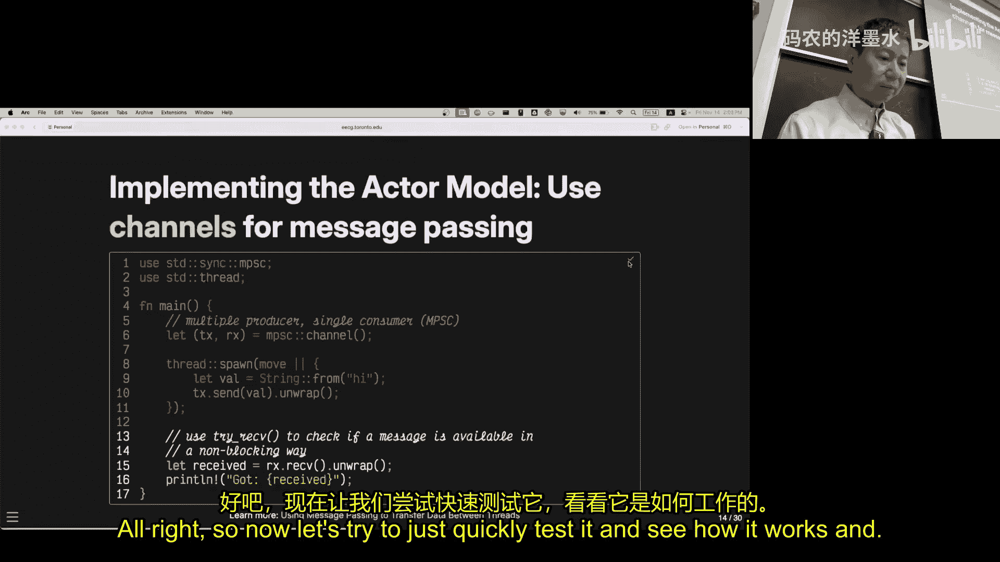

Let's try to。See if we can have it right there。好right。

So this is the code that we just copy and copied from the slide。Let's try to run it。So if we run it。

 we will see that as expected， we have this result。

 which is the message that we received in the main thread。 And before we receive that message。

 the main thread is not going to terminate because it's gonna wait on that receive on that channel and we don't have to join to wait for the thread because we just try to synchronize across different threads by using this very convenient channel semantics。

 which is what we recommended。And of course， this doesn't have to be just a simple string。

 You can actually have actors and expand it to， you know， astruct， you know， different kind of types。

 And as we mentioned， handles to receive messages and send messages and so on。

 All of that would be possible。 And so we could actually try to extend it to a full fledged actor model。

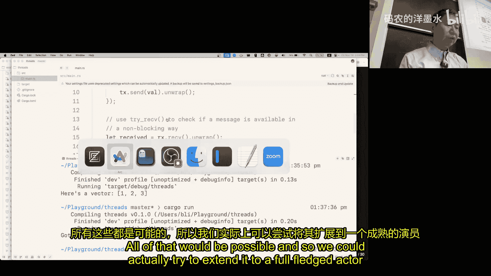

Alright， so now let's change the code a little bit。 And the question is。

 will this code compile successfully。Now， the only difference here is that we have the。

Print right after the scent。So we want to print the value in the spawn thread in that closure right after the sun。

 will this compile successfully？What do they think， will this compile successfully。

 We want to print this value。Right after we send it out into the channel。No。喂纳。没到。我实。Exactly。

 the ownership is gone。 is in the channel， so。That is one of the highlights of rust。

 A lot of people say rust is just another language。 I mentioned， you know， just like。

 here's just yet another。 No， this is where you need to use rust because。

This is a compile time error， right？ So this gives you a compile time error， mostly because。

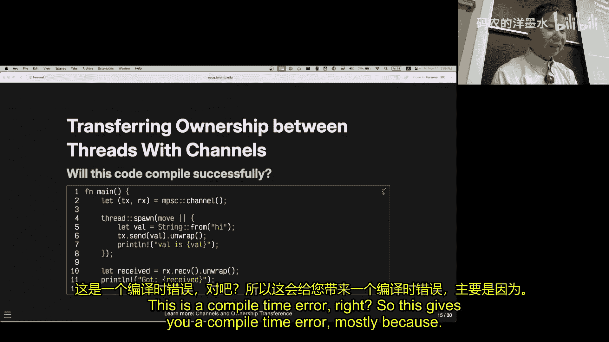

We have the convenience of the ownership model， combined with the communication channel so that you could actually easily。

😊，Give you this nice。Conversion from a runtime mistake to a compile time error so that you don't really have to share states and so on。

 You just send the channel。 And， you know， the message is actually not copied。

 but actually transferred ownership is transferred into the channel。

 And then eventually transferred to the receiver。 right， So that's something that we have。

 And if you start to use it right after you send it out without cloning it will give you a runtime。

 sorry， a compile time error。 And the compile time error basically says this basically has type string and it's transfer the ownership is transferred。

 It does not implement a copy trade。 And that's why you cannot use it after the move。

 So that's something that is very important。 And that's what we are taking advantage of by combining the ownership model with the communication channel。

 Allright， So we're not making a copy of the string， we're basically just transferring ownership。

 And that's really nice to have。😊，Alright， so let's get， let's take a five minute break。

 Let's resume at 2，12 and even more exciting things coming up。😊。

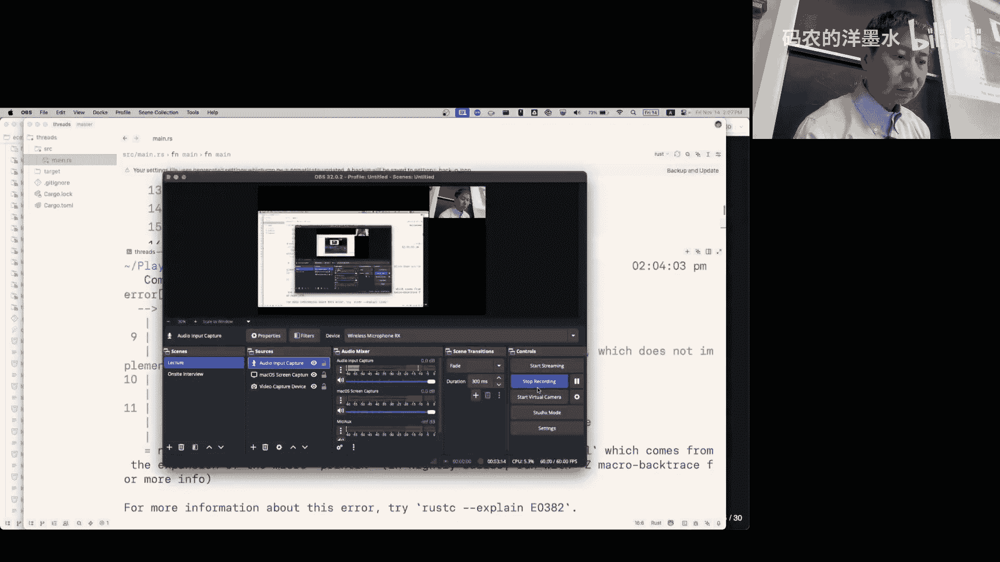