# 【全集 附课件】多伦多大学 使用Rust构建高性能软件系统 中英字幕 1080P p18 Lecture 18 - 无畏并发 - 线程 part2 -BV16V62BhEuf_p18-

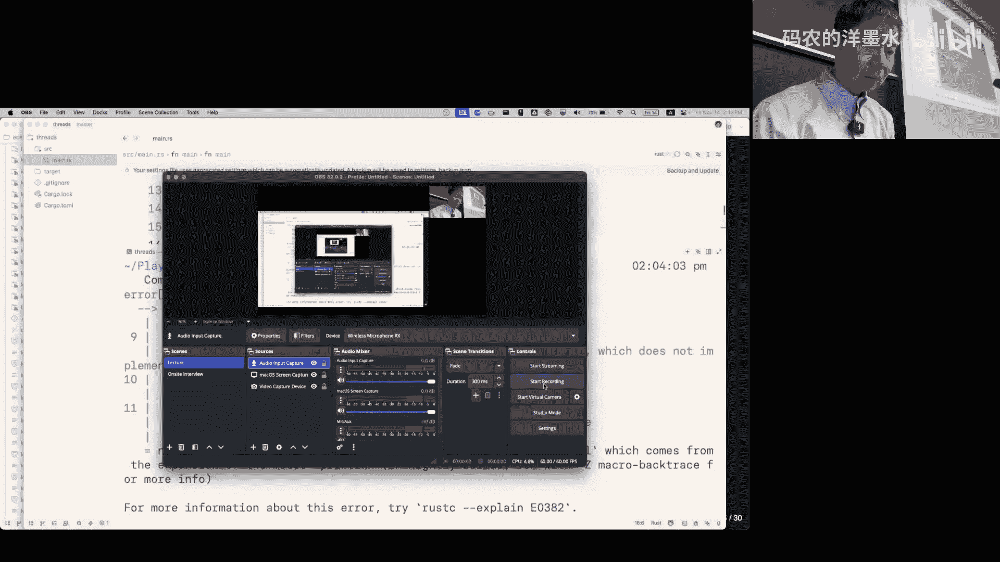

Allright， so。So it doesn't compile。 And now let's look at another example。 but this example。

 we spawn two threads。 So the first thread is going to send some messages high from the thread and we're gonna sleep one second between each send and for the next thread。

 we're gonna to send a few more messages and we're gonna sleep also one second in between the send。

 and。As you can see here。We are cloning the transmitter because it is a multipro。

 single consumer channel。 We are allowed to have multiple producers。

 Multi transmitters just need to clone。 We get that new transmitter。

 and we can pass that new transmitter。 The ownership of that new transmitter into this。

Closure that we spa。 And that would be， you know， a move。Right， so that's transfer ownership。

 which is exactly what we wanted。 We clone the transmitter。

 Trans the transfer the ownership into that particular closure that we spawn in the second thread。

And then for the main thread， we just wait for all of the for both both threads to send out their messages and print them out。

 So let's try to give it give it a try and see how it works。

 It's always fun to really play with these very nice little demos here。😊。

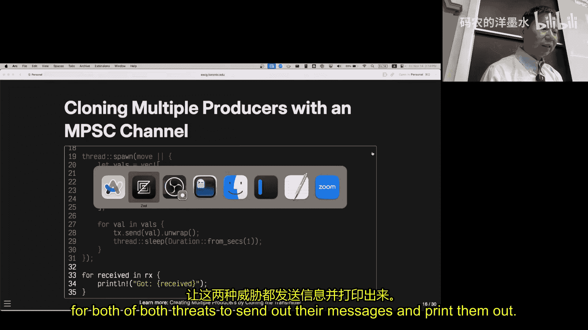

If I can find out， how do I make this a little bit bigger？Okay， so here we go。So， we have。

Let's try to，Do this。Alright， so we have the duration missing。

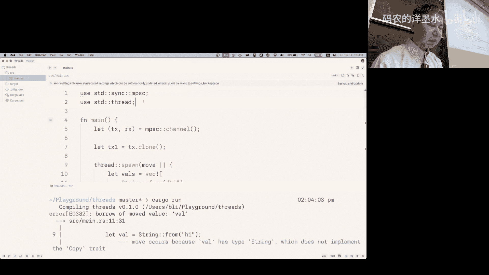

What was the duration， I forgot， How do I do the duration。

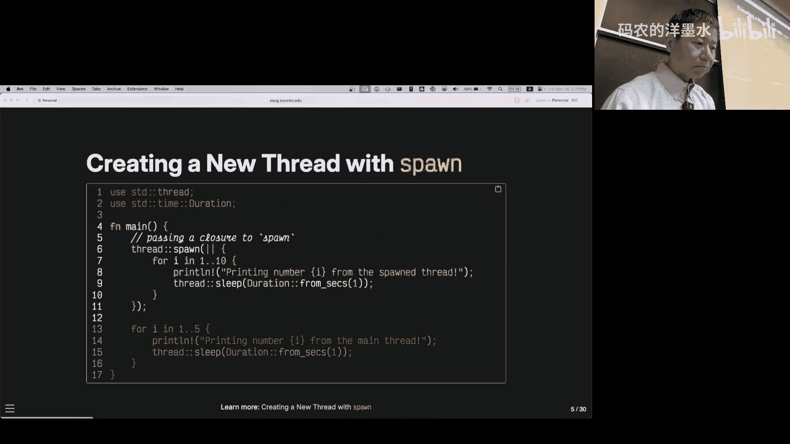

Right here， Standard time duration。Alright， so that would be the complete program。And。cargo人。

So we got these messages sent， and we got them printed out by the actual main thread。

 So that's really nice to have。 And that shows the kind of the typical way that we use these multi producer single consumer channels。

 And that's really nice that we wanted to do。😊。

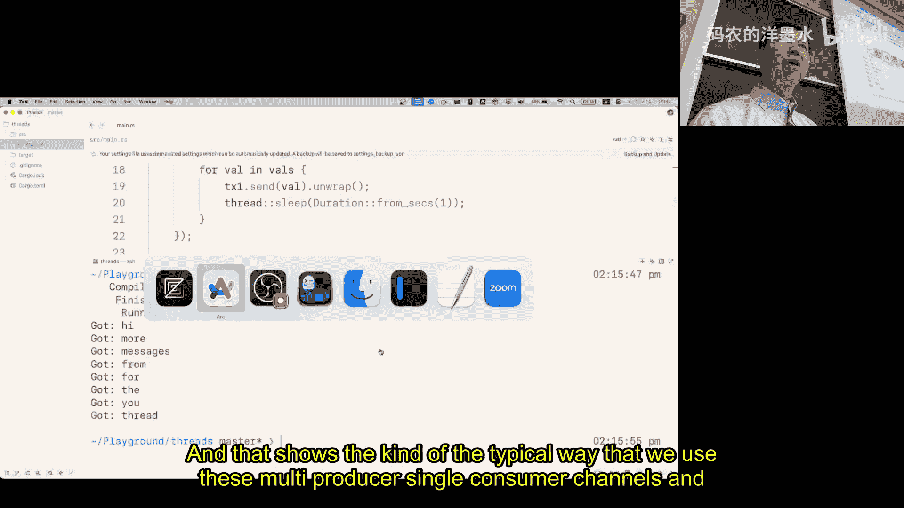

And again， just to emphasize。Do not communicate by sharing memory。

 Keep all of the states in each thread private， keep them local， Don't share them。

 Don't do anything about what operating system courses taught you， don't do anything about locks。

 No threat threat synchronization。 Well， you can do threat inchlination。 You use channels to do that。

 Don't do anything else。 And that's something that we talk about in terms of the actor model when we design our code。

😡，But as we mentioned。The rust designers do not limit you to do。Actor model to do message fast。

 What if I really wanted to share memory， mostly for performance reasons， you can still do that。

 as we mentioned before， when we talk about the smart pointers。

 we could do it by having something called mu text T。 And obviously T here is using generics。

 It's a generic type。 So a mu text around any type。 this is shared state concurrency。

 it's basically a mutual exclusion lock that is implemented again。

 by the standard sync library in the rust standard library。

 if you indeed have multiple threads sharing some state， in this case， we are sharing。😊，A an integer。

 So we say mu text new。 We create a mu text around this type T， which is the integer。

 And then we can actually try to access it。So how do we access it？Well， here's what we can do。

We can try to lock it。And then unwrap it。 So this mut text that we can have a lock method on the mut text。

 We can lock it。 What do we mean by locking the mut text。 Well。

 the semantics here is that we could actually wait for the lock to be available。

 So we as obviously assume that we have multiple threads trying to gain access to the same same shared state。

 They wanted to lock that mut text， and we wanted to do it as well so that the mut text might be locked by someone else。

 They will eventually release it， and I will get the lock after someone else released it。

And that is what I wait for。 So this M dot lock， this locking is。Blocking， right。

 iss not a non blocking tool。 It is a non blocking call。 It is a blocking call in the sense that。

 I'm gonna wait here until the lock is available。 I can get into that new text。

 So after I get the lock it run the write the lock， it is a result。

 So that result would be basically have to be unwrapped。 And once we unwrap it。

It will be a the actual inner， the inner data structure of that particular mutex in this case。

 it will be a simple integer， and that is what we assign to the number so that we don't even have to declare the type because it of type inference and sometimes the you know。

 the lock will give us an error。 for example， if whoever who is holding it panic。

 then we will get an error rather than a successful unwrapping of that lock。

 So typically it is successful。 We get the actual inner data structure that read the number。

 But it's interesting once we get the number。We can actually mutate。啲押做 data。

So we can actually change the value。 In this case， I can， you know， dereence it。In this case。

 that will be using the star de reference it。 and that will be something that we can actually do。

If we are using a mu text， in other words， the mut text is really some kind of a。Smart。

Pointer in the sense that it returns a smart pointer that we can actually try to Def。

 and more specifically， it's called a mut text card。

 And that is the name of the type that it returns and that by itself is a smart pointer that it returns because the smart pointer typically the definition is something that some type that we can Def and we can also drop remember last time we talked about the smart pointers。

 we can Def and we can drop so we can you know， implement the D ref and the drop traits。

 And that's something we can certainly assume for the multi mu text card in the sense that we can Dre the result of locking it because mut text card can be dered and the result of de referencing it。

Can be mutated， can be modified。 So that's really convenient because this is very similar to the ref cell that we talked about last time。

 but we didn't say too much about ref cell in the sense that ref cell。

 it is not something we could use in a multi threaded context。 So ref cell is not thread safe。

 So if we want some something threads safe， but also have the feature。

 the very nice feature that we call interior mutability， which we talked about last time。

 that is when we use mut text。 So last time we said if you need it to have multiple threads。

 You use mut text， this is where we do it。 So mut text card is。Implementing interior mutability。

 So inside the mut text， we can actually change it。 And that's typically what we wanted。 Otherwise。

 why do we need to lock it， We lock it because we want to change it。

 So that's interior mutability Iment it using mut text rather than ref cell。

 So that's why we didn't spend too much time talking about ref cell， because， you know。

 most likely our code is gonna be multi threaded or even multiple code routines later on。

 Most likely we don't use ref cell， because it's not gonna be just a single threaded code。

And most likely， we're gonna use new text in special cases， Okay， so。😊，Typically use actor model。

 remember not sharing states whatsoever， using communication channels， but in special cases。

 we could do it， and this is what we do。Alright， so now let's talk about sharing the mut text between threads。

 Just now we did not have a thread created。 but now let's do it。 For now。

 let's create a certain number of threads。 In this case， let's create 10 threads。

 each each thread will be created using a spawn and we do it in the for loop。 and for each iteration。

 we create a new thread。 And we kind of collect the handles。 The handles are the joint handles。

 We by these spawn calls。 and these handles will be pushed into a vector of handles。

And within these threads， we have a closure and that closure is going to be capturing the environment and that capture is a move capture。

 which means that we take ownership and what are we taking the ownership of counter So we take ownership of the counter and that counter is what we return from the mu text new。

 So it is a mu text that we can share across different threads。

 So that's really nice to have and then inside the spawn we will lock。😊。

Because we wanted to change the value。 And that's where we lock。 and we do unwrap。

 which is the same code as before。 And then we change the value by incremented by one。

 And then finally， after all of these are done because we need to call a joint to wait for all of these threads to be done。

 We are hoping that these threats are sharing the same integer。

 So we are hoping we get the right result。 No， you know， race condition。

 everything is nicely guarded by this mut text and we are hoping that we get a result that is printing the total。

 But， you know， in the main thread， we also need to lock it。 we cannot just basically directly。嗯。

We cannot directly use it。 But the mut text will have to be locked so that we can dereence it so we lock it。

 and then we de referenceence the result。 And that would be what we print。

 So let's take a look at this code。 Let's try to run it and see how it works。

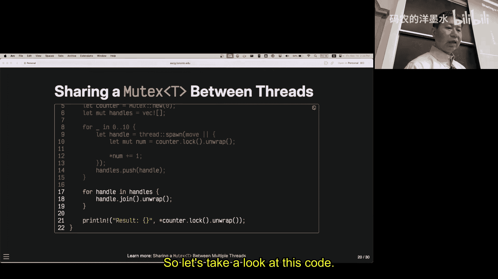

Alright， so this is the code that we have。 And what do we have。好right。Okay。

 so this is the code that we have。 So we already have the use。 So no need for use。

And we don't need this either。 So， okay， so this is the code that we have。So as you can see。

 we actually have a little bit of a。Issue here。So here what we are doing here is that we actually are talking about creating a mut text。

 and that mut textex is the counter。And we're saying move occurs because counter has type which does not implement the copy trait。

So this cow copy trait is not implemented。So this mu text that we wanted to use does not implement the copy trade。

 which is what we wanted because we wanted to move into it， move it into the thread itself。

So if Mu text does not implement the copy trade and we still wanted to， you know。

 share that new text across different threads， what do we do。Well， previously， we talked about。

 you know， having a reference counter。 remember the smart pointer where we actually try to use a reference counter。

 and that implements the copy tray because we basically have a reference count right there。

 So this does not compile successfully but we could actually try to use the reference counting to share the ownership by actually putting in this RC。

 This RC is the smart pointer that we mentioned last time that basically try to use a reference counting to actually implement the copy tray。

 So we just rack the mut text new with the RC new and then let's try to do that and see what happens right there So we have this RC here。

 Let's just try to do R new with the new text new and let's try to see that no， it does not work。

 So what's the new error message。 Let's take a look。

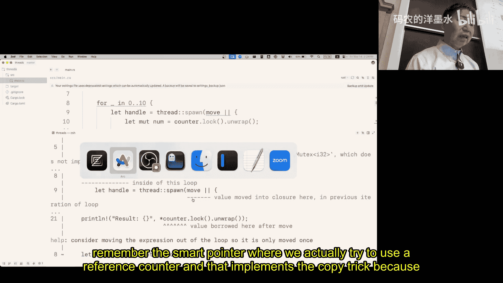

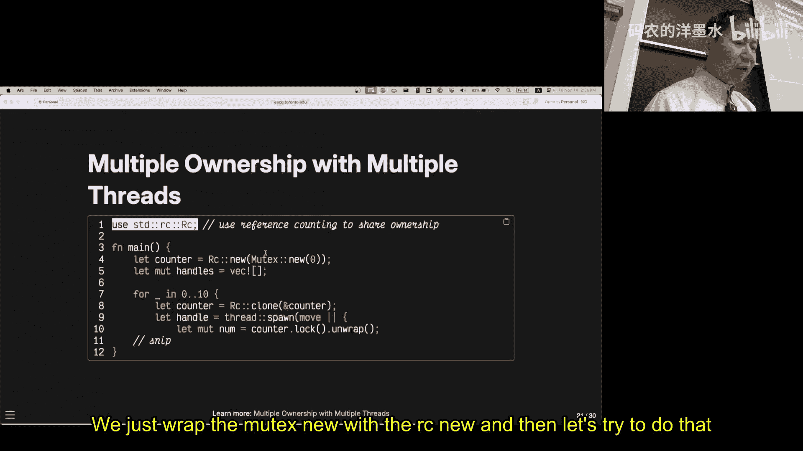

So this is the new message that we have。It is。Fairly long here。 So basically。No。

 it's actually not long right here。Right here， right， So it basically says。RRC。

Cannot be sent between threats safely。 So it's a new error message。 However。

 this is actually showing something that you really will have to understand before we go further。

You know， R C cannot be sent。 look at this， this language。

 this language from the era cannot be sent between threats safely。

What do we really mean by scent between threats safely。And well， let's read a little bit more。

 It basically doesn't really give me more except in saying the trait send。Is not implemented for RC。

That's what it actually tried to say to explain the English language and saying it cannot be sent between threats safely。

 So it actually knows that R C cannot be sent between threats safely by looking at whether or not it implements the trade send。

 If it does not implement the trade send。It is not safe to send it between threats。All right。苏。

We're going to talk a little bit more about this， about the send trade and what do we mean by sending safely across different threads。

 we're going to have more slides talking about it。 But for now。

 I just wanted to have a quick solution。 How do we actually try to revise it and try to make it work。

Any ideas， how do we revise it？And make it work。How do we get rid of the compile time error？

How do we send cross threats safely？So last time we talked about it briefly。

 we said rather than using R C ref cell， we use。Arc muex， right？

 So that's kind of the typical pattern。 We use ARC。And ARC， by the way， is not in R C。

I think it's in sync。 If I remember correctly， Yes， it is。And so， we use ARC。

And then we're gonna give it a try again。So， it says。

Consider cloning the value before moving it into the closure。 So basically。

 it says we're not cloning the value before moving in。 So the question is。

 how do we clone the value before moving in， How do we do that。

 So let's try to take a look at the correct code。

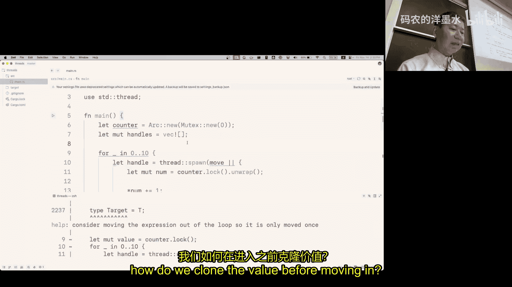

Right here。 So we need line number 9。 We need basically try to call something called Arc clone。

So by cloning， what we're doing here is that we're trying to clone the value of ARC。

 which is exactly the same when we're cloning the value of Rrc。Except that the ARC is threats safe。

 we can send the value of ARC across different threats。And so basically。

 we want to add this line of code and cloning it。

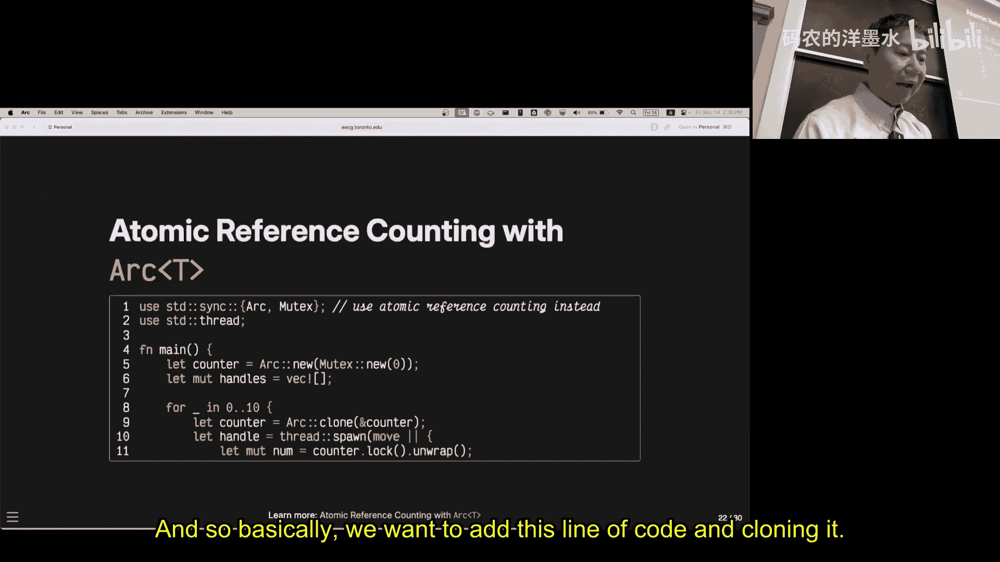

And into our code， and that's something we could certainly do。And that removes。

The actual compile time error。 and that is built successfully。 And then we get a successful result。

 which is 10。😊，Now。Here， what we're doing here is that when we're cloning arc。

 we're basically trying to cloning this counter， which is an arc。 We're trying to increase。

The reference counter。For this particular shared data structure。

 and the shared data structure is mu text。 So Mu text gives us save。Interth， interior mutability。

 Arc gave us the ability to send in between different threads。 So if you actually these days。

 if you use a large language model， they will typically say arc arc Arc arc mu text。

 arc mu text everywhere and you know， typically they， even if the same thread， it will， you know。

 exactly the same thread。 it will do an arc first。 And then it's gonna try to change clone it and then try to send it to a different thread and so on。

 typically you want to watch out for this。 When you have a lot of these arc mut text。

 arc mu text and blah， blah blah， rather than R C ref cell， obviously。

 because you have multiple threads， you have to think about this， Okay。

 you have to think about actor model because。You are asking for problems when youre starting to use lots of Arcm text。

 However， if assuming that the logic is completely correct in your Arcm text and everything like that。

 sometimes you have arcm text and even more option， you know， whatever inside hash map。

 everything inside， if you ask lot of， if all of those are completely bug free。

 the arcm text is slightly faster than this。 slightly faster， yep。Sorry， can I help your again Yes。

 sorry。唔识系你。Right。Oh， that's a great question。 I actually， I forgot to talk about it。 That's。

 that's my mistake。 So the question was， why don't we just unlock it。😊，You know， the counter。

 we lock it， but we never unlock it。 Why don't we just unlock it。 You know， the other languages。

 sometimes you have to unlock it， right， release the lock pretty much， right， in C， for example。But。

 you know， in C， we have to pretty much free the pointer and so on。 You know。

 whenever you mall and you have to free here， we don't have to do it， why。

Because the unlock is implemented by the mu text。In the actual drop。Right， because one it's。

 you remember every single smart pointer， like in this case， Mu text card is a is a， is a， is a drop。

 sorry， it's a smart pointer。 The mut text card because it's a smart。Pointer。

 it actually can implement not only D ref， but also the drop， right。

 So when it implements the drop inside that kind of custom tailored implementation for Meo text card。

 it will automatically unlock it。 So it will be unlocked。When it is going out of scope。

 which is exactly where you wanted it。Okay， so that's why you don't really have to。

 have the cognitive load to really remember to unlock it every time。 You don't。

 It will just unlock itself when it goes out of scope， which is exactly at the end of that closure。

 That is when it unlocks itself。Question。specifically applied that one。

Does Ro provide a traditional law。什么。Section。아。So the question is， can we lock a section of the code。

 We could do that by， you know， having。Basically an entrance lock， right？ So before you basically。

 it's a critical section， you know， before you gain get into that section。

 you have some kind of a flag that you lock， right， right there。

And that goes back to the conventional operating system courses where you basically have a mut text lock to guard a critical section。

 so you could do certainly do something like that。 Of course you if you wish you could actually have even more conveniences where you can basically have some kind of a third-part create log log doing these kind of a low level locking for you。

 all of that is possible。And however， I do wish that you don't use it。

 that's the basic idea of the actor model。

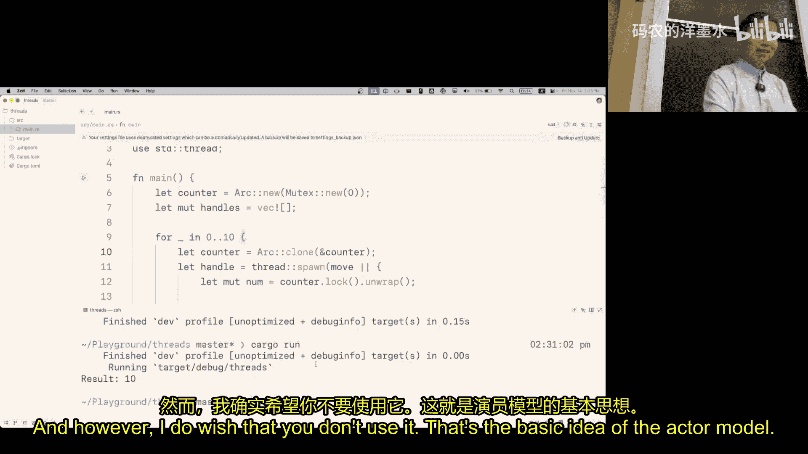

All right， so now let's。Talk about one more thing before we go get out of this multi threading。

We do have other atomic types。 By atomic here。 I mean， it's actually multiple thread safe。

 It is safe。Across multiple threads， we do have other atomic types in the rust standard library。

And these atomic types， they also provide atomic access。

 but they provide atomic access to primitive types。 In other words。

 your mu text lock in our simple idea over there， we don't really need to use a mu text out there。

 we can use one of these atomic types because it's just a simple integer。

So these atomic types are designed for these extremely small， simple primitive types。

 such as a simple integer。Now， for anything more than that， if you have like。

 you know like a data structure such as a type， like more than a primitive type。

 you if each one of the the actual fuels in that struck is， you know， like a primitive type。

 of course， you can use this as well。 Otherwise you're gonna have to use Mu text and it is safe to be shared between threads。

 obviously， that's why we call these atomic types。 they come from the rust standard library。

And we have quite a few of these， probably over a dozen covering different kind of you know。

 primitive types。 typicallyy， they're just integers， you know， unside integers， signed integers。

 Boolean values and so on。 and the memory model that we use for accessing these are typically using load and store。

 If you want to read out of these values， atomic values， we use a load。 If we want to write into it。

 we use a store。 So there's a nice API， very simple API to use these atomic types。And。

It is guaranteed to be lock free because locking， by the way， is more expensive than spinning。

 if you only do it very， very quickly， right if you do it。

 like if you have a larger critical section， spinning is actually not really efficient。

 But if just like one atomic type， spinning is actually much faster。

 So these atomic types are designed to really speed up the actual access。

 So theyre kind of lock free， and they can be used as building blocks for other concurrent types that consist of these primitive types。

So these are typically very useful if you have some kind of a global static variable。

 something like this。 If you have a global static variable。

 like a global threat count or whatever global count。

 which you wanted to share across multiple threads。😊，So if that's the case。

 you use these rust standard library nice types from the standard sink atomic。 And here。

 let me just use atomic U size because we're counting the number of threats。

 So it is a unsigned integer。And then we just create a new one called atomic size new。

 just like new text new。 Just create a new type。And then what we can do is that we can use something called fetchch ad。

 This is kind of like a combination of loading store。 We're kind of loading。

 and then we're storing as well。 We're loading， and then we're storing。😊，Whatever we load。

 we put it into the old thread count。 That's the current value。 And then we're storing one more。

 Were adding one to the old value。 That's the actual design of fetch ad。 So these atomic types。

 they have these kind of convenience methods that you can directly use。

 You don't have to directly use load in store。And the Sw add actually and a lot of other functions of methods。

 They actually have an ordering that you have to put in。 And that the ordering is all about。You know。

 the semantics of accessing it。 Do you actually assume that all of the previous stores are all reflected at the time when you load and so on so forth。

 or you don't have to care about that。 So the most relaxed variant of the ordering enum is the ordering relaxed。

 which means that we don't care as long as it is threatsa， We're good。

 So thats we don't care about the ordering。 as long as it threats save。

 It doesn't really matter how it's what the number is。 So that's something what we typically use。

 And then we have this print out that prints the old number。 And that old number plus one。

 hopefully it is the actual current count of the live number of threats。

 but it doesn't have to be because this number that you actually print out may not be。

The same as the current status， because in between line number 7 and line number 12。

 some other thread might have been spawned。 and new account will be it will be incremented。

 And that means that it may not be accurate。 But sometimes we're okay with that。

 And we can just print it out。 So this is very useful when you really need to maintain some global kind of like a global states that are simple integers You use these atomic types or simple bulloles that must be shared across different threads。

 So you don't really have to implement the ARC and Arc and mut text by yourself。

 And it's actually a little bit faster than Arc and mut text。

So now let's get back to this send business。Right， so previously。

 we have seen that compile time error， basically saying R C。The reference counting smart pointer。

Is not implementing the cent trade， So it cannot be sent across threat safely。

 What does that really mean。So first of all， the scent is a trait。

And it is a trade from the standard marker。 It's a standard library。 But it's in the marker part。

 What， So typically， we call it the marker trait。 And what is a marker trait。 Well。

 marker trait is a trait that has no。Functions， or methods in that trait， nothing。

So we don't really have to implement anything in that trade。It's just。Empty。

 the entire trade is empty。 You might say if it's in empty， why do I need to have that。 Well。

 just as the name suggested， we want to use these trades to mark a certain type。

 having a certain property。 In this case， we want to use this marker trade send to mark a certain type。

 having the send property。So that send property basically implements indicates that the ownership of values of this particular type。

That implements the same trade。Can be transferred between threats。

And that's basically what the compiler said that it is safe to send it to another thread and to kind of use the cent trade。

 the benefit that we get is that we can have this enforcement automatically implement it when the compiler thinks it is appropriate So we are able to say the compiler will put send trade on you know these types automatically and that's really nice to have and the compiler also will check if you have multiple threads and if whether or not you have a send trade and that's something that the compiler can enforce that compile time and that's the benefit of the cent trade so let's think about the types that implements the cent trade or by the compiler infers that it implements the cent trade again the cent trade as a marker trade saying that。

It is fine to transfer the ownership to another thread or to send the actual type。

 the value of that type to another thread so what are the types so almost every single type is sent。

Alright， almost all types can be sent。To the other， to the other thread。

 you basically talk about transfer ownership to another thread。 That's fine。 Not a big deal， right。

This R C is like one notable exception that we see the compiler complained about。

This R C is a reference counting smart pointer。 Why cannot it be said。To another threat。

It cannot be sent to another threat because if you transfer ownership to another threat。

Then basically both。Threats may update the reference count。At exactly the same time。

And that is not a good idea。 Remember， R C has an inner data structure。

 You're basically just doing reference counting of the inner data structure。 And if you send it over。

 then both of them can actually start to drop them and so on。

 they actually change the reference count。And that reference counting mechanism in R C E is not atomic。

 In other words， it is not threat safe， and that is why it cannot be sent。To another threat。

 And that's how the compiler catches the mistake at compile time。

When you actually have a type composed entirely of send types。

 So all of the fields of the type they are sent。 then， of course。

 the compiler knows that this type is also send， so it can be marked as sent automatically。

And most types are sent。 And for the RRC case， the， obviously， if we change it to ARC， the Arc。

 it will be sent。 And obviously， we still want to keep R C。 Why do we want to keep R C。

 even though it's not sent。It's faster。 It's faster because we don't have to do the atomic way of doing reference counting。

 It is faster。 Anything you want to make it threat safe， It has a runtime cost to it。Alright。

 so now let's think about one more than sent， which is the sink。 S is also a marker trait。

It's also a marker trait。So， in fact， do you know of any other marketer traits so far。

 except for sand and sink， Do you know of any other market trade。No， we have talked about it before。

 actually。There is one more trait that we talked about。 That is a marker trait。

 which means that it doesn't really have anything to implement empty， completely empty。

What is that trait。One more thing That is a marker trait。It is。huh。The copy trait。The copy trade is。

Or marketer rate。Alright， because we're basically saying， oh， this type is copy。

 Most all primitive types are copy。 same thing with send。 They all primitive types are send。

 You know， this is basically just a market trade。 We're just say saying that you could actually copy this。

 now， if it's a string， it does not implement a copy trade， right。

 A lot of things did not implement a copy trade。 So if it didn't implement the copy trade。

 Then we cannot copy， right， So it's actually on he。 So copy trade is also a market trade。

Something that is really nice to help the compiler to figure out what is going on with that particular type。

 What about the clone trade， Is this copy， sorry， is this。😊，Is this a marker trait？Is this marker？

This is not a marker trait because this actually requires that you implement clone。

 So that is the part of the trade。 So that's something that is not a marker。

 When it has one thing to， in fact， clone actually had even more。

 it has a clone from which is an has a default implementation， But regardless。

 it is not a marker trait。 But anything that is a copy， you know。It implies it is a clone， right。

 so this copy， even though it doesn't have anything inside a trade， it is a market trade by itself。

 but it is actually implying it is a clone。 Alright， so a copy is a market trade， but clone is not。

So sink is another market trait。 What does sink actually require。

 So sync is a little bit stronger than sand。 So sync indicates it is safe for the type implementing sink to be referenced from multiple threads。

 So if you actually look at the actual reference of that type， that can be。嗯。

Tn from multiple threats。So。If you actually think about it。Sink is very similar to scent。

And the connection is like this。 A type T is sync， if and only if。

The actual reference of that type is sent。 So if you actually transfer ownership of the reference to the other thread。

That is a sync type。 right， So that means that they can be referenced from multiple threads。Again。

 this is automatically implemented when the compiler thinks it's appropriate， you know。

 whenever there's a big type that each one of these methods， sorry。

 each one of thes are actually sync， then the entire thing is sync。

 So what are the types that are sync， almost every type in rust is sync。 and with the few exceptions。

 R C is obviously not sync because it's not even sent。Ref cell， by the way。

 it is not sync because its implementation of borrow checking。Is not threats safefe。

Which means that if you actually have a ref cell， the reference is not something that you can send to another thread。

 It's because you gonna have， if you send a reference to another thread。

 you're doing borrow checking on both sides and borrow checking and runtime。

 which is the implementation of ref cell， that implementation by itself， is not threat。 Sa。

 That's why this is not sync。And， of course， mu text， which what we're using， it is sync。

 That's something that you can actually directly use。

 And any type composed entirely of sync types is automatically marked by the compiler as sync。

So again， sink and similar to sand， these are marker traits。

 So that gives you an immense amount of power in the sense that you could actually say。

Here's my method。 I expect this type， but this type will have to be bound。

 It's a trade bound by send。Or by sync， or by send plus sync， you can actually bind multiple traits。

 send plus sync， which is very typical， right， So that gives the compiler a lot of power of knowing what exactly do you expect。

 What might be the contract of that particular type that you want it in terms of how threat save do you want that type to be。

And send plus sync is the contract that you wanted for the types that you share across multiple threads。

 You know， that's what Mu text is actually implementing。

So that is everything I want to talk about in terms of multi threading。

 but today I do want to get rid of get started talking about asynchronous rust。

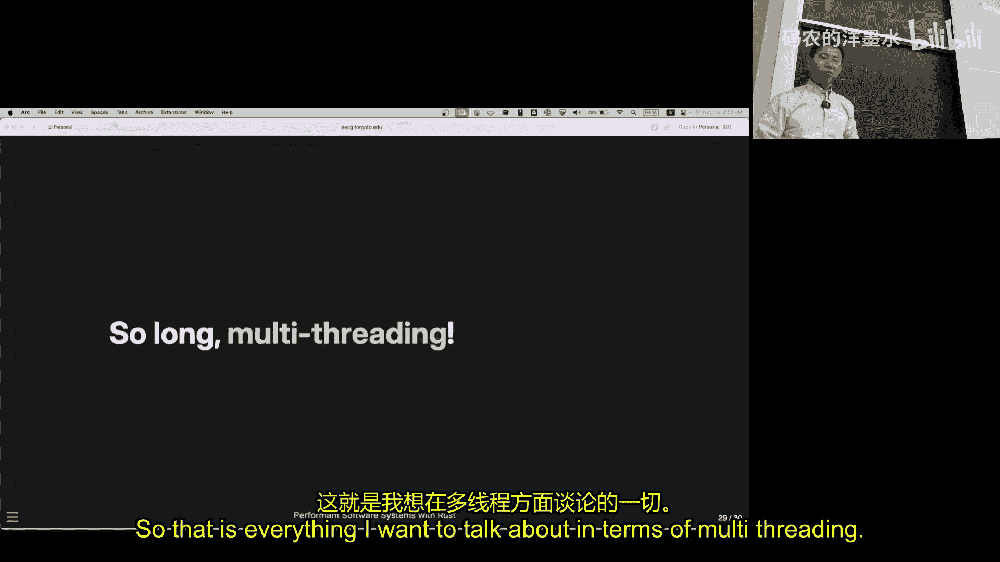

Because we don't have a whole lot of time next time when we do have a lot of things to talk about。

 So I wanted to talk about asynchronous rust。 And that would be the next lecture， lecture 13。

 And we want to get into asynchronous rust。

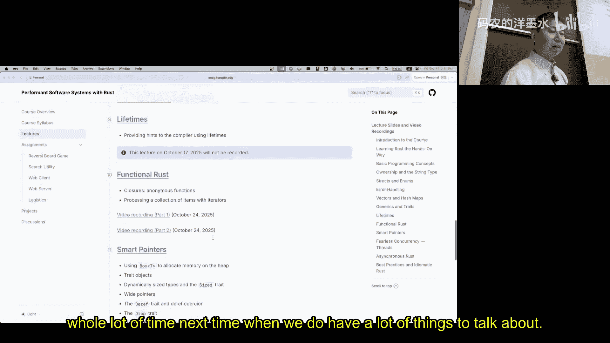

Today。Now， we want to talk about the benefits of asynchronous programming today。

 only at a high level， we're going to talk about details later on next time。

And what we're doing here is that we're migrating in a lot of cases， in fact。

 in most cases these days， we're kind of saying by so long to multi threaded programming。

 we're migrating to asynchronous programming in most cases。And in asynchronous programming。

The operations， they may not finish one by one in the other they were started。

They actually might finish using different sequences， not in the audit。 might finish out of order。

 And you can imagine this is very similar to what we previously mentioned the concurrent programming idea。

 So this is not strictly parallel and kind of concurrent but can also be parallel。 You know。

 something like that， we're gonna get back to this concurrency and parallel a little bit later。

 But before we do that， let's talk about in operating system design two ideas。

 CPU bound and I O bound operations， CPU bound basically says most of the time we spent running on the CPU。

Which is sort of like exporting a video for YouTube， for example。 A lot of the time is on the CPU。

 and IObound is sort of like downloading from the Internet。

 We're not using a whole lot of CPU or mostly just waiting for the network to arrive。

 the packages to arrive， that would be IObound。 And if you start to interleave the CPU bound and Iobound operations。

 Or if you have predominantly Iobound operations。 You wanted asynchronous programming。Because。

You wanted to do more things。In the same。Process or in the same threat。 Allright。

 so let's get started talking about this。So the first idea I want to talk about would be the system calls。

 a lot of the operating systems kernels， they actually expose all of the operating system kernels expose system calls for the user space programs。

 for the processes to use。 these are considered as the application programming interface。

 the API for the operating system kernel。 So whenever you want to use the services of the O kernel。

 you use these API。 and a lot of them， they're blocking in the sense that we actually have to wait until the system called to complete。

Before we proceed。And what if I want to do something else then？For example。

 if we're reading from a file or reading from a network socket， we don't want to just wait。

 Let the CPU idle right there。 You know， we want the CPU to do something else。

 conventionalal idea over there is to spawn a new thread。

 So you let the old thread waiting on that locking system call and you spawn a new thread。

And then you actually try to do something else， something else that could be also Iobound or CPUbound。

 And that would be the conventional way of doing this。 For example。

 if you're the old way of designing a web server， you know。

 the oldest web server will be something like an Apache web server。

 those are typically designed to use this spawning a new thread for every single blocking system call kind of idea。

 However， you're gonna have to watch out on this design because of the overhead of spawning new thread。

 there take some time to spawn a new thread and to take some time to keep a new thread up because if you have a lot of threads。

 you have way too many threads， you actually spend a lot of time switching across different threads rather than doing the actual work within the same thread。

 and it is not typically a very good idea to have too many threads is actually slow things down a lot。

 quite a lot。And that is why we don't want to have too many threats。 In fact。

 it'll be way better if you just go O to O to the extremes。

We just have one thread for every single CPU core。 So if you have 10 cores， like my laptop computer。

10 cores。10 threats， done，10 threats。Well， what about the blocking system call， Well。

 if we only have one thread， that CPU is gonna wait for that blocking。

 That's actually the motivation for have having a lot of threads。 Well， now we wanted to have。

 hopefully the support for non blocklocking system calls。 Hopefully。

 we want to have most of the calls will be non blocklocking。

So that we could ideally do something like this rather than spawning a new thread to， you know。

 so that the old thread can wait for the blocking system call and the new thread can do the useful work。

Itll be。 And then joining that waiting for that spa thread to finish。

 It'd be great to have like something like this is much more ergonomic， much more。😊。

Cognitively easier to actually try to understand what's going on。

 something like this and try to fetch data from URL dot await。And then we're going to print the data。

 Now you might say， okay， isn't that the same。 You know， we're kind of waiting。呵。

Waiting for that system called come in， You know， isn't that the same。Well。

 it's not exactly the same。Because here， what we're doing here is that we're kind of take advantage of the operating system's non blocking system call。

And we wanted to take over the CPU while that non blocking system call is actually waiting for data to arrive from the network。

And then。Our scheduler is going try to run something else within the same thread。

 We don't have to go to a different thread to do that。 In other words。

 whatever we're doing inside that thread。The operating system kernel doesn't know。

 The operating system kernel had no corresponding kernel task to correspond to my new work。

Every time I do a weight， I can actually do a extremely lightweight contact switch to some other work that I'm doing。

 So that is the motivation for having a synchronous programming。

 In the sense that we don't want to have too many threads， ideally， one thread for every CPU core。

 that one thread。 we switch every single call to a nonblocking call。

 And then we're gonna do a weight。 and that await is like a syntaxt from the programming language。

 You know， the compiler understand it so that the compiler can translate that weight to something that really cost the scheduler and schedule something else useful to run。

😊，That is the idea。Right， so again， that motivating。

Multi threaded programming to asynchronous programming or converting all of the threads。

 ideas to stackless proteins。So we're migrating to stackless codes。

 which is the latest like a version 2。0 of co routines。Previous。

 the old version is the goal programming language。 They use the stack based code routines。

 They are actually a little bit slower。 They require the user space stack。 But here。

 the stackless code routine does not require stack at all。 It's actually a little bit faster。

 So the rust implementation of stackless code routines is the fastest ever implementation of code routines。

 There is only one other language that implements stackless code routines。😊，And that is C plus plus。

 Okay， so C plus plus implements that as well。So if you want the absolute fastest way of doing concurrent programming。

 you either use rust or use C+ rust， nothing else。So concurrency happens entirely within the code itself。

 There's no kernel awareness。 Colnal task is not spawned just for that particular new thread。

 nothing like that。 We do have inside the actual user code within that thread or within that entire code that we wrote。

An asynchronous run time。An asynchronous runtime is just another crate。

 And that is like a smart design from dress programming language。

 It's not designed to be part of the programming language。

 So it's not designed to be something that the compiler is gonna be aware of。And however。

 it does coordinate with what compiler can do to really try to implement the entire thing。

 So a sequence runtime， which we will talk about next time， is just another qua。 Alright。

 so that's everything I talk about。 I have time to talk about today。 next time to be continued。

 We're gonna continue to talk about stackless proteins。 and additional details there。😊。

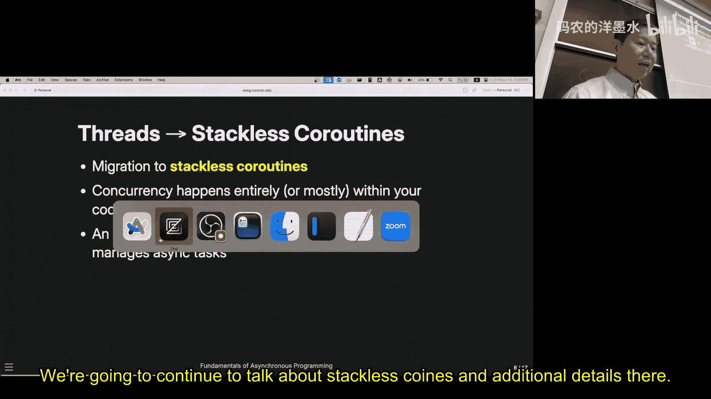